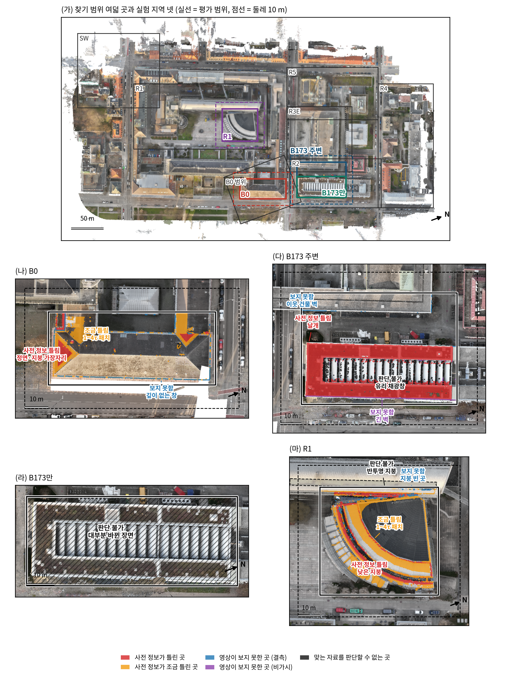
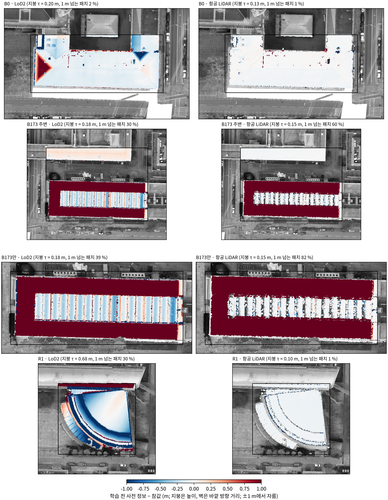
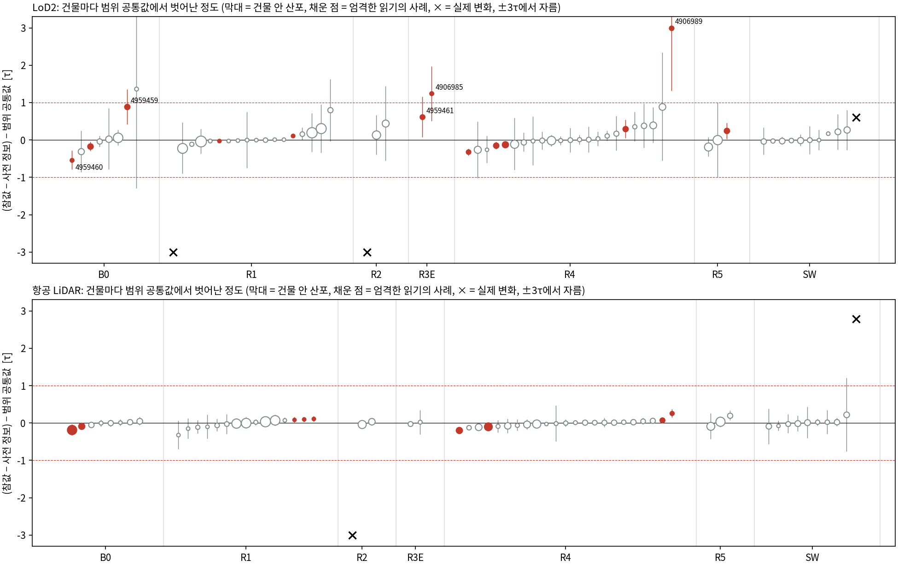
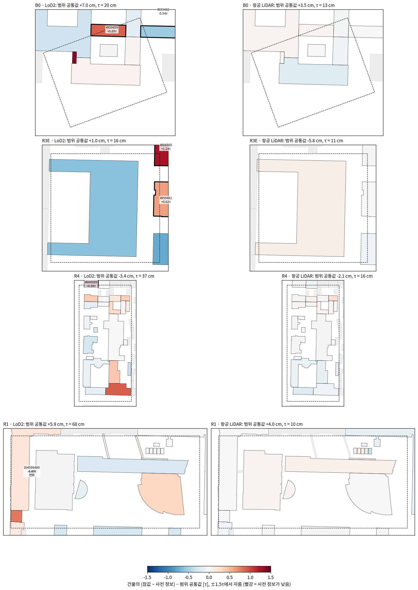
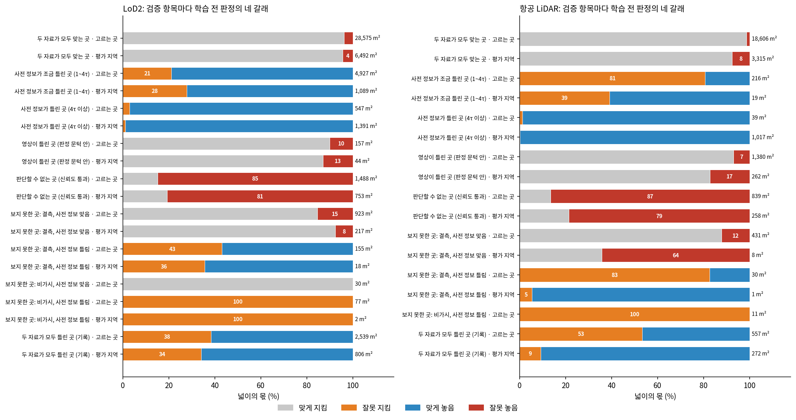
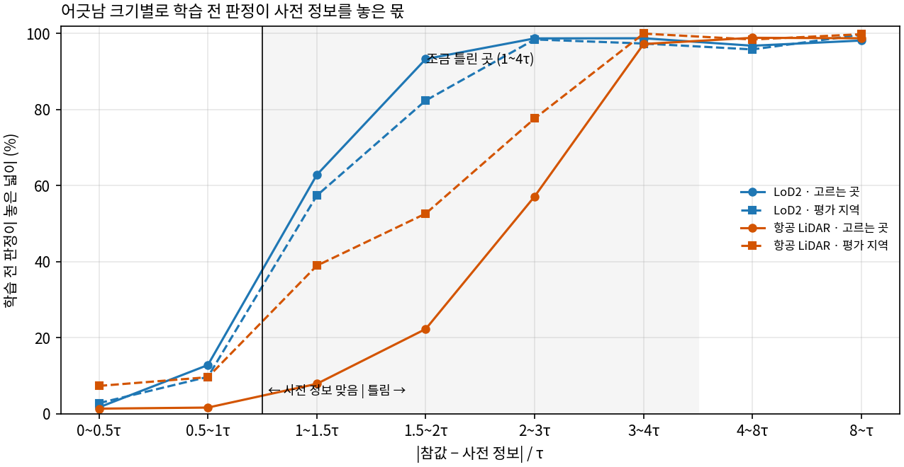
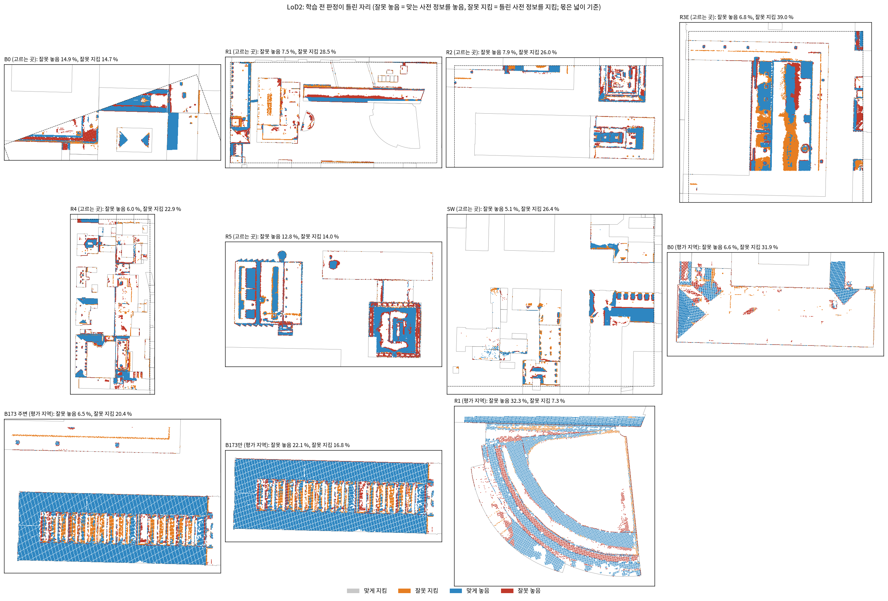
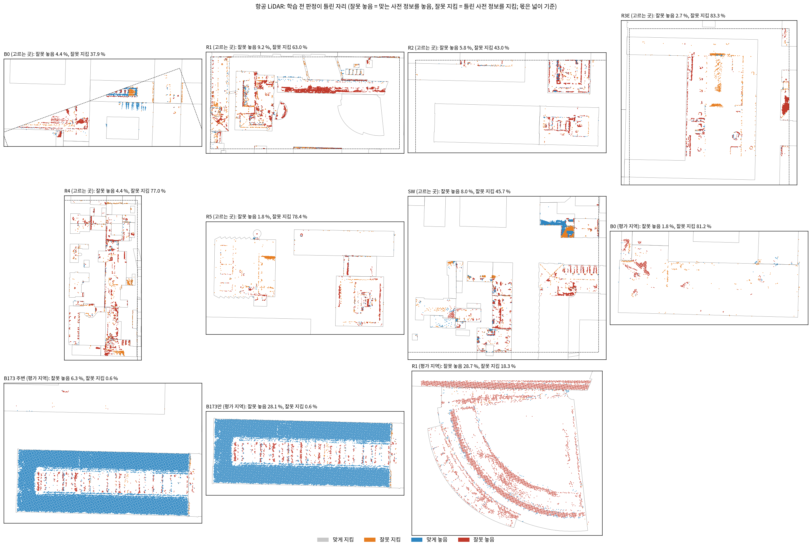
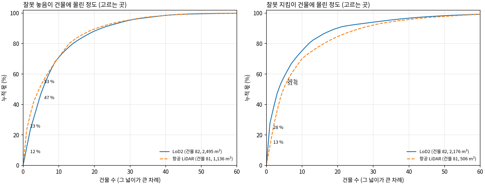

<!-- PHD-CH6-SUPPORT-v1 -->
# 6장 보조 작업 — 보고서 v1

- 작업: `PHD-CH6-SUPPORT-v1` (문서 세션의 '6장 보조 작업 요청 v1', 2026-10-15). 실행 2026-10-15 17:30~18:49. `scientific_verdict: null`.
- 판독, 등급, 추천은 분석자(에이전트)의 것이며 사람 검수 전이다.
- 지킨 것: 학습하지 않았다. 본 방법을 고치지 않았다. 3단계와 비교 방법 추가 발주를 바꾸지 않았다(그 대기열이 도는 동안 CPU 컨테이너 둘 이하로 함께 돌렸다). GPU는 쓰지 않았다.
- 정의는 결과 전에 설정 `configs/phd/ch6_support_v1/ch6_support_v1.json`(17:45 저장, sha 2a5f7fca67d8)에 적었다. 결과를 본 뒤 바꾼 것은 8절에 모았다.
- 산출 위치: 페이로드 `../JointBuildGS-artifacts/phase-payloads/phd/ch6_support_v1/PHD-CH6-SUPPORT-v1/`, 스크립트 `scripts/phd/ch6_support_v1/`, 이 문서 옆의 그림 `figures/`와 표 `tables/`.
- 함께 낸 문서: [일곱 검증 항목으로 다시 정리한 검토 기록](실험검토기록_일곱항목_v1.md), [6.3에 쓸 사실](6장_3절_사실_v1.md), [문서 세션에 넘길 것](문서세션_전달_v1.md).

## 0. 전체 과정에서의 위치

| 큰 단계 | 상태 |
|---|---|
| 1단계, 2단계, 고침과 다시 돌리기 | 끝남 |
| 3단계와 1단계 보강 | 끝남 (10-15 10:30 최종 보고) |
| 비교 방법 추가 | 학습 대기열 끝남 (이 작업이 도는 동안 마지막 일감이 함께 돌았다) |
| **6장 보조 작업 일 1~5** | **이 보고. 학습 없음** |
| 넓히기 | 뒤 |

## 1. 답 먼저

| 일 | 답 | 등급 |
|---|---|---|
| 1 결과 정리 기준 | 단계별 답을 일곱 검증 항목으로 다시 묶었다. 원본 기록 파일은 실험 서버에 없어 새 문서로 냈다. 요청의 대응표 가운데 '관문 조건 2 = 영상이 틀린 곳'은 6.2의 정의와 영역이 다르다(7절 1) | — |
| 2 6.3의 사실 | 여섯 물음에 모두 답했다. 표정은 자료집의 Pix4D 표정을 그대로 받았고, 인용은 TUM2TWIN 논문(ISPRS J. 232, 2026)과 UAS 자료집(Zenodo)이다. LoD2 지붕을 만든 시기만 파일에 없다. 앞 기록에서 바로잡거나 새로 확인한 것이 여섯이다 | 확인 (지붕 시기는 아직 모름) |
| 3 그림 6.1 | 캠퍼스 그림과 지역 넷의 그림, 표시한 자리 12곳의 목록, 그림 6.2 후보를 냈다. 앞 보고서의 u·v 지도는 실제와 좌우가 뒤집혀 있다 | — |
| 4 영역마다 다르게 어긋난 곳 | LoD2에는 사례가 있다(지붕 전체가 고르게 낮게 놓인 건물 두 동, τ 부근). 항공 LiDAR에는 없다(건물마다 0.26τ 안). 사례 건물에서 판정은 맞는 모양의 사전 정보를 크게 놓았다 | 확인 (원인은 아직 모름) |
| 5 학습 전 판정의 넓은 범위 검증 | 사전 정보가 맞는 곳은 대부분 지키고(잘못 놓음 1~8 %), 4τ 넘게 틀린 곳은 거의 다 놓는다(97~100 %). 잘못 놓음의 절반 이상은 신뢰도를 통과한 영상 오류에서 나온다. 신뢰도가 거른 잘못된 관측에서는 대부분 지킨다(79~87 %). 장면 대부분이 바뀐 B173만을 그 장면의 값으로만 판정하면 거의 모두 지켜 판정이 무너진다 | 확인 |

- 판정은 사전 정보의 어긋남이 τ를 넘는 곳부터 놓기 시작한다. LoD2는 0.5~1τ에서 10~13 %, 1~1.5τ에서 57~63 %, 1.5~2τ에서 82~93 %를 놓는다. 항공 LiDAR는 규칙대로 2τ를 지나서 놓는다(6절 그림).
- 판정이 틀린 곳은 몇 건물에 몰리지 않고, 반투명 지붕과 유리, R1 부채꼴의 가파른 호, 건물 단위로 어긋난 LoD2 같은 자리의 꼴에 모인다.
- 정의는 결과 전에 설정에 적었고 바꾸지 않았다. 일 4의 엄격한 읽기와 일 5의 어긋남 크기별 표는 결과를 본 뒤 더한 것이다(8절).

## 2. 일 1: 일곱 검증 항목으로 다시 정리

전체는 [실험 검토 기록, 일곱 검증 항목 판](실험검토기록_일곱항목_v1.md)에 있다.

- **한 일.** 저장소의 단계별 보고서(1단계와 그 진단·결론별 그림, 2단계, 고침, 3단계, 비교 방법 중간 보고)의 답을 요청 1절의 이름과 차례로 다시 묶었다. 항목마다 기준, 확인할 것, 판단 지표(앞 보고서의 이름), 값과 등급, 이번 작업의 학습 전 판정 확인, 남은 물음을 둔다. 끝에 옛 번호와 옛 이름의 대응, 영역 코드와 항목의 대응을 표로 두었다.
- **원본과의 관계.** `claude/실험_검토_기록.md`와 결과 정리 문서는 이 실험 서버(SSH)에 없다. 그래서 원본을 고치지 않고 새 문서로 냈다. 원본으로 옮길 때 원본의 판독 문장과 합쳐야 한다.
- **요청의 대응표와 실험 자료가 어긋나는 곳 하나 (7절 확인 요청 1).** 요청은 관문 조건 2를 '영상이 틀린 곳'의 지표로 정했다. 그런데 관문 조건 2의 영역(영역 코드 3 가운데 판정 문턱 안)은 '관측 신뢰도를 통과한 잘못된 관측'이다. 6.2의 정의('관측 신뢰도가 그 관측을 제외함')와 다르다. 이 문서는 요청의 대응을 따랐고, 6.2의 정의대로의 영역은 일 5의 보충으로 처음 찾았다.

| 검증 항목 | 지금의 답 (요약) | 등급 |
|---|---|---|
| 사전 정보가 틀린 곳 | 과거의 형상이 남지 않는다. LoD2 유입률이 GeoGS의 1/4~1/5이고, 실제로 바뀐 곳은 세 비교 방법보다 덜 남는다. LoD2가 단순하게 그린 곳에서는 영상만과 비슷하다 | 확인 |
| 영상이 틀린 곳 | 관문 조건 2의 표본이 모두 1만 점 아래다. 비교 방법보다 틀린 영상을 더 들인다 | 아직 모름 (관문) |
| 맞는 자료를 판단할 수 없는 곳 | 오류가 둘레 2 m 밖으로 번지지 않는다. 영역 안에서는 영상을 따른다. 영역마다 다른 어긋남은 LoD2에 사례가 있다 | 확인 |
| 두 자료가 모두 맞는 곳 | R1 LoD2에서 세부가 사전 정보보다 정확해진다. 나머지는 판별 불가 | 확인 (R1) |
| 영상이 보지 못한 곳 | 못 본 벽을 LoD2로 채운다. 결측은 영상만보다 조금 더 채운다. 항공 LiDAR는 결측을 채우지 못한다 | 확인 / 가능·근거 불완전 |
| 사전 정보가 조금 틀린 곳 | 1~4τ의 LoD2를 고친다. 판정을 끄면 이 범위에서 과거 형상이 늘어난다 | 확인 (R1) |
| 영상이 적을 때 | 맡긴 곳을 사전 정보로 받친다. 저자 3장에서는 영상만보다 덜 무너지지만 과거 형상을 막는 힘은 약해진다 | 확인 / 가능·근거 불완전 |

## 3. 일 2: 6.3에 쓸 사실

전체 표와 출처는 [6.3에 쓸 사실](6장_3절_사실_v1.md)에 있다. 요청 2절의 여섯 물음에 대한 답이다.

| 물음 | 답 | 등급 |
|---|---|---|
| 데이터셋 이름과 인용 | 영상·표정·드론 LiDAR는 TUM2TWIN의 UAS 자료집(Anders 외, Zenodo doi:10.5281/zenodo.14548134, 표정은 판 1.1.0 doi:10.5281/zenodo.14899378)이고, 인용할 논문은 Wysocki 외(2026) ISPRS J. 232, 810–830, doi:10.1016/j.isprsjprs.2025.12.013이다. 항공 LiDAR와 LoD2는 바이에른 측량청 공개 자료(CC BY 4.0)다. B0 참값과 저자 15장은 GeoGS(Zhang, Wysocki, Jutzi 2026, ISPRS J. 240, 184–201)의 공개 예제다 | 확인 |
| LoD2 기관과 제작 시기 | 바이에른 측량청. 파일의 모델 생성일은 2015~2025년(찾기 범위 78동 중 2025-04-04 34동, 2023-06-29 25동 등), 지적 대조일은 모두 2025-02-17이다. 지붕을 만든 시기는 파일에 없다(B173은 2025년 생성인데 옛 박공 지붕) | 확인 / 지붕 시기는 아직 모름 |
| 표정을 얻은 방법 | 자료집의 Pix4D 표정(OPF)을 그대로 받았다. COLMAP은 표정을 고정한 채 점만 삼각측량했다. 937/962장 | 확인 |
| 영상 크기와 지상 표본 거리 | 원본 5280×3956(Zenmuse L2), 학습 1024×741. 75 m 연직 영상의 지상 표본 거리는 원본 2.06 cm, 학습 해상도 11.3 cm. 공통 937장 중 연직 392·경사 545 | 확인 |
| 참값 정리 규칙의 요점 | 세 줄 요약(문서 5절): 일시 반사 지우기, 맨땅 화소로 높이 맞추기, 나무·일시 반사 칸 빼기와 벽은 단일 반사 수직면 점만 | 확인 |
| 드론 LiDAR 정확도와 밀도 | 기기 사양 수평 5 cm·수직 4 cm(150 m). 평가 범위 밀도 1,028~1,408점/m², 찾기 범위 533~2,550점/m² | 확인 |

**앞 기록에서 바로잡을 것** (출처 표기와 숫자에 영향)

1. LoD2 파일은 CityGML 1.0이다(자료 목록 문서는 2.0).
2. 1단계 설정 표의 '성긴 점 413만'은 Pix4D 연결점 수다. 실험이 쓰는 COLMAP 성긴 점은 371,808점이다.
3. B0 참값 밀도 '3,471 대 1,219점/m²'는 서로 다른 넓이로 나눈 값이다. 같은 건물 평면 안에서는 3,070 대 1,003이다.
4. 설정의 항공 LiDAR 높이 정확도 0.12 m는 TUM2TWIN 본문의 값이고, 기관 값은 약 0.10 m다.
5. TUM2TWIN 논문은 영상을 75 m 연직 비행으로만 적었지만, 공개 영상 962장 가운데 621장은 낮은 높이의 수동 경사 비행이다.
6. 영상과 드론 LiDAR는 같은 비행에서 기록했다(실제 변화 조사 보고서 6절 4번의 열린 물음이 풀림).

## 4. 일 3: 그림 6.1 실험 지역

**그림 설명 (본문용 초안).** 그림 6.1 실험 지역. (가) 캠퍼스의 드론 LiDAR 색 영상 위에 찾기 범위 여덟 곳(R1~R5, R3을 동쪽으로 10 m 넓힌 R3E, B0 범위, SW)과 실험 지역 넷의 평가 범위(실선), 둘레 10 m(점선)를 그렸다. B173만은 B173 주변 안에 있고 둘레가 없다. (나)~(마) 지역마다 드론 LiDAR의 맨 위 점 색으로 만든 0.1 m 정사영상 위에 평가 범위와 검증 항목의 자리를 칠했다. 두 자료가 모두 맞는 곳과 영상이 틀린 곳은 지역 전체에 흩어져 있어 따로 칠하지 않았다. B0에서는 학습 영상을 243장에서 2장까지 줄인 조건으로 '영상이 적을 때'도 본다. 지도는 실험 좌표의 축에 맞추어 돌렸고, 화살표가 북쪽이다.

- 칠한 자리의 규칙 (자리마다 앞선 정의를 그대로 썼다)
  - 사전 정보가 틀린 곳: 영역 코드 11 가운데 어긋남이 4τ 이상. B173은 사전 정보가 지금 지붕보다 위(바깥), R1은 LoD2가 참값보다 아래(안쪽)인 패치만.
  - 사전 정보가 조금 틀린 곳: 코드 11 가운데 1~4τ, 두 사전 정보의 합.
  - 영상이 보지 못한 곳: 관측 상태가 결측이거나 비가시인 패치(참값과 무관). B0는 LoD2 벽(깊이 없는 창), B173 주변은 LoD2 벽(비가시 긴 벽, 결측 이웃 벽), R1은 지붕.
  - 맞는 자료를 판단할 수 없는 곳: 전제 위배 패치 가운데 앞선 자리 정의(B173 톱니 면 17개, R1 반투명 지붕 면 하나)에 드는 것. R1 반투명 지붕은 평가 범위 안에 4.9 m²만 들어, 면 전체를 점선으로 함께 그렸다. B173만은 평가 범위 전체.
  - R1 평지붕을 영상이 20~30 cm 낮게 고르게 측정한 곳은 칠하지 않았다(10월 15일 문서 세션 결정).
- 표시한 자리 목록(지역, 항목, 넓이, 좌표 범위)은 [tables/fig6_1_sites.csv](tables/fig6_1_sites.csv)다. 좌표 범위는 그 항목으로 칠한 패치 전체의 범위이고, u·v(실험 좌표)와 EPSG:25832를 함께 적었다.

| 지역 | 검증 항목 | 자리 | 사전 정보 | 넓이 (m²) |
|---|---|---|---|---|
| B0 | 사전 정보가 틀린 곳 | 정면·지붕 가장자리 | LoD2 | 74 |
| B0 | 사전 정보가 조금 틀린 곳 | 1~4τ 패치 | 둘 다 | 330 |
| B0 | 영상이 보지 못한 곳 (결측) | 깊이 없는 창 | LoD2 | 198 |
| B173 주변 | 사전 정보가 틀린 곳 | 날개 | 둘 다 | 2,025 |
| B173 주변 | 영상이 보지 못한 곳 (비가시) | 긴 벽 | LoD2 | 1,219 |
| B173 주변 | 영상이 보지 못한 곳 (결측) | 이웃 건물 벽 | LoD2 | 67 |
| B173 주변 | 맞는 자료를 판단할 수 없는 곳 | 유리 채광창 | 둘 다 | 129 |
| B173만 | 맞는 자료를 판단할 수 없는 곳 | 대부분 바뀐 장면 | 둘 다 | 2,419 (평가 범위) |
| R1 | 사전 정보가 틀린 곳 | 낮은 지붕 | LoD2 | 161 |
| R1 | 사전 정보가 조금 틀린 곳 | 1~4τ 패치 | 둘 다 | 441 |
| R1 | 영상이 보지 못한 곳 (결측) | 지붕 빈 곳 | 둘 다 | 19 |
| R1 | 맞는 자료를 판단할 수 없는 곳 | 반투명 지붕 | 항공 LiDAR | 5 |

**선택 판 (그림 6.2 후보).** 지역마다 학습 전 사전 정보 − 참값의 높이 차이 지도를 따로 그렸다. 칸이 여덟이라 6.1에 덧붙이지 않았다.

- 읽는 법: 빨강은 사전 정보가 참값보다 위(바깥), 파랑은 아래(안쪽)다. ±1 m에서 잘랐다. B173 날개는 두 사전 정보 모두 4 m 넘게 위에 있고, R1 LoD2는 호 모양의 띠가 참값보다 낮다. B0 LoD2는 모임지붕 끝의 삼각형이 위에 있다. 항공 LiDAR는 B173을 빼면 거의 흰색이다.

**지도 방향에 대한 확인 요청.** 실험 좌표(u, v)는 거울상인 틀이다(u = 동쪽에서 반시계 70°, v는 그 오른쪽). 앞 보고서들의 지도처럼 v를 위로 그리면 실제 지도와 좌우가 뒤집힌다. 이 그림은 v를 아래로 그려 실제 방향과 같게 했다. 논문에 앞 보고서의 지도를 옮길 때는 같은 처리가 필요하다.

## 5. 일 4: 영역마다 다르게 어긋난 곳의 사례 찾기

**답. LoD2에는 사례가 있고, 항공 LiDAR에는 없다.**

- **LoD2 (확인).** 범위의 다른 건물과 달리 지붕 전체가 고르게 낮게 놓인 건물이 τ 부근에서 두 동 보였다.
  - R3E와 R5에 걸친 4906985는 범위 공통값보다 0.20 m(1.24τ) 낮다.
  - B0 범위의 4959459는 0.18 m(0.89τ) 낮고, 범위 공통값을 더한 절대 어긋남은 0.25 m(1.24τ)다.
  - 두 건물 모두 건물 안 산포(0.12 m, 0.09 m)가 어긋남보다 작다. 같은 건물의 항공 LiDAR는 범위 공통값과 4 mm 안에서 맞는다. 그래서 2022년 뒤의 실제 변화가 아니라, LoD2가 건물마다 다르게 놓인 것이다.
  - 그것이 정합의 문제인지 LoD2 지붕 높이를 만드는 방식의 문제인지는 나누지 못한다(아직 모름). 두 건물 모두 지붕 높이의 출처는 레이저 스캐닝, 모델 생성일은 2025-04-04다.
- **판정에 준 영향.** 어긋남 때문에 학습 전 판정이 맞는 모양의 사전 정보를 크게 놓았다.
  - 4959459: 그 건물의 사전 정보 385 m² 가운데 258 m²(67 %)를 놓았다. 그 가운데 221 m²는 건물의 어긋남만 빼면 τ 안에 드는 곳이다.
  - 4906985(R5 쪽): 1,158 m² 가운데 640 m²(55 %)를 놓았고, 450 m²가 그런 곳이다.
  - 같은 범위에서 사전 정보가 맞는 곳을 놓는 몫(B0 LoD2 14.9 %, R5 LoD2 9.6 %, 7.1절 T4)보다 훨씬 크다.
- **항공 LiDAR (확인).** 건물마다 범위 공통값에서 벗어난 정도가 4 cm(0.26τ) 이하다. 다만 범위 공통값 자체는 범위마다 다르다(−5.8 ~ +4.0 cm, 아래 표). 실험은 범위마다 따로 정합하므로 실험 지역 안에서는 문제가 되지 않는다.
- 사례 건물은 모두 평가 지역 밖이라 학습 결과는 없다.
- **권함 (분석자).** 6.2의 이 경우는 '학습 없는 확인'으로 남길 수 있다. LoD2 실제 자료에서 두 동이 보였고, 판정에 주는 영향을 학습 없이 셀 수 있다.

*읽는 법:* 점 하나가 건물 하나다. 세로축은 건물의 (참값 − 사전 정보) 중앙값에서 범위 공통값을 뺀 값을 τ로 나눈 것이고, 막대는 건물 안 산포다. 채운 점은 아래의 엄격한 읽기로 사례인 건물, ×는 실제 변화다. LoD2에서만 ±1τ 선 부근이나 밖에 채운 점이 있다. 항공 LiDAR는 실제 변화를 빼면 모두 0 가까이에 있다.

**방법 (요청 4절대로, 결과 전에 설정에 적음).**

- 범위마다 v6 첫째 단계(그 범위의 정합을 적용한 뒤)의 지붕 지지 패치에서 'MVS − 사전 정보'의 패치 중앙값을 건물(발자국)마다 모았다. 지붕이 10 m² 이상인 건물만 보았다.
- 건물마다 넓이 가중 중앙값 m과 NMAD s를 내고, |m| > s인 건물을 후보로 보았다. 4.3.2의 수직 편향 규칙과 같은 기준이다.
- 화소 잔차는 패치마다 저장되어 있지 않아 패치 중앙값을 썼다. 패치 중앙값의 NMAD는 화소의 NMAD보다 작으므로, 이 규칙은 후보를 넓게 잡는다.
- 후보마다 '참값 − 사전 정보'의 중앙값 g와 산포 sg로 확인했다. 실제 변화 조사의 변화 목록과 |g| > 2 m는 실제 변화로 뺐다.

**미리 정한 분류의 결과와 그 한계**

| 사전 정보 | 본 건물 | 후보 | 실제 변화 | 사례 | 영상 쪽 | 참값 없음 | 후보 가운데 m의 크기가 τ 이상 |
|---|---|---|---|---|---|---|---|
| LoD2 | 80 | 30 | 3 | 21 | 5 | 1 | 8 |
| 항공 LiDAR | 77 | 37 | 3 | 18 | 15 | 1 | 5 |

- 이 분류는 너무 넓었다. 미리 정한 '사례'의 조건(참값의 어긋남이 같은 부호이고 그 중앙값이 산포보다 큼)이 두 경우를 걸러내지 못했다.
  - **범위 공통 치우침.** R1 항공 LiDAR는 모든 건물에서 참값이 약 4 cm 위다. 범위 정합은 이 값이 화소 NMAD보다 작아 옮기지 않았다. 그래서 건물마다 따로 보면 모두 후보가 된다. 영역마다 다른 어긋남이 아니라 고른 어긋남이다.
  - **영상 쪽 오류.** R1 42364663은 MVS가 사전 정보보다 1.13 m 위인데 참값은 5 cm 위다. 참값의 작은 같은 부호 차이 때문에 '사례'로 들어갔다.

**엄격한 읽기 (결과를 본 뒤 더함, 미리 정한 분류와 나란히 둠)**

- 범위 공통값 G는 그 범위 건물들의 g 중앙값이다. d = g − G가 다음을 모두 채우면 사례로 본다.
  1. 건물 안 산포보다 크다(|d| > sg).
  2. MVS 쪽에서도 범위 중앙값에서 같은 방향으로 벗어난다.
  3. 변화가 아니다: 변화 목록 밖, |g| ≤ 2 m, 산포가 |d|보다 작음(일부가 아니라 지붕 전체가 옮겨 감). LoD2는 같은 건물의 항공 LiDAR가 범위 공통값과 τ 안에서 맞아야 한다.
- 영향이 있다고 보는 기준은 |d| ≥ τ다.
- 결과: LoD2 13동(그 가운데 τ 이상 2동), 항공 LiDAR 9동(모두 0.26τ 이하).

| 건물 | 범위 | g = 참값 − LoD2 (m) | 범위 공통값 G (m) | d (τ) | 건물 안 산포 (m) | MVS − LoD2 (m) | 같은 건물 항공 LiDAR의 d (m) | 판정에 준 영향 | 읽음 |
|---|---|---|---|---|---|---|---|---|---|
| 4906985 | R3E (대부분 R5) | +0.206 | +0.010 | +0.197 (1.24τ) | 0.116 | +0.373 | +0.003 | R5 쪽: 놓음 640 m² 가운데 450 m²가 어긋남만 빼면 맞는 곳 | 건물 단위 어긋남. MVS가 0.17 m 더 크게 봄 |
| 4959459 | B0 범위 | +0.246 | +0.070 | +0.175 (0.89τ; 절대 1.24τ) | 0.093 | +0.279 | +0.004 | 놓음 258 m² 가운데 221 m² | 건물 단위 어긋남 |
| 4906989 | R4 | +1.794 | −0.034 | +1.83 (4.98τ) | 0.616 | +1.902 | +0.004 | 놓음 112 m², 어긋남을 빼도 335 m²가 틀림 | 2015년 모델, 산포가 커서 옛 LoD2나 모양 차이로 보임 |
| 4959461 | R3E | +0.107 | +0.010 | +0.098 (0.62τ) | 0.085 | +0.112 | −0.003 | 놓음 96 m² 가운데 84 m² | 약한 사례 |
| 4959460 | B0 범위 | −0.036 | +0.070 | −0.106 (0.54τ) | 0.050 | −0.019 | 0.000 | 거의 놓지 않음 (0.4 m²) | 범위의 다른 건물보다 덜 낮음, 절대 어긋남은 작음 |

- '놓음'과 '어긋남만 빼면 맞는 곳'은 그 건물의 패치(지붕과 벽, 참값이 있는 것) 넓이다. '어긋남만 빼면 맞는 곳'은 |참값 − 사전 정보 − g| ≤ τ인 패치다. 이런 패치는 참 라벨로는 '맞게 놓음'이지만(사전 정보가 τ 넘게 틀림), 지붕 모양은 맞고 높이만 어긋난 곳이다. 요청 5절의 '거짓 충돌'은 이것으로 셌다.

*읽는 법:* 건물을 d/τ로 칠했다(빨강 = 사전 정보가 범위의 다른 건물보다 낮음). 굵은 선은 엄격한 읽기에서 0.5τ 넘는 사례, 빗금은 실제 변화다. 점선은 범위다. 나머지 범위의 지도(미리 정한 분류, MVS 기준)는 페이로드 `t4/figs/offset_<범위>_<사전 정보>.png`에 있다.

**함께 본 것: 범위마다의 공통값** (정합 뒤 '참값 − 사전 정보'의 건물 중앙값들의 중앙값)

| 범위 | LoD2 공통값 (cm) | 항공 LiDAR 공통값 (cm) | 항공 LiDAR에 적용한 정합 (수평, 수직; cm) |
|---|---|---|---|
| B0 | +7.0 | +3.5 | (−4.8, +4.3), 0 |
| R1 | +6.0 | +4.0 | 없음 |
| R2 | −7.7 | −1.3 | (−5.6, +6.3), 0 |
| R3E | +1.0 | −5.8 | (−1.3, +2.7), +6.3 |
| R4 | −3.4 | −2.1 | (+0.5, +3.7), 0 |
| R5 | +5.1 | −1.9 | (−0.2, +2.1), +7.3 |
| SW | +7.1 | +2.5 | 없음 |

- LoD2는 어느 범위에서도 옮기지 않았다(준비 측정의 규칙).
- R3E·R5에서는 항공 LiDAR를 수직으로 6~7 cm 옮겼다. 참값으로 보면 R5에서는 옮긴 뒤가 더 맞고(+5.4에서 −1.9 cm), R3E에서는 옮기기 전이 더 맞았다(+0.5에서 −5.8 cm). R3E의 MVS가 참값보다 높은 쪽으로 치우쳐 정합에 들어간 것으로 보인다(가능·근거 불완전, τ의 절반 아래).

## 6. 일 5: 학습 전 유효성 판정의 넓은 범위 검증

**답 (넓이 기준; '고르는 곳'은 값을 고르는 데 쓴 자료, '평가 지역'은 실험 지역 셋)**

1. **판정은 사전 정보가 맞는 곳을 대부분 지킨다(확인).** 두 자료가 모두 맞는 곳에서 잘못 놓음은 LoD2 3.8 % / 4.4 %, 항공 LiDAR 1.4 % / 7.6 %다(고르는 곳 / 평가 지역). 평가 지역 항공 LiDAR의 7.6 %는 거의 R1(19.3 %)에서 나오고, R1 부채꼴 지붕의 가파른 호에 모인다(까닭은 가능·근거 불완전).
2. **크게 틀린 사전 정보는 거의 다 놓는다(확인).** 4τ 넘게 틀린 곳의 맞게 놓음은 97~100 %다. 놓는 몫은 LoD2에서 τ를 지나며 가파르게 오른다(0.5~1τ 10~13 %, 1~1.5τ 57~63 %, 1.5~2τ 82~93 %). 항공 LiDAR는 규칙대로 2τ를 지나서 오른다(2~3τ 57~78 %, 3~4τ 97~100 %).
3. **잘못 놓음의 절반 이상은 '맞는 자료를 판단할 수 없는 곳'에서 나온다(확인).** 신뢰도를 통과한 영상 오류(전제 위배)는 사전 정보가 맞는 넓이의 약 5 %뿐이다. 그런데 그 79~87 %를 놓아(R1 평가 지역은 96~98 %), 고르는 곳의 잘못 놓음 넓이 가운데 LoD2 50 %, 항공 LiDAR 64 %를 차지한다. 정의에서 거의 따라 나오는 결과이며, 이 경우가 판정의 한계라는 6.2의 설명과 맞는다.
4. **조금 틀린 곳(1~4τ)에서 LoD2는 72~79 %를 고치려고 놓고, 놓치는 몫은 1~1.5τ에 몰린다(확인).** 항공 LiDAR는 2τ 규칙 때문에 1~2τ를 설계대로 지킨다(놓음 8~53 %, 넓이 216 m²뿐).
5. **결측 영역의 전파 판정은 직접 판정보다 덜 맞는다(확인).** 잘못 놓음 12 % 대 6~7 %다. 31~50 %는 미판정이라 사전 정보를 이어받는다. 비가시 영역은 판정 없이 모두 지키므로, 틀린 사전 정보도 지킨다(LoD2 77 m²).
6. **잘못된 판정은 몇 건물에 몰리지 않는다. 다만 몇 가지 자리의 꼴에 모인다(분포는 확인, 꼴은 가능·근거 불완전).** 잘못 놓음의 절반을 채우는 데 5~6동, 80 %에 13~14동이 든다. 가장 큰 한 동의 몫은 LoD2 12 %(R5 4906982), 항공 LiDAR 23 %(R1 반투명 지붕 건물 4906968)다. 지도에서는 반투명 지붕과 유리, R1 부채꼴의 가파른 호, 건물 단위로 어긋난 LoD2(일 4)에 모인다.
7. **신뢰도가 거른 잘못된 관측(6.2의 정의대로의 '영상이 틀린 곳')은 대부분 지킨다(확인).** 마스크를 끈 MVS로는 τ 넘게 틀렸지만 마스크가 그 관측을 거른 패치에서, 판정은 맞는 사전 정보를 고르는 곳에서 LoD2 79.0 %, 항공 LiDAR 87.1 % 지켰다(넓이 1,111 m², 1,131 m²). 신뢰도를 통과한 영상 오류에서 85~87 %를 놓은 것과 비교하면, 이 차이가 마스크가 일한 몫이다. 평가 지역에서는 B0·B173 주변이 80~96 %를 지켰다. R1에서는 30 %만 지켰다(LoD2 28 m², 항공 LiDAR 56 m²). 남은 화소나 빌려 온 판정이 충돌이었던 곳이다. 넓이로 보면 잘못된 관측이 있는 곳 가운데 마스크가 거른 몫은 고르는 곳에서 LoD2 약 40 %, 항공 LiDAR 약 34 %다(대략; 가능·근거 불완전).
8. **B173만을 장면 안에서만 구한 값으로 판정하면 판정이 무너진다(확인).** 장면 안에서 구한 정합이 사전 정보를 4.2~4.6 m 내려 변화를 흡수하고, 허용 오차가 2.9~3.6 m로 커진다. 그러면 판정은 거의 모두 지킨다. 잘못 지킴은 LoD2 9.7 %에서 40.2 %로, 항공 LiDAR 0.5 %에서 89.6 %로 늘고, 맞게 놓음은 48.3 %에서 23.7 %로, 82.9 %에서 1.7 %로 준다. 본 실험이 B173만에 찾기 범위(R2)의 값을 고정해 쓴 까닭이 이것이다. 6.2의 '건물 면의 대부분이 바뀐 장면'이 판정의 한계라는 설명과 맞는다.
9. 고르는 곳과 평가 지역에서 방향은 같다. 최종 코드(v6)의 판정은 버리는 기준 작업(v5)과 LoD2에서 100 %, 항공 LiDAR에서 99.0~99.8 % 같다(정합 이동이 있는 범위의 저장소 이동 몫, T8).

**방법 (결과 전에 설정에 적음)**

- 코드: 본 실험의 최종 판정 코드 = 모듈 `src/phd/prior_propagation_v6`, 규칙 auto(LoD2 1τ, 항공 LiDAR 2τ), 첫째 단계 스크립트 `scripts/phd/main_stage0_v1/s03_stage1_v6.py`(고치지 않음). 학습 코드 r12~r15는 같은 판정을 읽는다(0단계 확인, r13~r15의 판정 기본값 = r12).
- 범위: 찾기 범위 일곱 곳(B0, R1, R2, R3E, R4, R5, SW)과 실험 지역 넷. R3은 R3E 안에 있어 R3E로 셌다.
  - 일곱 범위: 버리는 기준 작업이 학습 영상만으로 만든 MVS, 그 범위 자신의 허용 오차와 정합(실험 지역이 고정해 쓴 값), 참값 v5 라벨을 v6 저장소로 다시 냄.
  - 실험 지역: 0단계 v6 판정(학습이 읽은 판정)과 1단계 영역 파일 v3(공통 참값 높이 맞춤).
- 셈: 패치마다 참 라벨(사전 정보가 τ 안이면 맞음)과 판정을 맞대어 맞게 지킴, 잘못 지킴, 맞게 놓음, 잘못 놓음으로 나누었다. 놓음은 지지 패치의 표나 결측 패치의 전파 판정이 충돌인 것이다. 혼재·근거 부족은 지킴으로 세고 따로도 적었다. 비가시는 판정이 없어 지킴이다.
- 항목: 영역 코드로 나누었다(검토 기록 8절의 표). 범위는 패치 중앙값의 MVS로, 실험 지역은 참값 점 자리의 MVS(영역 파일 v3)로 코드를 정했다.
- 고르는 곳은 일곱 범위에서 실험 지역 넷의 평가 범위를 뺀 곳이다. 범위가 겹치면 B0, R1, R2, R3E, R4, R5, SW 차례로 한 번만 센다. 평가 지역 합에는 B0·B173 주변·R1만 넣었다(B173만은 B173 주변 안에 있어 따로 적음).

**주 표: 검증 항목마다 학습 전 판정** (넓이와 몫; 사전 정보가 맞는 항목은 '맞게 지킴 · 잘못 놓음', 틀린 항목은 '맞게 놓음 · 잘못 지킴')

| 검증 항목 | LoD2 고르는 곳 | LoD2 평가 지역 | 항공 LiDAR 고르는 곳 | 항공 LiDAR 평가 지역 |
|---|---|---|---|---|
| 두 자료가 모두 맞는 곳 | 28,575 m² · 96.2 · **3.8** | 6,492 m² · 95.6 · **4.4** | 18,606 m² · 98.6 · **1.4** | 3,315 m² · 92.4 · **7.6** |
| 사전 정보가 틀린 곳 (4τ 이상) | 547 m² · 97.0 · **3.0** | 1,391 m² · 98.9 · **1.1** | 39 m² · 98.8 · **1.2** | 1,017 m² · 99.8 · **0.2** |
| 사전 정보가 조금 틀린 곳 (1~4τ) | 4,927 m² · 78.9 · **21.1** | 1,089 m² · 72.2 · **27.8** | 216 m² · 19.3 · **80.7** | 19 m² · 60.9 · **39.1** |
| 영상이 틀린 곳 (판정 문턱 안) | 157 m² · 90.0 · **10.0** | 44 m² · 87.0 · **13.0** | 1,380 m² · 93.0 · **7.0** | 262 m² · 82.7 · **17.3** |
| 판단할 수 없는 곳 (신뢰도 통과) | 1,488 m² · 15.2 · **84.8** | 753 m² · 19.2 · **80.8** | 839 m² · 13.5 · **86.5** | 258 m² · 21.3 · **78.7** |
| 보지 못한 곳: 결측, 사전 정보 맞음 | 923 m² · 84.6 · **15.4** | 217 m² · 92.4 · **7.6** | 431 m² · 87.9 · **12.1** | 8 m² · 35.8 · **64.2** |
| 보지 못한 곳: 결측, 사전 정보 틀림 | 155 m² · 56.9 · **43.1** | 18 m² · 64.5 · **35.5** | 30 m² · 17.4 · **82.6** | 1 m² · 94.6 · **5.4** |
| 보지 못한 곳: 비가시, 사전 정보 틀림 | 77 m² · 0 · **100** | 2 m² · 0 · **100** | 11 m² · 0 · **100** | 1 m² · 0 · **100** |
| 두 자료가 모두 틀린 곳 (기록) | 2,539 m² · 61.6 · **38.4** | 806 m² · 66.0 · **34.0** | 557 m² · 46.6 · **53.4** | 272 m² · 90.8 · **9.2** |

- 칸의 두 숫자는 몫(%)이고, 굵은 쪽이 잘못된 판정이다. 비가시이고 사전 정보가 맞는 곳(LoD2 30 m²)은 모두 지켰다.
- 평가 지역마다의 표(T2), 판정의 갈래별 표(T3), 범위마다의 표(T4)는 [tables/t5_tables.md](tables/t5_tables.md)에 있다.

*읽는 법:* 가로축은 참값에 대한 사전 정보의 어긋남(τ 배수)이다. 1τ 왼쪽에서 놓으면 잘못 놓음, 오른쪽에서 놓으면 맞게 놓음이다. LoD2(파랑)는 1τ 부근에서 곧장 오르고, 항공 LiDAR(주황)는 2τ 규칙 때문에 오른쪽으로 밀려 있다. 칸마다 넓이는 [tables/t5_bins.md](tables/t5_bins.md)에 있다.

**판정의 갈래 (고르는 곳과 평가 지역을 합침)**

| 사전 정보 | 갈래 | 넓이 (m²) | 맞게 지킴 | 잘못 지킴 | 맞게 놓음 | 잘못 놓음 | 그중 미판정 |
|---|---|---|---|---|---|---|---|
| LoD2 | 직접 (지지 패치의 표) | 48,810 | 70.2 % | 5.4 % | 17.8 % | 6.7 % | 0.0 % |
| LoD2 | 전파 (결측 패치) | 1,313 | 74.7 % | 5.6 % | 7.6 % | 12.1 % | 31.2 % |
| LoD2 | 없음 (비가시) | 109 | 27.8 % | 72.2 % | 0 | 0 | 0 |
| 항공 LiDAR | 직접 | 26,782 | 86.2 % | 1.9 % | 6.0 % | 5.9 % | 0.0 % |
| 항공 LiDAR | 전파 | 470 | 81.2 % | 5.2 % | 1.3 % | 12.2 % | 50.2 % |
| 항공 LiDAR | 없음 | 12 | 4.2 % | 95.8 % | 0 | 0 | 0 |

**잘못된 판정이 몰린 곳**

| 사전 정보 | 갈래 | 넓이 합 (m²) | 그 갈래가 있는 건물 | 가장 큰 건물 | 큰 다섯 건물의 몫 | 반을 채우는 건물 수 | 80 %를 채우는 건물 수 |
|---|---|---|---|---|---|---|---|
| LoD2 | 잘못 놓음 | 2,495 | 69 / 82 | 4906982 (R5) 12 % | 47 % | 6 | 14 |
| LoD2 | 잘못 지킴 | 2,176 | 78 / 82 | 4959460 (B0·R2·R3E·R5에 걸친 큰 건물) 28 % | 58 % | 4 | 12 |
| 항공 LiDAR | 잘못 놓음 | 1,136 | 67 / 82 | 4906968 (R1 반투명 지붕) 23 % | 53 % | 5 | 13 |
| 항공 LiDAR | 잘못 지킴 | 508 | 78 / 82 | 4959460 (같은 건물) 13 % | 51 % | 5 | 17 |

*읽는 법:* 맞게 지킴은 옅은 회색, 잘못 지킴은 주황, 맞게 놓음은 파랑, 잘못 놓음은 빨강이다. 범위 일곱(고르는 곳)과 실험 지역 넷을 같은 꼴로 그렸다. 항공 LiDAR의 빨강은 R1 부채꼴의 호와 위쪽 반투명 지붕 띠, B173 톱니(유리), R2 주변 건물의 가장자리에 모인다.

**보충 1: 관측 신뢰도가 거른 잘못된 관측** (6.2의 정의대로의 '영상이 틀린 곳': 사전 정보 맞음, 마스크를 끈 MVS는 τ 넘게 틀림, 마스크를 켠 쪽은 결측이거나 τ 안. 허용 오차와 정합은 마스크를 켠 쪽 값)

| 자리 | 사전 정보 | 넓이 (m²) | 그 가운데 판정 갈래 (직접 / 전파) | 맞게 지킴 | 잘못 놓음 |
|---|---|---|---|---|---|
| 고르는 곳 | LoD2 | 1,111.4 | 762.9 / 348.5 | 79.0 % | 21.0 % |
| 고르는 곳 | 항공 LiDAR | 1,131.3 | 842.1 / 289.1 | 87.1 % | 12.9 % |
| B0 | LoD2 | 117.6 | 52.8 / 64.8 | 87.0 % | 13.0 % |
| B0 | 항공 LiDAR | 8.6 | 8.1 / 0.5 | 79.5 % | 20.5 % |
| B173 주변 | LoD2 | 74.1 | 62.5 / 11.6 | 83.4 % | 16.6 % |
| B173 주변 | 항공 LiDAR | 26.0 | 24.4 / 1.6 | 95.5 % | 4.5 % |
| B173만 | LoD2 | 189.9 | 185.3 / 4.6 | 62.6 % | 37.4 % |
| B173만 | 항공 LiDAR | 19.2 | 19.0 / 0.2 | 98.5 % | 1.5 % |
| R1 | LoD2 | 28.4 | 22.9 / 5.5 | 30.2 % | 69.8 % |
| R1 | 항공 LiDAR | 55.7 | 52.4 / 3.3 | 29.3 % | 70.7 % |

- 판정은 마스크를 켠 쪽(본 실험)의 판정이다. '직접 / 전파'는 그 넓이가 지지 패치인지 결측 패치인지다.

**보충 2: B173만, 장면 안에서만 구한 값의 판정**

| 사전 정보 | 판정에 쓴 값 | τ 지붕 / 벽 (m) | 수직 이동 (m) | 맞게 지킴 | 잘못 지킴 | 맞게 놓음 | 잘못 놓음 |
|---|---|---|---|---|---|---|---|
| LoD2 | 찾기 범위(R2) 값 고정 | 0.176 / 0.228 | 0 | 32.7 % | 9.7 % | 48.3 % | 9.3 % |
| LoD2 | 장면 안에서 구함 | 3.647 / 0.637 | -4.23 | 31.0 % | 40.2 % | 23.7 % | 5.1 % |
| 항공 LiDAR | 찾기 범위(R2) 값 고정 | 0.147 / 0.147 | 0 | 12.0 % | 0.5 % | 82.9 % | 4.7 % |
| 항공 LiDAR | 장면 안에서 구함 | 2.857 / 2.857 | -4.62 | 8.7 % | 89.6 % | 1.7 % | 0.0 % |

- 참 라벨은 두 줄 모두 고정 τ(찾기 범위 값)로 정했다. 장면 안 값의 줄은 그 정합으로 옮긴 사전 정보의 정오다. 옮긴 사전 정보가 실제로 학습에 들어가기 때문이다.
- 평가 범위 전체(2,419 m²)의 패치이고, 넓이 몫이다.

**영상이 적을 때 (3단계 준비에서 낸 셈을 옮김, B0 LoD2 평가 범위, 넓이 몫)**

| 조건 | 맞게 지킴 | 잘못 지킴 | 맞게 놓음 | 잘못 놓음 | 미판정 | 판정한 넓이 (m²) | 비가시 (m²) |
|---|---|---|---|---|---|---|---|
| 영상 전체 243장 | 82.7 % | 3.6 % | 7.8 % | 5.8 % | 0.1 % | 4,069 | 0 |
| 저자 15장 | 74.4 % | 3.7 % | 8.5 % | 5.7 % | 7.6 % | 2,478 | 1,591 |
| 저자 9장 | 67.4 % | 3.7 % | 8.3 % | 5.3 % | 15.3 % | 2,472 | 1,597 |
| 저자 3장 | 42.2 % | 2.7 % | 7.8 % | 21.8 % | 25.5 % | 2,316 | 1,753 |
| 연직 포함 13장 | 45.8 % | 1.7 % | 3.6 % | 15.9 % | 32.9 % | 2,513 | 1,556 |
| 연직 포함 8장 | 27.4 % | 1.2 % | 2.1 % | 9.8 % | 59.5 % | 2,512 | 1,556 |
| 연직 포함 2장 | 9.1 % | 0.3 % | 3.9 % | 42.7 % | 44.1 % | 1,668 | 2,401 |

- 출처: 3단계 준비 `prep/judge5.md`. 같은 v6 판정을 조건마다 낸 것이다(이번에 다시 내지 않음). 영상이 줄면 미판정과 잘못 놓음이 함께 는다.

## 7. 문서 세션에 확인을 바라는 것

1. **'영상이 틀린 곳'의 실험 영역 (일 1, 일 5).** 6.2는 이 항목을 '관측 신뢰도가 그 관측을 제외한 곳'으로 정했다. 요청은 관문 조건 2를 지표로 정했는데, 관문 조건 2의 영역은 '신뢰도를 통과했지만 판정 문턱 안인 관측'이다. 둘은 다른 영역이다. 분석자 권함: 6.2의 '영상이 틀린 곳'을 (가) 신뢰도가 거른 관측과 (나) 신뢰도는 통과했지만 판정 문턱 안인 관측으로 나누어 쓴다. 둘 다 방법이 사전 정보를 지키는 경우이고, 판정 문턱을 넘은 관측만 '맞는 자료를 판단할 수 없는 곳'이 된다.
2. **'사전 정보가 영역마다 다르게 어긋난 곳'을 남길지 (일 4).** LoD2에 사례가 있다(두 동). 분석자 권함: 학습 없는 확인으로 남긴다.
3. **앞 보고서 지도의 방향 (일 3).** 앞 보고서들의 u·v 지도는 v를 위로 그려 실제와 좌우가 뒤집혀 있다. 논문에 옮길 때 이 그림처럼 v를 아래로 그릴지 정해 주면 좋겠다(분석자 권함: 고친다).
4. **6.3의 항공 LiDAR 정확도 값 (일 2).** 기관은 높이 약 0.10 m, TUM2TWIN 본문은 0.12 m, 같은 논문 표 2는 0.21 m다. 실험 설정은 0.12 m를 기록용으로만 썼다(허용 오차는 자료에서 구함). 본문에 어느 값을 쓸지 정한다.
5. **'정상적인 차이까지 고치지 않는가'의 기준 (일 5).** 항공 LiDAR의 최종 규칙은 2τ를 넘을 때만 놓으므로 1~2τ를 지킨다. 이것을 '정상적인 차이를 고치지 않음'으로 쓸지, '조금 틀린 사전 정보를 놓침'으로 쓸지 정해야 한다.
6. **원본 검토 기록과 결과 정리 문서 (일 1).** 실험 서버에 올려 주면 이 정리와 합친다.

## 8. 결과를 본 뒤 바꾼 것, 요청과 다른 점, 멈춤과 오류

**결과를 본 뒤 바꾼 것** (설정의 정의는 바꾸지 않았다. 그림 규칙과 덧붙인 읽기만이다)

1. 그림 6.1 자리 규칙: 항목별 넓이를 본 뒤 '영상이 보지 못한 곳'을 참값 코드(4·5·13·14)에서 관측 상태(결측·비가시)로 바꾸었다. 참값이 없는 벽(코드 0)이 빠져 B173 긴 벽이 1.6 m²만 잡혔기 때문이다(바꾼 뒤 1,219 m²). '판단할 수 없는 곳'은 건물 전체에서 앞선 자리 정의(B173 톱니 면 17개, R1 반투명 지붕 면)로 좁혔다.
2. 그림 6.1의 이름표 두 곳의 자리를 옮겼다(그리기만).
3. 일 4: 미리 정한 분류가 너무 넓어(5절) 엄격한 읽기를 더했다. 엄격한 읽기의 둘째 조건은 처음 'MVS 어긋남이 참값 어긋남과 거의 같음'이었다. 참값이 0.2 m 어긋남을 보이고 MVS가 더 크게 본 4906985를 빼 버려, '범위 중앙값에서 벗어난 방향이 같음'으로 바꾸었다. 미리 정한 분류는 그대로 함께 적었다.
4. 일 4 지도를 참값 기준으로 다시 그렸다(미리 정한 MVS 기준 지도는 페이로드에 둠).
5. 일 5의 '어긋남 크기별 놓은 몫'(보정률 곡선 꼴의 표와 그림)은 첫 집계에서 항공 LiDAR 1~4τ의 잘못 지킴(81 %)을 본 뒤 더한 것이다. 목적은 2τ 규칙 때문인지 보이는 것이며, 판단 기준이 아니다.
6. 일 5 막대 그림에서 넓이 1 m² 아래 줄을 뺐다(표에는 남김).

**요청과 다른 점**

1. 찾기 범위 여덟 곳 가운데 R3은 R3E 안에 있어 일곱 범위로 셌다(버리는 기준 작업과 같음).
2. 일 4의 건물별 값은 화소 잔차가 아니라 패치 중앙값으로 냈다. 화소 잔차가 패치마다 저장되어 있지 않기 때문이다. 후보를 넓게 잡는 쪽이다.
3. 일 5의 범위 판정에는 학습 영상만으로 만든 MVS(버리는 기준 작업)를 썼다. 실험 지역과 같은 조건이다.
4. 일 5의 영역 코드: 범위는 패치 중앙값의 MVS로, 실험 지역은 참값 점 자리의 MVS(영역 파일 v3)로 정했다. τ 경계의 패치는 두 방식에서 코드가 다를 수 있다.
5. 일 1의 원본 파일이 실험 서버에 없어 새 문서로 냈다.

**멈춤과 오류**

- 멈춘 일은 없다. 모든 일감이 끝났다(실패 0).
- 실행기의 로그 이름이 110자에서 잘려, B173만 자체 값 실행과 마스크 끔 실행의 로그 파일이 겹쳤다. 결과 폴더는 따로라 결과에는 문제가 없다(두 요약 파일로 확인).

## 9. 걸린 시간과 자원

| 단계 | 시각 (KST) | 걸린 시간 |
|---|---|---|
| 요청 읽기, 기록·코드·자료 살피기, 설정 저장 | 17:28–17:45 | 약 17분 |
| 일 2 사실 확인 (하위 에이전트; 파일 계산 약 6분, 웹 확인 21분) | 17:35–18:08 | 33분 (다른 단계와 겹침) |
| 묶음 A: 일곱 범위 v6 첫째 단계 14건 (동시 2) | 17:43–18:03 | 20분 (컨테이너 시간 합 40분; R1이 6~8분씩으로 가장 김) |
| 그림 바탕 정사영상과 그림 6.1 (세 번 그림), 그림 6.2 후보 | 17:54–18:05 | 정사영상 45초, 그림 한 번 20초 안팎 |
| 일곱 범위 라벨 7건 | 18:03–18:12 | 9분 |
| 일 4 집계, 엄격한 읽기, 영향, 그림 | 18:12–18:25 | 집계 2분 17초, 영향 1분, 나머지 몇 초 |
| 일 5 첫 집계, 표, 어긋남 크기별 표, 그림 | 18:14–18:22 | 집계 2분 18초, 나머지 몇 초 |
| 묶음 B2: B173만 자체 값 2, 상자 마스크 끔 6, 범위 마스크 끔 14 | 18:16–18:41 | 25분 (컨테이너 시간 합 49분) |
| B173만 자체 값 라벨, 일 5 전체 집계와 그림 | 18:41–18:44 | 3분 |
| 문서 쓰기와 점검 | 18:00–18:49 | 다른 단계와 겹침 |

- 자원: CPU만 썼다(컨테이너 둘 이하, 각 10 CPU·14 GB). GPU는 쓰지 않았다. 그동안 비교 방법 대기열의 마지막 일감(B173만 GeoGS 항공 LiDAR 지표)이 함께 돌았고, 호스트의 쓸 수 있는 메모리는 56~62 GB였다.
- 일감 59개가 모두 끝났고 실패는 없다.

## 10. 산출물과 재현

**문서 (이 폴더)**: 이 보고서, [검토 기록 일곱 항목 판](실험검토기록_일곱항목_v1.md), [6.3에 쓸 사실](6장_3절_사실_v1.md), [문서 세션에 넘길 것](문서세션_전달_v1.md), `figures/`(그림 6.1과 후보 6.2, 일 4·5 그림), `tables/`(일 5 표, 어긋남 크기별 표, 일 4 후보와 엄격한 읽기, 그림 6.1 자리 목록).

**페이로드** `../JointBuildGS-artifacts/phase-payloads/phd/ch6_support_v1/PHD-CH6-SUPPORT-v1/`

| 폴더 | 내용 |
|---|---|
| `t5/s03/<범위>/<사전 정보>/` | 일곱 범위의 v6 첫째 단계(마스크 켬): 패치 상태·판정, 허용 오차·정합 |
| `t5/gt/<범위>/` | v6 저장소로 다시 낸 참 라벨 |
| `t5/s03_maskoff/`, `t5/box_maskoff/` | 마스크를 끈 판정(허용 오차와 정합은 켠 쪽 값) |
| `t5/b173self/`, `t5/b173self_gt/` | B173만, 장면 안에서만 구한 값의 판정과 라벨 |
| `t5/judge/` | 일 5 셈(`counts.json`, `counts_long.csv`), 건물별(`buildings.csv`), 표(`tables.md`, `bins.md`), 패치별 판정(`patches/`), 그림 |
| `t4/` | 일 4 건물별 값(`buildings.csv`), 후보(`candidates.csv`), 엄격한 읽기(`strict.csv`, `strict.json`), 사례(`cases.json`), 그림 |
| `t3/` | 정사영상(`ortho_*.npz`), 그림 6.1·6.2 후보(PNG, PDF), 자리 목록(`sites.csv`, `sites.json`) |
| `t2/` | 6.3 사실 표(`facts_6_3.md`, `.json`), 웹 근거(`web_verification.md`, 내려받은 쪽) |
| `logs/`, `progress.md`, `jobs/` | 실행 기록, 단계 기록, 일감 목록 |

**재현** (모두 Docker `jointbuildgs:dev`, 네트워크 없음, `scripts/phd/ch6_support_v1/`에서)

1. `run_queue.sh jobs/a_ranges.txt 2 10 14`: 일곱 범위의 v6 첫째 단계(0단계 스크립트 `s03_stage1_v6.py` 그대로).
2. `run_after_a.sh`: 라벨(`s04_gt_v6.py`), 일 4(`t4_offset.py`), 일 5 첫 집계, 마스크 끔과 B173만 자체 값, 일 5 전체 집계(`t5_judge.py`)와 그림(`t5_figs.py`).
3. 결과를 본 뒤 더한 것: `t4_strict.py`, `t4_impact.py`, `t4_figs.py`, `t5_bins.py`, `t5_tables.py`.
4. 그림 6.1: `t3_ortho.py`, `t3_fig61.py`; 후보 6.2: `t3_fig62.py`.
5. 6.3 사실: `task2/`의 스크립트(지역 다각형, LoD2 읽기, 점 밀도, 영상 머리글, 지상 표본 거리, 표정 비교, 높이 이상).
6. 설정: `configs/phd/ch6_support_v1/ch6_support_v1.json`.
