# 영역을 다시 나누고 두 축으로 보는 7.1 재료 — 보고 v1 (PHD-MAIN-AXES71-v2)

- 만든 때 2026-10-22 23:49:21 KST · 브랜치 `exp/main-experiment` · scientific_verdict: null · 학습하지 않았고 GPU를 쓰지 않았다(모든 셈 `jointbuildgs:dev` 컨테이너의 CPU).
- 발주문 `본실험_두축평가_발주문_v2.md`. 중간 보고 `중간보고_v1.md`(a6e6c4ef). 숫자표 `두축평가_숫자표_v1*.md`, `앞단계_새지표_숫자표_v1*.md`. 표 `tables/`, 그림 `figures/`(PNG 300 dpi, PDF, json). 점마다 값 `PH/main_axes71_v2/PHD-MAIN-AXES71-v2/`.
- 설정 `configs/phd/main_axes71_v2/axes71_v2.json`(잠금 2026-10-22 20:05 sha256 39ffd056…, 결과를 보기 전 고침 2건은 amendments에 시각과 까닭). 스크립트 `scripts/phd/main_axes71_v2/`(차례: run_all.sh, run_final3.sh).

## 1. 맨 앞 — 보이지 않음, 어긋남, 정의 없음

| 무엇 | 결과 |
|---|---|
| 일 2 참값 점 수 (v4 의도 한눈에) | 6건 가운데 5건 같음. 다듬기 B0 · LoD2 301,688 대 기록 301,740 — 칸이 다름(거른 영상 오류인 코드 2 패치 11개의 행 52개가 보존 · 거름으로 감) |
| 일 3 발주 6절의 값 | 12개 가운데 11개 같음. 어긋남: 다듬기 R1rep_b10/ALS 본 방법 R(τ) 89.82 대 89.7 — 칸이 다름(R1 · 항공 LiDAR의 거른 영상 오류인 코드 2 패치 46개를 다듬기에서 뺌) |
| 일 3 새 거리 지표와 같은 칸 | 참값 쪽 432/432칸 반올림 전 값까지 같음. 결과 쪽 P(0.2 m) 셈 가는 기록의 셈 나와 108/108 같음(칸이 참값 행 없는 패치를 '참값 없음'으로 보내기 때문) |
| 일 3 v4 의도 한눈에 (반올림 전 중앙값) | 72/72 같음 |
| 일 4 새 거리 지표 일 5 | 4/4 같음 (B0 · LoD2 결합 1~1.5τ 31.8, 1.5~4τ 5.7 (5.65), B173 주변 · 항공 LiDAR 1~4τ 본 방법 86.4, 결합 48.7) |
| 일 7 고친 판 시험 표 2 | 24/24 같음 |
| 일 9 고친 판 시험의 값 | 5/5 반올림 전 값까지 같음 |
| 그림이 제목대로 읽히는가 (처음 보는 사람 점검, 그림마다 한 번) | V3 보임. V5 1회차 일부만 보임 → 제목을 봉우리 숫자로 고친 판 보임. **V6 두 번 모두 일부만 보임**(둘레 결측 +94 cm는 글로만 읽히고 칸 색으로는 확인되지 않음, 덩어리가 작음). **결측 지도는 결측 패치가 작아 확대 판에서도 작게 보임** (점검은 그림 일 8만, 답 전문 tables/일8_처음보는이점검.md) |
| 정의 없음 | 비가시 칸의 가상 시점 메시: B0·R1은 메시가 없고 만들려면 GPU 렌더가 필요해 만들지 않음('가상 시점 메시 없음'; 그 칸의 참값 점은 0~45점). MVS 표면은 가우시안이 없어 가상 시점 메시가 없음. 일 9의 3단계 조건: 조건마다 거른 영상 오류 파일이 없어 보존 · 거름, 보존 · 문턱 안, 다듬기, 상속 · 결측(과 그 합)은 정의 없음, 항공 LiDAR 영역 파일이 없어 그 경우 전체가 정의 없음 |

## 정의 (한 번만 적음)

- 참값 기준 재현율 R(τ) = |d_g| ≤ τ인 참값 점의 비율. 참값 기준 평균 거리 = |d_g|의 평균(상한 없음). d_g = 참값 점에서 결과 메시의 가장 가까운 삼각형까지, 바깥이면 +(새 거리 지표 그대로).
- 결과 기준 정밀도 P(τ)와 결과 기준 평균 거리 = 결과 점(1 m²당 400점, 새 거리 지표와 같은 점)에서 참값의 그 자리 평면까지 법선 방향 거리(셈 마: 가장 가까운 참값 점의 법선, 옆 거리 0.5 m 넘으면 '판단할 수 없음'으로 빼고 그 비율을 함께 적음).
- 관련 연구(DTU)의 완전성이 참값 기준 평균 거리에, 정확도가 결과 기준 평균 거리에 해당한다. v4까지의 '완전성'(중앙값)은 이 보고에서 '참값 기준 거리의 중앙값'이다.
- 칸의 참값 점 = 영역 행(rows_<사전 정보>.npz의 솎은 행), 전체의 참값 점 = 장면 참값 점(건물 표면 칸의 드론 LiDAR). 결과 점의 칸 = 가장 가까운 사전 정보 패치의 칸. 본 방법 = 두 씨앗의 평균. CDGS 변형 = 시점별 크기 맞추기를 생략한 변형.

## 2. 결론 요약 — 영역 나눔의 합, 칸마다의 넓이, 일 1의 답

- LoD2 세 지역 합: 평가 범위 18,919 m², 영역 행 994,798. 칸 넓이 비율 — 다듬기 34.2 %, 보정 · 1~4τ 5.5 %, 보정 · 4τ 넘음 7.2 %, 보존 · 거름 0.4 %, 보존 · 문턱 안 0.2 %, 한계 3.9 %, 이중 오류 4.1 %, 상속 · 결측 0.7 %, 결측 · 사전 정보 틀림 0.1 %, 상속 · 비가시 0.0 %, 비가시 · 사전 정보 틀림 0.0 %, 참값 없음 43.5 % (합 100 %, 두 칸에 든 패치 0).
- 항공 LiDAR 세 지역 합: 평가 범위 5,489 m², 영역 행 504,458. 칸 넓이 비율 — 다듬기 60.3 %, 보정 · 1~4τ 0.3 %, 보정 · 4τ 넘음 18.5 %, 보존 · 거름 0.2 %, 보존 · 문턱 안 4.7 %, 한계 4.7 %, 이중 오류 4.8 %, 상속 · 결측 0.1 %, 결측 · 사전 정보 틀림 0.0 %, 상속 · 비가시 0.0 %, 비가시 · 사전 정보 틀림 0.0 %, 참값 없음 6.4 % (합 100 %, 두 칸에 든 패치 0).
- 일 1의 답(전문 tables/일1_정의확인.md): 패치의 사전 정보 어긋남 = gt_med(참값 − 사전 정보의 중앙값; 지붕꼴 연직, 벽꼴 법선), 영상 깊이 어긋남 = 두 갈래를 합친 값(높이 차), 코드 3의 나눔 = premise_value와 문턱(LoD2 1τ, 항공 LiDAR 2τ), 거른 영상 오류는 코드 2·3·4에 있음(거르기 전 v_photo), 결측 패치의 판정 길 = 빈칸 채우기 borrow 파일의 state·J(고친 판 시험 표 2를 그대로 재현), 결합은 MVS 표면을 따로 만들지 않았음. 두 항의 꼴은 10절.

## 3. 이 발주에서 정한 것 (발주 2절의 '새로 정하는 것')

- **칸의 차례.** 발주 5.1을 영역 파일에 그대로 대면 겹치거나 비는 패치가 있다(일 1 확인). 앞 작업 정의(빈칸 채우기의 '영상이 틀린 곳' = 거른 영상 오류에서 코드 3 전제 위배를 뺀 것 ∪ 코드 3 문턱 안)를 지키도록 참값 없음 → 한계 → 보존 · 거름 → 보존 · 문턱 안 → 다듬기 → 보정 → 나머지 차례로 넣었다. 그래서 보존 합은 v4의 '영상이 틀린 곳'과 행까지 같고, 다듬기는 거른 영상 오류인 코드 2 패치만큼 작다. 코드 0(GT missing)인데 참값 행이 있는 패치(B0 · LoD2 3,387개 등)는 참값 없음에 넣었다. 설정의 cells.rule만 바꾸면 차례를 바꿔 다시 셀 수 있다.
- **결과 기준 거리(셈 마).** 참값 점 법선은 출처마다 반지름 0.5 m 공분산(10개 미만은 가장 가까운 10개)으로 냈다. 새 거리 지표의 법선과 각도 차 최대 0.03°. 이웃 10개 미만 점은 0.02~0.03 %.
- **결과 점.** 새 거리 지표의 결과 점을 같은 규칙으로 다시 뽑았다(모든 결과에서 점 수 같음, d_r 차 최대 1e-6 m).
- **축 2 값.** 코드 3을 정한 값 = where(v1_kept, mvs_minus_prior − gt_med, mvs_minus_gt_at_gt)(지붕꼴 연직, LoD2 벽꼴 면 법선; 빈칸 채우기 v_geo와 코드 2·3에서 같음). 보존 · 거름은 거르기 전 |v_photo| ÷ τ로 나눈 셋째 선.
- **MVS 표면** [새로 만듦]. 판 가 = 학습이 마스크를 켜고 읽는 깊이(COLMAP 기하 단계). 관측 신뢰도 마스크는 그 깊이의 유효 화소와 똑같아, '마스크만 뺀 같은 깊이'는 판 가와 같다. 그래서 판 나 = 마스크를 끈 학습이 읽는 깊이(광도 단계, 기하 거름 전)로 했다. 1단계 후처리 TSDF(0.05 / 0.25 / 300 m, 다듬기 없음)를 CPU로 옮겨 결합 깊이로 GPU 결과와 맞춰 봄(1 mm 넘게 다른 꼭짓점 6개). 판 가 꼭짓점 B0 16.4 M, B173 주변 19.0 M, R1 24.6 M. 결합은 MVS 표면을 따로 만들지 않았다(셋째 없음).
- **덩어리 잇기.** 이웃 패치 중심 간격의 중앙값 0.25 m(0.18~0.36 안) → 0.36 m로 이음.

## 4. 영역 나눔 (일 2)

- 숫자표 1절과 tables/일2_영역나눔.md. 경우마다 칸의 넓이·영역 행·장면 점의 비율, v4와 새 거리 지표의 수와 맞춰 본 것.

| 칸 | LoD2 합: 넓이 % · 영역 행 % | 항공 LiDAR 합: 넓이 % · 영역 행 % |
|---|---:|---:|
| 다듬기 | 34.2 · 59.2 | 60.3 · 62.4 |
| 보정 · 1~4τ | 5.5 · 9.1 | 0.3 · 0.3 |
| 보정 · 4τ 넘음 | 7.2 · 12.3 | 18.5 · 19.1 |
| 보존 · 거름 | 0.4 · 0.8 | 0.2 · 0.2 |
| 보존 · 문턱 안 | 0.2 · 0.4 | 4.7 · 4.8 |
| 한계 | 3.9 · 6.3 | 4.7 · 4.9 |
| 이중 오류 | 4.1 · 6.2 | 4.8 · 4.4 |
| 상속 · 결측 | 0.7 · 1.2 | 0.1 · 0.1 |
| 결측 · 사전 정보 틀림 | 0.1 · 0.1 | 0.0 · 0.0 |
| 상속 · 비가시 | 0.0 · 0.0 | 0.0 · 0.0 |
| 비가시 · 사전 정보 틀림 | 0.0 · 0.0 | 0.0 · 0.0 |
| 참값 없음 | 43.5 · 4.4 | 6.4 · 3.8 |
| 보정 합 | 12.8 · 21.4 | 18.8 · 19.3 |
| 보존 합 | 0.7 · 1.1 | 4.9 · 5.0 |
| 상속 합 | 0.7 · 1.3 | 0.1 · 0.1 |

## 5. 장면 전체 한눈에 (일 3)

**LoD2 합**

| 값 | 〔사전 정보 쪽〕 학습 전 사전 정보 | GeoGS | 〔영상 쪽〕 MVS | 2DGS | 〔곳마다 정함〕 결합 | CDGS 변형 | 본 방법 |
|---|---|---|---|---|---|---|---|
| F1 셈 마 | 67.5 | 70.2 | 89.6 | 62.6 | 84.8 | 37.4 | 89.3 |
| F1 셈 가 | 58.8 | 61.7 | 81.5 | 52.2 | 76.5 | 22.4 | 80.0 |
| Chamfer 셈 마 | 63.9 | 42.1 | 19.1 | 62.5 | 28.9 | 147.0 | 22.9 |
| Chamfer 셈 가 | 102.4 | 76.8 | 48.0 | 133.0 | 57.5 | 297.2 | 58.6 |
| 4τ 넘는 참값 점 | 15.0 | 1.1 | 0.5 | 5.4 | 0.8 | 20.0 | 0.9 |

- 칸별 참값 점 비율 (영역 행, %): 다듬기 59.2, 보정 · 1~4τ 9.1, 보정 · 4τ 넘음 12.3, 보존 · 거름 0.8, 보존 · 문턱 안 0.4, 한계 6.3, 이중 오류 6.2, 상속 · 결측 1.2, 결측 · 사전 정보 틀림 0.1, 상속 · 비가시 0.0, 비가시 · 사전 정보 틀림 0.0, 참값 없음 4.4

**항공 LiDAR 합**

| 값 | 〔사전 정보 쪽〕 학습 전 사전 정보 | GeoGS | 〔영상 쪽〕 MVS | 2DGS | 〔곳마다 정함〕 결합 | CDGS 변형 | 본 방법 |
|---|---|---|---|---|---|---|---|
| F1 셈 마 | 57.6 | 47.3 | 71.3 | 36.6 | 65.5 | 16.1 | 75.6 |
| F1 셈 가 | 43.3 | 36.3 | 60.6 | 27.1 | 51.9 | 6.9 | 64.2 |
| Chamfer 셈 마 | 57.6 | 44.8 | 19.1 | 62.5 | 30.6 | 146.3 | 22.1 |
| Chamfer 셈 가 | 112.6 | 94.7 | 48.0 | 133.0 | 75.7 | 299.4 | 57.4 |
| 4τ 넘는 참값 점 | 20.7 | 6.4 | 2.2 | 12.0 | 4.4 | 30.4 | 3.6 |

- 칸별 참값 점 비율 (영역 행, %): 다듬기 62.4, 보정 · 1~4τ 0.3, 보정 · 4τ 넘음 19.1, 보존 · 거름 0.2, 보존 · 문턱 안 4.8, 한계 4.9, 이중 오류 4.4, 상속 · 결측 0.1, 결측 · 사전 정보 틀림 0.0, 상속 · 비가시 0.0, 비가시 · 사전 정보 틀림 0.0, 참값 없음 3.8

## 6. 칸마다의 네 값 (일 3)

- 칸(열둘), 의도별 합(셋), 전체의 참값 기준 표와 결과 기준(셈 마) 표는 숫자표 3절. 씨앗마다는 tables/일3_<칸>.md, 반올림 전 값·모든 셈·부록 값은 AX/tables/a3_metrics.json. '달라졌다'의 기준과 읽기는 tables/일3_달라졌다.md·json(숫자표에는 세는 줄을 두지 않음). 강건함 표·점검 셈·1 m 값은 숫자표 부록과 tables/일3_부록_*.md.

### 보정 합 — 사전 정보마다 세 지역 합

**참값 기준: 참값 기준 재현율 R(τ) (%) · 참값 기준 평균 거리 (cm)**

| 경우 | 참값 점 | 〔사전 정보 쪽〕 학습 전 사전 정보 | GeoGS | 〔영상 쪽〕 MVS | 2DGS | 〔곳마다 정함〕 결합 | CDGS 변형 | 본 방법 |
|---|---:|---|---|---|---|---|---|---|
| LoD2 합 | 212,561 | 10.7 · 138.1 | 75.8 · 19.0 | 98.4 · 7.7 | 63.4 · 30.5 | 71.9 · 24.6 | 35.8 · 111.4 | 98.0 · 7.8 |
| 항공 LiDAR 합 | 97,528 | 1.0 · 237.5 | 72.7 · 11.6 | 97.9 · 4.9 | 34.5 · 40.5 | 96.4 · 5.3 | 3.3 · 160.2 | 97.9 · 4.9 |

**결과 기준(셈 마): 결과 기준 정밀도 P(τ) (%) · 결과 기준 평균 거리 (cm)**

| 경우 | 〔사전 정보 쪽〕 학습 전 사전 정보 | GeoGS | 〔영상 쪽〕 MVS | 2DGS | 〔곳마다 정함〕 결합 | CDGS 변형 | 본 방법 |
|---|---|---|---|---|---|---|---|
| LoD2 합 | 33.9 · 126.7 | 64.1 · 60.0 | 86.6 · 19.4 | 62.6 · 90.3 | 58.0 · 46.2 | 34.4 · 267.3 | 89.7 · 21.4 |
| 항공 LiDAR 합 | 22.2 · 199.6 | 41.3 · 67.6 | 71.9 · 16.3 | 20.2 · 126.4 | 66.1 · 39.4 | 3.1 · 362.5 | 73.2 · 21.3 |

### 보존 합 — 사전 정보마다 세 지역 합

**참값 기준: 참값 기준 재현율 R(τ) (%) · 참값 기준 평균 거리 (cm)**

| 경우 | 참값 점 | 〔사전 정보 쪽〕 학습 전 사전 정보 | GeoGS | 〔영상 쪽〕 MVS | 2DGS | 〔곳마다 정함〕 결합 | CDGS 변형 | 본 방법 |
|---|---:|---|---|---|---|---|---|---|
| LoD2 합 | 11,136 | 97.8 · 18.3 | 82.7 · 26.2 | 86.4 · 21.0 | 75.6 · 34.2 | 97.0 · 18.3 | 28.4 · 109.3 | 86.0 · 15.7 |
| 항공 LiDAR 합 | 25,265 | 95.8 · 4.8 | 50.3 · 16.6 | 52.0 · 13.4 | 31.1 · 26.1 | 94.6 · 5.4 | 22.3 · 30.7 | 62.8 · 13.3 |

**결과 기준(셈 마): 결과 기준 정밀도 P(τ) (%) · 결과 기준 평균 거리 (cm)**

| 경우 | 〔사전 정보 쪽〕 학습 전 사전 정보 | GeoGS | 〔영상 쪽〕 MVS | 2DGS | 〔곳마다 정함〕 결합 | CDGS 변형 | 본 방법 |
|---|---|---|---|---|---|---|---|
| LoD2 합 | 99.8 · 11.6 | 84.8 · 22.5 | 79.0 · 16.8 | 77.1 · 23.9 | 95.1 · 13.9 | 35.2 · 102.6 | 89.2 · 13.3 |
| 항공 LiDAR 합 | 59.1 · 18.8 | 47.7 · 40.3 | 61.7 · 20.4 | 36.1 · 48.2 | 58.3 · 19.1 | 13.4 · 218.6 | 70.5 · 18.5 |

### 다듬기 — 사전 정보마다 세 지역 합

**참값 기준: 참값 기준 재현율 R(τ) (%) · 참값 기준 평균 거리 (cm)**

| 경우 | 참값 점 | 〔사전 정보 쪽〕 학습 전 사전 정보 | GeoGS | 〔영상 쪽〕 MVS | 2DGS | 〔곳마다 정함〕 결합 | CDGS 변형 | 본 방법 |
|---|---:|---|---|---|---|---|---|---|
| LoD2 합 | 589,057 | 98.5 · 13.9 | 87.7 · 15.3 | 99.5 · 6.0 | 82.7 · 19.2 | 98.6 · 13.8 | 56.0 · 46.2 | 98.8 · 6.6 |
| 항공 LiDAR 합 | 314,896 | 98.4 · 3.5 | 66.1 · 11.7 | 92.7 · 5.1 | 47.8 · 18.2 | 98.4 · 3.5 | 31.5 · 27.3 | 95.5 · 4.8 |

**결과 기준(셈 마): 결과 기준 정밀도 P(τ) (%) · 결과 기준 평균 거리 (cm)**

| 경우 | 〔사전 정보 쪽〕 학습 전 사전 정보 | GeoGS | 〔영상 쪽〕 MVS | 2DGS | 〔곳마다 정함〕 결합 | CDGS 변형 | 본 방법 |
|---|---|---|---|---|---|---|---|
| LoD2 합 | 99.9 · 9.1 | 75.3 · 41.5 | 93.4 · 11.0 | 60.0 · 86.0 | 97.4 · 11.6 | 33.4 · 220.1 | 93.3 · 17.1 |
| 항공 LiDAR 합 | 70.8 · 17.0 | 45.8 · 44.3 | 71.2 · 16.2 | 31.0 · 95.7 | 70.6 · 17.3 | 14.5 · 199.2 | 76.9 · 19.7 |

### 한계 — 사전 정보마다 세 지역 합

**참값 기준: 참값 기준 재현율 R(τ) (%) · 참값 기준 평균 거리 (cm)**

| 경우 | 참값 점 | 〔사전 정보 쪽〕 학습 전 사전 정보 | GeoGS | 〔영상 쪽〕 MVS | 2DGS | 〔곳마다 정함〕 결합 | CDGS 변형 | 본 방법 |
|---|---:|---|---|---|---|---|---|---|
| LoD2 합 | 62,415 | 96.2 · 14.1 | 85.4 · 19.2 | 84.5 · 19.9 | 61.1 · 65.3 | 96.7 · 14.6 | 68.0 · 43.9 | 71.2 · 36.8 |
| 항공 LiDAR 합 | 24,965 | 92.3 · 5.3 | 35.1 · 59.4 | 34.9 · 22.6 | 21.1 · 74.3 | 74.0 · 10.2 | 21.0 · 31.0 | 30.8 · 55.2 |

**결과 기준(셈 마): 결과 기준 정밀도 P(τ) (%) · 결과 기준 평균 거리 (cm)**

| 경우 | 〔사전 정보 쪽〕 학습 전 사전 정보 | GeoGS | 〔영상 쪽〕 MVS | 2DGS | 〔곳마다 정함〕 결합 | CDGS 변형 | 본 방법 |
|---|---|---|---|---|---|---|---|
| LoD2 합 | 100.0 · 7.2 | 84.1 · 36.6 | 90.0 · 18.1 | 66.3 · 58.5 | 96.0 · 14.5 | 50.6 · 104.9 | 89.7 · 21.8 |
| 항공 LiDAR 합 | 56.9 · 19.7 | 42.4 · 49.7 | 66.2 · 17.7 | 41.2 · 58.6 | 55.8 · 20.3 | 19.9 · 108.6 | 75.0 · 15.6 |

### 상속 · 결측 — 사전 정보마다 세 지역 합

**참값 기준: 참값 기준 재현율 R(τ) (%) · 참값 기준 평균 거리 (cm)**

| 경우 | 참값 점 | 〔사전 정보 쪽〕 학습 전 사전 정보 | GeoGS | 〔영상 쪽〕 MVS | 2DGS | 〔곳마다 정함〕 결합 | CDGS 변형 | 본 방법 |
|---|---:|---|---|---|---|---|---|---|
| LoD2 합 | 12,425 | 99.5 · 13.3 | 97.8 · 16.0 | 98.8 · 7.3 | 93.7 · 13.7 | 99.2 · 14.0 | 47.0 · 72.1 | 99.3 · 6.2 |
| 항공 LiDAR 합 | 282 | 96.1 · 4.1* | 59.2 · 34.5* | 76.2 · 11.4* | 51.4 · 47.6* | 81.6 · 8.7* | 52.1 · 12.7* | 70.4 · 29.6* |

**결과 기준(셈 마): 결과 기준 정밀도 P(τ) (%) · 결과 기준 평균 거리 (cm)**

| 경우 | 〔사전 정보 쪽〕 학습 전 사전 정보 | GeoGS | 〔영상 쪽〕 MVS | 2DGS | 〔곳마다 정함〕 결합 | CDGS 변형 | 본 방법 |
|---|---|---|---|---|---|---|---|
| LoD2 합 | 100.0 · 7.7 | 81.7 · 31.4 | 91.8 · 12.3 | 61.8 · 48.7 | 97.3 · 11.4 | 46.9 · 77.1 | 95.7 · 9.5 |
| 항공 LiDAR 합 | 96.5 · 3.5* | 36.0 · 49.4* | 71.1 · 16.5* | 38.3 · 42.5* | 86.6 · 9.2* | 15.2 · 325.0* | 85.6 · 11.8* |

## 7. 그림과 캡션 재료 (일 4~8)

### 그림 A — 두 축 곡선(사전 정보마다 세 지역 합)

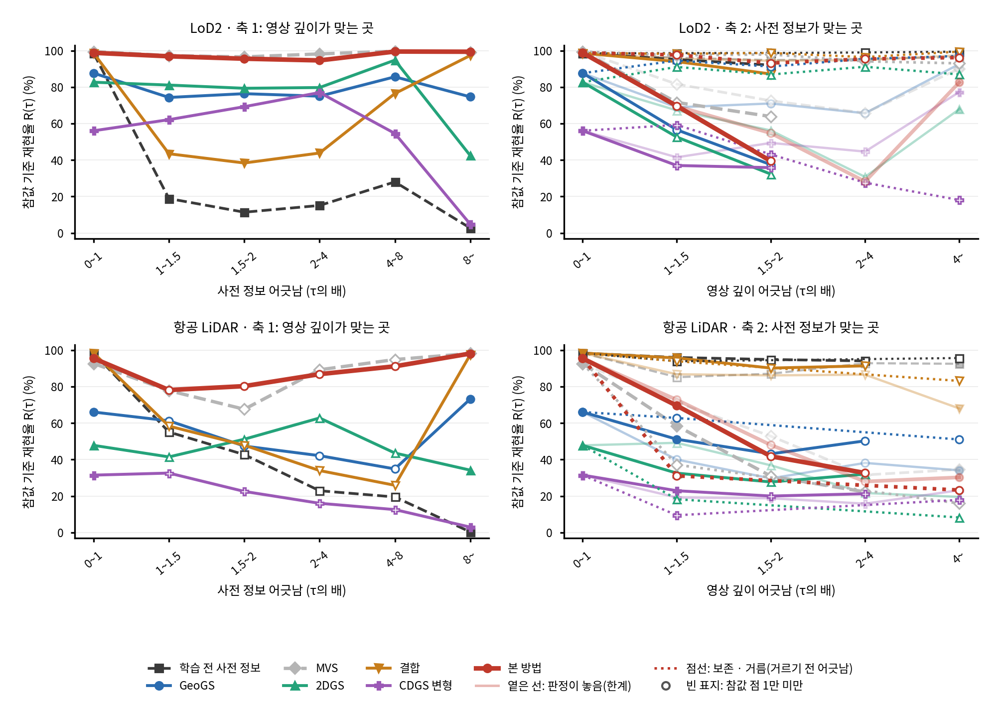

- 캡션 재료: 칸 패치를 사전 정보 어긋남(축 1)과 영상 깊이 어긋남(축 2)의 τ 배 구간으로 나눠 구간마다 참값 기준 재현율 R(τ). 색 = 결과(입력 둘은 회색 점선), 축 2의 옅은 선 = 한계, 점선 = 보존 · 거름(거르기 전 어긋남), 빈 표지 = 참값 점 1만 미만.

### 그림 B — 두 축 곡선(경우마다, 부록)

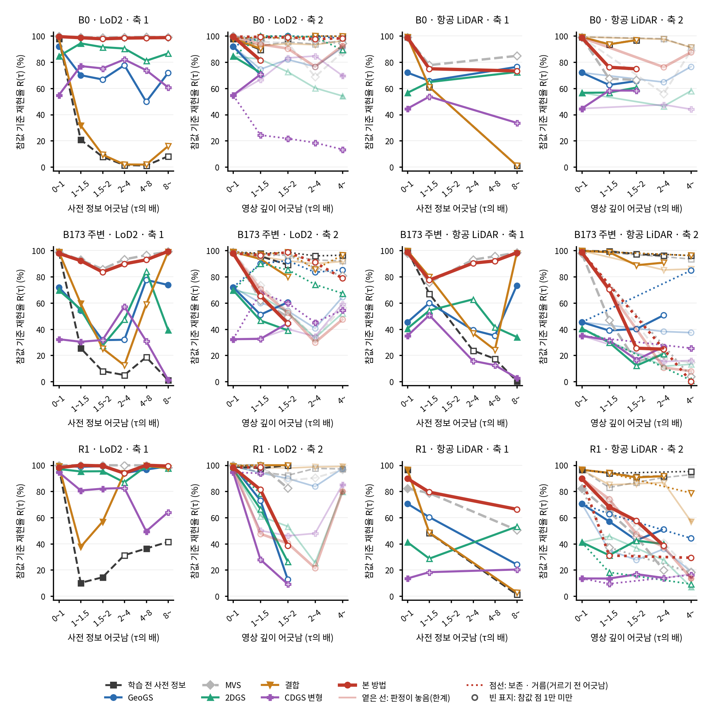

- 캡션 재료: 그림 A와 같은 꼴을 경우 여섯마다.

### 그림 C — 두 축 곡선의 참값 기준 평균 거리

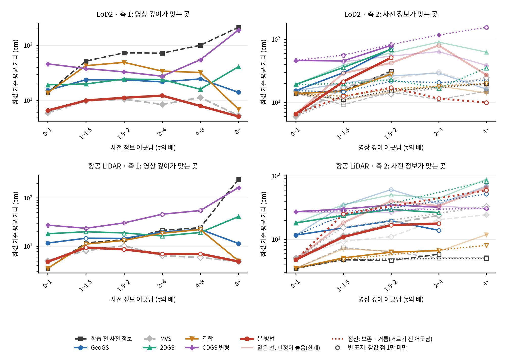

- 캡션 재료: 그림 A의 세로를 참값 기준 평균 거리(cm, 로그 눈금)로.

### 그림 D — 축 1의 m 단위 구간

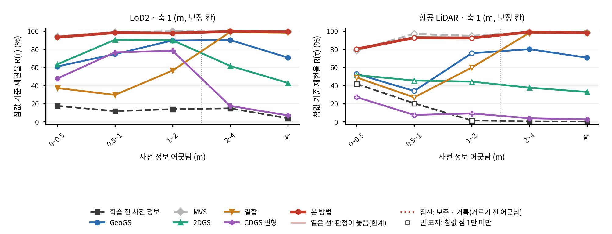

- 캡션 재료: 보정 칸을 |gt_med|(m)로 나눔: 0~0.5, 0.5~1, 1~2, 2~4, 4 m 넘음. 점선 = 2 m(결합의 변화 문턱).

### 일 5 누적 분포 — LoD2 합

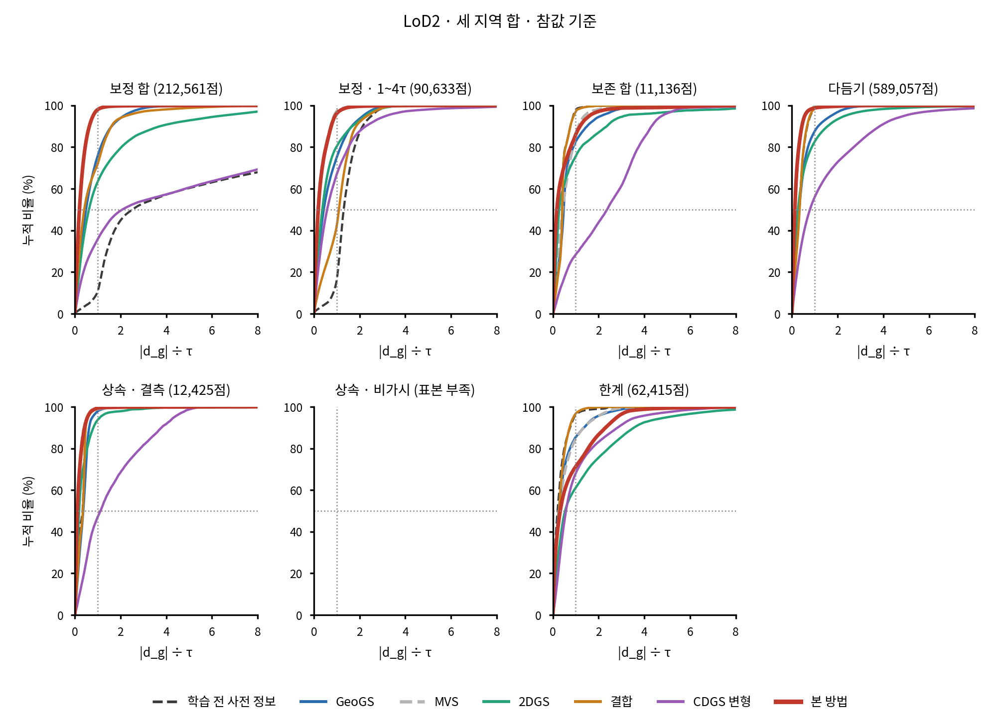

- 캡션 재료: 칸마다 |d_g| ÷ τ의 누적 분포, 가로 0~8, 세로 0~100 %, 결과마다 한 선, 점선 = τ와 50 %. 경우마다·결과 기준은 figures/일5_누적분포_*.

### 일 5 누적 분포 — 항공 LiDAR 합

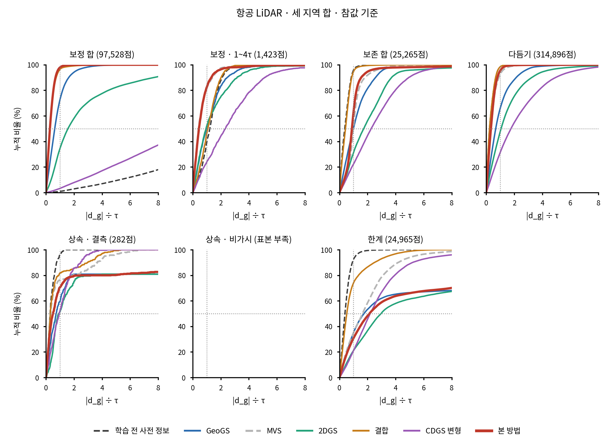

- 캡션 재료: 위와 같음.

### 일 6 덩어리마다 R(τ) — LoD2 합

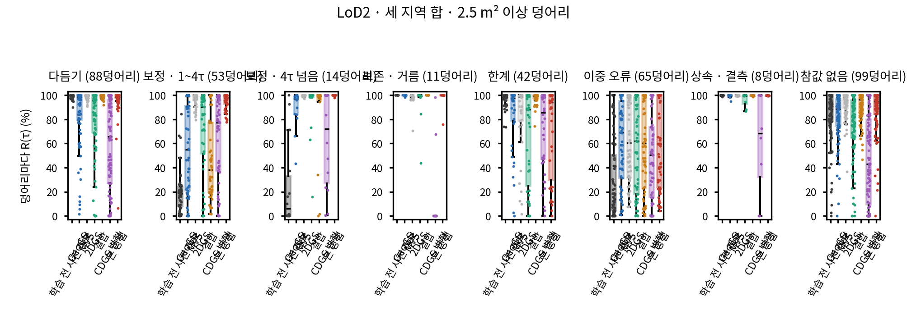

- 캡션 재료: 2.5 m² 이상 덩어리마다 R(τ), 결과마다 상자 하나, 점 = 덩어리.

### 일 6 덩어리마다 R(τ) — 항공 LiDAR 합

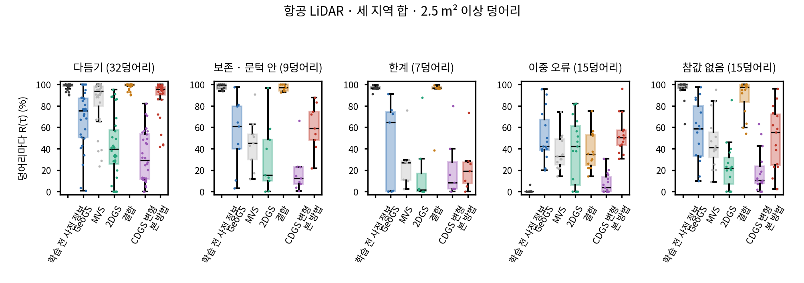

- 캡션 재료: 위와 같음.

### 일 7 경계 거리 — LoD2 합

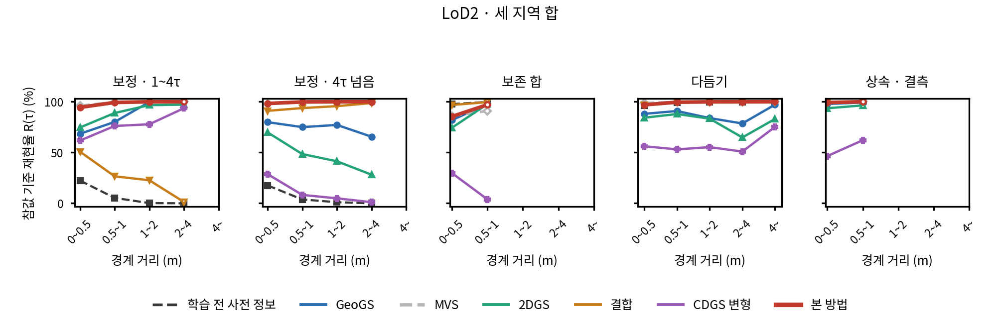

- 캡션 재료: 가로 = 경계 거리 구간(참값 점이 든 패치 중심에서 다른 칸 패치 중심까지), 세로 = R(τ).

### 일 7 경계 거리 — 항공 LiDAR 합

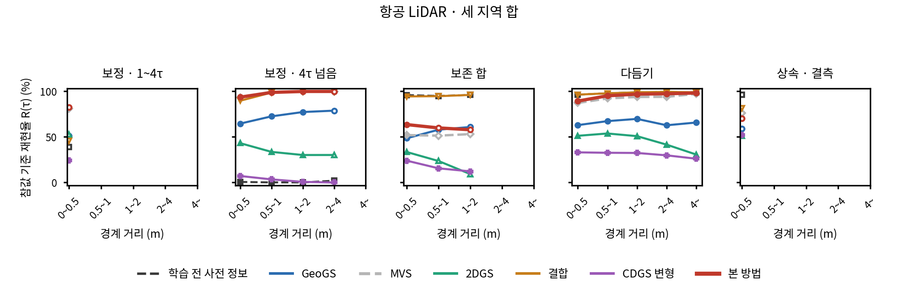

- 캡션 재료: 위와 같음.

### 일 8 B0 · 항공 LiDAR 긴 벽의 수평 단면

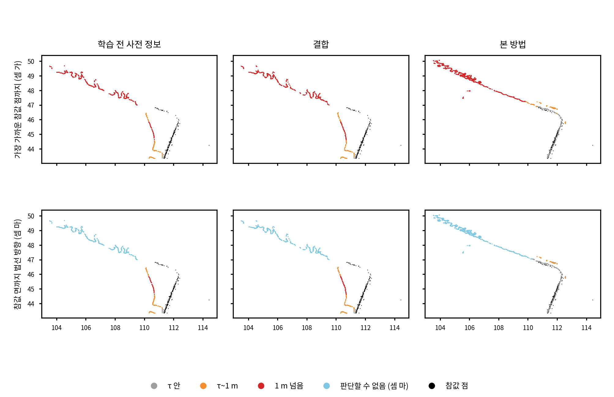

- 캡션 재료: 사전 정보 메시에서 60°보다 가파른 삼각형의 가장 넓은 무리를 벽으로 고름(참값 점과 사전 정보만 봄), 그 높이 중앙값에서 ±5 cm 판. 위 줄 = 셈 가 거리로, 아래 줄 = 셈 마 거리로 칠함(회색 τ 안, 주황 τ~1 m, 빨강 1 m 넘음, 하늘색 판단할 수 없음), 검정 = 참값 점.

### 일 8 V3 다듬기 (B173 주변 · 항공 LiDAR 평평한 지붕, 행 32,932)

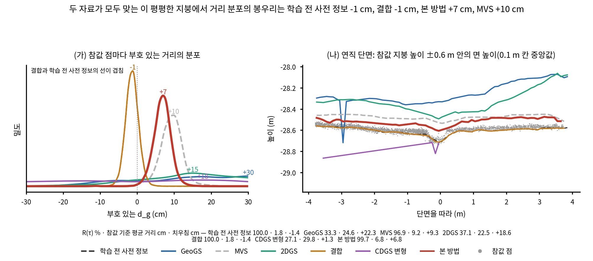

- 캡션 재료: (가) 부호 있는 d_g의 분포(결과마다 밀도선, 봉우리 숫자), (나) 지붕을 가로지르는 연직 단면: 참값 점(회색)과 결과마다 면 높이(0.1 m 칸 중앙값, 참값 지붕 높이 ±0.6 m 안).

### 일 8 V5 보존 (B173 주변 · 항공 LiDAR 유리 둥근 지붕 66패치, 행 433)

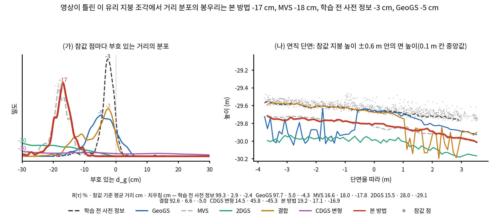

- 캡션 재료: V3과 같은 꼴, 단면은 유리 둥근 지붕을 가로지르는 방향.

### 일 8 V6 한계 (B173 주변 · 항공 LiDAR 유리 163패치 + 둘레 결측 18패치)

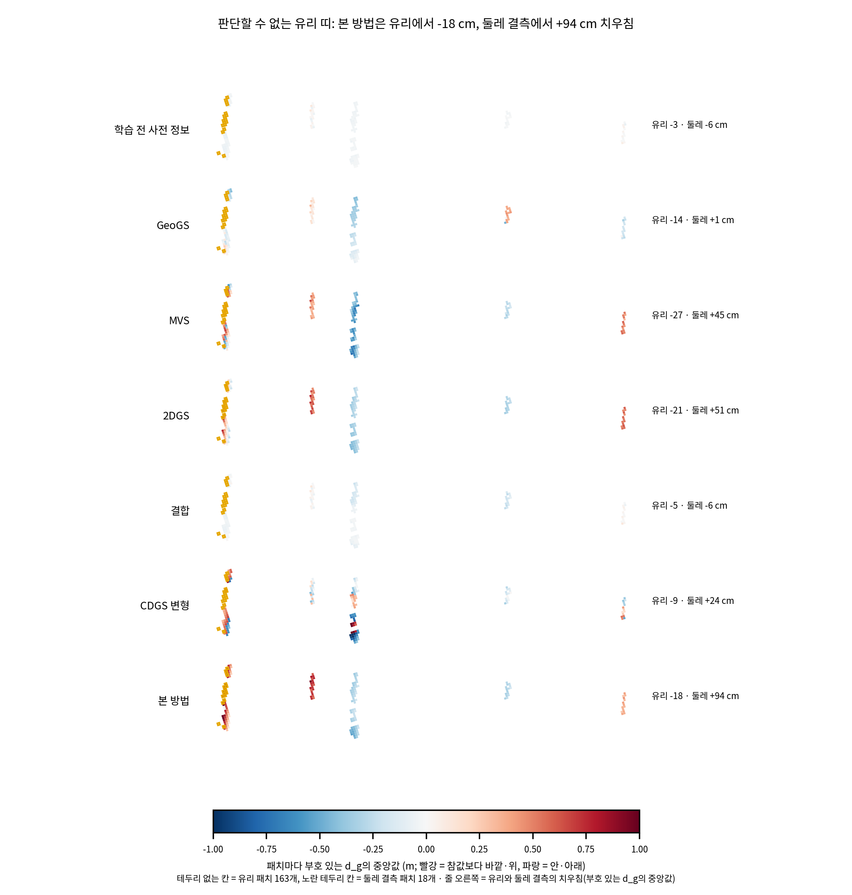

- 캡션 재료: 띠를 긴 축이 가로가 되게 돌려 위에서 본 지도, 결과마다 한 줄, 패치마다 부호 있는 d_g의 중앙값(±1 m), 노란 테두리 = 둘레 결측 패치, 줄 오른쪽 = 유리와 둘레 결측의 치우침.

## 8. 두 축 구간 표 (일 4)

### LoD2 합(세 지역)

**축 1 (τ의 배)**

| 구간 | 학습 전 사전 정보 | GeoGS | MVS | 2DGS | 결합 | CDGS 변형 | 본 방법 |
|---|---|---|---|---|---|---|---|
| 0~1 | 98.5 · 13.9 · 589,057 | 87.7 · 15.3 · 589,057 | 99.5 · 6.0 · 589,057 | 82.7 · 19.2 · 589,057 | 98.6 · 13.8 · 589,057 | 56.0 · 46.2 · 589,057 | 98.8 · 6.6 · 589,057 |
| 1~1.5 | 18.9 · 51.8 · 48,915 | 74.3 · 23.7 · 48,915 | 97.3 · 9.8 · 48,915 | 81.1 · 19.9 · 48,915 | 43.4 · 42.8 · 48,915 | 62.1 · 37.9 · 48,915 | 96.9 · 10.0 · 48,915 |
| 1.5~2 | 11.4 · 73.3 · 24,770 | 76.4 · 23.7 · 24,770 | 96.6 · 10.5 · 24,770 | 79.4 · 24.4 · 24,770 | 38.4 · 49.1 · 24,770 | 69.3 · 33.0 · 24,770 | 95.6 · 11.2 · 24,770 |
| 2~4 | 15.1 · 72.2 · 16,948 | 75.0 · 21.7 · 16,948 | 98.2 · 8.5 · 16,948 | 79.8 · 23.9 · 16,948 | 43.8 · 34.1 · 16,948 | 77.0 · 27.5 · 16,948 | 94.6 · 12.2 · 16,948 |
| 4~8 | 28.0 · 100.4 · 19,200 | 85.7 · 24.6 · 19,200 | 99.7 · 11.3 · 19,200 | 94.8 · 16.0 · 19,200 | 76.5 · 32.2 · 19,200 | 54.6 · 54.8 · 19,200 | 99.5 · 7.9 · 19,200 |
| 8~ | 2.7 · 212.6 · 102,728 | 74.7 · 14.0 · 102,728 | 99.2 · 5.3 · 102,728 | 42.5 · 40.9 · 102,728 | 97.3 · 6.9 · 102,728 | 4.8 · 189.7 · 102,728 | 99.4 · 5.1 · 102,728 |

**축 1 (m, 보정 칸만)**

| 구간 | 학습 전 사전 정보 | GeoGS | MVS | 2DGS | 결합 | CDGS 변형 | 본 방법 |
|---|---|---|---|---|---|---|---|
| 0~0.5 | 17.5 · 25.2 · 34,947 | 60.9 · 17.8 · 34,947 | 93.9 · 8.4 · 34,947 | 63.2 · 17.7 · 34,947 | 37.2 · 21.7 · 34,947 | 47.6 · 29.1 · 34,947 | 93.1 · 8.7 · 34,947 |
| 0.5~1 | 11.7 · 71.8 · 35,267 | 74.5 · 29.1 · 35,267 | 98.9 · 10.0 · 35,267 | 90.4 · 20.7 · 35,267 | 29.5 · 61.8 · 35,267 | 76.5 · 36.2 · 35,267 | 98.2 · 10.8 · 35,267 |
| 1~2 | 13.9 · 107.6 · 25,468 | 89.6 · 20.5 · 25,468 | 99.8 · 9.7 · 25,468 | 89.9 · 23.8 · 25,468 | 56.4 · 56.9 · 25,468 | 78.2 · 40.9 · 25,468 | 97.6 · 11.3 · 25,468 |
| 2~4 | 14.8 · 165.0 · 41,608 | 90.1 · 15.1 · 41,608 | 99.7 · 7.6 · 41,608 | 61.6 · 30.0 · 41,608 | 98.9 · 8.5 · 41,608 | 17.4 · 151.8 · 41,608 | 99.8 · 6.3 · 41,608 |
| 4~ | 3.8 · 216.9 · 75,271 | 70.8 · 16.3 · 75,271 | 99.1 · 5.8 · 75,271 | 42.8 · 43.7 · 75,271 | 98.2 · 6.4 · 75,271 | 7.0 · 186.4 · 75,271 | 99.3 · 5.5 · 75,271 |

**축 2 · 지킴(보존 · 문턱 안)**

| 구간 | 학습 전 사전 정보 | GeoGS | MVS | 2DGS | 결합 | CDGS 변형 | 본 방법 |
|---|---|---|---|---|---|---|---|
| 0~1 | 98.5 · 13.9 · 589,057 | 87.7 · 15.3 · 589,057 | 99.5 · 6.0 · 589,057 | 82.7 · 19.2 · 589,057 | 98.6 · 13.8 · 589,057 | 56.0 · 46.2 · 589,057 | 98.8 · 6.6 · 589,057 |
| 1~1.5 | 95.2 · 15.3 · 2,897* | 56.6 · 29.5 · 2,897* | 71.6 · 17.0 · 2,897* | 52.6 · 35.7 · 2,897* | 94.0 · 15.0 · 2,897* | 37.0 · 45.4 · 2,897* | 69.7 · 21.3 · 2,897* |
| 1.5~2 | 92.1 · 31.1 · 617* | 37.4 · 70.4 · 617* | 63.9 · 29.0 · 617* | 32.3 · 69.5 · 617* | 87.2 · 28.0 · 617* | 35.8 · 79.9 · 617* | 39.4 · 50.9 · 617* |
| 2~4 | 표본 부족 (5) | 표본 부족 (5) | 표본 부족 (5) | 표본 부족 (5) | 표본 부족 (5) | 표본 부족 (5) | 표본 부족 (5) |

**축 2 · 놓음(한계)**

| 구간 | 학습 전 사전 정보 | GeoGS | MVS | 2DGS | 결합 | CDGS 변형 | 본 방법 |
|---|---|---|---|---|---|---|---|
| 0~1 | 98.5 · 13.9 · 589,057 | 87.7 · 15.3 · 589,057 | 99.5 · 6.0 · 589,057 | 82.7 · 19.2 · 589,057 | 98.6 · 13.8 · 589,057 | 56.0 · 46.2 · 589,057 | 98.8 · 6.6 · 589,057 |
| 1~1.5 | 96.1 · 9.2 · 3,836* | 68.9 · 20.1 · 3,836* | 81.6 · 17.3 · 3,836* | 67.2 · 38.9 · 3,836* | 95.6 · 10.9 · 3,836* | 41.5 · 43.9 · 3,836* | 69.5 · 29.0 · 3,836* |
| 1.5~2 | 94.8 · 14.5 · 4,090* | 71.0 · 26.1 · 4,090* | 72.5 · 23.8 · 4,090* | 56.2 · 61.0 · 4,090* | 94.5 · 14.7 · 4,090* | 49.4 · 54.0 · 4,090* | 54.7 · 42.1 · 4,090* |
| 2~4 | 95.4 · 11.1 · 9,998* | 65.7 · 29.2 · 9,998* | 65.8 · 30.2 · 9,998* | 30.7 · 89.9 · 9,998* | 94.8 · 18.1 · 9,998* | 44.6 · 63.7 · 9,998* | 28.2 · 79.6 · 9,998* |
| 4~ | 96.5 · 15.1 · 44,491 | 92.6 · 16.2 · 44,491 | 90.1 · 17.5 · 44,491 | 67.8 · 62.4 · 44,491 | 97.4 · 14.1 · 44,491 | 77.3 · 38.6 · 44,491 | 82.6 · 27.3 · 44,491 |

**축 2 · 보존 · 거름**

| 구간 | 학습 전 사전 정보 | GeoGS | MVS | 2DGS | 결합 | CDGS 변형 | 본 방법 |
|---|---|---|---|---|---|---|---|
| 0~1 | 98.5 · 13.9 · 589,057 | 87.7 · 15.3 · 589,057 | 99.5 · 6.0 · 589,057 | 82.7 · 19.2 · 589,057 | 98.6 · 13.8 · 589,057 | 56.0 · 46.2 · 589,057 | 98.8 · 6.6 · 589,057 |
| 1~1.5 | 98.7 · 11.2 · 749* | 94.5 · 14.6 · 749* | 97.5 · 11.9 · 749* | 91.1 · 19.8 · 749* | 98.3 · 12.5 · 749* | 59.3 · 55.9 · 749* | 97.7 · 12.5 · 749* |
| 1.5~2 | 98.7 · 15.5 · 390* | 91.3 · 21.7 · 390* | 97.9 · 13.5 · 390* | 86.9 · 22.9 · 390* | 98.7 · 16.4 · 390* | 43.1 · 82.2 · 390* | 93.2 · 17.1 · 390* |
| 2~4 | 99.0 · 17.1 · 906* | 95.5 · 20.7 · 906* | 94.2 · 16.8 · 906* | 91.2 · 16.8 · 906* | 96.5 · 18.0 · 906* | 27.6 · 116.5 · 906* | 95.4 · 11.5 · 906* |
| 4~ | 99.5 · 19.8 · 5,572* | 97.1 · 22.4 · 5,572* | 93.0 · 24.7 · 5,572* | 87.0 · 35.1 · 5,572* | 99.5 · 19.9 · 5,572* | 18.1 · 153.8 · 5,572* | 96.2 · 10.0 · 5,572* |

### 항공 LiDAR 합(세 지역)

**축 1 (τ의 배)**

| 구간 | 학습 전 사전 정보 | GeoGS | MVS | 2DGS | 결합 | CDGS 변형 | 본 방법 |
|---|---|---|---|---|---|---|---|
| 0~1 | 98.4 · 3.5 · 314,896 | 66.1 · 11.7 · 314,896 | 92.7 · 5.1 · 314,896 | 47.8 · 18.2 · 314,896 | 98.4 · 3.5 · 314,896 | 31.5 · 27.3 · 314,896 | 95.5 · 4.8 · 314,896 |
| 1~1.5 | 55.1 · 11.8 · 586* | 61.3 · 14.7 · 586* | 77.8 · 8.1 · 586* | 41.5 · 20.0 · 586* | 58.4 · 11.1 · 586* | 32.6 · 23.5 · 586* | 78.2 · 9.4 · 586* |
| 1.5~2 | 42.7 · 13.8 · 213* | 47.4 · 14.5 · 213* | 67.6 · 10.2 · 213* | 51.2 · 18.9 · 213* | 47.9 · 13.2 · 213* | 22.5 · 30.4 · 213* | 80.3 · 8.6 · 213* |
| 2~4 | 22.9 · 21.3 · 624* | 42.1 · 19.8 · 624* | 89.3 · 6.4 · 624* | 62.8 · 16.3 · 624* | 34.0 · 18.6 · 624* | 16.0 · 45.9 · 624* | 86.9 · 6.9 · 624* |
| 4~8 | 19.5 · 24.2 · 390* | 34.9 · 22.3 · 390* | 94.9 · 5.9 · 390* | 43.6 · 19.3 · 390* | 25.9 · 22.2 · 390* | 12.6 · 54.6 · 390* | 91.2 · 7.0 · 390* |
| 8~ | 0.3 · 241.6 · 95,715 | 73.2 · 11.4 · 95,715 | 98.2 · 4.8 · 95,715 | 34.2 · 40.9 · 95,715 | 97.4 · 5.0 · 95,715 | 3.0 · 162.5 · 95,715 | 98.2 · 4.9 · 95,715 |

**축 1 (m, 보정 칸만)**

| 구간 | 학습 전 사전 정보 | GeoGS | MVS | 2DGS | 결합 | CDGS 변형 | 본 방법 |
|---|---|---|---|---|---|---|---|
| 0~0.5 | 41.7 · 15.3 · 1,246* | 52.7 · 16.1 · 1,246* | 78.7 · 8.1 · 1,246* | 51.4 · 18.3 · 1,246* | 48.8 · 13.8 · 1,246* | 27.1 · 30.3 · 1,246* | 80.2 · 8.6 · 1,246* |
| 0.5~1 | 20.3 · 23.5 · 537* | 33.9 · 22.9 · 537* | 96.8 · 5.4 · 537* | 45.4 · 19.4 · 537* | 26.8 · 21.7 · 537* | 7.4 · 57.8 · 537* | 92.6 · 6.5 · 537* |
| 1~2 | 1.4 · 131.9 · 1,016* | 75.6 · 9.2 · 1,016* | 94.6 · 6.0 · 1,016* | 44.2 · 17.6 · 1,016* | 59.7 · 15.2 · 1,016* | 9.2 · 108.3 · 1,016* | 92.3 · 5.3 · 1,016* |
| 2~4 | 0.5 · 142.2 · 25,702 | 80.0 · 9.8 · 25,702 | 98.6 · 4.6 · 25,702 | 37.5 · 35.5 · 25,702 | 98.0 · 4.8 · 25,702 | 3.8 · 121.3 · 25,702 | 98.9 · 4.7 · 25,702 |
| 4~ | 0.2 · 280.1 · 69,027 | 70.6 · 12.1 · 69,027 | 98.1 · 4.9 · 69,027 | 32.8 · 43.3 · 69,027 | 97.7 · 5.0 · 69,027 | 2.6 · 178.6 · 69,027 | 98.0 · 4.9 · 69,027 |

**축 2 · 지킴(보존 · 문턱 안)**

| 구간 | 학습 전 사전 정보 | GeoGS | MVS | 2DGS | 결합 | CDGS 변형 | 본 방법 |
|---|---|---|---|---|---|---|---|
| 0~1 | 98.4 · 3.5 · 314,896 | 66.1 · 11.7 · 314,896 | 92.7 · 5.1 · 314,896 | 47.8 · 18.2 · 314,896 | 98.4 · 3.5 · 314,896 | 31.5 · 27.3 · 314,896 | 95.5 · 4.8 · 314,896 |
| 1~1.5 | 96.0 · 4.8 · 19,985 | 51.2 · 15.2 · 19,985 | 58.5 · 11.5 · 19,985 | 32.6 · 23.8 · 19,985 | 95.7 · 5.1 · 19,985 | 22.9 · 30.0 · 19,985 | 69.6 · 11.0 · 19,985 |
| 1.5~2 | 94.9 · 4.6 · 3,274* | 43.2 · 19.6 · 3,274* | 30.9 · 17.8 · 3,274* | 27.7 · 29.5 · 3,274* | 90.2 · 6.3 · 3,274* | 20.0 · 34.8 · 3,274* | 41.8 · 16.7 · 3,274* |
| 2~4 | 94.1 · 5.9 · 1,106* | 50.3 · 13.9 · 1,106* | 22.2 · 23.8 · 1,106* | 32.0 · 26.5 · 1,106* | 91.4 · 6.7 · 1,106* | 21.2 · 32.2 · 1,106* | 32.6 · 17.8 · 1,106* |

**축 2 · 놓음(한계)**

| 구간 | 학습 전 사전 정보 | GeoGS | MVS | 2DGS | 결합 | CDGS 변형 | 본 방법 |
|---|---|---|---|---|---|---|---|
| 0~1 | 98.4 · 3.5 · 314,896 | 66.1 · 11.7 · 314,896 | 92.7 · 5.1 · 314,896 | 47.8 · 18.2 · 314,896 | 98.4 · 3.5 · 314,896 | 31.5 · 27.3 · 314,896 | 95.5 · 4.8 · 314,896 |
| 1~1.5 | 85.2 · 7.4 · 250* | 40.0 · 34.4 · 250* | 71.2 · 9.3 · 250* | 49.2 · 35.1 · 250* | 86.8 · 7.1 · 250* | 19.2 · 26.0 · 250* | 72.8 · 18.4 · 250* |
| 1.5~2 | 87.1 · 6.4 · 1,007* | 29.7 · 60.7 · 1,007* | 52.8 · 11.0 · 1,007* | 36.8 · 50.2 · 1,007* | 86.2 · 6.5 · 1,007* | 18.8 · 26.7 · 1,007* | 48.0 · 40.1 · 1,007* |
| 2~4 | 92.9 · 5.1 · 6,762* | 38.2 · 36.1 · 6,762* | 31.6 · 20.5 · 6,762* | 21.7 · 44.4 · 6,762* | 86.6 · 6.5 · 6,762* | 15.8 · 33.4 · 6,762* | 28.0 · 33.7 · 6,762* |
| 4~ | 92.5 · 5.2 · 16,946 | 34.1 · 69.1 · 16,946 | 34.6 · 24.3 · 16,946 | 19.5 · 88.3 · 16,946 | 68.1 · 11.9 · 16,946 | 23.2 · 30.4 · 16,946 | 30.2 · 65.3 · 16,946 |

**축 2 · 보존 · 거름**

| 구간 | 학습 전 사전 정보 | GeoGS | MVS | 2DGS | 결합 | CDGS 변형 | 본 방법 |
|---|---|---|---|---|---|---|---|
| 0~1 | 98.4 · 3.5 · 314,896 | 66.1 · 11.7 · 314,896 | 92.7 · 5.1 · 314,896 | 47.8 · 18.2 · 314,896 | 98.4 · 3.5 · 314,896 | 31.5 · 27.3 · 314,896 | 95.5 · 4.8 · 314,896 |
| 1~1.5 | 93.9 · 4.9 · 148* | 62.8 · 24.0 · 148* | 37.2 · 15.5 · 148* | 18.2 · 24.4 · 148* | 93.9 · 4.9 · 148* | 9.5 · 28.2 · 148* | 31.1 · 25.0 · 148* |
| 1.5~2 | 표본 부족 (86) | 표본 부족 (86) | 표본 부족 (86) | 표본 부족 (86) | 표본 부족 (86) | 표본 부족 (86) | 표본 부족 (86) |
| 2~4 | 표본 부족 (84) | 표본 부족 (84) | 표본 부족 (84) | 표본 부족 (84) | 표본 부족 (84) | 표본 부족 (84) | 표본 부족 (84) |
| 4~ | 95.7 · 5.0 · 582* | 51.0 · 51.7 · 582* | 16.0 · 33.2 · 582* | 8.2 · 82.6 · 582* | 83.2 · 8.1 · 582* | 17.9 · 30.8 · 582* | 23.3 · 59.2 · 582* |

### 맞춰 볼 값 (새 거리 지표 일 5)

| 경우 | 결과 | 구간 | 발주의 값 | 여기 | 같음 |
|---|---|---|---:|---:|---|
| B0 · LoD2 | 결합 | 1~1.5τ | 31.8 | 31.77 | 같음 |
| B0 · LoD2 | 결합 | 1.5~4τ | 5.7 | 5.65 | 같음 |
| B173 주변 · 항공 LiDAR | 본 방법 | 1~4τ | 86.4 | 86.44 | 같음 |
| B173 주변 · 항공 LiDAR | 결합 | 1~4τ | 48.7 | 48.67 | 같음 |

- 구간에 넣지 않은 패치(영상 깊이 어긋남 값 없음, 1τ 미만): B0 · LoD2 지킴 0·0, 놓음 0·0, 거름 거르기 전 어긋남; B173 주변 · LoD2 지킴 0·0, 놓음 0·0, 거름 거르기 전 어긋남; R1 · LoD2 지킴 0·0, 놓음 0·0, 거름 거르기 전 어긋남; B0 · 항공 LiDAR 지킴 0·0, 놓음 0·0, 거름 거르기 전 어긋남; B173 주변 · 항공 LiDAR 지킴 0·0, 놓음 0·0, 거름 거르기 전 어긋남; R1 · 항공 LiDAR 지킴 0·0, 놓음 0·0, 거름 거르기 전 어긋남

## 9. 덩어리, 경계 거리, 결측, 결과 기준 점검 (일 6~8)

- 덩어리: tables/일6_덩어리.md(칸마다 통계, 덩어리 단위 달성률, 덩어리 크기별 성공), 영역 지도 figures/일6_영역지도_<지역>_<사전 정보>.png 여섯.
- 경계 거리: tables/일7_경계거리.md. 결측: tables/일7_결측.md, 지도 figures/일7_결측지도_<지역>_<사전 정보>.png 여섯.
- 결과 기준 점검: tables/일8_결과기준점검.md(밀도 다섯 분위별 1 m 넘는 결과 점, 학습 전 사전 정보의 기울기별 셈 가~바), tables/중간_결과기준점검.md.

### 덩어리 단위 달성률 (참값 점의 50 %를 넘게 τ 안인 덩어리의 비율, %) — 사전 정보마다 세 지역 합

| 사전 정보 | 칸 | 크기 | 학습 전 사전 정보 | GeoGS | MVS | 2DGS | 결합 | CDGS 변형 | 본 방법 |
|---|---|---|---|---|---|---|---|---|---|
| LoD2 | 다듬기 | 2.5 m² 이상 (88) | 100.0 | 89.8 | 100.0 | 85.2 | 100.0 | 56.8 | 98.9 |
| LoD2 | 다듬기 | 10 m² 이상 (46) | 100.0 | 97.8 | 100.0 | 95.7 | 100.0 | 60.9 | 97.8 |
| LoD2 | 보정 · 1~4τ | 2.5 m² 이상 (53) | 5.7 | 50.9 | 100.0 | 75.5 | 32.1 | 62.3 | 100.0 |
| LoD2 | 보정 · 1~4τ | 10 m² 이상 (15) | 0.0 | 66.7 | 100.0 | 73.3 | 33.3 | 60.0 | 100.0 |
| LoD2 | 보정 · 4τ 넘음 | 2.5 m² 이상 (14) | 21.4 | 92.9 | 100.0 | 92.9 | 78.6 | 57.1 | 100.0 |
| LoD2 | 보정 · 4τ 넘음 | 10 m² 이상 (8) | 12.5 | 87.5 | 100.0 | 87.5 | 75.0 | 50.0 | 100.0 |
| LoD2 | 보존 · 거름 | 2.5 m² 이상 (11) | 100.0 | 100.0 | 100.0 | 90.9 | 100.0 | 18.2 | 100.0 |
| LoD2 | 보존 · 문턱 안 | 2.5 m² 이상 (2) | 100.0 | 0.0 | 50.0 | 50.0 | 100.0 | 0.0 | 25.0 |
| LoD2 | 한계 | 2.5 m² 이상 (42) | 100.0 | 83.3 | 85.7 | 64.3 | 100.0 | 64.3 | 71.4 |
| LoD2 | 한계 | 10 m² 이상 (14) | 100.0 | 100.0 | 100.0 | 64.3 | 100.0 | 78.6 | 85.7 |
| LoD2 | 이중 오류 | 2.5 m² 이상 (65) | 26.2 | 61.5 | 55.4 | 56.9 | 56.9 | 50.8 | 50.8 |
| LoD2 | 이중 오류 | 10 m² 이상 (11) | 0.0 | 54.5 | 27.3 | 36.4 | 27.3 | 18.2 | 36.4 |
| LoD2 | 상속 · 결측 | 2.5 m² 이상 (8) | 100.0 | 100.0 | 100.0 | 100.0 | 100.0 | 62.5 | 100.0 |
| LoD2 | 상속 · 결측 | 10 m² 이상 (2) | 100.0 | 100.0 | 100.0 | 100.0 | 100.0 | 100.0 | 100.0 |
| LoD2 | 결측 · 사전 정보 틀림 | 2.5 m² 이상 (1) | 0.0 | 100.0 | 100.0 | 100.0 | 100.0 | 100.0 | 100.0 |
| LoD2 | 참값 없음 | 2.5 m² 이상 (99) | 91.9 | 92.9 | 99.0 | 82.8 | 99.0 | 44.4 | 92.9 |
| LoD2 | 참값 없음 | 10 m² 이상 (43) | 97.7 | 97.7 | 100.0 | 93.0 | 100.0 | 65.1 | 97.7 |
| 항공 LiDAR | 다듬기 | 2.5 m² 이상 (32) | 100.0 | 75.0 | 84.4 | 31.2 | 100.0 | 28.1 | 89.1 |
| 항공 LiDAR | 다듬기 | 10 m² 이상 (10) | 100.0 | 80.0 | 100.0 | 40.0 | 100.0 | 20.0 | 100.0 |
| 항공 LiDAR | 보정 · 4τ 넘음 | 2.5 m² 이상 (1) | 0.0 | 100.0 | 100.0 | 0.0 | 100.0 | 0.0 | 100.0 |
| 항공 LiDAR | 보정 · 4τ 넘음 | 10 m² 이상 (1) | 0.0 | 100.0 | 100.0 | 0.0 | 100.0 | 0.0 | 100.0 |
| 항공 LiDAR | 보존 · 문턱 안 | 2.5 m² 이상 (9) | 100.0 | 55.6 | 44.4 | 22.2 | 100.0 | 11.1 | 66.7 |
| 항공 LiDAR | 보존 · 문턱 안 | 10 m² 이상 (3) | 100.0 | 66.7 | 100.0 | 33.3 | 100.0 | 0.0 | 83.3 |
| 항공 LiDAR | 한계 | 2.5 m² 이상 (7) | 100.0 | 57.1 | 14.3 | 14.3 | 85.7 | 14.3 | 14.3 |
| 항공 LiDAR | 한계 | 10 m² 이상 (1) | 100.0 | 0.0 | 0.0 | 0.0 | 0.0 | 0.0 | 0.0 |
| 항공 LiDAR | 이중 오류 | 2.5 m² 이상 (15) | 0.0 | 33.3 | 26.7 | 40.0 | 33.3 | 0.0 | 56.7 |
| 항공 LiDAR | 이중 오류 | 10 m² 이상 (5) | 0.0 | 20.0 | 20.0 | 80.0 | 40.0 | 0.0 | 60.0 |
| 항공 LiDAR | 참값 없음 | 2.5 m² 이상 (15) | 100.0 | 60.0 | 33.3 | 6.7 | 100.0 | 13.3 | 53.3 |
| 항공 LiDAR | 참값 없음 | 10 m² 이상 (1) | 100.0 | 0.0 | 100.0 | 0.0 | 100.0 | 0.0 | 100.0 |

### B0 · 항공 LiDAR

| 결과 | 셈 | 밀도 0~516 점/m² | 밀도 516~783 점/m² | 밀도 783~1111 점/m² | 밀도 1111~1578 점/m² | 밀도 1578~ 점/m² | 참값 행 없음 |
|---|---|---|---|---|---|---|---|
| 학습 전 사전 정보 | 가 | 9.1 | 10.8 | 5.5 | 8.0 | 3.5 | 12.1 |
| 학습 전 사전 정보 | 마 | 5.5 (5.8) | 6.4 (6.6) | 2.6 (3.6) | 1.6 (7.7) | 0.9 (3.6) | 8.2 (8.0) |
| GeoGS | 가 | 23.8 | 23.0 | 26.5 | 23.3 | 9.9 | 31.8 |
| GeoGS | 마 | 13.8 (14.2) | 14.9 (11.8) | 11.3 (17.7) | 6.9 (21.3) | 3.4 (8.1) | 17.3 (21.2) |
| MVS | 가 | 4.2 | 3.5 | 3.4 | 8.7 | 4.0 | 3.5 |
| MVS | 마 | 1.3 (5.2) | 1.3 (3.5) | 1.9 (2.1) | 0.8 (9.8) | 0.7 (3.7) | 1.0 (5.6) |
| 2DGS | 가 | 40.7 | 52.4 | 64.2 | 50.7 | 32.5 | 43.2 |
| 2DGS | 마 | 24.8 (24.2) | 38.0 (24.2) | 47.6 (32.1) | 24.1 (36.0) | 16.3 (19.7) | 24.9 (27.6) |
| 결합 | 가 | 9.0 | 11.4 | 5.9 | 8.1 | 3.6 | 12.1 |
| 결합 | 마 | 5.5 (5.7) | 6.7 (6.9) | 2.8 (3.8) | 1.7 (7.8) | 1.0 (3.6) | 8.2 (8.0) |
| CDGS 변형 | 가 | 62.7 | 71.0 | 60.4 | 49.8 | 56.7 | 76.5 |
| CDGS 변형 | 마 | 31.0 (48.9) | 49.2 (44.1) | 44.5 (29.4) | 28.0 (32.2) | 33.7 (35.9) | 39.3 (64.9) |
| 본 방법 | 가 | 7.6 | 5.9 | 7.5 | 10.0 | 5.6 | 6.4 |
| 본 방법 | 마 | 3.7 (6.2) | 3.8 (3.7) | 3.0 (4.9) | 1.8 (9.6) | 1.6 (4.2) | 2.6 (6.5) |

### B0 · 항공 LiDAR 긴 벽의 수평 단면 (그림 일8_단면_B0_항공LiDAR_벽)

| 결과 | 칠한 거리 | 단면의 결과 점 | τ 안 (%) | τ~1 m (%) | 1 m 넘음 (%) | 판단할 수 없음 (%) |
|---|---|---:|---:|---:|---:|---:|
| 학습 전 사전 정보 | 셈 가 | 657 | 1.1 | 17.5 | 81.4 | 0.0 |
| 학습 전 사전 정보 | 셈 마 | 657 | 2.3 | 16.3 | 9.1 | 72.3 |
| 결합 | 셈 가 | 636 | 1.7 | 19.0 | 79.2 | 0.0 |
| 결합 | 셈 마 | 636 | 2.0 | 19.2 | 9.0 | 69.8 |
| 본 방법 | 셈 가 | 945 | 18.0 | 9.3 | 72.7 | 0.0 |
| 본 방법 | 셈 마 | 945 | 22.1 | 3.8 | 0.0 | 74.1 |

## 10. 일 1 — 두 항의 꼴과 MVS 표면

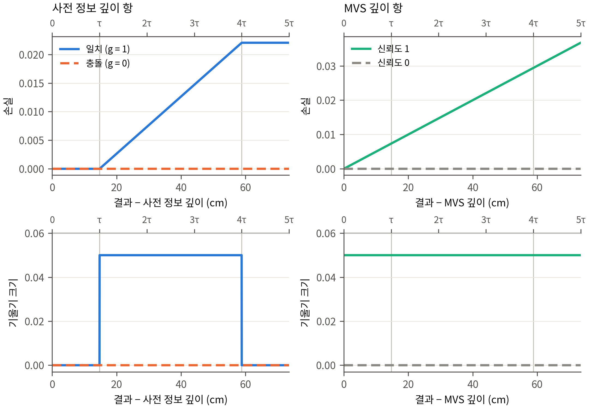

- 사전 정보 깊이 항: 0~τ 손실 0·기울기 0, τ~4τ 손실 λg(|d| − τ)/n_px·기울기 λg/n_px, 4τ 넘음 손실 상수 λg·3τ/n_px·기울기 0(g = 0은 판정 충돌, 섞임은 g = 1). MVS 깊이 항: 모든 구간 λA|D − M|/n_px. λ 둘 다 0.05(비 1 : 1). 코드 줄은 tables/일1_정의확인.md 2절.
- MVS 표면: 판 가(학습 깊이) · 판 나(마스크를 끈 학습이 읽는 광도 깊이) 지역마다 둘 [새로 만듦], 만든 법과 영수증 PH/…/mvs/<지역>/receipt_<지역>.json. 표의 'MVS'는 판 가, 판 나 값은 AX/tables/a3_metrics.json(mvs_b).

## 11. 일 9 — 앞 단계 학습들의 새 지표

- 학습 대장 tables/일9_학습대장.md(학습 82줄: 메시 있음 69, 결과 없음 2(2단계 마스크 끄기 둘, OOM), 관문 6, 3단계 조건의 항공 LiDAR 영역 파일 없음 7줄 '정의 없음').
- 표 tables/stage2·stage3·fixtest·variants, 숫자표 `앞단계_새지표_숫자표_v1*.md`(한 칸 = R(τ) · 참값 기준 평균 거리). 읽기(1.3, 3단계 규칙)는 같은 폴더의 json과 AX/tables/a9_metrics.json.
- 3단계 조건(B0a15·B0a9·B0a3·B0n13·B0n8·B0n2)은 B0_b10과 같은 패치·참값·영역 행을 쓴다(행 파일이 같음을 확인). 조건마다 거른 영상 오류 파일이 없어 보존 · 거름, 보존 · 문턱 안, 다듬기, 상속 · 결측(과 그 합)과 축 2는 정의 없음.

| 경우 | 결과 | 값 | 발주 | 기록(반올림 전) | 여기 | 같음 |
|---|---|---|---:|---:|---:|---|
| B0_b10/LoD2 | nojudge_LoD2_s0 | 보정 합 참값 기준 거리의 중앙값 cm | 7.6 | 7.5811 | 7.5811 | 같음 |
| R1rep_b10/LoD2 | nojudge_LoD2_s0 | 보정 합 참값 기준 거리의 중앙값 cm | 13.9 | 13.9413 | 13.9413 | 같음 |
| B0_b10/LoD2 | imgonly_s0 | 보정 합 참값 기준 거리의 중앙값 cm | 5.2 | 5.1557 | 5.1557 | 같음 |
| R1rep_b10/LoD2 | imgonly_s0 | 보정 합 참값 기준 거리의 중앙값 cm | 6.7 | 6.6640 | 6.6640 | 같음 |
| R1rep_b10/LoD2 | fixB_LoD2_s0 | 결측 영역 R(0.2 m) % | 84.0 | 83.9888 | 83.9888 | 같음 |

## 12. 결과 없음, 바꾼 것, 확인 불가

- 결과 없음: 일 9의 2단계 마스크 끄기 둘(B173 주변 · LoD2, R1 · 항공 LiDAR; OOM 뒤 다시 돌린 기록 없음). 관문으로 학습하지 않은 고친 판 시험 칸 6.
- 바꾼 것(값은 바뀌지 않음, 실행): 결과 점의 가장 가까운 참값 점 찾기에 앞 작업의 정확한 d_r을 탐색 상한으로 줌(답 같음); 돌던 컨테이너의 CPU 상한을 올림(docker update); 지역·묶음을 나눠 나란히 돌림; 20:40~44 스크립트 이름(numbers.py)이 표준 모듈을 가려 그 사이 시작한 MVS 판 나 셋과 계산 하나가 죽어 다시 돌림; 멈춘 일 9 학습 하나(B0a9 영상만)의 미완성 파일을 지우고 다시 셈.
- 바꾼 것(결과를 보기 전, 설정 amendments): 결과 선 색(색약 검사), 축 2 값의 정의(일 1 확인).
- 바꾼 것(그리는 법, 값 같음): 그림 A~D 범례·눈금, 결측 지도 확대 판, V3·V5 단면을 자리 범위·지붕 높이 ±0.6 m로, V5 제목을 봉우리 숫자로, V6 배치와 테두리 색, 일 8 벽 고르기를 사전 정보 메시의 가파른 삼각형으로(처음 판은 참값 행이 있는 패치만 써서 짧은 벽을 골랐음).
- 확인 불가·정의 없음: B0·R1의 비가시 칸(가상 시점 메시 없음, 만들려면 GPU 렌더), MVS 표면의 비가시 칸, 3단계 조건의 위 칸들.

## 13. 걸린 시간

| 단계 | 끝난 때 | 걸린 시간 (s) |
|---|---|---:|
| a1_normals_R1 | 10-22 20:07:31 | 38 |
| a1_normals_B0B173 | 10-22 20:10:44 | 186 |
| d1_inspect | 10-22 20:12:45 | 33 |
| a2_cells | 10-22 20:12:49 | 17 |
| d1_counts | 10-22 20:19:12 | 41 |
| d1_terms | 10-22 20:21:39 | 11 |
| d1_extra | 10-22 20:23:41 | 1 |
| d1_assemble | 10-22 20:25:03 | 1 |
| d1_extra | 10-22 20:26:13 | 1 |
| a6_clumps_t | 10-22 20:26:15 | 10 |
| d1_assemble | 10-22 20:26:22 | 1 |
| a6_maps_t | 10-22 20:26:42 | 4 |
| a2_cells | 10-22 20:32:36 | 39 |
| a2_cells | 10-22 20:33:26 | 36 |
| a7_missing | 10-22 20:34:43 | 15 |
| a2x_R1rep_b10 | 10-22 22:01:24 | 5,088 |
| a2x_B0_LoD2 | 10-22 22:15:29 | 1,070 |
| a2x_R1_mvs_a | 10-22 22:26:35 | 352 |
| a2x_B0_ALS | 10-22 22:39:55 | 2,571 |
| a2x_B173nb_mvs_b | 10-22 22:43:14 | 999 |
| a2x_B173nb_par | 10-22 22:47:49 | 7,435 |
| a9_dist_s1 | 10-22 22:56:15 | 5,132 |
| a9_dist_s0 | 10-22 23:03:41 | 5,578 |
| a9_dist_s2 | 10-22 23:05:09 | 5,666 |
| p_a3 | 10-22 23:05:19 | 849 |
| p_a3b | 10-22 23:05:20 | 1 |
| p_a3t | 10-22 23:05:21 | 1 |
| a3c | 10-22 23:05:48 | 0 |
| a3c | 10-22 23:06:28 | 1 |
| numbers3 | 10-22 23:06:58 | 1 |
| a2x_R1_mvs_b | 10-22 23:07:50 | 1,356 |
| a9_metrics | 10-22 23:10:54 | 251 |
| a9c | 10-22 23:11:17 | 1 |
| p_a4 | 10-22 23:12:45 | 444 |
| p_a4f | 10-22 23:12:54 | 9 |
| p_a5 | 10-22 23:15:01 | 127 |
| p_a6 | 10-22 23:15:43 | 42 |
| p_a6m | 10-22 23:15:56 | 13 |
| p_a7b | 10-22 23:16:45 | 49 |
| p_a7m | 10-22 23:16:56 | 11 |
| p_a5f | 10-22 23:17:12 | 16 |
| p_a8f | 10-22 23:19:09 | 60 |
| p_a8 | 10-22 23:20:20 | 53 |
| p_a4f | 10-22 23:20:38 | 6 |
| p_a7m | 10-22 23:21:17 | 11 |
| p_a7m | 10-22 23:21:48 | 10 |
| p_a8f | 10-22 23:23:31 | 53 |
| numbers | 10-22 23:24:10 | 1 |
| interim_t | 10-22 23:24:31 | 0 |
| interim | 10-22 23:26:13 | 0 |
| interim | 10-22 23:26:33 | 0 |
| f_a8f | 10-22 23:28:47 | 53 |
| f_a8 | 10-22 23:30:15 | 55 |
| f_a8 | 10-22 23:31:36 | 54 |
| f_a3 | 10-22 23:34:02 | 397 |
| f_a3b | 10-22 23:34:02 | 1 |
| f_a3t | 10-22 23:34:03 | 0 |
| f_a3c | 10-22 23:34:04 | 1 |
| f_a9 | 10-22 23:37:03 | 179 |
| f_a9c | 10-22 23:37:04 | 1 |
| f_num | 10-22 23:37:04 | 0 |
| final | 10-22 23:37:18 | 1 |
| r_a3t | 10-22 23:37:47 | 0 |
| r_a3b | 10-22 23:37:48 | 1 |
| r_a3c | 10-22 23:37:48 | 0 |
| r_a7b | 10-22 23:38:29 | 41 |
| r_a6 | 10-22 23:38:31 | 43 |
| r_a5 | 10-22 23:39:49 | 121 |
| r_a4 | 10-22 23:43:43 | 355 |
| r_a4f | 10-22 23:43:49 | 6 |
| r_a7m | 10-22 23:43:59 | 10 |
| r_a5f | 10-22 23:44:14 | 15 |
| r_a8 | 10-22 23:45:08 | 54 |
| r_a8f | 10-22 23:46:00 | 52 |
| r_a9 | 10-22 23:49:01 | 181 |
| r_it | 10-22 23:49:01 | 0 |
| r_num | 10-22 23:49:02 | 1 |
| r_fin | 10-22 23:49:02 | 0 |

- 하위 에이전트: 일 1 정의 확인 20:05~20:31, MVS 표면 20:05~22:52, 일 9 학습 대장 20:05~20:33, 처음 보는 사람 점검 다섯(각 20~30초).

## 부록. 처음 보는 사람 점검 답 전문

- 방법: v4와 같다. 그림마다 따로 띄운 하위 에이전트(general-purpose, 모델 sonnet)에게 그림 파일 하나만 열게 하고, 그림만 보고 보이는 것, 제목, 제목이 보이는지(보임 / 일부만 보임 / 다르게 보임)와 까닭, 헷갈린 곳을 묻는다. 다른 파일은 열지 않게 했다.
- 점검 1회차(2026-10-22 23:24): V3, V5, V6 첫 판. 점검 뒤 V5 제목을 그림에 적힌 봉우리 숫자로 바꾸고, 참값 점을 회색으로 바꿔 선을 위에 그렸다. 겹치는 두 결과의 선은 그림 안에 적었다. V6 둘레 결측의 테두리는 칠이 보이는 노란색으로 바꿨다. 이 변경은 그리는 법만 바꾼 것이고 값은 같다.
- 점검 2회차(23:29): 고친 V5, V6.
- 답 속의 'CDGS*'는 점검 때 그림의 표시다. 그 뒤(23:3x) 그림과 표의 표시를 'CDGS 변형'(시점별 크기 맞추기를 생략한 변형)으로 바꿨다. 값은 같다.

| 그림 | 1회차 | 2회차 |
|---|---|---|
| V3 다듬기 | 보임 | — (고치지 않음; 겹침 글귀만 더함) |
| V5 보존 | 일부만 보임 | 보임 |
| V6 한계 | 일부만 보임 | 일부만 보임 |

## V3 — 1회차

**1. 그림만 보고 (제목은 안 본 셈)**
- 왼쪽 (가)는 부호 있는 거리 d_g(cm)의 분포 곡선이다. 주황색은 -1 cm에서 좁고 높은 봉우리, 빨강은 +7 cm, 회색 점선은 +10 cm에 봉우리가 있다. 초록(+15), 보라(+18), 파랑(+30)은 낮고 넓게 퍼져 있다.
- 오른쪽 (나)는 연직 단면이다. 검은 점(참값)이 지붕 높이 약 -28.55~-28.7 m에 깔려 있고, 주황선이 그 점들에 거의 겹친다. 빨강선과 회색 점선은 점들 위로 5~10 cm 떠 있다. 파랑과 초록은 오른쪽으로 갈수록 -28.1 m까지 올라가고, 보라는 점이 거의 없는 가는 직선이다.

**2. 제목 문장**
"두 자료가 모두 맞는 이 평평한 지붕에서 거리 분포의 봉우리는 학습 전 사전 정보 -1 cm, 결합 -1 cm, 본 방법 +7 cm, MVS +10 cm"

**3. 판정: 보임** (한 군데는 직접 안 보임)
- (가)에서 곡선 위 숫자로 읽었다. 주황(결합) -1, 빨강(본 방법) +7, 회색 점선(MVS) +10이다.
- "학습 전 사전 정보 -1"은 (가)에서 따로 보이는 곡선이 없다. 주황 곡선에 가려진 듯하다. 대신 아래 줄글 "학습 전 사전 정보 100.0 · 1.8 · -1.4"와 "결합 100.0 · 1.8 · -1.4"에서 치우침 -1.4 cm로 읽었다. 결합과 같은 값이다.
- (나)에서도 순서가 맞다. 주황은 검은 점에 붙어 있고, 빨강은 약 +7 cm, 회색은 약 +10 cm 위에 있다. 단면이 평평한 것도 보인다. 다만 x=0 근처에 약 5 cm 오목한 곳이 있다.

**4. 헷갈린 곳**
- "두 자료"가 무엇인지 그림에 없다. 사전 정보와 결합을 뜻하는지, 다른 두 자료인지 알 수 없었다.
- 학습 전 사전 정보의 검은 점선이 (가)에 안 보여서, 제목의 첫 숫자는 줄글에서만 확인된다.
- 파랑 GeoGS와 초록 2DGS의 봉우리 숫자(+30, +15)는 곡선이 너무 낮고 넓어서 봉우리라고 보기 어렵다. 파랑 +30은 축 끝에 걸려 있다.
- (나)의 보라(CDGS*)는 거의 직선이고 -0.1 m에서 아래로 뾰족한 선이 하나 있다. 파랑도 -3 m에서 같은 모양으로 아래로 뾰족하다. 이 선들이 무엇인지 설명이 없다.

## V5 — 1회차

**1. 그림만 보고 (제목을 보지 않은 셈 치고)**
- 왼쪽 (가): 가로축 "부호 있는 d_g (cm)" -30~30 위에 곡선 7개의 밀도 분포. 점선(학습 전 사전 정보)은 -3 부근에서 높고 좁은 봉우리를 이루고, 파랑(GeoGS)은 -5 부근, 주황(결합)은 -2 부근에 있다. 빨강(본 방법)은 -17, 회색 점선(MVS)은 -18 부근에서 봉우리를 이룬다. 초록(2DGS)과 보라(CDGS*)는 -30 근처에서 평평하게 퍼져 있다.
- 오른쪽 (나): 연직 단면(가로 -4~3.5 m, 높이 -29.2~-30.2 m). 검은 참값 점이 약 -29.6에서 -29.75로 완만하게 내려가는 띠를 이룬다. 점선 사전 정보는 이 띠에 없다. 주황·파랑은 띠에 가까이 붙다가 오른쪽에서 크게 흔들린다. 빨강과 회색(MVS)은 띠보다 10~20 cm 아래에서 나란히 내려가고, 초록은 약 -30.0 부근으로 더 아래에 있다.

**2. 제목 문장**
"영상이 틀린 이 유리 지붕 조각에서 본 방법의 치우침은 -17 cm, 학습 전 사전 정보 -2 cm, GeoGS -4 cm"

**3. 판정: '일부만 보임'**
- 보이는 부분: (가)에서 본 방법 봉우리 라벨이 -17, 학습 전 사전 정보가 -3, GeoGS가 -5로 읽힌다. 이 값들은 제목의 -17, -2, -4와 대략 맞는다. 하단 줄에는 본 방법 -16.9, 학습 전 사전 정보 -2.4, GeoGS -4.3이 적혀 있다. (나)에서도 빨강이 참값 띠보다 약 10~20 cm 아래에 있는 것이 보인다.
- 어긋나는 부분:
  - 제목 숫자가 읽는 곳마다 다르다. 제목 -2와 그림의 점선 봉우리 라벨 -3이 다르다. 그림의 -2 라벨은 주황(결합)에 붙어 있다. -2는 하단 줄의 -2.4를 반올림한 값으로 보이지만, 그림만 봐서는 점선이 -3인지 -2인지 알기 어렵다. GeoGS 쪽도 봉우리 라벨은 -5인데 제목과 하단 줄은 -4(-4.3)다.
  - "영상이 틀린"이라는 말은 MVS가 본 방법과 같이 -18 cm 쪽에 있는 데서 짐작만 될 뿐, 그림 안에 영상이 틀렸다는 표시나 설명은 없다.
  - 제목은 세 방법만 다루는데, 그림에는 방법이 7개 있다. 결합(-5.0)과 MVS(-17.8), 2DGS(-29.1), CDGS*(-45.3)는 제목에 나오지 않는다.

**4. 헷갈린 곳**
- "치우침"이 봉우리 위치인지 평균인지 처음엔 몰랐다. 하단 줄의 3번째 값(-16.9 등)이 치우침이라고 읽어야 하는데, "참값 기준 평균 거리 cm · 치우침 cm"라는 설명이 작은 글씨라 눈에 잘 안 들어온다.
- 하단 줄의 "R(τ) %"가 무엇인지 그림만으로는 알 수 없다. 학습 전 사전 정보는 99.3, 본 방법은 19.2다.
- 라벨 겹침: (가)의 "-18"(MVS)과 "-17"(본 방법), "-30"(2DGS)과 "-30"(CDGS*), "-5"(GeoGS) 라벨이 곡선과 겹쳐 읽기 어렵다.
- (나)의 점선 사전 정보 선은 보이지 않는다. 검은 점에 가려진 것인지 아예 그려지지 않은 것인지 알 수 없다.

## V5 — 2회차 (고친 판)

**1. 그림에서 보이는 것**
- 왼쪽(가)은 방법별 부호 있는 거리 d_g(cm)의 밀도 곡선이다. 곡선마다 봉우리가 있고 숫자 라벨이 붙어 있다. 점선 검정이 0 근처에서 가장 날카롭다. 빨강과 회색 점선은 -17~-18 부근에 있다.
- 오른쪽(나)은 연직 단면이다. 회색 점(참값 점)이 높이 약 -29.5~-29.75 m에 띠로 깔려 있다. 검정 점선과 주황선은 이 점 띠를 따라간다. 빨강과 회색 점선은 점 띠보다 아래에서 나란히 내려간다.

**2. 제목 문장**
"영상이 틀린 이 유리 지붕 조각에서 거리 분포의 봉우리는 본 방법 -17 cm, MVS -18 cm, 학습 전 사전 정보 -3 cm, GeoGS -5 cm"

**3. 판정: 보임**
- 봉우리 숫자 네 개를 (가)의 라벨에서 그대로 읽었다. 빨강 -17, 회색 점선 -18, 검정 점선 -3, 파랑 -5이다. 하단 표의 치우침 값(본 방법 -16.9, MVS -17.8, 학습 전 사전 정보 -2.4, GeoGS -4.3)과도 맞는다.
- (나)에서도 빨강과 MVS는 참값 점 띠보다 약 15~20 cm 아래(x=0 부근에서 -29.8 대 -29.6 m)에 있다. 학습 전 사전 정보는 점 띠 위에 겹친다. 즉 "본 방법은 MVS와 같이 아래로 꺼지고, 학습 전 사전 정보는 참값 쪽"이 읽힌다.

**4. 헷갈린 곳**
- "영상이 틀린"과 "유리"는 이 그림에 영상이나 유리가 없어서 확인할 수 없다. 제목을 믿어야 한다. 음수가 참값보다 아래라는 부호 규약도 그림에 적혀 있지 않아 (나)와 맞춰 추정했다.
- 회색 "-18" 라벨이 빨강 곡선과 겹쳐 흐리다. (가)에서 -2의 주황(결합) 봉우리는 제목에 없다. 2DGS와 CDGS*는 봉우리 없이 -30 쪽에 납작하게 깔려 있다. (나)의 GeoGS(파랑)는 -5 봉우리 자리에서도 단면이 크게 흔들린다. y축 "밀도"는 눈금 숫자가 없다.

## V6 — 1회차

**1. 그림만 보고 보인 것**
- 가로 7줄(학습 전 사전 정보, GeoGS, MVS, 2DGS, 결합, CDGS*, 본 방법)에 작은 칸 덩어리가 좌우로 5묶음씩 흩어져 있다. 칸은 가는 세로 띠 모양이다.
- 칸 색은 아래 색 막대(-1.00~+1.00 m, 파랑=음, 빨강=양)를 따른다. 가장 왼쪽 묶음에만 굵은 검은 테두리 칸이 있다(막대 설명: "굵은 테두리 = 둘레 결측 패치"). 줄 오른쪽 끝에 "유리 ○ · 둘레 ○ cm"가 적혀 있다.
- 첫 줄과 '결합' 줄은 거의 하얗고 연하다. MVS·2DGS·CDGS*·본 방법 줄은 빨강과 파랑이 진하다.

**2. 제목 문장**
"판단할 수 없는 유리 띠: 본 방법은 유리에서 -18 cm, 둘레 결측에서 +94 cm 치우침"

**3. 판정: 일부만 보임**
- 숫자는 맨 아래 '본 방법' 줄 오른쪽 라벨(x≈1435~1630, y≈1530)에서 읽었다. "유리 -18 · 둘레 +94 cm"로 제목과 정확히 같다.
- 색도 대체로 맞는다. 본 방법 줄 가운데(x≈780)와 오른쪽(x≈1115)의 옅은 파랑 칸은 막대에서 약 -0.2 m 쪽이라 -18 cm와 어울린다. 가장 왼쪽 묶음의 테두리 칸은 검고 붉어 큰 양(+)으로 보이므로 +94 cm와 어울린다.
- 하지만 어느 칸이 유리이고 어느 칸이 둘레인지는 테두리 말고는 표시가 없다. 둘레 칸은 검은 테두리가 칠을 가려 색을 정확히 읽기 어렵다. 그래서 두 숫자는 라벨로만 확인되고, 칸 색으로는 대략 맞는 정도다.

**4. 헷갈린 곳**
- 본 방법 줄의 x≈685 묶음은 테두리 없이 진한 빨강(약 +0.8 m)이다. 유리라면 -18 cm와 어긋나 보이는데, 이것이 유리인지 아닌지 그림으로는 알 수 없다.
- "유리 띠"라는 말은 그림에서 확인되지 않는다. 칸은 가는 세로 조각이라 크기와 위치 감도 없다. 그림의 3분의 2가 빈 공간이라 칸이 너무 작고, 가장 왼쪽 묶음은 칸이 겹쳐 있다.
- 막대 설명 "오른쪽 = 치우침"은 "빨강 쪽 = 치우침(양)"의 뜻인지 바로 알기 어려웠다.

## V6 — 2회차 (고친 판)

**1. 그림만 보고 보인 것**
- 흰 바탕에 일곱 줄(학습 전 사전 정보, GeoGS, MVS, 2DGS, 결합, CDGS*, 본 방법)이 있고, 줄마다 작은 네모 칸 덩어리 다섯 개가 가로로 흩어져 있다. 칸은 빨강-파랑으로 칠해져 있고, 맨 왼쪽 덩어리에는 노란 테두리 칸이 모여 있다.
- 줄 오른쪽 끝에 "유리 -18 · 둘레 +94 cm" 같은 글이 있다. 아래에는 -1~+1 m 색 띠와 범례가 있다. 덩어리가 작고 줄 사이가 넓어서 칸 하나하나는 거의 읽히지 않는다.

**2. 제목 문장**
"판단할 수 없는 유리 띠: 본 방법은 유리에서 -18 cm, 둘레 결측에서 +94 cm 치우침"

**3. 판정: 일부만 보임**
- 보이는 것: 본 방법 줄 오른쪽 글(x≈1435, y≈1530)에 "유리 -18 · 둘레 +94 cm"가 적혀 있어 제목 숫자와 같다. 같은 글이 다른 줄에서는 GeoGS +1, 결합 -6, MVS +45, 2DGS +51, CDGS* +24 cm로 나와, 본 방법이 가장 크다는 것도 글로 읽힌다. 색으로는 본 방법의 둘째 덩어리(x≈687, y≈1480~1540)가 진한 빨강이고, 셋째 덩어리(x≈780)는 연한 파랑이어서 부호 방향은 맞다.
- 안 보이는 것: 노란 테두리 칸(둘레 결측)은 테두리가 칸을 덮어서 안쪽 색을 읽을 수 없다. 그래서 +94 cm를 색으로 확인하지 못한다. 줄 오른쪽 끝 덩어리(x≈1372, y≈1530)는 연한 살구색(대략 +0.3~0.4 m)인데, 범례상 +94 cm였다면 진한 빨강이어야 한다. 이 덩어리가 무엇인지는 그림에 적혀 있지 않다.
- 유리 칸의 파랑은 -0.3~-0.5 m쯤으로 보여 -18 cm보다 진하다. 중앙값이라 그럴 수 있지만 그림만으로는 확인하지 못한다. "띠" 모양도 따로 눈에 띄지 않는다.

**4. 헷갈린 곳**
- 다섯 덩어리가 각각 무엇인지(위치, 구역 이름) 표시가 없다. 오른쪽 글의 숫자가 어느 덩어리 색을 요약한 것인지 알 수 없다.
- 범례에 "줄 오른쪽 = 치우침"이라고 되어 있는데, 오른쪽 끝 덩어리의 색은 글의 +94 cm와 맞지 않아 보인다.
- 노란 테두리가 칸 색을 가려서, 제목의 핵심인 둘레 결측 +94 cm는 글을 믿어야만 읽힌다.

