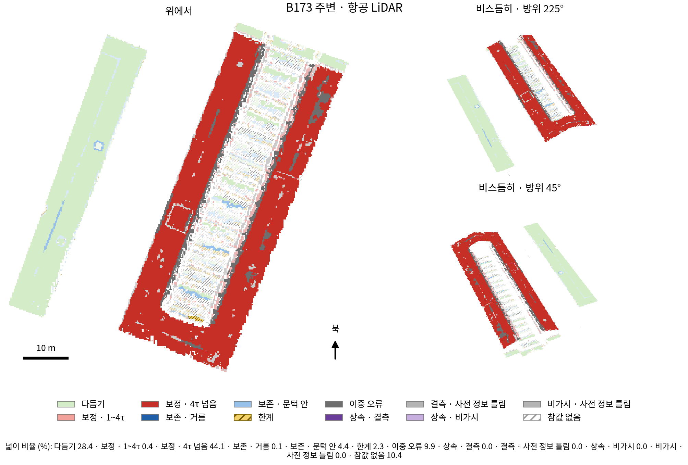
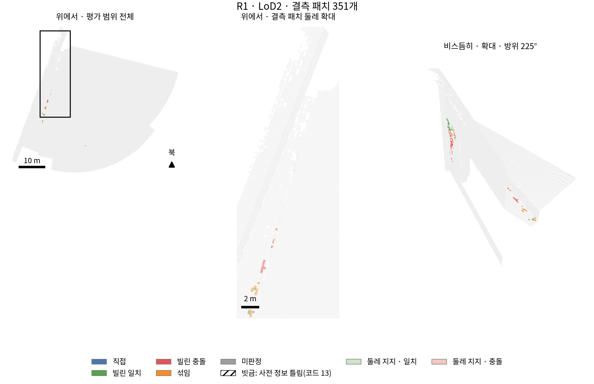

# 영역을 다시 나누고 두 축으로 보는 7.1 재료 — 중간 보고 v1 (PHD-MAIN-AXES71-v2)

- 만든 때 2026-10-22 23:26:33 KST · 브랜치 `exp/main-experiment` · scientific_verdict: null · 학습하지 않았고 GPU를 쓰지 않았다(모든 셈 `jointbuildgs:dev` 컨테이너의 CPU).
- 발주문 `본실험_두축평가_발주문_v2.md` 0.2의 차례 3. 결정을 기다리지 않고 차례 4(일 5, 일 8, 일 9의 마무리)로 이어 간다. 일 5·9의 값과 일 8 그림은 이미 나왔고 최종 보고에서 정리한다.
- 설정 `configs/phd/main_axes71_v2/axes71_v2.json`(첫 셈 전 잠금 2026-10-22 20:05, 결과를 보기 전 고침 2건: 결과 선 색, 축 2 값의 정의 — amendments에 시각과 까닭).
- 지표 이름: 참값 기준 재현율 R(τ), 결과 기준 정밀도 P(τ), 참값 기준 평균 거리, 결과 기준 평균 거리. 결과 기준은 셈 마(참값 그 자리 평면까지 법선 방향, 옆 거리 0.5 m 안). 관련 연구(DTU)의 완전성이 참값 기준 평균 거리에, 정확도가 결과 기준 평균 거리에 해당한다. CDGS* = 시점별 크기 맞추기를 생략한 변형.

## 0. 맨 앞 — 보이지 않음, 어긋남, 정의 없음

| 무엇 | 결과 |
|---|---|
| 일 2 참값 점 수 (v4 의도 한눈에) | 6건 가운데 5건 같음. 다듬기 B0 · LoD2 301,688 대 기록 301,740 — 칸이 다름(거른 영상 오류인 코드 2 패치 11개의 행 52개가 보존 · 거름으로 감) |
| 일 3 발주 6절의 값 | 12개 가운데 11개 같음. 어긋남: 다듬기 R1rep_b10/ALS 본 방법 R(τ) 89.82 대 89.7 — 칸이 다름(R1 · 항공 LiDAR의 거른 영상 오류인 코드 2 패치 46개를 다듬기에서 뺌) |
| 일 3 새 거리 지표와 같은 칸 | 참값 쪽 432/432칸 반올림 전 값까지 같음. 결과 쪽 P(0.2 m) 셈 가는 기록의 셈 나와 108/108 같음(칸이 참값 행 없는 패치를 '참값 없음'으로 보내기 때문) |
| 일 3 v4 의도 한눈에 (반올림 전 중앙값) | 72/72 같음 |
| 일 4 새 거리 지표 일 5 | 4/4 같음 (B0 · LoD2 결합 1~1.5τ 31.8, 1.5~4τ 5.7 (5.65), B173 주변 · 항공 LiDAR 1~4τ 본 방법 86.4, 결합 48.7) |
| 일 7 고친 판 시험 표 2 | 24/24 같음 |
| 일 9 고친 판 시험의 값 | 5/5 반올림 전 값까지 같음 |
| 그림이 제목대로 읽히는가 (처음 보는 사람 점검, 그림마다 한 번) | V3 보임, V5 일부만 보임(봉우리 숫자와 제목의 치우침 숫자가 다른 값이라 헷갈림), V6 일부만 보임(유리와 둘레를 테두리로만 구별, 칸이 작음). 결측 지도는 결측 패치가 작아 확대 판에서도 작게 보임 |
| 정의 없음 | 비가시 칸의 가상 시점 메시: B0·R1은 메시가 없고 만들려면 GPU 렌더가 필요해 만들지 않음('가상 시점 메시 없음'; 그 칸의 참값 점은 0~45점). MVS 표면은 가우시안이 없어 가상 시점 메시가 없음. 일 9의 3단계 조건: 조건마다 거른 영상 오류 파일이 없어 보존 · 거름, 보존 · 문턱 안, 다듬기, 상속 · 결측(과 그 합)은 정의 없음, 항공 LiDAR 영역 파일이 없어 그 경우 전체가 정의 없음 |

## 1. 이 발주에서 정한 것 (발주 2절의 '새로 정하는 것')

- **칸의 차례.** 발주 5.1을 영역 파일에 그대로 대면 겹치거나 비는 패치가 있다(일 1 확인). 앞 작업 정의(빈칸 채우기의 '영상이 틀린 곳' = 거른 영상 오류에서 코드 3 전제 위배를 뺀 것 ∪ 코드 3 문턱 안)를 지키도록 참값 없음 → 한계 → 보존 · 거름 → 보존 · 문턱 안 → 다듬기 → 보정 → 나머지 차례로 넣었다. 그래서 보존 합은 v4의 '영상이 틀린 곳'과 행까지 같고, 다듬기는 거른 영상 오류인 코드 2 패치만큼 작다. 코드 0(GT missing)인데 참값 행이 있는 패치(B0 · LoD2 3,387개 등)는 참값 없음에 넣었다. 설정의 cells.rule만 바꾸면 차례를 바꿔 다시 셀 수 있다.
- **결과 기준 거리(셈 마).** 참값 점 법선은 출처마다 반지름 0.5 m 공분산(10개 미만은 가장 가까운 10개)으로 냈다. 새 거리 지표의 법선과 각도 차 최대 0.03°. 이웃 10개 미만 점은 0.02~0.03 %.
- **결과 점.** 새 거리 지표의 결과 점을 같은 규칙으로 다시 뽑았다(모든 결과에서 점 수 같음, d_r 차 최대 1e-6 m).
- **축 2 값.** 코드 3을 정한 값 = where(v1_kept, mvs_minus_prior − gt_med, mvs_minus_gt_at_gt)(지붕꼴 연직, LoD2 벽꼴 면 법선; 빈칸 채우기 v_geo와 코드 2·3에서 같음). 보존 · 거름은 거르기 전 |v_photo| ÷ τ로 나눈 셋째 선.
- **MVS 표면** [새로 만듦]. 판 가 = 학습이 마스크를 켜고 읽는 깊이(COLMAP 기하 단계). 관측 신뢰도 마스크는 그 깊이의 유효 화소와 똑같아, '마스크만 뺀 같은 깊이'는 판 가와 같다. 그래서 판 나 = 마스크를 끈 학습이 읽는 깊이(광도 단계, 기하 거름 전)로 했다. 1단계 후처리 TSDF(0.05 / 0.25 / 300 m, 다듬기 없음)를 CPU로 옮겨 결합 깊이로 GPU 결과와 맞춰 봄(1 mm 넘게 다른 꼭짓점 6개). 판 가 꼭짓점 B0 16.4 M, B173 주변 19.0 M, R1 24.6 M. 결합은 MVS 표면을 따로 만들지 않았다(셋째 없음).
- **덩어리 잇기.** 이웃 패치 중심 간격의 중앙값 0.25 m(0.18~0.36 안) → 0.36 m로 이음.

## 2. 영역 나눔 (일 2) — 사전 정보마다 세 지역 합

- 칸 = 넓이 비율 (%) · 영역 행 비율 (%). 경우마다와 장면 점 비율은 숫자표 1절과 tables/일2_영역나눔.md. 넓이 합 100.00 %, 두 칸에 든 패치 0.

| 칸 | LoD2 합 | 항공 LiDAR 합 |
|---|---:|---:|
| 다듬기 | 34.2 · 59.2 | 60.3 · 62.4 |
| 보정 · 1~4τ | 5.5 · 9.1 | 0.3 · 0.3 |
| 보정 · 4τ 넘음 | 7.2 · 12.3 | 18.5 · 19.1 |
| 보존 · 거름 | 0.4 · 0.8 | 0.2 · 0.2 |
| 보존 · 문턱 안 | 0.2 · 0.4 | 4.7 · 4.8 |
| 한계 | 3.9 · 6.3 | 4.7 · 4.9 |
| 이중 오류 | 4.1 · 6.2 | 4.8 · 4.4 |
| 상속 · 결측 | 0.7 · 1.2 | 0.1 · 0.1 |
| 결측 · 사전 정보 틀림 | 0.1 · 0.1 | 0.0 · 0.0 |
| 상속 · 비가시 | 0.0 · 0.0 | 0.0 · 0.0 |
| 비가시 · 사전 정보 틀림 | 0.0 · 0.0 | 0.0 · 0.0 |
| 참값 없음 | 43.5 · 4.4 | 6.4 · 3.8 |
| 보정 합 | 12.8 · 21.4 | 18.8 · 19.3 |
| 보존 합 | 0.7 · 1.1 | 4.9 · 5.0 |
| 상속 합 | 0.7 · 1.3 | 0.1 · 0.1 |

## 3. 장면 전체 한눈에 (일 3)

**LoD2 합**

| 값 | 〔사전 정보 쪽〕 학습 전 사전 정보 | GeoGS | 〔영상 쪽〕 MVS | 2DGS | 〔곳마다 정함〕 결합 | CDGS* | 본 방법 |
|---|---|---|---|---|---|---|---|
| F1 셈 마 | 67.5 | 70.2 | 89.6 | 62.6 | 84.8 | 37.4 | 89.3 |
| F1 셈 가 | 58.8 | 61.7 | 81.5 | 52.2 | 76.5 | 22.4 | 80.0 |
| Chamfer 셈 마 | 63.9 | 42.1 | 19.1 | 62.5 | 28.9 | 147.0 | 22.9 |
| Chamfer 셈 가 | 102.4 | 76.8 | 48.0 | 133.0 | 57.5 | 297.2 | 58.6 |
| 4τ 넘는 참값 점 | 15.0 | 1.1 | 0.5 | 5.4 | 0.8 | 20.0 | 0.9 |

- 칸별 참값 점 비율 (영역 행, %): 다듬기 59.2, 보정 · 1~4τ 9.1, 보정 · 4τ 넘음 12.3, 보존 · 거름 0.8, 보존 · 문턱 안 0.4, 한계 6.3, 이중 오류 6.2, 상속 · 결측 1.2, 결측 · 사전 정보 틀림 0.1, 상속 · 비가시 0.0, 비가시 · 사전 정보 틀림 0.0, 참값 없음 4.4

**항공 LiDAR 합**

| 값 | 〔사전 정보 쪽〕 학습 전 사전 정보 | GeoGS | 〔영상 쪽〕 MVS | 2DGS | 〔곳마다 정함〕 결합 | CDGS* | 본 방법 |
|---|---|---|---|---|---|---|---|
| F1 셈 마 | 57.6 | 47.3 | 71.3 | 36.6 | 65.5 | 16.1 | 75.6 |
| F1 셈 가 | 43.3 | 36.3 | 60.6 | 27.1 | 51.9 | 6.9 | 64.2 |
| Chamfer 셈 마 | 57.6 | 44.8 | 19.1 | 62.5 | 30.6 | 146.3 | 22.1 |
| Chamfer 셈 가 | 112.6 | 94.7 | 48.0 | 133.0 | 75.7 | 299.4 | 57.4 |
| 4τ 넘는 참값 점 | 20.7 | 6.4 | 2.2 | 12.0 | 4.4 | 30.4 | 3.6 |

- 칸별 참값 점 비율 (영역 행, %): 다듬기 62.4, 보정 · 1~4τ 0.3, 보정 · 4τ 넘음 19.1, 보존 · 거름 0.2, 보존 · 문턱 안 4.8, 한계 4.9, 이중 오류 4.4, 상속 · 결측 0.1, 결측 · 사전 정보 틀림 0.0, 상속 · 비가시 0.0, 비가시 · 사전 정보 틀림 0.0, 참값 없음 3.8

## 4. 두 축 곡선 (일 4) — 그림 A

- 캡션 재료: 무엇 = 칸 패치를 사전 정보 어긋남(축 1)과 영상 깊이 어긋남(축 2)의 τ 배로 나눈 구간마다 참값 기준 재현율 R(τ). 어디서 = 사전 정보마다 세 지역의 참값 행. 색 = 결과(입력 둘은 회색 점선), 축 2의 옅은 선 = 판정이 놓은 한계 칸, 점선 = 보존 · 거름(거르기 전 어긋남), 빈 표지 = 참값 점 1만 미만. 그림 B(경우마다), C(평균 거리), D(축 1 m 단위)는 figures/.

### LoD2 합(세 지역)

**축 1 (τ의 배)**

| 구간 | 학습 전 사전 정보 | GeoGS | MVS | 2DGS | 결합 | CDGS* | 본 방법 |
|---|---|---|---|---|---|---|---|
| 0~1 | 98.5 · 13.9 · 589,057 | 87.7 · 15.3 · 589,057 | 99.5 · 6.0 · 589,057 | 82.7 · 19.2 · 589,057 | 98.6 · 13.8 · 589,057 | 56.0 · 46.2 · 589,057 | 98.8 · 6.6 · 589,057 |
| 1~1.5 | 18.9 · 51.8 · 48,915 | 74.3 · 23.7 · 48,915 | 97.3 · 9.8 · 48,915 | 81.1 · 19.9 · 48,915 | 43.4 · 42.8 · 48,915 | 62.1 · 37.9 · 48,915 | 96.9 · 10.0 · 48,915 |
| 1.5~2 | 11.4 · 73.3 · 24,770 | 76.4 · 23.7 · 24,770 | 96.6 · 10.5 · 24,770 | 79.4 · 24.4 · 24,770 | 38.4 · 49.1 · 24,770 | 69.3 · 33.0 · 24,770 | 95.6 · 11.2 · 24,770 |
| 2~4 | 15.1 · 72.2 · 16,948 | 75.0 · 21.7 · 16,948 | 98.2 · 8.5 · 16,948 | 79.8 · 23.9 · 16,948 | 43.8 · 34.1 · 16,948 | 77.0 · 27.5 · 16,948 | 94.6 · 12.2 · 16,948 |
| 4~8 | 28.0 · 100.4 · 19,200 | 85.7 · 24.6 · 19,200 | 99.7 · 11.3 · 19,200 | 94.8 · 16.0 · 19,200 | 76.5 · 32.2 · 19,200 | 54.6 · 54.8 · 19,200 | 99.5 · 7.9 · 19,200 |
| 8~ | 2.7 · 212.6 · 102,728 | 74.7 · 14.0 · 102,728 | 99.2 · 5.3 · 102,728 | 42.5 · 40.9 · 102,728 | 97.3 · 6.9 · 102,728 | 4.8 · 189.7 · 102,728 | 99.4 · 5.1 · 102,728 |

**축 1 (m, 보정 칸만)**

| 구간 | 학습 전 사전 정보 | GeoGS | MVS | 2DGS | 결합 | CDGS* | 본 방법 |
|---|---|---|---|---|---|---|---|
| 0~0.5 | 17.5 · 25.2 · 34,947 | 60.9 · 17.8 · 34,947 | 93.9 · 8.4 · 34,947 | 63.2 · 17.7 · 34,947 | 37.2 · 21.7 · 34,947 | 47.6 · 29.1 · 34,947 | 93.1 · 8.7 · 34,947 |
| 0.5~1 | 11.7 · 71.8 · 35,267 | 74.5 · 29.1 · 35,267 | 98.9 · 10.0 · 35,267 | 90.4 · 20.7 · 35,267 | 29.5 · 61.8 · 35,267 | 76.5 · 36.2 · 35,267 | 98.2 · 10.8 · 35,267 |
| 1~2 | 13.9 · 107.6 · 25,468 | 89.6 · 20.5 · 25,468 | 99.8 · 9.7 · 25,468 | 89.9 · 23.8 · 25,468 | 56.4 · 56.9 · 25,468 | 78.2 · 40.9 · 25,468 | 97.6 · 11.3 · 25,468 |
| 2~4 | 14.8 · 165.0 · 41,608 | 90.1 · 15.1 · 41,608 | 99.7 · 7.6 · 41,608 | 61.6 · 30.0 · 41,608 | 98.9 · 8.5 · 41,608 | 17.4 · 151.8 · 41,608 | 99.8 · 6.3 · 41,608 |
| 4~ | 3.8 · 216.9 · 75,271 | 70.8 · 16.3 · 75,271 | 99.1 · 5.8 · 75,271 | 42.8 · 43.7 · 75,271 | 98.2 · 6.4 · 75,271 | 7.0 · 186.4 · 75,271 | 99.3 · 5.5 · 75,271 |

**축 2 · 지킴(보존 · 문턱 안)**

| 구간 | 학습 전 사전 정보 | GeoGS | MVS | 2DGS | 결합 | CDGS* | 본 방법 |
|---|---|---|---|---|---|---|---|
| 0~1 | 98.5 · 13.9 · 589,057 | 87.7 · 15.3 · 589,057 | 99.5 · 6.0 · 589,057 | 82.7 · 19.2 · 589,057 | 98.6 · 13.8 · 589,057 | 56.0 · 46.2 · 589,057 | 98.8 · 6.6 · 589,057 |
| 1~1.5 | 95.2 · 15.3 · 2,897* | 56.6 · 29.5 · 2,897* | 71.6 · 17.0 · 2,897* | 52.6 · 35.7 · 2,897* | 94.0 · 15.0 · 2,897* | 37.0 · 45.4 · 2,897* | 69.7 · 21.3 · 2,897* |
| 1.5~2 | 92.1 · 31.1 · 617* | 37.4 · 70.4 · 617* | 63.9 · 29.0 · 617* | 32.3 · 69.5 · 617* | 87.2 · 28.0 · 617* | 35.8 · 79.9 · 617* | 39.4 · 50.9 · 617* |
| 2~4 | 표본 부족 (5) | 표본 부족 (5) | 표본 부족 (5) | 표본 부족 (5) | 표본 부족 (5) | 표본 부족 (5) | 표본 부족 (5) |

**축 2 · 놓음(한계)**

| 구간 | 학습 전 사전 정보 | GeoGS | MVS | 2DGS | 결합 | CDGS* | 본 방법 |
|---|---|---|---|---|---|---|---|
| 0~1 | 98.5 · 13.9 · 589,057 | 87.7 · 15.3 · 589,057 | 99.5 · 6.0 · 589,057 | 82.7 · 19.2 · 589,057 | 98.6 · 13.8 · 589,057 | 56.0 · 46.2 · 589,057 | 98.8 · 6.6 · 589,057 |
| 1~1.5 | 96.1 · 9.2 · 3,836* | 68.9 · 20.1 · 3,836* | 81.6 · 17.3 · 3,836* | 67.2 · 38.9 · 3,836* | 95.6 · 10.9 · 3,836* | 41.5 · 43.9 · 3,836* | 69.5 · 29.0 · 3,836* |
| 1.5~2 | 94.8 · 14.5 · 4,090* | 71.0 · 26.1 · 4,090* | 72.5 · 23.8 · 4,090* | 56.2 · 61.0 · 4,090* | 94.5 · 14.7 · 4,090* | 49.4 · 54.0 · 4,090* | 54.7 · 42.1 · 4,090* |
| 2~4 | 95.4 · 11.1 · 9,998* | 65.7 · 29.2 · 9,998* | 65.8 · 30.2 · 9,998* | 30.7 · 89.9 · 9,998* | 94.8 · 18.1 · 9,998* | 44.6 · 63.7 · 9,998* | 28.2 · 79.6 · 9,998* |
| 4~ | 96.5 · 15.1 · 44,491 | 92.6 · 16.2 · 44,491 | 90.1 · 17.5 · 44,491 | 67.8 · 62.4 · 44,491 | 97.4 · 14.1 · 44,491 | 77.3 · 38.6 · 44,491 | 82.6 · 27.3 · 44,491 |

**축 2 · 보존 · 거름**

| 구간 | 학습 전 사전 정보 | GeoGS | MVS | 2DGS | 결합 | CDGS* | 본 방법 |
|---|---|---|---|---|---|---|---|
| 0~1 | 98.5 · 13.9 · 589,057 | 87.7 · 15.3 · 589,057 | 99.5 · 6.0 · 589,057 | 82.7 · 19.2 · 589,057 | 98.6 · 13.8 · 589,057 | 56.0 · 46.2 · 589,057 | 98.8 · 6.6 · 589,057 |
| 1~1.5 | 98.7 · 11.2 · 749* | 94.5 · 14.6 · 749* | 97.5 · 11.9 · 749* | 91.1 · 19.8 · 749* | 98.3 · 12.5 · 749* | 59.3 · 55.9 · 749* | 97.7 · 12.5 · 749* |
| 1.5~2 | 98.7 · 15.5 · 390* | 91.3 · 21.7 · 390* | 97.9 · 13.5 · 390* | 86.9 · 22.9 · 390* | 98.7 · 16.4 · 390* | 43.1 · 82.2 · 390* | 93.2 · 17.1 · 390* |
| 2~4 | 99.0 · 17.1 · 906* | 95.5 · 20.7 · 906* | 94.2 · 16.8 · 906* | 91.2 · 16.8 · 906* | 96.5 · 18.0 · 906* | 27.6 · 116.5 · 906* | 95.4 · 11.5 · 906* |
| 4~ | 99.5 · 19.8 · 5,572* | 97.1 · 22.4 · 5,572* | 93.0 · 24.7 · 5,572* | 87.0 · 35.1 · 5,572* | 99.5 · 19.9 · 5,572* | 18.1 · 153.8 · 5,572* | 96.2 · 10.0 · 5,572* |

### 항공 LiDAR 합(세 지역)

**축 1 (τ의 배)**

| 구간 | 학습 전 사전 정보 | GeoGS | MVS | 2DGS | 결합 | CDGS* | 본 방법 |
|---|---|---|---|---|---|---|---|
| 0~1 | 98.4 · 3.5 · 314,896 | 66.1 · 11.7 · 314,896 | 92.7 · 5.1 · 314,896 | 47.8 · 18.2 · 314,896 | 98.4 · 3.5 · 314,896 | 31.5 · 27.3 · 314,896 | 95.5 · 4.8 · 314,896 |
| 1~1.5 | 55.1 · 11.8 · 586* | 61.3 · 14.7 · 586* | 77.8 · 8.1 · 586* | 41.5 · 20.0 · 586* | 58.4 · 11.1 · 586* | 32.6 · 23.5 · 586* | 78.2 · 9.4 · 586* |
| 1.5~2 | 42.7 · 13.8 · 213* | 47.4 · 14.5 · 213* | 67.6 · 10.2 · 213* | 51.2 · 18.9 · 213* | 47.9 · 13.2 · 213* | 22.5 · 30.4 · 213* | 80.3 · 8.6 · 213* |
| 2~4 | 22.9 · 21.3 · 624* | 42.1 · 19.8 · 624* | 89.3 · 6.4 · 624* | 62.8 · 16.3 · 624* | 34.0 · 18.6 · 624* | 16.0 · 45.9 · 624* | 86.9 · 6.9 · 624* |
| 4~8 | 19.5 · 24.2 · 390* | 34.9 · 22.3 · 390* | 94.9 · 5.9 · 390* | 43.6 · 19.3 · 390* | 25.9 · 22.2 · 390* | 12.6 · 54.6 · 390* | 91.2 · 7.0 · 390* |
| 8~ | 0.3 · 241.6 · 95,715 | 73.2 · 11.4 · 95,715 | 98.2 · 4.8 · 95,715 | 34.2 · 40.9 · 95,715 | 97.4 · 5.0 · 95,715 | 3.0 · 162.5 · 95,715 | 98.2 · 4.9 · 95,715 |

**축 1 (m, 보정 칸만)**

| 구간 | 학습 전 사전 정보 | GeoGS | MVS | 2DGS | 결합 | CDGS* | 본 방법 |
|---|---|---|---|---|---|---|---|
| 0~0.5 | 41.7 · 15.3 · 1,246* | 52.7 · 16.1 · 1,246* | 78.7 · 8.1 · 1,246* | 51.4 · 18.3 · 1,246* | 48.8 · 13.8 · 1,246* | 27.1 · 30.3 · 1,246* | 80.2 · 8.6 · 1,246* |
| 0.5~1 | 20.3 · 23.5 · 537* | 33.9 · 22.9 · 537* | 96.8 · 5.4 · 537* | 45.4 · 19.4 · 537* | 26.8 · 21.7 · 537* | 7.4 · 57.8 · 537* | 92.6 · 6.5 · 537* |
| 1~2 | 1.4 · 131.9 · 1,016* | 75.6 · 9.2 · 1,016* | 94.6 · 6.0 · 1,016* | 44.2 · 17.6 · 1,016* | 59.7 · 15.2 · 1,016* | 9.2 · 108.3 · 1,016* | 92.3 · 5.3 · 1,016* |
| 2~4 | 0.5 · 142.2 · 25,702 | 80.0 · 9.8 · 25,702 | 98.6 · 4.6 · 25,702 | 37.5 · 35.5 · 25,702 | 98.0 · 4.8 · 25,702 | 3.8 · 121.3 · 25,702 | 98.9 · 4.7 · 25,702 |
| 4~ | 0.2 · 280.1 · 69,027 | 70.6 · 12.1 · 69,027 | 98.1 · 4.9 · 69,027 | 32.8 · 43.3 · 69,027 | 97.7 · 5.0 · 69,027 | 2.6 · 178.6 · 69,027 | 98.0 · 4.9 · 69,027 |

**축 2 · 지킴(보존 · 문턱 안)**

| 구간 | 학습 전 사전 정보 | GeoGS | MVS | 2DGS | 결합 | CDGS* | 본 방법 |
|---|---|---|---|---|---|---|---|
| 0~1 | 98.4 · 3.5 · 314,896 | 66.1 · 11.7 · 314,896 | 92.7 · 5.1 · 314,896 | 47.8 · 18.2 · 314,896 | 98.4 · 3.5 · 314,896 | 31.5 · 27.3 · 314,896 | 95.5 · 4.8 · 314,896 |
| 1~1.5 | 96.0 · 4.8 · 19,985 | 51.2 · 15.2 · 19,985 | 58.5 · 11.5 · 19,985 | 32.6 · 23.8 · 19,985 | 95.7 · 5.1 · 19,985 | 22.9 · 30.0 · 19,985 | 69.6 · 11.0 · 19,985 |
| 1.5~2 | 94.9 · 4.6 · 3,274* | 43.2 · 19.6 · 3,274* | 30.9 · 17.8 · 3,274* | 27.7 · 29.5 · 3,274* | 90.2 · 6.3 · 3,274* | 20.0 · 34.8 · 3,274* | 41.8 · 16.7 · 3,274* |
| 2~4 | 94.1 · 5.9 · 1,106* | 50.3 · 13.9 · 1,106* | 22.2 · 23.8 · 1,106* | 32.0 · 26.5 · 1,106* | 91.4 · 6.7 · 1,106* | 21.2 · 32.2 · 1,106* | 32.6 · 17.8 · 1,106* |

**축 2 · 놓음(한계)**

| 구간 | 학습 전 사전 정보 | GeoGS | MVS | 2DGS | 결합 | CDGS* | 본 방법 |
|---|---|---|---|---|---|---|---|
| 0~1 | 98.4 · 3.5 · 314,896 | 66.1 · 11.7 · 314,896 | 92.7 · 5.1 · 314,896 | 47.8 · 18.2 · 314,896 | 98.4 · 3.5 · 314,896 | 31.5 · 27.3 · 314,896 | 95.5 · 4.8 · 314,896 |
| 1~1.5 | 85.2 · 7.4 · 250* | 40.0 · 34.4 · 250* | 71.2 · 9.3 · 250* | 49.2 · 35.1 · 250* | 86.8 · 7.1 · 250* | 19.2 · 26.0 · 250* | 72.8 · 18.4 · 250* |
| 1.5~2 | 87.1 · 6.4 · 1,007* | 29.7 · 60.7 · 1,007* | 52.8 · 11.0 · 1,007* | 36.8 · 50.2 · 1,007* | 86.2 · 6.5 · 1,007* | 18.8 · 26.7 · 1,007* | 48.0 · 40.1 · 1,007* |
| 2~4 | 92.9 · 5.1 · 6,762* | 38.2 · 36.1 · 6,762* | 31.6 · 20.5 · 6,762* | 21.7 · 44.4 · 6,762* | 86.6 · 6.5 · 6,762* | 15.8 · 33.4 · 6,762* | 28.0 · 33.7 · 6,762* |
| 4~ | 92.5 · 5.2 · 16,946 | 34.1 · 69.1 · 16,946 | 34.6 · 24.3 · 16,946 | 19.5 · 88.3 · 16,946 | 68.1 · 11.9 · 16,946 | 23.2 · 30.4 · 16,946 | 30.2 · 65.3 · 16,946 |

**축 2 · 보존 · 거름**

| 구간 | 학습 전 사전 정보 | GeoGS | MVS | 2DGS | 결합 | CDGS* | 본 방법 |
|---|---|---|---|---|---|---|---|
| 0~1 | 98.4 · 3.5 · 314,896 | 66.1 · 11.7 · 314,896 | 92.7 · 5.1 · 314,896 | 47.8 · 18.2 · 314,896 | 98.4 · 3.5 · 314,896 | 31.5 · 27.3 · 314,896 | 95.5 · 4.8 · 314,896 |
| 1~1.5 | 93.9 · 4.9 · 148* | 62.8 · 24.0 · 148* | 37.2 · 15.5 · 148* | 18.2 · 24.4 · 148* | 93.9 · 4.9 · 148* | 9.5 · 28.2 · 148* | 31.1 · 25.0 · 148* |
| 1.5~2 | 표본 부족 (86) | 표본 부족 (86) | 표본 부족 (86) | 표본 부족 (86) | 표본 부족 (86) | 표본 부족 (86) | 표본 부족 (86) |
| 2~4 | 표본 부족 (84) | 표본 부족 (84) | 표본 부족 (84) | 표본 부족 (84) | 표본 부족 (84) | 표본 부족 (84) | 표본 부족 (84) |
| 4~ | 95.7 · 5.0 · 582* | 51.0 · 51.7 · 582* | 16.0 · 33.2 · 582* | 8.2 · 82.6 · 582* | 83.2 · 8.1 · 582* | 17.9 · 30.8 · 582* | 23.3 · 59.2 · 582* |

## 5. 보존 · 거름, 보존 · 문턱 안, 한계의 네 값 (일 3) — 사전 정보마다 세 지역 합

- 경우마다는 tables/일3_보존_거름.md, 일3_보존_문턱안.md, 일3_한계.md.

### 보존 · 거름

**참값 기준: 참값 기준 재현율 R(τ) (%) · 참값 기준 평균 거리 (cm)**

| 경우 | 참값 점 | 〔사전 정보 쪽〕 학습 전 사전 정보 | GeoGS | 〔영상 쪽〕 MVS | 2DGS | 〔곳마다 정함〕 결합 | CDGS* | 본 방법 |
|---|---:|---|---|---|---|---|---|---|
| LoD2 합 | 7,617 | 99.3 · 18.4* | 96.4 · 21.4* | 93.9 · 21.9* | 87.9 · 30.8* | 98.9 · 18.8* | 24.5 · 136.1* | 96.1 · 10.8* |
| 항공 LiDAR 합 | 900 | 96.1 · 4.8* | 58.0 · 40.0* | 20.7 · 28.1* | 11.1 · 64.1* | 88.0 · 6.8* | 19.7 · 29.0* | 26.7 · 46.1* |

**결과 기준(셈 마): 결과 기준 정밀도 P(τ) (%) · 결과 기준 평균 거리 (cm)**

| 경우 | 〔사전 정보 쪽〕 학습 전 사전 정보 | GeoGS | 〔영상 쪽〕 MVS | 2DGS | 〔곳마다 정함〕 결합 | CDGS* | 본 방법 |
|---|---|---|---|---|---|---|---|
| LoD2 합 | 100.0 · 9.9 | 90.5 · 18.7 | 91.3 · 13.5 | 83.1 · 19.5 | 98.9 · 11.5 | 41.5 · 71.6 | 94.3 · 12.0 |
| 항공 LiDAR 합 | 54.7 · 38.2 | 47.2 · 33.2 | 41.5 · 39.7* | 13.9 · 54.0 | 61.1 · 33.2 | 16.7 · 164.2* | 40.1 · 45.4* |

### 보존 · 문턱 안

**참값 기준: 참값 기준 재현율 R(τ) (%) · 참값 기준 평균 거리 (cm)**

| 경우 | 참값 점 | 〔사전 정보 쪽〕 학습 전 사전 정보 | GeoGS | 〔영상 쪽〕 MVS | 2DGS | 〔곳마다 정함〕 결합 | CDGS* | 본 방법 |
|---|---:|---|---|---|---|---|---|---|
| LoD2 합 | 3,519 | 94.5 · 18.1* | 53.1 · 36.7* | 70.2 · 19.1* | 49.0 · 41.6* | 92.7 · 17.3* | 36.9 · 51.4* | 64.3 · 26.5* |
| 항공 LiDAR 합 | 24,365 | 95.8 · 4.8 | 50.0 · 15.7 | 53.1 · 12.9 | 31.9 · 24.7 | 94.8 · 5.4 | 22.4 · 30.8 | 64.2 · 12.0 |

**결과 기준(셈 마): 결과 기준 정밀도 P(τ) (%) · 결과 기준 평균 거리 (cm)**

| 경우 | 〔사전 정보 쪽〕 학습 전 사전 정보 | GeoGS | 〔영상 쪽〕 MVS | 2DGS | 〔곳마다 정함〕 결합 | CDGS* | 본 방법 |
|---|---|---|---|---|---|---|---|
| LoD2 합 | 99.6 · 14.9 | 71.3 · 31.2 | 71.5 · 18.8 | 64.8 · 32.9 | 90.0 · 17.1 | 32.3 · 116.6 | 80.2 · 15.7 |
| 항공 LiDAR 합 | 59.2 · 18.3 | 47.8 · 40.6 | 62.1 · 20.0 | 36.7 · 48.1 | 58.2 · 18.7 | 13.3 · 219.5 | 71.2 · 17.9 |

### 한계

**참값 기준: 참값 기준 재현율 R(τ) (%) · 참값 기준 평균 거리 (cm)**

| 경우 | 참값 점 | 〔사전 정보 쪽〕 학습 전 사전 정보 | GeoGS | 〔영상 쪽〕 MVS | 2DGS | 〔곳마다 정함〕 결합 | CDGS* | 본 방법 |
|---|---:|---|---|---|---|---|---|---|
| LoD2 합 | 62,415 | 96.2 · 14.1 | 85.4 · 19.2 | 84.5 · 19.9 | 61.1 · 65.3 | 96.7 · 14.6 | 68.0 · 43.9 | 71.2 · 36.8 |
| 항공 LiDAR 합 | 24,965 | 92.3 · 5.3 | 35.1 · 59.4 | 34.9 · 22.6 | 21.1 · 74.3 | 74.0 · 10.2 | 21.0 · 31.0 | 30.8 · 55.2 |

**결과 기준(셈 마): 결과 기준 정밀도 P(τ) (%) · 결과 기준 평균 거리 (cm)**

| 경우 | 〔사전 정보 쪽〕 학습 전 사전 정보 | GeoGS | 〔영상 쪽〕 MVS | 2DGS | 〔곳마다 정함〕 결합 | CDGS* | 본 방법 |
|---|---|---|---|---|---|---|---|
| LoD2 합 | 100.0 · 7.2 | 84.1 · 36.6 | 90.0 · 18.1 | 66.3 · 58.5 | 96.0 · 14.5 | 50.6 · 104.9 | 89.7 · 21.8 |
| 항공 LiDAR 합 | 56.9 · 19.7 | 42.4 · 49.7 | 66.2 · 17.7 | 41.2 · 58.6 | 55.8 · 20.3 | 19.9 · 108.6 | 75.0 · 15.6 |

## 6. 결과 기준의 점검 셈 (1.1, 일 8의 일부)

- 전체 · 경우마다 셈 가·다·마·바는 tables/중간_결과기준점검.md, 칸마다는 tables/일3_부록_셈.md. 아래는 동기가 된 B0 · 항공 LiDAR.

| 경우 | 결과 | 셈 가 (d_r, 모두) | 셈 다 (기대 간격 ≤ τ) | 셈 마 (법선, 옆 0.5 m) | 셈 바 (법선, 옆 1 m) |
|---|---|---|---|---|---|
| B0 · 항공 LiDAR | 학습 전 사전 정보 | 27.4 · 289.3 · 0.0 | 28.9 · 322.4 · 15.8 | 46.6 · 102.7 · 35.4 | 41.5 · 133.2 · 26.1 |
| B0 · 항공 LiDAR | GeoGS | 17.9 · 305.2 · 0.0 | 19.5 · 327.6 · 17.1 | 31.8 · 120.6 · 35.2 | 28.9 · 148.6 · 27.1 |
| B0 · 항공 LiDAR | MVS | 42.3 · 199.5 · 0.0 | 43.2 · 226.1 · 17.9 | 63.3 · 52.2 · 26.3 | 59.1 · 72.0 · 19.8 |
| B0 · 항공 LiDAR | 2DGS | 14.4 · 420.1 · 0.0 | 13.6 · 447.5 · 14.9 | 26.3 · 169.7 · 36.5 | 24.0 · 192.8 · 28.6 |
| B0 · 항공 LiDAR | 결합 | 27.3 · 288.7 · 0.0 | 28.8 · 321.8 · 15.9 | 46.4 · 102.6 · 35.4 | 41.4 · 133.3 · 26.0 |
| B0 · 항공 LiDAR | CDGS* | 6.6 · 477.6 · 0.0 | 7.0 · 478.8 · 13.0 | 14.8 · 247.9 · 48.9 | 12.6 · 297.5 · 38.6 |
| B0 · 항공 LiDAR | 본 방법 | 44.1 · 243.6 · 0.0 | 44.6 · 273.6 · 17.6 | 69.0 · 71.0 · 30.9 | 63.1 · 97.6 · 23.5 |

### 참값 밀도 구간별 1 m 넘는 결과 점 (%) — B0 · 항공 LiDAR (셈 가 → 셈 마)

| 결과 | 밀도 1분위 | 밀도 2분위 | 밀도 3분위 | 밀도 4분위 | 밀도 5분위 | 참값 행 없음 |
|---|---|---|---|---|---|---|
| 학습 전 사전 정보 | 9.1 → 5.5 | 10.8 → 6.4 | 5.5 → 2.6 | 8.0 → 1.6 | 3.5 → 0.9 | 12.1 → 8.2 |
| GeoGS | 23.8 → 13.8 | 23.0 → 14.9 | 26.5 → 11.3 | 23.3 → 6.9 | 9.9 → 3.4 | 31.8 → 17.3 |
| MVS | 4.2 → 1.3 | 3.5 → 1.3 | 3.4 → 1.9 | 8.7 → 0.8 | 4.0 → 0.7 | 3.5 → 1.0 |
| 2DGS | 40.7 → 24.8 | 52.4 → 38.0 | 64.2 → 47.6 | 50.7 → 24.1 | 32.5 → 16.3 | 43.2 → 24.9 |
| 결합 | 9.0 → 5.5 | 11.4 → 6.7 | 5.9 → 2.8 | 8.1 → 1.7 | 3.6 → 1.0 | 12.1 → 8.2 |
| CDGS* | 62.7 → 31.0 | 71.0 → 49.2 | 60.4 → 44.5 | 49.8 → 28.0 | 56.7 → 33.7 | 76.5 → 39.3 |
| 본 방법 | 7.6 → 3.7 | 5.9 → 3.8 | 7.5 → 3.0 | 10.0 → 1.8 | 5.6 → 1.6 | 6.4 → 2.6 |

## 7. 영역 지도와 덩어리 (일 6)

- 지도: figures/일6_영역지도_<지역>_<사전 정보>.png (위에서 + 비스듬히 둘). 예:

- 덩어리 표(사전 정보마다 합). 칸 = 덩어리 수 · 넓이 50 % · 90 % · 최대 · 가장 큰 덩어리 % · 1 · 2.5 · 10 m² 미만 덩어리 넓이 % · 경계 패치 넓이 % · 2.5 m² 이상 덩어리 수.

### 칸마다 덩어리 통계

| 경우 | 칸 | 덩어리 | 넓이 50 % · 90 % · 최대 (m²) | 가장 큰 덩어리 (%) | 1 · 2.5 · 10 m² 미만 덩어리의 넓이 (%) | 경계 패치 넓이 (%) | 2.5 m² 이상 덩어리 |
|---|---|---:|---|---:|---|---:|---:|
| LoD2 합 | 다듬기 | 1,077 | 0.12 · 1.69 · 1417.9 | 21.9 | 3.0 · 4.5 · 7.4 | 33.0 | 88 |
| LoD2 합 | 보정 · 1~4τ | 992 | 0.12 · 1.19 · 164.7 | 15.7 | 15.7 · 25.3 · 43.4 | 65.9 | 53 |
| LoD2 합 | 보정 · 4τ 넘음 | 165 | 0.12 · 1.89 · 513.8 | 37.7 | 1.9 · 3.5 · 5.8 | 27.6 | 14 |
| LoD2 합 | 보존 · 거름 | 202 | 0.12 · 0.68 · 7.4 | 8.9 | 35.8 · 46.0 · 100.0 | 87.0 | 11 |
| LoD2 합 | 보존 · 문턱 안 | 335 | 0.06 · 0.19 · 4.4 | 10.3 | 79.5 · 82.4 · 100.0 | 99.3 | 2 |
| LoD2 합 | 한계 | 884 | 0.12 · 0.94 · 64.2 | 8.6 | 22.1 · 30.4 · 47.5 | 83.3 | 42 |
| LoD2 합 | 이중 오류 | 1,292 | 0.12 · 1.25 · 31.4 | 4.1 | 26.5 · 45.4 · 77.4 | 87.8 | 65 |
| LoD2 합 | 상속 · 결측 | 446 | 0.06 · 0.50 · 15.9 | 11.3 | 45.8 · 62.0 · 77.4 | 96.1 | 8 |
| LoD2 합 | 결측 · 사전 정보 틀림 | 121 | 0.06 · 0.19 · 3.5 | 20.7 | 73.4 · 79.3 · 100.0 | 91.5 | 1 |
| LoD2 합 | 상속 · 비가시 | 5 | 0.06 · 0.06 · 0.1 | 20.0 | 100.0 · 100.0 · 100.0 | 100.0 | 0 |
| LoD2 합 | 비가시 · 사전 정보 틀림 | 14 | 0.09 · 0.29 · 0.4 | 19.4 | 100.0 · 100.0 · 100.0 | 100.0 | 0 |
| LoD2 합 | 참값 없음 | 1,586 | 0.12 · 1.12 · 3415.2 | 41.5 | 3.0 · 4.3 · 7.1 | 30.2 | 101 |
| 항공 LiDAR 합 | 다듬기 | 368 | 0.13 · 1.49 · 1466.9 | 44.3 | 1.7 · 2.5 · 6.0 | 13.9 | 32 |
| 항공 LiDAR 합 | 보정 · 1~4τ | 159 | 0.09 · 0.21 · 0.7 | 3.9 | 100.0 · 100.0 · 100.0 | 89.9 | 0 |
| 항공 LiDAR 합 | 보정 · 4τ 넘음 | 278 | 0.07 · 0.39 · 958.4 | 94.3 | 3.4 · 5.7 · 5.7 | 18.6 | 1 |
| 항공 LiDAR 합 | 보존 · 거름 | 77 | 0.09 · 0.26 · 0.9 | 7.9 | 100.0 · 100.0 · 100.0 | 95.3 | 0 |
| 항공 LiDAR 합 | 보존 · 문턱 안 | 844 | 0.11 · 0.50 · 32.5 | 12.6 | 52.8 · 67.3 · 76.0 | 79.8 | 9 |
| 항공 LiDAR 합 | 한계 | 648 | 0.13 · 0.59 · 77.7 | 30.2 | 44.3 · 58.8 · 69.8 | 72.1 | 7 |
| 항공 LiDAR 합 | 이중 오류 | 734 | 0.09 · 0.40 · 41.4 | 15.7 | 39.4 · 47.6 · 61.9 | 80.9 | 15 |
| 항공 LiDAR 합 | 상속 · 결측 | 35 | 0.07 · 0.18 · 0.2 | 6.4 | 100.0 · 100.0 · 100.0 | 100.0 | 0 |
| 항공 LiDAR 합 | 결측 · 사전 정보 틀림 | 14 | 0.07 · 0.12 · 0.3 | 21.2 | 100.0 · 100.0 · 100.0 | 94.6 | 0 |
| 항공 LiDAR 합 | 상속 · 비가시 | 2 | 0.04 · 0.06 · 0.1 | 73.6 | 100.0 · 100.0 · 100.0 | 73.6 | 0 |
| 항공 LiDAR 합 | 비가시 · 사전 정보 틀림 | 11 | 0.06 · 0.07 · 0.1 | 12.7 | 100.0 · 100.0 · 100.0 | 47.4 | 0 |
| 항공 LiDAR 합 | 참값 없음 | 1,121 | 0.13 · 0.64 · 16.2 | 4.6 | 55.6 · 77.4 · 95.4 | 63.3 | 15 |

### 덩어리 단위 달성률 (참값 점의 50 %를 넘게 τ 안인 덩어리의 비율, %) — 사전 정보마다 세 지역 합

| 사전 정보 | 칸 | 크기 | 학습 전 사전 정보 | GeoGS | MVS | 2DGS | 결합 | CDGS* | 본 방법 |
|---|---|---|---|---|---|---|---|---|---|
| LoD2 | 다듬기 | 2.5 m² 이상 (88) | 100.0 | 89.8 | 100.0 | 85.2 | 100.0 | 56.8 | 98.9 |
| LoD2 | 다듬기 | 10 m² 이상 (46) | 100.0 | 97.8 | 100.0 | 95.7 | 100.0 | 60.9 | 97.8 |
| LoD2 | 보정 · 1~4τ | 2.5 m² 이상 (53) | 5.7 | 50.9 | 100.0 | 75.5 | 32.1 | 62.3 | 100.0 |
| LoD2 | 보정 · 1~4τ | 10 m² 이상 (15) | 0.0 | 66.7 | 100.0 | 73.3 | 33.3 | 60.0 | 100.0 |
| LoD2 | 보정 · 4τ 넘음 | 2.5 m² 이상 (14) | 21.4 | 92.9 | 100.0 | 92.9 | 78.6 | 57.1 | 100.0 |
| LoD2 | 보정 · 4τ 넘음 | 10 m² 이상 (8) | 12.5 | 87.5 | 100.0 | 87.5 | 75.0 | 50.0 | 100.0 |
| LoD2 | 보존 · 거름 | 2.5 m² 이상 (11) | 100.0 | 100.0 | 100.0 | 90.9 | 100.0 | 18.2 | 100.0 |
| LoD2 | 보존 · 문턱 안 | 2.5 m² 이상 (2) | 100.0 | 0.0 | 50.0 | 50.0 | 100.0 | 0.0 | 25.0 |
| LoD2 | 한계 | 2.5 m² 이상 (42) | 100.0 | 83.3 | 85.7 | 64.3 | 100.0 | 64.3 | 71.4 |
| LoD2 | 한계 | 10 m² 이상 (14) | 100.0 | 100.0 | 100.0 | 64.3 | 100.0 | 78.6 | 85.7 |
| LoD2 | 이중 오류 | 2.5 m² 이상 (65) | 26.2 | 61.5 | 55.4 | 56.9 | 56.9 | 50.8 | 50.8 |
| LoD2 | 이중 오류 | 10 m² 이상 (11) | 0.0 | 54.5 | 27.3 | 36.4 | 27.3 | 18.2 | 36.4 |
| LoD2 | 상속 · 결측 | 2.5 m² 이상 (8) | 100.0 | 100.0 | 100.0 | 100.0 | 100.0 | 62.5 | 100.0 |
| LoD2 | 상속 · 결측 | 10 m² 이상 (2) | 100.0 | 100.0 | 100.0 | 100.0 | 100.0 | 100.0 | 100.0 |
| LoD2 | 결측 · 사전 정보 틀림 | 2.5 m² 이상 (1) | 0.0 | 100.0 | 100.0 | 100.0 | 100.0 | 100.0 | 100.0 |
| LoD2 | 참값 없음 | 2.5 m² 이상 (99) | 91.9 | 92.9 | 99.0 | 82.8 | 99.0 | 44.4 | 92.9 |
| LoD2 | 참값 없음 | 10 m² 이상 (43) | 97.7 | 97.7 | 100.0 | 93.0 | 100.0 | 65.1 | 97.7 |
| 항공 LiDAR | 다듬기 | 2.5 m² 이상 (32) | 100.0 | 75.0 | 84.4 | 31.2 | 100.0 | 28.1 | 89.1 |
| 항공 LiDAR | 다듬기 | 10 m² 이상 (10) | 100.0 | 80.0 | 100.0 | 40.0 | 100.0 | 20.0 | 100.0 |
| 항공 LiDAR | 보정 · 4τ 넘음 | 2.5 m² 이상 (1) | 0.0 | 100.0 | 100.0 | 0.0 | 100.0 | 0.0 | 100.0 |
| 항공 LiDAR | 보정 · 4τ 넘음 | 10 m² 이상 (1) | 0.0 | 100.0 | 100.0 | 0.0 | 100.0 | 0.0 | 100.0 |
| 항공 LiDAR | 보존 · 문턱 안 | 2.5 m² 이상 (9) | 100.0 | 55.6 | 44.4 | 22.2 | 100.0 | 11.1 | 66.7 |
| 항공 LiDAR | 보존 · 문턱 안 | 10 m² 이상 (3) | 100.0 | 66.7 | 100.0 | 33.3 | 100.0 | 0.0 | 83.3 |
| 항공 LiDAR | 한계 | 2.5 m² 이상 (7) | 100.0 | 57.1 | 14.3 | 14.3 | 85.7 | 14.3 | 14.3 |
| 항공 LiDAR | 한계 | 10 m² 이상 (1) | 100.0 | 0.0 | 0.0 | 0.0 | 0.0 | 0.0 | 0.0 |
| 항공 LiDAR | 이중 오류 | 2.5 m² 이상 (15) | 0.0 | 33.3 | 26.7 | 40.0 | 33.3 | 0.0 | 56.7 |
| 항공 LiDAR | 이중 오류 | 10 m² 이상 (5) | 0.0 | 20.0 | 20.0 | 80.0 | 40.0 | 0.0 | 60.0 |
| 항공 LiDAR | 참값 없음 | 2.5 m² 이상 (15) | 100.0 | 60.0 | 33.3 | 6.7 | 100.0 | 13.3 | 53.3 |
| 항공 LiDAR | 참값 없음 | 10 m² 이상 (1) | 100.0 | 0.0 | 100.0 | 0.0 | 100.0 | 0.0 | 100.0 |

## 8. 결측 지도와 결측 표 (일 7)

### LoD2 합(세 지역)

| 판정 길 | 정오 | 패치 | 넓이 (m²) | 참값 점 | 학습 전 사전 정보 | GeoGS | 2DGS | 결합 | CDGS* | 본 방법 | 결측 지키기 |
|---|---|---:|---:|---:|---|---|---|---|---|---|---|
| 빌린 일치 | 맞음 | 3,020 | 188.8 | 17,399 | 99.6 · 47.7 · 16.0 | 98.4 · 50.1 · 18.2 | 95.1 · 88.8 · 11.3 | 99.7 · 47.5 · 16.2 | 33.7 · 23.3 · 105.9 | 99.4 · 96.5 · 5.9 | 99.4 · 97.2 · 5.6 |
| 빌린 일치 | 틀림 | 55 | 3.4 | 229 | 31.4 · 26.6 · 34.5* | 73.4 · 65.9 · 19.1* | 69.0 · 64.2 · 23.3* | 67.7 · 60.3 · 22.2* | 70.7 · 65.1 · 21.5* | 72.3 · 69.4 · 20.1* | 69.4 · 65.9 · 21.6* |
| 빌린 충돌 | 맞음 | 264 | 16.5 | 1,207 | 97.7 · 89.7 · 12.2* | 86.6 · 64.1 · 19.6* | 55.6 · 32.6 · 128.0* | 93.9 · 76.7 · 16.6* | 76.6 · 43.7 · 34.8* | 83.0 · 53.7 · 30.9* | 84.9 · 61.5 · 26.6* |
| 빌린 충돌 | 틀림 | 182 | 11.4 | 1,013 | 13.5 · 7.6 · 106.2* | 89.3 · 69.2 · 20.0* | 92.9 · 71.1 · 20.2* | 87.2 · 62.8 · 19.2* | 58.0 · 13.5 · 53.8* | 98.9 · 93.5 · 7.7* | 98.6 · 94.8 · 7.4* |
| 섞임 | 맞음 | 155 | 9.7 | 722 | 99.0 · 82.3 · 10.4* | 93.5 · 65.9 · 17.6* | 74.9 · 64.1 · 46.5* | 95.0 · 75.3 · 13.4* | 74.2 · 44.2 · 29.3* | 93.0 · 72.7 · 16.5* | 96.3 · 83.0 · 11.5* |
| 섞임 | 틀림 | 18 | 1.1 | 72 | 표본 부족 | 표본 부족 | 표본 부족 | 표본 부족 | 표본 부족 | 표본 부족 | 표본 부족 |
| 미판정 | 맞음 | 24 | 1.5 | 131 | 97.7 · 83.2 · 8.1* | 96.9 · 87.0 · 9.6* | 94.7 · 73.3 · 14.7* | 97.7 · 83.2 · 8.1* | 38.2 · 33.6 · 65.2* | 96.2 · 94.3 · 7.1* | 97.7 · 94.7 · 5.2* |
| 미판정 | 틀림 | 16 | 1.0 | 106 | 11.3 · 11.3 · 111.9* | 100.0 · 100.0 · 7.5* | 100.0 · 79.2 · 15.9* | 99.1 · 67.0 · 17.5* | 96.2 · 38.7 · 23.4* | 100.0 · 100.0 · 3.1* | 100.0 · 100.0 · 4.3* |

### 항공 LiDAR 합(세 지역)

| 판정 길 | 정오 | 패치 | 넓이 (m²) | 참값 점 | 학습 전 사전 정보 | GeoGS | 2DGS | 결합 | CDGS* | 본 방법 | 결측 지키기 |
|---|---|---:|---:|---:|---|---|---|---|---|---|---|
| 빌린 일치 | 맞음 | 27 | 1.9 | 162 | 98.1 · 100.0 · 3.8* | 62.3 · 91.4 · 10.4* | 61.1 · 82.1 · 14.0* | 98.1 · 100.0 · 3.7* | 64.2 · 86.4 · 12.8* | 73.5 · 91.7 · 10.8* | 85.2 · 96.3 · 9.4* |
| 빌린 충돌 | 맞음 | 71 | 5.1 | 437 | 92.7 · 100.0 · 5.7* | 32.7 · 36.2 · 82.9* | 12.4 · 19.7 · 119.2* | 66.6 · 77.3 · 12.7* | 15.6 · 37.1 · 32.8* | 23.0 · 26.2 · 78.0* | 22.7 · 25.9 · 83.3* |
| 빌린 충돌 | 틀림 | 17 | 1.1 | 90 | 표본 부족 | 표본 부족 | 표본 부족 | 표본 부족 | 표본 부족 | 표본 부족 | 표본 부족 |
| 섞임 | 맞음 | 12 | 1.0 | 72 | 표본 부족 | 표본 부족 | 표본 부족 | 표본 부족 | 표본 부족 | 표본 부족 | 표본 부족 |
| 미판정 | 틀림 | 1 | 0.1 | 2 | 표본 부족 | 표본 부족 | 표본 부족 | 표본 부족 | 표본 부족 | 표본 부족 | 표본 부족 |

## 9. 경계 거리 (일 7)

- 칸 = R(τ) (%) · 참값 기준 평균 거리 (cm). 그림: figures/일7_경계거리_<사전 정보>.png.

### LoD2 합(세 지역)

| 칸 | 경계 거리 (m) | 참값 점 | 학습 전 사전 정보 | GeoGS | MVS | 2DGS | 결합 | CDGS* | 본 방법 |
|---|---|---:|---|---|---|---|---|---|---|
| 다듬기 | 0~0.5 | 203,959 | 96.3 · 15.4 | 88.1 · 16.6 | 98.8 · 7.3 | 84.3 · 21.6 | 96.6 · 15.3 | 56.2 · 48.0 | 97.0 · 9.0 |
| 다듬기 | 0.5~1 | 159,512 | 99.5 · 14.7 | 90.9 · 15.6 | 99.7 · 5.7 | 87.9 · 16.6 | 99.5 · 14.6 | 53.1 · 54.3 | 99.6 · 5.8 |
| 다듬기 | 1~2 | 109,329 | 99.7 · 14.3 | 83.9 · 16.4 | 99.9 · 5.2 | 83.3 · 15.8 | 99.8 · 14.0 | 55.3 · 45.8 | 99.9 · 5.0 |
| 다듬기 | 2~4 | 70,142 | 99.7 · 10.7 | 78.6 · 13.9 | 100.0 · 4.3 | 64.8 · 23.1 | 99.7 · 10.6 | 50.9 · 36.7 | 99.9 · 4.6 |
| 다듬기 | 4~ | 46,115 | 99.9 · 8.8 | 97.2 · 8.4 | 100.0 · 5.4 | 83.1 · 20.1 | 99.9 · 8.8 | 75.3 · 25.6 | 100.0 · 5.6 |
| 보정 · 1~4τ | 0~0.5 | 61,346 | 22.3 · 54.7 | 68.5 · 26.6 | 96.1 · 11.2 | 74.7 · 23.1 | 50.8 · 35.1 | 61.8 · 36.3 | 94.5 · 12.3 |
| 보정 · 1~4τ | 0.5~1 | 16,396 | 5.3 · 69.3 | 80.1 · 20.1 | 99.6 · 7.4 | 88.9 · 19.4 | 26.6 · 53.1 | 76.1 · 29.0 | 99.3 · 8.0 |
| 보정 · 1~4τ | 1~2 | 11,745 | 0.2 · 86.0 | 99.7 · 11.6 | 99.8 · 5.8 | 96.7 · 20.2 | 22.7 · 67.4 | 77.8 · 35.7 | 100.0 · 6.4 |
| 보정 · 1~4τ | 2~4 | 1,146* | 0.0 · 64.0 | 100.0 · 14.5 | 100.0 · 5.4 | 97.1 · 8.9 | 1.3 · 62.9 | 93.6 · 14.6 | 100.0 · 7.4 |
| 보정 · 4τ 넘음 | 0~0.5 | 37,035 | 17.6 · 145.7 | 79.9 · 18.9 | 97.9 · 9.5 | 69.8 · 27.3 | 91.1 · 14.6 | 28.7 · 110.5 | 98.3 · 7.6 |
| 보정 · 4τ 넘음 | 0.5~1 | 32,423 | 3.8 · 192.8 | 75.0 · 15.1 | 99.8 · 5.8 | 48.5 · 36.5 | 93.8 · 10.9 | 8.3 · 171.0 | 99.8 · 5.6 |
| 보정 · 4τ 넘음 | 1~2 | 41,729 | 1.0 · 216.5 | 77.2 · 13.3 | 99.9 · 4.2 | 41.4 · 41.6 | 95.7 · 8.9 | 4.9 · 198.0 | 100.0 · 4.0 |
| 보정 · 4τ 넘음 | 2~4 | 10,741 | 0.0 · 287.7 | 65.5 · 16.0 | 99.9 · 4.6 | 28.1 · 54.1 | 98.7 · 6.0 | 1.1 · 245.7 | 100.0 · 4.5 |
| 보존 · 거름 | 0~0.5 | 7,060* | 99.2 · 18.2 | 96.1 · 21.2 | 94.1 · 20.6 | 86.9 · 32.3 | 98.9 · 18.5 | 26.3 · 130.5 | 95.9 · 10.9 |
| 보존 · 거름 | 0.5~1 | 557* | 100.0 · 21.9 | 99.6 · 23.7 | 90.8 · 38.4 | 99.5 · 12.0 | 100.0 · 21.9 | 2.2 · 206.1 | 98.8 · 8.7 |
| 보존 · 문턱 안 | 0~0.5 | 3,509* | 94.6 · 18.0 | 53.3 · 36.2 | 70.2 · 19.1 | 49.2 · 41.4 | 92.8 · 17.2 | 36.7 · 51.4 | 64.4 · 26.3 |
| 보존 · 문턱 안 | 0.5~1 | 10* | 표본 부족 | 표본 부족 | 표본 부족 | 표본 부족 | 표본 부족 | 표본 부족 | 표본 부족 |
| 한계 | 0~0.5 | 54,240 | 95.7 · 14.5 | 83.6 · 19.9 | 84.4 · 18.9 | 62.7 · 58.7 | 96.4 · 14.4 | 65.9 · 44.3 | 70.6 · 36.2 |
| 한계 | 0.5~1 | 6,323* | 99.4 · 12.4 | 96.8 · 15.6 | 84.9 · 28.9 | 43.8 · 123.4 | 98.0 · 18.5 | 77.8 · 45.0 | 70.4 · 49.8 |
| 한계 | 1~2 | 1,803* | 100.0 · 8.0 | 100.0 · 10.3 | 87.7 · 20.0 | 71.9 · 61.4 | 100.0 · 8.0 | 96.8 · 29.8 | 92.7 · 11.1 |
| 한계 | 2~4 | 49* | 표본 부족 | 표본 부족 | 표본 부족 | 표본 부족 | 표본 부족 | 표본 부족 | 표본 부족 |
| 이중 오류 | 0~0.5 | 55,498 | 28.1 · 73.7 | 62.3 · 28.9 | 65.1 · 20.6 | 58.0 · 35.9 | 57.0 · 25.0 | 49.9 · 51.4 | 62.2 · 25.5 |
| 이중 오류 | 0.5~1 | 5,596* | 3.0 · 104.2 | 51.1 · 32.1 | 54.4 · 19.1 | 48.2 · 30.8 | 52.2 · 18.3 | 37.8 · 65.2 | 52.8 · 20.6 |
| 이중 오류 | 1~2 | 333* | 0.0 · 123.6 | 67.9 · 38.6 | 94.9 · 5.7 | 64.6 · 20.5 | 94.9 · 6.3 | 1.8 · 126.8 | 94.6 · 11.2 |
| 상속 · 결측 | 0~0.5 | 12,003 | 99.5 · 13.4 | 97.8 · 16.1 | 98.7 · 7.4 | 93.6 · 13.8 | 99.2 · 14.1 | 46.5 · 73.3 | 99.3 · 6.3 |
| 상속 · 결측 | 0.5~1 | 422* | 100.0 · 11.5 | 99.3 · 13.0 | 100.0 · 4.3 | 96.4 · 9.7 | 100.0 · 11.5 | 62.1 · 37.7 | 100.0 · 4.9 |
| 결측 · 사전 정보 틀림 | 0~0.5 | 1,327* | 18.0 · 89.5 | 86.2 · 19.9 | 94.5 · 11.6 | 87.4 · 21.2 | 83.4 · 19.9 | 58.6 · 47.4 | 93.3 · 10.4 |
| 결측 · 사전 정보 틀림 | 0.5~1 | 93* | 표본 부족 | 표본 부족 | 표본 부족 | 표본 부족 | 표본 부족 | 표본 부족 | 표본 부족 |
| 참값 없음 | 0~0.5 | 38,103 | 78.4 · 29.8 | 87.6 · 19.3 | 93.5 · 11.2 | 82.4 · 26.7 | 90.3 · 17.4 | 67.0 · 39.3 | 91.4 · 13.5 |
| 참값 없음 | 0.5~1 | 3,555* | 73.9 · 39.4 | 81.0 · 30.0 | 93.9 · 12.7 | 85.8 · 23.8 | 87.5 · 21.1 | 75.9 · 30.1 | 90.6 · 15.9 |
| 참값 없음 | 1~2 | 1,490* | 47.2 · 68.6 | 66.6 · 46.8 | 97.9 · 11.9 | 92.6 · 17.4 | 93.8 · 12.8 | 86.8 · 20.7 | 95.8 · 13.3 |
| 참값 없음 | 2~4 | 922* | 40.0 · 85.6 | 55.7 · 61.3 | 99.2 · 11.7 | 97.7 · 10.0 | 99.2 · 10.4 | 92.3 · 16.2 | 98.2 · 9.9 |
| 참값 없음 | 4~ | 161* | 97.5 · 9.2 | 100.0 · 5.6 | 99.4 · 5.5 | 90.1 · 10.9 | 100.0 · 5.6 | 36.6 · 28.5 | 98.4 · 6.4 |
| 보정 합 | 0~0.5 | 98,381 | 20.5 · 89.0 | 72.8 · 23.7 | 96.8 · 10.6 | 72.8 · 24.7 | 66.0 · 27.4 | 49.3 · 64.2 | 95.9 · 10.6 |
| 보정 합 | 0.5~1 | 48,819 | 4.3 · 151.3 | 76.7 · 16.8 | 99.7 · 6.3 | 62.0 · 30.8 | 71.2 · 25.1 | 31.1 · 123.3 | 99.7 · 6.4 |
| 보정 합 | 1~2 | 53,474 | 0.9 · 187.8 | 82.1 · 12.9 | 99.9 · 4.5 | 53.5 · 36.9 | 79.7 · 21.8 | 20.9 · 162.3 | 100.0 · 4.5 |
| 보정 합 | 2~4 | 11,887 | 0.0 · 266.1 | 68.9 · 15.8 | 99.9 · 4.6 | 34.8 · 49.7 | 89.3 · 11.5 | 10.0 · 223.5 | 100.0 · 4.8 |
| 보존 합 | 0~0.5 | 10,569 | 97.7 · 18.1 | 81.9 · 26.2 | 86.1 · 20.1 | 74.4 · 35.3 | 96.8 · 18.1 | 29.7 · 104.3 | 85.4 · 16.0 |
| 보존 합 | 0.5~1 | 567* | 99.8 · 22.4 | 97.9 · 27.1 | 91.0 · 38.2 | 97.7 · 13.8 | 99.6 · 22.4 | 3.9 · 203.1 | 97.1 · 10.1 |
| 상속 합 | 0~0.5 | 12,023 | 99.5 · 13.4 | 97.8 · 16.1 | 98.7 · 7.4 | 93.5 · 13.8 | 99.2 · 14.1 | 46.5 · 73.3 | 99.2 · 6.3 |
| 상속 합 | 0.5~1 | 422* | 100.0 · 11.5 | 99.3 · 13.0 | 100.0 · 4.3 | 96.4 · 9.7 | 100.0 · 11.5 | 62.1 · 37.7 | 100.0 · 4.9 |

### 항공 LiDAR 합(세 지역)

| 칸 | 경계 거리 (m) | 참값 점 | 학습 전 사전 정보 | GeoGS | MVS | 2DGS | 결합 | CDGS* | 본 방법 |
|---|---|---:|---|---|---|---|---|---|---|
| 다듬기 | 0~0.5 | 51,406 | 96.4 · 4.1 | 63.0 · 12.1 | 87.3 · 6.9 | 51.3 · 18.6 | 96.4 · 4.2 | 33.1 · 26.0 | 89.3 · 6.6 |
| 다듬기 | 0.5~1 | 69,632 | 97.8 · 3.6 | 67.3 · 11.0 | 92.2 · 5.2 | 53.8 · 15.1 | 97.9 · 3.6 | 32.6 · 27.1 | 95.2 · 4.7 |
| 다듬기 | 1~2 | 90,955 | 99.0 · 3.2 | 69.8 · 10.9 | 93.9 · 4.8 | 50.9 · 15.3 | 99.0 · 3.2 | 32.4 · 26.9 | 97.0 · 4.4 |
| 다듬기 | 2~4 | 81,391 | 99.4 · 3.3 | 62.8 · 13.3 | 94.0 · 4.6 | 41.6 · 21.6 | 99.4 · 3.3 | 29.8 · 27.9 | 97.4 · 4.4 |
| 다듬기 | 4~ | 21,512 | 98.9 · 4.1 | 65.8 · 10.4 | 97.3 · 3.7 | 30.7 · 26.3 | 98.9 · 4.1 | 26.1 · 30.5 | 98.2 · 3.8 |
| 보정 · 1~4τ | 0~0.5 | 1,398* | 39.0 · 16.3 | 51.4 · 16.8 | 81.1 · 7.7 | 52.7 · 18.1 | 45.9 · 14.7 | 24.2 · 34.3 | 82.4 · 8.2 |
| 보정 · 1~4τ | 0.5~1 | 24* | 표본 부족 | 표본 부족 | 표본 부족 | 표본 부족 | 표본 부족 | 표본 부족 | 표본 부족 |
| 보정 · 1~4τ | 1~2 | 1* | 표본 부족 | 표본 부족 | 표본 부족 | 표본 부족 | 표본 부족 | 표본 부족 | 표본 부족 |
| 보정 · 4τ 넘음 | 0~0.5 | 22,059 | 0.7 · 198.4 | 64.6 · 13.3 | 93.1 · 7.4 | 43.2 · 33.8 | 89.7 · 8.4 | 7.2 · 133.7 | 93.6 · 7.3 |
| 보정 · 4τ 넘음 | 0.5~1 | 30,225 | 0.1 · 241.2 | 72.6 · 11.5 | 99.4 · 4.5 | 33.6 · 41.2 | 98.7 · 4.6 | 3.4 · 162.4 | 98.9 · 4.8 |
| 보정 · 4τ 넘음 | 1~2 | 36,378 | 0.1 · 265.8 | 77.3 · 10.7 | 99.8 · 3.7 | 30.2 · 46.3 | 99.8 · 3.7 | 0.7 · 176.8 | 99.9 · 3.6 |
| 보정 · 4τ 넘음 | 2~4 | 7,443* | 2.1 · 241.8 | 78.9 · 10.0 | 99.9 · 4.3 | 30.2 · 33.7 | 99.9 · 4.5 | 0.0 · 172.5 | 99.9 · 4.3 |
| 보존 · 거름 | 0~0.5 | 874* | 96.0 · 4.8 | 58.0 · 40.8 | 21.3 · 27.8 | 11.2 · 65.0 | 87.6 · 6.8 | 20.3 · 29.0 | 27.2 · 45.7 |
| 보존 · 거름 | 0.5~1 | 26* | 표본 부족 | 표본 부족 | 표본 부족 | 표본 부족 | 표본 부족 | 표본 부족 | 표본 부족 |
| 보존 · 문턱 안 | 0~0.5 | 19,944 | 95.9 · 4.5 | 48.1 · 17.0 | 53.4 · 13.1 | 34.4 · 24.5 | 94.8 · 5.1 | 24.1 · 31.4 | 65.1 · 12.5 |
| 보존 · 문턱 안 | 0.5~1 | 3,423* | 94.9 · 6.3 | 58.0 · 10.2 | 51.8 · 12.2 | 23.7 · 23.7 | 94.7 · 6.4 | 15.7 · 28.0 | 60.3 · 10.1 |
| 보존 · 문턱 안 | 1~2 | 998* | 96.1 · 6.4 | 60.9 · 9.0 | 53.1 · 10.7 | 9.2 · 31.6 | 96.1 · 6.4 | 12.2 · 27.9 | 57.9 · 9.9 |
| 한계 | 0~0.5 | 19,517 | 92.2 · 5.2 | 36.9 · 53.5 | 36.3 · 22.1 | 23.3 · 68.7 | 77.4 · 9.3 | 21.2 · 31.7 | 33.0 · 49.2 |
| 한계 | 0.5~1 | 5,133* | 92.9 · 5.4 | 28.3 · 82.0 | 29.1 · 24.0 | 13.3 · 94.1 | 62.1 · 13.0 | 19.6 · 28.7 | 22.3 · 77.6 |
| 한계 | 1~2 | 315* | 90.2 · 5.8 | 31.7 · 60.8 | 42.5 · 29.3 | 12.7 · 100.4 | 58.1 · 16.0 | 28.6 · 24.9 | 32.4 · 64.0 |
| 이중 오류 | 0~0.5 | 19,548 | 6.2 · 153.7 | 50.8 · 23.7 | 41.1 · 22.3 | 44.7 · 37.2 | 40.5 · 23.6 | 12.1 · 95.9 | 53.8 · 24.6 |
| 이중 오류 | 0.5~1 | 2,630* | 1.5 · 129.6 | 53.8 · 18.6 | 24.1 · 27.5 | 27.8 · 45.0 | 23.4 · 27.4 | 15.1 · 98.2 | 30.5 · 28.3 |
| 이중 오류 | 1~2 | 85* | 표본 부족 | 표본 부족 | 표본 부족 | 표본 부족 | 표본 부족 | 표본 부족 | 표본 부족 |
| 이중 오류 | 2~4 | 21* | 표본 부족 | 표본 부족 | 표본 부족 | 표본 부족 | 표본 부족 | 표본 부족 | 표본 부족 |
| 이중 오류 | 4~ | 80* | 표본 부족 | 표본 부족 | 표본 부족 | 표본 부족 | 표본 부족 | 표본 부족 | 표본 부족 |
| 상속 · 결측 | 0~0.5 | 282* | 96.1 · 4.1 | 59.2 · 34.5 | 76.2 · 11.4 | 51.4 · 47.6 | 81.6 · 8.7 | 52.1 · 12.7 | 70.4 · 29.6 |
| 결측 · 사전 정보 틀림 | 0~0.5 | 90* | 표본 부족 | 표본 부족 | 표본 부족 | 표본 부족 | 표본 부족 | 표본 부족 | 표본 부족 |
| 결측 · 사전 정보 틀림 | 1~2 | 2* | 표본 부족 | 표본 부족 | 표본 부족 | 표본 부족 | 표본 부족 | 표본 부족 | 표본 부족 |
| 참값 없음 | 0~0.5 | 14,332 | 78.2 · 13.1 | 45.5 · 24.7 | 51.0 · 18.3 | 30.9 · 36.4 | 77.8 · 9.7 | 25.1 · 37.2 | 54.0 · 23.1 |
| 참값 없음 | 0.5~1 | 4,145* | 71.3 · 12.6 | 43.6 · 20.0 | 51.4 · 16.5 | 31.8 · 27.4 | 69.8 · 12.1 | 24.5 · 41.7 | 54.5 · 17.2 |
| 참값 없음 | 1~2 | 454* | 44.5 · 18.8 | 35.5 · 19.8 | 52.0 · 16.9 | 34.8 · 23.9 | 53.5 · 16.0 | 13.4 · 44.6 | 46.8 · 21.5 |
| 참값 없음 | 2~4 | 18* | 표본 부족 | 표본 부족 | 표본 부족 | 표본 부족 | 표본 부족 | 표본 부족 | 표본 부족 |
| 참값 없음 | 4~ | 53* | 표본 부족 | 표본 부족 | 표본 부족 | 표본 부족 | 표본 부족 | 표본 부족 | 표본 부족 |
| 보정 합 | 0~0.5 | 23,457 | 2.9 · 187.5 | 63.8 · 13.5 | 92.4 · 7.4 | 43.8 · 32.8 | 87.1 · 8.8 | 8.2 · 127.8 | 93.0 · 7.3 |
| 보정 합 | 0.5~1 | 30,249 | 0.2 · 241.0 | 72.5 · 11.5 | 99.4 · 4.5 | 33.6 · 41.2 | 98.7 · 4.6 | 3.4 · 162.3 | 98.8 · 4.8 |
| 보정 합 | 1~2 | 36,379 | 0.1 · 265.8 | 77.3 · 10.7 | 99.8 · 3.7 | 30.2 · 46.3 | 99.8 · 3.7 | 0.7 · 176.8 | 99.9 · 3.6 |
| 보정 합 | 2~4 | 7,443* | 2.1 · 241.8 | 78.9 · 10.0 | 99.9 · 4.3 | 30.2 · 33.7 | 99.9 · 4.5 | 0.0 · 172.5 | 99.9 · 4.3 |
| 보존 합 | 0~0.5 | 20,818 | 95.9 · 4.5 | 48.5 · 18.0 | 52.0 · 13.7 | 33.5 · 26.2 | 94.5 · 5.2 | 24.0 · 31.3 | 63.6 · 13.9 |
| 보존 합 | 0.5~1 | 3,449* | 95.0 · 6.3 | 58.0 · 10.2 | 51.4 · 12.4 | 23.6 · 23.8 | 94.7 · 6.4 | 15.6 · 28.0 | 59.9 · 10.5 |
| 보존 합 | 1~2 | 998* | 96.1 · 6.4 | 60.9 · 9.0 | 53.1 · 10.7 | 9.2 · 31.6 | 96.1 · 6.4 | 12.2 · 27.9 | 57.9 · 9.9 |
| 상속 합 | 0~0.5 | 290* | 94.5 · 4.4 | 58.3 · 35.7 | 74.8 · 15.6 | 50.0 · 52.4 | 80.3 · 8.7 | 50.7 · 13.2 | 69.1 · 34.5 |

## 10. 일 1 — 사전 정보 깊이 항과 MVS 깊이 항의 꼴

- 사전 정보 깊이 항(d = 결과 깊이 − 사전 정보 깊이, τ_p = τ ÷ f로 높이 τ에 해당): 0~τ 손실 0·기울기 0, τ~4τ 손실 λg(|d| − τ)/n_px·기울기 λg/n_px, 4τ 넘음 손실 상수 λg·3τ/n_px·기울기 0. g = 0은 패치 판정 충돌, 섞임은 g = 1. 판 A는 τ 대신 w에서 시작, 판 B는 결측 화소를 절단하지 않음.
- MVS 깊이 항: 모든 구간 λA|D − M|/n_px, 기울기 λA; 허용 구간·절단·높이 환산 없음. λ_mvs = λ_prior = 0.05, 둘 다 n_px로 나눔(비 1 : 1). 판정 표시는 항공 LiDAR에서 2τ이지만 손실 구간은 τ.
- 코드 줄과 다른 다섯 경우의 τ로 그린 값: tables/일1_정의확인.md 2절, figures/일1_두항의꼴.json.

## 11. 걸린 시간 (지금까지)

| 단계 | 시간 |
|---|---|
| 일 1 정의 확인·두 항의 꼴(하위 에이전트) | 20:05~20:31 |
| 참값 법선(세 지역) | 3분 |
| MVS 표면 여섯(판 나는 조각 TSDF) | 20:13~22:49 (판 가 2~4분, 판 나 24~42분) |
| 결과 점 다시 뽑기와 셈 마(세 지역, 메시 81개) | 20:10~23:08(20:36에 고쳐 다시 시작). CDGS 메시 하나 17~45분(결과 점 70 %가 참값에서 1 m 넘게 떠 가장 가까운 참값 점 찾기가 느림) |
| 일 9 거리(학습 67개, 셋으로 나눔) | 20:31~23:05 |
| 일 3~8 셈과 그림 | 22:51~23:21 (일 3 14분) |

## 12. 다음 (차례 4)

- 일 5 누적 분포, 일 8 점검과 V3·V5·V6, 일 9 표는 값이 나왔다. 최종 보고에서 그림을 점검하고 V5·V6 그림을 고친 뒤 다시 점검한다.
- 숫자표 `두축평가_숫자표_v1*.md`, `앞단계_새지표_숫자표_v1*.md`, 전달 묶음 두 개를 만든다.
