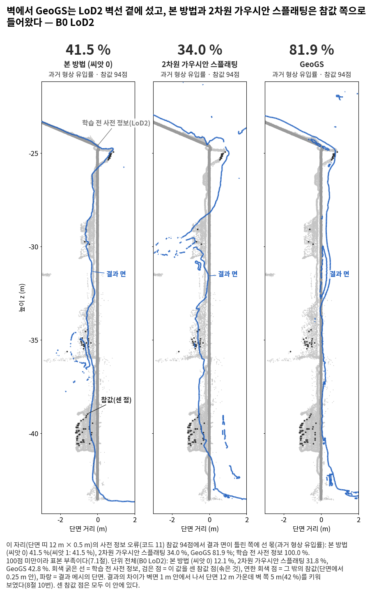
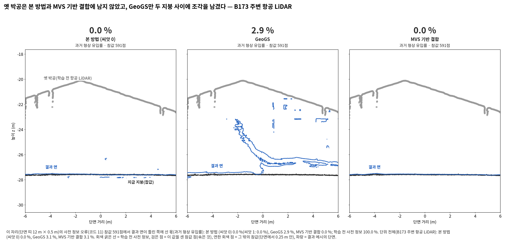
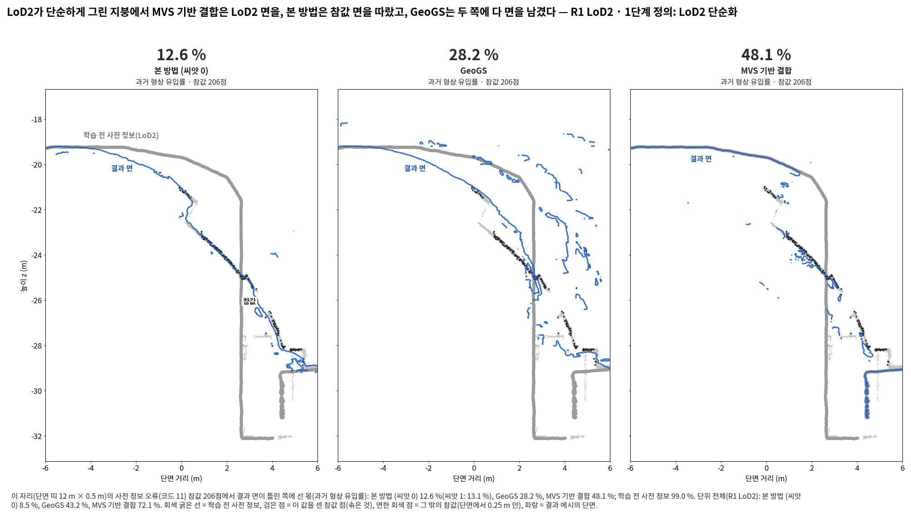
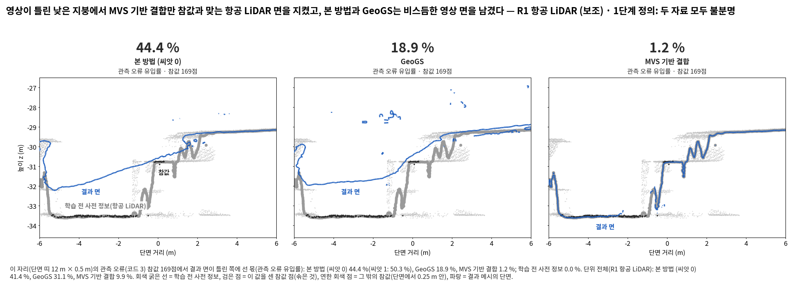
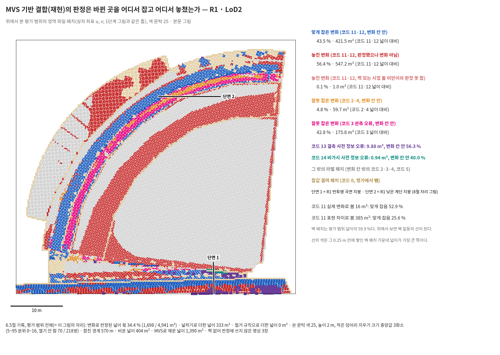

<!-- PHD-MAIN-BASELINES-v1 보고서 -->
# 본 실험 비교 방법 추가 — 보고서 v1

- 작업: `PHD-MAIN-BASELINES-v1` (발주문 v1.1, 커밋 8e90ef51). `scientific_verdict: null`.
- 설정: `configs/phd/main_baselines_v1/baselines_v1.json`.
  - 10-15 10:29:05에 학습 전 저장했다(sha256 `22197c0a…`).
  - 저장 뒤 바꾼 것 다섯은 `baselines_v1_amendments.json`에 덧붙이기만 했다(9.4절).
- 돈 것:
  - 준비는 10-15 05:53~07:52, 사용자 결정은 10:24, 대기열은 10:29~17:37이다.
  - 학습 8회(2차원 가우시안 스플래팅 4, GeoGS 항공 LiDAR 4)와 학습 없는 결과 16개(MVS 기반 결합 8, 변형 8)가 모두 끝났다(24/24 PASS).
  - CDGS는 학습 전 점검에 걸려 학습하지 않았다(사용자 결정 10-15).
- 앞 보고: 준비 보고 `c81a3a65`, 중간 보고 `78eb02b1`(앞 묶음 B173 주변).
- 1·2·3단계와 고침 발주의 공식 판정과 표는 고치지 않았다. 앞 작업의 열은 값을 옮긴 것이고, 나머지 값은 모두 '이 발주에서 냄'이다.
- 표: [tables/](tables/). 그림: [figures/](figures/). 그림마다 숫자 json이 옆에 있다.
- 중간 보고 6절의 확인 다섯에는 답이 없어 기본대로 했다.
  1. 발주문에 없는 방향의 읽는 말은 같은 꼴로 쓰고 '[발주에 없는 말]'을 붙였다.
  2. '벽 있음'은 가상 시점 메시로 읽고 학습 시점 메시 값을 옆에 적었다.
  3. 채광창 자리는 주석을 단 채 두었고, 자리를 더하지 않았다.
  4. R1 후처리는 혼자 돌렸다.
  5. CDGS 예외 학습은 하지 않았다.

## 답 모음

- 여섯 단위(B0, B173 주변, R1 × LoD2, 항공 LiDAR)의 읽기를 센 것이다. 값을 하나로 합치지 않았다.
- B173만은 보고만 하는 지역이라 2.5절에 따로 적는다.
- 등급은 확인, 가능·근거 불완전, 아직 모름의 셋이다(7절).

1. **비교-1. 본 방법은 2차원 가우시안 스플래팅보다 표면을 더 채웠다(확인). 바뀐 곳의 과거 형상은 같거나 덜 들였고, 영상이 틀린 곳의 유입은 대체로 많았다.**
   - 전체 완전성(0.2 m)은 여섯 단위 모두 본 방법이 더 채웠다(확인). 결측 영역(0.2 m)은 넷에서 더 채웠고 둘은 같았다(가능, 근거 불완전).
   - 과거 형상 유입률은 넷에서 덜 들였고, 둘(B0·R1 항공 LiDAR)은 '바뀐 곳에서 영상만 수준으로 막았다'(가능, 근거 불완전).
   - 관측 오류 유입률(영역 전체)은 넷에서 본 방법이 많았고, 하나는 같았고, 하나(R1 항공 LiDAR)는 적었다(가능, 근거 불완전).
   - 읽기는 하지 않지만, 장치 빼기 열의 '영상만'도 2차원 가우시안 스플래팅과 거의 같은 크기로 다르다. 영상만에는 MVS 관측 깊이 항이 있다(2.1절).
2. **비교-2. 본 방법은 GeoGS보다 바뀐 곳의 과거 형상을 덜 들였다(가능, 근거 불완전). 그 대가로 영상이 틀린 곳의 유입이 많았다(확인).**
   - 과거 형상 유입률은 넷에서 덜 들였다(그 가운데 확인 둘: B0·R1 LoD2). 하나(B0 항공 LiDAR, 표본 262점)에서는 더 들였고, 하나는 같았다.
   - 대가:
     - 관측 오류 유입률(영역 전체)은 여섯 단위 모두 'GeoGS보다 못했다'(확인).
     - 결측 영역(0.2 m)은 나음 둘, 같음 둘, 못함 둘이었다.
3. **비교-3. 본 방법은 MVS 기반 결합(재현)보다 바뀐 곳의 과거 형상을 덜 들였다(여섯 단위 모두). 영상이 틀린 곳의 유입은 여섯 단위 모두 많았다(확인).**
   - 과거 형상은 LoD2를 '실제 변화로 봄'에서 읽었다. 확인 둘(B173 주변 두 단위)이고, 나머지 넷은 표본이 1만 점 미만이라 '가능, 근거 불완전'이다.
   - 과거 형상의 차이는 거의 모두 결합이 놓친 변화(결합의 변화 칸 밖)에서 났다(6.3절).
   - 차이를 판정의 근거와 판정을 쓰는 방식으로 나누었다(6.4절).
     - 과거 형상은 근거 넷, 방식 다섯 단위에서 차이가 났다.
     - 관측 오류는 여섯 단위 모두 근거에서 차이가 났고, 방식에서도 여섯 단위 모두 차이가 났다(다섯은 본 방법이 많은 쪽, B0 항공 LiDAR만 반대).
   - 결측 영역(0.2 m)은 결합이 더 채운 셋, 같음 둘, 본 방법이 더 채운 하나였다.
4. **비교-4. CDGS는 결과가 없다.** 학습 전에 정한 축척 규칙에 여덟 단위가 모두 걸렸다(지역 규칙 포함, 6.5절). 비교-4의 물음은 답할 수 없다.

**네 비교 사이에서 본 방법의 자리.**

- 본 방법은 비교한 세 방법보다 바뀐 곳의 과거 형상을 덜 들였다. 2차원 가우시안 스플래팅과 GeoGS보다는 표면도 많이 채웠다.
- 대신 영상이 틀린 곳(관측 오류 영역)에서는 세 방법보다 틀린 영상을 많이 들였다. GeoGS와 결합보다는 여섯 단위 모두에서 많았다.
  - 사전 정보를 처음부터 믿는 방법(GeoGS)과 바뀌지 않았다고 본 곳을 그대로 두는 방법(결합)은, 영상이 틀린 곳에서 맞는 사전 정보를 지켰다.
  - 본 방법은 그 자리에서 영상만과 비슷하게 영상을 따랐다(4.1절의 '영상만' 열).
- 세부 정확도(완만한 지붕)는 LoD2 단위에서 본 방법이 가장 정확했다. 항공 LiDAR 단위에서는 그 면을 그대로 둔 결합이 더 정확했다(B173 주변 1.76 대 2.33 cm, R1 2.34 대 4.58 cm).

## 1. 이 발주가 알려고 한 것

- 2장이 한계를 보인 네 갈래(사전 정보를 믿는 방식)마다 대표 하나를, 본 방법과 같은 입력, 같은 메시 만들기, 같은 평가로 돌려 비교했다(발주문 2절).

  | 갈래 | 대표 | 물음 |
  |---|---|---|
  | 2.1 믿지 않음 | 2차원 가우시안 스플래팅 (Huang 외 2024) | 비교-1. 영상만으로 만들 때보다 영상이 확인하지 못한 곳을 더 채우고, 영상이 틀린 곳에서 맞는 사전 정보를 더 지키는가. 바뀐 곳의 과거 형상은 영상만 수준으로 막는가 |
  | 2.2 미리 높게 믿음 | GeoGS (Zhang 외 2026a) | 비교-2. 바뀐 곳의 과거 형상을 덜 들이는가. 그 대가로 잃는 것이 있는가 |
  | 2.3 바뀐 곳을 찾아 갱신 | MVS 기반 결합 (Zhou 외 2020, 재현) | 비교-3. 그보다 나은가. 그 판정이 놓친 변화와 잘못 잡은 변화에서는 어떤가 |
  | 2.4 믿을 정도를 자료로 추정 | CDGS (Zhang 외 2024) | 비교-4. 그보다 나은가 |

- 본 방법의 판정으로 갈아 끼운 변형은 장치 빼기다. 결합과의 차이를 '판정의 근거'와 '판정을 쓰는 방식'으로 나누는 데에만 쓴다(7.4절).
- 기준은 7.1절이다.
  - 셋 가운데 가장 큰 값이다: 모은 흔들림 폭, 본 방법의 단위 흔들림 폭 2.8 × |씨앗 0 − 씨앗 1| ÷ √2, 몫인 지표의 300 ÷ 표본.
  - 씨앗이 하나인 비교 방법은 기준의 두 배를 넘어야 '확인'이다.
  - 학습이 없는 결합과 변형은 기준을 넘으면 '확인'이다.

## 2. 물음마다의 답

아래 줄은 읽기 표([tables/read.md](tables/read.md))의 답을 그대로 옮긴 것이다. 각 물음 끝에 함께 적을 것을 더했다.

#### 비교-1의 답 (여섯 단위)

- 답 한 줄: 본 방법은 2차원 가우시안 스플래팅보다 결측 영역 완전성 (0.2 m)에서 네 단위(B0 · LoD2, B173 주변 · LoD2, R1 · LoD2, R1 · 항공 LiDAR), 비가시 영역 완전성 (0.2 m)에서 두 단위(B173 주변 · LoD2, B173 주변 · 항공 LiDAR), 전체 완전성 (0.2 m)에서 여섯 단위(B0 · LoD2, B0 · 항공 LiDAR, B173 주변 · LoD2, B173 주변 · 항공 LiDAR, R1 · LoD2, R1 · 항공 LiDAR), 관측 오류 유입률 (영역 전체)에서 한 단위(R1 · 항공 LiDAR), 과거 형상 유입률에서 네 단위(B0 · LoD2, B173 주변 · LoD2, B173 주변 · 항공 LiDAR, R1 · LoD2)에서 나았고, 관측 오류 유입률 (영역 전체)에서 네 단위(B0 · LoD2, B0 · 항공 LiDAR, B173 주변 · LoD2, B173 주변 · 항공 LiDAR), 관측 오류 유입률 (문턱 이내)에서 세 단위(B173 주변 · LoD2, B173 주변 · 항공 LiDAR, R1 · LoD2)에서 못했다.

- [상호 보완] 결측 영역 완전성 (0.2 m): 여섯 단위 가운데 넷에서 '본 방법이 더 채웠다' [B0 · LoD2 가능·근거 불완전; B173 주변 · LoD2 확인; R1 · LoD2 확인; R1 · 항공 LiDAR 확인], 둘에서 '다르지 않았다' [B0 · 항공 LiDAR; B173 주변 · 항공 LiDAR] — 등급 가능, 근거 불완전 (씨앗 하나, 빌린 흔들림 폭)
- [상호 보완] 결측 영역 완전성 (0.5 m): 여섯 단위 가운데 넷에서 '본 방법이 더 채웠다' [B0 · LoD2 확인; B173 주변 · LoD2 가능·근거 불완전; R1 · LoD2 확인; R1 · 항공 LiDAR 가능·근거 불완전], 하나에서 '다르지 않았다' [B0 · 항공 LiDAR], 하나에서 '2차원 가우시안 스플래팅이 더 채웠다' [B173 주변 · 항공 LiDAR 확인] — 등급 가능, 근거 불완전 (씨앗 하나, 빌린 흔들림 폭)
- [상호 보완] 비가시 영역 완전성 (0.2 m): 여섯 단위 가운데 둘에서 '본 방법이 더 채웠다' [B173 주변 · LoD2 (벽 있음으로 읽음) 가능·근거 불완전; B173 주변 · 항공 LiDAR (벽 있음으로 읽음) 가능·근거 불완전], 넷은 표본 부족 [B0 · LoD2; B0 · 항공 LiDAR; R1 · LoD2; R1 · 항공 LiDAR] — 등급 가능, 근거 불완전 (표본 (표본 부족 4단위), 씨앗 하나, 빌린 흔들림 폭)
- [상호 보완] 비가시 영역 완전성 (0.5 m): 여섯 단위 모두 표본 부족 [B0 · LoD2; B0 · 항공 LiDAR; B173 주변 · LoD2; B173 주변 · 항공 LiDAR; R1 · LoD2; R1 · 항공 LiDAR] — 등급 아직 모름 (표본 (표본 부족 6단위), 씨앗 하나, 빌린 흔들림 폭)
- [상호 보완] 전체 완전성 (0.2 m): 여섯 단위 모두 '본 방법이 더 채웠다' [B0 · LoD2 확인; B0 · 항공 LiDAR 확인; B173 주변 · LoD2 확인; B173 주변 · 항공 LiDAR 확인; R1 · LoD2 확인; R1 · 항공 LiDAR 확인] — 등급 확인 (씨앗 하나, 빌린 흔들림 폭)
- [상호 보완] 전체 완전성 (0.5 m): 여섯 단위 모두 '본 방법이 더 채웠다' [B0 · LoD2 확인; B0 · 항공 LiDAR 확인; B173 주변 · LoD2 확인; B173 주변 · 항공 LiDAR 확인; R1 · LoD2 확인; R1 · 항공 LiDAR 확인] — 등급 확인 (씨앗 하나, 빌린 흔들림 폭)
- [오류 차단, 영상 쪽] 관측 오류 유입률 (영역 전체): 여섯 단위 가운데 넷에서 '영상이 틀린 곳의 유입이 2차원 가우시안 스플래팅보다 많았다' [B0 · LoD2 가능·근거 불완전; B0 · 항공 LiDAR 확인; B173 주변 · LoD2 확인; B173 주변 · 항공 LiDAR 확인], 하나에서 '다르지 않았다' [R1 · LoD2], 하나에서 '영상이 틀린 곳에서 맞는 사전 정보를 지켰다' [R1 · 항공 LiDAR 가능·근거 불완전] — 등급 가능, 근거 불완전 (씨앗 하나, 빌린 흔들림 폭)
- [오류 차단, 영상 쪽] 관측 오류 유입률 (문턱 이내): 여섯 단위 가운데 셋에서 '다르지 않았다' [B0 · LoD2; B0 · 항공 LiDAR; R1 · 항공 LiDAR], 셋에서 '영상이 틀린 곳의 유입이 2차원 가우시안 스플래팅보다 많았다' [B173 주변 · LoD2 가능·근거 불완전; B173 주변 · 항공 LiDAR 가능·근거 불완전; R1 · LoD2 가능·근거 불완전] — 등급 가능, 근거 불완전 (표본 (1만 점 미만 3단위), 씨앗 하나, 빌린 흔들림 폭)
- [오류 차단, 사전 정보 쪽] 과거 형상 유입률: 여섯 단위 가운데 넷에서 '영상만 방법보다 과거 형상을 덜 들였다' [B0 · LoD2 확인; B173 주변 · LoD2 확인; B173 주변 · 항공 LiDAR 가능·근거 불완전; R1 · LoD2 가능·근거 불완전], 둘에서 '바뀐 곳에서 영상만 수준으로 막았다' [B0 · 항공 LiDAR; R1 · 항공 LiDAR] — 등급 가능, 근거 불완전 (씨앗 하나, 빌린 흔들림 폭)
- [세부 정확도] 세부 정확도, 새 읽기 (cm): 여섯 단위 가운데 넷에서 '본 방법의 세부가 더 정확했다' [B173 주변 · LoD2 확인; B173 주변 · 항공 LiDAR 확인; R1 · LoD2 확인; R1 · 항공 LiDAR 확인], 둘은 읽지 않음 (B0, 7.1) [B0 · LoD2; B0 · 항공 LiDAR] — 등급 확인 (씨앗 하나, 빌린 흔들림 폭)

#### 비교-2의 답 (여섯 단위)

- 답 한 줄: 본 방법은 GeoGS보다 과거 형상 유입률에서 네 단위(B0 · LoD2, B173 주변 · LoD2, B173 주변 · 항공 LiDAR, R1 · LoD2), 관측 오류 유입률 (문턱 이내)에서 두 단위(B0 · LoD2, R1 · LoD2), 결측 영역 완전성 (0.2 m)에서 두 단위(B0 · LoD2, R1 · 항공 LiDAR)에서 나았고, 과거 형상 유입률에서 한 단위(B0 · 항공 LiDAR), 관측 오류 유입률 (영역 전체)에서 여섯 단위(B0 · LoD2, B0 · 항공 LiDAR, B173 주변 · LoD2, B173 주변 · 항공 LiDAR, R1 · LoD2, R1 · 항공 LiDAR), 관측 오류 유입률 (문턱 이내)에서 세 단위(B0 · 항공 LiDAR, B173 주변 · LoD2, B173 주변 · 항공 LiDAR), 결측 영역 완전성 (0.2 m)에서 두 단위(B173 주변 · 항공 LiDAR, R1 · LoD2)에서 못했다.

- [오류 차단] 과거 형상 유입률: 여섯 단위 가운데 넷에서 '바뀐 곳의 과거 형상을 덜 들였다' [B0 · LoD2 확인; B173 주변 · LoD2 가능·근거 불완전; B173 주변 · 항공 LiDAR 가능·근거 불완전; R1 · LoD2 확인], 하나에서 'GeoGS보다 더 들였다' [B0 · 항공 LiDAR 가능·근거 불완전], 하나에서 'GeoGS와 다르지 않았다' [R1 · 항공 LiDAR] — 등급 가능, 근거 불완전 (표본 (1만 점 미만 1단위), 씨앗 하나, 빌린 흔들림 폭)
- [대가] 관측 오류 유입률 (영역 전체): 여섯 단위 모두 '그 대가로 관측 오류 유입률 (영역 전체)에서 GeoGS보다 못했다' [B0 · LoD2 확인; B0 · 항공 LiDAR 확인; B173 주변 · LoD2 확인; B173 주변 · 항공 LiDAR 확인; R1 · LoD2 확인; R1 · 항공 LiDAR 확인] — 등급 확인 (씨앗 하나, 빌린 흔들림 폭)
- [대가] 관측 오류 유입률 (문턱 이내): 여섯 단위 가운데 셋에서 '그 대가로 관측 오류 유입률 (문턱 이내)에서 GeoGS보다 못했다' [B0 · 항공 LiDAR 가능·근거 불완전; B173 주변 · LoD2 가능·근거 불완전; B173 주변 · 항공 LiDAR 가능·근거 불완전], 둘에서 '관측 오류 유입률 (문턱 이내)에서 GeoGS보다 나았다' [B0 · LoD2 가능·근거 불완전; R1 · LoD2 가능·근거 불완전], 하나에서 '다르지 않았다' [R1 · 항공 LiDAR] — 등급 가능, 근거 불완전 (표본 (1만 점 미만 5단위), 씨앗 하나, 빌린 흔들림 폭)
- [대가] 결측 영역 완전성 (0.2 m): 여섯 단위 가운데 둘에서 '결측 영역 완전성 (0.2 m)에서 GeoGS보다 나았다' [B0 · LoD2 확인; R1 · 항공 LiDAR 가능·근거 불완전], 둘에서 '다르지 않았다' [B0 · 항공 LiDAR; B173 주변 · LoD2], 둘에서 '그 대가로 결측 영역 완전성 (0.2 m)에서 GeoGS보다 못했다' [B173 주변 · 항공 LiDAR 확인; R1 · LoD2 확인] — 등급 가능, 근거 불완전 (씨앗 하나, 빌린 흔들림 폭)
- [대가] 결측 영역 완전성 (0.5 m): 여섯 단위 가운데 넷에서 '다르지 않았다' [B0 · LoD2; B0 · 항공 LiDAR; R1 · LoD2; R1 · 항공 LiDAR], 둘에서 '그 대가로 결측 영역 완전성 (0.5 m)에서 GeoGS보다 못했다' [B173 주변 · LoD2 확인; B173 주변 · 항공 LiDAR 확인] — 등급 확인 (씨앗 하나, 빌린 흔들림 폭)
- [대가] 비가시 영역 완전성 (0.2 m): 여섯 단위 모두 표본 부족 [B0 · LoD2; B0 · 항공 LiDAR; B173 주변 · LoD2; B173 주변 · 항공 LiDAR; R1 · LoD2; R1 · 항공 LiDAR] — 등급 아직 모름 (표본 (표본 부족 6단위), 씨앗 하나, 빌린 흔들림 폭)
- [대가] 비가시 영역 완전성 (0.5 m): 여섯 단위 모두 표본 부족 [B0 · LoD2; B0 · 항공 LiDAR; B173 주변 · LoD2; B173 주변 · 항공 LiDAR; R1 · LoD2; R1 · 항공 LiDAR] — 등급 아직 모름 (표본 (표본 부족 6단위), 씨앗 하나, 빌린 흔들림 폭)
- [세부 정확도] 세부 정확도, 새 읽기 (cm): 여섯 단위 가운데 넷에서 '본 방법의 세부가 더 정확했다' [B173 주변 · LoD2 확인; B173 주변 · 항공 LiDAR 확인; R1 · LoD2 확인; R1 · 항공 LiDAR 확인], 둘은 읽지 않음 (B0, 7.1) [B0 · LoD2; B0 · 항공 LiDAR] — 등급 확인 (씨앗 하나, 빌린 흔들림 폭)

#### 비교-3의 답 (여섯 단위)

- 답 한 줄: 본 방법은 MVS 기반 결합보다 과거 형상 유입률(LoD2는 실제 변화로 봄)에서 여섯 단위(B0 · LoD2, B0 · 항공 LiDAR, B173 주변 · LoD2, B173 주변 · 항공 LiDAR, R1 · LoD2, R1 · 항공 LiDAR), 관측 오류 유입률 (문턱 이내)에서 두 단위(B0 · LoD2, R1 · LoD2), 결측 영역 완전성 (0.2 m)에서 한 단위(B0 · LoD2)에서 나았고, 관측 오류 유입률 (영역 전체)에서 여섯 단위(B0 · LoD2, B0 · 항공 LiDAR, B173 주변 · LoD2, B173 주변 · 항공 LiDAR, R1 · LoD2, R1 · 항공 LiDAR), 관측 오류 유입률 (문턱 이내)에서 네 단위(B0 · 항공 LiDAR, B173 주변 · LoD2, B173 주변 · 항공 LiDAR, R1 · 항공 LiDAR), 결측 영역 완전성 (0.2 m)에서 세 단위(B173 주변 · 항공 LiDAR, R1 · LoD2, R1 · 항공 LiDAR)에서 못했다. (재현)

- [오류 차단, 사전 정보 쪽] 과거 형상 유입률: 여섯 단위 모두 '바뀐 곳의 과거 형상을 덜 들였다 (재현)' [B0 · LoD2 가능·근거 불완전; B0 · 항공 LiDAR 가능·근거 불완전; B173 주변 · LoD2 확인; B173 주변 · 항공 LiDAR 확인; R1 · LoD2 가능·근거 불완전; R1 · 항공 LiDAR 가능·근거 불완전] — 등급 가능, 근거 불완전 (표본 (1만 점 미만 4단위), 재현)
- [오류 차단, 영상 쪽] 관측 오류 유입률 (영역 전체): 여섯 단위 모두 '영상이 틀린 곳의 유입이 MVS 기반 결합보다 많았다 (재현)' [B0 · LoD2 확인; B0 · 항공 LiDAR 확인; B173 주변 · LoD2 확인; B173 주변 · 항공 LiDAR 확인; R1 · LoD2 확인; R1 · 항공 LiDAR 확인] — 등급 확인 (재현)
- [오류 차단, 영상 쪽] 관측 오류 유입률 (문턱 이내): 여섯 단위 가운데 넷에서 '영상이 틀린 곳의 유입이 MVS 기반 결합보다 많았다 (재현)' [B0 · 항공 LiDAR 가능·근거 불완전; B173 주변 · LoD2 가능·근거 불완전; B173 주변 · 항공 LiDAR 가능·근거 불완전; R1 · 항공 LiDAR 가능·근거 불완전], 둘에서 '영상이 틀린 곳에서 맞는 사전 정보를 지켰다 (재현)' [B0 · LoD2 가능·근거 불완전; R1 · LoD2 가능·근거 불완전] — 등급 가능, 근거 불완전 (표본 (1만 점 미만 6단위), 재현)
- [상호 보완] 결측 영역 완전성 (0.2 m): 여섯 단위 가운데 셋에서 'MVS 기반 결합이 더 채웠다 (재현)' [B173 주변 · 항공 LiDAR 확인; R1 · LoD2 확인; R1 · 항공 LiDAR 확인], 둘에서 '다르지 않았다 (재현)' [B0 · 항공 LiDAR; B173 주변 · LoD2], 하나에서 '본 방법이 더 채웠다 (재현)' [B0 · LoD2 확인] — 등급 확인 (재현)
- [상호 보완] 결측 영역 완전성 (0.5 m): 여섯 단위 가운데 셋에서 '다르지 않았다 (재현)' [B0 · LoD2; B0 · 항공 LiDAR; R1 · LoD2], 셋에서 'MVS 기반 결합이 더 채웠다 (재현)' [B173 주변 · LoD2 확인; B173 주변 · 항공 LiDAR 확인; R1 · 항공 LiDAR 확인] — 등급 확인 (재현)
- [상호 보완] 비가시 영역 완전성 (0.2 m): 여섯 단위 모두 표본 부족 [B0 · LoD2; B0 · 항공 LiDAR; B173 주변 · LoD2; B173 주변 · 항공 LiDAR; R1 · LoD2; R1 · 항공 LiDAR] — 등급 아직 모름 (표본 (표본 부족 6단위), 재현)
- [상호 보완] 비가시 영역 완전성 (0.5 m): 여섯 단위 모두 표본 부족 [B0 · LoD2; B0 · 항공 LiDAR; B173 주변 · LoD2; B173 주변 · 항공 LiDAR; R1 · LoD2; R1 · 항공 LiDAR] — 등급 아직 모름 (표본 (표본 부족 6단위), 재현)
- [세부 정확도] 세부 정확도, 새 읽기 (cm): 여섯 단위 가운데 둘에서 '본 방법의 세부가 더 정확했다 (재현)' [B173 주변 · LoD2 확인; R1 · LoD2 확인], 둘에서 'MVS 기반 결합의 세부가 더 정확했다 (재현)' [B173 주변 · 항공 LiDAR 확인; R1 · 항공 LiDAR 확인], 둘은 읽지 않음 (B0, 7.1) [B0 · LoD2; B0 · 항공 LiDAR] — 등급 확인 (재현)

#### 비교-4의 답 (여섯 단위)

- 답 한 줄: CDGS는 학습하지 않아(5.5절의 점검) 본 방법과 비교할 결과가 없다.

- [오류 차단] 과거 형상 유입률: 여섯 단위 모두 결과 없음 (CDGS 학습 안 함) — 등급 아직 모름 (결과 없음 (5.5 점검))
- [오류 차단] 관측 오류 유입률 (영역 전체): 여섯 단위 모두 결과 없음 (CDGS 학습 안 함) — 등급 아직 모름 (결과 없음 (5.5 점검))
- [오류 차단] 관측 오류 유입률 (문턱 이내): 여섯 단위 모두 결과 없음 (CDGS 학습 안 함) — 등급 아직 모름 (결과 없음 (5.5 점검))
- [상호 보완] 결측 영역 완전성 (0.2 m): 여섯 단위 모두 결과 없음 (CDGS 학습 안 함) — 등급 아직 모름 (결과 없음 (5.5 점검))
- [상호 보완] 결측 영역 완전성 (0.5 m): 여섯 단위 모두 결과 없음 (CDGS 학습 안 함) — 등급 아직 모름 (결과 없음 (5.5 점검))
- [상호 보완] 비가시 영역 완전성 (0.2 m): 여섯 단위 모두 결과 없음 (CDGS 학습 안 함) — 등급 아직 모름 (결과 없음 (5.5 점검))
- [상호 보완] 비가시 영역 완전성 (0.5 m): 여섯 단위 모두 결과 없음 (CDGS 학습 안 함) — 등급 아직 모름 (결과 없음 (5.5 점검))
- [세부 정확도 (참고)] 세부 정확도, 새 읽기 (cm): 여섯 단위 모두 결과 없음 (CDGS 학습 안 함) — 등급 아직 모름 (결과 없음 (5.5 점검))

### 2.1 비교-1에 함께 적는 것

- '영상만 − 2차원 가우시안 스플래팅'(읽기 없음, 7.2절)은 '본 방법 − 2차원 가우시안 스플래팅'과 크기가 비슷하다. 영상만에는 MVS 관측 깊이 항이 있고 2차원 가우시안 스플래팅에는 없다. 단위마다의 값은 4.2절 표의 마지막 열에 있다. 예를 들면 다음과 같다.
  - B173 주변 LoD2 전체 완전성: +38.1 %p 대 +38.4 %p.
  - R1 LoD2 과거 형상 유입률: 영상만 13.9 %, 2차원 가우시안 스플래팅 14.4 %, 본 방법 7.6 %.
- 2차원 가우시안 스플래팅의 표면은 거칠다.
  - 세부 정확도(새 읽기)는 13.8~21.2 cm다. 본 방법은 B0를 빼고 2.2~5.1 cm다.
  - 완만한 지붕의 뜬 조각 몫은 B173 주변에서 21 %다.
  - 관측 오류 행 가운데 어느 쪽에도 서지 않은 행이 B173 주변에서 28.7 %(LoD2)와 32.6 %(항공 LiDAR)다. 본 방법은 12.5 %와 4.2 %다.
  - 그래서 2차원 가우시안 스플래팅의 낮은 관측 오류 유입률이 모두 맞는 사전 정보를 지킨 몫은 아니다(사실만 적음).
- 비가시 영역은 여섯 단위 모두 참값이 100점 미만이다(B0 0점, B173 주변 17점·2점, R1 3점·6점). B173 주변 두 단위만 7.2절대로 '벽 있음'으로 대신 읽었다(3.3절).

### 2.2 비교-2에 함께 적는 것

- LoD2의 GeoGS 값은 고침 발주의 고친 GeoGS(`trust_LoD2_fix1`)를 옮긴 것이다. 항공 LiDAR는 이 발주에서 처음 냈다(`geogs_ALS_fix1`).
- GeoGS 항공 LiDAR의 처음 점과 가파른 삼각형의 몫은 6.6절에 있다.
- B0 항공 LiDAR에서 GeoGS가 과거 형상을 덜 들인 것(15.3 대 42.8 %)은 표본 262점의 값이다.

### 2.3 비교-3에 함께 적는 것

- 결합의 값과 읽기는 모두 재현의 것이다(8.1절).
- 판정의 기록, 놓침과 잘못 잡음, 차이가 난 자리, 판정의 근거와 판정을 쓰는 방식은 6.1~6.4절에 있다.

### 2.4 비교-4에 함께 적는 것

- CDGS가 학습되지 않은 까닭과 시점마다의 정렬 축척, 이동, 정렬 손실, 깊이 가중의 분포는 6.5절에 있다.

### 2.5 B173만 (보고만 하는 지역)

- B173 주변 안의 한 건물을 따로 둔 상자다. 답 줄에는 넣지 않았다.
- 본 방법 LoD2는 씨앗 0이 고침 발주(r14), 씨앗 1이 1단계(r12)라 두 씨앗의 흔들림에 판 차이가 섞인다.
- 숫자는 4.1절 표의 '보고만' 줄에 있다. B173 주변과 같은 꼴이다.
  - 과거 형상 유입률(LoD2)은 본 방법 5.3 %, 2차원 가우시안 스플래팅 9.0 %, GeoGS 20.8 %, 결합 14.4 %다.
  - 관측 오류 유입률(영역 전체, LoD2)은 본 방법 46.3 %, 2차원 가우시안 스플래팅 25.6 %, GeoGS 18.9 %, 결합 13.6 %다.
  - 전체 완전성(0.2 m, LoD2)은 본 방법 84.2 %, 2차원 가우시안 스플래팅 53.0 %, GeoGS 35.7 %, 결합 84.0 %다.
- 2차원 가우시안 스플래팅은 첫 시도에서 GPU 메모리 부족으로 멈추고, 같은 설정의 둘째 시도에서 끝났다(5절).

## 3. 대표 사례 (8절)

- 그림은 8절 규칙을 따랐다. 칸 위의 값은 그 자리(단면 띠 12 m × 0.5 m)의 값이고, '단위 전체' 값은 그림 아래 줄에 따로 밝혔다.
- 제목은 그림을 본 뒤 '한 눈에 볼 것'을 문장으로 썼다(규칙 1, 7).
- 미리 정한 칸 가운데 CDGS 칸은 '결과 없음(학습하지 않음)'으로 그렸다.
- 1단계의 비스듬한 3차원 보기 대신 1단계 대표 그림의 단면 꼴과 벽 정면 꼴로 그렸다(jointbuildgs:dev에 렌더러가 없음).
- 보조 사전 정보의 그림은 미리 정한 그림 밖에 더한 것이다. 그 띠에서 가장 많은 코드를 쓴다.

### 3.1 B0 지붕 가장자리 (LoD2)

- 그림 1 제목: 벽에서 GeoGS는 LoD2 벽선 곁에 섰고, 본 방법과 2차원 가우시안 스플래팅은 참값 쪽으로 들어왔다.
- 이 자리의 코드 11은 94점이라 표본 부족이다.
  - 과거 형상 유입률은 본 방법 41.5 %(씨앗 1도 41.5 %), 2차원 가우시안 스플래팅 34.0 %, GeoGS 81.9 %, 학습 전 사전 정보 100 %다.
  - 단위 전체 값은 12.1 · 31.8 · 42.8 %다.
- 그림 2(본 방법, CDGS, 결합)에서 결합은 이 자리에서 100 %, 단위 전체에서 98.5 %다. 'LoD2 벽선을 그대로 두었다'([figures/spot_b0eaves_2.png](figures/spot_b0eaves_2.png)).

### 3.2 B173 날개 (항공 LiDAR; LoD2는 보조)

- 그림 1 제목: 옛 박공은 본 방법과 MVS 기반 결합에 남지 않았고, GeoGS만 두 지붕 사이에 조각을 남겼다.
- 코드 11 참값 591점의 과거 형상 유입률은 본 방법 0.0 %(씨앗 1도 0.0 %), GeoGS 2.9 %, 결합 0.0 %, 학습 전 사전 정보 100 %다. 단위 전체는 0.03 · 3.08 · 3.08 %다.
- 그림 2(본 방법, CDGS, 2차원 가우시안 스플래팅)는 0.0 % · 결과 없음 · 0.0 %다([figures/spot_wing_2.png](figures/spot_wing_2.png)).
- LoD2 보조 그림(607점)은 본 방법 0.0 %, GeoGS 0.7 %, 결합 0.0 %, 2차원 가우시안 스플래팅 0.0 %다.

### 3.3 B173 긴 벽 (LoD2)

- 그림 1 제목: 영상이 보지 못한 긴 벽은 본 방법에서 섰고, 2차원 가우시안 스플래팅에서는 조각만 섰다.
- 셈: LoD2 면 53에서 '맞음으로 미룬' 14,970패치 가운데 결과 메시가 패치 중심 0.25 m 안에 있는 몫이다.
  - 본 방법 92.0 %(씨앗 1: 92.7 %)다. 1단계 값(가우시안이 받침)은 82.05 %로, 이 발주에서 다시 구해도 같았다.
  - 2차원 가우시안 스플래팅 22.8 %, CDGS는 결과 없음이다.
  - 그림 2에서는 GeoGS 22.3 %, 결합 2.2 %다([figures/spot_wall_2.png](figures/spot_wall_2.png)).
- 세는 메시는 결과마다 다르다.
  - 렌더러가 있는 결과는 가상 시점 메시로 셌다. 1단계가 이 벽에 쓴 것과 같다.
  - 렌더러가 없는 결과(결합, 변형, 학습 전 사전 정보)는 학습 시점 메시로 셌다.
  - 모든 결과를 학습 시점 메시 하나로 세면 본 방법 8.4 · 10.1 %, 2차원 가우시안 스플래팅 0.9 %, GeoGS 4.4 %, 결합 2.2 %, 변형 10.1 %, 학습 전 사전 정보 8.3 %다. 학습 시점 메시에는 영상이 보지 못한 면이 거의 담기지 않는다(`figures/wall_presence.json`, '결과를 본 뒤 더함').
- 같은 셈의 다른 단위:
  - B173 주변 항공 LiDAR는 본 방법 69.9 · 67.1 %, GeoGS 22.6 %, 결합 7.8 %다.
  - B173만(같은 벽, 면 25)은 본 방법 LoD2 90.4 · 90.5 %, GeoGS 16.1 %, 본 방법 항공 LiDAR 60.5 · 56.9 %다.

### 3.4 B173 유리 채광창 (LoD2; 항공 LiDAR는 보조)

- 코드 3 참값이 84점이라 표본 부족이다.
  - 관측 오류 유입률은 본 방법 10.7 %(씨앗 1: 15.5 %), 2차원 가우시안 스플래팅 11.9 %, 결합 22.6 %, 학습 전 사전 정보 10.7 %다.
  - 단위 전체는 61.3(본 방법 평균) · 37.9 · 19.7 %다.
- **이 자리는 그림 규칙 5와 7을 지키지 못한다.**
  - 참값이 유리 윗면(약 −27.4 m), 안쪽 여러 층, 바닥(약 −31.5 m)으로 갈리고, 센 참값 점도 그 층들에 흩어져 있다.
  - 선은 본 방법이 MVS 깊이의 톱니를 따르고 결합이 LoD2의 톱니를 따른다. 그런데 칸 위의 값은 결합이 가장 높아, 선과 숫자가 반대로 보인다.
  - 미리 정한 자리라 그대로 두었다. 영상이 틀린 곳의 대표 그림으로는 3.5절의 R1 낮은 지붕 보조 그림이 더 분명하다.
- 항공 LiDAR 보조 그림(코드 12, 421점): 5 m 위에 있던 학습 전 항공 LiDAR 면은 본 방법, 2차원 가우시안 스플래팅, 결합 어디에도 남지 않았다(모두 0.0 %). GeoGS는 2.6 %다.

### 3.5 R1 곡면 지붕과 낮은 지붕 (LoD2; 항공 LiDAR는 보조)

- **곡면 지붕(1단계 정의: LoD2 단순화).**
  - 그림 1 제목: LoD2가 단순하게 그린 지붕에서 MVS 기반 결합은 LoD2 면을, 본 방법은 참값 면을 따랐고, GeoGS는 두 쪽에 다 면을 남겼다.
  - 코드 11, 206점의 과거 형상 유입률은 본 방법 12.6 %(씨앗 1: 13.1 %), GeoGS 28.2 %, 결합 48.1 %, 학습 전 사전 정보 99.0 %다. 단위 전체는 8.5 · 43.2 · 72.1 %다.
  - 그림 2: 2차원 가우시안 스플래팅은 50.0 %다. 사전 정보를 쓰지 않는데도 참값 면과 LoD2 가까이의 면을 함께 남겼다([figures/spot_r1curve_2.png](figures/spot_r1curve_2.png)).
  - 항공 LiDAR 보조 그림은 코드 3, 27점이라 표본 부족이다. 항공 LiDAR 면이 참값과 맞았고, 결합은 그 면을 그대로 두었다(3.7 %). 본 방법 25.9 %, GeoGS 29.6 %, 2차원 가우시안 스플래팅 37.0 %다.
- **낮은 지붕(1단계 정의: 두 자료 모두 불분명).**
  - 그림 1 제목: LoD2보다 낮은 지붕에서 MVS 기반 결합은 LoD2 면에 남았고 GeoGS는 일부 남았으며, 본 방법은 LoD2 면을 떠났다.
  - 코드 11은 84점이라 표본 부족이다. 본 방법 0.0 %, GeoGS 29.8 %, 결합 61.9 %, 2차원 가우시안 스플래팅 0.0 %다([figures/spot_r1low_1.png](figures/spot_r1low_1.png), [figures/spot_r1low_2.png](figures/spot_r1low_2.png)).

- **같은 낮은 지붕의 항공 LiDAR 보조 그림(코드 3, 169점).**
  - 제목: 영상이 틀린 낮은 지붕에서 MVS 기반 결합만 참값과 맞는 항공 LiDAR 면을 지켰고, 본 방법과 GeoGS는 비스듬한 영상 면을 남겼다.
  - 관측 오류 유입률은 본 방법 44.4 %(씨앗 1: 50.3 %), GeoGS 18.9 %, 결합 1.2 %, 학습 전 사전 정보 0.0 %다. 단위 전체는 41.2(본 방법 평균) · 31.1 · 9.9 %다.
  - 그림 2: 2차원 가우시안 스플래팅도 40.8 %로 비스듬한 면을 남겼다.
  - 이 그림은 미리 정한 보조 그림이다. 관측 오류의 대표 그림으로 본문에 올린 것은 '결과를 본 뒤 더함'이다.

### 3.6 MVS 기반 결합(재현)의 판정 지도 (본문: B173 주변 항공 LiDAR, R1 LoD2)

- B173 주변 항공 LiDAR(날개):
  - 바뀐 곳(코드 11·12) 넓이의 95.7 %를 변화 칸에 넣었다. 놓친 것은 4.3 %다(판정했으나 변화 아님 3.3 %, 짝 시점 둘 미만 1.0 %).
  - 맞는 곳(코드 2·4)을 변화로 잘못 잡은 넓이는 0.0 %, 영상이 틀린 곳(코드 3)은 0.1 %다.

- R1 LoD2:
  - 바뀐 곳(코드 11·12) 넓이의 43.5 %를 잡고 56.4 %를 놓쳤다.
  - 놓친 곳은 대부분 '표현 차이로 봄'(385 m², 잡은 몫 25.6 %)이다. '실제 변화로 봄'은 16 m²이고 그 52.9 %를 잡았다.
  - 영상이 틀린 곳(코드 3)의 42.8 %를 변화로 잘못 잡았다.
- 나머지 여섯 지도는 보조다: `figures/fusionmap_<지역>_<사전 정보>.png`. LoD2 지도에서는 벽 면이 평가 넓이의 60~70 %다. 위에서 보면 벽은 선이 되므로 칸마다 넓이가 큰 쪽으로 칠했다('결과를 본 뒤 더함').

### 3.7 물음마다 요약 그림

- 단위마다 비교 셋의 막대 그림: [figures/bars/](figures/bars/) (`<지역>_<사전 정보>_q1`은 비교-1, `q2`는 비교-2, `q3`는 비교-3).
- 막대는 본 방법 두 씨앗, 학습 전 사전 정보, 그 비교 방법이다. 띠는 본 방법 평균 ± 기준이다. 씨앗이 하나인 비교에는 두 배 기준을 점선으로 그렸다.

## 4. 주 표

### 4.1 주로 볼 값 (여섯 단위와 B173만)

- 값은 앞 작업과 이 발주의 지표 파일 그대로다.
- 비교 방법 칸의 읽기와 등급은 4.2절 표와 2절의 답에 있다.
- '장치 빼기: 변형'은 본 방법의 판정으로 갈아 끼운 변형이다.

**과거 형상 유입률 (%, 코드 11; 낮을수록 좋음)**

| 단위 | 표본 | 본 방법 평균 (씨앗 0 · 1) | 학습 전 사전 정보 | 2차원 가우시안 스플래팅 | GeoGS | MVS 기반 결합 (재현) | CDGS | 장치 빼기: 영상만 | 장치 빼기: 변형 |
|---|---|---|---|---|---|---|---|---|---|
| B0 · LoD2 | 32,880 | 12.0 (12.1 · 11.9) | 100.0 | 31.8 | 42.8 | 98.5 | 결과 없음 | 13.3 | 32.5 |
| B0 · 항공 LiDAR | 262 | 42.8 (47.7 · 37.8) | 98.1 | 49.6 | 15.3 | 98.1 | 결과 없음 | 22.1 | 82.1 |
| B173 주변 · LoD2 | 119,763 | 6.8 (6.5 · 7.1) | 99.7 | 10.1 | 8.7 | 17.0 | 결과 없음 | 7.3 | 9.7 |
| B173 주변 · 항공 LiDAR | 96,117 | 0.0 (0.0 · 0.0) | 100.0 | 2.3 | 3.1 | 3.1 | 결과 없음 | 0.0 | 1.8 |
| R1 · LoD2 | 54,345 | 7.6 (8.5 · 6.8) | 99.4 | 14.4 | 43.2 | 72.1 | 결과 없음 | 13.9 | 17.0 |
| R1 · 항공 LiDAR | 555 | 24.9 (27.0 · 22.7) | 95.9 | 23.1 | 18.6 | 78.4 | 결과 없음 | 22.3 | 46.9 |
| B173만 · LoD2 (보고만) | 116,310 | 5.3 (5.5 · 5.1) | 99.7 | 9.0 | 20.8 | 14.4 | 결과 없음 | 결과 없음 | 7.0 |
| B173만 · 항공 LiDAR (보고만) | 95,542 | 0.1 (0.0 · 0.1) | 100.0 | 0.8 | 6.8 | 2.9 | 결과 없음 | 결과 없음 | 1.6 |

**LoD2 과거 형상 유입률 · 실제 변화로 봄 (%; 비교-3이 읽는 값)**

| 단위 | 표본 | 본 방법 평균 (씨앗 0 · 1) | 학습 전 사전 정보 | 2차원 가우시안 스플래팅 | GeoGS | MVS 기반 결합 (재현) | CDGS | 장치 빼기: 영상만 | 장치 빼기: 변형 |
|---|---|---|---|---|---|---|---|---|---|
| B0 · LoD2 | 296 | 35.5 (35.1 · 35.8) | 100.0 | 46.3 | 24.3 | 99.3 | 결과 없음 | 31.4 | 72.6 |
| B173 주변 · LoD2 | 95,157 | 0.8 (0.7 · 0.8) | 100.0 | 3.6 | 3.0 | 4.4 | 결과 없음 | 1.1 | 1.0 |
| R1 · LoD2 | 1,067 | 10.7 (9.3 · 12.2) | 99.6 | 8.8 | 37.6 | 52.1 | 결과 없음 | 13.2 | 18.5 |
| B173만 · LoD2 (보고만) | 95,263 | 0.9 (0.9 · 0.8) | 100.0 | 2.2 | 16.4 | 4.5 | 결과 없음 | 결과 없음 | 1.0 |

**관측 오류 유입률 · 영역 전체 (%, 코드 3; 낮을수록 좋음)**

| 단위 | 표본 | 본 방법 평균 (씨앗 0 · 1) | 학습 전 사전 정보 | 2차원 가우시안 스플래팅 | GeoGS | MVS 기반 결합 (재현) | CDGS | 장치 빼기: 영상만 | 장치 빼기: 변형 |
|---|---|---|---|---|---|---|---|---|---|
| B0 · LoD2 | 18,858 | 21.2 (21.0 · 21.3) | 3.1 | 18.4 | 12.7 | 4.0 | 결과 없음 | 21.0 | 12.9 |
| B0 · 항공 LiDAR | 4,231 | 35.7 (35.5 · 35.8) | 4.0 | 29.6 | 16.3 | 4.4 | 결과 없음 | 34.3 | 44.8 |
| B173 주변 · LoD2 | 12,410 | 61.3 (61.9 · 60.6) | 11.2 | 37.9 | 24.1 | 19.7 | 결과 없음 | 58.6 | 47.7 |
| B173 주변 · 항공 LiDAR | 7,881 | 84.3 (84.3 · 84.3) | 2.2 | 54.8 | 41.1 | 26.5 | 결과 없음 | 85.0 | 58.6 |
| R1 · LoD2 | 31,764 | 20.3 (20.0 · 20.6) | 1.2 | 21.6 | 9.6 | 9.3 | 결과 없음 | 20.0 | 17.4 |
| R1 · 항공 LiDAR | 15,581 | 41.2 (41.4 · 40.9) | 2.5 | 43.8 | 31.1 | 9.9 | 결과 없음 | 45.3 | 37.5 |
| B173만 · LoD2 (보고만) | 15,169 | 46.3 (46.2 · 46.4) | 6.7 | 25.6 | 18.9 | 13.6 | 결과 없음 | 결과 없음 | 37.7 |
| B173만 · 항공 LiDAR (보고만) | 8,141 | 85.1 (85.1 · 85.2) | 1.7 | 50.5 | 19.5 | 32.0 | 결과 없음 | 결과 없음 | 70.9 |

**결측 영역 완전성 0.2 m (%, 코드 4; 높을수록 좋음)**

| 단위 | 표본 | 본 방법 평균 (씨앗 0 · 1) | 학습 전 사전 정보 | 2차원 가우시안 스플래팅 | GeoGS | MVS 기반 결합 (재현) | CDGS | 장치 빼기: 영상만 | 장치 빼기: 변형 |
|---|---|---|---|---|---|---|---|---|---|
| B0 · LoD2 | 12,433 | 93.5 (94.4 · 92.7) | 26.1 | 87.2 | 29.3 | 26.1 | 결과 없음 | 92.3 | 25.9 |
| B0 · 항공 LiDAR | 177 | 89.0 (93.2 · 84.8) | 100.0 | 79.7 | 89.3 | 100.0 | 결과 없음 | 79.7 | 100.0 |
| B173 주변 · LoD2 | 6,314 | 96.5 (96.2 · 96.7) | 97.8 | 85.1 | 93.8 | 96.7 | 결과 없음 | 90.8 | 96.4 |
| B173 주변 · 항공 LiDAR | 111 | 0.0 (0.0 · 0.0) | 99.1 | 0.9 | 89.2 | 99.1 | 결과 없음 | 0.0 | 67.6 |
| R1 · LoD2 | 712 | 50.8 (48.9 · 52.7) | 92.7 | 26.4 | 71.9 | 69.4 | 결과 없음 | 45.9 | 76.8 |
| R1 · 항공 LiDAR | 383 | 31.7 (32.1 · 31.3) | 100.0 | 22.2 | 26.9 | 74.2 | 결과 없음 | 31.1 | 49.1 |
| B173만 · LoD2 (보고만) | 1,984 | 93.1 (93.0 · 93.2) | 97.9 | 90.3 | 87.4 | 96.2 | 결과 없음 | 결과 없음 | 92.7 |
| B173만 · 항공 LiDAR (보고만) | 21 | 0.0 (0.0 · 0.0) | 100.0 | 0.0 | 14.3 | 100.0 | 결과 없음 | 결과 없음 | 57.1 |

**전체 완전성 0.2 m (%; 높을수록 좋음)**

| 단위 | 표본 | 본 방법 평균 (씨앗 0 · 1) | 학습 전 사전 정보 | 2차원 가우시안 스플래팅 | GeoGS | MVS 기반 결합 (재현) | CDGS | 장치 빼기: 영상만 | 장치 빼기: 변형 |
|---|---|---|---|---|---|---|---|---|---|
| B0 · LoD2 | 2,063,378 | 95.5 (95.7 · 95.3) | 70.6 | 75.3 | 74.5 | 77.6 | 결과 없음 | 95.2 | 90.2 |
| B0 · 항공 LiDAR | 2,063,378 | 96.0 (96.0 · 95.9) | 86.8 | 75.3 | 75.8 | 87.2 | 결과 없음 | 95.2 | 94.9 |
| B173 주변 · LoD2 | 3,881,308 | 89.0 (89.0 · 88.9) | 53.2 | 50.6 | 57.6 | 87.2 | 결과 없음 | 88.6 | 88.6 |
| B173 주변 · 항공 LiDAR | 3,881,308 | 90.2 (90.2 · 90.2) | 52.3 | 50.6 | 64.1 | 87.7 | 결과 없음 | 88.6 | 92.2 |
| R1 · LoD2 | 2,667,737 | 86.2 (86.6 · 85.9) | 33.8 | 62.2 | 65.0 | 53.7 | 결과 없음 | 84.2 | 66.8 |
| R1 · 항공 LiDAR | 2,667,737 | 88.0 (87.9 · 88.2) | 89.1 | 62.2 | 76.9 | 88.5 | 결과 없음 | 84.2 | 87.8 |
| B173만 · LoD2 (보고만) | 2,261,308 | 84.2 (84.2 · 84.2) | 27.3 | 53.0 | 35.7 | 84.0 | 결과 없음 | 결과 없음 | 84.9 |
| B173만 · 항공 LiDAR (보고만) | 2,261,308 | 85.1 (85.1 · 85.2) | 23.1 | 53.0 | 25.8 | 83.6 | 결과 없음 | 결과 없음 | 88.3 |

**세부 정확도, 새 읽기 (cm; 낮을수록 좋음; B0는 읽지 않음)**

| 단위 | 표본 | 본 방법 평균 (씨앗 0 · 1) | 학습 전 사전 정보 | 2차원 가우시안 스플래팅 | GeoGS | MVS 기반 결합 (재현) | CDGS | 장치 빼기: 영상만 | 장치 빼기: 변형 |
|---|---|---|---|---|---|---|---|---|---|
| B0 · LoD2 | 481 | 50.38 (39.88 · 60.89) | 1.45 | 17.39 | 12.25 | 2.17 | 결과 없음 | 45.89 | 1.87 |
| B0 · 항공 LiDAR | 4,446 | 4.72 (4.79 · 4.65) | 2.88 | 16.25 | 14.75 | 2.99 | 결과 없음 | 5.18 | 3.24 |
| B173 주변 · LoD2 | 32,634 | 2.18 (2.22 · 2.14) | 2.94 | 13.84 | 15.01 | 2.95 | 결과 없음 | 2.26 | 2.95 |
| B173 주변 · 항공 LiDAR | 35,345 | 2.33 (2.35 · 2.30) | 1.75 | 14.17 | 14.61 | 1.76 | 결과 없음 | 2.47 | 1.77 |
| R1 · LoD2 | 74,638 | 5.09 (4.91 · 5.27) | 17.85 | 21.17 | 18.74 | 18.40 | 결과 없음 | 4.94 | 17.65 |
| R1 · 항공 LiDAR | 79,262 | 4.58 (4.45 · 4.72) | 2.34 | 20.60 | 17.62 | 2.34 | 결과 없음 | 5.22 | 2.49 |
| B173만 · LoD2 (보고만) | 781 | 6.89 (9.19 · 4.60) | 1.63 | 1.92 | 6.78 | 1.76 | 결과 없음 | 결과 없음 | 1.83 |
| B173만 · 항공 LiDAR (보고만) | 2,469 | 9.14 (9.33 · 8.95) | 2.04 | 11.61 | 11.85 | 2.69 | 결과 없음 | 결과 없음 | 2.90 |

### 4.2 단위마다의 표 A (읽는 지표)

- 비교 방법 칸: 값 · 읽기(본 방법이 나음 / 같음 / 못함) · 등급. 장치 빼기 열은 참고 열이라 읽기와 등급이 없다.
- 몫은 %, 거리는 cm다. 표본은 본 방법 씨앗 0의 행 수다(다른 열이 다르면 칸에 n을 적음).
- 1단계 지역 표의 나머지 줄(표 B)은 [tables/main_<지역>.md](tables/)에 있다. 1단계 표의 1,007칸과 3단계 표의 151칸이 발표된 값과 같음을 확인했다([tables/check_columns.md](tables/check_columns.md)).
- B0 두 단위는 비가시 영역의 참값이 0점이다. 이 칸은 '—' 또는 '결과 없음'으로 적혔다(표본 없음).

#### B0 · LoD2

| 지표 | 영역 코드 | 표본 | 본 방법 평균 (씨앗 0 · 1) | 학습 전 사전 정보 | 기준 (가장 큰 것) | 2차원 가우시안 스플래팅 | GeoGS | MVS 기반 결합 | CDGS | 장치 빼기: 영상만 | 장치 빼기: 사전 정보 신뢰 | 장치 빼기: 판정만 끈 본 방법 | 장치 빼기: 본 방법의 판정으로 갈아 끼운 변형 | 영상만 − 2차원 가우시안 스플래팅 |
|---|---|---|---|---|---|---|---|---|---|---|---|---|---|---|
| 과거 형상 유입률 | 11 | 32,880 | 11.98 (12.10 · 11.86) | 99.98 | 1.64 (모은 흔들림) | 31.80 · 나음 · 확인 | 42.83 · 나음 · 확인 | 98.54 | 결과 없음 | 13.29 | 결과 없음 | 14.75 | 32.52 | -18.51 |
| 과거 형상 유입률 · 실제 변화로 봄 | 11 (항공 LiDAR도 참값과 어긋남) | 296 | 35.48 (35.14 · 35.81) | 100.00 | 1.64 (모은 흔들림) | 46.28 | 24.32 | 99.32 · 나음 · 가능, 근거 불완전 | 결과 없음 | 31.42 | 결과 없음 | 56.08 | 72.64 | -14.86 |
| 과거 형상 유입률 · 표현 차이로 봄 | 11 (항공 LiDAR는 참값과 맞음) | 17,223 | 12.56 (12.84 · 12.29) | 100.00 | 1.64 (모은 흔들림) | 30.41 | 17.63 | 98.77 | 결과 없음 | 16.94 | 결과 없음 | 16.14 | 19.84 | -13.47 |
| 과거 형상 유입률 · 가르지 못함 | 11 (그 자리에 항공 LiDAR 면 없음) | 15,361 | 10.86 (10.82 · 10.90) | 99.95 | 1.64 (모은 흔들림) | 33.08 | 71.45 | 98.27 | 결과 없음 | 8.85 | 결과 없음 | 12.40 | 45.97 | -24.23 |
| 관측 오류 유입률 (영역 전체) | 3 | 18,858 | 21.16 (21.00 · 21.32) | 3.08 | 1.57 (모은 흔들림) | 18.44 · 못함 · 가능, 근거 불완전 | 12.71 · 못함 · 확인 | 4.01 · 못함 · 확인 | 결과 없음 | 21.04 | 결과 없음 | 20.50 | 12.91 | +2.60 |
| 관측 오류 유입률 (문턱 이내) | 3 (문턱 이내) | 384 | 15.50 (14.84 · 16.15) | 41.15 | 2.59 (단위 흔들림) | 16.93 · 같음 · 기준 안 | 46.35 · 나음 · 가능, 근거 불완전 | 41.15 · 나음 · 가능, 근거 불완전 | 결과 없음 | 15.62 | 결과 없음 | 14.06 | 38.28 | -1.31 |
| 결측 영역 완전성 (0.2 m) | 4 | 12,433 | 93.55 (94.38 · 92.72) | 26.14 | 3.29 (모은 흔들림) | 87.17 · 나음 · 가능, 근거 불완전 | 29.32 · 나음 · 확인 | 26.14 · 나음 · 확인 | 결과 없음 | 92.28 | 결과 없음 | 94.55 | 25.90 | +5.11 |
| 결측 영역 완전성 (0.5 m) | 4 | 12,433 | 98.72 (98.30 · 99.14) | 99.58 | 1.66 (단위 흔들림) | 94.10 · 나음 · 확인 | 98.19 · 같음 · 기준 안 | 99.59 · 같음 · 기준 안 | 결과 없음 | 97.59 | 결과 없음 | 99.46 | 98.62 | +3.49 |
| 비가시 영역 완전성 (0.2 m) | 5 | 0 | — (— · —) | — | — | — · 표본 부족 | — · 표본 부족 | — · 표본 부족 | 결과 없음 | — | 결과 없음 | — | — | — |
| 비가시 영역 완전성 (0.5 m) | 5 | 0 | — (— · —) | — | — | — · 표본 부족 | — · 표본 부족 | — · 표본 부족 | 결과 없음 | — | 결과 없음 | — | — | — |
| 전체 완전성 (0.2 m) | 전체 | 2,063,378 | 95.52 (95.71 · 95.34) | 70.59 | 0.73 (단위 흔들림) | 75.34 · 나음 · 확인 | 74.51 | 77.60 | 결과 없음 | 95.21 | 결과 없음 | 95.39 | 90.19 | +19.87 |
| 전체 완전성 (0.5 m) | 전체 | 2,063,378 | 97.84 (97.90 · 97.79) | 86.91 | 0.22 (단위 흔들림) | 91.35 · 나음 · 확인 | 93.69 | 94.00 | 결과 없음 | 97.79 | 결과 없음 | 98.00 | 98.02 | +6.44 |
| 세부 정확도, 새 읽기 (cm) | 2 (완만한 지붕) | 481 | 50.38 (39.88 · 60.89) | 1.45 | 41.60 (단위 흔들림) | 17.39 (n 514) · 읽지 않음 (B0, 7.1) | 12.25 (n 514) · 읽지 않음 (B0, 7.1) | 2.17 (n 505) · 읽지 않음 (B0, 7.1) | 결과 없음 | 45.89 | 결과 없음 | 13.14 | 1.87 | +28.50 |
| 세부 정확도, 지금 읽기 (cm) | 2 (완만한 지붕) | 497 | 126.74 (128.99 · 124.49) | 1.45 | 8.91 (단위 흔들림) | 413.08 (n 514) | 682.06 (n 514) | 2.19 (n 505) | 결과 없음 | 115.84 | 결과 없음 | 22.54 | 2.31 | -297.24 |
| 세부 정확도의 뜬 조각 몫 | 2 (완만한 지붕) | 514 | 34.72 (39.49 · 29.96) | 0.00 | 18.87 (단위 흔들림) | 65.37 | 82.10 | 0.97 | 결과 없음 | 41.63 | 결과 없음 | 25.88 | 13.04 | -23.74 |
| 이중 오류 유입률 | 12 | 3,495 | 50.60 (51.93 · 49.27) | 99.06 | 5.27 (단위 흔들림) | 46.15 | 48.53 | 96.94 | 결과 없음 | 46.58 | 결과 없음 | 53.91 | 82.55 | +0.43 |
| 결측 영역의 과거 형상 유입률 | 13 | 168 | 12.50 (16.67 · 8.33) | 98.21 | 16.51 (단위 흔들림) | 38.69 | 8.93 | 52.98 | 결과 없음 | 4.17 | 결과 없음 | 22.62 | 13.10 | -34.52 |

#### B0 · 항공 LiDAR

| 지표 | 영역 코드 | 표본 | 본 방법 평균 (씨앗 0 · 1) | 학습 전 사전 정보 | 기준 (가장 큰 것) | 2차원 가우시안 스플래팅 | GeoGS | MVS 기반 결합 | CDGS | 장치 빼기: 영상만 | 장치 빼기: 사전 정보 신뢰 | 장치 빼기: 판정만 끈 본 방법 | 장치 빼기: 본 방법의 판정으로 갈아 끼운 변형 | 영상만 − 2차원 가우시안 스플래팅 |
|---|---|---|---|---|---|---|---|---|---|---|---|---|---|---|
| 과거 형상 유입률 | 11 | 262 | 42.75 (47.71 · 37.79) | 98.09 | 19.64 (단위 흔들림) | 49.62 · 같음 · 기준 안 | 15.27 · 못함 · 가능, 근거 불완전 | 98.09 · 나음 · 가능, 근거 불완전 | 결과 없음 | 22.14 | 54.20 | 41.22 | 82.06 | -27.48 |
| 관측 오류 유입률 (영역 전체) | 3 | 4,231 | 35.66 (35.52 · 35.81) | 3.99 | 1.57 (모은 흔들림) | 29.57 · 못함 · 확인 | 16.33 · 못함 · 확인 | 4.37 · 못함 · 확인 | 결과 없음 | 34.29 | 13.02 | 29.85 | 44.79 | +4.72 |
| 관측 오류 유입률 (문턱 이내) | 3 (문턱 이내) | 489 | 49.48 (49.28 · 49.69) | 15.13 | 0.81 (단위 흔들림) | 49.90 · 같음 · 기준 안 | 41.10 · 못함 · 가능, 근거 불완전 | 15.13 · 못함 · 가능, 근거 불완전 | 결과 없음 | 51.53 | 31.90 | 49.69 | 28.02 | +1.63 |
| 결측 영역 완전성 (0.2 m) | 4 | 177 | 88.98 (93.22 · 84.75) | 100.00 | 16.77 (단위 흔들림) | 79.66 · 같음 · 기준 안 | 89.27 · 같음 · 기준 안 | 100.00 · 같음 · 기준 안 | 결과 없음 | 79.66 | 97.74 | 94.92 | 100.00 | +0.00 |
| 결측 영역 완전성 (0.5 m) | 4 | 177 | 100.00 (100.00 · 100.00) | 100.00 | 1.69 (세 점) | 100.00 · 같음 · 기준 안 | 100.00 · 같음 · 기준 안 | 100.00 · 같음 · 기준 안 | 결과 없음 | 83.62 | 100.00 | 100.00 | 100.00 | -16.38 |
| 비가시 영역 완전성 (0.2 m) | 5 | 0 | — (— · —) | — | — | — · 표본 부족 | — · 표본 부족 | — · 표본 부족 | 결과 없음 | — | — | — | — | — |
| 비가시 영역 완전성 (0.5 m) | 5 | 0 | — (— · —) | — | — | — · 표본 부족 | — · 표본 부족 | — · 표본 부족 | 결과 없음 | — | — | — | — | — |
| 전체 완전성 (0.2 m) | 전체 | 2,063,378 | 95.95 (96.00 · 95.90) | 86.76 | 0.20 (단위 흔들림) | 75.34 · 나음 · 확인 | 75.77 | 87.17 | 결과 없음 | 95.21 | 91.60 | 95.75 | 94.93 | +19.87 |
| 전체 완전성 (0.5 m) | 전체 | 2,063,378 | 97.97 (97.98 · 97.97) | 93.67 | 0.02 (단위 흔들림) | 91.35 · 나음 · 확인 | 93.87 | 94.36 | 결과 없음 | 97.79 | 96.72 | 97.99 | 98.62 | +6.44 |
| 세부 정확도, 새 읽기 (cm) | 2 (완만한 지붕) | 4,446 | 4.72 (4.79 · 4.65) | 2.88 | 0.52 (모은 흔들림) | 16.25 (n 4,167) · 읽지 않음 (B0, 7.1) | 14.75 (n 4,424) · 읽지 않음 (B0, 7.1) | 2.99 (n 4,445) · 읽지 않음 (B0, 7.1) | 결과 없음 | 5.18 | 3.79 | 4.64 | 3.24 | -11.07 |
| 세부 정확도, 지금 읽기 (cm) | 2 (완만한 지붕) | 4,446 | 5.25 (5.13 · 5.37) | 2.88 | 0.48 (단위 흔들림) | 42.11 (n 4,412) | 19.43 (n 4,434) | 2.99 (n 4,445) | 결과 없음 | 5.43 | 3.99 | 5.08 | 3.30 | -36.68 |
| 세부 정확도의 뜬 조각 몫 | 2 (완만한 지붕) | 4,446 | 8.84 (7.56 · 10.12) | 0.00 | 5.07 (단위 흔들림) | 33.42 | 17.30 | 0.20 | 결과 없음 | 8.25 | 5.20 | 7.85 | 1.73 | -25.17 |
| 이중 오류 유입률 | 12 | 397 | 79.85 (82.12 · 77.58) | 96.73 | 8.99 (단위 흔들림) | 72.29 | 60.45 | 96.73 | 결과 없음 | 77.58 | 80.35 | 81.11 | 86.65 | +5.29 |
| 결측 영역의 과거 형상 유입률 | 13 | 0 | — (— · —) | — | — | — | — | — | 결과 없음 | — | — | — | — | — |

#### B173 주변 · LoD2

| 지표 | 영역 코드 | 표본 | 본 방법 평균 (씨앗 0 · 1) | 학습 전 사전 정보 | 기준 (가장 큰 것) | 2차원 가우시안 스플래팅 | GeoGS | MVS 기반 결합 | CDGS | 장치 빼기: 영상만 | 장치 빼기: 사전 정보 신뢰 | 장치 빼기: 판정만 끈 본 방법 | 장치 빼기: 본 방법의 판정으로 갈아 끼운 변형 | 영상만 − 2차원 가우시안 스플래팅 |
|---|---|---|---|---|---|---|---|---|---|---|---|---|---|---|
| 과거 형상 유입률 | 11 | 119,763 | 6.81 (6.54 · 7.08) | 99.72 | 1.64 (모은 흔들림) | 10.09 · 나음 · 확인 | 8.67 · 나음 · 가능, 근거 불완전 | 16.96 | 결과 없음 | 7.27 · 7.02 | 결과 없음 | 7.99 | 9.74 | -2.82 · -3.07 |
| 과거 형상 유입률 · 실제 변화로 봄 | 11 (항공 LiDAR도 참값과 어긋남) | 95,157 | 0.77 (0.71 · 0.83) | 99.99 | 1.64 (모은 흔들림) | 3.57 | 2.98 | 4.41 · 나음 · 확인 | 결과 없음 | 1.11 · 0.96 | 결과 없음 | 1.06 | 0.97 | -2.46 · -2.61 |
| 과거 형상 유입률 · 표현 차이로 봄 | 11 (항공 LiDAR는 참값과 맞음) | 9,760 | 55.24 (52.52 · 57.96) | 99.98 | 10.77 (단위 흔들림) | 45.98 | 49.13 | 99.19 | 결과 없음 | 56.35 · 55.63 | 결과 없음 | 61.61 | 67.67 | +10.37 · +9.65 |
| 과거 형상 유입률 · 가르지 못함 | 11 (그 자리에 항공 LiDAR 면 없음) | 14,846 | 13.64 (13.62 · 13.67) | 97.85 | 1.64 (모은 흔들림) | 28.33 | 18.48 | 43.34 | 결과 없음 | 14.48 · 13.90 | 결과 없음 | 17.16 | 27.89 | -13.85 · -14.43 |
| 관측 오류 유입률 (영역 전체) | 3 | 12,410 | 61.25 (61.93 · 60.58) | 11.15 | 2.67 (단위 흔들림) | 37.91 · 못함 · 확인 | 24.09 · 못함 · 확인 | 19.67 · 못함 · 확인 | 결과 없음 | 58.57 · 59.17 | 결과 없음 | 55.03 | 47.69 | +20.66 · +21.26 |
| 관측 오류 유입률 (문턱 이내) | 3 (문턱 이내) | 1,594 | 65.88 (66.25 · 65.50) | 42.66 | 1.48 (단위 흔들림) | 36.76 · 못함 · 가능, 근거 불완전 | 27.29 · 못함 · 가능, 근거 불완전 | 50.00 · 못함 · 가능, 근거 불완전 | 결과 없음 | 57.21 · 60.23 | 결과 없음 | 67.44 | 56.40 | +20.45 · +23.47 |
| 결측 영역 완전성 (0.2 m) | 4 | 6,314 | 96.45 (96.20 · 96.71) | 97.77 | 3.29 (모은 흔들림) | 85.08 · 나음 · 확인 | 93.79 · 같음 · 기준 안 | 96.72 · 같음 · 기준 안 | 결과 없음 | 90.80 · 92.94 | 결과 없음 | 96.23 | 96.36 | +5.72 · +7.86 |
| 결측 영역 완전성 (0.5 m) | 4 | 6,314 | 97.80 (97.77 · 97.83) | 99.79 | 0.12 (단위 흔들림) | 97.58 · 나음 · 가능, 근거 불완전 | 99.41 · 못함 · 확인 | 99.83 · 못함 · 확인 | 결과 없음 | 97.56 · 97.67 | 결과 없음 | 97.81 | 99.30 | -0.02 · +0.09 |
| 비가시 영역 완전성 (0.2 m) | 5 | 17 | 70.59 (70.59 · 70.59) | 100.00 | 17.65 (세 점) | 52.94 · 표본 부족 | 88.24 · 표본 부족 | 94.12 · 표본 부족 | 결과 없음 | 41.18 · 76.47 | 결과 없음 | 64.71 | 82.35 | -11.76 · +23.53 |
| 비가시 영역 완전성 (0.5 m) | 5 | 17 | 88.24 (88.24 · 88.24) | 100.00 | 17.65 (세 점) | 100.00 · 표본 부족 | 100.00 · 표본 부족 | 100.00 · 표본 부족 | 결과 없음 | 88.24 · 88.24 | 결과 없음 | 100.00 | 100.00 | -11.76 · -11.76 |
| 벽 있음 (B173 긴 벽, 0.25 m) | 5 (면 53의 패치) | 14,970 | 92.32 (91.99 · 92.66) | 8.30 | 1.32 (단위 흔들림) | 22.81 · 나음 · 가능, 근거 불완전 | 22.32 | 2.24 | 결과 없음 | 21.32 · 25.62 | 결과 없음 | 89.26 | 10.13 | -1.49 · +2.81 |
| 전체 완전성 (0.2 m) | 전체 | 3,881,308 | 88.98 (89.04 · 88.92) | 53.16 | 0.24 (단위 흔들림) | 50.58 · 나음 · 확인 | 57.65 | 87.23 | 결과 없음 | 88.64 · 88.74 | 결과 없음 | 88.88 | 88.56 | +38.06 · +38.16 |
| 전체 완전성 (0.5 m) | 전체 | 3,881,308 | 96.45 (96.44 · 96.47) | 65.29 | 0.06 (단위 흔들림) | 82.99 · 나음 · 확인 | 93.58 | 97.85 | 결과 없음 | 96.11 · 96.35 | 결과 없음 | 96.82 | 98.02 | +13.12 · +13.36 |
| 세부 정확도, 새 읽기 (cm) | 2 (완만한 지붕) | 32,634 | 2.18 (2.22 · 2.14) | 2.94 | 0.52 (모은 흔들림) | 13.84 (n 32,246) · 나음 · 확인 | 15.01 (n 32,500) · 나음 · 확인 | 2.95 · 나음 · 확인 | 결과 없음 | 2.26 · 2.21 | 결과 없음 | 2.13 | 2.95 | -11.58 · -11.63 |
| 세부 정확도, 지금 읽기 (cm) | 2 (완만한 지붕) | 32,634 | 2.21 (2.24 · 2.17) | 2.94 | 0.14 (단위 흔들림) | 22.13 | 15.96 | 2.96 | 결과 없음 | 2.30 · 2.23 | 결과 없음 | 2.16 | 2.96 | -19.83 · -19.90 |
| 세부 정확도의 뜬 조각 몫 | 2 (완만한 지붕) | 32,634 | 1.30 (1.24 · 1.37) | 0.00 | 0.26 (단위 흔들림) | 21.13 | 5.31 | 0.30 | 결과 없음 | 1.81 · 1.51 | 결과 없음 | 1.50 | 0.17 | -19.32 · -19.62 |
| 이중 오류 유입률 | 12 | 35,690 | 40.32 (40.26 · 40.38) | 98.85 | 0.24 (단위 흔들림) | 30.34 | 35.04 | 63.56 | 결과 없음 | 39.24 · 39.28 | 결과 없음 | 45.21 | 43.88 | +8.90 · +8.94 |
| 결측 영역의 과거 형상 유입률 | 13 | 371 | 20.76 (21.83 · 19.68) | 94.61 | 4.26 (단위 흔들림) | 49.87 | 34.23 | 53.10 | 결과 없음 | 18.87 · 19.68 | 결과 없음 | 26.42 | 57.14 | -31.00 · -30.19 |

#### B173 주변 · 항공 LiDAR

| 지표 | 영역 코드 | 표본 | 본 방법 평균 (씨앗 0 · 1) | 학습 전 사전 정보 | 기준 (가장 큰 것) | 2차원 가우시안 스플래팅 | GeoGS | MVS 기반 결합 | CDGS | 장치 빼기: 영상만 | 장치 빼기: 사전 정보 신뢰 | 장치 빼기: 판정만 끈 본 방법 | 장치 빼기: 본 방법의 판정으로 갈아 끼운 변형 | 영상만 − 2차원 가우시안 스플래팅 |
|---|---|---|---|---|---|---|---|---|---|---|---|---|---|---|
| 과거 형상 유입률 | 11 | 96,117 | 0.03 (0.02 · 0.03) | 99.96 | 1.64 (모은 흔들림) | 2.27 · 나음 · 가능, 근거 불완전 | 3.08 · 나음 · 가능, 근거 불완전 | 3.08 · 나음 · 확인 | 결과 없음 | 0.04 · 0.07 | 17.94 | 0.15 | 1.80 | -2.23 · -2.20 |
| 관측 오류 유입률 (영역 전체) | 3 | 7,881 | 84.29 (84.30 · 84.28) | 2.22 | 1.57 (모은 흔들림) | 54.83 · 못함 · 확인 | 41.09 · 못함 · 확인 | 26.52 · 못함 · 확인 | 결과 없음 | 85.01 · 86.06 | 49.17 | 78.25 | 58.63 | +30.18 · +31.23 |
| 관측 오류 유입률 (문턱 이내) | 3 (문턱 이내) | 3,388 | 89.02 (89.20 · 88.84) | 4.52 | 0.71 (단위 흔들림) | 46.10 · 못함 · 가능, 근거 불완전 | 45.81 · 못함 · 가능, 근거 불완전 | 27.60 · 못함 · 가능, 근거 불완전 | 결과 없음 | 86.33 · 86.39 | 52.60 | 87.78 | 41.17 | +40.23 · +40.29 |
| 결측 영역 완전성 (0.2 m) | 4 | 111 | 0.00 (0.00 · 0.00) | 99.10 | 3.29 (모은 흔들림) | 0.90 · 같음 · 기준 안 | 89.19 · 못함 · 확인 | 99.10 · 못함 · 확인 | 결과 없음 | 0.00 · 0.00 | 63.06 | 0.00 | 67.57 | -0.90 · -0.90 |
| 결측 영역 완전성 (0.5 m) | 4 | 111 | 0.45 (0.90 · 0.00) | 100.00 | 2.70 (세 점) | 45.05 · 못함 · 확인 | 100.00 · 못함 · 확인 | 100.00 · 못함 · 확인 | 결과 없음 | 0.00 · 0.00 | 81.08 | 0.90 | 100.00 | -45.05 · -45.05 |
| 비가시 영역 완전성 (0.2 m) | 5 | 2 | 100.00 (100.00 · 100.00) | 100.00 | 150.00 (세 점) | 100.00 · 표본 부족 | 100.00 · 표본 부족 | 100.00 · 표본 부족 | 결과 없음 | 100.00 · 100.00 | 100.00 | 100.00 | 100.00 | +0.00 · +0.00 |
| 비가시 영역 완전성 (0.5 m) | 5 | 2 | 100.00 (100.00 · 100.00) | 100.00 | 150.00 (세 점) | 100.00 · 표본 부족 | 100.00 · 표본 부족 | 100.00 · 표본 부족 | 결과 없음 | 100.00 · 100.00 | 100.00 | 100.00 | 100.00 | +0.00 · +0.00 |
| 벽 있음 (B173 긴 벽, 0.25 m) | 5 (면 53의 패치) | 14,970 | 68.49 (69.87 · 67.10) | 7.51 | 5.49 (단위 흔들림) | 22.81 · 나음 · 가능, 근거 불완전 | 22.61 | 7.84 | 결과 없음 | 21.32 · 25.62 | 53.64 | 68.73 | 9.33 | -1.49 · +2.81 |
| 전체 완전성 (0.2 m) | 전체 | 3,881,308 | 90.20 (90.18 · 90.23) | 52.32 | 0.10 (단위 흔들림) | 50.58 · 나음 · 확인 | 64.07 | 87.68 | 결과 없음 | 88.64 · 88.74 | 56.27 | 90.92 | 92.17 | +38.06 · +38.16 |
| 전체 완전성 (0.5 m) | 전체 | 3,881,308 | 96.56 (96.53 · 96.60) | 58.45 | 0.14 (단위 흔들림) | 82.99 · 나음 · 확인 | 94.32 | 94.65 | 결과 없음 | 96.11 · 96.35 | 65.98 | 96.78 | 98.11 | +13.12 · +13.36 |
| 세부 정확도, 새 읽기 (cm) | 2 (완만한 지붕) | 35,345 | 2.33 (2.35 · 2.30) | 1.75 | 0.52 (모은 흔들림) | 14.17 (n 34,946) · 나음 · 확인 | 14.61 · 나음 · 확인 | 1.76 · 못함 · 확인 | 결과 없음 | 2.47 · 2.40 | 2.07 | 2.38 | 1.77 | -11.70 · -11.77 |
| 세부 정확도, 지금 읽기 (cm) | 2 (완만한 지붕) | 35,345 | 2.35 (2.37 · 2.33) | 1.75 | 0.08 (단위 흔들림) | 21.87 (n 35,343) | 15.63 | 1.76 | 결과 없음 | 2.51 · 2.42 | 2.13 | 2.41 | 1.77 | -19.36 · -19.45 |
| 세부 정확도의 뜬 조각 몫 | 2 (완만한 지붕) | 35,345 | 1.24 (1.15 · 1.34) | 0.00 | 0.38 (단위 흔들림) | 20.20 | 5.62 | 0.10 | 결과 없음 | 1.90 · 1.58 | 2.36 | 1.32 | 0.36 | -18.30 · -18.62 |
| 이중 오류 유입률 | 12 | 19,791 | 0.60 (0.56 · 0.63) | 99.96 | 0.14 (단위 흔들림) | 2.94 | 2.41 | 6.95 | 결과 없음 | 0.52 · 0.64 | 13.86 | 0.67 | 7.79 | -2.42 · -2.30 |
| 결측 영역의 과거 형상 유입률 | 13 | 53 | 0.00 (0.00 · 0.00) | 100.00 | 5.66 (세 점) | 0.00 | 3.77 | 3.77 | 결과 없음 | 0.00 · 0.00 | 30.19 | 0.00 | 3.77 | +0.00 · +0.00 |

#### R1 · LoD2

| 지표 | 영역 코드 | 표본 | 본 방법 평균 (씨앗 0 · 1) | 학습 전 사전 정보 | 기준 (가장 큰 것) | 2차원 가우시안 스플래팅 | GeoGS | MVS 기반 결합 | CDGS | 장치 빼기: 영상만 | 장치 빼기: 사전 정보 신뢰 | 장치 빼기: 판정만 끈 본 방법 | 장치 빼기: 본 방법의 판정으로 갈아 끼운 변형 | 영상만 − 2차원 가우시안 스플래팅 |
|---|---|---|---|---|---|---|---|---|---|---|---|---|---|---|
| 과거 형상 유입률 | 11 | 54,345 | 7.63 (8.51 · 6.76) | 99.39 | 3.46 (단위 흔들림) | 14.44 · 나음 · 가능, 근거 불완전 | 43.20 · 나음 · 확인 | 72.07 | 결과 없음 | 13.88 | 결과 없음 | 25.45 | 16.97 | -0.56 |
| 과거 형상 유입률 · 실제 변화로 봄 | 11 (항공 LiDAR도 참값과 어긋남) | 1,067 | 10.73 (9.28 · 12.18) | 99.63 | 5.74 (단위 흔들림) | 8.81 | 37.58 | 52.11 · 나음 · 가능, 근거 불완전 | 결과 없음 | 13.21 | 결과 없음 | 20.15 | 18.46 | +4.40 |
| 과거 형상 유입률 · 표현 차이로 봄 | 11 (항공 LiDAR는 참값과 맞음) | 35,402 | 6.36 (7.82 · 4.90) | 99.97 | 5.78 (단위 흔들림) | 14.83 | 39.70 | 80.35 | 결과 없음 | 16.50 | 결과 없음 | 26.41 | 11.21 | +1.67 |
| 과거 형상 유입률 · 가르지 못함 | 11 (그 자리에 항공 LiDAR 면 없음) | 17,876 | 9.98 (9.83 · 10.13) | 98.22 | 1.64 (모은 흔들림) | 14.01 | 50.47 | 56.85 | 결과 없음 | 8.75 | 결과 없음 | 23.86 | 28.29 | -5.26 |
| 관측 오류 유입률 (영역 전체) | 3 | 31,764 | 20.26 (19.95 · 20.57) | 1.16 | 1.57 (모은 흔들림) | 21.63 · 같음 · 기준 안 | 9.63 · 못함 · 확인 | 9.27 · 못함 · 확인 | 결과 없음 | 19.96 | 결과 없음 | 8.09 | 17.42 | -1.67 |
| 관측 오류 유입률 (문턱 이내) | 3 (문턱 이내) | 615 | 10.65 (10.73 · 10.57) | 41.95 | 0.49 (세 점) | 8.78 · 못함 · 가능, 근거 불완전 | 22.28 · 나음 · 가능, 근거 불완전 | 43.25 · 나음 · 가능, 근거 불완전 | 결과 없음 | 12.20 | 결과 없음 | 14.47 | 35.28 | +3.42 |
| 결측 영역 완전성 (0.2 m) | 4 | 712 | 50.77 (48.88 · 52.67) | 92.70 | 7.50 (단위 흔들림) | 26.40 · 나음 · 확인 | 71.91 · 못함 · 확인 | 69.38 · 못함 · 확인 | 결과 없음 | 45.93 | 결과 없음 | 73.74 | 76.83 | +19.53 |
| 결측 영역 완전성 (0.5 m) | 4 | 712 | 91.01 (88.34 · 93.68) | 98.88 | 10.57 (단위 흔들림) | 63.20 · 나음 · 확인 | 90.59 · 같음 · 기준 안 | 95.51 · 같음 · 기준 안 | 결과 없음 | 81.60 | 결과 없음 | 98.31 | 96.63 | +18.40 |
| 비가시 영역 완전성 (0.2 m) | 5 | 3 | 100.00 (100.00 · 100.00) | 100.00 | 100.00 (세 점) | 100.00 · 표본 부족 | 100.00 · 표본 부족 | 100.00 · 표본 부족 | 결과 없음 | 100.00 | 결과 없음 | 100.00 | 100.00 | +0.00 |
| 비가시 영역 완전성 (0.5 m) | 5 | 3 | 100.00 (100.00 · 100.00) | 100.00 | 100.00 (세 점) | 100.00 · 표본 부족 | 100.00 · 표본 부족 | 100.00 · 표본 부족 | 결과 없음 | 100.00 | 결과 없음 | 100.00 | 100.00 | +0.00 |
| 전체 완전성 (0.2 m) | 전체 | 2,667,737 | 86.22 (86.56 · 85.87) | 33.83 | 1.37 (단위 흔들림) | 62.17 · 나음 · 확인 | 65.01 | 53.70 | 결과 없음 | 84.24 | 결과 없음 | 77.10 | 66.84 | +22.07 |
| 전체 완전성 (0.5 m) | 전체 | 2,667,737 | 94.04 (94.08 · 94.00) | 55.08 | 0.16 (단위 흔들림) | 89.55 · 나음 · 확인 | 90.64 | 82.88 | 결과 없음 | 93.58 | 결과 없음 | 92.84 | 92.87 | +4.03 |
| 세부 정확도, 새 읽기 (cm) | 2 (완만한 지붕) | 74,638 | 5.09 (4.91 · 5.27) | 17.85 | 0.71 (단위 흔들림) | 21.17 (n 73,607) · 나음 · 확인 | 18.74 (n 74,501) · 나음 · 확인 | 18.40 (n 76,202) · 나음 · 확인 | 결과 없음 | 4.94 | 결과 없음 | 5.03 | 17.65 | -16.23 |
| 세부 정확도, 지금 읽기 (cm) | 2 (완만한 지붕) | 76,410 | 6.04 (6.37 · 5.70) | 17.85 | 1.33 (단위 흔들림) | 34.85 (n 76,416) | 43.14 (n 75,890) | 18.48 (n 76,228) | 결과 없음 | 5.44 | 결과 없음 | 5.34 | 17.77 | -29.41 |
| 세부 정확도의 뜬 조각 몫 | 2 (완만한 지붕) | 76,434 | 11.04 (16.10 · 5.99) | 0.02 | 20.02 (단위 흔들림) | 26.17 | 34.75 | 1.83 | 결과 없음 | 6.82 | 결과 없음 | 4.70 | 2.35 | -19.35 |
| 이중 오류 유입률 | 12 | 17,723 | 9.46 (9.87 · 9.06) | 96.04 | 1.60 (단위 흔들림) | 14.86 | 63.02 | 46.38 | 결과 없음 | 8.97 | 결과 없음 | 22.74 | 19.42 | -5.89 |
| 결측 영역의 과거 형상 유입률 | 13 | 852 | 2.17 (2.11 · 2.23) | 95.77 | 0.35 (세 점) | 6.22 | 8.69 | 39.32 | 결과 없음 | 0.82 | 결과 없음 | 39.20 | 12.44 | -5.40 |

#### R1 · 항공 LiDAR

| 지표 | 영역 코드 | 표본 | 본 방법 평균 (씨앗 0 · 1) | 학습 전 사전 정보 | 기준 (가장 큰 것) | 2차원 가우시안 스플래팅 | GeoGS | MVS 기반 결합 | CDGS | 장치 빼기: 영상만 | 장치 빼기: 사전 정보 신뢰 | 장치 빼기: 판정만 끈 본 방법 | 장치 빼기: 본 방법의 판정으로 갈아 끼운 변형 | 영상만 − 2차원 가우시안 스플래팅 |
|---|---|---|---|---|---|---|---|---|---|---|---|---|---|---|
| 과거 형상 유입률 | 11 | 555 | 24.86 (27.03 · 22.70) | 95.86 | 8.57 (단위 흔들림) | 23.06 · 같음 · 기준 안 | 18.56 · 같음 · 기준 안 | 78.38 · 나음 · 가능, 근거 불완전 | 결과 없음 | 22.34 | 47.57 | 23.78 | 46.85 | -0.72 |
| 관측 오류 유입률 (영역 전체) | 3 | 15,581 | 41.16 (41.40 · 40.93) | 2.55 | 1.57 (모은 흔들림) | 43.78 · 나음 · 가능, 근거 불완전 | 31.09 · 못함 · 확인 | 9.88 · 못함 · 확인 | 결과 없음 | 45.27 | 7.30 | 34.84 | 37.46 | +1.49 |
| 관측 오류 유입률 (문턱 이내) | 3 (문턱 이내) | 1,506 | 41.47 (42.70 · 40.24) | 11.42 | 4.87 (단위 흔들림) | 40.70 · 같음 · 기준 안 | 43.23 · 같음 · 기준 안 | 12.15 · 못함 · 가능, 근거 불완전 | 결과 없음 | 42.50 | 30.74 | 39.44 | 40.17 | +1.80 |
| 결측 영역 완전성 (0.2 m) | 4 | 383 | 31.72 (32.11 · 31.33) | 100.00 | 3.29 (모은 흔들림) | 22.19 · 나음 · 확인 | 26.89 · 나음 · 가능, 근거 불완전 | 74.15 · 못함 · 확인 | 결과 없음 | 31.07 | 91.91 | 32.90 | 49.09 | +8.88 |
| 결측 영역 완전성 (0.5 m) | 4 | 383 | 42.82 (45.95 · 39.69) | 100.00 | 12.39 (단위 흔들림) | 25.33 · 나음 · 가능, 근거 불완전 | 40.73 · 같음 · 기준 안 | 98.96 · 못함 · 확인 | 결과 없음 | 40.21 | 98.43 | 42.82 | 97.39 | +14.88 |
| 비가시 영역 완전성 (0.2 m) | 5 | 6 | 0.00 (0.00 · 0.00) | 100.00 | 50.00 (세 점) | 0.00 · 표본 부족 | 0.00 · 표본 부족 | 100.00 · 표본 부족 | 결과 없음 | 0.00 | 0.00 | 0.00 | 0.00 | +0.00 |
| 비가시 영역 완전성 (0.5 m) | 5 | 6 | 0.00 (0.00 · 0.00) | 100.00 | 50.00 (세 점) | 0.00 · 표본 부족 | 0.00 · 표본 부족 | 100.00 · 표본 부족 | 결과 없음 | 0.00 | 0.00 | 0.00 | 0.00 | +0.00 |
| 전체 완전성 (0.2 m) | 전체 | 2,667,737 | 88.03 (87.91 · 88.16) | 89.12 | 0.49 (단위 흔들림) | 62.17 · 나음 · 확인 | 76.89 | 88.49 | 결과 없음 | 84.24 | 89.32 | 89.23 | 87.79 | +22.07 |
| 전체 완전성 (0.5 m) | 전체 | 2,667,737 | 94.23 (94.25 · 94.20) | 96.14 | 0.10 (단위 흔들림) | 89.55 · 나음 · 확인 | 90.28 | 96.81 | 결과 없음 | 93.58 | 95.96 | 94.31 | 98.20 | +4.03 |
| 세부 정확도, 새 읽기 (cm) | 2 (완만한 지붕) | 79,262 | 4.58 (4.45 · 4.72) | 2.34 | 0.53 (단위 흔들림) | 20.60 (n 77,879) · 나음 · 확인 | 17.62 (n 78,886) · 나음 · 확인 | 2.34 (n 79,442) · 못함 · 확인 | 결과 없음 | 5.22 | 2.88 | 4.53 | 2.49 | -15.38 |
| 세부 정확도, 지금 읽기 (cm) | 2 (완만한 지붕) | 79,406 | 4.83 (4.70 · 4.97) | 2.34 | 0.53 (단위 흔들림) | 33.89 (n 79,354) | 22.43 (n 78,996) | 2.34 (n 79,442) | 결과 없음 | 5.54 | 3.01 | 4.75 | 2.53 | -28.35 |
| 세부 정확도의 뜬 조각 몫 | 2 (완만한 지붕) | 79,447 | 4.20 (4.19 · 4.20) | 0.00 | 0.02 (단위 흔들림) | 26.41 | 17.31 | 0.15 | 결과 없음 | 4.57 | 3.47 | 3.86 | 1.85 | -21.84 |
| 이중 오류 유입률 | 12 | 881 | 40.47 (38.37 · 42.57) | 97.73 | 8.32 (단위 흔들림) | 25.77 | 24.06 | 87.63 | 결과 없음 | 35.30 | 57.78 | 40.98 | 63.11 | +9.53 |
| 결측 영역의 과거 형상 유입률 | 13 | 30 | 1.67 (3.33 · 0.00) | 96.67 | 10.00 (세 점) | 20.00 | 0.00 | 6.67 | 결과 없음 | 0.00 | 80.00 | 0.00 | 6.67 | -20.00 |

#### B173만 · LoD2 (보고만 하는 지역)

| 지표 | 영역 코드 | 표본 | 본 방법 평균 (씨앗 0 · 1) | 학습 전 사전 정보 | 기준 (가장 큰 것) | 2차원 가우시안 스플래팅 | GeoGS | MVS 기반 결합 | CDGS | 장치 빼기: 영상만 | 장치 빼기: 사전 정보 신뢰 | 장치 빼기: 판정만 끈 본 방법 | 장치 빼기: 본 방법의 판정으로 갈아 끼운 변형 | 영상만 − 2차원 가우시안 스플래팅 |
|---|---|---|---|---|---|---|---|---|---|---|---|---|---|---|
| 과거 형상 유입률 | 11 | 116,310 | 5.27 (5.47 · 5.08) | 99.72 | 1.64 (모은 흔들림) | 8.99 · 나음 · 확인 | 20.80 · 나음 · 확인 | 14.42 | 결과 없음 | 결과 없음 | 결과 없음 | 결과 없음 | 6.99 | — |
| 과거 형상 유입률 · 실제 변화로 봄 (이 발주에서 냄) | 11 (항공 LiDAR도 참값과 어긋남) | 95,263 | 0.88 (0.94 · 0.82) | 99.99 | 1.64 (모은 흔들림) | 2.17 | 16.38 | 4.51 · 나음 · 확인 | 결과 없음 | 결과 없음 | 결과 없음 | 결과 없음 | 1.02 | — |
| 과거 형상 유입률 · 표현 차이로 봄 (이 발주에서 냄) | 11 (항공 LiDAR는 참값과 맞음) | 6,867 | 46.58 (47.36 · 45.80) | 99.97 | 3.09 (단위 흔들림) | 51.71 | 50.39 | 98.56 | 결과 없음 | 결과 없음 | 결과 없음 | 결과 없음 | 55.86 | — |
| 과거 형상 유입률 · 가르지 못함 (이 발주에서 냄) | 11 (그 자리에 항공 LiDAR 면 없음) | 14,180 | 14.82 (15.61 · 14.03) | 97.78 | 3.13 (단위 흔들림) | 34.10 | 36.16 | 40.27 | 결과 없음 | 결과 없음 | 결과 없음 | 결과 없음 | 23.43 | — |
| 관측 오류 유입률 (영역 전체) | 3 | 15,169 | 46.31 (46.25 · 46.37) | 6.72 | 1.57 (모은 흔들림) | 25.55 · 못함 · 확인 | 18.93 · 못함 · 확인 | 13.63 · 못함 · 확인 | 결과 없음 | 결과 없음 | 결과 없음 | 결과 없음 | 37.73 | — |
| 관측 오류 유입률 (문턱 이내) | 3 (문턱 이내) | 1,080 | 67.64 (67.31 · 67.96) | 45.56 | 1.29 (단위 흔들림) | 28.24 · 못함 · 가능, 근거 불완전 | 35.74 · 못함 · 가능, 근거 불완전 | 55.56 · 못함 · 가능, 근거 불완전 | 결과 없음 | 결과 없음 | 결과 없음 | 결과 없음 | 61.94 | — |
| 결측 영역 완전성 (0.2 m) | 4 | 1,984 | 93.07 (92.99 · 93.15) | 97.93 | 3.29 (모은 흔들림) | 90.27 · 같음 · 기준 안 | 87.40 · 나음 · 가능, 근거 불완전 | 96.22 · 같음 · 기준 안 | 결과 없음 | 결과 없음 | 결과 없음 | 결과 없음 | 92.69 | — |
| 결측 영역 완전성 (0.5 m) | 4 | 1,984 | 95.03 (94.96 · 95.11) | 99.85 | 0.30 (단위 흔들림) | 96.27 · 못함 · 확인 | 95.87 · 못함 · 확인 | 99.80 · 못함 · 확인 | 결과 없음 | 결과 없음 | 결과 없음 | 결과 없음 | 98.29 | — |
| 비가시 영역 완전성 (0.2 m) | 5 | 17 | 82.36 (88.24 · 76.47) | 100.00 | 23.30 (단위 흔들림) | 58.82 · 표본 부족 | 52.94 · 표본 부족 | 100.00 · 표본 부족 | 결과 없음 | 결과 없음 | 결과 없음 | 결과 없음 | 100.00 | — |
| 비가시 영역 완전성 (0.5 m) | 5 | 17 | 100.00 (100.00 · 100.00) | 100.00 | 17.65 (세 점) | 100.00 · 표본 부족 | 88.24 · 표본 부족 | 100.00 · 표본 부족 | 결과 없음 | 결과 없음 | 결과 없음 | 결과 없음 | 100.00 | — |
| 벽 있음 (B173 긴 벽, 0.25 m) | 5 (면 53의 패치) | 14,970 | 90.43 (90.41 · 90.46) | 8.30 | 0.11 (단위 흔들림) | — · 값 없음(벽 있음 그림 뒤에 채움) | 16.10 | — | 결과 없음 | 결과 없음 | 결과 없음 | 결과 없음 | — | — |
| 전체 완전성 (0.2 m) | 전체 | 2,261,308 | 84.17 (84.18 · 84.16) | 27.31 | 0.04 (단위 흔들림) | 52.96 · 나음 · 확인 | 35.66 | 83.95 | 결과 없음 | 결과 없음 | 결과 없음 | 결과 없음 | 84.93 | — |
| 전체 완전성 (0.5 m) | 전체 | 2,261,308 | 95.45 (95.44 · 95.45) | 44.40 | 0.02 (단위 흔들림) | 81.06 · 나음 · 확인 | 57.57 | 97.98 | 결과 없음 | 결과 없음 | 결과 없음 | 결과 없음 | 97.86 | — |
| 세부 정확도, 새 읽기 (cm) | 2 (완만한 지붕) | 781 | 6.89 (9.19 · 4.60) | 1.63 | 9.09 (단위 흔들림) | 1.92 (n 70) · 표본 부족 | 6.78 · 같음 · 기준 안 | 1.76 · 같음 · 기준 안 | 결과 없음 | 결과 없음 | 결과 없음 | 결과 없음 | 1.83 | — |
| 세부 정확도, 지금 읽기 (cm) | 2 (완만한 지붕) | 781 | 8.48 (11.22 · 5.75) | 1.63 | 10.83 (단위 흔들림) | 10.79 | 9.30 | 1.90 | 결과 없음 | 결과 없음 | 결과 없음 | 결과 없음 | 1.97 | — |
| 세부 정확도의 뜬 조각 몫 | 2 (완만한 지붕) | 781 | 12.29 (13.70 · 10.88) | 0.00 | 5.58 (단위 흔들림) | 100.00 | 20.87 | 3.59 | 결과 없음 | 결과 없음 | 결과 없음 | 결과 없음 | 3.84 | — |
| 이중 오류 유입률 | 12 | 35,527 | 33.19 (33.42 · 32.97) | 98.86 | 0.89 (단위 흔들림) | 33.16 | 34.51 | 63.24 | 결과 없음 | 결과 없음 | 결과 없음 | 결과 없음 | 38.96 | — |
| 결측 영역의 과거 형상 유입률 | 13 | 210 | 13.81 (17.14 · 10.48) | 94.29 | 13.19 (단위 흔들림) | 43.33 | 42.38 | 35.24 | 결과 없음 | 결과 없음 | 결과 없음 | 결과 없음 | 47.62 | — |

#### B173만 · 항공 LiDAR (보고만 하는 지역)

| 지표 | 영역 코드 | 표본 | 본 방법 평균 (씨앗 0 · 1) | 학습 전 사전 정보 | 기준 (가장 큰 것) | 2차원 가우시안 스플래팅 | GeoGS | MVS 기반 결합 | CDGS | 장치 빼기: 영상만 | 장치 빼기: 사전 정보 신뢰 | 장치 빼기: 판정만 끈 본 방법 | 장치 빼기: 본 방법의 판정으로 갈아 끼운 변형 | 영상만 − 2차원 가우시안 스플래팅 |
|---|---|---|---|---|---|---|---|---|---|---|---|---|---|---|
| 과거 형상 유입률 | 11 | 95,542 | 0.05 (0.04 · 0.06) | 99.95 | 1.64 (모은 흔들림) | 0.83 · 같음 · 기준 안 | 6.75 · 나음 · 확인 | 2.87 · 나음 · 확인 | 결과 없음 | 결과 없음 | 23.21 | 결과 없음 | 1.59 | — |
| 관측 오류 유입률 (영역 전체) | 3 | 8,141 | 85.15 (85.14 · 85.15) | 1.66 | 1.57 (모은 흔들림) | 50.53 · 못함 · 확인 | 19.53 · 못함 · 확인 | 32.02 · 못함 · 확인 | 결과 없음 | 결과 없음 | 36.83 | 결과 없음 | 70.92 | — |
| 관측 오류 유입률 (문턱 이내) | 3 (문턱 이내) | 2,319 | 87.50 (87.54 · 87.45) | 4.74 | 0.18 (단위 흔들림) | 41.48 · 못함 · 가능, 근거 불완전 | 17.29 · 못함 · 가능, 근거 불완전 | 35.58 · 못함 · 가능, 근거 불완전 | 결과 없음 | 결과 없음 | 48.81 | 결과 없음 | 53.64 | — |
| 결측 영역 완전성 (0.2 m) | 4 | 21 | 0.00 (0.00 · 0.00) | 100.00 | 14.29 (세 점) | 0.00 · 표본 부족 | 14.29 · 표본 부족 | 100.00 · 표본 부족 | 결과 없음 | 결과 없음 | 0.00 | 결과 없음 | 57.14 | — |
| 결측 영역 완전성 (0.5 m) | 4 | 21 | 0.00 (0.00 · 0.00) | 100.00 | 14.29 (세 점) | 52.38 · 표본 부족 | 38.10 · 표본 부족 | 100.00 · 표본 부족 | 결과 없음 | 결과 없음 | 85.71 | 결과 없음 | 100.00 | — |
| 비가시 영역 완전성 (0.2 m) | 5 | 2 | 100.00 (100.00 · 100.00) | 100.00 | 150.00 (세 점) | 100.00 · 표본 부족 | 100.00 · 표본 부족 | 100.00 · 표본 부족 | 결과 없음 | 결과 없음 | 100.00 | 결과 없음 | 100.00 | — |
| 비가시 영역 완전성 (0.5 m) | 5 | 2 | 100.00 (100.00 · 100.00) | 100.00 | 150.00 (세 점) | 100.00 · 표본 부족 | 100.00 · 표본 부족 | 100.00 · 표본 부족 | 결과 없음 | 결과 없음 | 100.00 | 결과 없음 | 100.00 | — |
| 벽 있음 (B173 긴 벽, 0.25 m) | 5 (면 53의 패치) | 14,970 | 58.66 (60.47 · 56.86) | 7.51 | 7.14 (단위 흔들림) | — · 값 없음(벽 있음 그림 뒤에 채움) | — | — | 결과 없음 | 결과 없음 | 49.88 | 결과 없음 | — | — |
| 전체 완전성 (0.2 m) | 전체 | 2,261,308 | 85.14 (85.06 · 85.22) | 23.06 | 0.32 (단위 흔들림) | 52.96 · 나음 · 확인 | 25.76 | 83.62 | 결과 없음 | 결과 없음 | 30.09 | 결과 없음 | 88.30 | — |
| 전체 완전성 (0.5 m) | 전체 | 2,261,308 | 95.58 (95.59 · 95.57) | 30.39 | 0.04 (단위 흔들림) | 81.06 · 나음 · 확인 | 44.18 | 92.62 | 결과 없음 | 결과 없음 | 45.00 | 결과 없음 | 97.79 | — |
| 세부 정확도, 새 읽기 (cm) | 2 (완만한 지붕) | 2,469 | 9.14 (9.33 · 8.95) | 2.04 | 0.75 (단위 흔들림) | 11.61 (n 1,730) · 나음 · 가능, 근거 불완전 | 11.85 · 나음 · 가능, 근거 불완전 | 2.69 · 못함 · 가능, 근거 불완전 | 결과 없음 | 결과 없음 | 4.64 | 결과 없음 | 2.90 | — |
| 세부 정확도, 지금 읽기 (cm) | 2 (완만한 지붕) | 2,469 | 10.15 (10.32 · 9.98) | 2.04 | 0.67 (단위 흔들림) | 27.37 | 68.53 | 2.73 | 결과 없음 | 결과 없음 | 5.34 | 결과 없음 | 3.00 | — |
| 세부 정확도의 뜬 조각 몫 | 2 (완만한 지붕) | 2,469 | 7.86 (8.59 · 7.13) | 0.04 | 2.89 (단위 흔들림) | 36.37 | 37.02 | 1.26 | 결과 없음 | 결과 없음 | 9.48 | 결과 없음 | 1.62 | — |
| 이중 오류 유입률 | 12 | 19,702 | 0.70 (0.69 · 0.72) | 99.98 | 0.06 (단위 흔들림) | 1.02 | 11.69 | 7.30 | 결과 없음 | 결과 없음 | 15.80 | 결과 없음 | 8.60 | — |
| 결측 영역의 과거 형상 유입률 | 13 | 14 | 0.00 (0.00 · 0.00) | 100.00 | 21.43 (세 점) | 0.00 | 0.00 | 21.43 | 결과 없음 | 결과 없음 | 50.00 | 결과 없음 | 0.00 | — |

## 5. 학습이 끝났는지의 표

- 24개 일감이 모두 끝났다. CDGS 여덟 칸은 학습하지 않았다.
- B173만 2차원 가우시안 스플래팅만 둘째 시도에 끝났다. 첫 시도는 14,150회(가우시안 2,452,981개)에서 GPU 메모리 부족으로 멈췄고, PyTorch가 22.82 GiB를 잡고 있었다.
- GPU 최대는 nvidia-smi 최대 − 시작(GiB)이다. 단계마다 걸린 초와 그 동안 호스트에 쓸 수 있던 메모리의 최소(GB)를 적었다.

| 방법 | 결과 | 지역 | 단위 | 상태 | 코드·이미지 | 시도 | 학습 (분) | GPU 최대 (GiB) | PyTorch 할당 최대 (GiB) | 마지막 가우시안 | 단계: 초 · 호스트 최소 GB |
|---|---|---|---|---|---|---|---|---|---|---|---|
| 2차원 가우시안 스플래팅 | `imgonly_2dgs_s0` | B173 주변 | LoD2, 항공 LiDAR | 끝남 | github.com/hbb1/2d-gaussian-splatting f3e3b9f + 어댑터 v1; 이미지 jointbuildgs:2dgs-official-f3e3b9f-v1 | 1 | 32.8 | 5.0 | 4.0 | 1,440,563 | post0 PASS 395 s · 19.0; post1 PASS 208 s · 37.2; cpu0 PASS 307 s · 48.3; cpu1 PASS 293 s · 51.6; cpu2 PASS 44 s · 57.1 |
| 2차원 가우시안 스플래팅 | `imgonly_2dgs_s0` | B0 | LoD2, 항공 LiDAR | 끝남 | github.com/hbb1/2d-gaussian-splatting f3e3b9f + 어댑터 v1; 이미지 jointbuildgs:2dgs-official-f3e3b9f-v1 | 1 | 26.4 | 3.4 | 2.6 | 1,024,176 | post0 PASS 451 s · 3.0; post1 PASS 41 s · 52.0; cpu0 PASS 326 s · 47.2; cpu1 PASS 310 s · 39.4; cpu2 PASS 53 s · 49.5 |
| 2차원 가우시안 스플래팅 | `imgonly_2dgs_s0` | R1 | LoD2, 항공 LiDAR | 끝남 | github.com/hbb1/2d-gaussian-splatting f3e3b9f + 어댑터 v1; 이미지 jointbuildgs:2dgs-official-f3e3b9f-v1 | 1 | 25.9 | 3.8 | 3.1 | 1,053,603 | post0 PASS 533 s · 34.5; post1 PASS 32 s · 91.7; cpu0 PASS 353 s · 35.7; cpu1 PASS 312 s · 35.4; cpu2 PASS 72 s · 40.5 |
| 2차원 가우시안 스플래팅 | `imgonly_2dgs_s0` | B173만 | LoD2, 항공 LiDAR | 끝남 | github.com/hbb1/2d-gaussian-splatting f3e3b9f + 어댑터 v1; 이미지 jointbuildgs:2dgs-official-f3e3b9f-v1 | 2 | 28.3 | 3.9 | 3.0 | 1,156,370 | post0 PASS 146 s · 46.7; post1 PASS 100 s · 55.3; cpu0 PASS 119 s · 55.2; cpu1 PASS 115 s · 55.3; cpu2 PASS 20 s · 59.9 |
| GeoGS (LoD2, 고침 발주의 결과를 옮김) | `trust_LoD2_fix1` | B173 주변 | LoD2 | 끝남 (앞 작업) | GeoGS-official-adapters-v1-fix1; 이미지 jointbuildgs:geogs-official-db40c95-compat-v1 | — | 71.1 | 17.8 | — | — | — |
| GeoGS (LoD2, 고침 발주의 결과를 옮김) | `trust_LoD2_fix1` | B0 | LoD2 | 끝남 (앞 작업) | GeoGS-official-adapters-v1-fix1; 이미지 jointbuildgs:geogs-official-db40c95-compat-v1 | — | 54.1 | 9.2 | — | — | — |
| GeoGS (LoD2, 고침 발주의 결과를 옮김) | `trust_LoD2_fix1` | R1 | LoD2 | 끝남 (앞 작업) | GeoGS-official-adapters-v1-fix1; 이미지 jointbuildgs:geogs-official-db40c95-compat-v1 | — | 52.6 | 10.8 | — | — | — |
| GeoGS (LoD2, 고침 발주의 결과를 옮김) | `trust_LoD2_fix1` | B173만 | LoD2 | 끝남 (앞 작업) | GeoGS-official-adapters-v1-fix1; 이미지 jointbuildgs:geogs-official-db40c95-compat-v1 | — | 195.6 | 21.2 | — | — | — |
| GeoGS | `geogs_ALS_fix1` | B173 주변 | 항공 LiDAR | 끝남 | GeoGS-official-adapters-v1-fix1; 이미지 jointbuildgs:geogs-official-db40c95-compat-v1 | 1 | 66.9 | 13.4 | — | 3,605,015 | post0 PASS 382 s · 11.4; post1 PASS 186 s · 36.5; cpu0 PASS 217 s · 58.8; cpu1 PASS 41 s · 57.7 |
| GeoGS | `geogs_ALS_fix1` | B0 | 항공 LiDAR | 끝남 | GeoGS-official-adapters-v1-fix1; 이미지 jointbuildgs:geogs-official-db40c95-compat-v1 | 1 | 55.7 | 9.7 | — | 3,067,316 | post0 PASS 469 s · 10.2; post1 PASS 49 s · 65.4; cpu0 PASS 169 s · 59.6; cpu1 PASS 52 s · 58.5 |
| GeoGS | `geogs_ALS_fix1` | R1 | 항공 LiDAR | 끝남 | GeoGS-official-adapters-v1-fix1; 이미지 jointbuildgs:geogs-official-db40c95-compat-v1 | 1 | 52.2 | 11.3 | — | 3,010,740 | post0 PASS 536 s · 42.9; post1 PASS 37 s · 91.2; cpu0 PASS 184 s · 49.6; cpu1 PASS 50 s · 55.7 |
| GeoGS | `geogs_ALS_fix1` | B173만 | 항공 LiDAR | 끝남 | GeoGS-official-adapters-v1-fix1; 이미지 jointbuildgs:geogs-official-db40c95-compat-v1 | 1 | 98.0 | 19.9 | — | 4,720,398 | post0 PASS 194 s · 42.5; post1 PASS 109 s · 52.3; cpu0 PASS 308 s · 58.8; cpu1 PASS 22 s · 61.2 |
| CDGS | `cdgs_LoD2_s0` | B173 주변 | LoD2 | 결과 없음 (학습하지 않음: 5.5 점검) — 축척 규칙: 이 지역의 LoD2 학습 영상 35.5 %, 항공 LiDAR 학습 영상 27.6 %가 축척 0.9~1.1 밖(4분의 1 초과)이라 이 지역의 두 사전 정보가 멈춤 | github.com/zqlin0521/cdgs-release db853c1 + 어댑터 v2; 이미지 jointbuildgs:cdgs-official-db853c1-v1 | — | — | — | — | — | — |
| CDGS | `cdgs_ALS_s0` | B173 주변 | 항공 LiDAR | 결과 없음 (학습하지 않음: 5.5 점검) — 축척 규칙: 이 지역의 LoD2 학습 영상 35.5 %, 항공 LiDAR 학습 영상 27.6 %가 축척 0.9~1.1 밖(4분의 1 초과)이라 이 지역의 두 사전 정보가 멈춤 | github.com/zqlin0521/cdgs-release db853c1 + 어댑터 v2; 이미지 jointbuildgs:cdgs-official-db853c1-v1 | — | — | — | — | — | — |
| CDGS | `cdgs_LoD2_s0` | B0 | LoD2 | 결과 없음 (학습하지 않음: 5.5 점검) — 축척 규칙: 이 지역의 항공 LiDAR 학습 영상 32.1 %가 축척 0.9~1.1 밖(4분의 1 초과)이라 이 지역의 두 사전 정보가 멈춤 | github.com/zqlin0521/cdgs-release db853c1 + 어댑터 v2; 이미지 jointbuildgs:cdgs-official-db853c1-v1 | — | — | — | — | — | — |
| CDGS | `cdgs_ALS_s0` | B0 | 항공 LiDAR | 결과 없음 (학습하지 않음: 5.5 점검) — 축척 규칙: 이 지역의 항공 LiDAR 학습 영상 32.1 %가 축척 0.9~1.1 밖(4분의 1 초과)이라 이 지역의 두 사전 정보가 멈춤 | github.com/zqlin0521/cdgs-release db853c1 + 어댑터 v2; 이미지 jointbuildgs:cdgs-official-db853c1-v1 | — | — | — | — | — | — |
| CDGS | `cdgs_LoD2_s0` | R1 | LoD2 | 결과 없음 (학습하지 않음: 5.5 점검) — 축척 규칙: 이 지역의 LoD2 학습 영상 38.1 %, 항공 LiDAR 학습 영상 47.1 %가 축척 0.9~1.1 밖(4분의 1 초과)이라 이 지역의 두 사전 정보가 멈춤; 가중 규칙: 깊이 가중 중앙값 0.000312 < 0.006이라 이 사전 정보가 멈춤 | github.com/zqlin0521/cdgs-release db853c1 + 어댑터 v2; 이미지 jointbuildgs:cdgs-official-db853c1-v1 | — | — | — | — | — | — |
| CDGS | `cdgs_ALS_s0` | R1 | 항공 LiDAR | 결과 없음 (학습하지 않음: 5.5 점검) — 축척 규칙: 이 지역의 LoD2 학습 영상 38.1 %, 항공 LiDAR 학습 영상 47.1 %가 축척 0.9~1.1 밖(4분의 1 초과)이라 이 지역의 두 사전 정보가 멈춤 | github.com/zqlin0521/cdgs-release db853c1 + 어댑터 v2; 이미지 jointbuildgs:cdgs-official-db853c1-v1 | — | — | — | — | — | — |
| CDGS | `cdgs_LoD2_s0` | B173만 | LoD2 | 결과 없음 (학습하지 않음: 5.5 점검) — 축척 규칙: 이 지역의 LoD2 학습 영상 31.4 %, 항공 LiDAR 학습 영상 36.4 %가 축척 0.9~1.1 밖(4분의 1 초과)이라 이 지역의 두 사전 정보가 멈춤; 가중 규칙: 깊이 가중 중앙값 0.000000 < 0.006이라 이 사전 정보가 멈춤 | github.com/zqlin0521/cdgs-release db853c1 + 어댑터 v2; 이미지 jointbuildgs:cdgs-official-db853c1-v1 | — | — | — | — | — | — |
| CDGS | `cdgs_ALS_s0` | B173만 | 항공 LiDAR | 결과 없음 (학습하지 않음: 5.5 점검) — 축척 규칙: 이 지역의 LoD2 학습 영상 31.4 %, 항공 LiDAR 학습 영상 36.4 %가 축척 0.9~1.1 밖(4분의 1 초과)이라 이 지역의 두 사전 정보가 멈춤; 가중 규칙: 깊이 가중 중앙값 0.000000 < 0.006이라 이 사전 정보가 멈춤 | github.com/zqlin0521/cdgs-release db853c1 + 어댑터 v2; 이미지 jointbuildgs:cdgs-official-db853c1-v1 | — | — | — | — | — | — |
| MVS 기반 결합 | `mvsfuse_LoD2` | B173 주변 | LoD2 | 끝남 | scripts/phd/main_baselines_v1/mvsfuse (재현; 학습 없음) | — | 학습 없음 (판정·합치기 + TSDF 10.2) | — | — | — | pre0 PASS 87 s · 42.2; post0 PASS 537 s · 21.9; cpu0 PASS 113 s · 47.1; cpu1 PASS 31 s · 51.8 |
| MVS 기반 결합 | `mvsfuse_ALS` | B173 주변 | 항공 LiDAR | 끝남 | scripts/phd/main_baselines_v1/mvsfuse (재현; 학습 없음) | — | 학습 없음 (판정·합치기 + TSDF 7.5) | — | — | — | pre0 PASS 65 s · 46.1; post0 PASS 392 s · 22.5; cpu0 PASS 116 s · 46.2; cpu1 PASS 37 s · 49.0 |
| MVS 기반 결합 | `mvsfuse_LoD2` | B0 | LoD2 | 끝남 | scripts/phd/main_baselines_v1/mvsfuse (재현; 학습 없음) | — | 학습 없음 (판정·합치기 + TSDF 4.5) | — | — | — | pre0 PASS 46 s · 52.2; post0 PASS 230 s · 35.1; cpu0 PASS 69 s · 50.0; cpu1 PASS 23 s · 61.4 |
| MVS 기반 결합 | `mvsfuse_ALS` | B0 | 항공 LiDAR | 끝남 | scripts/phd/main_baselines_v1/mvsfuse (재현; 학습 없음) | — | 학습 없음 (판정·합치기 + TSDF 5.4) | — | — | — | pre0 PASS 62 s · 47.8; post0 PASS 271 s · 34.5; cpu0 PASS 106 s · 48.2; cpu1 PASS 29 s · 51.8 |
| MVS 기반 결합 | `mvsfuse_LoD2` | R1 | LoD2 | 끝남 | scripts/phd/main_baselines_v1/mvsfuse (재현; 학습 없음) | — | 학습 없음 (판정·합치기 + TSDF 5.7) | — | — | — | pre0 PASS 31 s · 47.3; post0 PASS 322 s · 38.0; cpu0 PASS 86 s · 40.8; cpu1 PASS 32 s · 45.5 |
| MVS 기반 결합 | `mvsfuse_ALS` | R1 | 항공 LiDAR | 끝남 | scripts/phd/main_baselines_v1/mvsfuse (재현; 학습 없음) | — | 학습 없음 (판정·합치기 + TSDF 7.1) | — | — | — | pre0 PASS 78 s · 47.6; post0 PASS 356 s · 72.7; cpu0 PASS 75 s · 41.6; cpu1 PASS 31 s · 45.5 |
| MVS 기반 결합 | `mvsfuse_LoD2` | B173만 | LoD2 | 끝남 | scripts/phd/main_baselines_v1/mvsfuse (재현; 학습 없음) | — | 학습 없음 (판정·합치기 + TSDF 2.3) | — | — | — | pre0 PASS 48 s · 52.2; post0 PASS 93 s · 56.0; cpu0 PASS 61 s · 56.6; cpu1 PASS 13 s · 60.0 |
| MVS 기반 결합 | `mvsfuse_ALS` | B173만 | 항공 LiDAR | 끝남 | scripts/phd/main_baselines_v1/mvsfuse (재현; 학습 없음) | — | 학습 없음 (판정·합치기 + TSDF 2.3) | — | — | — | pre0 PASS 38 s · 51.7; post0 PASS 104 s · 52.4; cpu0 PASS 71 s · 56.6; cpu1 PASS 14 s · 59.9 |
| 본 방법의 판정으로 갈아 끼운 변형 | `judgefuse_LoD2` | B173 주변 | LoD2 | 끝남 | scripts/phd/main_baselines_v1/judgefuse (학습 없음) | — | 학습 없음 (판정·합치기 + TSDF 5.0) | — | — | — | pre0 PASS 87 s · 55.5; post0 PASS 222 s · 33.7; cpu0 PASS 72 s · 51.2; cpu1 PASS 27 s · 55.7 |
| 본 방법의 판정으로 갈아 끼운 변형 | `judgefuse_ALS` | B173 주변 | 항공 LiDAR | 끝남 | scripts/phd/main_baselines_v1/judgefuse (학습 없음) | — | 학습 없음 (판정·합치기 + TSDF 5.1) | — | — | — | pre0 PASS 58 s · 54.7; post0 PASS 256 s · 28.8; cpu0 PASS 121 s · 41.9; cpu1 PASS 35 s · 46.9 |
| 본 방법의 판정으로 갈아 끼운 변형 | `judgefuse_LoD2` | B0 | LoD2 | 끝남 | scripts/phd/main_baselines_v1/judgefuse (학습 없음) | — | 학습 없음 (판정·합치기 + TSDF 5.3) | — | — | — | pre0 PASS 96 s · 53.3; post0 PASS 227 s · 44.0; cpu0 PASS 65 s · 65.9; cpu1 PASS 29 s · 69.8 |
| 본 방법의 판정으로 갈아 끼운 변형 | `judgefuse_ALS` | B0 | 항공 LiDAR | 끝남 | scripts/phd/main_baselines_v1/judgefuse (학습 없음) | — | 학습 없음 (판정·합치기 + TSDF 5.5) | — | — | — | pre0 PASS 76 s · 52.3; post0 PASS 260 s · 38.7; cpu0 PASS 78 s · 59.4; cpu1 PASS 31 s · 61.9 |
| 본 방법의 판정으로 갈아 끼운 변형 | `judgefuse_LoD2` | R1 | LoD2 | 끝남 | scripts/phd/main_baselines_v1/judgefuse (학습 없음) | — | 학습 없음 (판정·합치기 + TSDF 7.2) | — | — | — | pre0 PASS 152 s · 49.5; post0 PASS 289 s · 67.7; cpu0 PASS 87 s · 52.9; cpu1 PASS 33 s · 57.6 |
| 본 방법의 판정으로 갈아 끼운 변형 | `judgefuse_ALS` | R1 | 항공 LiDAR | 끝남 | scripts/phd/main_baselines_v1/judgefuse (학습 없음) | — | 학습 없음 (판정·합치기 + TSDF 7.2) | — | — | — | pre0 PASS 111 s · 71.1; post0 PASS 327 s · 65.8; cpu0 PASS 95 s · 51.5; cpu1 PASS 38 s · 57.0 |
| 본 방법의 판정으로 갈아 끼운 변형 | `judgefuse_LoD2` | B173만 | LoD2 | 끝남 | scripts/phd/main_baselines_v1/judgefuse (학습 없음) | — | 학습 없음 (판정·합치기 + TSDF 2.0) | — | — | — | pre0 PASS 39 s · 59.8; post0 PASS 85 s · 48.1; cpu0 PASS 41 s · 56.3; cpu1 PASS 13 s · 60.0 |
| 본 방법의 판정으로 갈아 끼운 변형 | `judgefuse_ALS` | B173만 | 항공 LiDAR | 끝남 | scripts/phd/main_baselines_v1/judgefuse (학습 없음) | — | 학습 없음 (판정·합치기 + TSDF 2.1) | — | — | — | pre0 PASS 34 s · 59.9; post0 PASS 96 s · 47.1; cpu0 PASS 86 s · 56.0; cpu1 PASS 16 s · 60.0 |

## 6. 기제

### 6.1 MVS 기반 결합(재현)과 변형의 판정 기록 (6.5절, 6.6절의 '적을 것')

- 쓴 문턱(색 25, 높이 2 m, 작은 덩어리 지우기 크기의 분포)과 B173만은 [tables/fusion_records.md](tables/fusion_records.md)에 있다.

**MVS 기반 결합(재현)**

| 단위 | 결과 상태 | 변화로 판정된 넓이 몫 | 넓히기로 더한 넓이 | 철거 규칙으로 더한 넓이 | 합친 경계 | 결합 자신의 칸 | 비운 넓이 (완전히 비운 넓이) | MVS로 채운 넓이 | 짝 없어 판정에 쓰지 않은 영상 | 평가 범위 밖 변화 칸 |
|---|---|---:|---:|---:|---:|---:|---:|---:|---:|---:|
| B0 · LoD2 | 지표 있음 | 1.2 % (61.4 / 5,132.3 m²) | 14.9 m² | 0.0 m² | 53.2 m | 54.8 m | 20.1 m² (0.7 m²) | 880.0 m² | 4 / 243장 | 42.7 m² |
| B0 · 항공 LiDAR | 지표 있음 | 0.1 % (2.0 / 1,592.9 m²) | 51.3 m² | 0.0 m² | 5.5 m | 62.2 m | 0.2 m² (0.0 m²) | 261.7 m² | 4 / 243장 | 1,452.1 m² |
| B173 주변 · LoD2 | 지표 있음 | 56.1 % (4,960.8 / 8,845.9 m²) | 831.7 m² | 0.0 m² | 340.2 m | 382.5 m | 892.6 m² (205.6 m²) | 1,665.2 m² | 6 / 203장 | 0.0 m² |
| B173 주변 · 항공 LiDAR | 지표 있음 | 53.5 % (1,222.0 / 2,285.9 m²) | 1,064.2 m² | 0.0 m² | 183.0 m | 863.2 m | 118.7 m² (0.0 m²) | 144.0 m² | 6 / 203장 | 922.8 m² |
| R1 · LoD2 | 지표 있음 | 34.4 % (1,697.9 / 4,940.9 m²) | 333.3 m² | 0.0 m² | 570.2 m | 610.0 m | 404.2 m² (0.5 m²) | 1,389.8 m² | 3 / 333장 | 242.8 m² |
| R1 · 항공 LiDAR | 지표 있음 | 5.4 % (87.4 / 1,610.5 m²) | 188.6 m² | 0.0 m² | 98.2 m | 415.2 m | 30.3 m² (0.0 m²) | 320.4 m² | 3 / 333장 | 570.8 m² |

**본 방법의 판정으로 갈아 끼운 변형** (판정의 규칙에 매이지 않는 기록)

| 단위 | 합치기 | 충돌로 판정된 넓이 몫 | 합친 경계 | 비운 넓이 (완전히 비운 넓이) | MVS로 채운 넓이 | MVS로 바꾼 화소 몫 (사전 정보 화소 대비) |
|---|---|---:|---:|---:|---:|---:|
| B0 · LoD2 | PASS · 지표 있음 | 16.7 % (856.2 / 5,132.3 m²) | 345.0 m | 160.6 m² (2.8 m²) | 880.0 m² | 35.4 % |
| B0 · 항공 LiDAR | PASS · 지표 있음 | 2.4 % (37.8 / 1,592.9 m²) | 145.0 m | 7.7 m² (0.0 m²) | 261.7 m² | 36.4 % |
| B173 주변 · LoD2 | PASS · 지표 있음 | 36.8 % (3,251.8 / 8,845.9 m²) | 1,382.0 m | 471.3 m² (1.4 m²) | 1,665.2 m² | 45.4 % |
| B173 주변 · 항공 LiDAR | PASS · 지표 있음 | 61.0 % (1,395.1 / 2,285.9 m²) | 332.0 m | 130.7 m² (0.1 m²) | 144.0 m² | 31.3 % |
| R1 · LoD2 | PASS · 지표 있음 | 70.5 % (3,485.6 / 4,940.9 m²) | 817.8 m | 726.5 m² (3.2 m²) | 1,389.8 m² | 67.0 % |
| R1 · 항공 LiDAR | PASS · 지표 있음 | 32.5 % (523.7 / 1,610.5 m²) | 957.2 m | 152.1 m² (0.4 m²) | 320.4 m² | 53.6 % |

### 6.2 판정의 놓침과 잘못 잡음

- 몫은 그 코드의 패치 넓이 대비다. 참고 문턱(색 20·30, 넓히기 1.5 m)과 B173만은 [tables/fusion_hits.md](tables/fusion_hits.md)에 있다.
- 모든 몫은 패치 배열에서 다시 셌고, 각 결과의 기록과 같았다(표의 '다시 셈').

**MVS 기반 결합(재현), 색 문턱 25** (11 · 12의 몫)

| 단위 | 맞게 잡음 11 · 12 | 놓침, 판정함 11 · 12 | 놓침, 판정 못 함 11 · 12 | 잘못 잡음 2 · 4 | 잘못 잡음 3 | 코드 13: 넓이 · 변화 칸 몫 | 코드 14: 넓이 · 변화 칸 몫 | 다시 셈 |
|---|---:|---:|---:|---:|---:|---:|---:|---|
| B0 · LoD2 | 1.8 % · 2.6 % | 94.6 % · 93.2 % | 3.6 % · 4.2 % | 0.2 % · 1.2 % | 2.5 % | 1.69 m² · 33.3 % | 0.00 m² · — | 같음 |
| B0 · 항공 LiDAR | 1.6 % · 1.5 % | 74.8 % · 92.1 % | 23.6 % · 6.5 % | 0.1 % · 0.0 % | 0.3 % | 0.00 m² · — | 0.13 m² · 0.0 % | 같음 |
| B173 주변 · LoD2 | 77.9 % · 33.6 % | 17.0 % · 49.1 % | 5.1 % · 17.3 % | 34.3 % · 39.7 % | 9.0 % | 6.56 m² · 44.8 % | 1.31 m² · 66.7 % | 같음 |
| B173 주변 · 항공 LiDAR | 96.7 % · 91.3 % | 2.7 % · 5.7 % | 0.6 % · 3.0 % | 0.0 % · 0.0 % | 0.1 % | 0.62 m² · 85.6 % | 0.00 m² · — | 같음 |
| R1 · LoD2 | 40.4 % · 52.2 % | 59.5 % · 47.5 % | 0.0 % · 0.3 % | 4.0 % · 86.9 % | 42.8 % | 9.88 m² · 56.3 % | 0.94 m² · 40.0 % | 같음 |
| R1 · 항공 LiDAR | 12.4 % · 18.7 % | 83.7 % · 73.5 % | 3.9 % · 7.8 % | 0.0 % · 43.9 % | 19.6 % | 0.58 m² · 78.0 % | 0.73 m² · 0.0 % | 같음 |

**본 방법의 판정으로 갈아 끼운 변형** (11 · 12의 몫)

| 단위 | 충돌로 잡음 11 · 12 | 일치로 놓침 11 · 12 | 미판정 11 · 12 | 잘못 잡음 2 · 4 | 잘못 잡음 3 | 코드 13: 넓이 · 충돌 몫 | 코드 14: 넓이 · 충돌 몫 | 다시 셈 |
|---|---:|---:|---:|---:|---:|---:|---:|---|
| B0 · LoD2 | 74.5 % · 26.0 % | 25.5 % · 74.0 % | 0.0 % · 0.0 % | 3.8 % · 5.3 % | 50.0 % | 1.69 m² · 81.5 % | 0.00 m² · — | 같음 |
| B0 · 항공 LiDAR | 45.5 % · 10.4 % | 54.5 % · 89.6 % | 0.0 % · 0.0 % | 1.5 % · 0.0 % | 9.1 % | 0.00 m² · — | 0.13 m² · 0.0 % | 같음 |
| B173 주변 · LoD2 | 87.8 % · 57.9 % | 12.2 % · 42.1 % | 0.0 % · 0.0 % | 1.6 % · 4.7 % | 65.1 % | 6.56 m² · 24.8 % | 1.31 m² · 0.0 % | 같음 |
| B173 주변 · 항공 LiDAR | 99.7 % · 97.9 % | 0.3 % · 2.1 % | 0.0 % · 0.0 % | 0.2 % · 59.6 % | 31.7 % | 0.62 m² · 100.0 % | 0.00 m² · — | 같음 |
| R1 · LoD2 | 93.1 % · 91.9 % | 6.9 % · 8.1 % | 0.0 % · 0.0 % | 10.6 % · 50.0 % | 96.2 % | 9.88 m² · 88.0 % | 0.94 m² · 0.0 % | 같음 |
| R1 · 항공 LiDAR | 80.0 % · 84.7 % | 20.0 % · 15.3 % | 0.0 % · 0.0 % | 19.3 % · 96.9 % | 63.6 % | 0.58 m² · 88.9 % | 0.73 m² · 0.0 % | 같음 |

**LoD2 코드 11을 3단계 8.2의 나눔으로** (넓이 몫은 그 나눔 안에서; 본 행 = 과거 형상 유입률의 표본)

| 단위 | 나눔 | 패치 넓이 | 본 행 | MVS 기반 결합(재현): 맞게 잡음 · 놓침(판정함) · 놓침(판정 못 함) | 갈아 끼운 변형: 충돌 · 일치로 놓침 · 미판정 |
|---|---|---:|---:|---|---|
| B0 | 실제 변화로 봄 | 5.1 m² | 296 | 3.7 % · 77.8 % · 18.5 % | 69.1 % · 30.9 % · 0.0 % |
| B0 | 표현 차이로 봄 | 205.1 m² | 17,223 | 1.3 % · 96.9 % · 1.8 % | 93.8 % · 6.2 % · 0.0 % |
| B0 | 가르지 못함 | 186.1 m² | 15,361 | 2.3 % · 92.7 % · 4.9 % | 54.5 % · 45.5 % · 0.0 % |
| B0 | 참값 행 없음 | 5.1 m² | 0 | 0.0 % · 90.1 % · 9.9 % | 33.3 % · 66.7 % · 0.0 % |
| B173 주변 | 실제 변화로 봄 | 1,010.5 m² | 95,157 | 94.5 % · 4.6 % · 0.9 % | 99.0 % · 1.0 % · 0.0 % |
| B173 주변 | 표현 차이로 봄 | 134.1 m² | 9,760 | 0.0 % · 79.2 % · 20.8 % | 34.4 % · 65.6 % · 0.0 % |
| B173 주변 | 가르지 못함 | 210.9 m² | 14,846 | 48.0 % · 36.6 % · 15.4 % | 69.0 % · 31.0 % · 0.0 % |
| B173 주변 | 참값 행 없음 | 3.2 m² | 0 | 61.5 % · 34.6 % · 3.8 % | 26.9 % · 73.1 % · 0.0 % |
| R1 | 실제 변화로 봄 | 15.9 m² | 1,067 | 52.9 % · 47.1 % · 0.0 % | 91.8 % · 8.2 % · 0.0 % |
| R1 | 표현 차이로 봄 | 384.6 m² | 35,402 | 25.6 % · 74.4 % · 0.0 % | 97.2 % · 2.8 % · 0.0 % |
| R1 | 가르지 못함 | 260.2 m² | 17,876 | 56.1 % · 43.9 % · 0.1 % | 86.8 % · 13.2 % · 0.0 % |
| R1 | 참값 행 없음 | 59.1 m² | 0 | 65.0 % · 35.0 % · 0.0 % | 94.9 % · 5.1 % · 0.0 % |

- 두 판정을 나란히 놓으면 다음과 같다(사실만 적음).
  - 본 방법의 학습 전 판정은 바뀐 곳(코드 11)을 여섯 단위 모두에서 결합의 색 판정보다 많이 잡았다(45.5~99.7 % 대 1.6~96.7 %).
  - 같은 판정은 영상이 틀린 곳(코드 3)도 여섯 단위 모두에서 더 많이 충돌로 잡았다(9.1~96.2 % 대 0.1~42.8 %).

### 6.3 차이가 어디서 났는가 (7.4절)

- 코드 11 행을 결합의 변화 칸 안과 밖으로 나누었다.
  - '보탠 몫'은 그 갈래의 행 몫 × 그 갈래의 차이다. 갈래의 보탠 몫을 더하면 단위 전체의 차이가 된다.
  - 판정으로 나눈 것과 8.2의 나눔으로 나눈 것은 [tables/fusion_decomp.md](tables/fusion_decomp.md)에 있다.

| 단위 | 표본 | 본 방법 − 결합 (과거 형상 유입률) | 그 가운데 결합의 변화 칸 밖에서 보탠 몫 | 변화 칸 밖 행의 몫 |
|---|---:|---:|---:|---:|
| B0 · LoD2 | 32,880 | −86.57 %p | −86.11 %p | 97.9 % |
| B0 · LoD2, 실제 변화로 봄 | 296 | −63.85 %p | −60.81 %p | 95.9 % |
| B0 · 항공 LiDAR | 262 | −55.34 %p | −53.82 %p | 98.5 % |
| B173 주변 · LoD2 | 119,763 | −10.15 %p | −9.72 %p | 17.6 % |
| B173 주변 · LoD2, 실제 변화로 봄 | 95,157 | −3.64 %p | −3.24 %p | 4.5 % |
| B173 주변 · 항공 LiDAR | 96,117 | −3.05 %p | −2.57 %p | 3.1 % |
| R1 · LoD2 | 54,345 | −64.43 %p | −60.64 %p | 69.1 % |
| R1 · LoD2, 실제 변화로 봄 | 1,067 | −41.38 %p | −39.13 %p | 50.0 % |
| R1 · 항공 LiDAR | 555 | −53.51 %p | −50.81 %p | 80.0 % |
| B173만 · LoD2 (보고만) | 116,310 | −9.14 %p | −8.65 %p | 15.2 % |
| B173만 · 항공 LiDAR (보고만) | 95,542 | −2.82 %p | −2.38 %p | 2.9 % |

- 모든 단위에서 차이의 대부분이 결합의 변화 칸 밖, 곧 결합이 놓친 변화에서 났다.
- B0와 R1은 코드 11의 대부분이 결합의 변화 칸 밖에 있다. 이 자리는 대부분 '표현 차이로 봄'이다. 그 넓이 가운데 결합이 잡은 몫은 B0(205 m², 17,223점) 1.3 %, R1(385 m², 35,402점) 25.6 %다(6.2절의 8.2 나눔).

### 6.4 판정의 근거와 판정을 쓰는 방식 (7.4절)

- 근거 = 변형 − 결합, 방식 = 본 방법(두 씨앗 평균) − 변형이다. 둘을 더하면 '본 방법 − 결합'이다.
- LoD2의 과거 형상은 '실제 변화로 봄'에서 읽는다. 결합과 변형은 학습이 없어 기준을 넘으면 '확인'이다. 다만 과거 형상과 관측 오류(문턱 이내)는 1만 점 미만이면 '가능, 근거 불완전'까지다.

| 단위 | 과거 형상: 근거 | 과거 형상: 방식 | 관측 오류(영역 전체): 근거 | 관측 오류(영역 전체): 방식 |
|---|---|---|---|---|
| B0 · LoD2 | −26.69 %p (기준 1.64; 가능, 근거 불완전; 296점) | −37.16 %p (가능, 근거 불완전) | +8.89 %p (1.57; 확인) | +8.25 %p (확인) |
| B0 · 항공 LiDAR | −16.03 %p (19.65; 기준 안; 262점) | −39.31 %p (가능, 근거 불완전) | +40.42 %p (1.57; 확인) | −9.12 %p (확인) |
| B173 주변 · LoD2 | −3.44 %p (1.64; 확인) | −0.20 %p (기준 안) | +28.02 %p (2.68; 확인) | +13.57 %p (확인) |
| B173 주변 · 항공 LiDAR | −1.28 %p (1.64; 기준 안) | −1.77 %p (확인) | +32.12 %p (1.57; 확인) | +25.66 %p (확인) |
| R1 · LoD2 | −33.65 %p (5.75; 가능, 근거 불완전; 1,067점) | −7.73 %p (가능, 근거 불완전) | +8.14 %p (1.57; 확인) | +2.84 %p (확인) |
| R1 · 항공 LiDAR | −31.53 %p (8.56; 가능, 근거 불완전; 555점) | −21.98 %p (가능, 근거 불완전) | +27.57 %p (1.57; 확인) | +3.71 %p (확인) |

- 여섯 단위의 읽기:
  - 과거 형상: '판정의 근거에서 차이가 났다' 넷, '다르지 않았다' 둘. '판정을 쓰는 방식에서 차이가 났다' 다섯, '다르지 않았다' 하나.
  - 관측 오류(영역 전체): 근거 여섯, 방식 여섯.
  - 관측 오류(문턱 이내): 근거 여섯, 방식 다섯.
  - 결측 영역(0.2 m): 근거 둘, 방식 넷.
- 방향:
  - 과거 형상은 근거와 방식 모두 음수다. 갈아 끼운 판정도, 학습에서 판정을 쓰는 방식도 결합보다 과거 형상을 덜 들였다.
  - 관측 오류의 근거는 여섯 단위 모두 양수다. 같은 갱신 규칙에서 본 방법의 판정이 결합의 판정보다 틀린 영상을 많이 들였다(6.2절의 코드 3 몫과 같은 방향).
  - 관측 오류의 방식은 다섯 단위에서 양수이고, B0 항공 LiDAR만 음수다.
- B173만(보고만): LoD2 실제 변화는 근거 −3.49 %p(확인), 방식 −0.14 %p(기준 안)이다. 항공 LiDAR 과거 형상은 근거 −1.28, 방식 −1.54로 둘 다 기준 안이다. 관측 오류(영역 전체)는 근거 +24.10·+38.90, 방식 +8.58·+14.22로 모두 확인이다.

### 6.5 CDGS: 결과 없음의 까닭과 학습 전 정렬 (7.5절; 참고, 읽는 규칙 없음)

- CDGS는 학습 전에 시점마다 사전 정보 깊이를 SfM 점에 맞춰 늘이고(축척) 옮긴 뒤(이동), 맞은 정도로 그 시점의 깊이 가중을 정한다.
- 우리 사전 정보는 이미 미터 단위라, 맞는 답은 축척 1, 이동 0이다. 축척이 크게 어긋나면 깊이 감독이 틀린 깊이로 들어가므로, 학습 전에 멈춤 규칙 둘을 정했다(발주문 5.5).
  - 축척 0.9~1.1 밖인 시점이 4분의 1을 넘으면 그 지역을 멈춘다.
  - 깊이 가중의 중앙값이 0.006 미만이면 그 단위를 멈춘다.
- 첫 점검(준비 보고)에서는 여덟 단위 모두 가중이 꺼졌다. 사용자 결정(10-15)으로 둘을 고쳤다.
  - 시점마다 자기가 본 SfM 점만 정렬 대상으로 썼다.
  - 정렬을 원 저자 자료의 단위(Tanks and Temples SfM 깊이 중앙값 2.646)로 맞췄다.
- 다시 점검하니 가중은 대부분 살아났지만, 축척 규칙에 여덟 가운데 일곱 단위가 걸렸다. B0 LoD2만 두 규칙을 혼자 통과했으나 같은 지역의 항공 LiDAR가 걸려 함께 멈췄다.
- 공식 정렬(Adam)은 약 1,000단계에서 멈춘다. 항공 시점은 한 장 안의 깊이 폭이 좁아(50~75 m 거리) 축척과 이동이 잘 갈리지 않는다. 어떤 시점은 축척이 0 아래로 나왔다.

- 학습하지 않음: 학습 전에 정한 5.5절의 두 점검(축척 0.9~1.1 밖 시점이 학습 영상의 4분의 1 초과, 깊이 가중 중앙값 0.006 미만)이 사용자 결정(10-15) 뒤 다시 본 점검에서도 걸림 (설정 고친 것 5번, READY 0/8).

| 단위 | 멈춘 까닭 | 축척 q10 · q50 · q90 | 축척 0.9~1.1 밖 몫 | 이동 (m) q10 · q50 · q90 | 정렬 손실 (원 저자 단위) q50 · q90 | 깊이 가중 중앙값 (모든 학습 영상 · 깊이 있는 영상) | 깊이 있는 학습 영상 |
|---|---|---|---|---|---|---|---|
| B0 · LoD2 | 축척 규칙: 이 지역의 항공 LiDAR 학습 영상 32.1 %가 축척 0.9~1.1 밖(4분의 1 초과)이라 이 지역의 두 사전 정보가 멈춤 | 0.889 · 0.959 · 1.011 | 10.7 % | -0.72 · 2.99 · 9.89 | 1.61e-04 · 8.46e-03 | 0.450 · 0.586 | 152 / 243 |
| B0 · 항공 LiDAR | 축척 규칙: 이 지역의 항공 LiDAR 학습 영상 32.1 %가 축척 0.9~1.1 밖(4분의 1 초과)이라 이 지역의 두 사전 정보가 멈춤 | 0.134 · 0.944 · 1.031 | 32.1 % | -0.65 · 6.52 · 77.46 | 7.12e-04 · 1.99e-02 | 0.310 · 0.539 | 159 / 243 |
| B173 주변 · LoD2 | 축척 규칙: 이 지역의 LoD2 학습 영상 35.5 %, 항공 LiDAR 학습 영상 27.6 %가 축척 0.9~1.1 밖(4분의 1 초과)이라 이 지역의 두 사전 정보가 멈춤 | 0.722 · 0.902 · 1.004 | 35.5 % | 0.62 · 8.32 · 20.15 | 4.79e-04 · 4.22e-03 | 0.496 · 0.558 | 140 / 203 |
| B173 주변 · 항공 LiDAR | 축척 규칙: 이 지역의 LoD2 학습 영상 35.5 %, 항공 LiDAR 학습 영상 27.6 %가 축척 0.9~1.1 밖(4분의 1 초과)이라 이 지역의 두 사전 정보가 멈춤 | 0.773 · 0.945 · 1.003 | 27.6 % | -0.14 · 6.88 · 18.02 | 5.47e-04 · 2.72e-03 | 0.497 · 0.553 | 142 / 203 |
| R1 · LoD2 | 축척 규칙: 이 지역의 LoD2 학습 영상 38.1 %, 항공 LiDAR 학습 영상 47.1 %가 축척 0.9~1.1 밖(4분의 1 초과)이라 이 지역의 두 사전 정보가 멈춤; 가중 규칙: 깊이 가중 중앙값 0.000312 < 0.006이라 이 사전 정보가 멈춤 | 0.578 · 0.875 · 1.071 | 38.1 % | -5.50 · 9.33 · 31.48 | 1.03e-03 · 3.25e-02 | 0.000 · 0.514 | 181 / 333 |
| R1 · 항공 LiDAR | 축척 규칙: 이 지역의 LoD2 학습 영상 38.1 %, 항공 LiDAR 학습 영상 47.1 %가 축척 0.9~1.1 밖(4분의 1 초과)이라 이 지역의 두 사전 정보가 멈춤 | 0.387 · 0.857 · 0.983 | 47.1 % | 1.03 · 10.50 · 70.63 | 4.71e-04 · 2.12e-02 | 0.257 · 0.559 | 225 / 333 |
| B173만 · LoD2 | 축척 규칙: 이 지역의 LoD2 학습 영상 31.4 %, 항공 LiDAR 학습 영상 36.4 %가 축척 0.9~1.1 밖(4분의 1 초과)이라 이 지역의 두 사전 정보가 멈춤; 가중 규칙: 깊이 가중 중앙값 0.000000 < 0.006이라 이 사전 정보가 멈춤 | 0.678 · 0.795 · 0.927 | 31.4 % | 5.13 · 16.25 · 23.58 | 2.36e-04 · 8.67e-04 | 0.000 · 0.579 | 53 / 140 |
| B173만 · 항공 LiDAR | 축척 규칙: 이 지역의 LoD2 학습 영상 31.4 %, 항공 LiDAR 학습 영상 36.4 %가 축척 0.9~1.1 밖(4분의 1 초과)이라 이 지역의 두 사전 정보가 멈춤; 가중 규칙: 깊이 가중 중앙값 0.000000 < 0.006이라 이 사전 정보가 멈춤 | 0.671 · 0.852 · 0.919 | 36.4 % | 7.16 · 12.57 · 29.71 | 4.00e-04 · 1.57e-03 | 0.000 · 0.565 | 60 / 140 |

### 6.6 GeoGS 항공 LiDAR의 처음 점 (7.3절)

| 지역 | GeoGS LoD2 처음 점 (가림 검사 전 → 후) | GeoGS 항공 LiDAR 처음 점 (전 → 후) | 가파른 삼각형 몫 (표본 · 남은 점) | GeoGS 과거 형상 유입률 LoD2 · 항공 LiDAR | 코드 11 넓이 LoD2 · 항공 LiDAR (m²) |
|---|---|---|---|---|---|
| B0 | 100,000 → 99,881 | 100,000 → 76,366 | 89.3 % · 86.0 % | 42.83 · 15.27 | 401 · 6 |
| B173 주변 | 100,000 → 92,120 | 100,000 → 80,062 | 84.3 % · 80.4 % | 8.67 · 3.08 | 1,359 · 1,016 |
| R1 | 100,000 → 99,314 | 100,000 → 79,850 | 88.6 % · 85.8 % | 43.20 · 18.56 | 720 · 14 |
| B173만 | 100,000 → 75,214 | 100,000 → 69,557 | 85.6 % · 79.3 % | 20.80 · 6.75 | 1,309 · 1,013 |

## 7. 얼마나 확실한가

- 까닭은 다섯이다.
  - **씨앗 하나:** 2차원 가우시안 스플래팅과 GeoGS는 자체의 흔들림을 모른다. 그래서 기준의 두 배를 넘어야 '확인'이다.
  - **빌린 흔들림 폭:** 기준은 본 방법의 흔들림이다.
  - **표본:** 100점 미만은 표본 부족이다. 과거 형상, 관측 오류(문턱 이내), 세부 정확도는 1만 점 미만이면 '가능, 근거 불완전'까지다.
  - **재현:** 결합은 원 논문의 재현이다(8.1절).
  - **결과 없음:** CDGS가 없다.
- 비가시 영역은 여섯 단위 모두 참값이 100점 미만이다. 그래서 비교-2와 비교-3의 비가시 쪽 물음은 '아직 모름'이다.
- 세부 정확도는 B0를 읽지 않는다(7.1절).

| 물음 | 갈래 | 지표 | 등급 | 까닭 |
|---|---|---|---|---|
| 비교-1 | 상호 보완 | 결측 영역 완전성 (0.2 m) | 가능, 근거 불완전 | 씨앗 하나, 빌린 흔들림 폭 |
| 비교-1 | 상호 보완 | 결측 영역 완전성 (0.5 m) | 가능, 근거 불완전 | 씨앗 하나, 빌린 흔들림 폭 |
| 비교-1 | 상호 보완 | 비가시 영역 완전성 (0.2 m) | 가능, 근거 불완전 | 표본 (표본 부족 4단위), 씨앗 하나, 빌린 흔들림 폭 |
| 비교-1 | 상호 보완 | 비가시 영역 완전성 (0.5 m) | 아직 모름 | 표본 (표본 부족 6단위), 씨앗 하나, 빌린 흔들림 폭 |
| 비교-1 | 상호 보완 | 전체 완전성 (0.2 m) | 확인 | 씨앗 하나, 빌린 흔들림 폭 |
| 비교-1 | 상호 보완 | 전체 완전성 (0.5 m) | 확인 | 씨앗 하나, 빌린 흔들림 폭 |
| 비교-1 | 오류 차단, 영상 쪽 | 관측 오류 유입률 (영역 전체) | 가능, 근거 불완전 | 씨앗 하나, 빌린 흔들림 폭 |
| 비교-1 | 오류 차단, 영상 쪽 | 관측 오류 유입률 (문턱 이내) | 가능, 근거 불완전 | 표본 (1만 점 미만 3단위), 씨앗 하나, 빌린 흔들림 폭 |
| 비교-1 | 오류 차단, 사전 정보 쪽 | 과거 형상 유입률 | 가능, 근거 불완전 | 씨앗 하나, 빌린 흔들림 폭 |
| 비교-1 | 세부 정확도 | 세부 정확도, 새 읽기 (cm) | 확인 | 씨앗 하나, 빌린 흔들림 폭 |
| 비교-2 | 오류 차단 | 과거 형상 유입률 | 가능, 근거 불완전 | 표본 (1만 점 미만 1단위), 씨앗 하나, 빌린 흔들림 폭 |
| 비교-2 | 대가 | 관측 오류 유입률 (영역 전체) | 확인 | 씨앗 하나, 빌린 흔들림 폭 |
| 비교-2 | 대가 | 관측 오류 유입률 (문턱 이내) | 가능, 근거 불완전 | 표본 (1만 점 미만 5단위), 씨앗 하나, 빌린 흔들림 폭 |
| 비교-2 | 대가 | 결측 영역 완전성 (0.2 m) | 가능, 근거 불완전 | 씨앗 하나, 빌린 흔들림 폭 |
| 비교-2 | 대가 | 결측 영역 완전성 (0.5 m) | 확인 | 씨앗 하나, 빌린 흔들림 폭 |
| 비교-2 | 대가 | 비가시 영역 완전성 (0.2 m) | 아직 모름 | 표본 (표본 부족 6단위), 씨앗 하나, 빌린 흔들림 폭 |
| 비교-2 | 대가 | 비가시 영역 완전성 (0.5 m) | 아직 모름 | 표본 (표본 부족 6단위), 씨앗 하나, 빌린 흔들림 폭 |
| 비교-2 | 세부 정확도 | 세부 정확도, 새 읽기 (cm) | 확인 | 씨앗 하나, 빌린 흔들림 폭 |
| 비교-3 | 오류 차단, 사전 정보 쪽 | 과거 형상 유입률 | 가능, 근거 불완전 | 표본 (1만 점 미만 4단위), 재현 |
| 비교-3 | 오류 차단, 영상 쪽 | 관측 오류 유입률 (영역 전체) | 확인 | 재현 |
| 비교-3 | 오류 차단, 영상 쪽 | 관측 오류 유입률 (문턱 이내) | 가능, 근거 불완전 | 표본 (1만 점 미만 6단위), 재현 |
| 비교-3 | 상호 보완 | 결측 영역 완전성 (0.2 m) | 확인 | 재현 |
| 비교-3 | 상호 보완 | 결측 영역 완전성 (0.5 m) | 확인 | 재현 |
| 비교-3 | 상호 보완 | 비가시 영역 완전성 (0.2 m) | 아직 모름 | 표본 (표본 부족 6단위), 재현 |
| 비교-3 | 상호 보완 | 비가시 영역 완전성 (0.5 m) | 아직 모름 | 표본 (표본 부족 6단위), 재현 |
| 비교-3 | 세부 정확도 | 세부 정확도, 새 읽기 (cm) | 확인 | 재현 |
| 비교-4 | 오류 차단 | 과거 형상 유입률 | 아직 모름 | 결과 없음 (5.5 점검) |
| 비교-4 | 오류 차단 | 관측 오류 유입률 (영역 전체) | 아직 모름 | 결과 없음 (5.5 점검) |
| 비교-4 | 오류 차단 | 관측 오류 유입률 (문턱 이내) | 아직 모름 | 결과 없음 (5.5 점검) |
| 비교-4 | 상호 보완 | 결측 영역 완전성 (0.2 m) | 아직 모름 | 결과 없음 (5.5 점검) |
| 비교-4 | 상호 보완 | 결측 영역 완전성 (0.5 m) | 아직 모름 | 결과 없음 (5.5 점검) |
| 비교-4 | 상호 보완 | 비가시 영역 완전성 (0.2 m) | 아직 모름 | 결과 없음 (5.5 점검) |
| 비교-4 | 상호 보완 | 비가시 영역 완전성 (0.5 m) | 아직 모름 | 결과 없음 (5.5 점검) |
| 비교-4 | 세부 정확도 (참고) | 세부 정확도, 새 읽기 (cm) | 아직 모름 | 결과 없음 (5.5 점검) |

## 8. 재현과 바꾼 값

### 8.1 MVS 기반 결합: 원 논문(Zhou 외 2020)과 다른 점

| 단계 | 원 논문 | 이 재현 | 까닭 |
|---|---|---|---|
| 정합 | 옛 항공 LiDAR로 이끄는 정합(시차 ±2화소 안, MRF), 스테레오 한 쌍 | 이끄는 정합과 둘째 정합 대신 이 실험의 COLMAP MVS 깊이. 학습 영상마다 짝 하나(같은 비행, 시선 차 20° 안, 겹침 60 %에 가장 가까움) | 문서 세션 결정(10-13). 같은 입력을 쓰려고 |
| 대응 화소 | 사전 정보가 가리키는 시차 ±2화소 안의 3 × 3 NCC | 사전 정보 면의 점을 짝 영상에 투영한 자리 ±2화소 안의 3 × 3 NCC 최대. 짝 영상에서 사전 정보 면에 가려진 점은 판정하지 않음 | 정합의 매끄러움 항은 재현하지 않음 |
| 판정 | 대응 화소 RGB 차의 RMS가 문턱(20~30)을 넘으면 변화 | 문턱 25(범위의 가운데). 20과 30은 참고 | 원 논문의 범위 |
| 작은 덩어리 지우기 | 2 m 높이 변화의 기복 변위보다 조금 작은 크기(10 대 14.2화소)로 침식 | 짝마다 그 0.7배로 열기(침식 뒤 팽창) | 되돌림은 이 재현의 선택 |
| 모으기 | 한 쌍이라 없음 | 0.25 m 평면 칸에 모아, 짝 있는 시점 둘 이상이 보고 절반 넘게 변화로 보면 변화 칸 | 여러 시점을 쓰므로 |
| 크기 | 넓히기 중 1 × 1 m² 미만, 끝에 2 × 2 m² 미만 지움 | 넓히기 중 1 × 1 m² 미만 지움, 끝에 최소 넓이 회전 직사각형의 두 변이 2 m 이상이고 넓이 4 m² 이상만 남김. 높이 차 중앙값 2 m 이상 | 사용자 결정(10-15)으로 원 논문대로 |
| 벽 | DSM이라 벽 높이가 없음 | 가파른 사전 정보 화소(\|n_z\| < 0.5)는 판정에도, 넓히기와 크기 거르기의 높이 차에도 쓰지 않음 | 사용자 결정(10-15)과 그에 맞춘 설정 고침 1 |
| 철거 | 둘레 지면의 시차로 건물 영역을 보아 모두 비슷하면 건물 전체를 변화로 | 같은 생각. 색 차가 문턱 아래인 화소가 95 % 이상이면 건물 전체를 변화로 | '모두'를 옮긴 이 재현의 값 |
| 넓히기 | 영상만의 정합 시차와 첫 정합의 차가 필터 크기를 넘으면 변화, 2 × 2 m씩 넓히며 되풀이 | MVS 높이와 사전 정보 높이의 차가 2 m를 넘으면 변화 칸에 넣고, 새 변화 둘레 2 m로 되풀이 | 영상만의 정합 대신 MVS. 1.5 m는 참고 |
| 갱신 | 남은 변화의 LiDAR 점을 영상 점으로 바꿈 | 학습 시점마다 변화 칸 화소는 MVS 깊이, 나머지는 사전 정보 렌더 깊이. 변화인데 MVS가 없으면 비움, 사전 정보가 없으면 MVS. 같은 TSDF | 모든 방법과 같은 메시 만들기 |
| 거르기 | NDVI 0.1 초과, 도로·강 마스크 | 하지 않음 | 근적외 영상과 지형도가 없음. 평가 범위 밖 변화 넓이를 적어 빈자리를 보임 |

### 8.2 비교 방법마다 공식 기본값에서 바꾼 것

| 방법 | 바꾼 것 | 까닭 |
|---|---|---|
| 모두 | 같은 학습 영상·표정·나눔·처음 점(영상 점만), 같은 메시 만들기(학습 시점 1024 × 741 렌더, 알파로 나눈 기댓값 깊이, 상자 가림, TSDF 복셀 0.05 m·잘림 0.25 m·깊이 한도 300 m), 같은 영역 파일과 지표 | 공정성(발주문 4절) |
| 2차원 가우시안 스플래팅 | 학습 값은 공식 기본값 그대로(30,000회, 법선 일관성 0.05(7,000회부터), 왜곡 0, `depth_ratio` 0, 밀도 제어 500~15,000회, 공식 고정 씨앗). 어댑터는 주점, 평가 나눔, 영상 자리, 기록만 다룸. 할당기 설정 `expandable_segments`(메모리만) | 공식 평가 스크립트도 왜곡 0으로 돈다 |
| GeoGS 항공 LiDAR | 고친 GeoGS(고침 발주). 건물 부분 = `building_tri` + 정합 이동, 건물 꼭짓점이 하나라도 있는 면까지(v1). 고친 가림 검사. 컨테이너 `--memory 46g` | 사용자 결정(10-15)과 설정 고침 2·3 |
| CDGS | 어댑터 v2(정렬 대상과 단위, 6.5절). 학습하지 않음 | 사용자 결정(10-15) |

- 바꾼 곳의 diff는 `provenance/`에 있다(`twodgs/`, `cdgs/reproduction_changes_v2.diff`, `cdgs/cdgs-release-adapters-v2.diff`).

### 8.3 README의 환경과 다른 점

- 2차원 가우시안 스플래팅(`jointbuildgs:2dgs-official-f3e3b9f-v1`): GeoGS 이미지가 바탕이라 Python 3.10, PyTorch 2.1.2다. README는 3.8, 2.0.0이다.
- CDGS(`jointbuildgs:cdgs-official-db853c1-v1`): CUDA 11.8, Python 3.8, PyTorch 2.0.1이다. opencv를 4.12로 고정했고 scipy와 imageio를 더했다.
- 라이선스는 둘 다 Inria·MPII Gaussian-Splatting(비상업 연구)이다.

## 9. 준비 결과, 제안, 확인 불가, 실행 중 바꾼 것, 시간과 자원

### 9.1 준비 결과 (5절)

- [준비 보고](본실험_비교방법_준비보고_v1.md)에 있다.
- 모든 비교 방법의 입력이 본 방법과 같음을 확인했다. 영상 sha256, 표정 차 0, 나눔, 영상 점만인 처음 점이다.
- 같은 메시 만들기도 확인했다.
  - 2차원 가우시안 스플래팅은 공식 렌더러와 포크 렌더러의 깊이가 비트까지 같다.
  - CDGS는 카메라 행렬이 비트까지 같다.
  - 결합과 변형은 깊이 차의 중앙값이 0~0.000004 m다.
  - GeoGS 항공 LiDAR는 좌표 차가 0이다.

### 9.2 제안 (고치지 않음)

1. **비교-4가 필요하면 두 길이 있다.**
   - B0 LoD2 하나만 예외로 학습한다. 실행기의 메모리 설정을 고치고 시험해야 한다.
   - 축척을 1로 두거나 닫힌 식으로 맞추는 정렬로 'CDGS 변형'을 돌린다. 어느 쪽이든 미리 정한 규칙 밖이므로 그렇게 밝혀야 한다.
2. **채광창 자리 대신 쓸 관측 오류 자리를 고를 수 있다.** 방법의 값을 보지 않고 규칙(참값이 한 층, 코드 3이 100점 이상)으로 고른다. 이번 보고에서는 미리 정한 R1 낮은 지붕의 보조 그림이 그 역할을 했다(3.5절).
3. **R1 '혼자' 규칙을 다음 작업에서 줄일 수 있다.** R1의 결합 TSDF는 최대 32.3 GB만 썼다. 그런데도 이 규칙 때문에 기다린 시간이 약 80분이었다(9.5절). 결합과 변형의 TSDF는 학습과 함께 돌려도 결과가 같다.
4. **2차원 가우시안 스플래팅의 B173만 첫 시도가 GPU 메모리 부족으로 멈췄다.** 공식 기본값의 밀도 제어로 가우시안이 14,150회에 245만 개까지 늘었다. 공식 값은 바꾸지 않았고, 둘째 시도는 끝났다.

### 9.3 확인 불가 항목과 까닭

- **비교-4(CDGS):** 학습하지 않아 결과가 없다(6.5절).
- **비가시 영역의 비교:** 여섯 단위 모두 참값이 100점 미만이다(0~17점). '벽 있음'은 B173의 한 벽에서만 셌다.
- **비교 방법 자체의 흔들림:** 씨앗이 하나라 알 수 없다.
- **두 사전 정보의 시기:** 8.2 나눔은 항공 LiDAR를 기준으로 가른다. 항공 LiDAR는 2022년 자료이고, LoD2 기록은 2025년 작성이다(3단계 보고 8.2). 그 사이의 변화가 '표현 차이로 봄'에 섞일 수 있다.

### 9.4 실행 중 바꾼 것

**설정을 저장한 뒤 바꾼 것** (`baselines_v1_amendments.json`)

| 시각 | 바꾼 것 | 까닭 |
|---|---|---|
| 10:34:40 | 결합: 가파른 사전 정보 화소를 넓히기와 크기 거르기의 높이 차에서도 뺌 | 사용자 결정(10-15) '벽은 판정하지 않음'과 맞춤. 결과가 나오기 전 |
| 11:20:54 | GeoGS 항공 LiDAR 입력 v1(건물 꼭짓점이 하나라도 있는 면). v0은 보관 | 사용자 결정(10-15). 구멍이 닫힘(1 cm 넘게 다른 화소 3.3~5.3 % → 0.02~0.08 %) |
| 11:20:54 | GeoGS 항공 LiDAR 학습 컨테이너 `--memory 46g` | 호스트 메모리 안전. 계산은 같다 |
| 11:20:54 | 변형: 패치 없는 사전 정보 화소는 포크 자신의 화소 표시 | 사용자 결정(10-15). 여덟 단위 모든 학습 시점에서 포크의 사전 정보 항 끔 표시와 같음 |
| 11:34:02 | CDGS는 여덟 단위 모두 학습하지 않음 | 사용자 결정(10-15) |

**실행 중 생긴 일**

1. **변형 B173 주변 둘의 깊이 합치기 실패(11:08, 11:12, rc 125).**
   - 까닭: 대기열이 CPU 단계에도 `MEM=72g`를 넘겨 `72gg`가 되었다.
   - 고침: 실행기가 두 꼴을 다 받게 했고, 두 일감을 다시 돌려 11:27과 11:28에 끝났다.
2. **R1 결합 LoD2의 탐지 실패(11:25, rc 127).**
   - 까닭: 위 고침을 대기열이 돌리던 셸 스크립트에 그 자리에서 했다.
   - 고침: 첫 결과를 옮겨 두고 다시 돌렸다. 깊이 333장과 칸·패치 배열이 sha256까지 같았고, 걸린 시간 기록만 달랐다.
3. **CDGS 실행기 시험 실패(11:31).** torch 2.0.1이 `expandable_segments`를 받지 않는다. 학습하지 않아 다시 시험하지 않았다.
4. **B173만 2차원 가우시안 스플래팅의 첫 시도가 GPU 메모리 부족(13:30).** 같은 설정의 둘째 시도에서 끝났다(4절 10번의 규칙).
5. **결합 분석 표의 부호를 다른 표와 맞춤(13:3x).**
   - 근거는 '변형 − 결합', 방식은 '본 방법 − 변형'으로 적는다. 값은 같다.
   - 중간 보고의 `tables/interim/fusion_decomp`는 옛 부호 그대로다.
6. **그림 제목:** 날개 보조 그림 1의 앞뒤가 맞지 않는 제목을 고쳤다. R1 그림 여덟 장은 모든 칸을 본 뒤 문장 제목을 붙였다(17:5x).

### 9.5 걸린 시간과 자원

| 단계 | 시각 | 걸린 시간 |
|---|---|---|
| 준비(5절) | 10-15 05:53~07:52 | 2시간 |
| 준비 보고 뒤 사용자 결정 | 10:24 | — |
| 결정 반영(CDGS 다시 점검, GeoGS 항공 LiDAR v1, 결합 규칙) | 10:24~11:34 | 1시간 10분(대기열과 함께) |
| 대기열: 앞 묶음(B173 주변) | 10:29~13:17 | 2시간 48분 |
| 대기열: 나머지 | 13:17~17:37 | 4시간 20분 |
| 표, 결합 분석, 그림, 보고서 | 17:37~ | — |

- 학습:
  - 2차원 가우시안 스플래팅은 26.4~32.8분이다(B173만 둘째 시도 28.3분, 첫 시도 14.9분에서 멈춤). GPU 최대는 3.4~5.0 GiB다.
  - GeoGS 항공 LiDAR는 52.2~98.0분이다. GPU 최대는 9.7~19.9 GiB다(B173만 98.0분, 19.9 GiB, 가우시안 472만 개).
- 학습 없는 결과:
  - 판정과 합치기에 한 단위 30~90초, TSDF에 1.4~9분이 걸렸다.
  - R1 결합의 TSDF는 최대 호스트 32.3 GB를 썼다.
- 호스트 메모리:
  - 쓸 수 있는 메모리의 가장 낮은 값은 B0 2차원 가우시안 스플래팅 TSDF 때의 3.0 GB였다. 학습 둘과 겹친 때다.
  - 멈춘 단계는 없었다.
- R1 후처리 여덟 단계는 발주문 4절 10번대로 혼자, 한도 96 GB로 돌렸다.
  - 그때마다 titiler 둘과 tensorboard를 잠시 멈추고 다시 켰다(시각은 `progress.md`).
  - 실제 처리는 41분이었고, 혼자 돌 차례를 기다린 시간이 약 80분이었다. 가장 긴 것은 13:15~14:07(5.9분짜리 TSDF가 52분 기다림)이다.

### 9.6 결과를 본 뒤 더한 것

- '벽 있음'을 모든 결과에 대해 학습 시점 메시로 센 줄(3.3절).
- 판정 지도에서 벽 칸을 넓이가 큰 쪽으로 칠한 규칙과 벽·지붕 참고 줄(3.6절).
- R1 낮은 지붕의 항공 LiDAR 보조 그림을 관측 오류의 대표 그림으로 본문에 올린 것(3.5절).
- 2차원 가우시안 스플래팅의 '어느 쪽에도 서지 않은 행' 몫(2.1절).
- 6.3절의 단위마다 '변화 칸 밖' 표는 7.4절 나눔의 값을 모아 다시 놓은 것이다(새 값 아님).

## 10. 검토 기록에 붙일 요약

1. PHD-MAIN-BASELINES-v1(비교 방법 추가) 끝: 학습 8회와 학습 없는 결과 16개, 24/24 PASS(10-15 10:29~17:37). CDGS는 학습 전 축척 규칙에 여덟 단위 모두 걸려 학습하지 않음(사용자 결정).
2. 비교-1(2차원 가우시안 스플래팅): 전체 완전성 여섯 단위 모두 본 방법이 더 채움(확인). 과거 형상은 넷에서 덜 들임, 관측 오류 유입은 넷에서 많음(가능, 근거 불완전).
3. 비교-2(GeoGS): 과거 형상 넷에서 덜 들임(가능, 근거 불완전). 관측 오류 유입은 여섯 단위 모두 GeoGS보다 많음(확인).
4. 비교-3(MVS 기반 결합, 재현): 과거 형상 여섯 단위 모두 덜 들임(확인 둘, 나머지 표본 1만 미만). 차이는 결합이 놓친 변화에서 남. 관측 오류 유입은 여섯 단위 모두 많음(확인).
5. 판정의 근거와 방식: 관측 오류 유입의 차이는 본 방법의 판정이 영상이 틀린 곳을 충돌로 더 많이 잡는 데서도 났다(코드 3 충돌 몫 9~96 % 대 결합 0.1~43 %).
6. 세부 정확도: LoD2는 본 방법이 가장 정확, 항공 LiDAR는 면을 그대로 둔 결합이 더 정확(B173 주변 1.76 대 2.33 cm).
7. 한계: 비교 방법은 씨앗 하나, 기준은 본 방법의 흔들림을 빌림, 결합은 재현, 비가시 영역은 모든 단위가 표본 부족.
8. 그림 규칙: 채광창 자리는 참값이 여러 층이라 규칙 5·7을 지키지 못함. 관측 오류의 대표 그림은 R1 낮은 지붕 항공 LiDAR 보조 그림(결과를 본 뒤 본문에 올림).
9. 실행: R1 '혼자' 규칙으로 약 80분 기다림, B173만 2차원 가우시안 스플래팅 첫 시도 OOM, 실행 중 셸 스크립트 제자리 수정으로 한 일감 다시 돌림(결과 같음).
10. 남은 결정: 비교-4가 필요하면 B0 LoD2 예외 학습 또는 CDGS 변형. 발주에 없는 방향의 읽는 말 확인.
