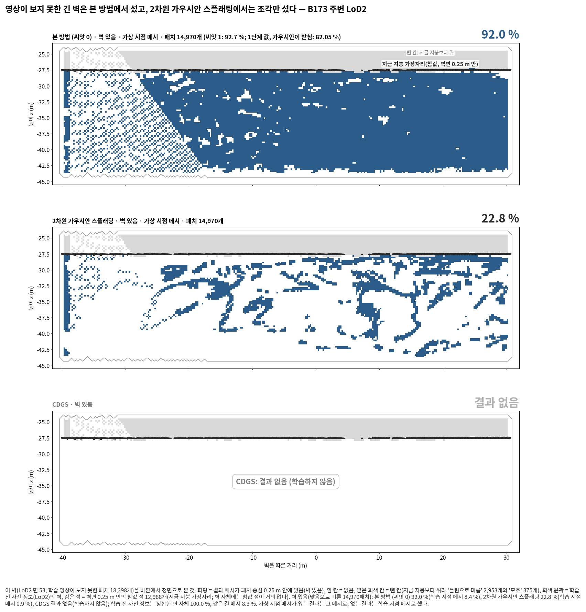
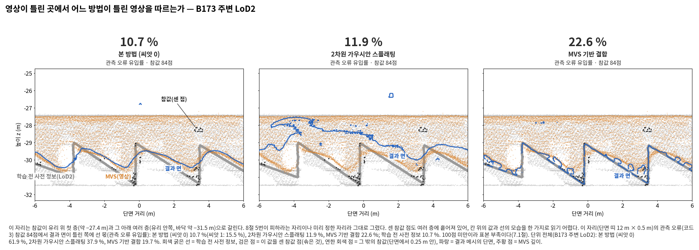
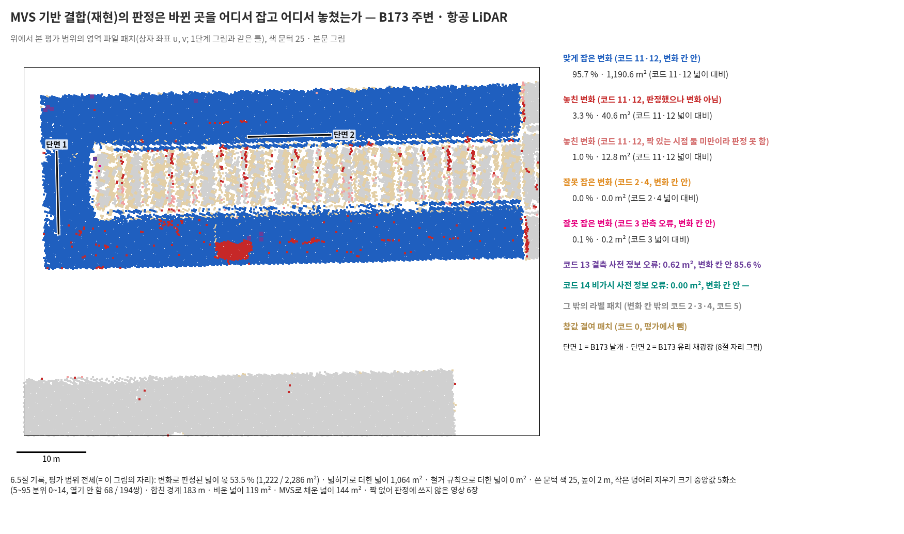

<!-- PHD-MAIN-BASELINES-v1 중간 보고 -->
# 본 실험 비교 방법 추가 — 중간 보고 v1 (앞 묶음: B173 주변)

- 작업: `PHD-MAIN-BASELINES-v1` (발주문 v1.1, 커밋 8e90ef51). `scientific_verdict: null`.
- 설정: `configs/phd/main_baselines_v1/baselines_v1.json` (10-15 10:29:05 저장, sha256 `22197c0a…`, 학습 전). 저장 뒤 바꾼 것은 `baselines_v1_amendments.json`에 덧붙이기만 했다(5건, 7절).
- 앞 묶음: B173 주변(`B173nb_b10`)의 여섯 일감.
  - 학습 둘: 2차원 가우시안 스플래팅, GeoGS 항공 LiDAR.
  - 학습 없음 넷: MVS 기반 결합(재현) LoD2·항공 LiDAR, 본 방법의 판정으로 갈아 끼운 변형 LoD2·항공 LiDAR.
  - 대기열 시작 10:29, 앞 묶음 끝 13:17. 여섯 모두 첫 시도에 끝났다.
- CDGS는 어느 단위에서도 학습하지 않았다. 사용자 결정(10-15)으로 고친 뒤 다시 본 5.5절 점검에서도 걸렸기 때문이다(1절 4).
- 1·2·3단계와 고침 발주의 공식 판정과 표는 고치지 않았다. 앞 작업의 열은 그 값을 옮긴 것이고, 나머지 값은 모두 '이 발주에서 냄'이다.
- 표: [tables/interim/](tables/interim/). 그림: [figures/interim/](figures/interim/). 그림마다 숫자 json이 옆에 있다.
- 이 보고는 B173 주변 두 단위만 읽는다. 7.6절의 답 줄(여섯 단위의 읽기를 센 것)은 최종 보고에서 쓴다.
- **결정할 것은 없다.** 대기열은 나머지(B0, R1, B173만)를 이어 돌고 있다. 확인을 바라는 것 다섯은 6절에 있다.

## 1. 답 먼저 (B173 주변 두 단위)

한 문단으로: 본 방법은 바뀐 곳의 과거 형상을 세 비교 방법보다 덜 들였다(두 단위 × 세 비교의 여섯 읽기 가운데 확인 셋, 가능·근거 불완전 셋). 2차원 가우시안 스플래팅보다는 표면을 훨씬 많이 채웠다(확인). 그러나 영상이 틀린 곳(관측 오류 영역)에서는 세 비교 방법보다 틀린 영상을 많이 들였다(여섯 읽기 모두 확인). MVS 기반 결합과의 과거 형상 차이를 둘로 나누면, LoD2의 실제 변화에서는 판정의 근거에서, 항공 LiDAR에서는 판정을 쓰는 방식에서 났다.

읽는 법: 차이는 '본 방법 평균 − 비교 방법'이다. 기준은 7.1절의 셋 가운데 가장 큰 값이다. 씨앗이 하나인 2차원 가우시안 스플래팅과 GeoGS는 기준의 두 배를 넘어야 '확인'이다. 학습이 없는 MVS 기반 결합은 기준을 넘으면 '확인'이다.

1. **비교-1. 2차원 가우시안 스플래팅보다 많이 채웠다(확인). 과거 형상은 덜 들였고, 관측 오류는 많이 들였다.**
   - 상호 보완:
     - 전체 완전성(0.2 m)은 LoD2 89.0 대 50.6 %(+38.4 %p), 항공 LiDAR 90.2 대 50.6 %(+39.6 %p)로 둘 다 '본 방법이 더 채웠다'(확인)이다.
     - 결측 영역(0.2 m)은 LoD2 96.5 대 85.1 %(+11.4 %p, 기준 3.29)로 '본 방법이 더 채웠다'(확인)이다.
     - 항공 LiDAR의 결측 영역은 참값 111점이다. 0.2 m는 0.0 대 0.9 %로 '다르지 않았다'이다. 0.5 m는 0.5 대 45.1 %로 '2차원 가우시안 스플래팅이 더 채웠다'(확인)이다.
     - 비가시 영역은 참값이 17점(LoD2)과 2점(항공 LiDAR)이라 표본 부족이다. 7.2절대로 '벽 있음'으로 대신 읽었다. LoD2 92.3 대 22.8 %, 항공 LiDAR 68.5 대 22.8 %로 '본 방법이 더 채웠다'(가능, 근거 불완전)이다. 세는 메시의 종류는 6절 2를 본다.
   - 오류 차단, 사전 정보 쪽(과거 형상 유입률):
     - LoD2는 6.8 대 10.1 %로 3.3 %p 덜 들였다(확인). 두 배 기준 3.27 %p를 0.01 %p 넘은 경계의 값이다.
     - 항공 LiDAR는 0.03 대 2.27 %(−2.25 %p)로 '가능, 근거 불완전'이다.
   - 오류 차단, 영상 쪽(관측 오류 유입률, 영역 전체): LoD2 61.3 대 37.9 %, 항공 LiDAR 84.3 대 54.8 %로, 영상이 틀린 곳의 유입이 본 방법에서 더 많았다(둘 다 확인).
     - 다만 2차원 가우시안 스플래팅의 표면은 거칠다. 세부 정확도(새 읽기)가 13.8 cm로 본 방법 2.2 cm의 여섯 배이고, 완만한 지붕의 뜬 조각 몫이 21 %다.
     - 관측 오류 행 가운데 어느 쪽에도 서지 않은 행이 28.7 %(LoD2)와 32.6 %(항공 LiDAR)다. 본 방법은 12.5 %와 4.2 %다. 그래서 2차원 가우시안 스플래팅의 낮은 유입률은 맞는 사전 정보를 지킨 몫만이 아니다(사실만 적음).
   - '영상만 − 2차원 가우시안 스플래팅'(읽기 없음, 7.2절)은 '본 방법 − 2차원 가우시안 스플래팅'과 크기가 비슷하다. 영상만에는 MVS 관측 깊이 항이 있다.
     - 전체 완전성: +38.1 %p 대 +38.4 %p(LoD2).
     - 관측 오류 유입률: +20.7·+21.3 %p 대 +23.3 %p.
     - 과거 형상 유입률: −2.8·−3.1 %p 대 −3.3 %p.
2. **비교-2. GeoGS보다 과거 형상을 덜 들였다(가능, 근거 불완전). 그 대가로 관측 오류에서 GeoGS보다 못했다(확인).**
   - LoD2(고침 발주의 고친 GeoGS 값을 옮김):
     - 과거 형상 유입률 6.8 대 8.7 %(−1.86 %p)다. 씨앗이 하나인 비교라 두 배 기준(3.27 %p) 아래는 '가능, 근거 불완전'이다.
     - 대가: 관측 오류 유입률 61.3 대 24.1 %로 '그 대가로 관측 오류 유입률에서 GeoGS보다 못했다'(확인)이다. 결측 영역 0.5 m도 97.8 대 99.4 %(확인)다. 0.2 m는 기준 안이다.
   - 항공 LiDAR(이 발주에서 처음 냄):
     - 과거 형상 유입률 0.03 대 3.08 %(−3.06 %p)다. 두 배 기준 3.28 %p에 조금 못 미쳐 '가능, 근거 불완전'이다.
     - 대가: 관측 오류 유입률 84.3 대 41.1 %(확인), 결측 영역 0.2 m 0.0 대 89.2 %(확인, 참값 111점).
   - 함께 적는 것: GeoGS 항공 LiDAR의 처음 점은 표본 100,000점 가운데 가림 검사 뒤 80,062점이 남았다. 가파른 삼각형의 몫은 표본 84.3 %, 남은 점 80.4 %다. 코드 11 넓이는 LoD2 1,359 m², 항공 LiDAR 1,016 m²다.
3. **비교-3. MVS 기반 결합(재현)보다 바뀐 곳의 과거 형상을 덜 들였다(확인). 영상이 틀린 곳의 유입은 많았다(확인).**
   - 과거 형상 유입률(LoD2는 '실제 변화로 봄'에서 읽음): LoD2 0.77 대 4.41 %(−3.64 %p), 항공 LiDAR 0.03 대 3.08 %(−3.06 %p). 둘 다 '바뀐 곳의 과거 형상을 덜 들였다'(확인, 재현)이다.
   - 관측 오류 유입률(영역 전체): LoD2 61.3 대 19.7 %, 항공 LiDAR 84.3 대 26.5 %로 본 방법에서 더 많았다(확인, 재현).
   - 상호 보완: LoD2 결측 영역 0.2 m는 '다르지 않았다'이고 0.5 m는 '결합이 더 채웠다'(99.8 대 97.8 %, 확인)이다. 항공 LiDAR 결측 영역은 0.0 대 99.1 %로 '결합이 더 채웠다'(확인, 참값 111점)이다.
   - 차이가 난 자리(7.4절의 나눔 1): LoD2 코드 11 전체에서 본 방법이 결합보다 10.15 %p 낮았고, 그 가운데 9.72 %p가 결합의 변화 칸 밖(코드 11 행의 17.6 %)에서 났다. 결합이 놓친 변화다. '실제 변화로 봄' 안에서는 3.64 %p 가운데 3.24 %p, 항공 LiDAR는 3.05 %p 가운데 2.57 %p가 같은 자리에서 났다.
   - 판정의 근거와 판정을 쓰는 방식(근거 = 변형 − 결합, 방식 = 본 방법 − 변형; 두 차이를 더하면 '본 방법 − 결합'):

     | 지표 | 단위 | 근거 (기준; 등급) | 방식 (기준; 등급) | 읽음 |
     |---|---|---|---|---|
     | 과거 형상 유입률 | LoD2 실제 변화로 봄 | −3.44 %p (1.64; 확인) | −0.20 %p (1.64; 기준 안) | 판정의 근거에서 차이가 났다 |
     | 과거 형상 유입률 | 항공 LiDAR | −1.28 %p (1.64; 기준 안) | −1.77 %p (1.64; 확인) | 판정을 쓰는 방식에서 차이가 났다 |
     | 관측 오류 유입률(영역 전체) | LoD2 | +28.02 %p (2.67; 확인) | +13.56 %p (2.67; 확인) | 둘 다에서 차이가 났다 |
     | 관측 오류 유입률(영역 전체) | 항공 LiDAR | +32.11 %p (1.57; 확인) | +25.66 %p (1.57; 확인) | 둘 다에서 차이가 났다 |

   - 판정의 근거가 관측 오류에서 낸 차이는 판정 기록에서도 보인다. 영상이 틀린 곳(코드 3)의 넓이 가운데 본 방법의 학습 전 판정은 LoD2 65.1 %, 항공 LiDAR 31.7 %를 충돌로 잡았다. 결합의 색 판정은 9.0 %와 0.1 %만 변화로 잡았다(표 `fusion_hits`).
   - 결합의 판정 기록(6.5절): 바뀐 곳(코드 11·12)을 잡은 몫은 LoD2 77.9·33.6 %, 항공 LiDAR 96.7·91.3 %다. 맞는 곳(코드 2·4)을 변화로 잘못 잡은 몫은 LoD2 34.3·39.7 %, 항공 LiDAR 0.0·0.0 %다. LoD2의 '표현 차이로 봄'(134 m²)은 하나도 변화 칸에 들지 않았다(판정했으나 변화 아님 79.2 %, 판정 못 함 20.8 %).
4. **비교-4. CDGS는 결과가 없다.**
   - 학습 전에 정한 5.5절의 축척 규칙에 걸렸다. B173 주변은 정렬 축척이 0.9~1.1 밖인 학습 영상이 LoD2 35.5 %, 항공 LiDAR 27.6 %로 4분의 1을 넘었다.
   - 이 칸이 빠져 비교-4의 물음은 B173 주변에서 답할 수 없다.

## 2. 대표 사례 (8절, B173 자리 셋)

- 그림은 8절 규칙을 따랐다. 칸 위의 값은 그 자리의 값이고, '단위 전체' 값은 그림 아래 줄에 따로 밝혔다.
- 미리 정한 칸 가운데 CDGS 칸은 '결과 없음(학습하지 않음)'으로 그렸다.
- 1단계의 비스듬한 3차원 보기 대신 1단계 대표 그림의 단면 꼴과 벽 정면 꼴로 그렸다(jointbuildgs:dev에 렌더러가 없음).
- 보조 사전 정보의 그림은 미리 정한 그림 밖에 더한 것이다. 그 자리 띠에서 가장 많은 코드를 쓴다.

### 2.1 B173 날개 (항공 LiDAR; LoD2는 보조)

- 그림 1 제목: 옛 박공은 본 방법과 MVS 기반 결합에 남지 않았고, GeoGS만 두 지붕 사이에 조각을 남겼다.
- 이 자리(단면 띠 12 m × 0.5 m)의 코드 11 참값 591점에서 과거 형상 유입률은 다음과 같다.
  - 본 방법 0.0 %(씨앗 1도 0.0 %), GeoGS 2.9 %, MVS 기반 결합 0.0 %, 학습 전 사전 정보 100.0 %.
  - 단위 전체 값은 0.03 · 3.08 · 3.08 %다.
- 그림 2(본 방법, CDGS, 2차원 가우시안 스플래팅)는 0.0 % · 결과 없음 · 0.0 %다([figures/interim/spot_wing_2.png](figures/interim/spot_wing_2.png)).
- LoD2 보조 그림 둘(코드 11, 607점)은 본 방법 0.0 %, GeoGS 0.7 %, 결합 0.0 %, 2차원 가우시안 스플래팅 0.0 %다.

### 2.2 B173 긴 벽 (LoD2)

- 그림 1 제목: 영상이 보지 못한 긴 벽은 본 방법에서 섰고, 2차원 가우시안 스플래팅에서는 조각만 섰다.
- 셈: LoD2 면 53에서 '맞음으로 미룬' 14,970패치 가운데 결과 메시가 패치 중심 0.25 m 안에 있는 몫이다.
- 그림 1(본 방법, 2차원 가우시안 스플래팅, CDGS):
  - 본 방법 92.0 %(씨앗 1: 92.7 %)다. 1단계 값(가우시안이 받침)은 82.05 %로, 이 발주에서 다시 구해도 같았다.
  - 2차원 가우시안 스플래팅 22.8 %, CDGS는 결과 없음이다.
- 그림 2(본 방법, GeoGS, MVS 기반 결합)는 GeoGS 22.3 %, 결합 2.2 %다([figures/interim/spot_wall_2.png](figures/interim/spot_wall_2.png)).
- 세는 메시가 결과마다 다르다(6절 2).
  - 렌더러가 있는 결과는 가상 시점 메시로 셌다. 1단계가 이 벽에 쓴 것과 같다.
  - 렌더러가 없는 결과(결합, 변형, 학습 전 사전 정보)는 학습 시점 메시로 셌다.
  - 모든 결과를 학습 시점 메시 하나로 세면 본 방법 8.4 · 10.1 %, 2차원 가우시안 스플래팅 0.9 %, GeoGS 4.4 %, 결합 2.2 %, 변형 10.1 %, 학습 전 사전 정보 8.3 %다. 학습 시점 메시에는 영상이 보지 못한 면이 거의 담기지 않는다.
- 항공 LiDAR 단위의 같은 셈: 본 방법 69.9 · 67.1 %, GeoGS 22.6 %, 결합 7.8 %다.

### 2.3 B173 유리 채광창 (LoD2; 항공 LiDAR는 보조)

- 이 자리의 코드 3 참값은 84점이라 표본 부족이다.
  - 관측 오류 유입률은 본 방법 10.7 %(씨앗 1: 15.5 %), 2차원 가우시안 스플래팅 11.9 %, 결합 22.6 %, 학습 전 사전 정보 10.7 %다.
  - 단위 전체는 61.9 · 37.9 · 19.7 %다.
- **이 자리는 그림 규칙 5와 7을 지키지 못한다.**
  - 참값이 유리 윗면(약 −27.4 m), 안쪽 여러 층, 바닥(약 −31.5 m)으로 갈린다. 센 참값 점도 그 층들에 흩어져 있다.
  - 그림의 선은 본 방법이 MVS 깊이의 톱니를 따르고, 결합이 LoD2의 톱니를 따른다. 그런데 칸 위의 값은 결합이 가장 높아, 선과 숫자가 반대로 보인다.
  - 미리 정한 자리라 그대로 두고, 그림 아래와 json에 이 점을 적었다(6절 3).
- 항공 LiDAR 보조 그림(코드 12, 421점): 5 m 위에 있던 학습 전 항공 LiDAR 면은 본 방법, 2차원 가우시안 스플래팅, 결합 어디에도 남지 않았다(모두 0.0 %). GeoGS는 2.6 %다.

### 2.4 MVS 기반 결합(재현)의 판정 지도 (B173 주변 항공 LiDAR, 본문)

- 바뀐 곳(코드 11·12) 넓이의 95.7 %를 변화 칸에 넣었다.
  - 놓친 몫은 4.3 %다. 판정했으나 변화가 아니라고 한 곳이 3.3 %, 짝 있는 시점이 둘 미만이라 판정하지 못한 곳이 1.0 %다.
  - 맞는 곳(코드 2·4)을 변화로 잘못 잡은 넓이는 0.0 %다.
- 6.5절 기록:
  - 변화로 판정된 넓이 몫 53.5 %, 넓히기로 더한 넓이 1,064 m², 철거 규칙 0 m².
  - 합친 경계 183 m, 비운 넓이 119 m², MVS로 채운 넓이 144 m², 짝이 없어 판정에 쓰지 않은 영상 6장.
  - 평가 범위 밖 변화 칸은 923 m²다.
- LoD2 지도는 보조다([figures/interim/fusionmap_B173nb_b10_LoD2.png](figures/interim/fusionmap_B173nb_b10_LoD2.png)). LoD2에서 변화로 판정된 4,961 m² 가운데 3,836 m²가 벽 면이다. 위에서 본 지도에서 벽은 선이 되므로 칸마다 넓이가 큰 쪽으로 칠했다('결과를 본 뒤 더함').

### 2.5 물음마다 요약 그림

- 단위마다 비교 셋의 막대 그림이 있다: [figures/interim/bars/](figures/interim/bars/). `B173nb_b10_<사전 정보>_q1`은 비교-1, `q2`는 비교-2, `q3`는 비교-3이다.
- 막대는 본 방법 두 씨앗, 학습 전 사전 정보, 그 비교 방법이다. 띠는 본 방법 평균 ± 기준이다.

## 3. 주 표 (B173 주변)

- 비교 방법 칸: 값 · 읽기(본 방법이 나음 / 같음 / 못함) · 등급. 장치 빼기 열은 참고 열이라 읽기와 등급이 없다.
- 몫은 %, 거리는 cm. 표본은 본 방법 씨앗 0의 행 수다(다른 열이 다르면 칸에 n을 적음).
- 1단계 지역 표의 나머지 줄(표 B)과 줄마다의 기준 부분은 [tables/interim/main_B173nb_b10.md](tables/interim/main_B173nb_b10.md)와 [tables/interim/read.md](tables/interim/read.md)에 있다.

**B173 주변 · LoD2**

| 지표 | 영역 코드 | 표본 | 본 방법 평균 (씨앗 0 · 1) | 학습 전 사전 정보 | 기준 (가장 큰 것) | 2차원 가우시안 스플래팅 | GeoGS | MVS 기반 결합 | CDGS | 장치 빼기: 영상만 | 장치 빼기: 사전 정보 신뢰 | 장치 빼기: 판정만 끈 본 방법 | 장치 빼기: 본 방법의 판정으로 갈아 끼운 변형 | 영상만 − 2차원 가우시안 스플래팅 |
|---|---|---|---|---|---|---|---|---|---|---|---|---|---|---|
| 과거 형상 유입률 | 11 | 119,763 | 6.81 (6.54 · 7.08) | 99.72 | 1.64 (모은 흔들림) | 10.09 · 나음 · 확인 | 8.67 · 나음 · 가능, 근거 불완전 | 16.96 | 결과 없음 | 7.27 · 7.02 | 결과 없음 | 7.99 | 9.74 | -2.82 · -3.07 |
| 과거 형상 유입률 · 실제 변화로 봄 | 11 (항공 LiDAR도 참값과 어긋남) | 95,157 | 0.77 (0.71 · 0.83) | 99.99 | 1.64 (모은 흔들림) | 3.57 | 2.98 | 4.41 · 나음 · 확인 | 결과 없음 | 1.11 · 0.96 | 결과 없음 | 1.06 | 0.97 | -2.46 · -2.61 |
| 과거 형상 유입률 · 표현 차이로 봄 | 11 (항공 LiDAR는 참값과 맞음) | 9,760 | 55.24 (52.52 · 57.96) | 99.98 | 10.77 (단위 흔들림) | 45.98 | 49.13 | 99.19 | 결과 없음 | 56.35 · 55.63 | 결과 없음 | 61.61 | 67.67 | +10.37 · +9.65 |
| 과거 형상 유입률 · 가르지 못함 | 11 (그 자리에 항공 LiDAR 면 없음) | 14,846 | 13.64 (13.62 · 13.67) | 97.85 | 1.64 (모은 흔들림) | 28.33 | 18.48 | 43.34 | 결과 없음 | 14.48 · 13.90 | 결과 없음 | 17.16 | 27.89 | -13.85 · -14.43 |
| 관측 오류 유입률 (영역 전체) | 3 | 12,410 | 61.25 (61.93 · 60.58) | 11.15 | 2.67 (단위 흔들림) | 37.91 · 못함 · 확인 | 24.09 · 못함 · 확인 | 19.67 · 못함 · 확인 | 결과 없음 | 58.57 · 59.17 | 결과 없음 | 55.03 | 47.69 | +20.66 · +21.26 |
| 관측 오류 유입률 (문턱 이내) | 3 (문턱 이내) | 1,594 | 65.88 (66.25 · 65.50) | 42.66 | 1.48 (단위 흔들림) | 36.76 · 못함 · 가능, 근거 불완전 | 27.29 · 못함 · 가능, 근거 불완전 | 50.00 · 못함 · 가능, 근거 불완전 | 결과 없음 | 57.21 · 60.23 | 결과 없음 | 67.44 | 56.40 | +20.45 · +23.47 |
| 결측 영역 완전성 (0.2 m) | 4 | 6,314 | 96.45 (96.20 · 96.71) | 97.77 | 3.29 (모은 흔들림) | 85.08 · 나음 · 확인 | 93.79 · 같음 · 기준 안 | 96.72 · 같음 · 기준 안 | 결과 없음 | 90.80 · 92.94 | 결과 없음 | 96.23 | 96.36 | +5.72 · +7.86 |
| 결측 영역 완전성 (0.5 m) | 4 | 6,314 | 97.80 (97.77 · 97.83) | 99.79 | 0.12 (단위 흔들림) | 97.58 · 나음 · 가능, 근거 불완전 | 99.41 · 못함 · 확인 | 99.83 · 못함 · 확인 | 결과 없음 | 97.56 · 97.67 | 결과 없음 | 97.81 | 99.30 | -0.02 · +0.09 |
| 비가시 영역 완전성 (0.2 m) | 5 | 17 | 70.59 (70.59 · 70.59) | 100.00 | 17.65 (세 점) | 52.94 · 표본 부족 | 88.24 · 표본 부족 | 94.12 · 표본 부족 | 결과 없음 | 41.18 · 76.47 | 결과 없음 | 64.71 | 82.35 | -11.76 · +23.53 |
| 비가시 영역 완전성 (0.5 m) | 5 | 17 | 88.24 (88.24 · 88.24) | 100.00 | 17.65 (세 점) | 100.00 · 표본 부족 | 100.00 · 표본 부족 | 100.00 · 표본 부족 | 결과 없음 | 88.24 · 88.24 | 결과 없음 | 100.00 | 100.00 | -11.76 · -11.76 |
| 벽 있음 (B173 긴 벽, 0.25 m) | 5 (면 53의 패치) | 14,970 | 92.32 (91.99 · 92.66) | 8.30 | 1.32 (단위 흔들림) | 22.81 · 나음 · 가능, 근거 불완전 | 22.32 | 2.24 | 결과 없음 | 21.32 · 25.62 | 결과 없음 | 89.26 | 10.13 | -1.49 · +2.81 |
| 전체 완전성 (0.2 m) | 전체 | 3,881,308 | 88.98 (89.04 · 88.92) | 53.16 | 0.24 (단위 흔들림) | 50.58 · 나음 · 확인 | 57.65 | 87.23 | 결과 없음 | 88.64 · 88.74 | 결과 없음 | 88.88 | 88.56 | +38.06 · +38.16 |
| 전체 완전성 (0.5 m) | 전체 | 3,881,308 | 96.45 (96.44 · 96.47) | 65.29 | 0.06 (단위 흔들림) | 82.99 · 나음 · 확인 | 93.58 | 97.85 | 결과 없음 | 96.11 · 96.35 | 결과 없음 | 96.82 | 98.02 | +13.12 · +13.36 |
| 세부 정확도, 새 읽기 (cm) | 2 (완만한 지붕) | 32,634 | 2.18 (2.22 · 2.14) | 2.94 | 0.52 (모은 흔들림) | 13.84 (n 32,246) · 나음 · 확인 | 15.01 (n 32,500) · 나음 · 확인 | 2.95 · 나음 · 확인 | 결과 없음 | 2.26 · 2.21 | 결과 없음 | 2.13 | 2.95 | -11.58 · -11.63 |
| 세부 정확도, 지금 읽기 (cm) | 2 (완만한 지붕) | 32,634 | 2.21 (2.24 · 2.17) | 2.94 | 0.14 (단위 흔들림) | 22.13 | 15.96 | 2.96 | 결과 없음 | 2.30 · 2.23 | 결과 없음 | 2.16 | 2.96 | -19.83 · -19.90 |
| 세부 정확도의 뜬 조각 몫 | 2 (완만한 지붕) | 32,634 | 1.30 (1.24 · 1.37) | 0.00 | 0.26 (단위 흔들림) | 21.13 | 5.31 | 0.30 | 결과 없음 | 1.81 · 1.51 | 결과 없음 | 1.50 | 0.17 | -19.32 · -19.62 |
| 이중 오류 유입률 | 12 | 35,690 | 40.32 (40.26 · 40.38) | 98.85 | 0.24 (단위 흔들림) | 30.34 | 35.04 | 63.56 | 결과 없음 | 39.24 · 39.28 | 결과 없음 | 45.21 | 43.88 | +8.90 · +8.94 |
| 결측 영역의 과거 형상 유입률 | 13 | 371 | 20.76 (21.83 · 19.68) | 94.61 | 4.26 (단위 흔들림) | 49.87 | 34.23 | 53.10 | 결과 없음 | 18.87 · 19.68 | 결과 없음 | 26.42 | 57.14 | -31.00 · -30.19 |

**B173 주변 · 항공 LiDAR**

| 지표 | 영역 코드 | 표본 | 본 방법 평균 (씨앗 0 · 1) | 학습 전 사전 정보 | 기준 (가장 큰 것) | 2차원 가우시안 스플래팅 | GeoGS | MVS 기반 결합 | CDGS | 장치 빼기: 영상만 | 장치 빼기: 사전 정보 신뢰 | 장치 빼기: 판정만 끈 본 방법 | 장치 빼기: 본 방법의 판정으로 갈아 끼운 변형 | 영상만 − 2차원 가우시안 스플래팅 |
|---|---|---|---|---|---|---|---|---|---|---|---|---|---|---|
| 과거 형상 유입률 | 11 | 96,117 | 0.03 (0.02 · 0.03) | 99.96 | 1.64 (모은 흔들림) | 2.27 · 나음 · 가능, 근거 불완전 | 3.08 · 나음 · 가능, 근거 불완전 | 3.08 · 나음 · 확인 | 결과 없음 | 0.04 · 0.07 | 17.94 | 0.15 | 1.80 | -2.23 · -2.20 |
| 관측 오류 유입률 (영역 전체) | 3 | 7,881 | 84.29 (84.30 · 84.28) | 2.22 | 1.57 (모은 흔들림) | 54.83 · 못함 · 확인 | 41.09 · 못함 · 확인 | 26.52 · 못함 · 확인 | 결과 없음 | 85.01 · 86.06 | 49.17 | 78.25 | 58.63 | +30.18 · +31.23 |
| 관측 오류 유입률 (문턱 이내) | 3 (문턱 이내) | 3,388 | 89.02 (89.20 · 88.84) | 4.52 | 0.71 (단위 흔들림) | 46.10 · 못함 · 가능, 근거 불완전 | 45.81 · 못함 · 가능, 근거 불완전 | 27.60 · 못함 · 가능, 근거 불완전 | 결과 없음 | 86.33 · 86.39 | 52.60 | 87.78 | 41.17 | +40.23 · +40.29 |
| 결측 영역 완전성 (0.2 m) | 4 | 111 | 0.00 (0.00 · 0.00) | 99.10 | 3.29 (모은 흔들림) | 0.90 · 같음 · 기준 안 | 89.19 · 못함 · 확인 | 99.10 · 못함 · 확인 | 결과 없음 | 0.00 · 0.00 | 63.06 | 0.00 | 67.57 | -0.90 · -0.90 |
| 결측 영역 완전성 (0.5 m) | 4 | 111 | 0.45 (0.90 · 0.00) | 100.00 | 2.70 (세 점) | 45.05 · 못함 · 확인 | 100.00 · 못함 · 확인 | 100.00 · 못함 · 확인 | 결과 없음 | 0.00 · 0.00 | 81.08 | 0.90 | 100.00 | -45.05 · -45.05 |
| 비가시 영역 완전성 (0.2 m) | 5 | 2 | 100.00 (100.00 · 100.00) | 100.00 | 150.00 (세 점) | 100.00 · 표본 부족 | 100.00 · 표본 부족 | 100.00 · 표본 부족 | 결과 없음 | 100.00 · 100.00 | 100.00 | 100.00 | 100.00 | +0.00 · +0.00 |
| 비가시 영역 완전성 (0.5 m) | 5 | 2 | 100.00 (100.00 · 100.00) | 100.00 | 150.00 (세 점) | 100.00 · 표본 부족 | 100.00 · 표본 부족 | 100.00 · 표본 부족 | 결과 없음 | 100.00 · 100.00 | 100.00 | 100.00 | 100.00 | +0.00 · +0.00 |
| 벽 있음 (B173 긴 벽, 0.25 m) | 5 (면 53의 패치) | 14,970 | 68.49 (69.87 · 67.10) | 7.51 | 5.49 (단위 흔들림) | 22.81 · 나음 · 가능, 근거 불완전 | 22.61 | 7.84 | 결과 없음 | 21.32 · 25.62 | 53.64 | 68.73 | 9.33 | -1.49 · +2.81 |
| 전체 완전성 (0.2 m) | 전체 | 3,881,308 | 90.20 (90.18 · 90.23) | 52.32 | 0.10 (단위 흔들림) | 50.58 · 나음 · 확인 | 64.07 | 87.68 | 결과 없음 | 88.64 · 88.74 | 56.27 | 90.92 | 92.17 | +38.06 · +38.16 |
| 전체 완전성 (0.5 m) | 전체 | 3,881,308 | 96.56 (96.53 · 96.60) | 58.45 | 0.14 (단위 흔들림) | 82.99 · 나음 · 확인 | 94.32 | 94.65 | 결과 없음 | 96.11 · 96.35 | 65.98 | 96.78 | 98.11 | +13.12 · +13.36 |
| 세부 정확도, 새 읽기 (cm) | 2 (완만한 지붕) | 35,345 | 2.33 (2.35 · 2.30) | 1.75 | 0.52 (모은 흔들림) | 14.17 (n 34,946) · 나음 · 확인 | 14.61 · 나음 · 확인 | 1.76 · 못함 · 확인 | 결과 없음 | 2.47 · 2.40 | 2.07 | 2.38 | 1.77 | -11.70 · -11.77 |
| 세부 정확도, 지금 읽기 (cm) | 2 (완만한 지붕) | 35,345 | 2.35 (2.37 · 2.33) | 1.75 | 0.08 (단위 흔들림) | 21.87 (n 35,343) | 15.63 | 1.76 | 결과 없음 | 2.51 · 2.42 | 2.13 | 2.41 | 1.77 | -19.36 · -19.45 |
| 세부 정확도의 뜬 조각 몫 | 2 (완만한 지붕) | 35,345 | 1.24 (1.15 · 1.34) | 0.00 | 0.38 (단위 흔들림) | 20.20 | 5.62 | 0.10 | 결과 없음 | 1.90 · 1.58 | 2.36 | 1.32 | 0.36 | -18.30 · -18.62 |
| 이중 오류 유입률 | 12 | 19,791 | 0.60 (0.56 · 0.63) | 99.96 | 0.14 (단위 흔들림) | 2.94 | 2.41 | 6.95 | 결과 없음 | 0.52 · 0.64 | 13.86 | 0.67 | 7.79 | -2.42 · -2.30 |
| 결측 영역의 과거 형상 유입률 | 13 | 53 | 0.00 (0.00 · 0.00) | 100.00 | 5.66 (세 점) | 0.00 | 3.77 | 3.77 | 결과 없음 | 0.00 · 0.00 | 30.19 | 0.00 | 3.77 | +0.00 · +0.00 |

- LoD2의 과거 형상 유입률은 3단계 발주 8.2의 세 갈래로도 적었다(코드 11 패치를 같은 참값 점의 항공 LiDAR로 가름; [tables/interim/split82.md](tables/interim/split82.md)). 비교-3은 '실제 변화로 봄'에서 읽는다(7.4절).
- '벽 있음' 줄은 렌더러가 있는 결과를 가상 시점 메시로, 없는 결과(MVS 기반 결합, 변형, 학습 전 사전 정보)를 학습 시점 메시로 센 값이다(2.2절, 6절 2).

## 4. 학습이 끝났는지의 표

| 방법 | 결과 | 지역 | 단위 | 상태 | 코드·이미지 | 시도 | 학습 (분) | GPU 최대 (GiB) | PyTorch 할당 최대 (GiB) | 마지막 가우시안 | 단계: 초 · 호스트 최소 GB |
|---|---|---|---|---|---|---|---|---|---|---|---|
| 2차원 가우시안 스플래팅 | `imgonly_2dgs_s0` | B173 주변 | LoD2, 항공 LiDAR | 끝남 | github.com/hbb1/2d-gaussian-splatting f3e3b9f + 어댑터 v1; 이미지 jointbuildgs:2dgs-official-f3e3b9f-v1 | 1 | 32.8 | 5.0 | 4.0 | 1,440,563 | post0 PASS 395 s · 19.0; post1 PASS 208 s · 37.2; cpu0 PASS 307 s · 48.3; cpu1 PASS 293 s · 51.6; cpu2 PASS 44 s · 57.1 |
| GeoGS (LoD2, 고침 발주의 결과를 옮김) | `trust_LoD2_fix1` | B173 주변 | LoD2 | 끝남 (앞 작업) | GeoGS-official-adapters-v1-fix1; 이미지 jointbuildgs:geogs-official-db40c95-compat-v1 | — | 71.1 | 17.8 | — | — | — |
| GeoGS | `geogs_ALS_fix1` | B173 주변 | 항공 LiDAR | 끝남 | GeoGS-official-adapters-v1-fix1; 이미지 jointbuildgs:geogs-official-db40c95-compat-v1 | 1 | 66.9 | 13.4 | — | 3,605,015 | post0 PASS 382 s · 11.4; post1 PASS 186 s · 36.5; cpu0 PASS 217 s · 58.8; cpu1 PASS 41 s · 57.7 |
| MVS 기반 결합 | `mvsfuse_LoD2` | B173 주변 | LoD2 | 끝남 | scripts/phd/main_baselines_v1/mvsfuse (재현; 학습 없음) | — | 학습 없음 (판정·합치기 + TSDF 10.2) | — | — | — | pre0 PASS 87 s · 42.2; post0 PASS 537 s · 21.9; cpu0 PASS 113 s · 47.1; cpu1 PASS 31 s · 51.8 |
| MVS 기반 결합 | `mvsfuse_ALS` | B173 주변 | 항공 LiDAR | 끝남 | scripts/phd/main_baselines_v1/mvsfuse (재현; 학습 없음) | — | 학습 없음 (판정·합치기 + TSDF 7.5) | — | — | — | pre0 PASS 65 s · 46.1; post0 PASS 392 s · 22.5; cpu0 PASS 116 s · 46.2; cpu1 PASS 37 s · 49.0 |
| 본 방법의 판정으로 갈아 끼운 변형 | `judgefuse_LoD2` | B173 주변 | LoD2 | 끝남 | scripts/phd/main_baselines_v1/judgefuse (학습 없음) | — | 학습 없음 (판정·합치기 + TSDF 5.0) | — | — | — | pre0 PASS 87 s · 55.5; post0 PASS 222 s · 33.7; cpu0 PASS 72 s · 51.2; cpu1 PASS 27 s · 55.7 |
| 본 방법의 판정으로 갈아 끼운 변형 | `judgefuse_ALS` | B173 주변 | 항공 LiDAR | 끝남 | scripts/phd/main_baselines_v1/judgefuse (학습 없음) | — | 학습 없음 (판정·합치기 + TSDF 5.1) | — | — | — | pre0 PASS 58 s · 54.7; post0 PASS 256 s · 28.8; cpu0 PASS 121 s · 41.9; cpu1 PASS 35 s · 46.9 |

- 위 표는 앞 묶음의 줄만 옮겼다. 전체(방법 × 지역 × 사전 정보)는 [tables/interim/status.md](tables/interim/status.md)에 있다.
- CDGS 여덟 칸은 모두 '결과 없음(학습하지 않음: 5.5 점검)'이다. 까닭과 수는 status.md의 칸마다 적었다.
- 13:28 현재 나머지 대기열의 상태:
  - 끝남: B0 2차원 가우시안 스플래팅, B0 MVS 기반 결합 LoD2.
  - 돌고 있음: B173만 2차원 가우시안 스플래팅 학습 둘째 시도(GPU 1, 13:30 시작). 첫 시도는 14,150회(가우시안 245만 개)에서 GPU 메모리 부족으로 멈췄다(7.2절 5). R1 2차원 가우시안 스플래팅은 후처리를 마치고 지표를 기다린다.
  - 기다림: R1 결합 항공 LiDAR의 TSDF(R1이라 혼자 돌 차례를 기다림), 그 밖의 결합·변형, GeoGS 항공 LiDAR 셋(B0, R1, B173만).

## 5. 메모리와 걸린 시간

- 대기열은 10:29에 시작해 앞 묶음을 13:17에 마쳤다(2시간 48분).
  - GPU 1은 처음부터 썼다. GPU 0은 3단계가 끝난 뒤(3단계 최종 보고 10:21) 10:37부터 함께 썼다. 처음에는 결합의 TSDF를, 11:23부터는 학습을 돌렸다.
- 학습:

  | 결과 | 학습 | GPU 최대 (nvidia-smi 최대 − 시작) | 마지막 가우시안 |
  |---|---|---|---|
  | 2차원 가우시안 스플래팅 | 32.8분 (10:29~11:02, GPU 1) | 5.0 GiB | 1,440,563 |
  | GeoGS 항공 LiDAR | 66.9분 (11:31~12:38, GPU 1) | 13.4 GiB | 3,605,015 |

- 후처리와 지표(초; 괄호는 그 단계 동안 호스트에 쓸 수 있던 메모리의 최소, GB):

  | 결과 | 판정·합치기 | 후처리 1 (TSDF 등) | 후처리 2 (평가 점 등) | 지표 LoD2 · 항공 LiDAR | 측정 |
  |---|---|---|---|---|---|
  | 2차원 가우시안 스플래팅 | — | 395 (19.0) | 208 (37.2) | 307 (48.3) · 293 (51.6) | 44 (57.1) |
  | GeoGS 항공 LiDAR | — | 382 (11.4) | 186 (36.5) | — · 217 (58.8) | 41 (57.7) |
  | MVS 기반 결합 LoD2 | 87 (42.2) | 537 (21.9) | — | 113 (47.1) | 31 (51.8) |
  | MVS 기반 결합 항공 LiDAR | 65 (46.1) | 392 (22.5) | — | 116 (46.2) | 37 (49.0) |
  | 변형 LoD2 | 87 (55.5) | 222 (33.7) | — | 72 (51.2) | 27 (55.7) |
  | 변형 항공 LiDAR | 58 (54.7) | 256 (28.8) | — | 121 (41.9) | 35 (46.9) |

  - 변형 둘은 깊이 합치기를 11:27~11:28에 마쳤고, TSDF는 GPU 0 일꾼이 B0 학습과 후처리를 마친 뒤 11:58~12:11에 돌았다.
- 호스트 메모리:
  - 앞 묶음에서 가장 낮았던 값은 GeoGS 후처리 1의 11.4 GB다.
  - 앞 묶음 밖에서는 B0 2차원 가우시안 스플래팅의 후처리 1(TSDF) 때 3.0 GB까지 내려갔다. 학습 둘과 겹친 때다. 멈춘 단계는 없었다.
- R1 후처리는 발주문 4절 10번대로 혼자, 컨테이너 한도 96 GB로 돌렸다.
  - 호스트 여유가 90 GB 아래라 titiler 둘과 tensorboard를 잠시 멈췄다(12:55~13:04, 13:09~13:10). 끝나고 바로 다시 켰다.
  - 혼자 돌릴 차례를 기다리는 동안 다른 GPU는 새 일을 시작하지 않는다. 13:15부터는 R1 결합 항공 LiDAR의 TSDF가 B173만 학습(둘째 시도)이 끝나기를 기다리고, 그동안 GPU 0이 비어 있다.
  - R1 결합의 TSDF는 최대 32.3 GB만 썼다(R1 결합 LoD2, `post.json`). 6절 4에 적은 대로 결합과 변형의 R1 TSDF만 학습과 함께 돌리면 끝나는 시각을 당길 수 있다. 결과는 같다.
- 끝나는 시각 어림: 지금 차례대로면 19:30~20:30이다. 가장 긴 B173만 GeoGS는 고침 발주에서 196분이 걸렸다.

## 6. 확인을 바라는 것 (답이 없어도 대기열은 이어 간다)

답이 없으면 아래의 '지금 하는 것'대로 최종 보고까지 간다.

1. **발주문이 읽는 말을 정하지 않은 방향의 말.**
   - 대상: 7.2~7.4절은 한쪽 방향의 말만 정했다. 예를 들어 비교-1의 관측 오류 유입률은 '본 방법이 낮으면 지켰다'만 있다.
   - 무슨 일: B173 주변에서는 정해지지 않은 쪽(본 방법이 높음)이 여러 번 나왔다.
   - 지금 하는 것: 같은 꼴로 적고 표에 '[발주에 없는 말]'을 붙였다. 쓴 말은 다음 넷이다.
     - '영상이 틀린 곳의 유입이 ○○보다 많았다'
     - 비교-1 과거 형상에서 본 방법이 낮을 때 '영상만 방법보다 과거 형상을 덜 들였다'
     - 세부 정확도의 '○○의 세부가 더 정확했다'
     - 비교-2 대가에서 본 방법이 나을 때의 말
   - 고칠 말이 있으면 알려 주면 최종 보고에 반영한다.
2. **'벽 있음'을 셀 메시.**
   - 대상: 7.2절은 비가시 영역 참값이 100점 미만이면 '벽 있음'으로 대신 읽는다. B173 주변 두 단위가 이에 해당한다(17점, 2점).
   - 무슨 일: 렌더러가 있는 방법은 가상 시점 메시와 학습 시점 메시 둘이 있다. 학습 시점 메시에는 영상이 보지 못한 벽이 거의 담기지 않는다(본 방법도 8~10 %).
   - 지금 하는 것: 비교-1(본 방법과 2차원 가우시안 스플래팅, 둘 다 렌더러가 있음)은 가상 시점 메시로 읽고, 학습 시점 메시 값을 옆에 적는다. 다른 비교는 발주문대로 표본 부족으로 둔다.
3. **유리 채광창 자리.**
   - 대상: 8절 표의 미리 정한 자리다. 참값이 여러 층이라 규칙 5와 7을 지키지 못했다(2.3절).
   - 지금 하는 것: 그대로 두고 주석을 단다.
   - 권하는 것: 최종 보고에 코드 3 자리 하나를 '결과를 본 뒤 더함'으로 더한다. 고르는 규칙은 방법의 값을 보지 않고 미리 적는다. 참값이 한 층이고 코드 3 참값이 100점 이상인 띠 가운데 점이 가장 많은 띠다. 더할지 알려 주면 그대로 한다.
4. **R1 결합·변형의 TSDF를 학습과 함께 돌릴지.**
   - 대상: 발주문 4절 10번 'R1 후처리는 혼자'.
   - 무슨 일: 혼자 돌 차례를 기다리는 동안 GPU 하나가 쉰다(5절).
   - 지금 하는 것: 규칙대로 혼자 돌린다.
   - 바꾸면: 남은 R1 변형 둘의 TSDF만 학습과 함께 돌린다. 측정된 최대 메모리는 32 GB이고, 다른 TSDF와는 겹치지 않는다. 결과는 같고 끝나는 시각만 당겨진다. R1 GeoGS 후처리는 그대로 혼자다.
5. **CDGS를 B0 LoD2 하나만이라도 학습할지.**
   - 대상: CDGS는 5.5절 축척 규칙으로 여덟 단위 모두 멈췄다. B0 LoD2만 두 규칙을 혼자서는 통과했다(축척 밖 10.7 %, 가중 중앙값 0.45). 같은 지역의 항공 LiDAR가 걸려 지역 규칙으로 멈췄다.
   - 지금 하는 것: 학습하지 않는다(사용자 결정 10-15).
   - 바꾸면: 실행기의 메모리 설정을 고치고(torch 2.0.1이 `expandable_segments`를 받지 않음), 짧은 시험 뒤 학습한다. 약 1~2시간이 더 들고, 비교-4는 B0 LoD2 한 단위만 생긴다.

## 7. 설정을 저장한 뒤 바꾼 것과 실행 중 생긴 일

### 7.1 설정을 저장한 뒤 바꾼 것 (`baselines_v1_amendments.json`, 덧붙이기만)

| 시각 | 바꾼 것 | 까닭 |
|---|---|---|
| 10:34:40 | MVS 기반 결합: 가파른 사전 정보 화소(\|n_z\| < 0.5)를 넓히기와 크기 거르기의 높이 차에서도 뺌 | 사용자 결정(10-15) '벽은 판정하지 않음'과 맞춤. 원 논문의 DSM에는 벽 높이가 없다. 결과가 나오기 전 |
| 11:20:54 | GeoGS 항공 LiDAR 입력 v1: 건물 꼭짓점이 하나라도 있는 면을 건물 부분으로 넣음. v0은 보관 | 사용자 결정(10-15). 지붕 끝과 땅 사이의 구멍이 닫힘(본 방법 렌더와 1 cm 넘게 다른 화소 3.3~5.3 % → 0.02~0.08 %) |
| 11:20:54 | GeoGS 항공 LiDAR 학습 컨테이너 `--memory 46g` | 다른 일과 함께 돌 때의 호스트 메모리 안전. 계산은 같다 |
| 11:20:54 | 변형: 패치가 없는 사전 정보 화소는 포크 자신의 화소 표시를 씀 | 사용자 결정(10-15). 바꾸는 화소가 여덟 단위 모든 학습 시점에서 포크의 사전 정보 항 끔 표시와 같음 |
| 11:34:02 | CDGS는 여덟 단위 모두 학습하지 않음 | 사용자 결정(10-15): 고친 뒤 다시 본 5.5 점검에서도 걸리면 학습하지 않고 보고 |

### 7.2 실행 중 생긴 일

1. **변형 B173 주변 둘의 깊이 합치기 실패(11:08, 11:12, rc 125).**
   - 까닭: 대기열이 CPU 단계에도 GPU 꼴의 `MEM=72g`를 넘겼고, `run_cpu_bl.sh`가 그 뒤에 g를 붙여 `72gg`가 되었다.
   - 고침: `run_cpu_bl.sh`가 `46`과 `46g`를 모두 받게 했다. 두 일감의 상태를 지우고(`SB/jobs/reset_judgefuse_1125.json`에 보관) 다시 돌려 11:27, 11:28에 끝났다.
2. **R1 MVS 기반 결합 LoD2의 변화 탐지 실패(11:25, rc 127).**
   - 까닭: 위 고침을 대기열이 돌리던 `run_cpu_bl.sh`에 그 자리에서 했다. 탐지 컨테이너는 끝까지 돌았지만, bash가 바뀐 파일을 옛 위치에서 이어 읽어 깨진 줄을 돌렸고 로그를 덮었다.
   - 고침: 첫 결과를 `SB/jobs/reset/`로 옮기고 그 일감만 다시 돌렸다(11:38). 다시 낸 깊이 333장과 칸·패치 배열은 첫 결과와 sha256이 같았다. 걸린 시간 기록만 달랐다.
   - 앞으로 대기열이 돌리는 셸 스크립트는 그 자리에서 고치지 않고, 새 파일을 만들어 바꿔 끼운다.
3. **CDGS 실행기 시험 실패(11:31).** torch 2.0.1이 `PYTORCH_CUDA_ALLOC_CONF=expandable_segments`를 받지 않았다. CDGS는 학습하지 않으므로 다시 시험하지 않았다(6절 5).
4. **그림 제목 하나 고침.** 날개 보조 그림 1의 제목이 '세 방법 어디에도 남지 않았고, GeoGS만 …'으로 앞뒤가 맞지 않아, 그림의 칸대로 고쳐 다시 그렸다.
5. **B173만 2차원 가우시안 스플래팅의 GPU 메모리 부족(13:30).**
   - 첫 시도가 30,000회 가운데 14,150회째에서 멈췄다. 그때 가우시안은 2,452,981개였고, PyTorch가 22.82 GiB를 잡고 있었다(GPU 23.56 GiB). B173 주변의 같은 방법은 끝까지 5.0 GiB였다.
   - 4절 10번과 설정의 대기열 규칙대로 같은 설정으로 한 번 더 돌린다(13:30:44 시작). 또 멈추면 '결과 없음(GPU 메모리 부족, 두 번)'으로 적는다. B173만은 보고만 하는 지역이라 답 줄에는 들어가지 않는다.
6. **결합 분석 표의 부호.** `fusion_decomp`의 근거·방식 차이는 '결합 − 변형', '변형 − 본 방법'으로 적혀 있다. 이 보고와 `read.md`의 '변형 − 결합', '본 방법 − 변형'과 부호가 반대이고 값은 같다. 최종 보고 전에 한쪽으로 맞춘다.

## 8. 이 보고와 함께 커밋한 것

- 이 보고, [tables/interim/](tables/interim/), [figures/interim/](figures/interim/).
- 준비 보고 뒤 사용자 결정(10-15)으로 다시 낸 준비 그림: GeoGS 항공 LiDAR 좌표 확인 넷(v1 입력), CDGS 겹침 둘.
- CDGS 바꾼 곳 기록 `provenance/cdgs/changes.json`과 diff 둘(`reproduction_changes_v2.diff`, `cdgs-release-adapters-v2.diff`).
- 스크립트와 설정은 발주문 9절대로 전달 묶음(zip)에 넣는다.
