가 · 앞 후보만 — B173 · 항공 LiDAR: 48.7/19.1 · 45.4/19.1; B173 · LoD2: 69.8/38.2 · 65.4/37.1; R1 · LoD2: 91.1/14.7 · 90.6/15.1 %.
나 · 색 먼저 — B173 · 항공 LiDAR: 12.0/29.4 · 16.0/28.7; B173 · LoD2: 28.3/47.6 · 31.8/50.3; R1 · LoD2: 19.0/13.4 · 32.5/15.8 %.
다 · 모양 학습 — B173 · 항공 LiDAR: 확인 불가/확인 불가 · 확인 불가/확인 불가; B173 · LoD2: 15.7/44.7 · 18.5/41.4; R1 · LoD2: 12.5/20.3 · 30.0/22.6 %.
라 · 둘레 학습 — B173 · 항공 LiDAR: 8.0/28.7 · 7.4/28.6; B173 · LoD2: 22.5/43.6 · 23.5/38.8; R1 · LoD2: 14.9/7.1 · 21.0/7.1 %.
사진 다시 셈 틀린 넓이: 항공 LiDAR 지붕 16.31, LoD2 지붕 768.31, LoD2 벽 1311.19 m². 확인 불가: 모양 학습 2판. 학습 합계 169.6분, 깊이 합계 6.8분, 사진 다시 셈 4.3분.

# 후보 고르기 원인 확인 보고 v1

앞 다섯 줄은 묶음 가·맞는 후보가 앞인 자리다. 각 경우의 순서는 **출발 같음 · 출발 맞음**, 각 값은 **맞는 쪽이 0.2 넘게 진한 넓이 / 렌더 깊이가 맞는 높이에 잡힌 넓이**다. 새 값은 모두 **[이 발주에서 냄]**이다.

작업: PHD-MAIN-CANDPICK-v2. 갱신 2026-10-31T17:38:12.012025+09:00. 설계 24판 중 **22판 학습 완료 / 2판 단위 점검 중단**, 깊이 채점 **28판 완료(새 22 + v1 기준 6)**. `scientific_verdict: null`.

## 일 1 · 후보 상태

아래는 묶음 가다. 전체 묶음 가·나·다, 앞뒤 전체·앞·뒤의 원래 넓이와 비율은 [전체 불투명도 표](tables/opacity_outcomes.csv)에 있다. v1은 다시 학습하지 않았다.

| 경우 | 출발 | 맞는 후보 | 판 | 맞음만 % | 틀림만 % | 둘 다 % | 둘 다 아님 % | 맞는 쪽 진함 % | 틀린 쪽 진함 % | 함께 덮음 중앙값 |
|---|---|---|---|---|---|---|---|---|---|---|
| B173 · 항공 LiDAR | 같음 | 앞 | v1 기준 | 5.2 | 30.3 | 7.6 | 56.9 | 8.1 | 40.2 | 0.56 |
| B173 · 항공 LiDAR | 같음 | 앞 | 가 · 앞 후보만 | 22.6 | 0.0 | 0.0 | 77.4 | 48.7 | 0.0 | 0.18 |
| B173 · 항공 LiDAR | 같음 | 앞 | 나 · 색 먼저 | 9.1 | 37.2 | 20.0 | 33.7 | 12.0 | 46.5 | 0.74 |
| B173 · 항공 LiDAR | 같음 | 앞 | 다 · 모양 학습 | 확인 불가 | 확인 불가 | 확인 불가 | 확인 불가 | 확인 불가 | 확인 불가 | 확인 불가 |
| B173 · 항공 LiDAR | 같음 | 앞 | 라 · 둘레 학습 | 4.2 | 25.2 | 4.3 | 66.3 | 8.0 | 44.0 | 0.39 |
| B173 · 항공 LiDAR | 같음 | 뒤 | v1 기준 | 56.5 | 0.8 | 2.9 | 39.7 | 78.0 | 1.2 | 0.63 |
| B173 · 항공 LiDAR | 같음 | 뒤 | 가 · 앞 후보만 | 0.0 | 16.9 | 0.0 | 83.1 | 0.0 | 33.5 | 0.07 |
| B173 · 항공 LiDAR | 같음 | 뒤 | 나 · 색 먼저 | 69.3 | 0.7 | 4.7 | 25.2 | 85.8 | 1.2 | 0.73 |
| B173 · 항공 LiDAR | 같음 | 뒤 | 다 · 모양 학습 | 확인 불가 | 확인 불가 | 확인 불가 | 확인 불가 | 확인 불가 | 확인 불가 | 확인 불가 |
| B173 · 항공 LiDAR | 같음 | 뒤 | 라 · 둘레 학습 | 43.3 | 0.4 | 0.6 | 55.8 | 70.2 | 0.3 | 0.47 |
| B173 · 항공 LiDAR | 맞음 | 앞 | v1 기준 | 5.5 | 29.0 | 8.2 | 57.3 | 9.0 | 41.7 | 0.53 |
| B173 · 항공 LiDAR | 맞음 | 앞 | 가 · 앞 후보만 | 19.9 | 0.0 | 0.0 | 80.1 | 45.4 | 0.0 | 0.16 |
| B173 · 항공 LiDAR | 맞음 | 앞 | 나 · 색 먼저 | 13.9 | 25.7 | 19.1 | 41.4 | 16.0 | 38.7 | 0.74 |
| B173 · 항공 LiDAR | 맞음 | 앞 | 다 · 모양 학습 | 확인 불가 | 확인 불가 | 확인 불가 | 확인 불가 | 확인 불가 | 확인 불가 | 확인 불가 |
| B173 · 항공 LiDAR | 맞음 | 앞 | 라 · 둘레 학습 | 3.9 | 23.9 | 4.0 | 68.2 | 7.4 | 39.1 | 0.38 |
| B173 · 항공 LiDAR | 맞음 | 뒤 | v1 기준 | 58.7 | 0.6 | 2.2 | 38.4 | 78.5 | 1.2 | 0.64 |
| B173 · 항공 LiDAR | 맞음 | 뒤 | 가 · 앞 후보만 | 0.0 | 16.4 | 0.0 | 83.6 | 0.0 | 33.3 | 0.08 |
| B173 · 항공 LiDAR | 맞음 | 뒤 | 나 · 색 먼저 | 75.9 | 0.2 | 2.4 | 21.5 | 89.3 | 0.5 | 0.77 |
| B173 · 항공 LiDAR | 맞음 | 뒤 | 다 · 모양 학습 | 확인 불가 | 확인 불가 | 확인 불가 | 확인 불가 | 확인 불가 | 확인 불가 | 확인 불가 |
| B173 · 항공 LiDAR | 맞음 | 뒤 | 라 · 둘레 학습 | 46.5 | 0.2 | 0.2 | 53.1 | 72.4 | 0.2 | 0.49 |
| B173 · LoD2 | 같음 | 앞 | v1 기준 | 21.4 | 34.5 | 4.5 | 39.6 | 22.6 | 50.3 | 0.62 |
| B173 · LoD2 | 같음 | 앞 | 가 · 앞 후보만 | 36.9 | 0.0 | 0.0 | 63.1 | 69.8 | 0.0 | 0.36 |
| B173 · LoD2 | 같음 | 앞 | 나 · 색 먼저 | 28.4 | 27.5 | 21.0 | 23.1 | 28.3 | 39.9 | 0.77 |
| B173 · LoD2 | 같음 | 앞 | 다 · 모양 학습 | 13.5 | 35.5 | 2.6 | 48.4 | 15.7 | 52.6 | 0.56 |
| B173 · LoD2 | 같음 | 앞 | 라 · 둘레 학습 | 14.3 | 27.5 | 0.4 | 57.8 | 22.5 | 49.0 | 0.50 |
| B173 · LoD2 | 같음 | 뒤 | v1 기준 | 75.2 | 1.1 | 3.2 | 20.6 | 87.0 | 1.1 | 0.81 |
| B173 · LoD2 | 같음 | 뒤 | 가 · 앞 후보만 | 0.0 | 47.3 | 0.0 | 52.7 | 0.0 | 65.3 | 0.44 |
| B173 · LoD2 | 같음 | 뒤 | 나 · 색 먼저 | 84.4 | 0.2 | 4.8 | 10.7 | 93.1 | 0.4 | 0.86 |
| B173 · LoD2 | 같음 | 뒤 | 다 · 모양 학습 | 56.8 | 0.0 | 0.1 | 43.1 | 83.5 | 0.0 | 0.56 |
| B173 · LoD2 | 같음 | 뒤 | 라 · 둘레 학습 | 58.3 | 0.2 | 0.6 | 40.9 | 77.7 | 0.6 | 0.60 |
| B173 · LoD2 | 맞음 | 앞 | v1 기준 | 20.8 | 32.5 | 4.2 | 42.5 | 21.5 | 48.6 | 0.60 |
| B173 · LoD2 | 맞음 | 앞 | 가 · 앞 후보만 | 36.1 | 0.0 | 0.0 | 63.9 | 65.4 | 0.0 | 0.30 |
| B173 · LoD2 | 맞음 | 앞 | 나 · 색 먼저 | 33.7 | 22.1 | 22.5 | 21.8 | 31.8 | 37.1 | 0.78 |
| B173 · LoD2 | 맞음 | 앞 | 다 · 모양 학습 | 15.3 | 18.9 | 3.2 | 62.5 | 18.5 | 39.2 | 0.47 |
| B173 · LoD2 | 맞음 | 앞 | 라 · 둘레 학습 | 16.0 | 22.7 | 0.4 | 60.9 | 23.5 | 48.2 | 0.46 |
| B173 · LoD2 | 맞음 | 뒤 | v1 기준 | 77.3 | 0.8 | 1.8 | 20.1 | 88.5 | 0.9 | 0.82 |
| B173 · LoD2 | 맞음 | 뒤 | 가 · 앞 후보만 | 0.0 | 45.3 | 0.0 | 54.7 | 0.0 | 65.1 | 0.42 |
| B173 · LoD2 | 맞음 | 뒤 | 나 · 색 먼저 | 88.1 | 0.2 | 2.6 | 9.1 | 94.7 | 0.3 | 0.89 |
| B173 · LoD2 | 맞음 | 뒤 | 다 · 모양 학습 | 65.3 | 0.0 | 0.0 | 34.7 | 86.4 | 0.0 | 0.65 |
| B173 · LoD2 | 맞음 | 뒤 | 라 · 둘레 학습 | 60.8 | 0.0 | 0.1 | 39.1 | 81.2 | 0.1 | 0.60 |
| R1 · LoD2 | 같음 | 앞 | v1 기준 | 12.9 | 25.4 | 39.0 | 22.7 | 20.3 | 38.4 | 0.87 |
| R1 · LoD2 | 같음 | 앞 | 가 · 앞 후보만 | 76.5 | 0.0 | 0.0 | 23.5 | 91.1 | 0.0 | 0.83 |
| R1 · LoD2 | 같음 | 앞 | 나 · 색 먼저 | 13.4 | 19.6 | 56.9 | 10.0 | 19.0 | 34.6 | 0.94 |
| R1 · LoD2 | 같음 | 앞 | 다 · 모양 학습 | 6.9 | 35.0 | 18.6 | 39.6 | 12.5 | 44.7 | 0.72 |
| R1 · LoD2 | 같음 | 앞 | 라 · 둘레 학습 | 9.1 | 19.1 | 25.2 | 46.6 | 14.9 | 34.4 | 0.64 |
| R1 · LoD2 | 같음 | 뒤 | v1 기준 | 48.5 | 0.0 | 0.0 | 51.5 | 77.6 | 0.0 | 0.50 |
| R1 · LoD2 | 같음 | 뒤 | 가 · 앞 후보만 | 0.0 | 4.3 | 0.0 | 95.7 | 0.0 | 6.5 | 0.01 |
| R1 · LoD2 | 같음 | 뒤 | 나 · 색 먼저 | 58.1 | 0.7 | 0.3 | 40.9 | 83.2 | 0.7 | 0.56 |
| R1 · LoD2 | 같음 | 뒤 | 다 · 모양 학습 | 42.7 | 0.0 | 1.0 | 56.3 | 68.2 | 0.0 | 0.40 |
| R1 · LoD2 | 같음 | 뒤 | 라 · 둘레 학습 | 37.7 | 0.0 | 0.0 | 62.3 | 70.8 | 0.0 | 0.39 |
| R1 · LoD2 | 맞음 | 앞 | v1 기준 | 17.5 | 18.4 | 41.0 | 23.1 | 26.7 | 31.1 | 0.87 |
| R1 · LoD2 | 맞음 | 앞 | 가 · 앞 후보만 | 76.6 | 0.0 | 0.0 | 23.4 | 90.6 | 0.0 | 0.85 |
| R1 · LoD2 | 맞음 | 앞 | 나 · 색 먼저 | 21.9 | 11.0 | 56.9 | 10.2 | 32.5 | 20.9 | 0.94 |
| R1 · LoD2 | 맞음 | 앞 | 다 · 모양 학습 | 19.5 | 19.2 | 15.2 | 46.1 | 30.0 | 26.1 | 0.65 |
| R1 · LoD2 | 맞음 | 앞 | 라 · 둘레 학습 | 12.4 | 15.5 | 24.0 | 48.1 | 21.0 | 25.8 | 0.63 |
| R1 · LoD2 | 맞음 | 뒤 | v1 기준 | 53.8 | 0.0 | 0.0 | 46.2 | 78.6 | 0.0 | 0.51 |
| R1 · LoD2 | 맞음 | 뒤 | 가 · 앞 후보만 | 0.0 | 1.6 | 0.0 | 98.4 | 0.0 | 6.3 | 0.01 |
| R1 · LoD2 | 맞음 | 뒤 | 나 · 색 먼저 | 66.3 | 0.7 | 0.7 | 32.4 | 84.9 | 1.0 | 0.62 |
| R1 · LoD2 | 맞음 | 뒤 | 다 · 모양 학습 | 50.3 | 0.0 | 0.0 | 49.7 | 74.5 | 0.0 | 0.50 |
| R1 · LoD2 | 맞음 | 뒤 | 라 · 둘레 학습 | 43.4 | 0.0 | 0.0 | 56.6 | 72.8 | 0.0 | 0.42 |

판 가의 지운 후보는 존재하지 않으므로, 두 후보 비교 표에서만 불투명도 0으로 표시했다. 학습·렌더에는 넣지 않았다. 함께 덮음은 `1−(1−맞는 쪽)(1−틀린 쪽)`이며 실제 화소 불투명도와 별개의 후보 요약값이다.

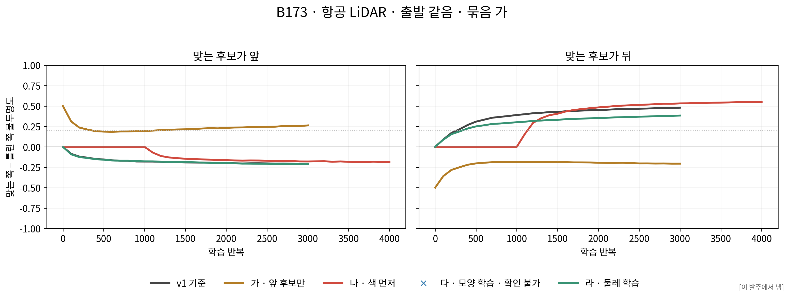

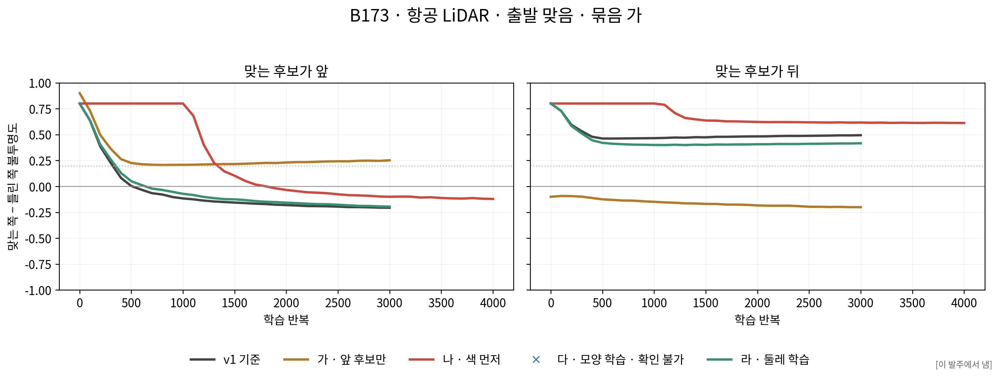

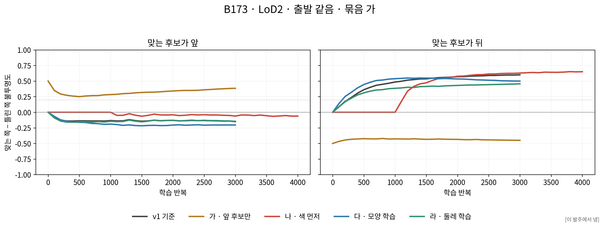

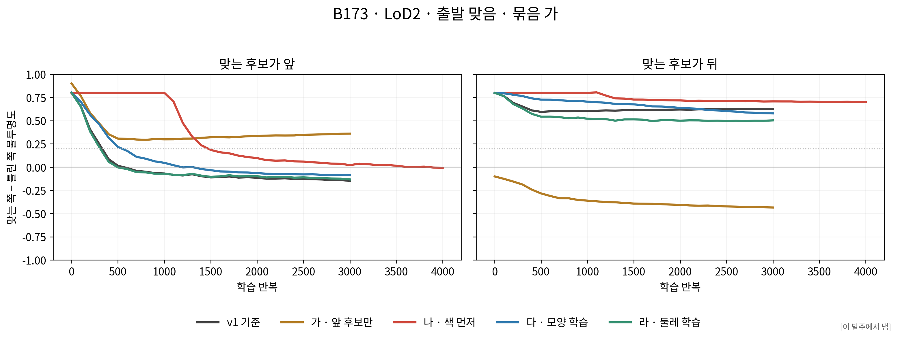

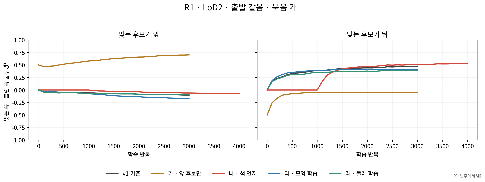

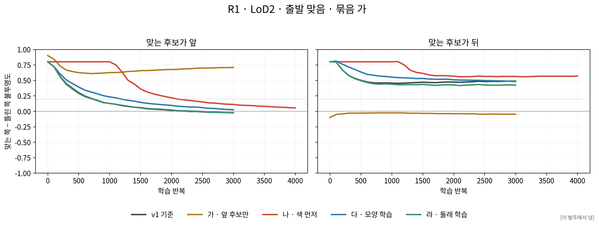

## 일 2 · 렌더 깊이

v1의 사진별 후보 마스크 합집합과 기여 화소가 모든 보기에서 일치했다. 13,214점 모두 점별로 화소 수가 가장 많은 학습 사진 3장을 학습 전에 고정했다. 동률은 사진 이름 순서다. 각 점이 실제로 기여한 화소의 세 보기 값을 모아 화소마다 같은 무게로 중앙값을 구했다.

GeoGS의 메시용 `depth_ratio=0`은 광선과 원반이 만나는 깊이를 가시성 가중 평균하고 불투명도 합으로 나눈다. 깊이에는 GeoGS 원본의 불투명도 상한 0.99, 0.2m보다 가까운 기여 제외, 투과도 0.0001 미만 직전 종료를 적용했다. 기여를 제외한 뒤 가중치를 다시 누적하며 뒤의 원반도 계속 확인한다. 투영 원반·화소 중심·타일 순서는 고정한 gsplat 1.4 값이다. 색 렌더와 학습은 v1의 gsplat 설정 그대로다. 유효 기여가 없거나 유한하지 않은 계산은 확인 불가다.

첫 깊이 구현은 가까운 기여가 하나라도 있으면 화소 전체를 비우고 gsplat의 상한 0.999를 사용한 오류가 있었다. 학습 완료 뒤 원본 코드와 대조해 고쳤다. [수정 시각·규칙·해시](tables/depth_correction_r1.json)를 다시 잠그고 28판 모두 재채점했다. 학습 상태·사진 선택·문턱은 바꾸지 않았다. 첫 채점 28판과 렌더는 전달 묶음의 `payload/revisions/depth_r0/`에 오류 이력으로 보존하며 주 표에는 수정 결과만 쓴다. 작은 예제 4개와 실제 384화소의 별도 CPU 비교를 통과했고 최대 차이는 0.032mm였다.

맞음·틀림은 원래 후보 높이에서 항공 LiDAR ±12.66cm, LoD2 ±20cm다. 판 다도 원래 후보 높이와 비교한다. 세 보기 중 유효 깊이 화소가 없는 보기가 있으면 그 점은 확인 불가다. 표는 묶음 가이며 [전체 깊이 표](tables/depth_outcomes.csv)에 모든 묶음이 있다.

| 경우 | 출발 | 판 | 앞: 맞음/틀림/사이·바깥/확인 불가 % | 뒤: 맞음/틀림/사이·바깥/확인 불가 % |
|---|---|---|---|---|
| B173 · 항공 LiDAR | 같음 | v1 기준 | 23.9 / 30.2 / 45.9 / 0.0 | 35.8 / 0.6 / 63.6 / 0.0 |
| B173 · 항공 LiDAR | 같음 | 가 · 앞 후보만 | 19.1 / 31.7 / 49.3 / 0.0 | 15.1 / 0.9 / 84.0 / 0.0 |
| B173 · 항공 LiDAR | 같음 | 나 · 색 먼저 | 29.4 / 28.5 / 42.1 / 0.0 | 29.8 / 0.9 / 69.3 / 0.0 |
| B173 · 항공 LiDAR | 같음 | 다 · 모양 학습 | 확인 불가 / 확인 불가 / 확인 불가 / 확인 불가 | 확인 불가 / 확인 불가 / 확인 불가 / 확인 불가 |
| B173 · 항공 LiDAR | 같음 | 라 · 둘레 학습 | 28.7 / 33.6 / 37.6 / 0.0 | 39.1 / 0.6 / 60.2 / 0.0 |
| B173 · 항공 LiDAR | 맞음 | v1 기준 | 23.4 / 29.8 / 46.8 / 0.0 | 36.5 / 0.6 / 62.9 / 0.0 |
| B173 · 항공 LiDAR | 맞음 | 가 · 앞 후보만 | 19.1 / 32.2 / 48.8 / 0.0 | 14.3 / 0.8 / 84.9 / 0.0 |
| B173 · 항공 LiDAR | 맞음 | 나 · 색 먼저 | 28.7 / 26.7 / 44.6 / 0.0 | 31.7 / 0.7 / 67.6 / 0.0 |
| B173 · 항공 LiDAR | 맞음 | 다 · 모양 학습 | 확인 불가 / 확인 불가 / 확인 불가 / 확인 불가 | 확인 불가 / 확인 불가 / 확인 불가 / 확인 불가 |
| B173 · 항공 LiDAR | 맞음 | 라 · 둘레 학습 | 28.6 / 34.1 / 37.3 / 0.0 | 43.5 / 0.7 / 55.8 / 0.0 |
| B173 · LoD2 | 같음 | v1 기준 | 32.2 / 4.2 / 63.6 / 0.0 | 37.7 / 0.0 / 62.3 / 0.0 |
| B173 · LoD2 | 같음 | 가 · 앞 후보만 | 38.2 / 3.1 / 58.7 / 0.0 | 8.5 / 0.2 / 91.3 / 0.0 |
| B173 · LoD2 | 같음 | 나 · 색 먼저 | 47.6 / 3.1 / 49.3 / 0.0 | 35.6 / 0.1 / 64.4 / 0.0 |
| B173 · LoD2 | 같음 | 다 · 모양 학습 | 44.7 / 5.8 / 49.5 / 0.0 | 40.3 / 0.0 / 59.7 / 0.0 |
| B173 · LoD2 | 같음 | 라 · 둘레 학습 | 43.6 / 4.2 / 52.2 / 0.0 | 31.9 / 0.0 / 68.1 / 0.0 |
| B173 · LoD2 | 맞음 | v1 기준 | 31.7 / 6.1 / 62.2 / 0.0 | 38.2 / 0.0 / 61.8 / 0.0 |
| B173 · LoD2 | 맞음 | 가 · 앞 후보만 | 37.1 / 3.1 / 59.8 / 0.0 | 8.6 / 0.2 / 91.2 / 0.0 |
| B173 · LoD2 | 맞음 | 나 · 색 먼저 | 50.3 / 3.1 / 46.5 / 0.0 | 38.5 / 0.0 / 61.4 / 0.0 |
| B173 · LoD2 | 맞음 | 다 · 모양 학습 | 41.4 / 6.9 / 51.7 / 0.0 | 42.0 / 0.0 / 58.0 / 0.0 |
| B173 · LoD2 | 맞음 | 라 · 둘레 학습 | 38.8 / 4.7 / 56.4 / 0.0 | 34.4 / 0.0 / 65.5 / 0.0 |
| R1 · LoD2 | 같음 | v1 기준 | 8.9 / 14.4 / 76.7 / 0.0 | 19.1 / 1.6 / 79.3 / 0.0 |
| R1 · LoD2 | 같음 | 가 · 앞 후보만 | 14.7 / 6.7 / 78.6 / 0.0 | 18.3 / 1.3 / 80.4 / 0.0 |
| R1 · LoD2 | 같음 | 나 · 색 먼저 | 13.4 / 8.5 / 78.1 / 0.0 | 20.3 / 0.7 / 79.0 / 0.0 |
| R1 · LoD2 | 같음 | 다 · 모양 학습 | 20.3 / 6.8 / 73.0 / 0.0 | 17.6 / 1.7 / 80.7 / 0.0 |
| R1 · LoD2 | 같음 | 라 · 둘레 학습 | 7.1 / 24.0 / 68.9 / 0.0 | 22.8 / 1.3 / 75.8 / 0.0 |
| R1 · LoD2 | 맞음 | v1 기준 | 9.6 / 10.5 / 79.9 / 0.0 | 19.5 / 1.3 / 79.2 / 0.0 |
| R1 · LoD2 | 맞음 | 가 · 앞 후보만 | 15.1 / 6.1 / 78.8 / 0.0 | 19.3 / 1.3 / 79.3 / 0.0 |
| R1 · LoD2 | 맞음 | 나 · 색 먼저 | 15.8 / 6.7 / 77.5 / 0.0 | 20.5 / 0.7 / 78.8 / 0.0 |
| R1 · LoD2 | 맞음 | 다 · 모양 학습 | 22.6 / 5.8 / 71.7 / 0.0 | 18.5 / 1.7 / 79.8 / 0.0 |
| R1 · LoD2 | 맞음 | 라 · 둘레 학습 | 7.1 / 20.0 / 72.9 / 0.0 | 22.5 / 1.3 / 76.1 / 0.0 |

## 정성 · 같은 자리의 단면과 렌더

모두 출발 맞음이다. 단면은 0·500·1,000·끝 회, 렌더는 학습 전에 고른 같은 보기와 같은 확대 범위다. 판 다는 실제 이동한 원반 중심 네 개를 각각 표시한다. 낙엽 지붕은 v1의 대체 자리 표시를 유지한다. 색 보정과 생성 영상은 쓰지 않았다.

### B173 날개

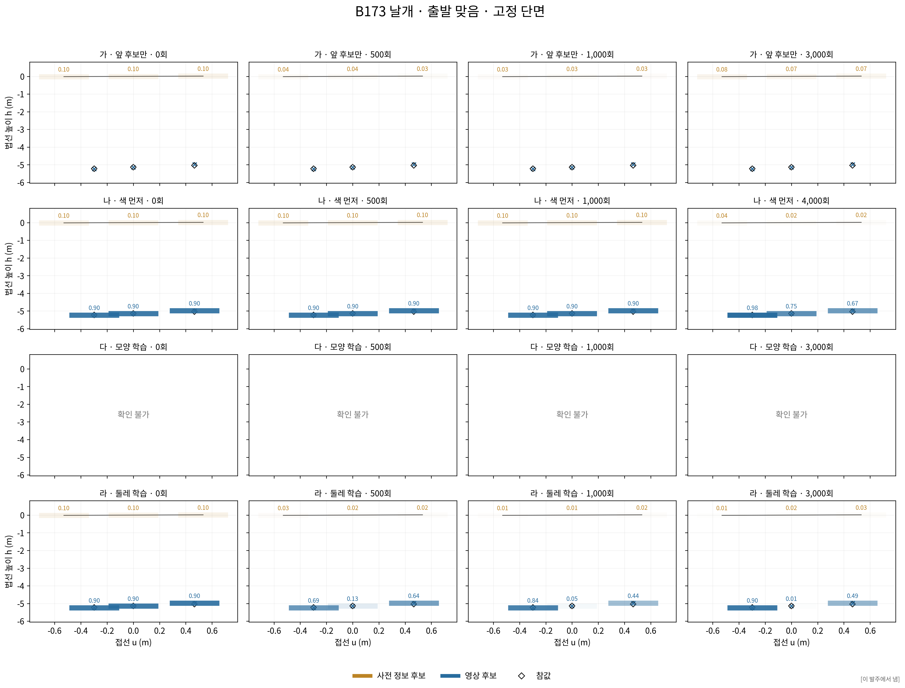

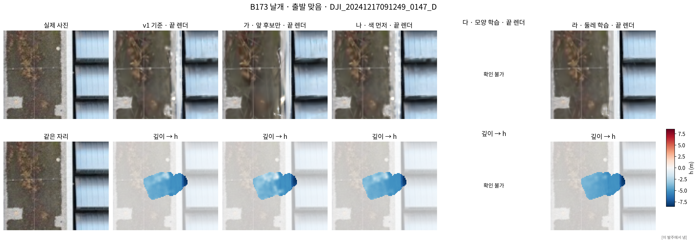

### R1 계단 지붕

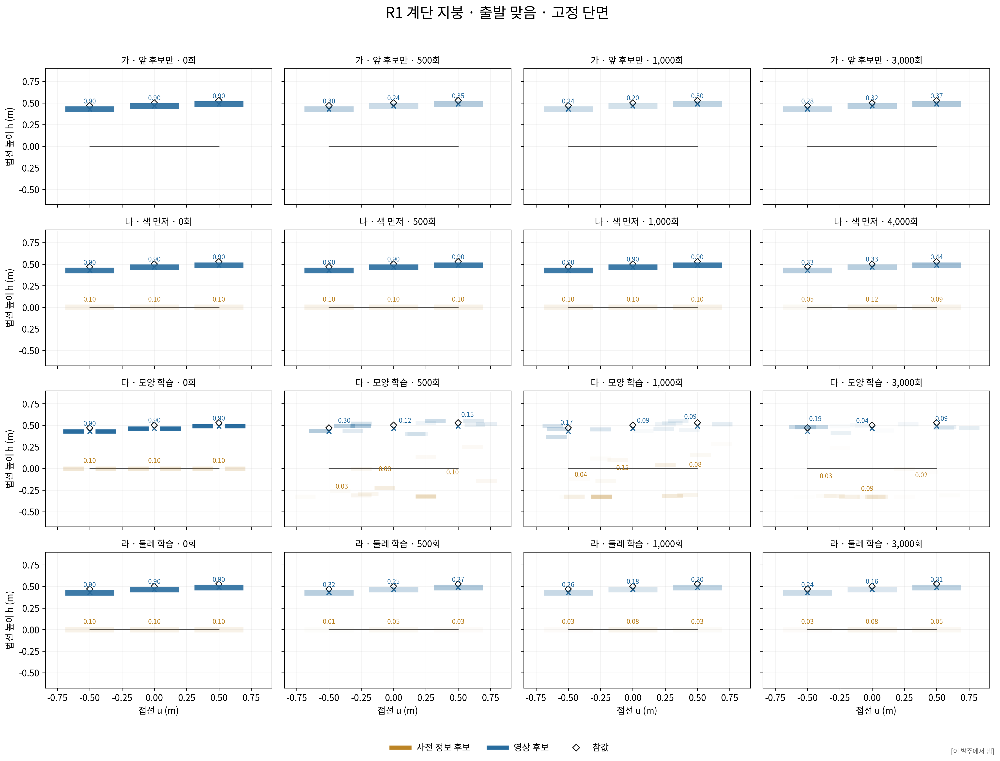

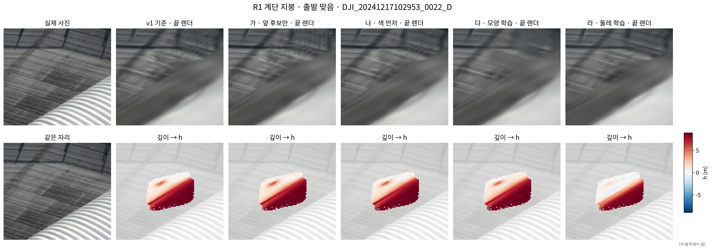

### 낙엽 지붕 대체 자리

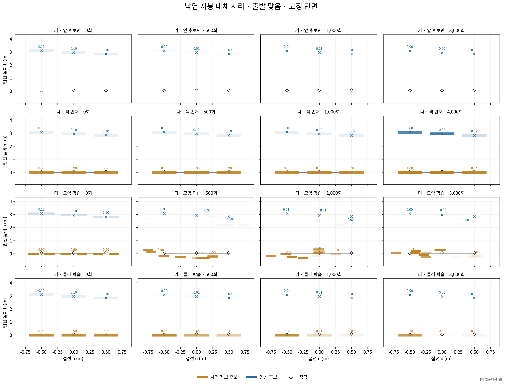

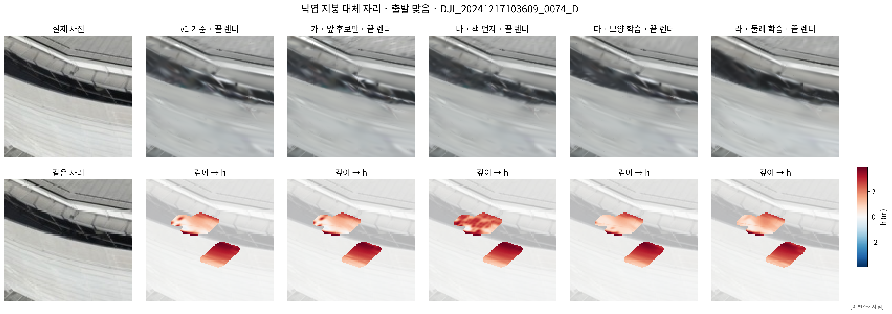

### B173 · LoD2 · 앞 자리

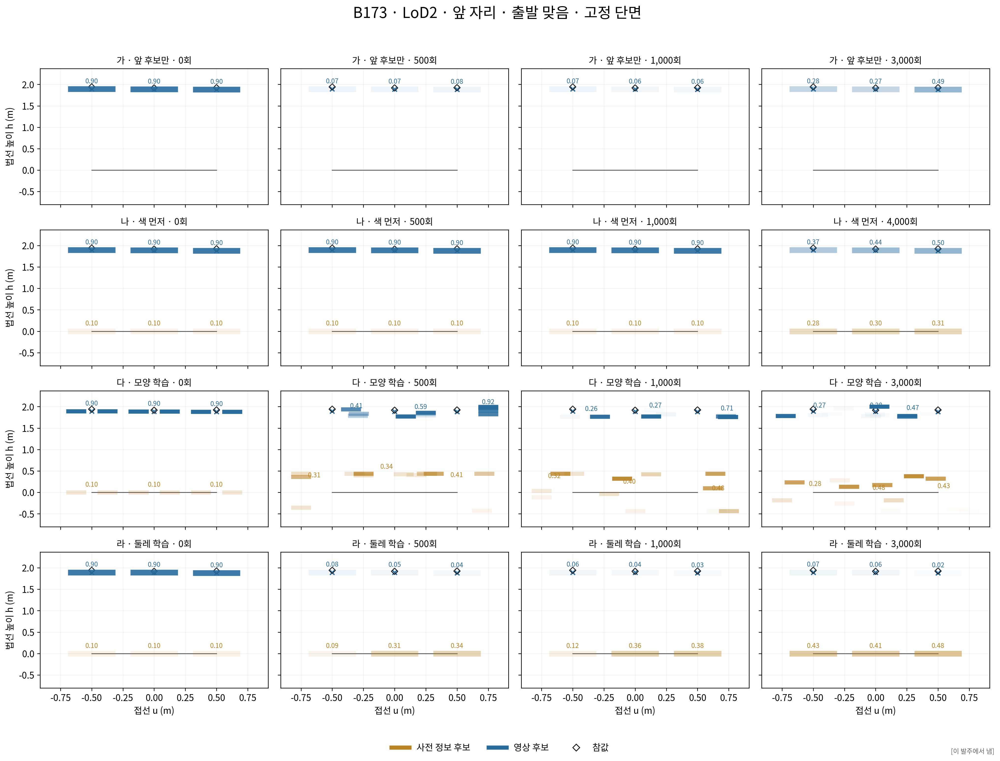

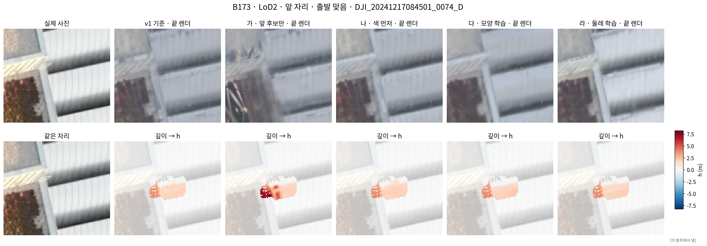

## 일 3 · 사진 검사 다시 셈

저장 곡선과 원래 봉우리 표시를 그대로 사용했다. 점에 속한 JUDGENUM 핵심점 패치들의 유한한 검출 한계 중앙값으로 범위만 바꿨다. 해당 값이 하나도 없는 점은 확인 불가다. 지붕과 LoD2 벽은 같은 형식의 저장 곡선이 있었다. 항공 LiDAR 벽의 사진 곡선은 없어 별도 사진 결과를 만들지 않았다.

전체 저장 사진 점·패치의 새 판단은 외부 `photo_dl/points`, `photo_dl/patches`에 있다. 아래 고르기 셈은 JUDGENUM의 원래 건물·패치 범위를 유지한다. 전체 사진 범위의 넓이 표는 [전체 판단 넓이](tables/photo_census_judgment_areas.csv)에 따로 둔다.

| 사전 정보 | 대상 | 사진 점 수 | 사진 패치 수 | 전체 넓이 m² | 검출 한계 없는 넓이 m² |
|---|---|---|---|---|---|
| ALS | 지붕 | 212662 | 754293 | 50394.85 | 18178.76 |
| LoD2 | 지붕 | 248099 | 939465 | 58716.56 | 20304.19 |
| LoD2 | 벽 | 540162 | 2066825 | 129175.38 | 59410.93 |

| 대상 | 설정 | δ | 최소 점수 | 거리 문턱 m | 틀린 넓이 m² | 계산 대상 m² |
|---|---|---|---|---|---|---|
| 항공 LiDAR 지붕 | 새 고른 값 | 0.3 | 0 | 1.5 | 16.31 | 843.72 |
| 항공 LiDAR 지붕 | JN 고른 값 | 0.3 | 0 | 1.5 | 17.19 | 843.72 |
| 항공 LiDAR 지붕 | 사진 없음 | — | — | 1.5 | 15.10 | 843.72 |
| 항공 LiDAR 지붕 | 사진 보기 값 | 0.1 | 0.3 | ∞ | 38.90 | 843.72 |
| LoD2 지붕 | 새 고른 값 | 0.05 | 0.3 | 0.3 | 768.31 | 6453.69 |
| LoD2 지붕 | JN 고른 값 | 0.3 | 0.5 | 0.3 | 1472.94 | 6453.69 |
| LoD2 지붕 | 사진 없음 | — | — | 0.3 | 940.75 | 6453.69 |
| LoD2 지붕 | 사진 보기 값 | 0.1 | 0.3 | ∞ | 3366.00 | 6453.69 |
| LoD2 벽 | 새 고른 값 | 0.3 | 0 | 0.3 | 1311.19 | 7030.44 |
| LoD2 벽 | JN 고른 값 | 0.3 | 0.5 | 0.3 | 1362.62 | 7030.44 |
| LoD2 벽 | 사진 없음 | — | — | 0.3 | 1302.38 | 7030.44 |
| LoD2 벽 | 사진 보기 값 | 0.1 | 0.3 | ∞ | 4385.06 | 7030.44 |

135개 조합, 원래 처리 뒤 판단, 건물별 대상, 동률 규칙을 유지했다. 지붕·벽을 따로 고른 표, 건물을 같게 본 값, 건물 하나 빼기 결과와 전 조합은 `tables/photo_*` 및 외부 `photo_dl/*_selection.json`에 저장했다.

### 기존 사진 지지 834.4375 m²의 변화

| 사진 선택값 | 지지 m² | 반박 m² | 모름 m² |
|---|---|---|---|
| JN 고른 값 고정 | 151.00 | 239.94 | 443.50 |
| 새 고른 값 | 156.00 | 567.56 | 110.88 |

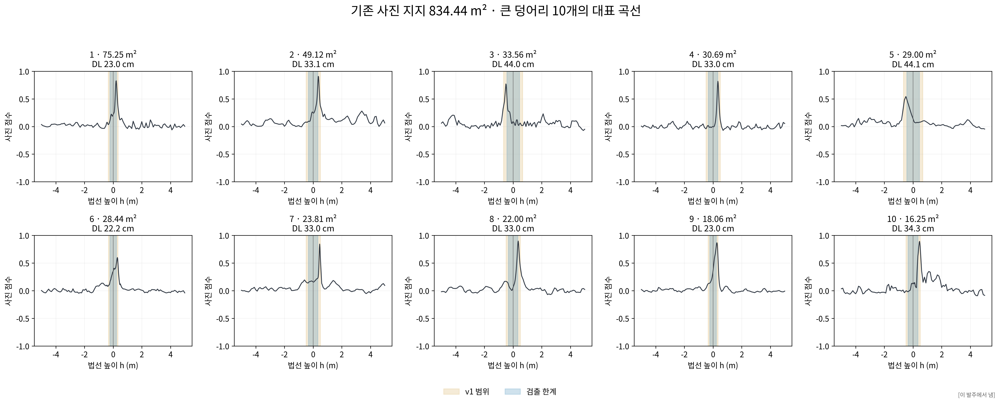

### 저장 정밀도와 확인 불가

| 사전 정보 | 검출 한계 없는 패치 수 | 해당 넓이 m² | 옛 범위 재생 차이 패치 수 | 재생 차이 넓이 m² |
|---|---|---|---|---|
| ALS | 24786 | 1666.73 | 406 | 27.53 |
| LoD2 | 398902 | 24930.49 | 1326 | 82.88 |

저장 곡선은 float16이고 당시 점수 요약은 float32다. 따라서 옛 범위를 다시 적용해도 일부 문턱 가까운 판단이 일치하지 않는다. 이 차이를 숨기거나 원본 곡선을 새 사진 처리로 대체하지 않았다. [고른 값에서의 정밀도 영향](tables/photo_precision_sensitivity.csv)을 함께 낸다. 새 판단과 원래 판단의 차이를 모두 범위 변경 하나의 효과로 단정하지 않는다.

확인용 건물에는 개발 대상에서 고른 값을 그대로 적용했다. 공개한 것은 수·넓이·SHA-256뿐이다. 상세 판단과 선택은 외부 `holdout/`에만 있다.

| 사전 정보 | 확인용 패치 수 | 확인용 넓이 m² |
|---|---|---|
| ALS | 35135 | 2402.50 |
| LoD2 | 173119 | 10819.87 |

## 기대값과 수치 비교

| 경우 | 출발 | 판 | 앞 진함 % | 앞 깊이 맞음 % | 둘 다 70% | 뒤 진함 v1 대비 %p |
|---|---|---|---|---|---|---|
| B173 · 항공 LiDAR | 같음 | 가 · 앞 후보만 | 48.7 | 19.1 | 미충족 | -78.0 |
| B173 · 항공 LiDAR | 같음 | 나 · 색 먼저 | 12.0 | 29.4 | 미충족 | +7.8 |
| B173 · 항공 LiDAR | 같음 | 다 · 모양 학습 | 확인 불가 | 확인 불가 | 확인 불가 | 확인 불가 |
| B173 · 항공 LiDAR | 같음 | 라 · 둘레 학습 | 8.0 | 28.7 | 미충족 | -7.8 |
| B173 · 항공 LiDAR | 맞음 | 가 · 앞 후보만 | 45.4 | 19.1 | 미충족 | -78.5 |
| B173 · 항공 LiDAR | 맞음 | 나 · 색 먼저 | 16.0 | 28.7 | 미충족 | +10.7 |
| B173 · 항공 LiDAR | 맞음 | 다 · 모양 학습 | 확인 불가 | 확인 불가 | 확인 불가 | 확인 불가 |
| B173 · 항공 LiDAR | 맞음 | 라 · 둘레 학습 | 7.4 | 28.6 | 미충족 | -6.1 |
| B173 · LoD2 | 같음 | 가 · 앞 후보만 | 69.8 | 38.2 | 미충족 | -87.0 |
| B173 · LoD2 | 같음 | 나 · 색 먼저 | 28.3 | 47.6 | 미충족 | +6.1 |
| B173 · LoD2 | 같음 | 다 · 모양 학습 | 15.7 | 44.7 | 미충족 | -3.5 |
| B173 · LoD2 | 같음 | 라 · 둘레 학습 | 22.5 | 43.6 | 미충족 | -9.4 |
| B173 · LoD2 | 맞음 | 가 · 앞 후보만 | 65.4 | 37.1 | 미충족 | -88.5 |
| B173 · LoD2 | 맞음 | 나 · 색 먼저 | 31.8 | 50.3 | 미충족 | +6.2 |
| B173 · LoD2 | 맞음 | 다 · 모양 학습 | 18.5 | 41.4 | 미충족 | -2.1 |
| B173 · LoD2 | 맞음 | 라 · 둘레 학습 | 23.5 | 38.8 | 미충족 | -7.3 |
| R1 · LoD2 | 같음 | 가 · 앞 후보만 | 91.1 | 14.7 | 미충족 | -77.6 |
| R1 · LoD2 | 같음 | 나 · 색 먼저 | 19.0 | 13.4 | 미충족 | +5.6 |
| R1 · LoD2 | 같음 | 다 · 모양 학습 | 12.5 | 20.3 | 미충족 | -9.4 |
| R1 · LoD2 | 같음 | 라 · 둘레 학습 | 14.9 | 7.1 | 미충족 | -6.7 |
| R1 · LoD2 | 맞음 | 가 · 앞 후보만 | 90.6 | 15.1 | 미충족 | -78.6 |
| R1 · LoD2 | 맞음 | 나 · 색 먼저 | 32.5 | 15.8 | 미충족 | +6.3 |
| R1 · LoD2 | 맞음 | 다 · 모양 학습 | 30.0 | 22.6 | 미충족 | -4.0 |
| R1 · LoD2 | 맞음 | 라 · 둘레 학습 | 21.0 | 7.1 | 미충족 | -5.8 |

표는 발주문에 적힌 70%와 −10%p를 확인할 수 있는 수치다. 원인 해석과 방법 채택 결론은 이 보고서에서 내리지 않는다. 판 가의 앞 후보가 혼자 남았을 때 0.5 이상인 비율은 일 1의 맞음만 열, 판 다·라의 수치는 위 표와 단면·렌더에서 확인한다.

## 바꾼 것·확인 불가·시간

- 판 가: 앞 후보 네 개만 렌더. 판 나: 1~1,000회 불투명도 고정, 1,001~4,000회 함께 학습. 판 다: 후보 위치·회전·크기만 추가 학습하고 매 갱신 뒤 자기 범위로 이동 제한. 판 라: 자리에서 수평 3m 안 바탕의 불투명도·색만 추가 학습.
- 판 다의 위치 학습률은 GeoGS 기본 시작 0.00016, 끝 0.0000016, 30,000회 지수 변화에 원본 장면 크기를 곱했다. B173 272.353813, R1 229.696469이다. 회전 0.001, 크기 0.005. 불투명도·색 학습률은 v1과 같다.
- 판 다의 범위 점검은 float32 좌표 반올림에 대해 0.03mm의 수치 허용치를 사용한다. 실제 초과량은 100회 기록에 보존하고, 끝 좌표는 별도 float64 계산으로 다시 확인한다.
- 판 라에서 학습한 바탕 가우시안 수: B173 · 항공 LiDAR 48,562, B173 · LoD2 58,586, R1 · LoD2 44,407개. 그 밖의 바탕 값과 바탕 기하는 유지했다. 판 다의 끝 법선 이동 분포는 [분포 표](tables/normal_displacement_distribution.csv)에 있다.
- B173·항공 LiDAR 43점의 `u_prior`가 없어 판 다 2판을 학습하지 않았다. 해당 결과는 확인 불가다. 다른 판의 점을 임의로 제외하지 않았다.
- 판 라의 처음 역변환 오류는 원본 logit 직접 읽기로 학습 전에 해결했다. 처음 실패 기록은 보존했다. 모든 단위 점검·실행 실패·표시 수정은 [실패 기록](issues.md)에 남겼다.
- 학습 합계 169.6분, 깊이 채점 합계 6.8분은 두 GPU의 각 판 실행 시간 합이다. 사진 CPU 계산 4.3분. 준비·검증·그림·압축·대기는 이 합계에서 제외했다. 시작·끝 시각은 각 실행 기록에 있다.
- 앞 작업의 값·설정·코드·결과를 수정하지 않았다. 참값은 자리·초기 불투명도·채점에만 쓰고 손실에는 넣지 않았다. 새 깊이 손실·밀도 제어·불투명도 재설정·정리는 없다.

실제 실행 코드는 첫 커밋 전에 해시로 잠갔다. 실행 기록의 커밋은 당시 저장소 HEAD이며 새 코드의 동일성은 별도 코드 해시로 확인한다. 사진 계산의 당시 HEAD는 Git 기록으로 확인했고, 원래 완료 기록에 빠진 환경변수 직접 기록은 [출처 표](tables/photo_execution_provenance.json)에 확인 불가로 표시했다.

전달 묶음에는 설정, 코드, 이 보고서, 표·그림, 새 판의 상태·기록 및 사진 다시 셈의 공개 값이 들어간다. 원본 사진·바탕 장면·v1 전체 자료는 외부 입력 경로와 해시로 연결한다. ZIP 무결성은 과학적 결론을 뜻하지 않는다.
