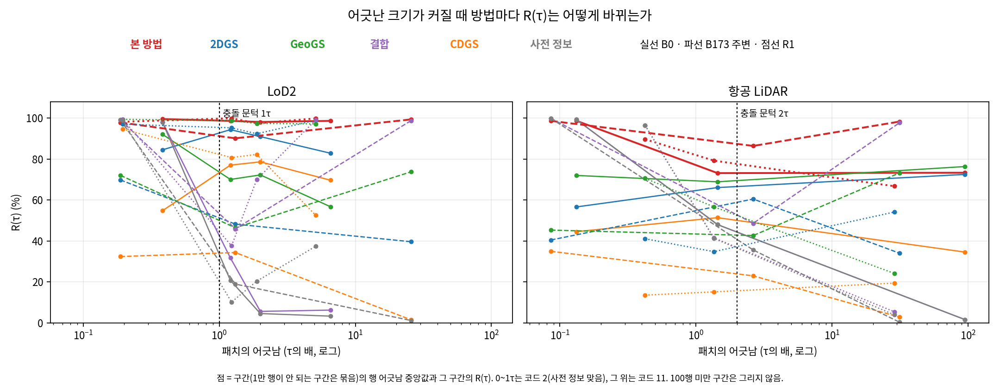
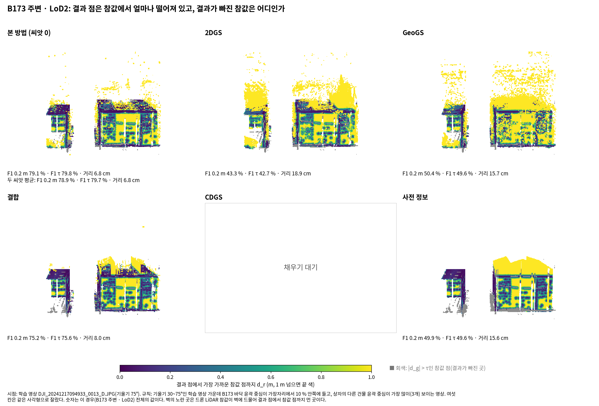

# 새 거리 지표로 7.1 다시 세기 — 보고 v1

- 작업 PHD-MAIN-DIST71-v1 · 2026-10-17 · 브랜치 `exp/main-experiment` · scientific_verdict: null · 만든 때 2026-10-17 08:49:08 KST
- 페이로드 `PH/main_dist71_v1/PHD-MAIN-DIST71-v1`(점마다 거리 `dist/`, 표, 그림, 로그). 표와 그림과 숫자표는 이 폴더(`docs/experiments/phd/main_dist71_v1/`)에도 있다.
- 스크립트 `scripts/phd/main_dist71_v1/`는 전달 묶음에 넣었다. 앞 작업들처럼 저장소에는 커밋하지 않았다.

## 1. 결론

여섯 경우와 다섯 방법(CDGS는 채우기 대기)과 일곱 곳에서 R, P, F1, 거리, 치우침, 퍼짐을 같은 식으로 셌다. 학습과 렌더는 하지 않았고 GPU를 쓰지 않았다. 저장된 학습 시점 메시와 가상 시점 메시, 참값 점군, 영역 파일만 읽었다.

**재현 점검.** 앞 셈의 방식(참값 점에서 결과 메시에서 뽑은 점까지)으로 다시 센 전체 F1(0.2 m)은 표 B의 24칸 가운데 23칸이 기록과 같다. 결과마다 정밀도, 재현율, F1도 숫자 요청의 저장값(넷째 자리)과 24·24·24칸이 같다. 결측 영역 R(0.2 m)은 표 C의 30칸 가운데 29칸이 같다. 이 발주의 셈(참값 점에서 메시 면까지)으로 구한 전체 F1(0.2 m)은 앞 셈보다 +0.04 ~ +0.80 %p 높다. 면까지의 거리는 면 위에서 뽑은 점까지의 거리보다 짧거나 같기 때문이다.

**일 1의 답.**

- 결과 메시: 학습 시점 메시는 CDGS를 뺀 모든 방법과 경우에 있다. CDGS는 빈칸 채우기에서 B0 · LoD2만 학습이 끝났고 후처리가 멈춰 메시가 없다(채우기 대기). 가상 시점 메시는 B173 주변에만 있고 B0와 R1에는 없다.
- 비가시 영역(코드 5)은 모든 경우에서 참값 행이 100점에 못 미친다(B0 0, B173 주변 LoD2 17, 항공 LiDAR 2, R1 몇 점). 값은 어느 경우든 '표본 부족'이라, 가상 시점 메시가 없는 B0와 R1에 새로 만들지 않았다. B173 주변은 있는 메시로 셌다.
- 참값: 전체는 장면 F1과 같은 드론 LiDAR 점(건물 표면 칸), 곳은 영역 지표의 솎은 참값 행이다. B0의 행은 주 참값을 쓰고, 주 참값에 라벨이 없는 패치만 드론 LiDAR로 채운다. 그래서 B0의 곳은 정밀도의 d_r도 같은 참값(드론 LiDAR + 주 참값)까지 구했다(아래 '읽은 방식').
- 참값 점의 대응: 가장 가까운 패치가 아니다. 지붕은 위에서 내린 연직선이 처음 만나는 사전 정보 면의 패치(연직 거리 한도 없음, 그 패치의 가장 높은 점에서 1 m 아래까지), 벽은 수직면 점에서 벽면에 내린 수선의 발(2 m 안)이다. 결과 점은 이 발주대로 가장 가까운 패치(거리 한도 없음)를 따른다.
- 전체의 참값 점 가운데 패치가 있는 몫: LoD2 84.3~91.1 %, 항공 LiDAR 64.4~75.9 %. 나머지는 건물 둘레 2 m 안의 땅과, 항공 LiDAR에서는 패치가 없는 벽의 점이다[새로 셈]. 이 점들은 2026-10-17 결정대로 가장 가까운 패치의 τ와 법선을 쓴다.
- 패치의 어긋남: 영역 파일의 `gt_med`(대응 참값 점의 '참값 − 사전 정보' 중앙값)이고, 라벨이 있는 모든 패치에서 라벨이 '\|gt_med\| > τ'와 같다.
- 법선: 참값 점의 법선은 같은 출처의 평가 참값 점 가운데 반경 0.5 m 안의 점으로 구했다(이웃 10점 미만이면 없음). 사전 정보의 지붕꼴 법선은 모두 위를 향한다. LoD2 벽꼴 법선은 바닥 윤곽으로 확인할 수 있는 패치에서 B0 바깥 37,923 · 안쪽 0 · 정할 수 없음 0; B173 주변 바깥 20,015 · 안쪽 3 · 정할 수 없음 5,608; R1 바깥 8,643 · 안쪽 0 · 정할 수 없음 3,487이다. 정할 수 없는 것은 바닥 윤곽 안쪽의 벽(지붕 높이가 바뀌는 곳)이다.

**칸 수** (숫자표 기준, `tables/cell_counts.md`).

| 부분 | 값 | 채우기 대기 | 결과 없음 | 표본 부족 | 정의 없음 |
|---|---:|---:|---:|---:|---:|
| F1 0.2 m판 | 456 | 108 | 0 | 60 | 0 |
| F1 τ판 | 456 | 108 | 0 | 60 | 0 |
| 셈 가와 셈 나 | 60 | 12 | 0 | 0 | 0 |
| 어긋난 크기별 재현율 R(τ) | 100 | 20 | 0 | 0 | 0 |
| 모두 | 1,072 | 248 | 0 | 120 | 0 |

**어긋남.** 기록과 다른 칸은 2개이고 모두 '저장값의 반올림 경계'다. 다시 센 값은 숫자 요청의 저장값(넷째 자리)과 같고, 기록은 그 저장값을 반올림한 값이다. 저장값이 …5로 끝나 반올림 전 값으로는 첫째 자리가 달라진다. 두 값을 함께 적고 고르지 않는다.

- 표 B 전체 F1 0.2 m · B0 · 항공 LiDAR · 결합: 기록 46.7(저장값 46.65의 반올림), 반올림 전 다시 셈 46.647
- 표 C 결측 영역 R 0.2 m · B0 · LoD2 · 본 방법: 기록 93.6(저장값 93.55의 반올림), 반올림 전 다시 셈 93.549

**패치가 없는 참값 점의 규칙 (2026-10-17 결정).** 전체에서 패치가 없는 참값 점에는 τ(LoD2의 지붕·벽 값)와 법선의 방향을 정할 패치가 없고, 발주문은 결과 점에만 '가장 가까운 패치'를 정했다. 첫 판에서는 전체의 LoD2 R(τ)·F1(τ)와 모든 경우의 전체 치우침·퍼짐을 '정의 없음'으로 두고 여쭈었다. 사용자 결정에 따라 결과 점처럼 가장 가까운 패치(중심, 거리 한도 없음)의 τ와 법선을 써서 채웠다. 다른 후보(패치가 있는 참값 점만 셈)의 값은 기록으로 남겼다(`tables/d3_all_candidates.md`). 두 규칙의 LoD2 전체 F1(τ) 차는 -2.10 ~ +0.35 %p다(가까운 패치 − 패치 있는 점만).

**확인 불가와 비운 칸.**

- CDGS: 빈칸 채우기 일 1·9의 메시가 아직 없어 모든 칸이 '채우기 대기'다.
- 비가시 영역: 모든 경우에서 참값 행이 100점 미만이라 '표본 부족'이다. B0와 R1에는 가상 시점 메시도 없다.
- 표본 부족과 `*`: 곳마다 참값 행과 결과 점의 수를 json에 적었다. 항공 LiDAR의 결측 영역과 사전 정보가 틀린 곳(B0, R1)은 표본이 적다.

**이 발주문을 읽은 방식.**

- 곡선의 구간 묶기: '네 배를 넘어 묶지는 않는다'를 4τ 아래(1~4τ의 네 구간)와 위(4~8τ, 8τ 넘음)를 따로 묶는 것으로 읽었다. 묶는 규칙은 앞 코드(`src/phd/metrics_v3/bins.py` merge_small: 1만 행이 안 되는 구간을 다음 구간에 붙임)다.
- 셈 나: '참값 점이 대응한 패치'는 솎기 전 영역 행이 하나라도 있는 패치로 셌다.
- B0 곳의 정밀도: 재현율의 참값이 영역 행(주 참값 중심)이므로, d_r도 같은 참값(건물 표면 칸의 드론 LiDAR 점과 주 참값 점)까지 구했다(`d2b_b0gt.py`). 전체는 장면 F1과 같이 드론 LiDAR 점만 쓴다. 드론 LiDAR만으로 구하면 B0 곳의 정밀도가 크게 낮아진다(B0 · LoD2 본 방법 두 씨앗 평균의 P 0.2 m: 영상이 틀린 곳 83.5 % → 6.7 %, 결측 영역 88.7 % → 10.2 %). 두 값은 `tables/d3_b0_two_gt.md`에 나란히 있다. 이 읽기가 맞지 않으면 알려 주시면 표를 바꾼다.
- 거리 지도의 본 방법은 씨앗 0을 그렸다. 그림 아래 숫자는 그 결과의 값과 두 씨앗 평균을 함께 적었다.
- 거리 지도의 시점: 기울기 30~75°인 학습 영상 가운데 B173 바닥 윤곽 중심이 영상 가장자리에서 10 % 안쪽에 들고, 상자의 다른 건물 윤곽 중심이 가장 많이 보이는 영상(같으면 B173이 영상 중심에 가장 가까운 영상). 여섯 칸은 같은 사각형으로 자름 → `DJI_20241217094933_0013_D.JPG`(기울기 75°).

**보내기 전 점검.**

- [x] 학습하지 않았다. 렌더도 하지 않았다(만든 메시 없음).
- [x] 정의를 새로 만들지 않았다. 발주문에 없던 규칙(전체에서 패치가 없는 참값 점의 τ와 부호)은 '정의 없음'으로 두고 여쭈었고, 2026-10-17 결정대로 가장 가까운 패치를 따랐다.
- [x] 다른 작업의 폴더와 설정을 고치지 않았다(빈칸 채우기, 숫자 모으기, FACTS65는 읽기만).
- [x] 값마다 표본과 출처가 있다(json). 새로 센 값에 [새로 셈]을 달았다.
- [x] 재현 점검을 했다. 어긋난 값은 둘 다 적었다.
- [x] 숫자표가 2만 자 안이다. `거리지표71_숫자표_v1.md` 17,415자

## 2. 일 1의 표 (코드 줄과 함께)

- 만든 때 2026-10-17 08:48:03 KST, 스크립트 `scripts/phd/main_dist71_v1/d1_defs.py`. 6.5·6.6 사실 확인(FACTS65, `docs/experiments/phd/ch6_facts65_v2/facts_6_5_6_6.md`, 커밋 f556b072)이 답한 물음은 그 줄 번호와 함께 옮기고, 그 표에 없던 수만 새로 셌다[새로 셈].

### 결과 메시

| 경우 | 방법 | 결과 | 학습 시점 메시 | 있음 (GB) | 가상 시점 메시 | 있음 |
|---|---|---|---|---|---|---|
| B0 · LoD2 | 본 방법 | `prop_LoD2_s0` | `S1/stage1/B0_b10/prop_LoD2_s0/post/mesh_tsdf.ply` | 있음 (0.93) | `S1/stage1/B0_b10/prop_LoD2_s0/gpu/virtual/mesh_virtual.ply` | 없음 |
| B0 · LoD2 | 본 방법 | `prop_LoD2_s1` | `S1/stage1/B0_b10/prop_LoD2_s1/post/mesh_tsdf.ply` | 있음 (0.93) | `S1/stage1/B0_b10/prop_LoD2_s1/gpu/virtual/mesh_virtual.ply` | 없음 |
| B0 · LoD2 | 2DGS | `imgonly_2dgs_s0` | `SB/runs/B0_b10/imgonly_2dgs_s0/post/mesh_tsdf.ply` | 있음 (1.91) | `SB/runs/B0_b10/imgonly_2dgs_s0/gpu/virtual/mesh_virtual.ply` | 없음 |
| B0 · LoD2 | GeoGS | `trust_LoD2_fix1` | `SF/runs/B0_b10/trust_LoD2_fix1/post/mesh_tsdf.ply` | 있음 (1.61) | `SF/runs/B0_b10/trust_LoD2_fix1/gpu/virtual/mesh_virtual.ply` | 없음 |
| B0 · LoD2 | 결합 | `mvsfuse_LoD2` | `SB/runs/B0_b10/mvsfuse_LoD2/post/mesh_tsdf.ply` | 있음 (0.73) | `SL/work/virtual/B0_b10/mvsfuse_LoD2/mesh_virtual.ply` | 없음 |
| B0 · LoD2 | CDGS | `cdgsnofit_LoD2_s0` | `SL/runs/B0_b10/cdgsnofit_LoD2_s0/post/mesh_tsdf.ply` | 없음 | `SL/runs/B0_b10/cdgsnofit_LoD2_s0/gpu/virtual/mesh_virtual.ply` | 없음 |
| B0 · LoD2 | 사전 정보 | `samepath_LoD2` | `S1/stage1/B0_b10/samepath_LoD2/mesh.ply` | 있음 (0.28) | `SL/work/virtual/B0_b10/samepath_LoD2/mesh_virtual.ply` | 없음 |
| B0 · 항공 LiDAR | 본 방법 | `prop_ALS_s0` | `S1/stage1/B0_b10/prop_ALS_s0/post/mesh_tsdf.ply` | 있음 (0.9) | `S1/stage1/B0_b10/prop_ALS_s0/gpu/virtual/mesh_virtual.ply` | 없음 |
| B0 · 항공 LiDAR | 본 방법 | `prop_ALS_s1` | `S1/stage1/B0_b10/prop_ALS_s1/post/mesh_tsdf.ply` | 있음 (0.9) | `S1/stage1/B0_b10/prop_ALS_s1/gpu/virtual/mesh_virtual.ply` | 없음 |
| B0 · 항공 LiDAR | 2DGS | `imgonly_2dgs_s0` | `SB/runs/B0_b10/imgonly_2dgs_s0/post/mesh_tsdf.ply` | 있음 (1.91) | `SB/runs/B0_b10/imgonly_2dgs_s0/gpu/virtual/mesh_virtual.ply` | 없음 |
| B0 · 항공 LiDAR | GeoGS | `geogs_ALS_fix1` | `SB/runs/B0_b10/geogs_ALS_fix1/post/mesh_tsdf.ply` | 있음 (2.03) | `SB/runs/B0_b10/geogs_ALS_fix1/gpu/virtual/mesh_virtual.ply` | 없음 |
| B0 · 항공 LiDAR | 결합 | `mvsfuse_ALS` | `SB/runs/B0_b10/mvsfuse_ALS/post/mesh_tsdf.ply` | 있음 (1.01) | `SL/work/virtual/B0_b10/mvsfuse_ALS/mesh_virtual.ply` | 없음 |
| B0 · 항공 LiDAR | CDGS | `cdgsnofit_ALS_s0` | `SL/runs/B0_b10/cdgsnofit_ALS_s0/post/mesh_tsdf.ply` | 없음 | `SL/runs/B0_b10/cdgsnofit_ALS_s0/gpu/virtual/mesh_virtual.ply` | 없음 |
| B0 · 항공 LiDAR | 사전 정보 | `samepath_ALS` | `S1/stage1/B0_b10/samepath_ALS/mesh.ply` | 있음 (0.86) | `SL/work/virtual/B0_b10/samepath_ALS/mesh_virtual.ply` | 없음 |
| B173 주변 · LoD2 | 본 방법 | `prop_LoD2_s0` | `S0/stage0/b1_LoD2/post/mesh_tsdf.ply` | 있음 (1.02) | `MF/virtual/option2/b1_LoD2/mesh_virtual.ply` | 있음 |
| B173 주변 · LoD2 | 본 방법 | `prop_LoD2_s1` | `S0/stage0/b2_LoD2/post/mesh_tsdf.ply` | 있음 (1.02) | `MF/virtual/option2/b2_LoD2/mesh_virtual.ply` | 있음 |
| B173 주변 · LoD2 | 2DGS | `imgonly_2dgs_s0` | `SB/runs/B173nb_b10/imgonly_2dgs_s0/post/mesh_tsdf.ply` | 있음 (1.51) | `SB/runs/B173nb_b10/imgonly_2dgs_s0/gpu/virtual/mesh_virtual.ply` | 있음 |
| B173 주변 · LoD2 | GeoGS | `trust_LoD2_fix1` | `SF/runs/B173nb_b10/trust_LoD2_fix1/post/mesh_tsdf.ply` | 있음 (1.55) | `SF/runs/B173nb_b10/trust_LoD2_fix1/gpu/virtual/mesh_virtual.ply` | 있음 |
| B173 주변 · LoD2 | 결합 | `mvsfuse_LoD2` | `SB/runs/B173nb_b10/mvsfuse_LoD2/post/mesh_tsdf.ply` | 있음 (0.89) | `SL/work/virtual/B173nb_b10/mvsfuse_LoD2/mesh_virtual.ply` | 있음 |
| B173 주변 · LoD2 | CDGS | `cdgsnofit_LoD2_s0` | `SL/runs/B173nb_b10/cdgsnofit_LoD2_s0/post/mesh_tsdf.ply` | 없음 | `SL/runs/B173nb_b10/cdgsnofit_LoD2_s0/gpu/virtual/mesh_virtual.ply` | 없음 |
| B173 주변 · LoD2 | 사전 정보 | `samepath_LoD2` | `MT/gpu/samepath_LoD2/mesh.ply` | 있음 (0.45) | `SL/work/virtual/B173nb_b10/samepath_LoD2/mesh_virtual.ply` | 있음 |
| B173 주변 · 항공 LiDAR | 본 방법 | `prop_ALS_s0` | `S0/stage0/b1_ALS/post/mesh_tsdf.ply` | 있음 (1.0) | `MF/virtual/option2/b1_ALS/mesh_virtual.ply` | 있음 |
| B173 주변 · 항공 LiDAR | 본 방법 | `prop_ALS_s1` | `S0/stage0/b2_ALS/post/mesh_tsdf.ply` | 있음 (1.01) | `MF/virtual/option2/b2_ALS/mesh_virtual.ply` | 있음 |
| B173 주변 · 항공 LiDAR | 2DGS | `imgonly_2dgs_s0` | `SB/runs/B173nb_b10/imgonly_2dgs_s0/post/mesh_tsdf.ply` | 있음 (1.51) | `SB/runs/B173nb_b10/imgonly_2dgs_s0/gpu/virtual/mesh_virtual.ply` | 있음 |
| B173 주변 · 항공 LiDAR | GeoGS | `geogs_ALS_fix1` | `SB/runs/B173nb_b10/geogs_ALS_fix1/post/mesh_tsdf.ply` | 있음 (1.56) | `SB/runs/B173nb_b10/geogs_ALS_fix1/gpu/virtual/mesh_virtual.ply` | 있음 |
| B173 주변 · 항공 LiDAR | 결합 | `mvsfuse_ALS` | `SB/runs/B173nb_b10/mvsfuse_ALS/post/mesh_tsdf.ply` | 있음 (1.09) | `SL/work/virtual/B173nb_b10/mvsfuse_ALS/mesh_virtual.ply` | 있음 |
| B173 주변 · 항공 LiDAR | CDGS | `cdgsnofit_ALS_s0` | `SL/runs/B173nb_b10/cdgsnofit_ALS_s0/post/mesh_tsdf.ply` | 없음 | `SL/runs/B173nb_b10/cdgsnofit_ALS_s0/gpu/virtual/mesh_virtual.ply` | 없음 |
| B173 주변 · 항공 LiDAR | 사전 정보 | `samepath_ALS` | `MT/gpu/samepath_ALS/mesh.ply` | 있음 (0.94) | `SL/work/virtual/B173nb_b10/samepath_ALS/mesh_virtual.ply` | 있음 |
| R1 · LoD2 | 본 방법 | `prop_LoD2_s0` | `S1/stage1/R1rep_b10/prop_LoD2_s0/post/mesh_tsdf.ply` | 있음 (1.08) | `S1/stage1/R1rep_b10/prop_LoD2_s0/gpu/virtual/mesh_virtual.ply` | 없음 |
| R1 · LoD2 | 본 방법 | `prop_LoD2_s1` | `S1/stage1/R1rep_b10/prop_LoD2_s1/post/mesh_tsdf.ply` | 있음 (1.09) | `S1/stage1/R1rep_b10/prop_LoD2_s1/gpu/virtual/mesh_virtual.ply` | 없음 |
| R1 · LoD2 | 2DGS | `imgonly_2dgs_s0` | `SB/runs/R1rep_b10/imgonly_2dgs_s0/post/mesh_tsdf.ply` | 있음 (2.17) | `SB/runs/R1rep_b10/imgonly_2dgs_s0/gpu/virtual/mesh_virtual.ply` | 없음 |
| R1 · LoD2 | GeoGS | `trust_LoD2_fix1` | `SF/runs/R1rep_b10/trust_LoD2_fix1/post/mesh_tsdf.ply` | 있음 (2.07) | `SF/runs/R1rep_b10/trust_LoD2_fix1/gpu/virtual/mesh_virtual.ply` | 없음 |
| R1 · LoD2 | 결합 | `mvsfuse_LoD2` | `SB/runs/R1rep_b10/mvsfuse_LoD2/post/mesh_tsdf.ply` | 있음 (1.09) | `SL/work/virtual/R1rep_b10/mvsfuse_LoD2/mesh_virtual.ply` | 없음 |
| R1 · LoD2 | CDGS | `cdgsnofit_LoD2_s0` | `SL/runs/R1rep_b10/cdgsnofit_LoD2_s0/post/mesh_tsdf.ply` | 없음 | `SL/runs/R1rep_b10/cdgsnofit_LoD2_s0/gpu/virtual/mesh_virtual.ply` | 없음 |
| R1 · LoD2 | 사전 정보 | `samepath_LoD2` | `S1/stage1/R1rep_b10/samepath_LoD2/mesh.ply` | 있음 (0.25) | `SL/work/virtual/R1rep_b10/samepath_LoD2/mesh_virtual.ply` | 없음 |
| R1 · 항공 LiDAR | 본 방법 | `prop_ALS_s0` | `S1/stage1/R1rep_b10/prop_ALS_s0/post/mesh_tsdf.ply` | 있음 (1.01) | `S1/stage1/R1rep_b10/prop_ALS_s0/gpu/virtual/mesh_virtual.ply` | 없음 |
| R1 · 항공 LiDAR | 본 방법 | `prop_ALS_s1` | `S1/stage1/R1rep_b10/prop_ALS_s1/post/mesh_tsdf.ply` | 있음 (1.04) | `S1/stage1/R1rep_b10/prop_ALS_s1/gpu/virtual/mesh_virtual.ply` | 없음 |
| R1 · 항공 LiDAR | 2DGS | `imgonly_2dgs_s0` | `SB/runs/R1rep_b10/imgonly_2dgs_s0/post/mesh_tsdf.ply` | 있음 (2.17) | `SB/runs/R1rep_b10/imgonly_2dgs_s0/gpu/virtual/mesh_virtual.ply` | 없음 |
| R1 · 항공 LiDAR | GeoGS | `geogs_ALS_fix1` | `SB/runs/R1rep_b10/geogs_ALS_fix1/post/mesh_tsdf.ply` | 있음 (1.91) | `SB/runs/R1rep_b10/geogs_ALS_fix1/gpu/virtual/mesh_virtual.ply` | 없음 |
| R1 · 항공 LiDAR | 결합 | `mvsfuse_ALS` | `SB/runs/R1rep_b10/mvsfuse_ALS/post/mesh_tsdf.ply` | 있음 (1.07) | `SL/work/virtual/R1rep_b10/mvsfuse_ALS/mesh_virtual.ply` | 없음 |
| R1 · 항공 LiDAR | CDGS | `cdgsnofit_ALS_s0` | `SL/runs/R1rep_b10/cdgsnofit_ALS_s0/post/mesh_tsdf.ply` | 없음 | `SL/runs/R1rep_b10/cdgsnofit_ALS_s0/gpu/virtual/mesh_virtual.ply` | 없음 |
| R1 · 항공 LiDAR | 사전 정보 | `samepath_ALS` | `S1/stage1/R1rep_b10/samepath_ALS/mesh.ply` | 있음 (0.86) | `SL/work/virtual/R1rep_b10/samepath_ALS/mesh_virtual.ply` | 없음 |

- 학습 시점 메시가 없는 것: B0 · LoD2 · CDGS 학습 시점 메시 (cdgsnofit_LoD2_s0); B0 · 항공 LiDAR · CDGS 학습 시점 메시 (cdgsnofit_ALS_s0); B173 주변 · LoD2 · CDGS 학습 시점 메시 (cdgsnofit_LoD2_s0); B173 주변 · 항공 LiDAR · CDGS 학습 시점 메시 (cdgsnofit_ALS_s0); R1 · LoD2 · CDGS 학습 시점 메시 (cdgsnofit_LoD2_s0); R1 · 항공 LiDAR · CDGS 학습 시점 메시 (cdgsnofit_ALS_s0). CDGS는 빈칸 채우기 일 1·9의 변형 결과(`cdgsnofit_<사전 정보>_s0`)이며, B0 · LoD2만 학습이 끝났고 후처리가 호스트 메모리 부족으로 멈춰 메시가 없다(SL/progress.md 10-16 04:06). 표에는 '채우기 대기'로 둔다.
- 가상 시점 메시는 B173 주변에만 있다(1단계 본 방법은 MF/virtual/option2, 2DGS와 항공 LiDAR GeoGS는 SB, 고친 GeoGS LoD2는 SF, 결합과 사전 정보는 채우기 일 6). B0와 R1에는 어느 방법에도 없다(FACTS65 2.3-4).
- 메시의 자리: 본 방법과 사전 정보는 `scripts/phd/main_stage1_v1/metrics_s1.py:32-50`(result_paths; B173 주변 본 방법은 0단계 학습, 사전 정보는 지표 시험 묶음), 2DGS·항공 LiDAR GeoGS·결합은 SB/runs, 고친 GeoGS LoD2는 SF/runs(R1은 3단계 5.0이 혼자 다시 한 후처리, `docs/experiments/phd/main_stage3_v1/본실험_3단계_보고서_v1.md:451`).

### 참값

- 평가 범위를 자르는 법과 뺀 칸: FACTS65 2.1-4(참값 점은 XY가 평가 범위 사각형 안이고 제외 칸 밖인 것; 제외 칸은 0.5 m 칸의 나무와 일시 물체, 항공 LiDAR는 사전 정보 쪽 나무도). 코드 `scripts/phd/main_stage1_v1/defs_s1.py:52-61`(use = 평가 범위 안 & 제외 칸 밖).
- 파일: 참값 점군 `S1/v3/box_gt/<지역>/gt_points.npz`(드론 LiDAR), B0는 `gt_primary.npz`(주 참값, GeoGS 예제 장면 정리본)도; 제외 칸 `S1/v3/box_gt/<지역>/exclusion_cells.npz`(any); 점마다의 쓰임 `S1/defs/<지역>/gt_classes.npz`(use, roof, wall, excl); 건물 표면 칸 `S1/defs/<지역>/bsurf.npz`.
- B0의 두 참값: 영역 지표는 패치의 라벨 출처의 점만 쓴다. 주 참값에 라벨이 없는 패치만 드론 LiDAR 라벨로 채운다(FACTS65 2.1-7, `scripts/phd/main_stage1_v1/s1_common.py:76-100`). 장면 F1(이 발주의 '전체')은 모든 지역에서 드론 LiDAR 점만 쓴다(FACTS65 2.2-39).
- 이 발주의 셈에 쓴 참값: 전체는 장면 F1과 같은 드론 LiDAR 점(건물 표면 칸)을 d_g와 d_r 모두에 쓴다. 곳의 d_g는 영역 행(솎은 행)이고, 곳의 d_r은 그 행과 같은 출처의 점까지 구한다: B0는 건물 표면 칸의 드론 LiDAR 점과 주 참값 점(`d2b_b0gt.py`), 다른 지역은 드론 LiDAR 점.

| 지역 | 출처 | 점 | 평가 범위 안 | 그 가운데 제외 칸 | 쓰는 점(use) | 지붕류 | 벽류 | 전체(건물 표면 칸) |
|---|---|---:|---:|---:|---:|---:|---:|---:|
| B0 | 드론 LiDAR | 26,994,350 | 2,236,666 | 49,263 | 2,187,403 | 1,580,004 | 267,226 | 2,063,378 |
| B0 | 주 참값 | 4,709,500 | 4,709,500 | 101,824 | 4,607,676 | 1,629,960 | 2,680,095 | — |
| B173 주변 | 드론 LiDAR | 37,798,404 | 5,424,718 | 706,973 | 4,717,745 | 3,311,093 | 412,552 | 3,881,308 |
| R1 | 드론 LiDAR | 36,405,930 | 3,740,905 | 775,324 | 2,965,581 | 2,070,793 | 481,565 | 2,667,737 |

B0 패치의 라벨 출처 [새로 셈] (코드가 있는 패치): LoD2: 주 참값 51,115, 드론 LiDAR 13,990; ALS: 주 참값 15,421, 드론 LiDAR 7,692.

### 참값 점의 대응

- 규칙(FACTS65 2.1-15, `scripts/phd/main_stage1_v1/s04_gt_v7.py:255-292`): 가장 가까운 패치를 찾는 규칙이 아니다. 지붕꼴은 참값 점에서 위로부터 내린 연직선이 맨 먼저 만나는 정합한 사전 정보 면(\|n_z\| ≥ 0.5)의 패치이고, 연직 거리의 한도는 없되 그 패치의 가장 높은 점에서 1 m 아래까지(윗겹)만 남긴다(270행). 벽꼴(LoD2만)은 수직면 점에서 가장 가까운 벽 삼각형의 수선의 발이 면 안이고 거리가 2 m 안일 때 그 패치다(287행). 지표 행은 평가 범위 안·제외 칸 밖의 지붕류 점은 지붕꼴 패치로, 벽류 점은 벽꼴 패치로 대응된 것뿐이다(`defs_s1.py:97`).
- 이 발주의 결과 점은 가장 가까운 패치(중심, 거리 한도 없음)를 따르므로 참값 점의 규칙과 다르다: 참값 점은 면을 거쳐(지붕은 연직선, 벽은 2 m 안) 정해지고, 대응되지 않은 참값 점은 곳이 없다.
- 몫: FACTS65 2.1-16의 셈(행 수 ÷ 평가 범위 안 지붕류와 벽류 점)은 B173 주변과 R1만 있었고 B0는 확인 불가(2.1-17)였다. 아래는 여섯 경우 모두 다시 센 값이다[새로 셈]. '전체'의 몫은 장면 F1의 참값 점(건물 표면 칸의 드론 LiDAR 점) 가운데 1단계 대응 파일로 패치가 있는 점의 몫이다.

| 경우 | 출처 | 행 ÷ 지붕류·벽류 점 | 지붕류 | 벽류 | 전체의 참값 점 가운데 패치가 있는 몫 (두 패치) |
|---|---|---|---|---|---|
| B0 · LoD2 | 드론 LiDAR | 44.0 % (811,943 ÷ 1,847,230) | 45.6 % | 34.3 % | 84.3 % (1,739,696 ÷ 2,063,378; 1,899) |
| B0 · LoD2 | 주 참값 | 87.6 % (3,774,088 ÷ 4,310,055) | 76.5 % | 94.3 % | — |
| B0 · 항공 LiDAR | 드론 LiDAR | 35.4 % (654,436 ÷ 1,847,230) | 41.4 % | — | 66.8 % (1,378,138 ÷ 2,063,378; 0) |
| B0 · 항공 LiDAR | 주 참값 | 25.7 % (1,108,969 ÷ 4,310,055) | 68.0 % | — | — |
| B173 주변 · LoD2 | 드론 LiDAR | 94.8 % (3,529,247 ÷ 3,723,645) | 95.7 % | 87.8 % | 91.1 % (3,537,798 ÷ 3,881,308; 61,322) |
| B173 주변 · 항공 LiDAR | 드론 LiDAR | 78.0 % (2,902,426 ÷ 3,723,645) | 87.7 % | — | 75.9 % (2,947,910 ÷ 3,881,308; 0) |
| R1 · LoD2 | 드론 LiDAR | 84.4 % (2,153,823 ÷ 2,552,358) | 92.0 % | 51.8 % | 88.0 % (2,348,309 ÷ 2,667,737; 106,051) |
| R1 · 항공 LiDAR | 드론 LiDAR | 66.2 % (1,689,584 ÷ 2,552,358) | 81.6 % | — | 64.4 % (1,717,898 ÷ 2,667,737; 0) |

- 항공 LiDAR는 벽 패치가 없어 벽류 점이 하나도 대응되지 않는다(FACTS65 2.1-18). B0의 드론 LiDAR 행은 드론 LiDAR가 라벨을 낸 패치의 점뿐이다.
- '전체'에서 패치가 없는 참값 점(건물 둘레 2 m 안의 땅, 항공 LiDAR의 벽 등)에는 τ와 법선의 방향을 정할 패치가 없다. 발주문에 규칙이 없어 여쭈었고, 2026-10-17 사용자 결정으로 결과 점처럼 가장 가까운 패치(중심, 거리 한도 없음)의 τ와 법선을 쓴다. 다른 후보(패치가 있는 점만)의 값은 `d3_all_candidates.md`에 기록으로 둔다.

### 패치의 어긋남

- 영역 파일에 있다: `gt_med`(패치에 대응한 참값 점의 '참값 − 사전 정보' 부호 있는 거리의 중앙값). 사전 정보의 정오는 \|gt_med\|를 그 패치 종류의 τ와 비교해 정했다(FACTS65 2.1-6, `scripts/phd/main_stage1_v1/s04_gt_v7.py:300-313`; 대응 점이 5개 미만이면 라벨 없음). 이 발주는 패치의 어긋남 = \|gt_med\| ÷ τ를 쓴다.
- 점검 [새로 셈]: 라벨이 있는 패치에서 라벨과 '\|gt_med\| > τ'가 같은 몫, 코드 11 가운데 어긋남이 τ를 넘는 몫, 코드 2 가운데 τ 안인 몫.

| 경우 | 라벨 = 규칙 | 코드 11: \|gt_med\| > τ | 코드 2: \|gt_med\| ≤ τ |
|---|---|---|---|
| B0 · LoD2 | 95,456 / 95,456 | 6,421 / 6,421 | 52,164 / 52,164 |
| B0 · 항공 LiDAR | 44,794 / 44,794 | 80 / 80 | 21,870 / 21,870 |
| B173 주변 · LoD2 | 136,463 / 136,463 | 21,741 / 21,741 | 32,128 / 32,128 |
| B173 주변 · 항공 LiDAR | 76,125 / 76,125 | 15,279 / 15,279 | 10,142 / 10,142 |
| R1 · LoD2 | 86,537 / 86,537 | 11,518 / 11,518 | 19,586 / 19,586 |
| R1 · 항공 LiDAR | 45,825 / 45,825 | 177 / 177 | 17,807 / 17,807 |

### 법선

- 참값 점의 법선 [새로 셈]: 출처마다 평가에 쓰는 점(use) 전부를 이웃으로, 반경 0.5 m 안의 점으로 분산이 가장 작은 방향(Open3D estimate_normals, 반경 탐색, 이웃 수 한도 없음). 이웃이 10점 미만이면 법선 없음(`src/phd/metrics_v3/cloud.py:89-110` pca_normals의 min_n = 10과 같게). 방향은 그 점이 대응한 패치의 바깥 법선과 같은 쪽으로 맞춘다(`d2_dist.py` oriented_sign).

| 지역 | 출처 | 점 | 법선 없음 | 이웃 수 중앙값 |
|---|---|---:|---:|---:|
| B0 | 드론 LiDAR | 2,187,403 | 411 | 644 |
| B0 | 주 참값 | 4,607,676 | 952 | 1,142 |
| B173 주변 | 드론 LiDAR | 4,717,745 | 1,198 | 885 |
| R1 | 드론 LiDAR | 2,965,581 | 791 | 763 |

- 사전 정보 패치의 법선(`scripts/phd/main_stage1_v1/defs_s1.py:65-75` patch_geometry): 지붕꼴은 패치 면의 법선을 n_z ≥ 0으로 뒤집어 둔다(69행: 위가 바깥). LoD2 벽꼴은 LoD2 면 표(DR/s02_box/<지역>/lod2_surfaces.json)의 다각형 법선이다(74행). 항공 LiDAR에는 벽꼴 패치가 없다.
- 바깥을 향하는지 [새로 셈]: 지붕꼴은 n_z < 0인 패치를 셌다. LoD2 벽꼴은 패치 중심에서 법선의 수평 방향으로 0.3 m 나간 점이 그 건물의 바닥 윤곽(DR/s02_box/<지역>/footprints.json) 밖이고 0.3 m 들어간 점이 안이면 바깥, 거꾸로면 안쪽, 둘 다 안이거나 밖이면 정할 수 없음으로 셌다(평가 범위 안, 코드가 있는 패치).

| 경우 | 지붕꼴 패치 | n_z < 0 | 벽꼴 패치 | 바깥 | 안쪽 | 정할 수 없음 | 윤곽 없음 |
|---|---:|---:|---:|---:|---:|---:|---:|
| B0 · LoD2 | 27,182 | 0 | 37,923 | 37,923 (100.0 %) | 0 | 0 | 0 |
| B0 · 항공 LiDAR | 23,113 | 0 | 0 | — | — | — | — |
| B173 주변 · LoD2 | 40,232 | 0 | 25,626 | 20,015 (78.1 %) | 3 | 5,608 | 0 |
| B173 주변 · 항공 LiDAR | 30,956 | 0 | 0 | — | — | — | — |
| R1 · LoD2 | 29,920 | 0 | 12,130 | 8,643 (71.2 %) | 0 | 3,487 | 0 |
| R1 · 항공 LiDAR | 22,948 | 0 | 0 | — | — | — | — |

## 3. 일 3과 일 4의 표

숫자표는 `거리지표71_숫자표_v1*.md`다. 아래는 곳마다 F1과 거리의 자세한 표(본 방법은 평균과 두 씨앗)이고, R, P, 치우침, 퍼짐과 셈 나의 모든 값은 `tables/d3_<곳>_<지표>.md/json`에 있다.

### 전체 · F1

- 만든 때 2026-10-17 08:48:51 KST, 스크립트 `scripts/phd/main_dist71_v1/d3_metrics.py`. 반올림 전 값·표본·두 셈은 같은 이름의 json. 본 방법은 평균 (씨앗 0 · 1). 표본 100점 미만 '표본 부족', 1만 점 미만 `*`. [새로 셈]

- 전체에서 패치가 없는 참값 점은 2026-10-17 사용자 결정대로 결과 점처럼 가장 가까운 패치의 τ와 법선을 쓴다(그 점의 수는 json의 patchless_gt). 다른 후보(패치가 있는 점만)의 값은 d3_all_candidates.md.

**F1 0.2 m, 셈 가**

| 경우 | 참값 점 | 본 방법 | 2DGS | GeoGS | 결합 | CDGS | 사전 정보 |
|---|---:|---|---|---|---|---|---|
| B0 · LoD2 | 2,063,378 | 63.58 (63.71 · 63.45) | 31.19 | 47.26 | 58.32 | 채우기 대기 | 55.37 |
| B0 · 항공 LiDAR | 2,063,378 | 64.07 (64.64 · 63.50) | 31.19 | 38.73 | 46.74 | 채우기 대기 | 46.72 |
| B173 주변 · LoD2 | 3,881,308 | 78.95 (79.07 · 78.83) | 43.28 | 50.43 | 75.25 | 채우기 대기 | 49.93 |
| B173 주변 · 항공 LiDAR | 3,881,308 | 79.84 (79.54 · 80.14) | 43.28 | 52.19 | 62.67 | 채우기 대기 | 37.12 |
| R1 · LoD2 | 2,667,737 | 68.47 (67.64 · 69.29) | 41.65 | 44.84 | 51.24 | 채우기 대기 | 37.97 |
| R1 · 항공 LiDAR | 2,667,737 | 71.50 (71.31 · 71.70) | 41.65 | 58.32 | 72.67 | 채우기 대기 | 73.91 |

**F1 τ, 셈 가**

| 경우 | 참값 점 | 본 방법 | 2DGS | GeoGS | 결합 | CDGS | 사전 정보 |
|---|---:|---|---|---|---|---|---|
| B0 · LoD2 | 2,063,378 | 69.99 (69.94 · 70.04) | 38.22 | 58.26 | 67.55 | 채우기 대기 | 64.37 |
| B0 · 항공 LiDAR | 2,063,378 | 59.76 (60.27 · 59.25) | 23.43 | 27.77 | 41.10 | 채우기 대기 | 41.17 |
| B173 주변 · LoD2 | 3,881,308 | 79.67 (79.83 · 79.51) | 42.68 | 49.61 | 75.56 | 채우기 대기 | 49.62 |
| B173 주변 · 항공 LiDAR | 3,881,308 | 73.55 (73.09 · 74.02) | 33.88 | 41.97 | 56.04 | 채우기 대기 | 32.42 |
| R1 · LoD2 | 2,667,737 | 88.64 (87.47 · 89.81) | 76.79 | 77.45 | 84.60 | 채우기 대기 | 67.31 |
| R1 · 항공 LiDAR | 2,667,737 | 57.14 (56.93 · 57.34) | 23.00 | 38.71 | 59.43 | 채우기 대기 | 60.87 |

**F1 0.5 m, 셈 가**

| 경우 | 참값 점 | 본 방법 | 2DGS | GeoGS | 결합 | CDGS | 사전 정보 |
|---|---:|---|---|---|---|---|---|
| B0 · LoD2 | 2,063,378 | 71.65 (71.77 · 71.53) | 45.68 | 67.84 | 71.73 | 채우기 대기 | 68.66 |
| B0 · 항공 LiDAR | 2,063,378 | 71.84 (72.46 · 71.22) | 45.68 | 58.40 | 58.98 | 채우기 대기 | 58.82 |
| B173 주변 · LoD2 | 3,881,308 | 92.16 (92.22 · 92.10) | 71.59 | 78.79 | 90.29 | 채우기 대기 | 64.04 |
| B173 주변 · 항공 LiDAR | 3,881,308 | 92.59 (92.63 · 92.56) | 71.59 | 79.21 | 80.48 | 채우기 대기 | 52.01 |
| R1 · LoD2 | 2,667,737 | 85.17 (84.02 · 86.31) | 69.81 | 69.98 | 77.15 | 채우기 대기 | 58.69 |
| R1 · 항공 LiDAR | 2,667,737 | 85.84 (85.90 · 85.77) | 69.81 | 75.80 | 88.05 | 채우기 대기 | 88.45 |

**F1 0.2 m, 셈 나**

| 경우 | 참값 점 | 본 방법 | 2DGS | GeoGS | 결합 | CDGS | 사전 정보 |
|---|---:|---|---|---|---|---|---|
| B0 · LoD2 | 2,063,378 | 66.73 (66.87 · 66.59) | 32.43 | 50.45 | 60.97 | 채우기 대기 | 58.52 |
| B0 · 항공 LiDAR | 2,063,378 | 63.79 (64.40 · 63.18) | 30.17 | 40.73 | 47.65 | 채우기 대기 | 47.62 |
| B173 주변 · LoD2 | 3,881,308 | 86.19 (86.41 · 85.98) | 49.25 | 57.58 | 85.02 | 채우기 대기 | 58.18 |
| B173 주변 · 항공 LiDAR | 3,881,308 | 80.79 (80.50 · 81.08) | 43.14 | 52.40 | 62.74 | 채우기 대기 | 37.35 |
| R1 · LoD2 | 2,667,737 | 72.80 (71.33 · 74.27) | 45.25 | 51.40 | 54.34 | 채우기 대기 | 42.04 |
| R1 · 항공 LiDAR | 2,667,737 | 72.28 (72.07 · 72.49) | 42.34 | 59.69 | 74.04 | 채우기 대기 | 75.22 |

**F1 τ, 셈 나**

| 경우 | 참값 점 | 본 방법 | 2DGS | GeoGS | 결합 | CDGS | 사전 정보 |
|---|---:|---|---|---|---|---|---|
| B0 · LoD2 | 2,063,378 | 70.45 (70.39 · 70.52) | 37.55 | 59.04 | 67.43 | 채우기 대기 | 65.02 |
| B0 · 항공 LiDAR | 2,063,378 | 60.42 (60.89 · 59.96) | 22.79 | 29.71 | 42.77 | 채우기 대기 | 42.83 |
| B173 주변 · LoD2 | 3,881,308 | 86.29 (86.55 · 86.03) | 47.65 | 55.58 | 84.49 | 채우기 대기 | 57.12 |
| B173 주변 · 항공 LiDAR | 3,881,308 | 74.56 (74.09 · 75.03) | 33.80 | 42.21 | 56.14 | 채우기 대기 | 32.68 |
| R1 · LoD2 | 2,667,737 | 90.78 (89.06 · 92.50) | 79.12 | 80.47 | 86.20 | 채우기 대기 | 70.86 |
| R1 · 항공 LiDAR | 2,667,737 | 58.13 (57.90 · 58.37) | 23.52 | 39.53 | 60.73 | 채우기 대기 | 62.13 |

**F1 0.5 m, 셈 나**

| 경우 | 참값 점 | 본 방법 | 2DGS | GeoGS | 결합 | CDGS | 사전 정보 |
|---|---:|---|---|---|---|---|---|
| B0 · LoD2 | 2,063,378 | 72.69 (72.81 · 72.56) | 46.26 | 70.11 | 72.29 | 채우기 대기 | 69.93 |
| B0 · 항공 LiDAR | 2,063,378 | 70.19 (70.97 · 69.40) | 44.15 | 58.51 | 58.28 | 채우기 대기 | 58.12 |
| B173 주변 · LoD2 | 3,881,308 | 96.04 (96.17 · 95.92) | 76.44 | 85.42 | 96.74 | 채우기 대기 | 69.76 |
| B173 주변 · 항공 LiDAR | 3,881,308 | 93.03 (93.02 · 93.03) | 71.47 | 79.20 | 80.55 | 채우기 대기 | 52.09 |
| R1 · LoD2 | 2,667,737 | 88.11 (86.39 · 89.82) | 73.29 | 75.14 | 79.46 | 채우기 대기 | 62.87 |
| R1 · 항공 LiDAR | 2,667,737 | 86.47 (86.55 · 86.39) | 70.77 | 77.35 | 89.28 | 채우기 대기 | 89.62 |

### 전체 · 거리

- 만든 때 2026-10-17 08:48:51 KST, 스크립트 `scripts/phd/main_dist71_v1/d3_metrics.py`. 반올림 전 값·표본·두 셈은 같은 이름의 json. 본 방법은 평균 (씨앗 0 · 1). 표본 100점 미만 '표본 부족', 1만 점 미만 `*`. [새로 셈]

**거리 (cm)**

| 경우 | 참값 점 | 본 방법 | 2DGS | GeoGS | 결합 | CDGS | 사전 정보 |
|---|---:|---|---|---|---|---|---|
| B0 · LoD2 | 2,063,378 | 3.13 (3.15 · 3.11) | 9.17 | 9.45 | 8.78 | 채우기 대기 | 9.72 |
| B0 · 항공 LiDAR | 2,063,378 | 2.97 (3.03 · 2.90) | 9.17 | 8.95 | 2.48 | 채우기 대기 | 2.48 |
| B173 주변 · LoD2 | 3,881,308 | 6.76 (6.76 · 6.77) | 18.95 | 15.66 | 7.97 | 채우기 대기 | 15.60 |
| B173 주변 · 항공 LiDAR | 3,881,308 | 6.54 (6.53 · 6.54) | 18.95 | 12.98 | 3.48 | 채우기 대기 | 14.27 |
| R1 · LoD2 | 2,667,737 | 6.49 (6.24 · 6.75) | 14.02 | 12.53 | 16.54 | 채우기 대기 | 40.45 |
| R1 · 항공 LiDAR | 2,667,737 | 5.94 (5.89 · 5.98) | 14.02 | 8.16 | 5.65 | 채우기 대기 | 5.60 |

### 사전 정보가 틀린 곳 · F1

- 만든 때 2026-10-17 08:48:51 KST, 스크립트 `scripts/phd/main_dist71_v1/d3_metrics.py`. 반올림 전 값·표본·두 셈은 같은 이름의 json. 본 방법은 평균 (씨앗 0 · 1). 표본 100점 미만 '표본 부족', 1만 점 미만 `*`. [새로 셈]

**F1 0.2 m, 셈 가**

| 경우 | 참값 점 | 본 방법 | 2DGS | GeoGS | 결합 | CDGS | 사전 정보 |
|---|---:|---|---|---|---|---|---|
| B0 · LoD2 | 33,860 | 83.80 (83.55 · 84.05) | 58.99 | 54.15 | 11.56 | 채우기 대기 | 8.01 |
| B0 · 항공 LiDAR | 359 | 80.17* (77.32 · 83.03) | 31.89* | 47.37* | 46.35* | 채우기 대기 | 45.27* |
| B173 주변 · LoD2 | 123,503 | 88.74 (89.08 · 88.40) | 25.10 | 37.58 | 70.12 | 채우기 대기 | 8.52 |
| B173 주변 · 항공 LiDAR | 96,269 | 85.56 (85.15 · 85.97) | 21.57 | 52.07 | 72.80 | 채우기 대기 | 1.65 |
| R1 · LoD2 | 55,198 | 68.69 (65.89 · 71.50) | 41.24 | 37.31 | 35.69 | 채우기 대기 | 10.84 |
| R1 · 항공 LiDAR | 900 | 69.60* (69.75 · 69.45) | 38.34* | 53.00* | 61.06* | 채우기 대기 | 59.83* |

**F1 τ, 셈 가**

| 경우 | 참값 점 | 본 방법 | 2DGS | GeoGS | 결합 | CDGS | 사전 정보 |
|---|---:|---|---|---|---|---|---|
| B0 · LoD2 | 33,860 | 90.33 (90.05 · 90.61) | 65.70 | 70.52 | 26.47 | 채우기 대기 | 19.15 |
| B0 · 항공 LiDAR | 359 | 67.74* (65.06 · 70.42) | 24.29* | 31.41* | 29.76* | 채우기 대기 | 29.40* |
| B173 주변 · LoD2 | 123,503 | 87.84 (88.39 · 87.30) | 24.02 | 35.91 | 66.08 | 채우기 대기 | 6.12 |
| B173 주변 · 항공 LiDAR | 96,269 | 82.37 (81.81 · 82.94) | 15.91 | 42.62 | 69.22 | 채우기 대기 | 1.02 |
| R1 · LoD2 | 55,198 | 91.53 (89.53 · 93.52) | 75.24 | 73.43 | 62.07 | 채우기 대기 | 26.78 |
| R1 · 항공 LiDAR | 900 | 50.30* (49.99 · 50.61) | 20.64* | 35.33* | 32.15* | 채우기 대기 | 31.78* |

**F1 0.2 m, 셈 나**

| 경우 | 참값 점 | 본 방법 | 2DGS | GeoGS | 결합 | CDGS | 사전 정보 |
|---|---:|---|---|---|---|---|---|
| B0 · LoD2 | 33,860 | 83.72 (83.47 · 83.98) | 58.89 | 54.05 | 11.50 | 채우기 대기 | 7.98 |
| B0 · 항공 LiDAR | 359 | 67.39* (63.46 · 71.33) | 32.01* | 34.18* | 42.25* | 채우기 대기 | 40.32* |
| B173 주변 · LoD2 | 123,503 | 88.53 (88.85 · 88.21) | 24.63 | 36.60 | 69.38 | 채우기 대기 | 8.50 |
| B173 주변 · 항공 LiDAR | 96,269 | 85.56 (85.15 · 85.98) | 21.57 | 52.07 | 72.81 | 채우기 대기 | 1.65 |
| R1 · LoD2 | 55,198 | 69.19 (66.05 · 72.33) | 40.28 | 37.85 | 34.83 | 채우기 대기 | 11.00 |
| R1 · 항공 LiDAR | 900 | 69.85* (70.08 · 69.61) | 41.37* | 55.42* | 61.76* | 채우기 대기 | 60.20* |

**F1 τ, 셈 나**

| 경우 | 참값 점 | 본 방법 | 2DGS | GeoGS | 결합 | CDGS | 사전 정보 |
|---|---:|---|---|---|---|---|---|
| B0 · LoD2 | 33,860 | 90.25 (89.97 · 90.54) | 65.60 | 70.47 | 26.39 | 채우기 대기 | 19.10 |
| B0 · 항공 LiDAR | 359 | 56.49* (53.24 · 59.74) | 24.27* | 23.36* | 27.81* | 채우기 대기 | 26.67* |
| B173 주변 · LoD2 | 123,503 | 87.57 (88.11 · 87.02) | 23.50 | 34.71 | 65.18 | 채우기 대기 | 6.10 |
| B173 주변 · 항공 LiDAR | 96,269 | 82.38 (81.81 · 82.95) | 15.90 | 42.62 | 69.23 | 채우기 대기 | 1.02 |
| R1 · LoD2 | 55,198 | 91.08 (88.97 · 93.19) | 73.39 | 72.81 | 59.38 | 채우기 대기 | 26.22 |
| R1 · 항공 LiDAR | 900 | 50.20* (49.93 · 50.47) | 22.46* | 36.60* | 32.52* | 채우기 대기 | 32.02* |

### 사전 정보가 틀린 곳 · 거리

- 만든 때 2026-10-17 08:48:51 KST, 스크립트 `scripts/phd/main_dist71_v1/d3_metrics.py`. 반올림 전 값·표본·두 셈은 같은 이름의 json. 본 방법은 평균 (씨앗 0 · 1). 표본 100점 미만 '표본 부족', 1만 점 미만 `*`. [새로 셈]

**거리 (cm)**

| 경우 | 참값 점 | 본 방법 | 2DGS | GeoGS | 결합 | CDGS | 사전 정보 |
|---|---:|---|---|---|---|---|---|
| B0 · LoD2 | 33,860 | 5.42 (5.38 · 5.46) | 9.08 | 17.38 | 49.68 | 채우기 대기 | 56.65 |
| B0 · 항공 LiDAR | 359 | 8.65* (8.69 · 8.62) | 8.75* | 7.75* | 23.89* | 채우기 대기 | 25.02* |
| B173 주변 · LoD2 | 123,503 | 4.93 (4.97 · 4.89) | 22.76 | 11.36 | 5.38 | 채우기 대기 | 165.09 |
| B173 주변 · 항공 LiDAR | 96,269 | 4.12 (4.08 · 4.16) | 23.21 | 9.17 | 4.06 | 채우기 대기 | 243.64 |
| R1 · LoD2 | 55,198 | 6.81 (6.92 · 6.70) | 16.10 | 16.86 | 26.95 | 채우기 대기 | 95.25 |
| R1 · 항공 LiDAR | 900 | 6.05* (6.29 · 5.80) | 12.68* | 12.17* | 16.86* | 채우기 대기 | 17.56* |

### 영상이 틀린 곳 · F1

- 만든 때 2026-10-17 08:48:51 KST, 스크립트 `scripts/phd/main_dist71_v1/d3_metrics.py`. 반올림 전 값·표본·두 셈은 같은 이름의 json. 본 방법은 평균 (씨앗 0 · 1). 표본 100점 미만 '표본 부족', 1만 점 미만 `*`. [새로 셈]

**F1 0.2 m, 셈 가**

| 경우 | 참값 점 | 본 방법 | 2DGS | GeoGS | 결합 | CDGS | 사전 정보 |
|---|---:|---|---|---|---|---|---|
| B0 · LoD2 | 6,457 | 85.52* (86.52 · 84.53) | 75.69* | 39.24* | 40.38* | 채우기 대기 | 40.37* |
| B0 · 항공 LiDAR | 1,755 | 84.79* (85.99 · 83.60) | 54.09* | 68.39* | 78.21* | 채우기 대기 | 77.72* |
| B173 주변 · LoD2 | 3,816 | 76.89* (77.28 · 76.50) | 56.67* | 67.03* | 87.87* | 채우기 대기 | 95.46* |
| B173 주변 · 항공 LiDAR | 9,398 | 82.17* (81.72 · 82.62) | 43.70* | 55.58* | 70.16* | 채우기 대기 | 70.23* |
| R1 · LoD2 | 863 | 34.95* (31.76 · 38.14) | 17.31* | 27.57* | 30.54* | 채우기 대기 | 39.49* |
| R1 · 항공 LiDAR | 14,112 | 78.32 (77.42 · 79.22) | 38.92 | 62.32 | 82.42 | 채우기 대기 | 82.89 |

**F1 τ, 셈 가**

| 경우 | 참값 점 | 본 방법 | 2DGS | GeoGS | 결합 | CDGS | 사전 정보 |
|---|---:|---|---|---|---|---|---|
| B0 · LoD2 | 6,457 | 95.31* (94.46 · 96.15) | 86.22* | 93.50* | 99.40* | 채우기 대기 | 99.38* |
| B0 · 항공 LiDAR | 1,755 | 72.57* (73.55 · 71.59) | 40.95* | 53.27* | 72.31* | 채우기 대기 | 72.25* |
| B173 주변 · LoD2 | 3,816 | 74.21* (74.74 · 73.67) | 56.57* | 66.12* | 89.75* | 채우기 대기 | 97.07* |
| B173 주변 · 항공 LiDAR | 9,398 | 63.63* (63.91 · 63.36) | 33.03* | 44.00* | 60.76* | 채우기 대기 | 60.96* |
| R1 · LoD2 | 863 | 77.42* (73.31 · 81.54) | 58.03* | 52.67* | 95.85* | 채우기 대기 | 99.48* |
| R1 · 항공 LiDAR | 14,112 | 56.97 (56.74 · 57.19) | 22.35 | 37.70 | 69.49 | 채우기 대기 | 70.25 |

**F1 0.2 m, 셈 나**

| 경우 | 참값 점 | 본 방법 | 2DGS | GeoGS | 결합 | CDGS | 사전 정보 |
|---|---:|---|---|---|---|---|---|
| B0 · LoD2 | 6,457 | 85.52* (86.51 · 84.53) | 75.68* | 39.24* | 40.38* | 채우기 대기 | 40.36* |
| B0 · 항공 LiDAR | 1,755 | 84.79* (85.98 · 83.60) | 54.07* | 68.35* | 78.18* | 채우기 대기 | 77.67* |
| B173 주변 · LoD2 | 3,816 | 76.93* (77.31 · 76.54) | 56.70* | 66.96* | 88.11* | 채우기 대기 | 95.50* |
| B173 주변 · 항공 LiDAR | 9,398 | 82.17* (81.72 · 82.62) | 43.70* | 55.58* | 70.16* | 채우기 대기 | 70.23* |
| R1 · LoD2 | 863 | 35.95* (32.56 · 39.35) | 20.05* | 34.65* | 30.78* | 채우기 대기 | 39.34* |
| R1 · 항공 LiDAR | 14,112 | 78.27 (77.33 · 79.22) | 38.83 | 62.54 | 82.69 | 채우기 대기 | 83.15 |

**F1 τ, 셈 나**

| 경우 | 참값 점 | 본 방법 | 2DGS | GeoGS | 결합 | CDGS | 사전 정보 |
|---|---:|---|---|---|---|---|---|
| B0 · LoD2 | 6,457 | 95.31* (94.46 · 96.16) | 86.21* | 93.53* | 99.40* | 채우기 대기 | 99.38* |
| B0 · 항공 LiDAR | 1,755 | 72.58* (73.54 · 71.62) | 40.92* | 53.23* | 72.28* | 채우기 대기 | 72.19* |
| B173 주변 · LoD2 | 3,816 | 74.23* (74.75 · 73.71) | 56.58* | 66.05* | 89.90* | 채우기 대기 | 97.11* |
| B173 주변 · 항공 LiDAR | 9,398 | 63.63* (63.91 · 63.36) | 33.03* | 44.00* | 60.76* | 채우기 대기 | 60.96* |
| R1 · LoD2 | 863 | 80.51* (76.10 · 84.92) | 69.26* | 67.95* | 97.21* | 채우기 대기 | 99.48* |
| R1 · 항공 LiDAR | 14,112 | 57.17 (56.95 · 57.40) | 22.33 | 37.78 | 69.70 | 채우기 대기 | 70.46 |

### 영상이 틀린 곳 · 거리

- 만든 때 2026-10-17 08:48:51 KST, 스크립트 `scripts/phd/main_dist71_v1/d3_metrics.py`. 반올림 전 값·표본·두 셈은 같은 이름의 json. 본 방법은 평균 (씨앗 0 · 1). 표본 100점 미만 '표본 부족', 1만 점 미만 `*`. [새로 셈]

**거리 (cm)**

| 경우 | 참값 점 | 본 방법 | 2DGS | GeoGS | 결합 | CDGS | 사전 정보 |
|---|---:|---|---|---|---|---|---|
| B0 · LoD2 | 6,457 | 4.87* (4.85 · 4.89) | 10.11* | 25.08* | 22.42* | 채우기 대기 | 22.42* |
| B0 · 항공 LiDAR | 1,755 | 9.25* (9.26 · 9.25) | 10.60* | 9.58* | 3.28* | 채우기 대기 | 3.28* |
| B173 주변 · LoD2 | 3,816 | 12.12* (12.19 · 12.05) | 15.66* | 11.08* | 8.24* | 채우기 대기 | 7.15* |
| B173 주변 · 항공 LiDAR | 9,398 | 13.74* (13.64 · 13.84) | 27.45* | 18.20* | 3.05* | 채우기 대기 | 2.30* |
| R1 · LoD2 | 863 | 38.42* (46.73 · 30.10) | 59.85* | 57.64* | 28.64* | 채우기 대기 | 39.45* |
| R1 · 항공 LiDAR | 14,112 | 8.85 (8.59 · 9.11) | 18.78 | 9.25 | 5.85 | 채우기 대기 | 5.83 |

### 두 자료가 모두 맞는 곳 · F1

- 만든 때 2026-10-17 08:48:51 KST, 스크립트 `scripts/phd/main_dist71_v1/d3_metrics.py`. 반올림 전 값·표본·두 셈은 같은 이름의 json. 본 방법은 평균 (씨앗 0 · 1). 표본 100점 미만 '표본 부족', 1만 점 미만 `*`. [새로 셈]

**F1 0.2 m, 셈 가**

| 경우 | 참값 점 | 본 방법 | 2DGS | GeoGS | 결합 | CDGS | 사전 정보 |
|---|---:|---|---|---|---|---|---|
| B0 · LoD2 | 301,740 | 93.74 (93.61 · 93.87) | 47.96 | 60.37 | 78.36 | 채우기 대기 | 78.60 |
| B0 · 항공 LiDAR | 137,426 | 87.37 (88.31 · 86.43) | 38.32 | 62.95 | 79.02 | 채우기 대기 | 79.29 |
| B173 주변 · LoD2 | 172,508 | 93.11 (93.43 · 92.80) | 61.44 | 69.38 | 96.16 | 채우기 대기 | 99.11 |
| B173 주변 · 항공 LiDAR | 64,322 | 91.35 (91.23 · 91.47) | 49.76 | 52.12 | 75.42 | 채우기 대기 | 73.90 |
| R1 · LoD2 | 115,372 | 80.30 (77.07 · 83.54) | 50.30 | 62.02 | 60.63 | 채우기 대기 | 62.38 |
| R1 · 항공 LiDAR | 113,446 | 80.38 (79.89 · 80.87) | 45.63 | 68.45 | 87.46 | 채우기 대기 | 88.03 |

**F1 τ, 셈 가**

| 경우 | 참값 점 | 본 방법 | 2DGS | GeoGS | 결합 | CDGS | 사전 정보 |
|---|---:|---|---|---|---|---|---|
| B0 · LoD2 | 301,740 | 97.04 (97.01 · 97.07) | 54.61 | 82.14 | 98.51 | 채우기 대기 | 98.85 |
| B0 · 항공 LiDAR | 137,426 | 84.12 (85.07 · 83.17) | 29.47 | 49.70 | 74.97 | 채우기 대기 | 75.22 |
| B173 주변 · LoD2 | 172,508 | 93.82 (94.14 · 93.49) | 61.31 | 68.28 | 96.73 | 채우기 대기 | 99.37 |
| B173 주변 · 항공 LiDAR | 64,322 | 87.21 (86.94 · 87.47) | 37.87 | 40.83 | 69.93 | 채우기 대기 | 68.41 |
| R1 · LoD2 | 115,372 | 92.47 (89.81 · 95.13) | 80.98 | 83.84 | 97.23 | 채우기 대기 | 99.42 |
| R1 · 항공 LiDAR | 113,446 | 70.80 (70.44 · 71.16) | 25.96 | 46.74 | 80.82 | 채우기 대기 | 81.45 |

**F1 0.2 m, 셈 나**

| 경우 | 참값 점 | 본 방법 | 2DGS | GeoGS | 결합 | CDGS | 사전 정보 |
|---|---:|---|---|---|---|---|---|
| B0 · LoD2 | 301,740 | 93.74 (93.62 · 93.87) | 47.96 | 60.38 | 78.39 | 채우기 대기 | 78.62 |
| B0 · 항공 LiDAR | 137,426 | 87.99 (88.86 · 87.12) | 37.79 | 64.07 | 81.25 | 채우기 대기 | 81.55 |
| B173 주변 · LoD2 | 172,508 | 93.14 (93.48 · 92.81) | 61.46 | 69.44 | 96.19 | 채우기 대기 | 99.16 |
| B173 주변 · 항공 LiDAR | 64,322 | 91.35 (91.23 · 91.47) | 49.76 | 52.12 | 75.42 | 채우기 대기 | 73.90 |
| R1 · LoD2 | 115,372 | 80.17 (76.93 · 83.42) | 50.07 | 61.97 | 60.60 | 채우기 대기 | 62.39 |
| R1 · 항공 LiDAR | 113,446 | 80.47 (79.95 · 80.99) | 45.84 | 68.68 | 88.06 | 채우기 대기 | 88.57 |

**F1 τ, 셈 나**

| 경우 | 참값 점 | 본 방법 | 2DGS | GeoGS | 결합 | CDGS | 사전 정보 |
|---|---:|---|---|---|---|---|---|
| B0 · LoD2 | 301,740 | 97.05 (97.02 · 97.08) | 54.61 | 82.15 | 98.52 | 채우기 대기 | 98.86 |
| B0 · 항공 LiDAR | 137,426 | 85.18 (85.95 · 84.40) | 29.22 | 50.77 | 77.58 | 채우기 대기 | 77.86 |
| B173 주변 · LoD2 | 172,508 | 93.84 (94.18 · 93.51) | 61.32 | 68.34 | 96.76 | 채우기 대기 | 99.41 |
| B173 주변 · 항공 LiDAR | 64,322 | 87.21 (86.94 · 87.47) | 37.87 | 40.83 | 69.93 | 채우기 대기 | 68.41 |
| R1 · LoD2 | 115,372 | 92.38 (89.68 · 95.07) | 80.81 | 83.78 | 97.23 | 채우기 대기 | 99.43 |
| R1 · 항공 LiDAR | 113,446 | 71.01 (70.62 · 71.40) | 26.12 | 46.82 | 81.52 | 채우기 대기 | 82.09 |

### 두 자료가 모두 맞는 곳 · 거리

- 만든 때 2026-10-17 08:48:51 KST, 스크립트 `scripts/phd/main_dist71_v1/d3_metrics.py`. 반올림 전 값·표본·두 셈은 같은 이름의 json. 본 방법은 평균 (씨앗 0 · 1). 표본 100점 미만 '표본 부족', 1만 점 미만 `*`. [새로 셈]

**거리 (cm)**

| 경우 | 참값 점 | 본 방법 | 2DGS | GeoGS | 결합 | CDGS | 사전 정보 |
|---|---:|---|---|---|---|---|---|
| B0 · LoD2 | 301,740 | 3.65 (3.67 · 3.64) | 9.39 | 14.20 | 13.64 | 채우기 대기 | 13.66 |
| B0 · 항공 LiDAR | 137,426 | 2.57 (2.55 · 2.60) | 10.55 | 7.48 | 2.10 | 채우기 대기 | 2.10 |
| B173 주변 · LoD2 | 172,508 | 5.87 (5.89 · 5.85) | 10.60 | 8.38 | 5.86 | 채우기 대기 | 4.52 |
| B173 주변 · 항공 LiDAR | 64,322 | 6.73 (6.71 · 6.76) | 17.92 | 16.65 | 1.73 | 채우기 대기 | 1.67 |
| R1 · LoD2 | 115,372 | 5.45 (5.10 · 5.79) | 12.46 | 8.29 | 13.47 | 채우기 대기 | 14.06 |
| R1 · 항공 LiDAR | 113,446 | 4.75 (4.67 · 4.83) | 12.87 | 6.38 | 5.10 | 채우기 대기 | 5.10 |

### 결측 영역 · F1

- 만든 때 2026-10-17 08:48:51 KST, 스크립트 `scripts/phd/main_dist71_v1/d3_metrics.py`. 반올림 전 값·표본·두 셈은 같은 이름의 json. 본 방법은 평균 (씨앗 0 · 1). 표본 100점 미만 '표본 부족', 1만 점 미만 `*`. [새로 셈]

**F1 0.2 m, 셈 가**

| 경우 | 참값 점 | 본 방법 | 2DGS | GeoGS | 결합 | CDGS | 사전 정보 |
|---|---:|---|---|---|---|---|---|
| B0 · LoD2 | 12,433 | 91.04 (91.97 · 90.11) | 69.68 | 36.52 | 39.39 | 채우기 대기 | 39.37 |
| B0 · 항공 LiDAR | 177 | 36.56* (50.31 · 22.81) | 10.15* | 29.73* | 53.62* | 채우기 대기 | 52.29* |
| B173 주변 · LoD2 | 6,314 | 92.65* (92.91 · 92.39) | 61.31* | 82.00* | 95.49* | 채우기 대기 | 97.88* |
| B173 주변 · 항공 LiDAR | 111 | 0.00* (0.00 · 0.00) | 1.78* | 82.19* | 87.71* | 채우기 대기 | 70.64* |
| R1 · LoD2 | 712 | 47.09* (45.65 · 48.54) | 24.77* | 78.99* | 57.56* | 채우기 대기 | 95.01* |
| R1 · 항공 LiDAR | 383 | 39.99* (40.03 · 39.96) | 28.90* | 32.18* | 64.21* | 채우기 대기 | 81.57* |

**F1 τ, 셈 가**

| 경우 | 참값 점 | 본 방법 | 2DGS | GeoGS | 결합 | CDGS | 사전 정보 |
|---|---:|---|---|---|---|---|---|
| B0 · LoD2 | 12,433 | 97.08 (96.67 · 97.49) | 80.48 | 91.53 | 99.49 | 채우기 대기 | 99.49 |
| B0 · 항공 LiDAR | 177 | 30.24* (41.31 · 19.18) | 7.15* | 21.60* | 50.96* | 채우기 대기 | 49.27* |
| B173 주변 · LoD2 | 6,314 | 94.71* (94.93 · 94.49) | 65.00* | 83.43* | 96.73* | 채우기 대기 | 98.96* |
| B173 주변 · 항공 LiDAR | 111 | 0.00* (0.00 · 0.00) | 1.76* | 74.72* | 84.12* | 채우기 대기 | 65.31* |
| R1 · LoD2 | 712 | 94.85* (92.59 · 97.11) | 80.41* | 95.43* | 90.96* | 채우기 대기 | 100.00* |
| R1 · 항공 LiDAR | 383 | 33.18* (33.90 · 32.47) | 18.38* | 24.78* | 54.12* | 채우기 대기 | 72.49* |

**F1 0.2 m, 셈 나**

| 경우 | 참값 점 | 본 방법 | 2DGS | GeoGS | 결합 | CDGS | 사전 정보 |
|---|---:|---|---|---|---|---|---|
| B0 · LoD2 | 12,433 | 91.05 (91.98 · 90.11) | 69.69 | 36.53 | 39.39 | 채우기 대기 | 39.38 |
| B0 · 항공 LiDAR | 177 | 36.56* (50.31 · 22.81) | 10.15* | 29.73* | 53.62* | 채우기 대기 | 52.29* |
| B173 주변 · LoD2 | 6,314 | 92.95* (93.23 · 92.67) | 61.66* | 83.02* | 95.78* | 채우기 대기 | 98.18* |
| B173 주변 · 항공 LiDAR | 111 | 0.00* (0.00 · 0.00) | 1.78* | 82.19* | 87.71* | 채우기 대기 | 70.64* |
| R1 · LoD2 | 712 | 47.09* (45.65 · 48.54) | 24.77* | 78.99* | 57.56* | 채우기 대기 | 95.01* |
| R1 · 항공 LiDAR | 383 | 39.99* (40.03 · 39.96) | 28.90* | 32.18* | 64.21* | 채우기 대기 | 81.57* |

**F1 τ, 셈 나**

| 경우 | 참값 점 | 본 방법 | 2DGS | GeoGS | 결합 | CDGS | 사전 정보 |
|---|---:|---|---|---|---|---|---|
| B0 · LoD2 | 12,433 | 97.08 (96.67 · 97.49) | 80.48 | 91.55 | 99.51 | 채우기 대기 | 99.52 |
| B0 · 항공 LiDAR | 177 | 30.24* (41.31 · 19.18) | 7.15* | 21.60* | 50.96* | 채우기 대기 | 49.27* |
| B173 주변 · LoD2 | 6,314 | 94.99* (95.23 · 94.75) | 65.34* | 84.45* | 96.98* | 채우기 대기 | 99.22* |
| B173 주변 · 항공 LiDAR | 111 | 0.00* (0.00 · 0.00) | 1.76* | 74.72* | 84.12* | 채우기 대기 | 65.31* |
| R1 · LoD2 | 712 | 94.85* (92.59 · 97.11) | 80.41* | 95.43* | 90.96* | 채우기 대기 | 100.00* |
| R1 · 항공 LiDAR | 383 | 33.18* (33.90 · 32.47) | 18.38* | 24.78* | 54.12* | 채우기 대기 | 72.49* |

### 결측 영역 · 거리

- 만든 때 2026-10-17 08:48:51 KST, 스크립트 `scripts/phd/main_dist71_v1/d3_metrics.py`. 반올림 전 값·표본·두 셈은 같은 이름의 json. 본 방법은 평균 (씨앗 0 · 1). 표본 100점 미만 '표본 부족', 1만 점 미만 `*`. [새로 셈]

**거리 (cm)**

| 경우 | 참값 점 | 본 방법 | 2DGS | GeoGS | 결합 | CDGS | 사전 정보 |
|---|---:|---|---|---|---|---|---|
| B0 · LoD2 | 12,433 | 3.99 (3.96 · 4.01) | 8.22 | 24.88 | 22.31 | 채우기 대기 | 22.31 |
| B0 · 항공 LiDAR | 177 | 6.81* (7.41 · 6.21) | 9.93* | 10.38* | 2.85* | 채우기 대기 | 2.85* |
| B173 주변 · LoD2 | 6,314 | 4.90* (4.82 · 4.98) | 8.82* | 5.01* | 3.43* | 채우기 대기 | 2.34* |
| B173 주변 · 항공 LiDAR | 111 | 95.98* (94.23 · 97.73) | 51.17* | 4.72* | 6.12* | 채우기 대기 | 6.12* |
| R1 · LoD2 | 712 | 19.98* (21.10 · 18.86) | 39.83* | 8.35* | 14.09* | 채우기 대기 | 9.63* |
| R1 · 항공 LiDAR | 383 | 68.74* (57.25 · 80.22) | 141.33* | 128.47* | 7.22* | 채우기 대기 | 5.47* |

### 비가시 영역 · F1

- 만든 때 2026-10-17 08:48:51 KST, 스크립트 `scripts/phd/main_dist71_v1/d3_metrics.py`. 반올림 전 값·표본·두 셈은 같은 이름의 json. 본 방법은 평균 (씨앗 0 · 1). 표본 100점 미만 '표본 부족', 1만 점 미만 `*`. [새로 셈]

- 비가시 영역(코드 5)은 가상 시점 메시로 센다. B173 주변에만 메시가 있고, 참값 행이 모든 경우에서 100점에 못 미친다.

**F1 0.2 m, 셈 가**

| 경우 | 참값 점 | 본 방법 | 2DGS | GeoGS | 결합 | CDGS | 사전 정보 |
|---|---:|---|---|---|---|---|---|
| B0 · LoD2 | 0 | 가상 시점 메시 없음 | 가상 시점 메시 없음 | 가상 시점 메시 없음 | 가상 시점 메시 없음 | 채우기 대기 | 가상 시점 메시 없음 |
| B0 · 항공 LiDAR | 0 | 가상 시점 메시 없음 | 가상 시점 메시 없음 | 가상 시점 메시 없음 | 가상 시점 메시 없음 | 채우기 대기 | 가상 시점 메시 없음 |
| B173 주변 · LoD2 | 17 | 표본 부족 | 표본 부족 | 표본 부족 | 표본 부족 | 채우기 대기 | 표본 부족 |
| B173 주변 · 항공 LiDAR | 2 | 표본 부족 | 표본 부족 | 표본 부족 | 표본 부족 | 채우기 대기 | 표본 부족 |
| R1 · LoD2 | 3 | 가상 시점 메시 없음 | 가상 시점 메시 없음 | 가상 시점 메시 없음 | 가상 시점 메시 없음 | 채우기 대기 | 가상 시점 메시 없음 |
| R1 · 항공 LiDAR | 6 | 가상 시점 메시 없음 | 가상 시점 메시 없음 | 가상 시점 메시 없음 | 가상 시점 메시 없음 | 채우기 대기 | 가상 시점 메시 없음 |

**F1 τ, 셈 가**

| 경우 | 참값 점 | 본 방법 | 2DGS | GeoGS | 결합 | CDGS | 사전 정보 |
|---|---:|---|---|---|---|---|---|
| B0 · LoD2 | 0 | 가상 시점 메시 없음 | 가상 시점 메시 없음 | 가상 시점 메시 없음 | 가상 시점 메시 없음 | 채우기 대기 | 가상 시점 메시 없음 |
| B0 · 항공 LiDAR | 0 | 가상 시점 메시 없음 | 가상 시점 메시 없음 | 가상 시점 메시 없음 | 가상 시점 메시 없음 | 채우기 대기 | 가상 시점 메시 없음 |
| B173 주변 · LoD2 | 17 | 표본 부족 | 표본 부족 | 표본 부족 | 표본 부족 | 채우기 대기 | 표본 부족 |
| B173 주변 · 항공 LiDAR | 2 | 표본 부족 | 표본 부족 | 표본 부족 | 표본 부족 | 채우기 대기 | 표본 부족 |
| R1 · LoD2 | 3 | 가상 시점 메시 없음 | 가상 시점 메시 없음 | 가상 시점 메시 없음 | 가상 시점 메시 없음 | 채우기 대기 | 가상 시점 메시 없음 |
| R1 · 항공 LiDAR | 6 | 가상 시점 메시 없음 | 가상 시점 메시 없음 | 가상 시점 메시 없음 | 가상 시점 메시 없음 | 채우기 대기 | 가상 시점 메시 없음 |

**F1 0.2 m, 셈 나**

| 경우 | 참값 점 | 본 방법 | 2DGS | GeoGS | 결합 | CDGS | 사전 정보 |
|---|---:|---|---|---|---|---|---|
| B0 · LoD2 | 0 | 가상 시점 메시 없음 | 가상 시점 메시 없음 | 가상 시점 메시 없음 | 가상 시점 메시 없음 | 채우기 대기 | 가상 시점 메시 없음 |
| B0 · 항공 LiDAR | 0 | 가상 시점 메시 없음 | 가상 시점 메시 없음 | 가상 시점 메시 없음 | 가상 시점 메시 없음 | 채우기 대기 | 가상 시점 메시 없음 |
| B173 주변 · LoD2 | 17 | 표본 부족 | 표본 부족 | 표본 부족 | 표본 부족 | 채우기 대기 | 표본 부족 |
| B173 주변 · 항공 LiDAR | 2 | 표본 부족 | 표본 부족 | 표본 부족 | 표본 부족 | 채우기 대기 | 표본 부족 |
| R1 · LoD2 | 3 | 가상 시점 메시 없음 | 가상 시점 메시 없음 | 가상 시점 메시 없음 | 가상 시점 메시 없음 | 채우기 대기 | 가상 시점 메시 없음 |
| R1 · 항공 LiDAR | 6 | 가상 시점 메시 없음 | 가상 시점 메시 없음 | 가상 시점 메시 없음 | 가상 시점 메시 없음 | 채우기 대기 | 가상 시점 메시 없음 |

**F1 τ, 셈 나**

| 경우 | 참값 점 | 본 방법 | 2DGS | GeoGS | 결합 | CDGS | 사전 정보 |
|---|---:|---|---|---|---|---|---|
| B0 · LoD2 | 0 | 가상 시점 메시 없음 | 가상 시점 메시 없음 | 가상 시점 메시 없음 | 가상 시점 메시 없음 | 채우기 대기 | 가상 시점 메시 없음 |
| B0 · 항공 LiDAR | 0 | 가상 시점 메시 없음 | 가상 시점 메시 없음 | 가상 시점 메시 없음 | 가상 시점 메시 없음 | 채우기 대기 | 가상 시점 메시 없음 |
| B173 주변 · LoD2 | 17 | 표본 부족 | 표본 부족 | 표본 부족 | 표본 부족 | 채우기 대기 | 표본 부족 |
| B173 주변 · 항공 LiDAR | 2 | 표본 부족 | 표본 부족 | 표본 부족 | 표본 부족 | 채우기 대기 | 표본 부족 |
| R1 · LoD2 | 3 | 가상 시점 메시 없음 | 가상 시점 메시 없음 | 가상 시점 메시 없음 | 가상 시점 메시 없음 | 채우기 대기 | 가상 시점 메시 없음 |
| R1 · 항공 LiDAR | 6 | 가상 시점 메시 없음 | 가상 시점 메시 없음 | 가상 시점 메시 없음 | 가상 시점 메시 없음 | 채우기 대기 | 가상 시점 메시 없음 |

### 비가시 영역 · 거리

- 만든 때 2026-10-17 08:48:51 KST, 스크립트 `scripts/phd/main_dist71_v1/d3_metrics.py`. 반올림 전 값·표본·두 셈은 같은 이름의 json. 본 방법은 평균 (씨앗 0 · 1). 표본 100점 미만 '표본 부족', 1만 점 미만 `*`. [새로 셈]

- 비가시 영역(코드 5)은 가상 시점 메시로 센다. B173 주변에만 메시가 있고, 참값 행이 모든 경우에서 100점에 못 미친다.

**거리 (cm)**

| 경우 | 참값 점 | 본 방법 | 2DGS | GeoGS | 결합 | CDGS | 사전 정보 |
|---|---:|---|---|---|---|---|---|
| B0 · LoD2 | 0 | 가상 시점 메시 없음 | 가상 시점 메시 없음 | 가상 시점 메시 없음 | 가상 시점 메시 없음 | 채우기 대기 | 가상 시점 메시 없음 |
| B0 · 항공 LiDAR | 0 | 가상 시점 메시 없음 | 가상 시점 메시 없음 | 가상 시점 메시 없음 | 가상 시점 메시 없음 | 채우기 대기 | 가상 시점 메시 없음 |
| B173 주변 · LoD2 | 17 | 표본 부족 | 표본 부족 | 표본 부족 | 표본 부족 | 채우기 대기 | 표본 부족 |
| B173 주변 · 항공 LiDAR | 2 | 표본 부족 | 표본 부족 | 표본 부족 | 표본 부족 | 채우기 대기 | 표본 부족 |
| R1 · LoD2 | 3 | 가상 시점 메시 없음 | 가상 시점 메시 없음 | 가상 시점 메시 없음 | 가상 시점 메시 없음 | 채우기 대기 | 가상 시점 메시 없음 |
| R1 · 항공 LiDAR | 6 | 가상 시점 메시 없음 | 가상 시점 메시 없음 | 가상 시점 메시 없음 | 가상 시점 메시 없음 | 채우기 대기 | 가상 시점 메시 없음 |

### 조금 틀린 곳 · F1

- 만든 때 2026-10-17 08:48:51 KST, 스크립트 `scripts/phd/main_dist71_v1/d3_metrics.py`. 반올림 전 값·표본·두 셈은 같은 이름의 json. 본 방법은 평균 (씨앗 0 · 1). 표본 100점 미만 '표본 부족', 1만 점 미만 `*`. [새로 셈]

**F1 0.2 m, 셈 가**

| 경우 | 참값 점 | 본 방법 | 2DGS | GeoGS | 결합 | CDGS | 사전 정보 |
|---|---:|---|---|---|---|---|---|
| B0 · LoD2 | 27,502 | 83.01 (82.70 · 83.33) | 64.01 | 53.59 | 12.16 | 채우기 대기 | 8.60 |
| B0 · 항공 LiDAR | 177 | 89.68* (89.42 · 89.94) | 74.26* | 77.29* | 77.65* | 채우기 대기 | 80.77* |
| B173 주변 · LoD2 | 26,047 | 89.41 (90.23 · 88.59) | 49.72 | 40.71 | 58.97 | 채우기 대기 | 34.19 |
| B173 주변 · 항공 LiDAR | 752 | 90.08* (90.17 · 89.98) | 50.84* | 56.62* | 62.59* | 채우기 대기 | 48.68* |
| R1 · LoD2 | 37,084 | 71.00 (68.66 · 73.33) | 43.05 | 41.85 | 28.82 | 채우기 대기 | 9.03 |
| R1 · 항공 LiDAR | 494 | 69.49* (68.46 · 70.53) | 29.85* | 44.78* | 73.57* | 채우기 대기 | 76.01* |

**F1 τ, 셈 가**

| 경우 | 참값 점 | 본 방법 | 2DGS | GeoGS | 결합 | CDGS | 사전 정보 |
|---|---:|---|---|---|---|---|---|
| B0 · LoD2 | 27,502 | 91.13 (90.77 · 91.49) | 73.04 | 72.80 | 30.47 | 채우기 대기 | 22.32 |
| B0 · 항공 LiDAR | 177 | 75.55* (75.68 · 75.41) | 57.71* | 63.49* | 57.77* | 채우기 대기 | 59.51* |
| B173 주변 · LoD2 | 26,047 | 87.66 (88.76 · 86.55) | 48.10 | 38.98 | 51.33 | 채우기 대기 | 23.76 |
| B173 주변 · 항공 LiDAR | 752 | 83.34* (83.44 · 83.24) | 42.88* | 44.30* | 48.08* | 채우기 대기 | 32.69* |
| R1 · LoD2 | 37,084 | 95.27 (94.11 · 96.43) | 81.84 | 82.44 | 56.55 | 채우기 대기 | 22.51 |
| R1 · 항공 LiDAR | 494 | 52.71* (50.49 · 54.93) | 16.86* | 33.97* | 42.19* | 채우기 대기 | 43.48* |

**F1 0.2 m, 셈 나**

| 경우 | 참값 점 | 본 방법 | 2DGS | GeoGS | 결합 | CDGS | 사전 정보 |
|---|---:|---|---|---|---|---|---|
| B0 · LoD2 | 27,502 | 82.94 (82.62 · 83.26) | 63.92 | 53.47 | 12.11 | 채우기 대기 | 8.57 |
| B0 · 항공 LiDAR | 177 | 89.48* (89.40 · 89.57) | 74.12* | 77.02* | 77.38* | 채우기 대기 | 80.56* |
| B173 주변 · LoD2 | 26,047 | 89.30 (90.12 · 88.47) | 49.42 | 39.92 | 58.54 | 채우기 대기 | 34.22 |
| B173 주변 · 항공 LiDAR | 752 | 90.08* (90.17 · 89.98) | 50.84* | 56.62* | 62.59* | 채우기 대기 | 48.68* |
| R1 · LoD2 | 37,084 | 71.38 (68.71 · 74.04) | 41.83 | 42.07 | 27.48 | 채우기 대기 | 9.10 |
| R1 · 항공 LiDAR | 494 | 70.12* (69.18 · 71.06) | 35.21* | 48.59* | 75.83* | 채우기 대기 | 76.75* |

**F1 τ, 셈 나**

| 경우 | 참값 점 | 본 방법 | 2DGS | GeoGS | 결합 | CDGS | 사전 정보 |
|---|---:|---|---|---|---|---|---|
| B0 · LoD2 | 27,502 | 91.06 (90.70 · 91.41) | 72.95 | 72.74 | 30.39 | 채우기 대기 | 22.28 |
| B0 · 항공 LiDAR | 177 | 76.10* (76.28 · 75.92) | 58.70* | 63.16* | 57.57* | 채우기 대기 | 59.34* |
| B173 주변 · LoD2 | 26,047 | 87.48 (88.60 · 86.36) | 47.71 | 37.99 | 50.86 | 채우기 대기 | 23.74 |
| B173 주변 · 항공 LiDAR | 752 | 83.34* (83.44 · 83.24) | 42.88* | 44.30* | 48.08* | 채우기 대기 | 32.69* |
| R1 · LoD2 | 37,084 | 94.96 (93.73 · 96.20) | 80.38 | 81.56 | 53.21 | 채우기 대기 | 21.91 |
| R1 · 항공 LiDAR | 494 | 51.26* (48.87 · 53.64) | 20.31* | 35.66* | 43.46* | 채우기 대기 | 43.94* |

### 조금 틀린 곳 · 거리

- 만든 때 2026-10-17 08:48:51 KST, 스크립트 `scripts/phd/main_dist71_v1/d3_metrics.py`. 반올림 전 값·표본·두 셈은 같은 이름의 json. 본 방법은 평균 (씨앗 0 · 1). 표본 100점 미만 '표본 부족', 1만 점 미만 `*`. [새로 셈]

**거리 (cm)**

| 경우 | 참값 점 | 본 방법 | 2DGS | GeoGS | 결합 | CDGS | 사전 정보 |
|---|---:|---|---|---|---|---|---|
| B0 · LoD2 | 27,502 | 6.04 (6.04 · 6.05) | 8.64 | 17.26 | 43.57 | 채우기 대기 | 49.28 |
| B0 · 항공 LiDAR | 177 | 8.91* (8.71 · 9.11) | 9.53* | 9.23* | 13.02* | 채우기 대기 | 13.02* |
| B173 주변 · LoD2 | 26,047 | 10.01 (10.02 · 10.00) | 19.74 | 20.28 | 18.96 | 채우기 대기 | 23.55 |
| B173 주변 · 항공 LiDAR | 752 | 5.57* (5.77 · 5.38) | 11.38* | 18.29* | 15.16* | 채우기 대기 | 18.94* |
| R1 · LoD2 | 37,084 | 6.97 (7.33 · 6.61) | 17.31 | 14.94 | 57.01 | 채우기 대기 | 94.36 |
| R1 · 항공 LiDAR | 494 | 5.14* (5.55 · 4.73) | 16.69* | 8.39* | 12.07* | 채우기 대기 | 12.18* |

### 전체 · 패치가 없는 참값 점의 규칙에 따른 값

- 만든 때 2026-10-17 08:48:51 KST, 스크립트 `scripts/phd/main_dist71_v1/d3_metrics.py`. [새로 셈]
- 전체의 참값 점 가운데 1단계 대응 파일로 패치가 없는 점에는 τ(LoD2)와 법선의 방향을 정할 패치가 없었다. 2026-10-17 사용자 결정으로 결과 점처럼 가장 가까운 패치(중심, 거리 한도 없음)의 τ와 법선을 쓴다(표의 값 = '가까운 패치'). 다른 후보 '패치 있는 점만'(패치가 있는 참값 점만 셈)은 기록으로 둔다. 항공 LiDAR는 τ가 하나라 R(τ)·F1(τ)는 규칙과 관계없다.

| 경우 | 방법 | 패치 없는 참값 점 | R τ: 가까운 패치 · 패치 있는 점만 | F1 τ (셈 가): 가까운 패치 · 패치 있는 점만 | 치우침 cm: 가까운 패치 · 패치 있는 점만 | 퍼짐 cm: 가까운 패치 · 패치 있는 점만 |
|---|---|---:|---|---|---|---|
| B0 · LoD2 | 본 방법 | 323,682 | 97.58 · 99.34 | 69.99 · 70.44 | -1.54 · -1.79 | 4.12 · 3.67 |
| B0 · LoD2 | 2DGS | 323,682 | 81.47 · 82.86 | 38.22 · 38.37 | 1.07 · 0.36 | 13.80 · 12.10 |
| B0 · LoD2 | GeoGS | 323,682 | 84.30 · 87.64 | 58.26 · 59.03 | 5.54 · 5.23 | 13.30 · 11.75 |
| B0 · LoD2 | 결합 | 323,682 | 86.00 · 86.26 | 67.55 · 67.63 | -6.13 · -6.69 | 7.54 · 6.01 |
| B0 · LoD2 | 사전 정보 | 323,682 | 79.35 · 86.04 | 64.37 · 66.46 | -6.66 · -6.72 | 8.11 · 6.02 |
| B0 · 항공 LiDAR | 본 방법 | 685,240 | — (정해짐) | — (정해짐) | -1.12 · -1.43 | 4.03 · 3.14 |
| B0 · 항공 LiDAR | 2DGS | 685,240 | — (정해짐) | — (정해짐) | 2.13 · 2.15 | 13.90 · 12.44 |
| B0 · 항공 LiDAR | GeoGS | 685,240 | — (정해짐) | — (정해짐) | 3.99 · 3.16 | 12.91 · 10.20 |
| B0 · 항공 LiDAR | 결합 | 685,240 | — (정해짐) | — (정해짐) | -1.45 · -1.41 | 2.94 · 2.02 |
| B0 · 항공 LiDAR | 사전 정보 | 685,240 | — (정해짐) | — (정해짐) | -1.48 · -1.41 | 2.94 · 2.02 |
| B173 주변 · LoD2 | 본 방법 | 343,510 | 88.66 · 92.41 | 79.67 · 81.15 | 5.00 · 4.96 | 6.04 · 5.51 |
| B173 주변 · LoD2 | 2DGS | 343,510 | 47.94 · 49.47 | 42.68 · 43.27 | 13.17 · 13.21 | 23.52 · 21.99 |
| B173 주변 · LoD2 | GeoGS | 343,510 | 55.34 · 56.43 | 49.61 · 50.04 | 9.94 · 10.00 | 20.43 · 19.55 |
| B173 주변 · LoD2 | 결합 | 343,510 | 86.31 · 88.69 | 75.56 · 76.46 | 4.92 · 4.82 | 8.34 · 7.91 |
| B173 주변 · LoD2 | 사전 정보 | 343,510 | 52.14 · 54.59 | 49.62 · 50.71 | 6.02 · 6.10 | 23.98 · 19.96 |
| B173 주변 · 항공 LiDAR | 본 방법 | 933,398 | — (정해짐) | — (정해짐) | 5.06 · 5.44 | 5.68 · 4.46 |
| B173 주변 · 항공 LiDAR | 2DGS | 933,398 | — (정해짐) | — (정해짐) | 13.80 · 15.88 | 23.05 · 20.72 |
| B173 주변 · 항공 LiDAR | GeoGS | 933,398 | — (정해짐) | — (정해짐) | 8.14 · 9.50 | 18.90 · 18.18 |
| B173 주변 · 항공 LiDAR | 결합 | 933,398 | — (정해짐) | — (정해짐) | -0.41 · -0.36 | 5.07 · 3.66 |
| B173 주변 · 항공 LiDAR | 사전 정보 | 933,398 | — (정해짐) | — (정해짐) | -0.49 · -0.57 | 20.98 · 6.16 |
| R1 · LoD2 | 본 방법 | 319,428 | 95.35 · 96.74 | 88.64 · 89.24 | -3.59 · -4.00 | 8.22 · 7.61 |
| R1 · LoD2 | 2DGS | 319,428 | 93.06 · 95.86 | 76.79 · 77.73 | -2.42 · -2.32 | 20.31 · 18.94 |
| R1 · LoD2 | GeoGS | 319,428 | 96.40 · 98.08 | 77.45 · 77.99 | -2.80 · -3.38 | 18.19 · 16.85 |
| R1 · LoD2 | 결합 | 319,428 | 91.00 · 90.20 | 84.60 · 84.25 | -9.41 · -10.41 | 22.06 · 22.80 |
| R1 · LoD2 | 사전 정보 | 319,428 | 64.29 · 67.01 | 67.31 · 68.77 | -23.28 · -22.85 | 45.82 · 42.60 |
| R1 · 항공 LiDAR | 본 방법 | 949,839 | — (정해짐) | — (정해짐) | -2.99 · -3.95 | 7.39 · 5.88 |
| R1 · 항공 LiDAR | 2DGS | 949,839 | — (정해짐) | — (정해짐) | 0.37 · 0.76 | 20.87 · 18.93 |
| R1 · 항공 LiDAR | GeoGS | 949,839 | — (정해짐) | — (정해짐) | 1.20 · 0.95 | 12.25 · 9.94 |
| R1 · 항공 LiDAR | 결합 | 949,839 | — (정해짐) | — (정해짐) | -4.50 · -4.83 | 4.38 · 2.76 |
| R1 · 항공 LiDAR | 사전 정보 | 949,839 | — (정해짐) | — (정해짐) | -4.59 · -4.88 | 4.26 · 2.70 |

### B0 곳별 정밀도와 F1: 두 참값

- 만든 때 2026-10-17 08:48:51 KST, 스크립트 `scripts/phd/main_dist71_v1/d3_metrics.py`. [새로 셈]
- B0의 곳(전체 밖)은 재현율의 참값이 영역 행(주 참값, 주 참값에 라벨이 없는 패치만 드론 LiDAR)이다. 표의 값은 정밀도의 d_r도 같은 참값(건물 표면 칸의 드론 LiDAR 점 + 주 참값 점)으로 구한 것이고, 아래 '드론 LiDAR만'은 장면 F1처럼 드론 LiDAR 점까지 구한 값이다(셈 가). 다른 지역은 참값이 드론 LiDAR 하나라 두 값이 같다.

| 경우 | 곳 | 방법 | P 0.2 m: 영역 참값 · 드론 LiDAR만 | F1 0.2 m: 영역 참값 · 드론 LiDAR만 | F1 τ: 영역 참값 · 드론 LiDAR만 |
|---|---|---|---|---|---|
| B0 · LoD2 | 사전 정보가 틀린 곳 | 본 방법 | 81.2 · 52.8 | 83.8 · 65.6 | 90.3 · 73.4 |
| B0 · LoD2 | 사전 정보가 틀린 곳 | 2DGS | 47.7 · 27.2 | 59.0 · 40.3 | 65.7 · 45.7 |
| B0 · LoD2 | 사전 정보가 틀린 곳 | GeoGS | 53.8 · 41.9 | 54.2 · 47.4 | 70.5 · 57.3 |
| B0 · LoD2 | 사전 정보가 틀린 곳 | 결합 | 22.5 · 13.0 | 11.6 · 9.7 | 26.5 · 20.3 |
| B0 · LoD2 | 사전 정보가 틀린 곳 | 사전 정보 | 20.2 · 11.0 | 8.0 · 6.9 | 19.1 · 15.1 |
| B0 · LoD2 | 영상이 틀린 곳 | 본 방법 | 83.5 · 6.7 | 85.5 · 12.4 | 95.3 · 19.1 |
| B0 · LoD2 | 영상이 틀린 곳 | 2DGS | 73.0 · 7.3 | 75.7 · 13.3 | 86.2 · 22.7 |
| B0 · LoD2 | 영상이 틀린 곳 | GeoGS | 56.2 · 4.7 | 39.2 · 8.1 | 93.5 · 19.7 |
| B0 · LoD2 | 영상이 틀린 곳 | 결합 | 81.1 · 13.6 | 40.4 · 18.0 | 99.4 · 27.2 |
| B0 · LoD2 | 영상이 틀린 곳 | 사전 정보 | 81.2 · 11.6 | 40.4 · 16.2 | 99.4 · 22.8 |
| B0 · LoD2 | 두 자료가 모두 맞는 곳 | 본 방법 | 91.1 · 54.0 | 93.7 · 69.3 | 97.0 · 72.6 |
| B0 · LoD2 | 두 자료가 모두 맞는 곳 | 2DGS | 34.9 · 20.2 | 48.0 · 31.9 | 54.6 · 37.1 |
| B0 · LoD2 | 두 자료가 모두 맞는 곳 | GeoGS | 56.6 · 38.3 | 60.4 · 48.1 | 82.1 · 61.4 |
| B0 · LoD2 | 두 자료가 모두 맞는 곳 | 결합 | 86.8 · 56.8 | 78.4 · 63.3 | 98.5 · 75.7 |
| B0 · LoD2 | 두 자료가 모두 맞는 곳 | 사전 정보 | 87.5 · 56.7 | 78.6 · 63.2 | 98.8 · 75.5 |
| B0 · LoD2 | 결측 영역 | 본 방법 | 88.7 · 10.2 | 91.0 · 18.3 | 97.1 · 23.3 |
| B0 · LoD2 | 결측 영역 | 2DGS | 58.0 · 8.9 | 69.7 · 16.2 | 80.5 · 29.7 |
| B0 · LoD2 | 결측 영역 | GeoGS | 48.4 · 6.7 | 36.5 · 10.9 | 91.5 · 25.2 |
| B0 · LoD2 | 결측 영역 | 결합 | 79.9 · 13.2 | 39.4 · 17.5 | 99.5 · 25.6 |
| B0 · LoD2 | 결측 영역 | 사전 정보 | 79.7 · 13.9 | 39.4 · 18.2 | 99.5 · 26.6 |
| B0 · LoD2 | 조금 틀린 곳 | 본 방법 | 82.3 · 50.4 | 83.0 · 62.9 | 91.1 · 72.2 |
| B0 · LoD2 | 조금 틀린 곳 | 2DGS | 55.4 · 30.3 | 64.0 · 43.3 | 73.0 · 50.5 |
| B0 · LoD2 | 조금 틀린 곳 | GeoGS | 53.4 · 41.6 | 53.6 · 46.9 | 72.8 · 58.7 |
| B0 · LoD2 | 조금 틀린 곳 | 결합 | 24.3 · 13.0 | 12.2 · 10.0 | 30.5 · 22.8 |
| B0 · LoD2 | 조금 틀린 곳 | 사전 정보 | 21.5 · 10.3 | 8.6 · 7.1 | 22.3 · 17.1 |
| B0 · 항공 LiDAR | 사전 정보가 틀린 곳 | 본 방법 | 70.8 · 28.8 | 80.2 · 43.9 | 67.7 · 36.2 |
| B0 · 항공 LiDAR | 사전 정보가 틀린 곳 | 2DGS | 19.3 · 13.3 | 31.9 · 23.3 | 24.3 · 18.4 |
| B0 · 항공 LiDAR | 사전 정보가 틀린 곳 | GeoGS | 31.8 · 15.4 | 47.4 · 26.5 | 31.4 · 17.2 |
| B0 · 항공 LiDAR | 사전 정보가 틀린 곳 | 결합 | 50.8 · 14.8 | 46.3 · 22.0 | 29.8 · 15.5 |
| B0 · 항공 LiDAR | 사전 정보가 틀린 곳 | 사전 정보 | 49.4 · 14.5 | 45.3 · 21.5 | 29.4 · 15.7 |
| B0 · 항공 LiDAR | 영상이 틀린 곳 | 본 방법 | 75.6 · 71.2 | 84.8 · 82.0 | 72.6 · 69.2 |
| B0 · 항공 LiDAR | 영상이 틀린 곳 | 2DGS | 40.0 · 36.8 | 54.1 · 51.1 | 40.9 · 37.2 |
| B0 · 항공 LiDAR | 영상이 틀린 곳 | GeoGS | 58.4 · 54.1 | 68.4 · 65.4 | 53.3 · 49.1 |
| B0 · 항공 LiDAR | 영상이 틀린 곳 | 결합 | 64.9 · 60.9 | 78.2 · 75.2 | 72.3 · 68.6 |
| B0 · 항공 LiDAR | 영상이 틀린 곳 | 사전 정보 | 64.2 · 60.8 | 77.7 · 75.2 | 72.2 · 69.5 |
| B0 · 항공 LiDAR | 두 자료가 모두 맞는 곳 | 본 방법 | 77.7 · 71.4 | 87.4 · 83.3 | 84.1 · 80.3 |
| B0 · 항공 LiDAR | 두 자료가 모두 맞는 곳 | 2DGS | 26.0 · 22.6 | 38.3 · 34.6 | 29.5 · 25.8 |
| B0 · 항공 LiDAR | 두 자료가 모두 맞는 곳 | GeoGS | 49.1 · 44.2 | 63.0 · 58.8 | 49.7 · 44.4 |
| B0 · 항공 LiDAR | 두 자료가 모두 맞는 곳 | 결합 | 65.3 · 58.7 | 79.0 · 74.0 | 75.0 · 70.8 |
| B0 · 항공 LiDAR | 두 자료가 모두 맞는 곳 | 사전 정보 | 65.7 · 59.1 | 79.3 · 74.3 | 75.2 · 71.1 |
| B0 · 항공 LiDAR | 결측 영역 | 본 방법 | 23.8 · 23.7 | 36.6 · 36.4 | 30.2 · 30.1 |
| B0 · 항공 LiDAR | 결측 영역 | 2DGS | 5.4 · 5.4 | 10.2 · 10.1 | 7.2 · 7.0 |
| B0 · 항공 LiDAR | 결측 영역 | GeoGS | 17.8 · 17.7 | 29.7 · 29.6 | 21.6 · 21.3 |
| B0 · 항공 LiDAR | 결측 영역 | 결합 | 36.6 · 36.6 | 53.6 · 53.6 | 51.0 · 51.0 |
| B0 · 항공 LiDAR | 결측 영역 | 사전 정보 | 35.4 · 35.4 | 52.3 · 52.3 | 49.3 · 49.3 |
| B0 · 항공 LiDAR | 조금 틀린 곳 | 본 방법 | 87.1 · 84.1 | 89.7 · 88.0 | 75.5 · 72.8 |
| B0 · 항공 LiDAR | 조금 틀린 곳 | 2DGS | 65.7 · 59.9 | 74.3 · 70.4 | 57.7 · 51.1 |
| B0 · 항공 LiDAR | 조금 틀린 곳 | GeoGS | 68.5 · 65.0 | 77.3 · 75.1 | 63.5 · 59.7 |
| B0 · 항공 LiDAR | 조금 틀린 곳 | 결합 | 76.8 · 75.5 | 77.7 · 77.0 | 57.8 · 56.1 |
| B0 · 항공 LiDAR | 조금 틀린 곳 | 사전 정보 | 83.1 · 82.2 | 80.8 · 80.3 | 59.5 · 57.7 |

### 일 4 · 나은 경우와 못한 경우의 수

- 만든 때 2026-10-17 08:48:51 KST, 스크립트 `scripts/phd/main_dist71_v1/d4_counts.py`. [새로 셈]
- 기준 = 모은 흔들림 폭(두 씨앗이 있고 1만 점 이상인 경우의 분산을 모은 표준 편차 × 2.8), 그 경우의 흔들림 폭(2.8 × |씨앗 0 − 씨앗 1| ÷ √2), 세 점의 몫(F1만, 300 ÷ 표본 %p) 가운데 가장 큰 값. 학습하는 비교 방법(2DGS, GeoGS, CDGS)은 차가 기준의 두 배를 넘으면 확인, 기준과 두 배 사이면 가능·근거 불완전; 학습하지 않는 방법(결합, 사전 정보)은 기준을 넘으면 확인. 1만 점 미만은 가능까지, 100점 미만은 세지 않음.
- 칸 = 본 방법이 나은 경우 수 · 못한 경우 수, 각각 '확인 (가능)'.

### 사전 정보가 틀린 곳

| 지표 | 모은 흔들림 폭 | 2DGS: 나음 · 못함 | GeoGS: 나음 · 못함 | 결합: 나음 · 못함 | CDGS: 나음 · 못함 | 사전 정보: 나음 · 못함 |
|---|---:|---|---|---|---|---|
| F1 0.2 m (셈 가) | 5.67 | 4 (2) · 0 (0) | 4 (2) · 0 (0) | 4 (2) · 0 (0) | 0 (0) · 0 (0) | 4 (2) · 0 (0) |
| F1 τ (셈 가) | 4.29 | 4 (2) · 0 (0) | 4 (2) · 0 (0) | 4 (2) · 0 (0) | 0 (0) · 0 (0) | 4 (2) · 0 (0) |
| 거리 (cm) | 0.26 | 4 (1) · 0 (0) | 4 (1) · 0 (1) | 3 (2) · 0 (0) | 0 (0) · 0 (0) | 4 (2) · 0 (0) |

*F1 0.2 m (셈 가): 경우마다 (본 방법 평균, 기준; 비교 방법 값과 읽기)*

| 경우 | 본 방법 (씨앗 0 · 1) | 기준 | 2DGS | GeoGS | 결합 | CDGS | 사전 정보 |
|---|---|---:|---|---|---|---|---|
| B0 · LoD2 | 83.80 (83.55 · 84.05) | 5.67 | 58.99 (나음, 확인) | 54.15 (나음, 확인) | 11.56 (나음, 확인) | 채우기 대기 | 8.01 (나음, 확인) |
| B0 · 항공 LiDAR | 80.17 (77.32 · 83.03) | 11.31 | 31.89 (나음, 가능)* | 47.37 (나음, 가능)* | 46.35 (나음, 가능)* | 채우기 대기 | 45.27 (나음, 가능)* |
| B173 주변 · LoD2 | 88.74 (89.08 · 88.40) | 5.67 | 25.10 (나음, 확인) | 37.58 (나음, 확인) | 70.12 (나음, 확인) | 채우기 대기 | 8.52 (나음, 확인) |
| B173 주변 · 항공 LiDAR | 85.56 (85.15 · 85.97) | 5.67 | 21.57 (나음, 확인) | 52.07 (나음, 확인) | 72.80 (나음, 확인) | 채우기 대기 | 1.65 (나음, 확인) |
| R1 · LoD2 | 68.69 (65.89 · 71.50) | 11.10 | 41.24 (나음, 확인) | 37.31 (나음, 확인) | 35.69 (나음, 확인) | 채우기 대기 | 10.84 (나음, 확인) |
| R1 · 항공 LiDAR | 69.60 (69.75 · 69.45) | 5.67 | 38.34 (나음, 가능)* | 53.00 (나음, 가능)* | 61.06 (나음, 가능)* | 채우기 대기 | 59.83 (나음, 가능)* |

*F1 τ (셈 가): 경우마다 (본 방법 평균, 기준; 비교 방법 값과 읽기)*

| 경우 | 본 방법 (씨앗 0 · 1) | 기준 | 2DGS | GeoGS | 결합 | CDGS | 사전 정보 |
|---|---|---:|---|---|---|---|---|
| B0 · LoD2 | 90.33 (90.05 · 90.61) | 4.29 | 65.70 (나음, 확인) | 70.52 (나음, 확인) | 26.47 (나음, 확인) | 채우기 대기 | 19.15 (나음, 확인) |
| B0 · 항공 LiDAR | 67.74 (65.06 · 70.42) | 10.60 | 24.29 (나음, 가능)* | 31.41 (나음, 가능)* | 29.76 (나음, 가능)* | 채우기 대기 | 29.40 (나음, 가능)* |
| B173 주변 · LoD2 | 87.84 (88.39 · 87.30) | 4.29 | 24.02 (나음, 확인) | 35.91 (나음, 확인) | 66.08 (나음, 확인) | 채우기 대기 | 6.12 (나음, 확인) |
| B173 주변 · 항공 LiDAR | 82.37 (81.81 · 82.94) | 4.29 | 15.91 (나음, 확인) | 42.62 (나음, 확인) | 69.22 (나음, 확인) | 채우기 대기 | 1.02 (나음, 확인) |
| R1 · LoD2 | 91.53 (89.53 · 93.52) | 7.90 | 75.24 (나음, 확인) | 73.43 (나음, 확인) | 62.07 (나음, 확인) | 채우기 대기 | 26.78 (나음, 확인) |
| R1 · 항공 LiDAR | 50.30 (49.99 · 50.61) | 4.29 | 20.64 (나음, 가능)* | 35.33 (나음, 가능)* | 32.15 (나음, 가능)* | 채우기 대기 | 31.78 (나음, 가능)* |

*거리 (cm): 경우마다 (본 방법 평균, 기준; 비교 방법 값과 읽기)*

| 경우 | 본 방법 (씨앗 0 · 1) | 기준 | 2DGS | GeoGS | 결합 | CDGS | 사전 정보 |
|---|---|---:|---|---|---|---|---|
| B0 · LoD2 | 5.42 (5.38 · 5.46) | 0.26 | 9.08 (나음, 확인) | 17.38 (나음, 확인) | 49.68 (나음, 확인) | 채우기 대기 | 56.65 (나음, 확인) |
| B0 · 항공 LiDAR | 8.65 (8.69 · 8.62) | 0.26 | 8.75 (같음)* | 7.75 (못함, 가능)* | 23.89 (나음, 가능)* | 채우기 대기 | 25.02 (나음, 가능)* |
| B173 주변 · LoD2 | 4.93 (4.97 · 4.89) | 0.26 | 22.76 (나음, 확인) | 11.36 (나음, 확인) | 5.38 (나음, 확인) | 채우기 대기 | 165.09 (나음, 확인) |
| B173 주변 · 항공 LiDAR | 4.12 (4.08 · 4.16) | 0.26 | 23.21 (나음, 확인) | 9.17 (나음, 확인) | 4.06 (같음) | 채우기 대기 | 243.64 (나음, 확인) |
| R1 · LoD2 | 6.81 (6.92 · 6.70) | 0.44 | 16.10 (나음, 확인) | 16.86 (나음, 확인) | 26.95 (나음, 확인) | 채우기 대기 | 95.25 (나음, 확인) |
| R1 · 항공 LiDAR | 6.05 (6.29 · 5.80) | 0.96 | 12.68 (나음, 가능)* | 12.17 (나음, 가능)* | 16.86 (나음, 가능)* | 채우기 대기 | 17.56 (나음, 가능)* |

### 영상이 틀린 곳

| 지표 | 모은 흔들림 폭 | 2DGS: 나음 · 못함 | GeoGS: 나음 · 못함 | 결합: 나음 · 못함 | CDGS: 나음 · 못함 | 사전 정보: 나음 · 못함 |
|---|---:|---|---|---|---|---|
| F1 0.2 m (셈 가) | 3.57 | 1 (5) · 0 (0) | 1 (4) · 0 (0) | 0 (3) · 1 (1) | 0 (0) · 0 (0) | 0 (3) · 1 (1) |
| F1 τ (셈 가) | 0.88 | 1 (5) · 0 (0) | 1 (4) · 0 (0) | 0 (1) · 1 (3) | 0 (0) · 0 (0) | 0 (1) · 1 (3) |
| 거리 (cm) | 1.02 | 1 (4) · 0 (0) | 0 (2) · 0 (1) | 0 (1) · 1 (3) | 0 (0) · 0 (0) | 0 (1) · 1 (3) |

*F1 0.2 m (셈 가): 경우마다 (본 방법 평균, 기준; 비교 방법 값과 읽기)*

| 경우 | 본 방법 (씨앗 0 · 1) | 기준 | 2DGS | GeoGS | 결합 | CDGS | 사전 정보 |
|---|---|---:|---|---|---|---|---|
| B0 · LoD2 | 85.52 (86.52 · 84.53) | 3.94 | 75.69 (나음, 가능)* | 39.24 (나음, 가능)* | 40.38 (나음, 가능)* | 채우기 대기 | 40.37 (나음, 가능)* |
| B0 · 항공 LiDAR | 84.79 (85.99 · 83.60) | 4.72 | 54.09 (나음, 가능)* | 68.39 (나음, 가능)* | 78.21 (나음, 가능)* | 채우기 대기 | 77.72 (나음, 가능)* |
| B173 주변 · LoD2 | 76.89 (77.28 · 76.50) | 3.57 | 56.67 (나음, 가능)* | 67.03 (나음, 가능)* | 87.87 (못함, 가능)* | 채우기 대기 | 95.46 (못함, 가능)* |
| B173 주변 · 항공 LiDAR | 82.17 (81.72 · 82.62) | 3.57 | 43.70 (나음, 가능)* | 55.58 (나음, 가능)* | 70.16 (나음, 가능)* | 채우기 대기 | 70.23 (나음, 가능)* |
| R1 · LoD2 | 34.95 (31.76 · 38.14) | 12.63 | 17.31 (나음, 가능)* | 27.57 (같음)* | 30.54 (같음)* | 채우기 대기 | 39.49 (같음)* |
| R1 · 항공 LiDAR | 78.32 (77.42 · 79.22) | 3.57 | 38.92 (나음, 확인) | 62.32 (나음, 확인) | 82.42 (못함, 확인) | 채우기 대기 | 82.89 (못함, 확인) |

*F1 τ (셈 가): 경우마다 (본 방법 평균, 기준; 비교 방법 값과 읽기)*

| 경우 | 본 방법 (씨앗 0 · 1) | 기준 | 2DGS | GeoGS | 결합 | CDGS | 사전 정보 |
|---|---|---:|---|---|---|---|---|
| B0 · LoD2 | 95.31 (94.46 · 96.15) | 3.34 | 86.22 (나음, 가능)* | 93.50 (같음)* | 99.40 (못함, 가능)* | 채우기 대기 | 99.38 (못함, 가능)* |
| B0 · 항공 LiDAR | 72.57 (73.55 · 71.59) | 3.90 | 40.95 (나음, 가능)* | 53.27 (나음, 가능)* | 72.31 (같음)* | 채우기 대기 | 72.25 (같음)* |
| B173 주변 · LoD2 | 74.21 (74.74 · 73.67) | 2.12 | 56.57 (나음, 가능)* | 66.12 (나음, 가능)* | 89.75 (못함, 가능)* | 채우기 대기 | 97.07 (못함, 가능)* |
| B173 주변 · 항공 LiDAR | 63.63 (63.91 · 63.36) | 1.08 | 33.03 (나음, 가능)* | 44.00 (나음, 가능)* | 60.76 (나음, 가능)* | 채우기 대기 | 60.96 (나음, 가능)* |
| R1 · LoD2 | 77.42 (73.31 · 81.54) | 16.31 | 58.03 (나음, 가능)* | 52.67 (나음, 가능)* | 95.85 (못함, 가능)* | 채우기 대기 | 99.48 (못함, 가능)* |
| R1 · 항공 LiDAR | 56.97 (56.74 · 57.19) | 0.88 | 22.35 (나음, 확인) | 37.70 (나음, 확인) | 69.49 (못함, 확인) | 채우기 대기 | 70.25 (못함, 확인) |

*거리 (cm): 경우마다 (본 방법 평균, 기준; 비교 방법 값과 읽기)*

| 경우 | 본 방법 (씨앗 0 · 1) | 기준 | 2DGS | GeoGS | 결합 | CDGS | 사전 정보 |
|---|---|---:|---|---|---|---|---|
| B0 · LoD2 | 4.87 (4.85 · 4.89) | 1.02 | 10.11 (나음, 가능)* | 25.08 (나음, 가능)* | 22.42 (나음, 가능)* | 채우기 대기 | 22.42 (나음, 가능)* |
| B0 · 항공 LiDAR | 9.25 (9.26 · 9.25) | 1.02 | 10.60 (나음, 가능)* | 9.58 (같음)* | 3.28 (못함, 가능)* | 채우기 대기 | 3.28 (못함, 가능)* |
| B173 주변 · LoD2 | 12.12 (12.19 · 12.05) | 1.02 | 15.66 (나음, 가능)* | 11.08 (못함, 가능)* | 8.24 (못함, 가능)* | 채우기 대기 | 7.15 (못함, 가능)* |
| B173 주변 · 항공 LiDAR | 13.74 (13.64 · 13.84) | 1.02 | 27.45 (나음, 가능)* | 18.20 (나음, 가능)* | 3.05 (못함, 가능)* | 채우기 대기 | 2.30 (못함, 가능)* |
| R1 · LoD2 | 38.42 (46.73 · 30.10) | 32.94 | 59.85 (같음)* | 57.64 (같음)* | 28.64 (같음)* | 채우기 대기 | 39.45 (같음)* |
| R1 · 항공 LiDAR | 8.85 (8.59 · 9.11) | 1.02 | 18.78 (나음, 확인) | 9.25 (같음) | 5.85 (못함, 확인) | 채우기 대기 | 5.83 (못함, 확인) |

### 두 자료가 모두 맞는 곳

| 지표 | 모은 흔들림 폭 | 2DGS: 나음 · 못함 | GeoGS: 나음 · 못함 | 결합: 나음 · 못함 | CDGS: 나음 · 못함 | 사전 정보: 나음 · 못함 |
|---|---:|---|---|---|---|---|
| F1 0.2 m (셈 가) | 5.53 | 6 (0) · 0 (0) | 5 (1) · 0 (0) | 4 (0) · 1 (0) | 0 (0) · 0 (0) | 4 (0) · 2 (0) |
| F1 τ (셈 가) | 4.65 | 5 (1) · 0 (0) | 5 (0) · 0 (0) | 2 (0) · 1 (0) | 0 (0) · 0 (0) | 2 (0) · 2 (0) |
| 거리 (cm) | 0.58 | 6 (0) · 0 (0) | 6 (0) · 0 (0) | 2 (0) · 1 (0) | 0 (0) · 0 (0) | 2 (0) · 2 (0) |

*F1 0.2 m (셈 가): 경우마다 (본 방법 평균, 기준; 비교 방법 값과 읽기)*

| 경우 | 본 방법 (씨앗 0 · 1) | 기준 | 2DGS | GeoGS | 결합 | CDGS | 사전 정보 |
|---|---|---:|---|---|---|---|---|
| B0 · LoD2 | 93.74 (93.61 · 93.87) | 5.53 | 47.96 (나음, 확인) | 60.37 (나음, 확인) | 78.36 (나음, 확인) | 채우기 대기 | 78.60 (나음, 확인) |
| B0 · 항공 LiDAR | 87.37 (88.31 · 86.43) | 5.53 | 38.32 (나음, 확인) | 62.95 (나음, 확인) | 79.02 (나음, 확인) | 채우기 대기 | 79.29 (나음, 확인) |
| B173 주변 · LoD2 | 93.11 (93.43 · 92.80) | 5.53 | 61.44 (나음, 확인) | 69.38 (나음, 확인) | 96.16 (같음) | 채우기 대기 | 99.11 (못함, 확인) |
| B173 주변 · 항공 LiDAR | 91.35 (91.23 · 91.47) | 5.53 | 49.76 (나음, 확인) | 52.12 (나음, 확인) | 75.42 (나음, 확인) | 채우기 대기 | 73.90 (나음, 확인) |
| R1 · LoD2 | 80.30 (77.07 · 83.54) | 12.80 | 50.30 (나음, 확인) | 62.02 (나음, 가능) | 60.63 (나음, 확인) | 채우기 대기 | 62.38 (나음, 확인) |
| R1 · 항공 LiDAR | 80.38 (79.89 · 80.87) | 5.53 | 45.63 (나음, 확인) | 68.45 (나음, 확인) | 87.46 (못함, 확인) | 채우기 대기 | 88.03 (못함, 확인) |

*F1 τ (셈 가): 경우마다 (본 방법 평균, 기준; 비교 방법 값과 읽기)*

| 경우 | 본 방법 (씨앗 0 · 1) | 기준 | 2DGS | GeoGS | 결합 | CDGS | 사전 정보 |
|---|---|---:|---|---|---|---|---|
| B0 · LoD2 | 97.04 (97.01 · 97.07) | 4.65 | 54.61 (나음, 확인) | 82.14 (나음, 확인) | 98.51 (같음) | 채우기 대기 | 98.85 (같음) |
| B0 · 항공 LiDAR | 84.12 (85.07 · 83.17) | 4.65 | 29.47 (나음, 확인) | 49.70 (나음, 확인) | 74.97 (나음, 확인) | 채우기 대기 | 75.22 (나음, 확인) |
| B173 주변 · LoD2 | 93.82 (94.14 · 93.49) | 4.65 | 61.31 (나음, 확인) | 68.28 (나음, 확인) | 96.73 (같음) | 채우기 대기 | 99.37 (못함, 확인) |
| B173 주변 · 항공 LiDAR | 87.21 (86.94 · 87.47) | 4.65 | 37.87 (나음, 확인) | 40.83 (나음, 확인) | 69.93 (나음, 확인) | 채우기 대기 | 68.41 (나음, 확인) |
| R1 · LoD2 | 92.47 (89.81 · 95.13) | 10.53 | 80.98 (나음, 가능) | 83.84 (같음) | 97.23 (같음) | 채우기 대기 | 99.42 (같음) |
| R1 · 항공 LiDAR | 70.80 (70.44 · 71.16) | 4.65 | 25.96 (나음, 확인) | 46.74 (나음, 확인) | 80.82 (못함, 확인) | 채우기 대기 | 81.45 (못함, 확인) |

*거리 (cm): 경우마다 (본 방법 평균, 기준; 비교 방법 값과 읽기)*

| 경우 | 본 방법 (씨앗 0 · 1) | 기준 | 2DGS | GeoGS | 결합 | CDGS | 사전 정보 |
|---|---|---:|---|---|---|---|---|
| B0 · LoD2 | 3.65 (3.67 · 3.64) | 0.58 | 9.39 (나음, 확인) | 14.20 (나음, 확인) | 13.64 (나음, 확인) | 채우기 대기 | 13.66 (나음, 확인) |
| B0 · 항공 LiDAR | 2.57 (2.55 · 2.60) | 0.58 | 10.55 (나음, 확인) | 7.48 (나음, 확인) | 2.10 (같음) | 채우기 대기 | 2.10 (같음) |
| B173 주변 · LoD2 | 5.87 (5.89 · 5.85) | 0.58 | 10.60 (나음, 확인) | 8.38 (나음, 확인) | 5.86 (같음) | 채우기 대기 | 4.52 (못함, 확인) |
| B173 주변 · 항공 LiDAR | 6.73 (6.71 · 6.76) | 0.58 | 17.92 (나음, 확인) | 16.65 (나음, 확인) | 1.73 (못함, 확인) | 채우기 대기 | 1.67 (못함, 확인) |
| R1 · LoD2 | 5.45 (5.10 · 5.79) | 1.38 | 12.46 (나음, 확인) | 8.29 (나음, 확인) | 13.47 (나음, 확인) | 채우기 대기 | 14.06 (나음, 확인) |
| R1 · 항공 LiDAR | 4.75 (4.67 · 4.83) | 0.58 | 12.87 (나음, 확인) | 6.38 (나음, 확인) | 5.10 (같음) | 채우기 대기 | 5.10 (같음) |

### 결측 영역

| 지표 | 모은 흔들림 폭 | 2DGS: 나음 · 못함 | GeoGS: 나음 · 못함 | 결합: 나음 · 못함 | CDGS: 나음 · 못함 | 사전 정보: 나음 · 못함 |
|---|---:|---|---|---|---|---|
| F1 0.2 m (셈 가) | 3.69 | 1 (3) · 0 (0) | 1 (2) · 0 (2) | 1 (0) · 0 (3) | 0 (0) · 0 (0) | 1 (0) · 0 (4) |
| F1 τ (셈 가) | 1.62 | 1 (3) · 0 (0) | 1 (2) · 0 (1) | 0 (0) · 1 (3) | 0 (0) · 0 (0) | 0 (0) · 1 (3) |
| 거리 (cm) | 0.10 | 1 (4) · 0 (1) | 1 (2) · 0 (2) | 1 (0) · 0 (5) | 0 (0) · 0 (0) | 1 (0) · 0 (5) |

*F1 0.2 m (셈 가): 경우마다 (본 방법 평균, 기준; 비교 방법 값과 읽기)*

| 경우 | 본 방법 (씨앗 0 · 1) | 기준 | 2DGS | GeoGS | 결합 | CDGS | 사전 정보 |
|---|---|---:|---|---|---|---|---|
| B0 · LoD2 | 91.04 (91.97 · 90.11) | 3.69 | 69.68 (나음, 확인) | 36.52 (나음, 확인) | 39.39 (나음, 확인) | 채우기 대기 | 39.37 (나음, 확인) |
| B0 · 항공 LiDAR | 36.56 (50.31 · 22.81) | 54.45 | 10.15 (같음)* | 29.73 (같음)* | 53.62 (같음)* | 채우기 대기 | 52.29 (같음)* |
| B173 주변 · LoD2 | 92.65 (92.91 · 92.39) | 3.69 | 61.31 (나음, 가능)* | 82.00 (나음, 가능)* | 95.49 (같음)* | 채우기 대기 | 97.88 (못함, 가능)* |
| B173 주변 · 항공 LiDAR | 0.00 (0.00 · 0.00) | 3.69 | 1.78 (같음)* | 82.19 (못함, 가능)* | 87.71 (못함, 가능)* | 채우기 대기 | 70.64 (못함, 가능)* |
| R1 · LoD2 | 47.09 (45.65 · 48.54) | 5.72 | 24.77 (나음, 가능)* | 78.99 (못함, 가능)* | 57.56 (못함, 가능)* | 채우기 대기 | 95.01 (못함, 가능)* |
| R1 · 항공 LiDAR | 39.99 (40.03 · 39.96) | 3.69 | 28.90 (나음, 가능)* | 32.18 (나음, 가능)* | 64.21 (못함, 가능)* | 채우기 대기 | 81.57 (못함, 가능)* |

*F1 τ (셈 가): 경우마다 (본 방법 평균, 기준; 비교 방법 값과 읽기)*

| 경우 | 본 방법 (씨앗 0 · 1) | 기준 | 2DGS | GeoGS | 결합 | CDGS | 사전 정보 |
|---|---|---:|---|---|---|---|---|
| B0 · LoD2 | 97.08 (96.67 · 97.49) | 1.62 | 80.48 (나음, 확인) | 91.53 (나음, 확인) | 99.49 (못함, 확인) | 채우기 대기 | 99.49 (못함, 확인) |
| B0 · 항공 LiDAR | 30.24 (41.31 · 19.18) | 43.83 | 7.15 (같음)* | 21.60 (같음)* | 50.96 (같음)* | 채우기 대기 | 49.27 (같음)* |
| B173 주변 · LoD2 | 94.71 (94.93 · 94.49) | 1.62 | 65.00 (나음, 가능)* | 83.43 (나음, 가능)* | 96.73 (못함, 가능)* | 채우기 대기 | 98.96 (못함, 가능)* |
| B173 주변 · 항공 LiDAR | 0.00 (0.00 · 0.00) | 2.70 | 1.76 (같음)* | 74.72 (못함, 가능)* | 84.12 (못함, 가능)* | 채우기 대기 | 65.31 (못함, 가능)* |
| R1 · LoD2 | 94.85 (92.59 · 97.11) | 8.95 | 80.41 (나음, 가능)* | 95.43 (같음)* | 90.96 (같음)* | 채우기 대기 | 100.00 (같음)* |
| R1 · 항공 LiDAR | 33.18 (33.90 · 32.47) | 2.84 | 18.38 (나음, 가능)* | 24.78 (나음, 가능)* | 54.12 (못함, 가능)* | 채우기 대기 | 72.49 (못함, 가능)* |

*거리 (cm): 경우마다 (본 방법 평균, 기준; 비교 방법 값과 읽기)*

| 경우 | 본 방법 (씨앗 0 · 1) | 기준 | 2DGS | GeoGS | 결합 | CDGS | 사전 정보 |
|---|---|---:|---|---|---|---|---|
| B0 · LoD2 | 3.99 (3.96 · 4.01) | 0.10 | 8.22 (나음, 확인) | 24.88 (나음, 확인) | 22.31 (나음, 확인) | 채우기 대기 | 22.31 (나음, 확인) |
| B0 · 항공 LiDAR | 6.81 (7.41 · 6.21) | 2.38 | 9.93 (나음, 가능)* | 10.38 (나음, 가능)* | 2.85 (못함, 가능)* | 채우기 대기 | 2.85 (못함, 가능)* |
| B173 주변 · LoD2 | 4.90 (4.82 · 4.98) | 0.31 | 8.82 (나음, 가능)* | 5.01 (같음)* | 3.43 (못함, 가능)* | 채우기 대기 | 2.34 (못함, 가능)* |
| B173 주변 · 항공 LiDAR | 95.98 (94.23 · 97.73) | 6.92 | 51.17 (못함, 가능)* | 4.72 (못함, 가능)* | 6.12 (못함, 가능)* | 채우기 대기 | 6.12 (못함, 가능)* |
| R1 · LoD2 | 19.98 (21.10 · 18.86) | 4.45 | 39.83 (나음, 가능)* | 8.35 (못함, 가능)* | 14.09 (못함, 가능)* | 채우기 대기 | 9.63 (못함, 가능)* |
| R1 · 항공 LiDAR | 68.74 (57.25 · 80.22) | 45.48 | 141.33 (나음, 가능)* | 128.47 (나음, 가능)* | 7.22 (못함, 가능)* | 채우기 대기 | 5.47 (못함, 가능)* |

### 비가시 영역

| 지표 | 모은 흔들림 폭 | 2DGS: 나음 · 못함 | GeoGS: 나음 · 못함 | 결합: 나음 · 못함 | CDGS: 나음 · 못함 | 사전 정보: 나음 · 못함 |
|---|---:|---|---|---|---|---|
| F1 0.2 m (셈 가) | — | 0 (0) · 0 (0) | 0 (0) · 0 (0) | 0 (0) · 0 (0) | 0 (0) · 0 (0) | 0 (0) · 0 (0) |
| F1 τ (셈 가) | — | 0 (0) · 0 (0) | 0 (0) · 0 (0) | 0 (0) · 0 (0) | 0 (0) · 0 (0) | 0 (0) · 0 (0) |
| 거리 (cm) | — | 0 (0) · 0 (0) | 0 (0) · 0 (0) | 0 (0) · 0 (0) | 0 (0) · 0 (0) | 0 (0) · 0 (0) |

*F1 0.2 m (셈 가): 경우마다 (본 방법 평균, 기준; 비교 방법 값과 읽기)*

| 경우 | 본 방법 (씨앗 0 · 1) | 기준 | 2DGS | GeoGS | 결합 | CDGS | 사전 정보 |
|---|---|---:|---|---|---|---|---|
| B0 · LoD2 | 본 방법 값 없음 | | — | — | — | — | — |
| B0 · 항공 LiDAR | 본 방법 값 없음 | | — | — | — | — | — |
| B173 주변 · LoD2 | 51.23 (63.88 · 38.58) | 50.09 | 표본 부족 | 표본 부족 | 표본 부족 | 채우기 대기 | 표본 부족 |
| B173 주변 · 항공 LiDAR | 54.84 (53.56 · 56.12) | 150.00 | 표본 부족 | 표본 부족 | 표본 부족 | 채우기 대기 | 표본 부족 |
| R1 · LoD2 | 본 방법 값 없음 | | — | — | — | — | — |
| R1 · 항공 LiDAR | 본 방법 값 없음 | | — | — | — | — | — |

*F1 τ (셈 가): 경우마다 (본 방법 평균, 기준; 비교 방법 값과 읽기)*

| 경우 | 본 방법 (씨앗 0 · 1) | 기준 | 2DGS | GeoGS | 결합 | CDGS | 사전 정보 |
|---|---|---:|---|---|---|---|---|
| B0 · LoD2 | 본 방법 값 없음 | | — | — | — | — | — |
| B0 · 항공 LiDAR | 본 방법 값 없음 | | — | — | — | — | — |
| B173 주변 · LoD2 | 54.68 (67.18 · 42.18) | 49.50 | 표본 부족 | 표본 부족 | 표본 부족 | 채우기 대기 | 표본 부족 |
| B173 주변 · 항공 LiDAR | 44.40 (45.42 · 43.39) | 150.00 | 표본 부족 | 표본 부족 | 표본 부족 | 채우기 대기 | 표본 부족 |
| R1 · LoD2 | 본 방법 값 없음 | | — | — | — | — | — |
| R1 · 항공 LiDAR | 본 방법 값 없음 | | — | — | — | — | — |

*거리 (cm): 경우마다 (본 방법 평균, 기준; 비교 방법 값과 읽기)*

| 경우 | 본 방법 (씨앗 0 · 1) | 기준 | 2DGS | GeoGS | 결합 | CDGS | 사전 정보 |
|---|---|---:|---|---|---|---|---|
| B0 · LoD2 | 본 방법 값 없음 | | — | — | — | — | — |
| B0 · 항공 LiDAR | 본 방법 값 없음 | | — | — | — | — | — |
| B173 주변 · LoD2 | 15.74 (8.49 · 23.00) | 28.73 | 표본 부족 | 표본 부족 | 표본 부족 | 채우기 대기 | 표본 부족 |
| B173 주변 · 항공 LiDAR | 5.05 (5.11 · 5.00) | 0.21 | 표본 부족 | 표본 부족 | 표본 부족 | 채우기 대기 | 표본 부족 |
| R1 · LoD2 | 본 방법 값 없음 | | — | — | — | — | — |
| R1 · 항공 LiDAR | 본 방법 값 없음 | | — | — | — | — | — |

### 조금 틀린 곳

| 지표 | 모은 흔들림 폭 | 2DGS: 나음 · 못함 | GeoGS: 나음 · 못함 | 결합: 나음 · 못함 | CDGS: 나음 · 못함 | 사전 정보: 나음 · 못함 |
|---|---:|---|---|---|---|---|
| F1 0.2 m (셈 가) | 5.71 | 3 (3) · 0 (0) | 3 (3) · 0 (0) | 3 (2) · 0 (0) | 0 (0) · 0 (0) | 3 (2) · 0 (1) |
| F1 τ (셈 가) | 3.75 | 3 (3) · 0 (0) | 3 (3) · 0 (0) | 3 (3) · 0 (0) | 0 (0) · 0 (0) | 3 (3) · 0 (0) |
| 거리 (cm) | 0.82 | 3 (2) · 0 (0) | 3 (2) · 0 (0) | 3 (3) · 0 (0) | 0 (0) · 0 (0) | 3 (3) · 0 (0) |

*F1 0.2 m (셈 가): 경우마다 (본 방법 평균, 기준; 비교 방법 값과 읽기)*

| 경우 | 본 방법 (씨앗 0 · 1) | 기준 | 2DGS | GeoGS | 결합 | CDGS | 사전 정보 |
|---|---|---:|---|---|---|---|---|
| B0 · LoD2 | 83.01 (82.70 · 83.33) | 5.71 | 64.01 (나음, 확인) | 53.59 (나음, 확인) | 12.16 (나음, 확인) | 채우기 대기 | 8.60 (나음, 확인) |
| B0 · 항공 LiDAR | 89.68 (89.42 · 89.94) | 5.71 | 74.26 (나음, 가능)* | 77.29 (나음, 가능)* | 77.65 (나음, 가능)* | 채우기 대기 | 80.77 (나음, 가능)* |
| B173 주변 · LoD2 | 89.41 (90.23 · 88.59) | 5.71 | 49.72 (나음, 확인) | 40.71 (나음, 확인) | 58.97 (나음, 확인) | 채우기 대기 | 34.19 (나음, 확인) |
| B173 주변 · 항공 LiDAR | 90.08 (90.17 · 89.98) | 5.71 | 50.84 (나음, 가능)* | 56.62 (나음, 가능)* | 62.59 (나음, 가능)* | 채우기 대기 | 48.68 (나음, 가능)* |
| R1 · LoD2 | 71.00 (68.66 · 73.33) | 9.26 | 43.05 (나음, 확인) | 41.85 (나음, 확인) | 28.82 (나음, 확인) | 채우기 대기 | 9.03 (나음, 확인) |
| R1 · 항공 LiDAR | 69.49 (68.46 · 70.53) | 5.71 | 29.85 (나음, 가능)* | 44.78 (나음, 가능)* | 73.57 (같음)* | 채우기 대기 | 76.01 (못함, 가능)* |

*F1 τ (셈 가): 경우마다 (본 방법 평균, 기준; 비교 방법 값과 읽기)*

| 경우 | 본 방법 (씨앗 0 · 1) | 기준 | 2DGS | GeoGS | 결합 | CDGS | 사전 정보 |
|---|---|---:|---|---|---|---|---|
| B0 · LoD2 | 91.13 (90.77 · 91.49) | 3.75 | 73.04 (나음, 확인) | 72.80 (나음, 확인) | 30.47 (나음, 확인) | 채우기 대기 | 22.32 (나음, 확인) |
| B0 · 항공 LiDAR | 75.55 (75.68 · 75.41) | 3.75 | 57.71 (나음, 가능)* | 63.49 (나음, 가능)* | 57.77 (나음, 가능)* | 채우기 대기 | 59.51 (나음, 가능)* |
| B173 주변 · LoD2 | 87.66 (88.76 · 86.55) | 4.36 | 48.10 (나음, 확인) | 38.98 (나음, 확인) | 51.33 (나음, 확인) | 채우기 대기 | 23.76 (나음, 확인) |
| B173 주변 · 항공 LiDAR | 83.34 (83.44 · 83.24) | 3.75 | 42.88 (나음, 가능)* | 44.30 (나음, 가능)* | 48.08 (나음, 가능)* | 채우기 대기 | 32.69 (나음, 가능)* |
| R1 · LoD2 | 95.27 (94.11 · 96.43) | 4.59 | 81.84 (나음, 확인) | 82.44 (나음, 확인) | 56.55 (나음, 확인) | 채우기 대기 | 22.51 (나음, 확인) |
| R1 · 항공 LiDAR | 52.71 (50.49 · 54.93) | 8.78 | 16.86 (나음, 가능)* | 33.97 (나음, 가능)* | 42.19 (나음, 가능)* | 채우기 대기 | 43.48 (나음, 가능)* |

*거리 (cm): 경우마다 (본 방법 평균, 기준; 비교 방법 값과 읽기)*

| 경우 | 본 방법 (씨앗 0 · 1) | 기준 | 2DGS | GeoGS | 결합 | CDGS | 사전 정보 |
|---|---|---:|---|---|---|---|---|
| B0 · LoD2 | 6.04 (6.04 · 6.05) | 0.82 | 8.64 (나음, 확인) | 17.26 (나음, 확인) | 43.57 (나음, 확인) | 채우기 대기 | 49.28 (나음, 확인) |
| B0 · 항공 LiDAR | 8.91 (8.71 · 9.11) | 0.82 | 9.53 (같음)* | 9.23 (같음)* | 13.02 (나음, 가능)* | 채우기 대기 | 13.02 (나음, 가능)* |
| B173 주변 · LoD2 | 10.01 (10.02 · 10.00) | 0.82 | 19.74 (나음, 확인) | 20.28 (나음, 확인) | 18.96 (나음, 확인) | 채우기 대기 | 23.55 (나음, 확인) |
| B173 주변 · 항공 LiDAR | 5.57 (5.77 · 5.38) | 0.82 | 11.38 (나음, 가능)* | 18.29 (나음, 가능)* | 15.16 (나음, 가능)* | 채우기 대기 | 18.94 (나음, 가능)* |
| R1 · LoD2 | 6.97 (7.33 · 6.61) | 1.42 | 17.31 (나음, 확인) | 14.94 (나음, 확인) | 57.01 (나음, 확인) | 채우기 대기 | 94.36 (나음, 확인) |
| R1 · 항공 LiDAR | 5.14 (5.55 · 4.73) | 1.63 | 16.69 (나음, 가능)* | 8.39 (나음, 가능)* | 12.07 (나음, 가능)* | 채우기 대기 | 12.18 (나음, 가능)* |

## 4. 일 5의 곡선 표와 그림

- 만든 때 2026-10-17 02:09:07 KST, 스크립트 `scripts/phd/main_dist71_v1/d5_curve.py`. [새로 셈]
- 구간 = 패치의 어긋남(\|gt_med\| ÷ τ). 0~1은 코드 2, 1 이상은 코드 11. 1만 행 미만 구간은 앞 규칙(bins.merge_small)으로 다음 구간에 붙이되, 4τ 아래와 위를 따로 묶어 4τ를 넘어 묶지 않았다. 칸 = R(τ) % · 거리 cm. 본 방법은 두 씨앗 평균. 1만 행 미만 `*`, 100행 미만 '표본 부족'.

**B0 · LoD2** (묶기 전 행 수: 1~1.5 15,471, 1.5~2 5,992, 2~3 4,396, 3~4 1,643, 4~8 4,338, 8~ 2,020)

| 구간 (τ의 배) | 행 | 본 방법 | 2DGS | GeoGS | 결합 | CDGS | 사전 정보 |
|---|---:|---|---|---|---|---|---|
| 0~1 (코드 2) | 301,740 | 99.6 · 3.7 | 84.5 · 9.4 | 92.1 · 14.2 | 98.0 · 13.6 | 채우기 대기 | 98.0 · 13.7 |
| 1~1.5 | 15,471 | 98.7 · 7.4 | 94.4 · 9.5 | 70.1 · 27.5 | 31.8 · 49.5 | 채우기 대기 | 20.8 · 58.5 |
| 1.5~4 | 12,031 | 98.1 · 5.1 | 91.0 · 7.8 | 72.3 · 11.1 | 5.7 · 41.2 | 채우기 대기 | 4.6 · 42.0 |
| 4~ | 6,358 | 98.7 · 3.4* | 82.9 · 11.1* | 56.8 · 17.6* | 6.3 · 88.6* | 채우기 대기 | 3.3 · 91.4* |

**B0 · 항공 LiDAR** (묶기 전 행 수: 1~1.5 108, 1.5~2 31, 2~3 10, 3~4 28, 4~8 4, 8~ 178)

| 구간 (τ의 배) | 행 | 본 방법 | 2DGS | GeoGS | 결합 | CDGS | 사전 정보 |
|---|---:|---|---|---|---|---|---|
| 0~1 (코드 2) | 137,426 | 98.7 · 2.6 | 56.6 · 10.6 | 72.0 · 7.5 | 99.3 · 2.1 | 채우기 대기 | 99.3 · 2.1 |
| 1~4 | 177 | 73.2 · 8.9* | 66.1 · 9.5* | 68.9 · 9.2* | 48.0 · 13.0* | 채우기 대기 | 48.0 · 13.0* |
| 4~ | 182 | 73.4 · 8.5* | 72.5 · 7.8* | 76.4 · 6.2* | 1.6 · 39.8* | 채우기 대기 | 1.6 · 42.4* |

**B173 주변 · LoD2** (묶기 전 행 수: 1~1.5 16,944, 1.5~2 5,502, 2~3 2,482, 3~4 1,119, 4~8 456, 8~ 97,000)

| 구간 (τ의 배) | 행 | 본 방법 | 2DGS | GeoGS | 결합 | CDGS | 사전 정보 |
|---|---:|---|---|---|---|---|---|
| 0~1 (코드 2) | 172,508 | 97.9 · 5.9 | 69.8 · 10.6 | 72.1 · 8.4 | 99.1 · 5.9 | 채우기 대기 | 99.1 · 4.5 |
| 1~4 | 26,047 | 90.2 · 10.0 | 48.3 · 19.7 | 46.5 · 20.3 | 45.9 · 19.0 | 채우기 대기 | 19.0 · 23.6 |
| 4~ | 97,456 | 99.4 · 4.3 | 39.7 · 24.2 | 73.8 · 9.8 | 98.8 · 4.2 | 채우기 대기 | 1.2 · 215.9 |

**B173 주변 · 항공 LiDAR** (묶기 전 행 수: 1~1.5 140, 1.5~2 93, 2~3 253, 3~4 266, 4~8 368, 8~ 95,149)

| 구간 (τ의 배) | 행 | 본 방법 | 2DGS | GeoGS | 결합 | CDGS | 사전 정보 |
|---|---:|---|---|---|---|---|---|
| 0~1 (코드 2) | 64,322 | 98.7 · 6.7 | 40.5 · 17.9 | 45.3 · 16.6 | 99.9 · 1.7 | 채우기 대기 | 99.9 · 1.7 |
| 1~4 | 752 | 86.4 · 5.6* | 60.5 · 11.4* | 42.7 · 18.3* | 48.7 · 15.2* | 채우기 대기 | 35.6 · 18.9* |
| 4~ | 95,517 | 98.3 · 4.1 | 34.1 · 23.3 | 73.2 · 9.1 | 97.7 · 4.0 | 채우기 대기 | 0.4 · 244.9 |

**R1 · LoD2** (묶기 전 행 수: 1~1.5 16,500, 1.5~2 13,276, 2~3 5,896, 3~4 1,412, 4~8 14,406, 8~ 3,708)

| 구간 (τ의 배) | 행 | 본 방법 | 2DGS | GeoGS | 결합 | CDGS | 사전 정보 |
|---|---:|---|---|---|---|---|---|
| 0~1 (코드 2) | 115,372 | 98.2 · 5.4 | 97.1 · 12.5 | 99.4 · 8.3 | 99.4 · 13.5 | 채우기 대기 | 99.0 · 14.1 |
| 1~1.5 | 16,500 | 100.0 · 6.3 | 95.3 · 13.0 | 98.8 · 13.1 | 37.6 · 74.8 | 채우기 대기 | 10.2 · 83.4 |
| 1.5~4 | 20,584 | 97.5 · 7.7 | 92.4 · 20.4 | 97.4 · 16.8 | 70.0 · 29.7 | 채우기 대기 | 20.4 · 114.3 |
| 4~ | 18,114 | 99.9 · 6.5 | 98.9 · 14.9 | 97.2 · 21.5 | 99.2 · 10.9 | 채우기 대기 | 37.4 · 100.1 |

**R1 · 항공 LiDAR** (묶기 전 행 수: 1~1.5 338, 1.5~2 89, 2~3 44, 3~4 23, 4~8 18, 8~ 388)

| 구간 (τ의 배) | 행 | 본 방법 | 2DGS | GeoGS | 결합 | CDGS | 사전 정보 |
|---|---:|---|---|---|---|---|---|
| 0~1 (코드 2) | 113,446 | 89.7 · 4.8 | 41.1 · 12.9 | 70.6 · 6.4 | 96.5 · 5.1 | 채우기 대기 | 96.5 · 5.1 |
| 1~4 | 494 | 79.3 · 5.1* | 34.8 · 16.7* | 56.7 · 8.4* | 41.5 · 12.1* | 채우기 대기 | 41.3 · 12.2* |
| 4~ | 406 | 66.7 · 7.3* | 54.2 · 9.3* | 24.1 · 14.3* | 5.4 · 26.2* | 채우기 대기 | 3.9 · 30.5* |

## 5. 일 6의 그림

- 시점 `DJI_20241217094933_0013_D.JPG`(기울기 75°, 다른 건물 윤곽 중심 3개). 규칙: 기울기 30~75°인 학습 영상 가운데 B173 바닥 윤곽 중심이 영상 가장자리에서 10 % 안쪽에 들고, 상자의 다른 건물 윤곽 중심이 가장 많이 보이는 영상(같으면 B173이 영상 중심에 가장 가까운 영상). 여섯 칸은 같은 사각형으로 자름. 후보 상위: DJI_20241217094933_0013_D.JPG(3), DJI_20241217094935_0014_D.JPG(3), DJI_20241217095009_0031_D.JPG(3), DJI_20241217094917_0005_D.JPG(3), DJI_20241217095023_0038_D.JPG(3).
- 색 = 결과 점에서 가장 가까운 참값 점까지 d_r(0~1 m), 회색 = |d_g| > τ인 참값 점(패치가 있는 점). 본 방법은 씨앗 0.

## 6. 걸린 시간

- 시작: 발주를 받고 코드와 자료를 읽기 시작한 시각은 기록하지 않았다. 첫 기록은 00:30:20(작업 폴더 만듦)이다
- 일 1 정의 확인: ~00:45:45 (대응 몫 셈 00:32:41, 표 00:45:45), 커밋 d995c873 00:57:07
- 참값 점 법선: 00:36:17~00:39:37 (B173 주변 63초, B0와 R1 127초)
- 일 2 점마다 거리: B173 주변 00:42:28~01:14:46 (1,938초), R1 00:44:43~01:07:58 (1,395초), B0 01:08:10~01:25:27 (1,037초). 두 지역씩 함께 돌림(컨테이너마다 CPU 16개, 메모리 한도 40 GB). 그 사이에 일 3~7 스크립트를 쓰고 부분 자료로 시험함
- 일 7 재현 점검: 01:26:03~01:27:28, 커밋 88a73a35 01:27:42
- 일 3·4 표, 일 5 곡선, 일 6 그림: 01:27:45~01:30:00, 커밋 b3daea34 01:30:11, 76935f88 01:30:14
- 숫자표, B0 정밀도 참값 출처 점검, 보고서, 전달 묶음: 01:30~(보고서 커밋 시각)
- 숫자표 첫 판과 보고서 초안: 01:30~01:43
- B0 곳의 정밀도 참값 점검: 시험 01:31~01:46(두 번째 시험에서 본 방법 LoD2 씨앗 0의 차를 확인), 다시 셈 01:46:20~02:07:43(1,283초; 2DGS가 773초)
- 표·숫자표·보고서 다시 만듦, 전달 묶음: 02:08~02:10, 커밋 626e318b
- 사용자 결정 반영(전체에서 패치가 없는 참값 점 = 가장 가까운 패치): 08:47~(이 보고서의 커밋 시각)

