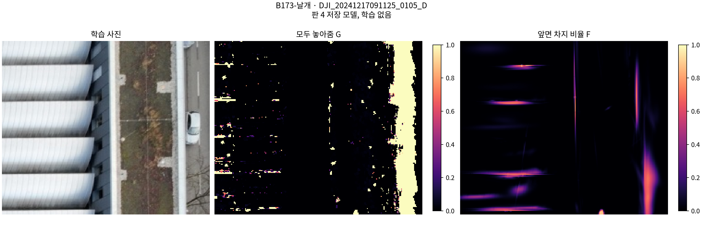
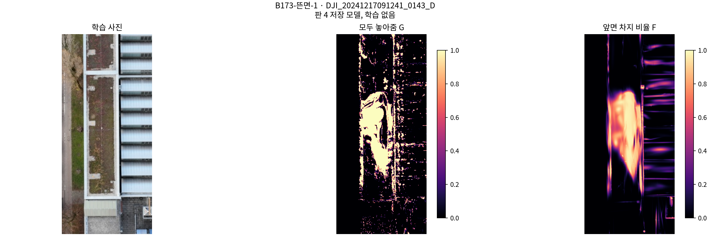
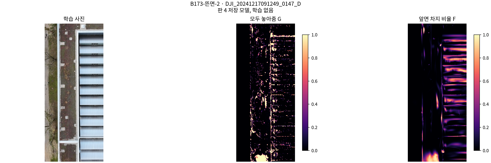

# 빈 공간 손실 · 학습 전 점검

**사전 관문 미통과 — 새 학습을 시작하지 않았다.**

B173 판 4의 30,000회 저장 모델과 학습 사진 203장 전체를 검사했다. 새 학습·Adam 갱신은 0회다.
뜬 가우시안의 압력이 정상 지붕·벽보다 클 확률은 **0.261042**다. 발주 기준은 **0.8 이상**이다.

[이 발주에서 냄]. scientific_verdict: null.

off 숫자 점검: **FAIL_NUMERICAL_TOLERANCE**, 첫 열 장 최대 상대차 **8.6265196e-06** (기준 1e-6).
기준 손실끼리 반복한 대조 역전파도 최대 6.7498005e-06의 상대차를 보였다. 같은 계산 그래프에서 off−base의 기울기는 정확히 0이다. 이는 독립 CUDA 누적의 재현 차이와 스위치 효과를 구분하는 기록이며, 발주의 수치 기준을 통과로 바꾸지 않았다.

| 비교 | 엄격한 순위 확률 P(뜬 P > 정상 P) | 동률 비율 | 뜬 가우시안 | 비교 가우시안 |
|---|---:|---:|---:|---:|
| 지붕 | 0.25849584 | 0.40100858 | 13,934 | 33,020 |
| 벽 | 0.27453996 | 0.66012394 | 13,934 | 5,857 |
| 지붕·벽 합집합 | 0.26104221 | 0.43989213 | 13,934 | 38,656 |

확률은 모든 가우시안 쌍을 같은 무게로 비교했다. P가 같은 쌍은 ‘더 크다’에 포함하지 않는다. 동률에 절반을 주는 순위 확률은 JSON에 별도로 기록했다.

| 무리 | 수 | P 50% | P 90% | P 99% | P > 0 비율 |
|---|---:|---:|---:|---:|---:|
| roof | 33020 | 0 | 0.13051537 | 4.2861475 | 0.44033919 |
| wall | 5857 | 0 | 0 | 5.5355928 | 0.078709237 |
| floating | 13934 | 0 | 2.4215156 | 105.41285 | 0.28347926 |
| other | 1344496 | 0 | 0 | 0.41795999 | 0.043845426 |

P는 203장에 걸친 Σ G·w·f의 합이다. 평균 화소 손실의 색 기울기에 화소 수와 f를 곱해 가우시안별 압력을 복원했다. 원래 diagnostic_labels.npz의 표식과 체크포인트 가우시안 순서를 일치 확인했다.

| 칸 | 대응 화소 수 | G > 0.5 화소 수 | 비율 |
|---|---:|---:|---:|
| 0 | 5,583,271 | 162,170 | 0.029045697 |
| 1 | 1,854,316 | 473,686 | 0.25545053 |
| 2 | 550,648 | 21,396 | 0.038856039 |
| 3 | 552,460 | 98,896 | 0.17901025 |
| 4 | 15,295 | 2,821 | 0.18443936 |
| 5 | 25,158 | 18,506 | 0.73559106 |
| 6 | 4,845,292 | 620,592 | 0.12808144 |

분모는 기존 패치 대응표에서 그 칸에 대응하는 모든 화소다. 자료가 없는 화소는 G=0이다. 칸은 보고에만 쓰며 손실에 쓰지 않았다.

| 무게 계산 | 값 |
|---|---:|
| 사진 기울기 중앙값 a | 6.3099896e-10 |
| 빈 공간 기울기 중앙값 b | 2.1281038e-13 |
| λ₁ = a/b | 2965.076 |
| λ₄ = 4a/b | 11860.304 |

집계 순서의 명시가 없어 계산 전에 다음 규칙을 가정하여 잠갔다: 가우시안마다 203장의 |∂L/∂opacity_logit|을 평균한 다음 뜬 가우시안 13,934개의 중앙값을 취한다. 사진 손실은 판 4와 같은 L1+SSIM이며 λ_free=1의 손실과 비교했다. 사진×가우시안을 한꺼번에 펼친 중앙값은 a=b=0이므로 그 방식의 비율은 확인 불가다. 위 두 λ는 실제 학습에 사용하지 않았다.

| 단위 점검 | 결과 |
|---|---|
| 가짜 자료: 한 자료 가까움 / 둘 다 멂 / 자료 없음 | PASS |
| 손계산 합성 0.284와 렌더 | 0.28400001 |
| 위치·크기·방향 기울기 | 정확히 0 |
| 불투명도 기울기 | 있음 |
| off 첫 10회 손실·기울기 상대차 | 최대 8.62652e-06 |

off 점검은 초기 모델에서 씨앗 0이 고른 첫 열 장의 손실을 두 번 역전파해 비교했다. Adam을 갱신하는 10회 학습은 하지 않았다. off는 손실 텐서를 그대로 반환하고 렌더·난수·밀도 제어를 추가 호출하지 않는다.
저장 모델 색 렌더의 사진별 PSNR 최대 재현 차이: 3.8146973e-06 dB (허용 0.1 dB).

중앙 깊이는 기존 렌더러의 allmap[5]를 읽었다. 기존 혼합 우도 손실의 기대 깊이 계산은 바꾸지 않았다. 자료 지도·σ·V·가용 화소는 기존 lt_losses와 같다. 별도의 깊이 자료를 만들지 않았다.
기존 lt_losses는 유효 prior 깊이·패치 대응이 있는 화소에서만 MVS 항도 계산한다. 이 가용성 규칙을 그대로 재사용했으며, prior 대응 없이 MVS만 있는 곳에 σ나 V를 새로 배정하지 않았다.

미분식의 추가 관찰: F의 투과율 w도 불투명도에 의존하므로, 이 식만으로 모든 불투명도가 낮아진다고 보장할 수 없다. 손계산 장면에서 앞 조각의 f=0.2, 뒤 조각의 f=0.8, 뒤 불투명도=0.4이면 ∂F/∂앞 불투명도=0.2−0.4×0.8=−0.12다. 손실을 줄이는 갱신이 앞 조각의 불투명도를 올릴 수 있다. 발주의 식에 별도 기울기 절단·부호 제한을 추가하지 않았고, 위치·크기·방향만 차단했다.

사례 그림은 학습 사진 / G / F 순서다. 밝은 값은 해당 지도가 켜진 부분이다.

그림 관찰: 날개 사진에서는 G가 넓게 꺼져 있고 F는 가는 띠와 가장자리 일부에 켜진다. 뜬면-1은 가운데 큰 영역에서 G와 F가 함께 켜진다. 뜬면-2는 아래쪽 덩어리와 지붕 경계에서 켜진 부분이 보인다. 세 사례 전체에서 덮개에만 켜지고 보존 영역에는 모두 꺼진다는 시각적 통과를 선언하지 않는다. 칸 2의 G>0.5 비율은 3.8856%다. 사람의 최종 시각 판정은 받지 않았다.

기존 B0 학습과 이미 시작했던 후처리 자식 프로세스는 정상 종료까지 보존했다. 이후 미시작 R1 다시점·기존 잔여 판을 시작하는 스케줄러만 종료하여 GPU·TSDF 잠금을 해제했다. 후처리의 빠진 호스트 영수증은 Linux 자식 종료 상태 0에서 복구했으며 정확한 시작·종료 시각은 확인 불가로 남겼다. 실행 중인 CPU 진단과 MESHPATCH 계산에는 종료 신호를 보내지 않았다.

학습 및 핵심 채점: NOT_RUN_PREFLIGHT_GATE. fs1·fs4·R1 모델, 새 메시, 새 patch_z는 없다. 없는 결과를 0이나 성공으로 표시하지 않는다.

묶음에 포함된 압력·기울기 배열로 분위수·순위 확률·무게는 다시 계산할 수 있다. 원본 대형 모델과 203장 영상은 포함하지 않으므로 새 렌더는 외부 원본이 필요하다. CRC·SHA-256은 파일 무결성을 확인하며 과학적 타당성이나 사람의 시각 판정을 뜻하지 않는다.
