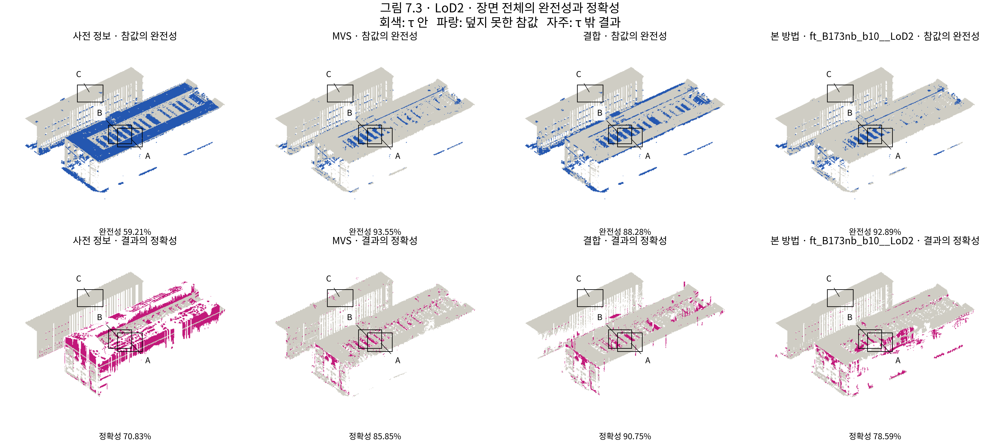
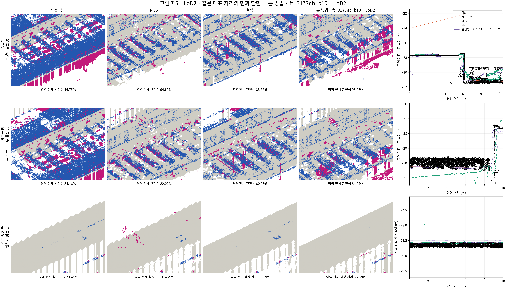

# 결과_B173주변_LoD2

[이 발주에서 냄] · PHD-MAIN-FINALTRAIN-v1 · scientific_verdict: null

**풀림 기록: 7,000회 보존 풀림 38.38%: r8 15.15%의 2배 초과**

- 판의 상태: TRAINING_COMPLETE_30000. 씨앗 0. 요청 반복 30,000회.
- 학습 시간: 2.182시간. 시도 1회.
- 채점: RESCORE-v1 최종 메시·기둥·새 τ·새 칸.
- 목표 범위: 전체 258,097패치. 평가 밖 116,563패치 / 7285.188m². PASS.
- 유한한 목표·불확실도를 정하지 못한 넓이(빈 공간 제외): 0.125m². 해당 값은 보간하거나 추측하지 않았다.
- 장면 σ_ref: 0.0571144541m. 무게 차수 1. 배경 무게 1. σ_W와 r은 목표에 넣지 않았다.

| 판 | 완전성 % | 정확성 % | 참값 기준 거리 m | 결과 기준 거리 m | 상태 |
|---|---:|---:|---:|---:|---|
| 사전 정보 | 59.21 | 70.83 | 0.76 | 0.68 | 완료 |
| MVS | 93.55 | 85.85 | 0.11 | 0.15 | 완료 |
| 결합 | 88.28 | 90.75 | 0.16 | 0.15 | 완료 |
| 기준선 | 92.26 | 89.19 | 0.12 | 0.15 | 완료 |
| GeoGS | 82.49 | 66.98 | 0.16 | 0.32 | 완료 |
| 2DGS | 71.29 | 59.41 | 0.26 | 0.45 | 완료 |
| CDGS | 58.65 | 50.25 | 0.34 | 0.66 | 완료 |
| 판단으로 조합한 메시 | 90.20 | 85.07 | 0.14 | 0.27 | 완료 |
| 상한 | 90.89 | 85.62 | 0.13 | 0.26 | 완료 |
| 본 방법 | 92.89 | 78.59 | 0.11 | 0.30 | 완료 |

맞는 판단별 반올림 전 네 값·표본 수·기둥 밖 비율은 `tables/table4_B173nb_b10__LoD2.{csv,json}`에 있다.

화소 무게 1·10·50·90·99%: [0.18174432218074799, 0.39662817120552063, 0.7969313263893127, 2.460043430328369, 4.379826068878174]. 아래 끝 비율 0.37383%, 위 끝 비율 0.00706%.

목표 수식·기본값 100회 점검: PASS. 학습 입력 대조: PASS. 자르기 전 패치 넓이 가중 평균 무게: 1.000000000000000.

고정 평가 입력의 판단문 재실행 불일치: 0개. 전체 범위로 입력을 확장한 재계산의 평가 범위 판단 차이: 2개. 평가 범위 학습에는 고정 JUDGEAPPLY 판단을 썼다. RESCORE 목표 대조: [{'site': 'B173nb_b10', 'prior': 'LoD2', 'status': 'PASS', 'compared': 125564, 'max_height_difference_m': 0.0, 'target_sha256': '610cff9a3900540c37ac896dd055e84849af2ad70fdbc9e3c82e88b23b4a1458', 'rescore_sha256': '0c3b4f9525aad2902c1b86876ad0cbc276a8e1dc5ed581b92227137e6d101532'}].

7,000·15,000·30,000회 풀림과 r8 비교는 `tables/release_B173nb_b10__LoD2.{csv,json}`에 기록했다. r8 값이 없는 항목은 비워 두었다.
- 7,000회: 가우시안 1,031,040개, PASS_HEALTH.
- 15,000회: 가우시안 2,990,321개, PASS_HEALTH.
- 30,000회: 가우시안 2,990,321개, PASS_HEALTH.

