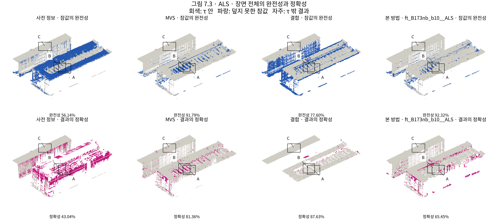
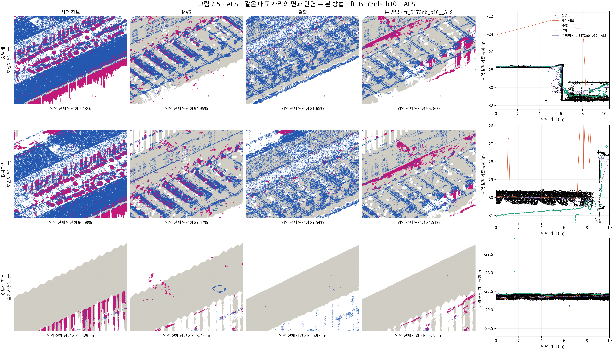

# 결과_B173주변_항공LiDAR

[이 발주에서 냄] · PHD-MAIN-FINALTRAIN-v1 · scientific_verdict: null

- 판의 상태: TRAINING_COMPLETE_30000. 씨앗 0. 요청 반복 30,000회.
- 학습 시간: 1.462시간. 시도 1회.
- 채점: RESCORE-v1 최종 메시·기둥·새 τ·새 칸.
- 목표 범위: 전체 76,657패치. 평가 밖 42,384패치 / 2753.806m². PASS.
- 유한한 목표·불확실도를 정하지 못한 넓이(빈 공간 제외): 1567.139m². 해당 값은 보간하거나 추측하지 않았다.
- 장면 σ_ref: 0.0145366836m. 무게 차수 1. 배경 무게 1. σ_W와 r은 목표에 넣지 않았다.

| 판 | 완전성 % | 정확성 % | 참값 기준 거리 m | 결과 기준 거리 m | 상태 |
|---|---:|---:|---:|---:|---|
| 사전 정보 | 56.14 | 43.04 | 0.82 | 0.82 | 완료 |
| MVS | 91.79 | 81.36 | 0.11 | 0.15 | 완료 |
| 결합 | 90.20 | 65.33 | 0.12 | 0.31 | 완료 |
| 기준선 | 92.35 | 85.24 | 0.11 | 0.14 | 완료 |
| GeoGS | 77.40 | 59.33 | 0.17 | 0.31 | 완료 |
| 2DGS | 66.23 | 48.95 | 0.26 | 0.45 | 완료 |
| CDGS | 29.26 | 15.38 | 0.81 | 2.42 | 완료 |
| 판단으로 조합한 메시 | 76.18 | 87.91 | 1.03 | 0.23 | 완료 |
| 상한 | 77.52 | 89.61 | 1.02 | 0.13 | 완료 |
| 본 방법 | 92.32 | 65.45 | 0.09 | 0.26 | 완료 |

맞는 판단별 반올림 전 네 값·표본 수·기둥 밖 비율은 `tables/table4_B173nb_b10__ALS.{csv,json}`에 있다.

화소 무게 1·10·50·90·99%: [0.10000000149011612, 0.21898436546325684, 1.159343957901001, 2.1781809329986572, 3.5665814876556396]. 아래 끝 비율 3.47832%, 위 끝 비율 0.00878%.

목표 수식·기본값 100회 점검: PASS. 학습 입력 대조: PASS. 자르기 전 패치 넓이 가중 평균 무게: 1.000000000000000.

고정 평가 입력의 판단문 재실행 불일치: 0개. 전체 범위로 입력을 확장한 재계산의 평가 범위 판단 차이: 1개. 평가 범위 학습에는 고정 JUDGEAPPLY 판단을 썼다. RESCORE 목표 대조: [{'site': 'B173nb_b10', 'prior': 'ALS', 'status': 'PASS', 'compared': 33512, 'max_height_difference_m': 0.0, 'target_sha256': 'dc10377655ed8516207172e607b2934839fbb18e93a33a152b488ecc319b550c', 'rescore_sha256': '44e6d7c1a161905dcd6d29d78ea8411b88123788f40edbae145549467b1937b7'}].

7,000·15,000·30,000회 풀림과 r8 비교는 `tables/release_B173nb_b10__ALS.{csv,json}`에 기록했다. r8 값이 없는 항목은 비워 두었다.
- 7,000회: 가우시안 953,848개, PASS_HEALTH.
- 15,000회: 가우시안 2,908,431개, PASS_HEALTH.
- 30,000회: 가우시안 2,908,431개, PASS_HEALTH.

