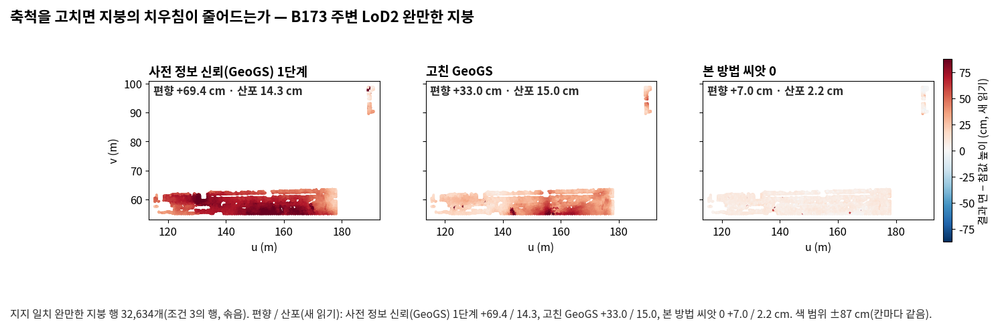
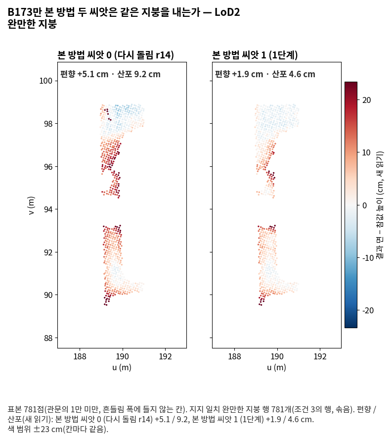
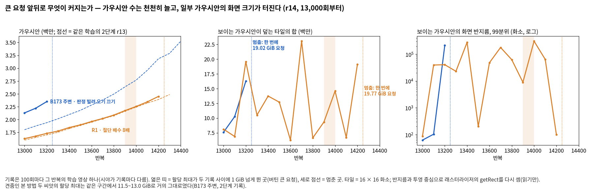

<!-- PHD-MAIN-FIX-v1 최종 보고 -->
# 본 실험 고침과 다시 돌리기 — 보고서 v1

- 작업: `PHD-MAIN-FIX-v1` (발주문 v1, 2026-10-12). 실행 10-13 10:09 ~ 16:36(학습), 표·그림·보고 ~ 17:00. `scientific_verdict: null`.
- 브랜치 `exp/main-experiment`, 폴더 `JointBuildGS-exp`.
- 설정: `configs/phd/main_fix_v1/fix_v1.json`(11:15:19 저장, sha256 `9209ce0986b2fe086697ea50190aa60cacda3e2f7d24fe8d5b70e2640dfb6d8d`). 학습 뒤 바꾸지 않았다.
- 1단계와 2단계의 공식 판정과 표는 고치지 않았다. 다시 낸 값은 '다시 잼(고친 GeoGS)'이나 '다시 돌림(r14)'으로 표시해 나란히 둔다.
- 앞선 보고: [준비 보고](본실험_고침_준비보고_v1.md)(14e1d05c), [중간 보고](본실험_고침_중간보고_v1.md)(02891230). 표 [tables/](tables/), 그림 [figures/](figures/).

## 1. 답 먼저

| 물음 | 답 | 갈래 |
|---|---|---|
| r14는 r13과 같은 결정을 내리는가 | 같다. 학습 전 계산 일곱 단위와 고정 체크포인트 한 반복 여섯 곳에서 배열과 손실 값이 같고, r13의 시험 8개가 통과한다(준비 보고 2절) | 확인 |
| 메모리를 얼마나 덜었나 | 500회 할당 최대: R1 LoD2 −4.71 GiB, B173 주변 LoD2 −2.87 GiB. 긴 학습이 멈출 때 PyTorch가 잡은 바탕: r14 3.5 GiB, 원래 r13 7.9·8.8 GiB, r12 11.8 GiB | 확인 |
| 얼마나 느려졌나 | 긴 학습에서 같은 반복까지 +1~+5 %다(B173만은 −3~+8 %). 준비 보고의 +28~31 %(1,000회 점검)는 이 값으로 바로잡는다(3절) | 확인 |
| GeoGS의 두 문제가 고쳐졌나 | 고쳐졌다. 처음 점은 가림 검사로 0.1~24.8 % 빠지고, B173 주변 DA3 묶음 축척은 0.130~1.213 → 0.975~1.074다. 학습 결과는 두 고침이 닿은 B173 주변에서만 크게 바뀌었다(완만한 지붕 편향 +69 → +33 cm, 뜬 조각 몫 14.4 → 5.3 %) | 확인 |
| 다시 낸 관문 조건 1 (LoD2 세 단위) | B0 충족, B173 주변 충족. 바뀐 칸과 미충족은 없다. R1은 후처리가 호스트 메모리 부족으로 멈춰 값이 없다(여쭘 1) | B0·B173 주변 확인, R1 아직 모름 |
| 판정 빌려 오기 끄기 · B173 주변 LoD2 (맞바꿈) | r14로도 GPU 메모리 부족으로 멈췄다(13,2xx회, 한 번에 19.02 GiB 요청) | 아직 모름 |
| 절단 배수 8배 · R1 LoD2 (민감도) | r14로도 GPU 메모리 부족으로 멈췄다(14,2xx회, 한 번에 19.77 GiB 요청) | 아직 모름 |
| B173만 두 학습의 값 | 본 방법 씨앗 0(r14)은 끝났다(75분). 1단계 씨앗 1과 견주면 조건 1의 값 5.47 대 5.08 %(차이 0.39 %p), 조건 4 95.40 대 95.02 %, 완만한 지붕 산포(지금 읽기) 11.2 대 5.8 cm(표본 781점)다. 영상만은 r14로도 멈췄다(10,8xx회, 한 번에 22.41 GiB 요청) | 본 방법 확인 / 영상만 아직 모름 |
| 'da'는 어떤 항인가 | 판정 모듈의 MVS 깊이 항이다(가중을 곱하기 전 값의 지수 평균, 절단 없음; `train.py:875`, `:1050`, `:1058`). 마스크 끄기에서 처음부터 큰 것은 입력 탓이다 | 확인 |
| 마스크 끄기 학습을 흔든 것은 | 그 항이 마스크가 빼던 화소의 엉뚱한 광도 깊이로 렌더를 당겼을 수 있다. 늘어난 가우시안의 자리를 잇는 기록이 없다 | 가능, 근거 불완전 |
| (6.4) 큰 요청 때 무엇이 커졌나 | 가우시안의 수가 아니라 일부 가우시안의 화면 크기다. 13,000회부터의 기록에서 보이는 가우시안의 화면 반지름 99분위가 수만~38만 화소로 터지고, 타일 겹침이 늘었다. 기록은 100회마다 시야 하나라 요청이 난 그 반복의 값은 없다 | 가능, 근거 불완전 |

**여쭐 것** (자세히는 6절)

1. R1 고친 GeoGS의 후처리를 다시 돌릴지(호스트 메모리가 필요해 다른 서비스를 잠시 멈춰야 할 수 있음).
2. 판정 빌려 오기 끄기 · B173 주변, 절단 배수 8배 · R1, B173만 영상만: r14로도 끝나지 않은 셋을 어떻게 할지. 권장은 다시 돌리지 않는 것이다. 한 번의 렌더 요청이 GPU 전체(23.56 GiB)에 가깝기 때문이다.

## 2. 실험 구성과 실제로 돈 학습

| 차례 | 지역 | 학습 (결과 이름) | 코드 | 상태 | 시간 (분) | nvidia-smi 최대 (GiB) | PyTorch 할당 최대 (GiB) | 원래 학습: 코드 · 상태 · 시간 · nvidia-smi · PyTorch |
|---|---|---|---|---|---|---|---|---|
| 1 | B173 주변 | 사전 정보 신뢰(GeoGS) LoD2 (`trust_LoD2_fix1`) | 고친 GeoGS(fix1) | PASS | 71 | 17.8 | — | GeoGS 1단계 · PASS · 64 · 11.0 · — |
| 1 | R1 | 같음 | 고친 GeoGS(fix1) | PASS(후처리 멈춤) | 53 | 10.8 | — | GeoGS 1단계 · PASS · 56 · 15.9 · — |
| 2 | B0 | 같음 | 고친 GeoGS(fix1) | PASS | 54 | 9.2 | — | GeoGS 1단계 · PASS · 53 · 10.4 · — |
| 2 | B173만 | 같음 | 고친 GeoGS(fix1) | PASS | 196 | 21.2 | — | GeoGS 1단계 · PASS · 139 · 16.4 · — |
| 3 | B173 주변 | 판정 빌려 오기 끄기 LoD2 (`abl_prop_LoD2_s0`) | r14 | OOM | 21 | 17.7 | 16.5 | r13 · OOM · 23 · 18.9 · 22.0 |
| 3 | R1 | 절단 배수 8배 LoD2 (`sens_trunc8_LoD2_s0`) | r14 | OOM | 24 | 13.5 | 19.6 | r13 · OOM · 24 · 15.6 · 19.6 |
| 4 | B173만 | 본 방법 LoD2 씨앗 0 (`prop_LoD2_s0`) | r14 | PASS | 75 | 18.1 | 16.5 | r12 · OOM · 24 · 23.5 · 22.0 |
| 4 | B173만 | 영상만 씨앗 0 (`imgonly_s0`) | r14 | OOM | 14 | 9.5 | 22.4 | r12 · OOM · 23 · 21.9 · 20.8 |

- 고친 GeoGS = `GeoGS-official-adapters-v1-fix1`(공식 db40c95 + 가림 검사 두 줄; 바뀐 파일 `data/generate_pcd.py` 하나, [provenance/source_manifest_fix1.json](provenance/source_manifest_fix1.json)). 학습 명령, 이미지, 저자 플래그는 1단계와 같다. B173 주변만 DA3 12장 묶음 깊이를 쓴다.
- r14 = `src/phd/forks/GeoGS-conf-guided-v1-r14`(r13에서 `jbgs_judgment.py`, `train.py` 두 파일만; [provenance/build_report_r14.json](provenance/build_report_r14.json)). 2단계의 둘은 2단계 설정의 그 줄과 같은 스위치·값·입력이다. B173만 둘은 1단계와 같다. 1단계 영상만은 r12로 돌았으므로 r14로 돌렸다(r12 = r13 기본값 = r14).
- nvidia-smi 최대는 30초마다 잰 값이라 순간의 큰 요청을 놓친다. PyTorch 할당 최대는 100회마다 적는 `torch.cuda.max_memory_allocated`다.
- 후처리: 고친 GeoGS 셋과 B173만 본 방법 씨앗 0은 1·2단계와 같은 후처리(렌더, TSDF, 부유, 가상 시점 메시, 지표, 고운 자)를 마쳤다. R1 고친 GeoGS는 GPU 후처리에서 멈췄다(6절).

## 3. 준비 결과 (4.1~4.3, 준비 보고의 요약)

- **4.1 r14**: 판정 지도 다섯 장(A·M·P·TAU·GW)과 위치·표지 지도를 CPU 고정 메모리에 두고, 그 영상의 반복에만 GPU로 옮긴다. 이 포크는 학습 영상을 처음부터 CPU에 두므로, 실제로 줄어든 것은 판정 지도 몫이다(R1 LoD2 5.26 GiB, B173 주변 3.20 GiB). 결정은 r13과 같다(1절).
- **바로잡음(속도)**: 준비 보고의 1,000회 점검은 r14가 28~31 % 느리다고 적었다. 긴 학습 넷을 같은 반복까지 견주면 +1~+5 %다.

  | 학습 | 견준 반복 | r14 | 원래 | 차이 |
  |---|---|---|---|---|
  | B173 주변 빌려 오기 끄기 (r13) | 1,000 / 10,000 / 13,200 | 0.5 / 12.8 / 19.5분 | 0.5 / 12.7 / 18.9분 | +1 / +1 / +3 % |
  | R1 절단 8배 (r13) | 1,000 / 10,000 / 14,200 | 0.5 / 13.5 / 22.3분 | 0.5 / 13.0 / 21.7분 | +3 / +4 / +3 % |
  | B173만 본 방법 0 (r12) | 1,000 / 10,000 / 14,500 | 0.5 / 11.8 / 20.9분 | 0.4 / 10.9 / 21.5분 | +2 / +8 / −3 % |
  | B173만 영상만 0 (r12) | 1,000 / 10,000 / 10,800 | 0.3 / 11.2 / 13.1분 | 0.3 / 11.4 / 12.9분 | +3 / −2 / +1 % |

  - R1 LoD2에서 같은 r14가 1,000회까지 점검 때는 37~40초, 학습(절단 8배) 때는 32초 걸렸다(r13은 둘 다 30~31초).
  - 점검(11:02~11:14) 때는 B0·R1의 처음 점 생성(CPU)이 아직 돌았다. 반복마다 지도를 옮기는 r14가 그 겹침에 더 민감했던 것으로 보인다(가능, 근거 불완전).
- **4.2 GeoGS**: 가림 검사는 세 겹으로 막혀 있었다(`trimesh.Scene.ray` 예외, rtree 없음, 첫 교차가 아님). 두 줄을 고치고 rtree를 더했다. B173 주변 DA3는 묶음 19(제자리 촬영)와 10(경사 영상 4장 1.45배)을 12장 묶음으로 저자의 맞춤(RANSAC) 그대로 다시 맞췄다. 같은 문제는 다른 학습에 없다(본 방법·영상만·항공 LiDAR 신뢰는 DA3와 GeoGS 처음 점을 쓰지 않음).
- **4.3 'da'**: 1절 표. 코드 줄과 숫자는 준비 보고 4절.

## 4. 학습마다 숫자 표와 그림

### 4.1 고친 GeoGS 넷 (차례 1·2)

자세한 표와 그림은 [중간 보고](본실험_고침_중간보고_v1.md) 2~6절에 있다. 여기에는 6.1-1이 적으라는 값만 다시 둔다([tables/fix_geogs_compact.md](tables/fix_geogs_compact.md), 전체 [tables/fix_geogs.md](tables/fix_geogs.md)).

| 지역 | 사전 정보 오류 유입률 [조건 1] (%) | 완만한 지붕 편향 / 산포, 새 읽기 (cm) | 완만한 지붕 편향 / 산포, 지금 읽기 (cm) | 뜬 조각 몫 (%) | 결측 일치 0.2 m (%) | 고운 자: 문턱 이내 / 지지 일치 / 사전 정보 오류 (cm) |
|---|---|---|---|---|---|---|
| B173 주변: GeoGS 1단계 → 고친 판 | 10.17 → 8.67 | 69.4 / 14.3 → 33.0 / 15.0 | 71.4 / 17.1 → 34.2 / 16.0 | 14.35 → 5.31 | 90.2 → 93.8 | 24.1 / 19.2 / 38.2 → 20.8 / 9.7 / 13.7 |
| B173 주변: 본 방법 0 · 1 | 6.54 · 7.08 | 7.1 / 2.2 · 7.1 / 2.1 | 7.1 / 2.2 · 7.2 / 2.2 | 1.24 · 1.37 | 96.2 · 96.7 | 18.9 / 6.2 / 5.2 · 18.4 / 6.1 / 5.1 |
| B0: GeoGS 1단계 → 고친 판 | 43.56 → 42.83 | −1.7 / 24.6 → 28.3 / 12.2 | 1,056.7 / 577.6 → 491.5 / 682.1 | 73.35 → 82.10 | 40.1 → 29.3 | 40.5 / 18.4 / 21.1 → 33.2 / 19.4 / 22.0 |
| B0: 본 방법 0 · 1 | 12.10 · 11.86 | 13.7 / 39.9 · −17.6 / 60.9 | 69.8 / 129.0 · 43.5 / 124.5 | 39.49 · 29.96 | 94.4 · 92.7 | 16.8 / 4.0 / 6.2 · 13.3 / 4.0 / 6.3 |
| B173만: GeoGS 1단계 → 고친 판 | 19.49 → 20.80 | 3.9 / 6.0 → 3.5 / 6.8 | 6.7 / 9.9 → 6.0 / 9.3 | 24.33 → 20.87 | 88.4 → 87.4 | 15.3 / 9.3 / 87.0 → 17.6 / 8.1 / 82.1 |
| R1: GeoGS 1단계 → 고친 판 | 36.96 → — | 1.2 / 20.0 → — | 6.1 / 27.3 → — | 19.98 → — | 81.9 → — | 68.3 / 10.2 / 30.9 → — |

- 과거 형상 잔존율은 GeoGS에 출신 기록이 없어 공식 값이 '—'다. 발주 7절의 그림 규칙으로 센 보충 값은 [tables/fix_past_any.md](tables/fix_past_any.md)다(B173 주변 1.1 → 1.7 %, 본 방법 1.0·1.1 %).
- B0의 완만한 지붕 값은 1단계 보고서 5.4가 '측정의 한계'로 둔 값이다.
- 그림(학습마다):
  - B173 주변: [가림 검사가 무엇을 뺐는가](figures/geogs_init_B173nb_b10.png), [축척을 고치면 지붕의 치우침이 줄어드는가](figures/geogs_gentle_B173nb_b10.png), [고친 GeoGS에서도 틀린 옛 모양이 남는가](figures/geogs_prior_error_B173nb_b10.png).
  - B0: [깊이를 그대로 둔 곳에서 고친 GeoGS는 1단계와 같은 지붕을 내는가](figures/geogs_gentle_B0_b10.png). 편향 / 산포(새 읽기) −1.7 / 24.6 → +28.3 / 12.2 cm(514행, '측정의 한계' 자리).
  - B173만: [같은 물음](figures/geogs_gentle_B173_b0.png). +3.9 / 6.0 → +3.5 / 6.8 cm(781행). 두 판이 같은 무늬다.
  - R1: 후처리가 멈춰 그림이 없다.

- 축척을 고치면 남쪽 긴 지붕의 치우침이 절반쯤 줄어든다(+69 → +33 cm). 가운데의 남쪽 가장자리에 남고, 본 방법(+7 cm) 수준까지는 아니다.

### 4.2 판정 빌려 오기 끄기 · B173 주변 LoD2 — 결과 없음

- 학습은 13,2xx회에서 GPU 메모리 부족으로 멈췄다. 학습 렌더(래스터라이저 forward) 한 번이 19.02 GiB를 요청했고, 빈 메모리는 18.92 GiB, 그때 PyTorch 할당은 3.52 GiB였다.
- 6.2의 맞바꿈 읽기(결측 영역의 사전 정보 오류 유입률과 결측 일치 완전성)를 하지 못했다. 이 자리의 일하는 양은 빌려 온 판정이 있는 결측 패치 2,749개다(2단계 준비). 견줌(1단계 본 방법 두 씨앗)의 값과 기준은 [tables/fix_r14.md](tables/fix_r14.md)에 둔다.
- 2단계 r13 판도 같은 학습이 14,400회에서 멈췄다(15.06 GiB 요청, 할당 7.94 GiB). 두 판 모두에서 할당 최대가 견줌(11.5~13.0 GiB)보다 크게 뛰었다: r14 11,000 → 12,000회 8.3 → 16.2 GiB, r13 14,000 → 14,400회 16.9 → 22.0 GiB.
- 그림: 4.6절의 메모리 그림(파랑).

### 4.3 절단 배수 8배 · R1 LoD2 — 결과 없음

- 학습은 14,2xx회에서 GPU 메모리 부족으로 멈췄다. 학습 렌더 한 번이 19.77 GiB를 요청했고, 빈 메모리는 19.33 GiB, 그때 PyTorch 할당은 3.53 GiB였다.
- 2단계 r13 판이 멈춘 요청(15.23 GiB, 할당 8.81 GiB)은 r14에서는 들어갔다. 13,900~14,000회에 할당 최대가 13.0 → 19.6 GiB로 올랐는데도 이어 갔다. 그다음의 더 큰 요청에서 멈췄다.
- 6.2의 민감도 읽기(보정률 곡선, 사전 정보 오류 유입률, 조건 1~4의 판단을 2배와 나란히)를 하지 못했다. 2배의 결과는 2단계 보고서 그대로다. 절단 배수 그림은 8배의 점이 없어 그리지 않았다.
- 그림: 4.6절의 메모리 그림(주황).

### 4.4 B173만 · 본 방법 LoD2 씨앗 0 (다시 돌림 r14)

- 학습은 PASS다(75분, nvidia-smi 18.1 GiB, PyTorch 할당 최대 16.5 GiB). 1단계 r12 판이 14,800회에서 멈춘 요청(11.70 GiB, 그때 바탕 11.83 GiB)은 r14에서는 들어갔다. 15,000회에 할당 최대가 13.0 → 16.5 GiB로 오른 큰 요청도 버텼다.
- 6.3대로 1단계 표에 '다시 돌림(r14)'으로 채웠다([tables/fix_r14.md](tables/fix_r14.md)의 B173만 표). 관문 판정은 내지 않는다(보고만 하는 지역).

| 지표 | 씨앗 0 (다시 돌림 r14) | 씨앗 1 (1단계) | 차이 (0 − 1) |
|---|---|---|---|
| 사전 정보 오류 유입률 [조건 1의 값] (%) | 5.47 | 5.08 | +0.39 |
| 전제 위배 둘레 완전성 0.2 m [조건 4의 값] (%) | 95.40 | 95.02 | +0.38 |
| 관측 오류 문턱 이내 유입률 [조건 2의 값] (%) | 67.3 | 68.0 | −0.7 |
| 완만한 지붕 편향 / 산포, 새 읽기 (cm) | 5.05 / 9.19 | 1.89 / 4.60 | +3.16 / +4.59 |
| 완만한 지붕 편향 / 산포, 지금 읽기 (cm) | 7.32 / 11.22 | 2.69 / 5.75 | +4.63 / +5.47 |
| 뜬 조각 몫 (%) | 13.70 | 10.88 | +2.82 |
| 과거 형상 잔존율 (%) | 0.80 | 0.96 | −0.16 |
| 결측 일치 완전성 0.2 m (%) | 92.99 | 93.15 | −0.16 |
| 못 본 곳 상속률 (%) | 83.0 | 84.5 | −1.5 |
| 고운 자: 문턱 이내 / 지지 일치 / 사전 정보 오류 (cm) | 22.73 / 5.21 / 4.83 | 22.65 / 5.45 / 4.85 | +0.08 / −0.24 / −0.02 |
| F1 @0.2 m (%) | 73.6 | 75.4 | −1.8 |

- 오류 차단과 완전성 지표는 두 씨앗이 가깝다. 차이는 조건 1·4가 0.4 %p, 조건 2 0.7 %p, 과거 형상·결측 일치 0.2 %p, 상속률 1.5 %p, F1 1.8 %p다.
- 완만한 지붕은 씨앗 0이 4~5 cm 높고 산포가 두 배다. 뜬 조각 몫도 2.8 %p 많다. 다만 완만한 지붕 칸의 표본은 781점으로 관문의 1만에 못 미친다.
- 흔들림 폭(참고, 3절 4번; [tables/fix_ruler_ref.md](tables/fix_ruler_ref.md)): 이 칸을 넣어 다시 모으면 조건 1은 1.64 → 1.53 %p(6칸), 조건 4는 0.98 → 0.95 %p(7칸)다. 조건 2(1,080점)와 조건 3(781점)은 표본이 1만 미만이라 빠진다. 판정과 '달라졌다'의 기준에는 쓰지 않았다.

- 두 씨앗은 같은 무늬를 낸다. 씨앗 0이 가운데 띠(v 94.5~97.5 m)에서 10~20 cm 더 높다.

### 4.5 B173만 · 영상만 씨앗 0 — 결과 없음

- 학습은 10,8xx회에서 GPU 메모리 부족으로 멈췄다. 학습 렌더 한 번이 22.41 GiB를 요청했고, 빈 메모리는 19.37 GiB, 그때 PyTorch 할당은 3.53 GiB였다. 메모리 기록은 13,000회부터라 이 학습에는 없다.
- 할당 최대: 9,000회 9.6 → 10,800회 22.4 GiB. 1단계 r12 판은 13,600회에서 할당이 22.85 GiB로 GPU를 채운 상태에서 멈췄다.
- 사전 정보를 끈 학습이다. 그러므로 이 큰 요청은 사전 정보나 판정 장치 없이도 생긴다.
- 조건 2·4의 견줌(영상만)이 B173만에는 여전히 없다.

### 4.6 메모리 기록 (6.4)

**r14 학습 넷과 원래 학습** ([tables/fix_r14_status.md](tables/fix_r14_status.md))

| 학습 | 판 | 상태 · 마지막 기록 | 멈춘 요청 (GiB): 요청 · 빈 · 그때 PyTorch 할당 | 할당 최대 (GiB): 10,000 · 12,000 · 14,000 · 끝 | 같은 반복까지 시간 (분) | 13,000~15,000 기록: 반지름 99분위 최대 · 타일 겹침 최대 |
|---|---|---|---|---|---|---|
| B173 주변 · 판정 빌려 오기 끄기 LoD2 | r14 | OOM · 13,200 | 19.02 · 18.92 · 3.52 | 8.1 · 16.2 · — · 16.5 | 19.5 (13,200회) | 213,501 화소 · 16,250,373 (3줄) |
|  | r13 | OOM · 14,400 | 15.06 · 14.50 · 7.94 | 10.9 · 12.0 · 16.9 · 22.0 | 18.9 (13,200회) | — |
| R1 · 절단 배수 8배 LoD2 | r14 | OOM · 14,200 | 19.77 · 19.33 · 3.53 | 10.9 · 12.6 · 19.6 · 19.6 | 22.3 (14,200회) | 306,670 화소 · 23,037,728 (13줄) |
|  | r13 | OOM · 14,300 | 15.23 · 13.94 · 8.81 | 15.5 · 16.7 · 19.6 · 19.6 | 21.7 (14,200회) | — |
| B173만 · 본 방법 LoD2 씨앗 0 | r14 | PASS · 30,000 | — | 6.8 · 8.1 · 8.5 · 16.5 | 21.7 (14,800회) | 381,087 화소 · 22,116,119 (21줄) |
|  | r12 | OOM · 14,800 | 11.70 · 10.86 · 11.83 | 8.7 · 13.3 · 16.3 · 22.0 | 23.1 (14,800회) | — |
| B173만 · 영상만 씨앗 0 | r14 | OOM · 10,800 | 22.41 · 19.37 · 3.53 | 9.6 · — · — · 22.4 | 13.1 (10,800회) | 기록 없음(13,000회 전에 멈춤) |
|  | r12 | OOM · 13,600 | 0.09 · 0.04 · 22.85 | 8.1 · 15.7 · — · 20.8 | 12.9 (10,800회) | — |

- 멈춘 요청: CUDA 오류의 'Tried to allocate'(학습 렌더, 래스터라이저 forward), 그때 GPU의 빈 메모리와 PyTorch가 잡은 메모리. 할당 최대는 판정 모듈이 100회마다 적는 `torch.cuda.max_memory_allocated`(학습 시작부터의 최대).
- 같은 반복까지 시간: 두 학습이 함께 가진 마지막 기록까지(같은 때 다른 GPU에서 다른 학습이 돌았다).

- **읽음(가능, 근거 불완전)**: 큰 요청 앞뒤로 커진 것은 가우시안의 수가 아니다. 일부 가우시안의 화면 크기가 커졌다.
  - B173 주변 끄기의 13,000 → 13,100 → 13,200회 기록: 보이는 가우시안 118만 → 60만 → 9만, 화면 반지름 99분위 62 → 103 → 213,500화소, 타일 겹침 759만 → 1,025만 → 1,625만이다.
  - R1 절단 8배: 13,000~14,200회 13줄 가운데 10줄에서 99분위가 8,000화소를 넘는다(최대 30.7만). 큰 요청을 버틴 13,900~14,000회 바로 뒤 기록도 30.7만 화소다.
  - 가우시안 수는 두 학습 모두 같은 구간에서 매끄럽게 는다(r13 판과 비슷한 기울기).
- **가리지 못한 것**: 기록은 100회마다 그 반복의 시야 하나다. 요청이 난 바로 그 반복의 반지름과 겹침은 없다. 기록한 겹침(최대 2,300만)에 래스터라이저의 쌍마다 버퍼(수십 바이트)를 곱해도 19 GiB에 못 미친다. 따라서 멈춘 반복의 시야는 기록된 시야보다 훨씬 큰 화면 크기의 가우시안을 보았을 것이다. 다만 이것은 추정이다.
- 견줌(본 방법 두 씨앗, B173 주변)은 같은 구간에서 할당 최대가 11.5~13.0 GiB로 거의 그대로였다. B173만 본 방법 씨앗 1(1단계, PASS)도 10.8 GiB였다. 큰 요청은 학습마다 다르게 나타난다.
- 끝까지 간 B173만 본 방법 씨앗 0(r14)의 기록에도 화면 반지름 99분위가 38만 화소인 시야가 있었다(21줄, 타일 겹침 최대 2,212만). 그러므로 큰 화면 반지름만으로는 멈춘 요청을 가리지 못한다. 멈춘 셋과 끝난 하나를 가른 것은 바탕이 얼마나 비었느냐와, 한 시야에 그런 가우시안이 얼마나 몰렸느냐로 보인다(가능, 근거 불완전).

## 5. 1단계 값과 관문 판정의 '다시 잼(고친 GeoGS)'

| 단위 | 본 방법 (1단계 두 씨앗 평균) | GeoGS 1단계 | 고친 GeoGS | 표본 | 공식 r · 판정 | 고친 자 r · 판정 | 다시 잼(고친 GeoGS) r · 판정 |
|---|---|---|---|---|---|---|---|
| B0 · LoD2 | 11.98 % | 43.56 % | 42.83 % | 32,880 | 8.22 %p · 충족 | 1.64 %p · 충족 | 1.64 %p · **충족** |
| B173 주변 · LoD2 | 6.81 % | 10.17 % | 8.67 % | 119,763 | 8.22 %p · 판별 불가 | 1.64 %p · 충족 | 1.64 %p · **충족** |
| R1 · LoD2 | 7.63 % | 36.96 % | — | 54,345 | 8.22 %p · 충족 | 1.64 %p · 충족 | **값 없음**(후처리 멈춤) |

- 바뀐 칸이 없어 6.1-3의 까닭 풀이는 없다. 두 고침이 조건 1 영역에 닿은 정도는 중간 보고 3절이다. B0·R1에는 닿지 않고, B173 주변에는 둘 다 닿는다.
- 관문 밖 1단계 표(지역 합침)의 다시 냄(6.1-4)은 [tables/fix_pooled.md](tables/fix_pooled.md)다. R1이 빠져 두 지역(B0, B173 주변)만 합쳤고, 같은 두 지역으로 합친 1단계 GeoGS 줄을 옆에 두었다.
- 관문 조건 2·4(영상만과 견줌), 조건 3(학습 전 사전 정보와 견줌), 2단계 장치 빼기의 답은 GeoGS와 상관이 없어 다시 내지 않았다(6.1-5).

## 6. 여쭐 것, 제안, 확인 불가, 실행 중 바꾼 것, 시간과 자원

### 6.1 여쭐 것

**여쭘 1. R1 고친 GeoGS의 후처리**

- 대상: R1 · 사전 정보 신뢰(GeoGS) 고친 판. 학습은 PASS(53분)이고, 모델은 그대로 있다.
- 무슨 일: 13:47에 GPU 후처리(평가 렌더, TSDF 메시, 출신별 가우시안)가 강제 종료됐다(rc 137).
  - 커널 기록은 호스트 전체의 메모리 부족이다(global OOM).
  - TSDF 통합 333장을 마치고 메시를 뽑던 중이었고, 그때 이 프로세스가 64 GB를 쓰고 있었다.
  - 같은 때 다른 서비스가 약 58 GB, B173만 GeoGS 학습이 4 GB를 썼다. 1단계 같은 단계의 최대는 59.7 GB였다.
- 왜 여쭙나: 발주 3.8(실행 오류 → 멈추고, 기록하고, 여쭘). 다른 서비스가 그대로면 쓸 수 있는 메모리가 최대 67 GB쯤이라, 다시 돌려도 안 들어갈 수 있다.
- 선택지:
  1. **(권장)** 다른 학습이 없을 때 혼자, 같은 설정으로 한 번 다시 돌린다. 컨테이너 한도만 72 → 96 GB로 올린다. 그동안 titiler 둘(각 13.7 GB)과 tensorboard(8.4 GB)를 잠시 멈추면 들어갈 가능성이 크다. 이 서비스들은 분석자가 멈추지 않는다.
  2. 다른 서비스는 그대로 두고 혼자 한 번만 다시 돌린다.
  3. 다시 돌리지 않는다(R1 칸 '값 없음').

**여쭘 2. r14로도 끝나지 않은 셋** (판정 빌려 오기 끄기 · B173 주변 LoD2, 절단 배수 8배 · R1 LoD2, B173만 영상만)

- 무슨 일: 셋 모두 학습 렌더 한 번이 19.02 / 19.77 / 22.41 GiB를 요청해 멈췄다(4.2·4.3·4.5절). 그때 PyTorch가 잡은 바탕은 3.5 GiB뿐이었다. r14가 줄일 수 있는 몫은 다 줄였다.
- 왜 여쭙나: 발주 3.8(GPU 메모리 부족 → 멈추고, 기록하고, 여쭘, 자동으로 다시 돌리지 않음).
- 선택지:
  1. **(권장)** 다시 돌리지 않는다. 결과 없음으로 두고, 6.4는 4.6절의 기록으로 답한다. 한 번의 요청이 GPU 전체(23.56 GiB)에 가까워 24 GB에서는 끝나기 어렵다.
  2. 24 GB에서 한 번 더 돌린다. 같은 코드라도 GPU 계산의 흔들림으로 다른 길을 가지만(4.6절), 끝날 가능성은 낮다고 본다.
  3. 48 GB GPU가 생기면 그때 돌린다. 발주는 48 GB를 기다리지 않는다고 했다.

### 6.2 제안 (고치지 않음)

1. **래스터라이저의 큰 한 번 요청.**
   - 화면 반지름이 매우 큰 가우시안 몇이 화면 전체 타일에 겹쳐, 한 번의 렌더 버퍼가 GPU 전체에 가까워진다(4.6절).
   - 렌더를 화면 조각으로 나눠 하거나, 화면 반지름에 상한을 두면 요청이 줄 수 있다. 앞의 것은 결과가 같아야 하고, 뒤의 것은 방법을 바꾼다.
   - 둘 다 이 발주의 범위('자료를 두는 자리만') 밖이라 제안으로만 둔다.
   - 그 전에 큰 요청이 난 반복의 시야와 가우시안을 남기는 기록(요청 직전에 저장)을 더하면 원인을 가릴 수 있다.
2. **GeoGS 자체의 학습마다의 흔들림.** B0에서는 고침이 조건 1 영역에 닿지 않았는데도 결측 일치 0.2 m가 −10.8 %p, 뜬 조각 몫이 +8.8 %p 움직였다. 같은 입력으로 씨앗만 바꾼 GeoGS 두 번이 있으면 견줌 쪽의 흔들림도 볼 수 있다.
3. **B173 주변 고친 GeoGS에 남은 지붕 편향(+33 cm).** 영상마다의 DA3 ÷ MVS 축척(12장 묶음)을 남쪽 지붕 줄에 겹쳐 본다. 남은 어긋남(묶음 7 1.074, 영상 2장 1.18)이 그 자리를 보는지 확인한다.
4. **TSDF 메시 추출의 호스트 메모리.** 결과마다 다르다(1단계 R1 GeoGS 59.7 GB, 고친 판은 64 GB 넘음). 같은 셈을 나눠 하는 판은 결과가 같은지 확인해야 하므로 제안으로만 둔다.

### 6.3 확인 불가와 까닭

| 항목 | 까닭 |
|---|---|
| R1 고친 GeoGS의 모든 값, 관문 조건 1 R1 칸 | 후처리 멈춤(여쭘 1) |
| 판정 빌려 오기 끄기 · B173 주변의 맞바꿈 | 학습이 끝나지 않음(여쭘 2) |
| 절단 배수 8배 · R1의 민감도 | 학습이 끝나지 않음(여쭘 2) |
| B173만 영상만의 값, B173만 조건 2·4의 견줌 | 학습이 끝나지 않음(여쭘 2) |
| 큰 요청이 난 반복의 화면 크기 | 기록이 100회마다 |
| B173 주변 조건 1 변화의 몫(가림 검사 대 축척) | 두 고침을 함께 넣은 학습 하나뿐 |

### 6.4 실행 중 바꾼 것

| 시각 | 곳 | 한 것 | 까닭 |
|---|---|---|---|
| 11:48 | 지표의 GeoGS 읽기 | 이 작업의 어댑터(`f_common.load_result`, `f_step.py`)에 1단계 `metrics_s1`의 PLY 길을 되살렸다. 1단계 GeoGS 두 곳의 부유 지표가 1단계 파일과 같음을 확인했다 | 2단계 지표 스크립트는 포크 덤프만 읽어, 덤프 없는 GeoGS의 가우시안(뜬 조각 몫, 그림)을 못 읽는다 |
| 12:45 | 그림 '사전 정보 오류' | 키운 줄을 더했다(그림 규칙 10). 자리는 결과를 보고 골랐고 그림에 적었다 | 세 칸의 차이가 작다 |
| 13:52 | 대기열(2묶음부터) | GPU 후처리는 호스트에 쓸 수 있는 메모리가 넉넉할 때 시작한다(포크 post 50·run 25 GB, GeoGS 70·32 GB) | R1 후처리의 호스트 메모리 부족. 셈은 같고 시작만 늦어질 수 있다 |
| 14:56 | 2묶음 시작 | 중간 보고를 쓰는 동안 시작했다 | 다시 낸 판정에 미충족이 없다. R1 질문은 2묶음과 무관하다 |
| 15:23 | 메모리 그림 | 칸을 셋으로 했다(가우시안 수, 타일 겹침, 화면 반지름 99분위). 버틴 큰 요청과 멈춘 곳을 표시했다 | 발주의 둘(가우시안 수, 타일 겹침)만으로는 무엇이 커졌는지가 보이지 않는다 |
| — | 표 | 6.1-1 짧은 표, 6.1-4 지역 합친 표(1단계 셈 그대로), 과거 형상 보충 값, 고침이 닿은 곳, 흔들림 폭 참고 값(3절 4번), r14 학습 넷의 멈춤 표를 더했다 | 발주 6절의 항목 |

- r14와 r13의 갈라짐: 긴 학습에서 r14 판과 r13 판은 10,000회 언저리부터 갈라졌다. 같은 코드(r13)를 같은 씨앗으로 두 번 돌린 1,000회 점검도 100회째부터 같은 크기로 달랐다(예: R1 1,000회 손실 0.593 대 0.517). 그래서 GPU 계산의 흔들림으로 보았고, 'r14가 r13과 다름' 멈춤은 걸지 않았다(발주 4.1-3도 같은 까닭으로 긴 학습으로 견주지 말라고 한다).

### 6.5 걸린 시간과 자원

| 단계 | 시각 |
|---|---|
| 준비(학습 없음) | 10:09 ~ 11:15(처음 점 생성은 11:26까지) |
| 고친 GeoGS 넷 | 11:15 ~ 14:51(후처리·지표 포함) |
| 중간 보고 | 14:52 ~ 15:00 |
| r14 넷 | 14:56 ~ 16:36(후처리·지표 포함) |
| 최종 표·그림·보고 | 16:37 ~ 17:00 |

- GPU: RTX 3090 24 GiB 두 장(PyTorch가 보는 전체 23.56 GiB). 호스트 125 GB, 다른 서비스 약 58 GB.
- GPU 시간: 고친 GeoGS 6.2시간, r14 2.2시간(학습). 후처리 GPU 0.8시간(멈춘 R1 포함).

## 7. 보내기 전 점검 (발주 10절)

- [x] 학습 전에 설정을 저장했고 sha256을 남겼다(11:15:19, `9209ce09…`).
- [x] r14가 학습 전 계산과 고정 체크포인트의 한 반복에서 r13과 같은 결정을 내린다(준비 보고 2절).
- [x] r14의 메모리와 속도를 r13과 나란히 적었다(1절, 3절; 속도는 긴 학습 값으로 바로잡음).
- [x] GeoGS의 두 문제를 고친 증거(처음 점의 수, 묶음별 축척)가 있고, 같은 문제가 다른 학습에 없음을 확인했다(준비 보고 3절).
- [x] 'da'의 정체를 코드 줄로 확인했다(준비 보고 4절).
- [x] 1단계와 2단계의 공식 판정과 표를 고치지 않았다.
- [x] 다시 낸 관문 판정을 공식 판정 옆에 두었다(5절).
- [x] 끝난 학습마다 숫자 표와 그림이 있다(4절). 끝나지 않은 넷은 숫자 대신 멈춤 표(4.6절)가 있다: R1 GeoGS(후처리 멈춤)는 그림이 없고, r14 셋은 메모리 그림이 있다.
- [x] 이름 규칙을 지켰다(발주 3절 7번).
