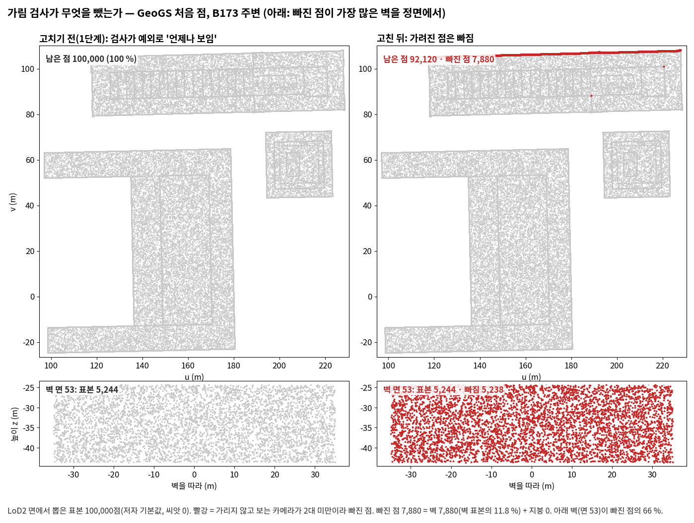

<!-- PHD-MAIN-FIX-v1 준비 보고 -->
# 본 실험 고침과 다시 돌리기 — 준비 보고 v1

- 작업: `PHD-MAIN-FIX-v1` (발주문 v1, 2026-10-12). 준비 10-13 10:09 ~ 11:15(학습 없음), 11:26에 R1·B0 처음 점까지 끝남. `scientific_verdict: null`.
- 브랜치 `exp/main-experiment`, 폴더 `JointBuildGS-exp`. 1단계와 2단계의 공식 판정과 표는 고치지 않았다.
- 설정: `configs/phd/main_fix_v1/fix_v1.json`, **11:15:19 저장, sha256 `9209ce0986b2fe086697ea50190aa60cacda3e2f7d24fe8d5b70e2640dfb6d8d`** (첫 학습 전).
- 표: [tables/](tables/). 페이로드 `JointBuildGS-artifacts/phase-payloads/phd/main_fix_v1/PHD-MAIN-FIX-v1/`.

## 1. 답 먼저

1. **멈춤은 없다.** 11:15에 고친 GeoGS 학습을 시작했다. 결정을 기다리지 않았다(4.4).
2. **r14는 r13과 같은 결정을 내린다.** 학습 전 계산 일곱 단위와 고정 체크포인트 한 반복 여섯 곳에서, 배열과 값이 모두 같다. 시야마다의 손실 값도 같다. r13의 시험 8개를 r14에 돌려 모두 통과했다.
   - 메모리(1,000회 학습, 500회의 PyTorch 할당 최대): R1 LoD2 12.64 → 7.93 GiB(−4.71), B173 주변 LoD2 8.12 → 5.26 GiB(−2.87).
   - 속도: 이 짧은 학습에서는 r14가 28~31 % 느리다. 반복마다 8.6~9.3 ms가 더 걸린다. 긴 학습에서 이 몫이 얼마인지는 r14 학습 넷의 실제 시간으로 보고한다.
   - **발주의 전제와 코드가 다른 곳:** 이 포크는 학습 영상을 처음부터 CPU에 둔다(`scene/cameras.py:39`). 그리고 반복마다 그 영상만 GPU로 옮긴다(`train.py:841`). 그래서 영상 몫(발주의 어림 R1 3.5 GB)은 이미 GPU 밖에 있었다. 줄어든 몫은 판정 지도뿐이다. R1 LoD2에서는 5.26 GiB, B173 주변 LoD2에서는 3.20 GiB를 CPU 고정 메모리로 옮겼다.
3. **GeoGS 가림 검사는 세 겹으로 막혀 있었고, 이를 고쳤다.**
   - 공식 코드가 `trimesh.Scene`에 없는 `.ray`를 불러 호출마다 예외가 났다. 그 결과 늘 '언제나 보임'이 되었다.
   - 메시의 광선 검사로 바꿔도 `rtree`가 없어 다시 예외가 난다. 이 모듈은 이미지에도, 저자의 requirements에도 없다.
   - 코드는 '첫 교차'를 쓰려고 하지만, 기본값(모든 교차)에서는 순서가 거리 순이 아니다.
   - 두 줄을 고치고 rtree를 더했다. 네 지역 모두 앞쪽 300점에서 저자 함수와 결과가 한 원소까지 같다.
   - 처음 점: B173 주변 100,000 → **92,120**, B173만 100,000 → **75,214**, B0 100,000 → **99,881**, R1 100,000 → **99,314**.
   - B173 주변에서 빠진 7,880점은 모두 벽이다. 그 66 %가 '못 본 벽' 면 53에 있고, 그 벽 표본의 99.9 %가 빠졌다.
   - 빠진 몫은 B0 0.1 %, R1 0.7 %, B173 주변 7.9 %, B173만 24.8 %다. 빠진 점은 거의 모두 벽이다(지붕은 B173만 10점뿐). 모든 카메라에서 가려진 벽이 많은 곳일수록 많이 빠졌다.
4. **B173 주변 DA3 묶음의 축척을 저자의 맞춤 방식으로 다시 맞췄다.**
   - 묶음 19: 영상 8장의 카메라 위치가 0.09 m 안에 몰렸다(제자리 촬영). 위치만으로 정하는 Sim(3) 축척이 정해지지 않았다(맞춤 잔차 0.558, 다른 묶음 ≤ 0.056).
   - 묶음 10: 위치 맞춤은 됐다(0.013). 그러나 DA3 깊이가 다른 비행의 경사 영상 4장에서만 1.45배였다.
   - 고침: 미리 정한 규칙의 첫 후보인 12장 묶음이다. 공식 맞춤의 RANSAC이 켜진다. B173 주변 묶음 축척은 0.130~1.213에서 0.975~1.074로 바뀌었다. 0.9~1.1 밖 영상은 12 → 2장이다.
   - 다른 세 지역은 1단계 깊이를 그대로 쓴다. 문제 묶음이 없고, 같은 규칙을 쓰면 B0 묶음 하나가 1.26으로 어긋난다.
5. **같은 문제는 다른 학습에 없다.** 본 방법, 영상만, 사전 정보 신뢰(항공 LiDAR)는 DA3 깊이를 쓰지 않는다(`--da_depth_path /p/fork_none`, `--lambda_da_depth 0.0`). 처음 점도 GeoGS의 가림 검사를 거치지 않는다.
6. **'da'는 판정 모듈의 MVS 깊이 항이다.** 가중을 곱하기 전 값의 지수 평균이며, 절단이 없다(`train.py:875`, `:1050`, `:1058`). GeoGS 자체의 DA3 깊이 항은 셈에서 빠진다.
   - 마스크 끄기의 'da'가 처음부터 큰 것은 입력 탓이다. 같은 좋은 면에 대고 재도 이 항이 기본 입력의 15~28배(시야별 중앙)이고, 위쪽 10 % 시야는 1,300~13,000배다. 항의 98.5 %가 기본 신뢰도 0이던 화소의 터무니없는 광도 깊이(최대 약 10¹⁰ m)에서 나온다. → '흔들린 결과를 보여 준 값'이 아니다(확인).
   - 이 항이 학습을 흔들었는지는 가능, 근거 불완전이다. 항은 그 화소들을 가중 그대로 당긴다. 가우시안이 견줌보다 빨리 늘기 시작한 2,900·3,700회 전에 이미 컸다. 그러나 늘어난 가우시안의 자리는 기록이 없어 잇지 못한다.

## 2. 4.1 메모리만 바꾼 판 r14

**바뀐 것** (`scripts/phd/main_fix_v1/build_fork_r14.py`, [provenance/build_report_r14.json](provenance/build_report_r14.json)): r13에서 두 파일만 바뀌었다. `scene/gaussian_model.py`와 공용 모듈 v6은 r13과 같다.

| 파일 | 바뀐 곳 |
|---|---|
| `jbgs_judgment.py` | `HostMaps`(지도를 CPU 고정 메모리에 두고, 읽을 때마다 GPU 사본을 돌려줌). A·M·P·TAU를 이 꼴로 담고, g_p(GW)도 계산한 뒤 CPU에 둠. `_g_init`은 위치·표지 지도를 영상 하나씩 GPU로 옮김(r13은 모든 영상을 한꺼번에 GPU에 올림). 기록용 `--jbgs_memlog_*`(기본 꺼짐). 판 이름 r14 |
| `train.py` | 두 줄: 렌더 직후 기록 함수 호출(기본 꺼짐, 읽기만) |

- 지도를 읽는 모든 곳은 인덱싱과 비교만 하고 지도에 쓰지 않는다(코드 확인). 그래서 GPU 사본을 건네도 계산과 차례가 r13과 같다.
- 다시 읽기 렌더(학습 영상 전부의 깊이·불투명도)는 그대로 GPU에 둔다.
- 학습 영상: 위 1절 2번. r14 학습에는 발주대로 `--data_device cpu`를 넘기지만, 영상에는 아무 일도 하지 않는다(이 포크에서 이 인자가 닿는 곳은 쓰지 않는 알파 마스크뿐).

**시험**: `tests/phd/test_fork_r14_memory.py` 11개(r13의 8개를 r14에 + HostMaps 3개) 통과. r13 시험 8개도 따로 돌려 통과.

**학습 전 계산과 고정 체크포인트의 한 반복** (r13 = 2단계 점검, B173만은 이 작업)

| 단위 | r13 | r14 | 견준 배열 | 다른 것 |
|---|---|---|---|---|
| B0 · LoD2 | 2단계 점검 | 이 작업 | 배열 1014개, 보고 항목 3300개 | 없음 |
| B173 주변 · LoD2 | 2단계 점검 | 이 작업 | 배열 854개, 보고 항목 2780개 | 없음 |
| B173 주변 · 항공 LiDAR | 2단계 점검 | 이 작업 | 배열 854개, 보고 항목 2780개 | 없음 |
| R1 · LoD2 | 2단계 점검 | 이 작업 | 배열 1374개, 보고 항목 4470개 | 없음 |
| R1 · 항공 LiDAR | 2단계 점검 | 이 작업 | 배열 1374개, 보고 항목 4470개 | 없음 |
| B0 저자 15장 · LoD2 | 2단계 점검 | 이 작업 | 배열 94개, 보고 항목 310개 | 없음 |
| B173만 · LoD2 | 이 작업 | 이 작업 | 배열 602개, 보고 항목 1961개 | 없음 |

- 모두 같음: 예

| 체크포인트 | 견준 배열 | 손실 값 (MVS 항 합 · 사전 정보 항 합, r13 = r14) | 다른 것 |
|---|---|---|---|
| B0 · LoD2 · 씨앗 0 | 255개 | 222.145172 · 7.281681 | 없음 |
| B173 주변 · LoD2 · 씨앗 0 | 215개 | 140.536752 · 1.841410 | 없음 |
| B173 주변 · 항공 LiDAR · 씨앗 0 | 215개 | 127.432901 · 2.520217 | 없음 |
| R1 · LoD2 · 씨앗 0 | 345개 | 325.074529 · 4.775235 | 없음 |
| R1 · 항공 LiDAR · 씨앗 0 | 345개 | 342.996616 · 3.295013 | 없음 |
| B173만 · LoD2 · 씨앗 1 | 152개 | 93.880014 · 0.392085 | 없음 |

- 모두 같음: 예

**메모리와 속도** (R1 LoD2, B173 주변 LoD2, 1,000회. 결과로 읽지 않음)

| 단위 | 판 | PyTorch 할당 최대 500회 (GiB) | nvidia-smi 최대 (GiB) | 100회당 초 (두 번) | 평균 | GPU 밖에 둔 지도 (GiB) |
|---|---|---|---|---|---|---|
| R1 · LoD2 | r13 | 12.64 | 13.03 | 3.10 · 3.04 | 3.07 | 0.00 |
| R1 · LoD2 | r14 | 7.93 | 8.34 | 3.71 · 4.15 | 3.93 | 5.26 |
| R1 · LoD2 | r14 − r13 | -4.71 | -4.69 | | +28 % (8.6 ms/회) | |
| B173 주변 · LoD2 | r13 | 8.12 | 8.61 | 3.02 · 3.01 | 3.02 | 0.00 |
| B173 주변 · LoD2 | r14 | 5.26 | 5.73 | 3.81 · 4.09 | 3.95 | 3.20 |
| B173 주변 · LoD2 | r14 − r13 | -2.87 | -2.88 | | +31 % (9.3 ms/회) | |

- 차례 r13 → r14 → r14 → r13, 단위마다 GPU 하나(R1 GPU 0, B173 주변 GPU 1). 속도 = 학습 반복 100~1,000회(다시 읽기 500·1,000회 포함).

- 첫 측정(10:35~10:42)에서는 속도가 +52 %·+106 %로 나왔다. 그때는 처음 점 생성 4건이 호스트에서 함께 돌았고, r13과 r14가 서로 다른 GPU에 있었다. 그래서 같은 GPU에서 r13 → r14 → r14 → r13 차례로 다시 쟀다. 첫 측정은 기록으로만 둔다.
- 호스트 메모리: 전체 125 GB 가운데 다른 서비스가 약 58 GB를 쓴다. r14 학습 하나가 고정 메모리로 옮기는 지도는 R1 5.3 GiB, B173 주변 3.2 GiB, B173만 2.2 GiB다. 학습 둘을 함께 돌려도 남은 65 GB 안에 든다.

## 3. 4.2 GeoGS 고치기

### 3.1 가림 검사 (처음 점)

- 자리: 공식 `data/generate_pcd.py`의 `is_point_visible_from_camera`다. 1단계는 이 스크립트를 저자 기본값(표본 100,000, 관측 2~15, 씨앗 0)으로 돌렸다.
- 예외의 까닭과 고침:

| 겹 | 까닭 | 고침 |
|---|---|---|
| 1 | `create_trimesh_scene`이 `trimesh.Scene`을 돌려주는데, Scene에는 `.ray`가 없다. 호출마다 AttributeError → '언제나 보임' | 메시(`trimesh.Trimesh`)를 돌려줌(한 줄) |
| 2 | 메시의 광선 검사(`ray_triangle`)는 `rtree`가 있어야 한다. 이미지에도, 저자의 requirements에도 없다 | 전처리 이미지에 rtree 1.3.0만 더함(`jointbuildgs:geogs-official-db40c95-rtree-v1`) |
| 3 | 코드는 '첫 교차'까지의 거리를 재려 한다(주석). 그러나 기본값(모든 교차)에서는 `locations[0]`이 거리 순이 아니다. 상자 시험에서는 먼 쪽 면을 돌려주었다 | `multiple_hits=False`(한 줄) |

- 고친 원본: `GeoGS-official-adapters-v1-fix1` = 1단계의 `GeoGS-official-adapters-v1` + 위 두 줄. 바뀐 파일은 `data/generate_pcd.py` 하나다([provenance/source_manifest_fix1.json](provenance/source_manifest_fix1.json)).
- 돌리는 방법: 저자 함수로 투영과 관측 목록을 그대로 만들고, 광선만 카메라마다 한 번에 던졌다. 판단은 같은 광선, 같은 첫 교차, 같은 5 cm다.
  - 네 지역 모두 앞쪽 300점에서 저자 함수(광선 하나씩)와 결과가 한 원소까지 같다.
  - 표본 10만 점은 네 지역 모두 1단계와 같다(씨앗 0).
  - 투영된 (점, 카메라) 쌍의 수는 1단계의 경고 수와 같다.

**처음 점(GeoGS `--lod_init`)**

| 지역 | 표본 (1단계와 같음) | 1단계 남은 점 | 고친 뒤 남은 점 | 빠진 점 (벽 · 지붕) | 벽 표본 중 빠짐 | 지붕 표본 중 빠짐 | 투영된 (점, 카메라) 쌍 = 1단계 경고 수 | 가려진 쌍 | 300점 점검 |
|---|---|---|---|---|---|---|---|---|---|
| B0 | 100,000 (같음) | 100,000 | 99,881 | 119 (119 · 0) | 0.2 % | 0.0 % | 12,563,932 (1단계 12,563,932) | 7,546,098 (60 %) | 같음 (300점) |
| B173 주변 | 100,000 (같음) | 100,000 | 92,120 | 7,880 (7,880 · 0) | 11.8 % | 0.0 % | 7,549,221 (1단계 —) | 4,120,835 (55 %) | 같음 (300점) |
| B173만 | 100,000 (같음) | 100,000 | 75,214 | 24,786 (24,776 · 10) | 35.6 % | 0.0 % | 6,739,647 (1단계 6,739,647) | 4,434,163 (66 %) | 같음 (300점) |
| R1 | 100,000 (같음) | 100,000 | 99,314 | 686 (686 · 0) | 1.0 % | 0.0 % | 15,494,388 (1단계 15,494,388) | 8,185,150 (53 %) | 같음 (300점) |

- 그림: 위는 발주의 '위에서 본 지도'다. 위에서 보면 벽이 선으로 겹치므로, 아래 줄에 빠진 점이 가장 많은 벽(면 53)을 정면에서 키워 보였다(그림 규칙 10). 면 53은 2단계 보호 끄기 그림의 '못 본 벽'이다. 그 벽을 가리지 않고 보는 카메라가 2대 미만이라 처음 점이 빠졌다.

### 3.2 DA3 깊이 묶음의 축척

- 1단계의 묶음(학습 영상을 이름 차례로 8장씩)을 그대로 다시 추론했다. 깊이는 네 지역 모두 1단계와 같다.
- 공식 맞춤(`align_poses_umeyama`)을 감싸, 묶음마다 DA3가 추정한 카메라 자세와 축척, 맞춤 잔차를 기록했다.
- 공식 맞춤은 입력 자세를 DA3가 추정한 자세에 Sim(3)로 맞추고, 깊이를 그 축척으로 나눈다. RANSAC은 10장부터 켜진다.

| 묶음(1단계) | 카메라 위치 퍼짐 | 맞춤 잔차(상대) | DA3 ÷ MVS | 까닭 |
|---|---|---|---|---|
| 19 | 0.09 m(특이값 0.3 · 0.1 · 0.0 m) | 0.558 | 0.13 | 제자리 촬영. 위치로 정하는 축척이 정해지지 않음 |
| 10 | 91.6 m | 0.013 | 0.99(4장) · 1.45(4장) | 위치 맞춤은 됨. 다른 비행의 경사 영상 4장에서 DA3 깊이 자체가 1.45배 |
| 나머지(B173 주변 24, 다른 세 지역 91) | 1.9 m 이상 | ≤ 0.056 | 0.965~1.018(B173 주변 0.99 언저리) | — |

- 고침 규칙(결과를 보기 전에 정함, progress.md 10:46):
  1. 후보를 차례로 시험한다. 첫째는 12장 묶음(이름 차례), 둘째는 건너뛰며 12장이다.
  2. B173 주변의 모든 묶음이 MVS 대비 0.9~1.1 안이면 받아들인다.
  3. B173 주변만 새 깊이로 바꾼다.
  4. 다른 세 지역은 진단으로만 돌린다.
- 결과: 첫째 후보가 조건을 맞췄다. 둘째(건너뛰며)는 묶음 중앙은 0.985~1.014였지만, 묶음 안에서 영상 22장이 2.4~3.3배로 흩어졌다(기록만).

**DA3 깊이 묶음 (DA3 ÷ MVS 축척, 묶음은 그 영상들의 중앙값)**

| 지역 | 규칙 | 묶음 (영상) | 묶음 축척 최소 / 중앙 / 최대 | 0.9~1.1 밖 묶음 | 0.9~1.1 밖 영상 | 맞춤 잔차: 묶음 중앙값의 최대 · 모든 영상의 최대 (상대) | RANSAC | 고친 GeoGS가 쓰는 깊이 |
|---|---|---|---|---|---|---|---|---|
| B0 | 1단계(8장씩) | 31 (243) | 0.968 / 0.987 / 1.003 | 없음 | 3 | 0.018 · 0.053 | 꺼짐 | 씀 |
| B0 | 12장씩 | 21 (243) | 0.977 / 0.990 / 1.260 | 5 | 11 | 0.029 · 0.638 | 켬 | — |
| B173 주변 | 1단계(8장씩) | 26 (203) | 0.130 / 0.990 / 1.213 | 10, 19 | 12 | 0.236 · 0.558 | 꺼짐 | — |
| B173 주변 | 12장씩 | 17 (203) | 0.975 / 0.993 / 1.074 | 없음 | 2 | 0.053 · 1.547 | 켬 | 씀 |
| B173만 | 1단계(8장씩) | 18 (140) | 0.965 / 0.985 / 1.012 | 없음 | 0 | 0.024 · 0.035 | 꺼짐 | 씀 |
| B173만 | 12장씩 | 12 (140) | 0.946 / 0.987 / 0.999 | 없음 | 4 | 0.016 · 0.357 | 켬 | — |
| R1 | 1단계(8장씩) | 42 (333) | 0.972 / 0.991 / 1.018 | 없음 | 0 | 0.031 · 0.056 | 꺼짐 | 씀 |
| R1 | 12장씩 | 28 (333) | 0.970 / 0.992 / 1.012 | 없음 | 2 | 0.011 · 0.953 | 켬 | — |

- 맞춤 잔차 = 공식 맞춤(Sim(3)) 뒤 영상마다 카메라 중심이 어긋난 거리 ÷ 예측 퍼짐. RANSAC이 켜지면 맞춤에서 빠진 영상의 잔차는 그대로 커서, 모든 영상의 최대는 RANSAC이 꺼진 1단계와 바로 견줄 수 없다. 묶음 중앙값의 최대가 맞춤 자체의 크기다.

- 남은 것: 12장 묶음 7(옛 묶음 10의 경사 영상이 든 곳)이 1.074, 영상 2장이 1.18이다. 1단계의 다른 세 지역(0.965~1.018)보다는 거칠다.
- 같은 규칙을 B0에 돌리면 묶음 5가 1.26으로 어긋난다. 묶음을 어떻게 짜느냐에 축척이 민감하다는 뜻이다. 다른 세 지역은 1단계 깊이를 그대로 둔다(규칙 3).

### 3.3 같은 문제가 다른 학습에 있는지 (코드)

| 학습 | 처음 점 | DA3 깊이 |
|---|---|---|
| 본 방법, 영상만, 사전 정보 신뢰(항공 LiDAR) (포크 r12·r13·r14) | 0단계가 만든 `scene_<prior>/sparse/0`와 판정 모듈의 심기. 포크 안의 `data/generate_pcd.py`는 아무도 부르지 않음. 학습 본체와 판정 모듈은 trimesh를 쓰지 않음 | 쓰지 않음: `--da_depth_path /p/fork_none`, `--lambda_da_depth 0.0`. 깊이 집합은 비어 있음(NullController) |

→ 같은 문제는 없다. 멈추지 않았다.

### 3.4 고친 GeoGS의 이름과 학습 전 확인

- 이름: **고친 GeoGS(fix1)** = `GeoGS-official-adapters-v1-fix1`. B173 주변은 DA3 12장 묶음, 다른 세 지역은 1단계 DA3다. 결과 이름은 `trust_LoD2_fix1`이다. 학습 명령과 이미지는 1단계와 같다(저자 플래그 `--lod_init --freeze_onlybldg --protect_bldg --dynamic_depth_weight`, 30,000회).
- 장면: 1단계 장면에서 `sparse_lod/0`(처음 점)과, B173 주변의 `da3_prior`만 바꿨다. 나머지는 하드 링크다.
- 학습 전 확인: 공식 리더가 새 장면에서 읽는 처음 점과 DA3 깊이 지도를 1단계와 견줬다(`geogs_preload.py`).

| 지역 | 공식 리더가 읽는 처음 점: 1단계 → 고친 장면 | 고친 점이 모두 1단계 표본 가운데 있음 | DA3 깊이 지도가 바뀐 학습 영상 | 바뀐 지도의 새 ÷ 옛 (중앙, 최소~최대) |
|---|---|---|---|---|
| B0 | 100,000 → 99,881 | 예 | 0 / 243 | — |
| B173 주변 | 100,000 → 92,120 | 예 | 203 / 203 | 1.004 (0.754~7.77) |
| B173만 | 100,000 → 75,214 | 예 | 0 / 140 | — |
| R1 | 100,000 → 99,314 | 예 | 0 / 333 | — |

## 4. 4.3 마스크 끄기 마감 확인 ('da')

**코드** (2단계 학습 본체 = 포크 r13 `train.py`, 판정 모듈 `jbgs_judgment.py`)

| 줄 | 코드 | 뜻 |
|---|---|---|
| `train.py:733` | `da_depth_maps = mvs_pgsr_control.load_mvs_depth_set(...)` | MVS-PGSR 환경 변수가 없으면 NullController가 빈 집합을 돌려줌 |
| `train.py:848` · `:292` | `da_depth_loss = compute_depth_loss(surf_depth, da_depth, ...)` / `if gt_depth is None: return torch.tensor(0.0)` | GeoGS 자체의 DA3 깊이 항: 깊이가 없어 0. `--lambda_da_depth 0.0`은 이 분기에서 쓰이지 않음 |
| `train.py:872`~`:875` | `mvs_term, prior_term, _ = judgment.losses(...)`, `total_loss = ... + judgment.lambda_mvs * mvs_term + ...`, `da_depth_loss = mvs_term` | 판정 모듈의 MVS 항으로 덮어씀. 가중 0.05는 손실에서만 곱함 |
| `train.py:1050`, `:1058` | `ema_da_loss = 0.4 * da_depth_loss.item() + 0.6 * ema_da_loss`, `"da": f"{ema_da_loss:.5f}"` | 'da' = 가중을 곱하기 **전** MVS 항의 지수 평균 |
| `jbgs_judgment.py:636`, `:1262`, `:342`~`:354` | 마스크 끄기 = `("conf_photometric", "mvs_photometric")`, `weighted_l1(D, M, A, 화소 수)` = Σ A·\|D − M\| / 화소 수 | 마스크를 끄면 광도 깊이와 그 신뢰도를 읽음. L1이고 절단이 없음 |

**숫자** ([tables/da_check.md](tables/da_check.md))

| 단위 | 좋은 면에 대고 잰 MVS 항: 기본 / 마스크 끄기 (시야별 중앙) | 비: 중앙 (10~90 %) | 항의 몫: 잔차 1 m 넘는 화소 / 기본 신뢰도 0이던 화소 | 그 화소의 몫 | 잔차 최대 |
|---|---|---|---|---|---|
| B173 주변 LoD2 | 0.273 / 7.350 | 27.7배 (6.3~1,299배) | 98.5 % / 84.8 % | 화소의 20.5 % / 20.3 % | 4.9e+10 m |
| R1 항공 LiDAR | 0.359 / 6.508 | 15.5배 (4.2~12,952배) | 98.5 % / 83.5 % | 화소의 18.6 % / 14.5 % | 2.0e+10 m |

- 좋은 면 = 1단계 본 방법 씨앗 0의 30,000회 렌더 깊이(B173 주변은 0단계 b1). 시야 = 학습 영상 전부. 비 = 마스크 끄기 항 ÷ 기본 항.
- 학습 중 기록(100회마다, 그 반복의 시야 하나)의 비는 시야마다 크게 흔들려, 중앙값은 1~1,000회에 1.0·1.4배다. 'da'는 지수 평균이라 엉뚱한 깊이가 많은 시야가 올 때마다 크게 뛰고, 그 값이 한동안 남는다.

**결론**

- 'da'는 학습을 흔든 항 그 자체(마스크를 끈 MVS 항)의 값이다. 그 값이 처음부터 큰 것은 입력의 크기다. 좋은 면에 대고 재도 15~28배다. 그래서 '흔들린 결과를 보여 준 값'이 아니다(확인).
- 그 항이 학습을 흔들었는지는 가능, 근거 불완전이다.
  - 이 항은 절단 없는 L1이다. 마스크가 빼던 화소(B173 주변 20 %, R1 15 %)의 엉뚱한 깊이 쪽으로 렌더 깊이를 가중 그대로 당긴다.
  - 가우시안은 2,900·3,700회부터 견줌보다 빨리 늘었다(2단계 표 2.3).
  - 그러나 늘어난 가우시안이 그 화소 쪽에 생겼는지는 15,000회 전에 멈춰 기록이 없어 잇지 못한다.
- 마스크 끄기 두 학습은 발주대로 다시 돌리지 않는다. 답은 학습 전 판정의 답(2단계 보고서 4.1)으로 마감한다.

## 5. 발주와 다른 점, 해석한 곳

| 곳 | 한 것 | 까닭 |
|---|---|---|
| 4.1 영상 자리 | r14 학습에 `--data_device cpu`를 넘김. 효과는 없음 | 이 포크는 영상을 처음부터 CPU에 둔다(1절 2번) |
| 4.1 판정 지도 | 다섯 장(A·M·P·TAU·GW)에 더해, g_p를 셀 때 잠깐 올리던 위치·표지 지도(LM·MK·MC)도 영상 하나씩 옮김 | 같은 '판정 지도'이고, r13에서는 모든 영상을 한꺼번에 올리는 순간 최대를 만든다 |
| 4.1 손실 값 | 2단계의 체크포인트 점검에 시야마다의 두 손실 값을 더한 판(`probe_ckpt_fix.py`)으로 r13과 r14를 모두 다시 잼 | 2단계 점검은 손실 값을 남기지 않았다 |
| 4.1 속도 | 같은 GPU에서 r13 → r14 → r14 → r13으로 다시 잼 | 첫 측정은 다른 작업과 겹쳤다 |
| 4.2 가림 검사 | 첫 교차(`multiple_hits=False`)도 고침에 넣음. 광선을 카메라마다 한 번에 던짐(판단은 같음, 300점 확인) | 주석의 뜻(첫 교차). 광선 수가 지역마다 670만~1,550만 |
| 4.2 rtree | 전처리 이미지에 rtree만 더함 | 없으면 고친 검사도 예외로 떨어진다 |
| 4.2 DA3 | 규칙을 결과 전에 정함. B173 주변만 바꿈 | 2절의 '처음 점의 가림 검사와 B173 주변 깊이 묶음의 축척' |
| 5.2 차례 | B173 주변과 B173만을 먼저 시작함. R1·B0은 처음 점이 나오는 대로 받음 | R1·B0의 처음 점 생성이 늦게 끝남(광선 1,260만·1,550만). 대기열은 5.2 차례에서 준비된 첫 학습을 받는다 |
| 4.4 | 준비 보고를 쓰는 동안 학습을 시작함 | 멈춤이 없어 기다릴 결정이 없다 |

## 6. 걸린 시간과 자원

| 단계 | 시각 |
|---|---|
| 코드 읽기, r14 짓기·시험 | 10:09 ~ 10:13 |
| r14 학습 전 계산 8회, 체크포인트 12회, 메모리 4회 | 10:13 ~ 10:42 |
| 처음 점 생성 4곳(CPU, 한 코어씩) | 10:16 ~ 11:26 (B173만 48분, B173 주변 49분, B0 62분, R1 68분) |
| 'da' 셈 | 10:20 ~ 10:24 |
| DA3 진단 4곳, 후보 2개, 기록용 3곳 | 10:43 ~ 11:02 |
| 속도 다시 재기(ABBA 8회) | 11:02 ~ 11:14 |
| 설정 저장, 학습 시작 | 11:15 |

- GPU: RTX 3090 24 GiB 두 장. 호스트 125 GB(다른 서비스 약 58 GB).
