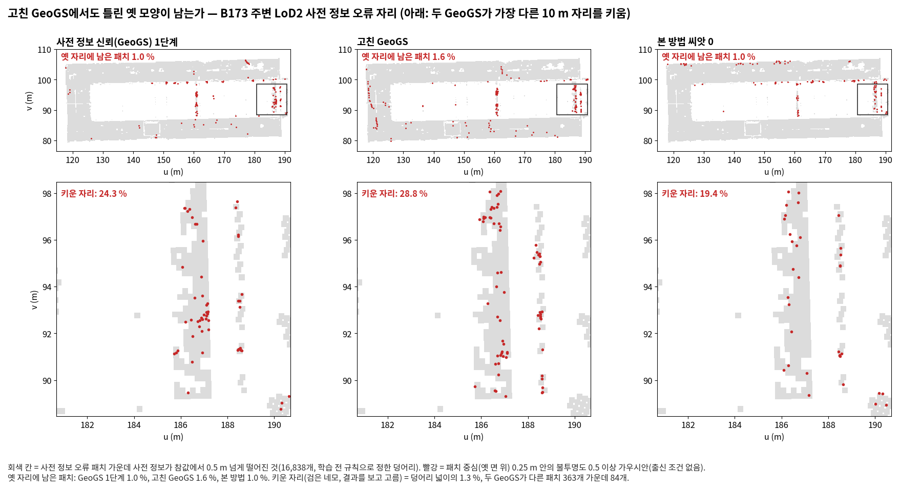

<!-- PHD-MAIN-FIX-v1 중간 보고 -->
# 본 실험 고침과 다시 돌리기 — 중간 보고 v1 (고친 GeoGS 네 번)

- 작업: `PHD-MAIN-FIX-v1` (발주문 v1, 2026-10-12). 차례 1·2(고친 GeoGS 네 번): 10-13 11:15 ~ 14:51. `scientific_verdict: null`.
- 설정: `configs/phd/main_fix_v1/fix_v1.json` (11:15:19 저장, sha256 `9209ce0986b2fe086697ea50190aa60cacda3e2f7d24fe8d5b70e2640dfb6d8d`). 학습 뒤 바꾸지 않았다.
- 1단계와 2단계의 공식 판정과 표는 고치지 않았다. 다시 낸 판정은 공식 판정 옆에 '다시 잼(고친 GeoGS)'으로 둔다.
- 표: [tables/](tables/) (`fix_geogs_compact`, `fix_geogs`, `fix_touch`, `fix_pooled`, `fix_past_any`, `fix_runs`). 그림: [figures/](figures/).
- 2묶음(r14 학습 넷)은 14:56에 시작했다. 다시 낸 판정에 미충족이 없고, 여쭐 것(R1 후처리, 7절)은 2묶음과 무관하다.

## 1. 답 먼저

1. **관문 조건 1 '다시 잼(고친 GeoGS)': 미충족 없음, 판정이 바뀐 칸 없음. R1은 값이 아직 없다.**
   - B0 LoD2: 본 방법 11.98 % 대 고친 GeoGS 42.83 %(1단계 GeoGS 43.56 %) → **충족**. 공식 판정과 고친 자 판정도 충족이다.
   - B173 주변 LoD2: 6.81 % 대 8.67 %(1단계 10.17 %) → **충족**. 차이 1.86 %p가 흔들림 폭 1.64 %p를 0.22 %p 넘는다. 공식 판정은 판별 불가, 고친 자 판정은 충족이다.
   - R1 LoD2: 학습은 PASS다. 그러나 후처리가 호스트 메모리 부족으로 강제 종료되어 값이 없다. 다시 돌릴지 여쭌다(7절).
2. **GeoGS의 두 문제는 고쳐졌다(확인).** 처음 점의 수와 묶음별 축척의 증거는 준비 보고 3절에 있다. 학습 결과는 두 고침이 닿은 곳에서만 크게 바뀌었다.
   - B173 주변(두 고침이 모두 조건 1 영역에 닿음): 바뀐 값은 아래와 같다.
     - 완만한 지붕 편향(새 읽기): +69.4 → +33.0 cm
     - 뜬 조각 몫: 14.4 → 5.3 %
     - 고운 자의 사전 정보 오류 거리: 38.2 → 13.7 cm
     - 조건 1: 10.17 → 8.67 %
   - B0(빠진 처음 점이 조건 1 영역에 없음, DA3 깊이 그대로): 조건 1이 43.56 → 42.83 %로 거의 같다.
3. **고친 GeoGS에도 남은 것: 가능, 근거 불완전.** B173 주변의 완만한 지붕 편향 +33 cm(새 읽기)는 본 방법(+7 cm)의 다섯 배쯤이다.
   - 이 편향은 남쪽 긴 지붕 줄의 가운데에 몰려 있다(그림 2).
   - 같은 건물만 둔 B173만의 고친 GeoGS는 +3.5 cm다(1단계 +3.9 cm).
   - 까닭은 가리지 않았다. 남은 축척 어긋남(12장 묶음 7이 1.074, 영상 2장이 1.18)이 한 후보다(8절 제안 2).
4. **B173만 고친 GeoGS(보고만 하는 지역).**
   - 조건 1의 값: 20.8 %(1단계 19.5 %).
   - 완만한 지붕 편향 / 산포(새 읽기): 3.5 / 6.8 cm(1단계 3.9 / 6.0 cm).
   - 처음 점의 24.8 %(벽 표본의 35.6 %)가 빠졌고, DA3 깊이는 그대로다.
5. **여쭐 것 하나:** R1 고친 GeoGS의 후처리를 다시 돌릴지다(7절). 그 밖에는 결정할 것이 없어 2묶음을 이어 간다.

## 2. 돈 학습

| 지역 | 시각 | 학습 | GPU 최대 (nvidia-smi) | 끝 가우시안 | 후처리: GPU post · run · 지표 · 고운 자 (분) | 후처리 호스트 최대 | 1단계 GeoGS: 시간 · GPU 최대 · 끝 가우시안 · 후처리 호스트 최대 |
|---|---|---|---|---|---|---|---|
| B173 주변 | 11:15 ~ 12:26 | 71분, PASS | 17.8 GiB | 3,357,256 | 6.5 · 3.4 · 4.8 · 0.7 | 46.2 GB | 64분 · 11.0 GiB · 3,123,780 · 55.3 GB |
| R1 | 12:36 ~ 13:28 | 53분, PASS | 10.8 GiB | 2,971,426 | post 18.5분 뒤 강제 종료 | 64 GB 넘음(종료 때) | 56분 · 15.9 GiB · 3,298,875 · 59.7 GB |
| B0 | 13:47 ~ 14:41 | 54분, PASS | 9.2 GiB | 3,158,181 | 6.8 · 0.5 · 2.2 · 0.7 | 45.0 GB | 53분 · 10.4 GiB · 3,103,837 · 44.9 GB |
| B173만 | 11:16 ~ 14:32 | 196분, PASS | 21.2 GiB | 7,077,204 | 3.9 · 2.3 · 6.3 · 0.4 | 23.3 GB | 139분 · 16.4 GiB · 5,075,558 · 23.0 GB |

- 코드: 고친 GeoGS(fix1) = `GeoGS-official-adapters-v1-fix1`. 공식 `train.py`이고, 이미지와 저자 플래그는 1단계와 같다. 장면은 `geogs/<지역>/scene_fix1`이다(준비 보고 3.4).
- 네 학습 모두 로그에 NaN이나 오류 줄이 없다. 가우시안은 1단계처럼 15,000회까지 늘다가 멈췄다.
- B173만은 끝 가우시안이 1단계보다 39 % 많아 GPU를 더 썼다(21.2 GiB, 여유 약 2.8 GiB). 시간도 1단계보다 57분 더 걸렸다. 같은 때 GPU 0의 후처리와 지표가 호스트 CPU를 나눠 썼다.
- 지표와 고운 자는 1·2단계와 같은 스크립트다(`metrics_s2`, `measure_s2`). GeoGS의 가우시안은 1단계 지표처럼 PLY에서 읽었다(8절 실행 중 바꾼 것).

## 3. 관문 조건 1 '다시 잼(고친 GeoGS)'

| 단위 | 본 방법 (1단계 두 씨앗 평균) | GeoGS 1단계 | 고친 GeoGS | 표본 | 공식 r · 판정 | 고친 자 r · 판정 | 다시 잼(고친 GeoGS) r · 판정 |
|---|---|---|---|---|---|---|---|
| B0 · LoD2 | 11.98 % | 43.56 % | 42.83 % | 32,880 | 8.22 %p · 충족 | 1.64 %p · 충족 | 1.64 %p · **충족** |
| B173 주변 · LoD2 | 6.81 % | 10.17 % | 8.67 % | 119,763 | 8.22 %p · 판별 불가 | 1.64 %p · 충족 | 1.64 %p · **충족** |
| R1 · LoD2 | 7.63 % | 36.96 % | — | 54,345 | 8.22 %p · 충족 | 1.64 %p · 충족 | **값 없음**(후처리 멈춤, 7절) |

- 판정의 말은 관문과 같다. 차이가 흔들림 폭(2단계 준비의 고친 자, 조건 1 = 1.64 %p)을 넘고 본 방법이 작으면 충족이다. 흔들림 폭 안이면 판별 불가, 넘고 본 방법이 크면 미충족이다. 표본 1만 점 미만이면 판별 불가다.
- 본 방법 쪽은 1단계 두 씨앗의 평균 그대로다. 다시 돌리지 않았다. 고친 GeoGS의 표본 수는 1단계와 같다(영역으로 정해지는 수).
- **바뀐 칸이 없어 6.1-3의 까닭 풀이는 없다.** 다만 두 고침이 조건 1 영역에 얼마나 닿았는지는 미리 셌다(결과를 보기 전, `touch_fix.py`).

| 단위 | 조건 1 영역 패치 (넓이) | 가림 검사로 빠진 처음 점: 영역 0.5 m 안 / 전체 | 빠진 점이 닿은 영역 패치 | DA3 깊이가 10 % 넘게 바뀐 학습 영상 | 그 영상의 화면 안에 든 영역 패치 |
|---|---|---|---|---|---|
| B0 · LoD2 | 6,421 (401 m²) | 0 / 119 | 0 % | 0 / 243 | —(깊이 그대로) |
| B173 주변 · LoD2 | 21,741 (1,359 m²) | 107 / 7,880 | 1.4 % | 12 / 203 | 100 %; 패치마다 5장(중앙). (패치, 영상) 쌍의 8.5 % |
| R1 · LoD2 | 11,518 (720 m²) | 0 / 686 | 0 % | 0 / 333 | —(깊이 그대로) |

- B0과 R1에서는 두 고침이 조건 1 영역에 닿지 않는다. 그래서 이 두 단위에서 1단계와 고친 GeoGS의 차이는 고침의 몫이라기보다 GeoGS 학습마다의 차이로 보인다(분석자 판독). B0 조건 1의 차이는 −0.73 %p다.
- B173 주변의 조건 1 변화(−1.50 %p)에는 두 고침이 모두 닿는다. 다만 어느 고침의 몫인지는 이 두 학습만으로는 가르지 못한다.

## 4. 지역마다 숫자 (6.1-1)

전체 표(1단계 결과 표의 모든 줄)는 [tables/fix_geogs.md](tables/fix_geogs.md)다. 아래는 6.1-1이 적으라는 값만 모은 것이다([tables/fix_geogs_compact.md](tables/fix_geogs_compact.md)).

| 지역 | 지표 | 본 방법 0 | 본 방법 1 | GeoGS 1단계 | 고친 GeoGS | 고친 − 1단계 |
|---|---|---|---|---|---|---|
| B173 주변 | 사전 정보 오류 유입률 (%) [조건 1] | 6.54 | 7.08 | 10.17 | 8.67 | −1.50 |
|  | 표본 (점) | 119,763 | 119,763 | 119,763 | 119,763 |  |
|  | 완만한 지붕 편향, 새 읽기 (cm) | 7.05 | 7.14 | 69.37 | 33.02 | −36.35 |
|  | 완만한 지붕 산포, 새 읽기 (cm) | 2.22 | 2.14 | 14.28 | 15.01 | +0.73 |
|  | 완만한 지붕 편향, 지금 읽기 (cm) | 7.09 | 7.18 | 71.38 | 34.15 | −37.23 |
|  | 완만한 지붕 산포, 지금 읽기 (cm) | 2.24 | 2.17 | 17.11 | 15.96 | −1.15 |
|  | 뜬 조각 몫 (%) | 1.24 | 1.37 | 14.35 | 5.31 | −9.04 |
|  | 과거 형상 (%), 출신 조건 없음(보충) | 1.03 | 1.05 | 1.06 | 1.66 | +0.59 |
|  | 결측 일치 완전성 0.2 m (%) | 96.20 | 96.71 | 90.18 | 93.79 | +3.61 |
|  | 고운 자: 문턱 이내 / 지지 일치 / 사전 정보 오류 (cm) | 18.9 / 6.2 / 5.2 | 18.4 / 6.1 / 5.1 | 24.1 / 19.2 / 38.2 | 20.8 / 9.7 / 13.7 | −3.2 / −9.5 / −24.5 |
| B0 | 사전 정보 오류 유입률 (%) [조건 1] | 12.10 | 11.86 | 43.56 | 42.83 | −0.73 |
|  | 표본 (점) | 32,880 | 32,880 | 32,880 | 32,880 |  |
|  | 완만한 지붕 편향 / 산포, 새 읽기 (cm) | 13.7 / 39.9 | −17.6 / 60.9 | −1.7 / 24.6 | 28.3 / 12.3 | +30.0 / −12.4 |
|  | 완만한 지붕 편향 / 산포, 지금 읽기 (cm) | 69.8 / 129.0 | 43.5 / 124.5 | 1,056.7 / 577.6 | 491.5 / 682.1 | −565.2 / +104.5 |
|  | 뜬 조각 몫 (%) | 39.49 | 29.96 | 73.35 | 82.10 | +8.75 |
|  | 과거 형상 (%), 출신 조건 없음(보충) | 14.03 | 15.33 | 10.18 | 10.27 | +0.09 |
|  | 결측 일치 완전성 0.2 m (%) | 94.38 | 92.72 | 40.12 | 29.32 | −10.80 |
|  | 고운 자: 문턱 이내 / 지지 일치 / 사전 정보 오류 (cm) | 16.8 / 4.0 / 6.2 | 13.3 / 4.0 / 6.3 | 40.5 / 18.4 / 21.1 | 33.2 / 19.4 / 22.0 | −7.2 / +1.0 / +1.0 |
| B173만 | 사전 정보 오류 유입률 (%) [조건 1의 값, 관문 없음] | (2묶음) | 5.08 | 19.49 | 20.80 | +1.31 |
|  | 완만한 지붕 편향 / 산포, 새 읽기 (cm) | (2묶음) | 1.9 / 4.6 | 3.9 / 6.0 | 3.5 / 6.8 | −0.4 / +0.8 |
|  | 완만한 지붕 편향 / 산포, 지금 읽기 (cm) | (2묶음) | 2.7 / 5.8 | 6.7 / 9.9 | 6.0 / 9.3 | −0.7 / −0.6 |
|  | 뜬 조각 몫 (%) | (2묶음) | 10.88 | 24.33 | 20.87 | −3.46 |
|  | 과거 형상 (%), 출신 조건 없음(보충) | (2묶음) | 1.13 | 6.23 | 4.46 | −1.78 |
|  | 결측 일치 완전성 0.2 m (%) | (2묶음) | 93.15 | 88.41 | 87.40 | −1.01 |
|  | 고운 자: 문턱 이내 / 지지 일치 / 사전 정보 오류 (cm) | (2묶음) | 22.7 / 5.5 / 4.9 | 15.3 / 9.3 / 87.0 | 17.6 / 8.1 / 82.1 | +2.3 / −1.2 / −4.9 |

- R1은 고친 GeoGS 값이 없어 뺐다(1단계 값은 전체 표에 있다).
- 조건 3의 두 읽기 = 지지 일치 완만한 지붕의 새 읽기와 지금 읽기(1단계 관문의 값)다. 조건 3은 학습 전 사전 정보와 견주므로 GeoGS로 다시 내지 않는다(6.1-5).
- 과거 형상 잔존율의 공식 값은 사전 정보 출신 가우시안만 센다. GeoGS는 출신 기록이 없어 공식 값이 '—'다.
  - 그래서 발주 7절의 그림 규칙(출신 조건 없이 불투명도 0.5 이상, 옛 면 0.25 m 안)으로 세 결과를 같은 셈으로 보충했다([tables/fix_past_any.md](tables/fix_past_any.md)).
  - 같은 셈에 출신 조건을 넣으면, 본 방법 일곱 칸 모두 1단계 공식 값과 같다(셈 확인).
- B0의 완만한 지붕 값은 1단계 보고서 5.4가 '측정의 한계'로 둔 값이다(편향 +36~+70 cm, NMAD 116~129 cm, GeoGS +10.6 m). 고친 판에서도 그대로 흔들린다.
- B0에서는 고침이 조건 1 영역에 닿지 않았다. 그런데도 결측 일치 0.2 m(40.1 → 29.3 %)와 뜬 조각 몫(73 → 82 %)이 크게 움직였다. 빠진 벽 점 119개 탓인지 학습마다의 차이인지는 가르지 못한다(8절 제안 1).

## 5. 그림

**그림 1. 가림 검사가 무엇을 뺐는가** — 준비 보고 3.1의 그림과 같다([figures/geogs_init_B173nb_b10.png](figures/geogs_init_B173nb_b10.png)).

**그림 2. 축척을 고치면 지붕의 치우침이 줄어드는가**

- 1단계 GeoGS는 남쪽 긴 지붕 줄 전체가 진한 빨강이다(+69 cm, 새 읽기).
- 고친 GeoGS는 서쪽과 동쪽 끝이 옅어졌다. 가운데(u 140~165 m)의 남쪽 가장자리에는 빨강이 남는다(+33 cm).
- 본 방법은 거의 흰색이다(+7 cm). 세 칸의 색 범위는 같다(±87 cm).
- 읽음: 축척을 고치면 치우침이 줄어든다. 그러나 본 방법 수준까지는 아니다.

**그림 3. 고친 GeoGS에서도 틀린 옛 모양이 남는가**

- 자리는 학습 전에 정했다. B173 주변 LoD2 사전 정보 오류 패치의 가장 큰 덩어리(2단계와 같은 규칙, `prep/figdefs_fix.json`)이고, 그 안에서 사전 정보가 참값에서 0.5 m 넘게 떨어진 패치만 칠했다.
- 세 칸 모두 옛 자리에 남은 패치가 적다. 1단계 GeoGS 1.0 %, 고친 GeoGS 1.6 %, 본 방법 1.0 %다.
- 아래 줄(그림 규칙 10)은 두 GeoGS가 가장 다른 10 m 자리다. 덩어리 넓이의 1.3 %이고, 결과를 보고 골랐다. 벽 두 줄이며, 셋 다 19~29 %가 남는다(1단계 24.3, 고친 판 28.8, 본 방법 19.4 %).
- 읽음: 이 자리에서는 고친 GeoGS에서도 틀린 옛 모양이 거의 남지 않는다. 남은 곳은 벽 몇 줄이고, 본 방법도 비슷하게 남긴다.

## 6. 관문 밖 1단계 표를 다시 냄 (6.1-4)

1단계 보고서에서 GeoGS와 견준 관문 밖 표는 5.5(결측·비가시 완전성)와 5.6(보정률 곡선·경계)이다. 둘 다 지역을 합친 표다. 1단계 셈 함수(`final_s1.py`)를 그대로 쓰고, 고친 GeoGS 줄을 더했다([tables/fix_pooled.md](tables/fix_pooled.md)). 1단계 줄은 1단계 보고서와 한 자리까지 같게 다시 나온다. R1이 빠져 고친 GeoGS는 두 지역(B0, B173 주변)만 합쳤다. 그래서 같은 두 지역으로 합친 1단계 GeoGS 줄을 옆에 두었다.

| 방법 | 결측 일치 0.2 / 0.5 m (%, 점) | 비가시 일치 0.2 / 0.5 m (%, 점) | 보정률 곡선 (묶인 구간: 참값 쪽 %) | 합친 경계 (τ) | 지역 |
|---|---|---|---|---|---|
| 본 방법 0 | 93.3 / 97.8 (19,459) | 75.0 / 90.0 (20) | 1~1.5τ 73, 1.5~2τ 80, 2~3τ 77, 3~8τ 86, 8τ~ 99 | 1.0 | 세 지역 |
| GeoGS 1단계 | 57.9 / 97.7 (19,459) | 80.0 / 100.0 (20) | 1~1.5τ 38, 1.5~2τ 36, 2~3τ 53, 3~8τ 36, 8τ~ 60 | 8.0 | 세 지역 |
| GeoGS 1단계 · 같은 두 지역 | 57.0 / 97.7 (18,747) | 76.5 / 100.0 (17) | 1~1.5τ 30, 1.5~2τ 22, 2~4τ 64, 4τ~ 63 | 2.0 | B0, B173 주변 |
| 고친 GeoGS | 51.0 / 98.6 (18,747) | 88.2 / 100.0 (17) | 1~1.5τ 26, 1.5~2τ 26, 2~4τ 55, 4τ~ 89 | 2.0 | B0, B173 주변 |

- 같은 두 지역에서 고친 GeoGS를 1단계와 견주었다.
  - 결측 일치 0.2 m는 6.0 %p 낮다(B0 쪽, 4절).
  - 비가시 일치는 17점 가운데 2점이 더 맞았다.
  - 보정률 곡선은 큰 오류 구간(4τ~)에서 63 → 89 %로 올랐다. 경계는 같다(2.0τ). 지역별 경계도 같다(B0 1.5τ, B173 주변 8.0τ).
- R1의 값이 들어오면 세 지역으로 다시 낸다.

## 7. 멈춤과 여쭘: R1 고친 GeoGS의 후처리

- **대상**: R1 · 사전 정보 신뢰(GeoGS) 고친 판(`trust_LoD2_fix1`). 학습은 PASS(53분)이고, 모델은 그대로 있다.
- **무슨 일**: 13:47에 GPU 후처리가 rc 137로 끝났다. 이 단계는 평가 렌더, TSDF 메시, 출신별 가우시안을 낸다.
  - 커널 기록은 호스트 전체의 메모리 부족이다(global OOM). 컨테이너 한도(72 GB)나 GPU 탓이 아니다.
  - TSDF 통합 333장은 마쳤고, 메시를 뽑던 중이었다. 그때 이 프로세스가 64 GB를 쓰고 있었다.
  - 같은 때 이 머신의 다른 서비스가 약 58 GB, B173만 GeoGS 학습이 4 GB를 썼다.
  - 1단계 R1 GeoGS의 같은 단계 최대는 59.7 GB였다.
  - 기록: `logs/STOP_post_R1rep_b10_trust_LoD2_fix1.json`, `logs/STOP_post_R1rep_b10_trust_LoD2_fix1_cause.json`.
- **왜 여쭙나**:
  - 발주 3.8은 실행 오류가 나면 그 일을 멈추고, 기록하고, 여쭙고, 자동으로 다시 돌리지 말라고 한다.
  - 다른 서비스가 그대로면 쓸 수 있는 메모리가 최대 67 GB쯤이다. 이 단계는 64 GB를 넘게 쓰므로 다시 돌려도 안 들어갈 수 있다.
- **막히는 것**: R1의 관문 조건 1 '다시 잼(고친 GeoGS)' 칸, R1 숫자, 6절 표의 세 번째 지역이다.
- **선택지**:
  1. **(권장)** 다른 학습이 없을 때(2묶음 뒤) 혼자, 같은 설정으로 한 번 다시 돌린다.
     - 컨테이너 한도만 72 → 96 GB로 올린다. 셈은 같다.
     - 그동안 다른 서비스 가운데 titiler 둘(각 13.7 GB)과 tensorboard(8.4 GB)를 잠시 멈추면 들어갈 가능성이 크다.
     - 이 서비스들은 분석자가 멈추지 않는다. 사용자께서 멈추시거나 허락해 주셔야 한다.
  2. 다른 서비스는 그대로 두고 혼자 한 번만 다시 돌린다. 다시 죽으면 기록만 한다.
  3. 다시 돌리지 않는다. R1 칸은 '값 없음'으로 둔다.

## 8. 실행 중 바꾼 것, 제안, 확인 불가, 시간

**실행 중 바꾼 것** (모두 progress.md에 시각과 함께 적음)

| 곳 | 한 것 | 까닭 |
|---|---|---|
| 지표의 GeoGS 읽기 | 2단계 지표 스크립트(`metrics_s2`)는 포크 덤프만 읽는다. 이 작업의 어댑터(`f_common.load_result`, `f_step.py`)에 1단계 `metrics_s1`의 PLY 길을 그대로 되살렸다. 첫 GeoGS 지표 전(11:48)이다 | 덤프가 없는 GeoGS의 가우시안(뜬 조각 몫, 그림)을 못 읽는다. 1단계 GeoGS 두 곳의 부유 지표가 1단계 파일과 같음을 확인했다 |
| 그림 3 | 키운 줄을 더했다(그림 규칙 10). 자리는 결과를 보고 골랐고, 그림에 그렇게 적었다 | 세 칸의 차이가 작다 |
| 대기열(2묶음부터) | GPU 후처리는 호스트에 쓸 수 있는 메모리가 포크 50 GB(post)·25 GB(run), GeoGS 70·32 GB 이상일 때 시작한다(`run_fix.wait_host`) | R1 후처리의 호스트 메모리 부족. 셈은 같고 시작만 늦어질 수 있다 |
| 표 | 6.1-1 짧은 표, 6.1-4 지역 합친 표(1단계 셈 그대로), 과거 형상 보충 값, 고침이 닿은 곳(6.1-3 준비)을 더했다 | 발주 6.1의 항목 |
| 2묶음 시작 | 이 보고를 쓰는 동안 시작했다(14:56) | 다시 낸 판정에 미충족이 없다. R1 질문은 2묶음과 무관하다 |

**제안** (고치지 않음)

1. GeoGS 자체의 학습마다의 흔들림을 따로 재는 것.
   - B0에서는 두 고침이 조건 1 영역에 닿지 않았다. 그런데도 몇 지표가 크게 움직였다(결측 일치 0.2 m −10.8 %p, 뜬 조각 몫 +8.8 %p).
   - 관문의 흔들림 폭(1.64 %p)은 본 방법 두 씨앗에서 잰 것이다.
   - 같은 입력으로 씨앗만 바꾼 GeoGS 두 번이 있으면, 견줌 쪽의 흔들림도 볼 수 있다.
2. B173 주변 고친 GeoGS에 남은 지붕 편향(+33 cm)의 자리 보기.
   - 영상마다의 DA3 ÷ MVS 축척(12장 묶음)을 남쪽 지붕 줄에 겹쳐 본다.
   - 남은 어긋남(묶음 7의 1.074, 영상 2장의 1.18)이 그 자리를 보는지 확인한다.
3. TSDF 메시 추출의 호스트 메모리.
   - 결과마다 다르다(1단계 R1 GeoGS 59.7 GB, 고친 판은 64 GB 넘음).
   - 같은 셈을 나눠 하는 판은 결과가 같은지 확인해야 하므로 제안으로만 둔다.

**확인 불가**

- R1 고친 GeoGS의 모든 값: 후처리가 멈췄다(7절).
- B173 주변에서 조건 1 변화(−1.50 %p)의 어느 몫이 가림 검사이고 어느 몫이 축척인지: 두 고침을 함께 넣은 학습 하나뿐이다.

**걸린 시간과 자원**

| 단계 | 시각 |
|---|---|
| 고친 GeoGS 학습 넷(GPU 둘) | 11:15 ~ 14:41 (B173 주변 71분, R1 53분, B0 54분, B173만 196분) |
| 후처리·지표(셋) | 12:26 ~ 14:51 (학습 하나에 10~16분) |
| R1 후처리(멈춤) | 13:28 ~ 13:47 |
| 표·그림·이 보고 | 12:43 ~ 15:10 |

- GPU: RTX 3090 24 GiB 두 장. 호스트 125 GB(다른 서비스 약 58 GB).

## 9. 다음

- 2묶음(r14 학습 넷)이 돈다. 차례 3은 판정 빌려 오기 끄기 · B173 주변 LoD2와 절단 배수 8배 · R1 LoD2다. 차례 4는 B173만 본 방법 씨앗 0과 영상만이다.
- R1 후처리는 답을 받으면 그에 따라 한다. 답이 늦으면 2묶음이 끝난 뒤로 미룬다.
- 최종 보고: 2묶음의 숫자 표, 그림(판정 빌려 오기 끄기, 절단 배수, 메모리), 6.2~6.4의 답, 위 표들의 R1 칸.
