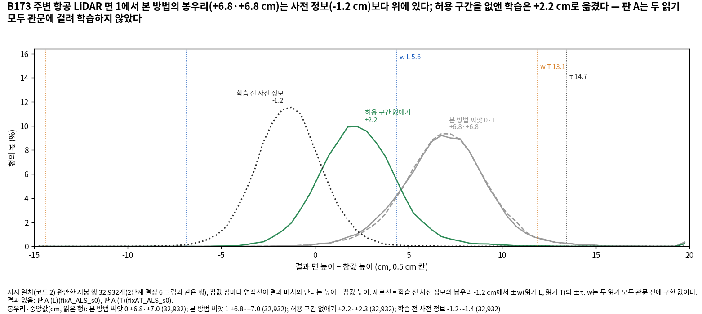
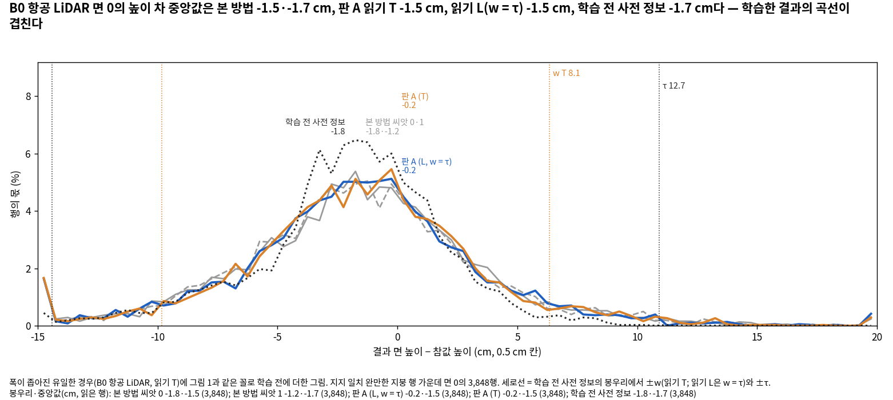
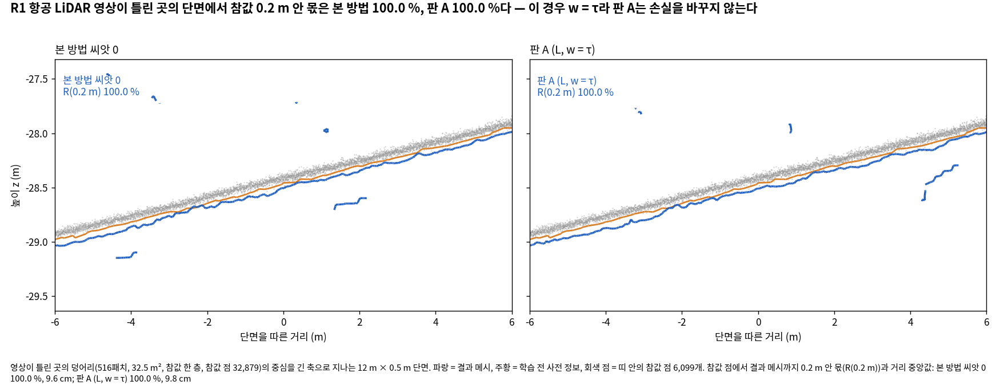
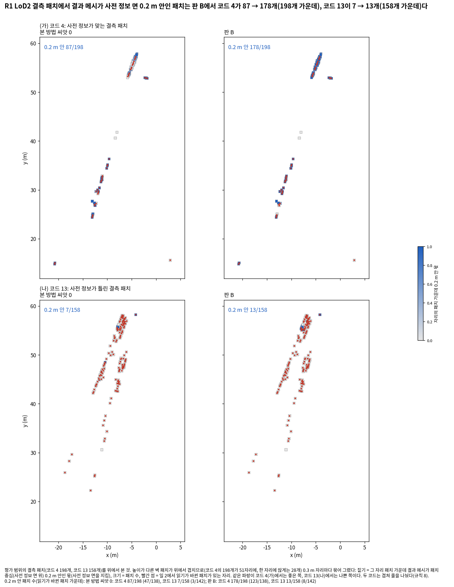
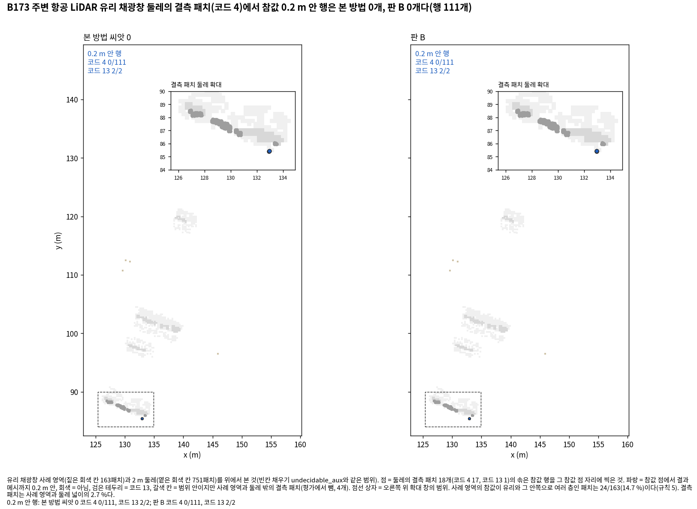
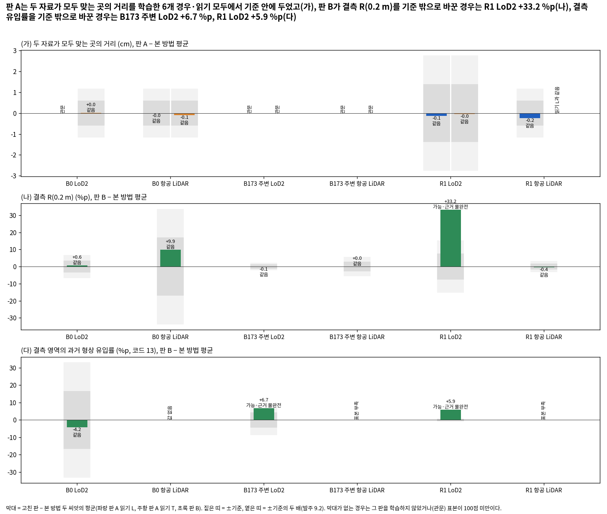

# 고친 판 시험 — 보고 v1

- 작업: PHD-MAIN-FIXTEST-v1 (발주문 `본실험_고친판시험_발주문_v1.md`), 브랜치 `exp/main-experiment`
- 쓴 때: 2026-10-20 23시 KST. scientific_verdict: null
- 숫자는 모두 [이 발주에서 냄]이다. 본 방법 두 씨앗과 참고 열은 새 거리 지표 작업과 같은 스크립트로 셌다(본 방법의 값은 그 작업의 표와 같다). 옮긴 값에는 출처를 단다.
- 보고서는 해석과 7장 글감을 쓰지 않는다. 결과를 본 뒤 더하거나 바꾼 것은 그 자리에 '결과를 본 뒤'로 적는다.
- 앞선 보고: [준비 보고](본실험_고친판시험_준비보고_v1.md), [중간 보고](본실험_고친판시험_중간보고_v1.md). 숫자표: [고친판시험_숫자표_v1.md](고친판시험_숫자표_v1.md).

## 1. 예측 대 결과

판정 규칙은 결과를 보기 전에 커밋했다(`scripts/phd/main_fixtest_v1/pred_ft.py`, 44b92ddc). 근거 값 전체는 [tables/predictions_ft.md](tables/predictions_ft.md)에 있다.

- 방향을 말한 예측은 그 방향으로 기준을 넘으면 맞음, 같음이거나 반대 방향이면 틀림이다. 결과가 없거나(관문) 표본이 100점 미만이면 판단 불가다.
- '기준 안'을 말한 예측은 읽은 값이 모두 같음일 때 맞음이다.
- 여러 경우를 말한 예측은 경우마다 판정하고, 한 경우라도 틀리면 틀림이다. 등급은 판정을 정한 값 가운데 가장 약한 읽기다(발주 9.2; 표본 1만 점 미만은 가능·근거 불완전까지).
- 판 A는 읽기마다 따로 판정했다. R1 항공 LiDAR는 두 읽기의 w가 같아(= τ) 한 학습(`fixA_ALS_s0`)이 두 읽기를 맡는다.

**판 A** (근거 값: 본 방법 두 씨앗의 평균 → 판 A, 괄호 안은 기준과 표본)

| 예측 | 볼 값 | 읽기 L | 읽기 T | 근거 값 |
|---|---|---|---|---|
| A1 | 코드 2의 거리와 치우침 | 판단 불가 | 틀림 (같음) | 읽기 L에는 폭이 좁아진 경우가 없다. 읽기 T(B0 항공 LiDAR): 거리 2.57 → 2.47 cm (0.58; 137,426), 치우침 −1.08 → −1.00 cm (0.50), 학습 전 사전 정보 −1.40 cm. B173 주변 항공 LiDAR 부분은 관문이라 판단 불가 |
| A2 | 영상이 틀린 곳의 거리 | 판단 불가 | 맞음 (가능·근거 불완전) | 읽기 T(B0 항공 LiDAR): 9.25 → 8.16 cm (1.02; 1,755) |
| A3 | 모든 곳의 거리와 R(τ) | 틀림 (가능·근거 불완전) | 틀림 (확인) | 읽기 L: 36개 값 가운데 6개가 기준 밖(B0 항공 LiDAR 3, R1 항공 LiDAR 2, R1 LoD2 1). 읽기 T: 36개 가운데 6개(B0 LoD2 사전 정보가 틀린 곳 R(τ) 98.48 → 98.32 %는 기준 0.01이라 확인, 나머지 다섯은 가능·근거 불완전) |
| A4 | R1 항공 LiDAR 코드 2의 거리와 치우침 | 맞음 (같음) | 맞음 (같음, 같은 학습) | 거리 4.75 → 4.51 cm (0.58; 113,446), 치우침 −4.15 → −3.76 cm (0.40) |
| A5 | 곡선의 1~1.5τ, 1.5~2τ | 판단 불가 | 틀림 (같음) | 읽기 T(B0 항공 LiDAR): 1~1.5τ R(τ) 75.0 → 75.0 % (108행), 1.5~2τ는 31행이라 표본 부족. 앞 작업 규칙으로 묶은 1~4τ는 73.2 → 70.1 % (가능·근거 불완전; 177행) |
| A6 | 코드 11의 거리와 유입률 | 틀림 (가능·근거 불완전) | 틀림 (가능·근거 불완전) | 읽기 L: 6개 가운데 1개(B0 항공 LiDAR 거리 8.65 → 9.19 cm; 0.26; 359). 읽기 T: 8개 가운데 2개(B0 LoD2 유입률 11.98 → 13.79 %, 1.64; 32,880, B0 항공 LiDAR 거리 8.65 → 9.02 cm) |
| A7 | 코드 4의 R(0.2 m) | 맞음 (같음) | 맞음 (같음) | R1 항공 LiDAR 31.72 → 32.64 % (1.55; 383). R1 LoD2 읽기 L 50.77 → 55.06 % (같음), 읽기 T 50.77 → 63.62 % (가능·근거 불완전, 오름; 712). B173 주변 항공 LiDAR는 관문 |
| A8 | 9.1의 4번 (일치 화소의 구간 몫) | 틀림 (같음) | 틀림 (같음) | 경우마다: B0 항공 LiDAR T와 B0 LoD2 T는 맞음(확인), R1 LoD2는 L·T 모두 틀림(같음), w = τ인 경우(B0 항공 LiDAR L, R1 항공 LiDAR)는 w~τ 구간이 비어 판단 불가. 값은 6.1절 |

**판 B**

| 예측 | 볼 값 | 판정 | 근거 값 |
|---|---|---|---|
| B1 | 코드 4 | 틀림 (같음) | 결측 R(0.2 m): B173 주변 항공 LiDAR 0.0 → 0.0 % (2.70; 111; 사전 정보 신뢰 63.1 %), R1 항공 LiDAR 31.72 → 31.33 % (1.55; 383; 사전 정보 신뢰 91.9 %). 둘 다 기준의 두 배를 넘지 않았다. B0 항공 LiDAR 88.98 → 98.87 % (같음, 기준 16.78; 177)는 '같거나 오른다'에 맞는다 |
| B2 | 코드 4, 코드 13 | 맞음 (가능·근거 불완전) | R1 LoD2 결측 R(0.2 m) 50.77 → 83.99 % (7.51; 712; 판정만 끈 본 방법 73.7 %), 결측 유입률 2.17 → 8.10 % (0.35; 852; 판정만 끈 본 방법 39.2 %) |
| B3 | 코드 4, 코드 13 | 맞음 (같음) | 결측 R(0.2 m): B0 LoD2 93.55 → 94.12 % (3.28; 12,433), B173 주변 LoD2 96.45 → 96.33 % (1.00; 6,314). 유입률(값만 적음, '오를 수 있다'): B0 LoD2 12.50 → 8.33 % (같음; 168; 판정만 끈 22.6 %), B173 주변 LoD2 20.75 → 27.49 % (가능·근거 불완전, 오름; 371; 판정만 끈 26.4 %) |
| B4 | 결측이 아닌 곳의 거리와 R(τ) | 틀림 (확인) | 48개 값 가운데 10개가 기준 밖. 확인 셋은 모두 R(τ)이고 기준이 0.01~0.03 %p인 곳이다(B0 LoD2 사전 정보가 틀린 곳 +0.24, B173 주변 LoD2 두 자료가 모두 맞는 곳 +0.21, B173 주변 항공 LiDAR 두 자료가 모두 맞는 곳 +0.06 %p; 셋 다 오름). 나머지 일곱은 가능·근거 불완전이다 |
| B5 | 9.1의 5번 (읽기가 바뀐 결측 패치) | 틀림 (같음) | R1 LoD2만 맞음(가능·근거 불완전): 잘못 놓았던 패치(코드 4, 99패치 6.2 m²) R(0.2 m) 40.8 → 90.1 %, 맞게 놓았던 패치(코드 13, 139패치 8.7 m²) 유입률 0.3 → 5.8 %. B0 LoD2, B173 주변 LoD2, R1 항공 LiDAR는 같음, B173 주변 항공 LiDAR는 표본 부족. 값은 6.3절 |

**같은 설정을 다시 돌린 흔들림** (모든 판정을 읽을 때 함께 볼 값)

- w = τ인 판 A 두 학습(B0 항공 LiDAR 읽기 L, R1 항공 LiDAR)은 손실과 결정이 본 방법과 같다(일 2: 새로 당기는 화소 0). 씨앗도 본 방법 씨앗 0과 같다.
- 그런데도 곳의 거리·R(τ) 24개 값 가운데 5개가 기준을 넘었다(B0 항공 LiDAR 3, R1 항공 LiDAR 2; 모두 가능·근거 불완전).
- R1 항공 LiDAR는 장면 F1(0.2 m)도 71.1·71.5 → 73.5 %로 확인이다(4.2절).
- 읽기 L의 A3에서 기준을 넘은 6개 가운데 5개와 A6에서 넘은 1개(A3의 B0 항공 LiDAR 거리와 같은 값)가 이 두 학습에서 나왔다. 읽기 T의 A3에 든 R1 항공 LiDAR 2개도 두 읽기가 함께 쓰는 같은 학습의 값이다.

## 2. 10월 22일 판단을 돕는 읽기에 따른 정리

받아들일지는 쓰지 않는다. 발주 10절 끝에 적힌 근거가 섰는지까지만 쓴다.

**판 A를 받아들일 근거** (A1이 폭이 좁아진 경우의 절반 이상에서 맞고, A3과 A6이 맞는다)

- **A1:** 폭이 좁아진 경우는 읽기 T의 B0 항공 LiDAR 하나이고, 거기서 A1은 틀림(같음)이다. 읽기 L에는 폭이 좁아진 경우가 없다. 따라서 '절반 이상에서 맞음'은 어느 읽기에서도 서지 않았다.
- **A3, A6:** 두 읽기 모두 틀림이다. 기준을 넘은 값의 다수는 가능·근거 불완전이다. 읽기 L의 A3에서 넘은 6개 가운데 5개와 A6의 1개는 w = τ라 결정이 본 방법과 같은 학습에서 나왔다(1절 끝). 읽기 T에서 확인으로 읽힌 하나(B0 LoD2 사전 정보가 틀린 곳 R(τ) −0.16 %p)는 기준이 0.01 %p인 곳이다.
- **A4·A5의 손해와 A1의 이득 (나란히):**

| 항목 | 자리 | 크기 | 넓이·표본 |
|---|---|---|---|
| A1의 이득 (읽기 T) | B0 항공 LiDAR 코드 2 | 거리 −0.10 cm (기준 0.58, 같음) | 참값 행 137,426 |
| A4의 손해 | R1 항공 LiDAR 코드 2 | 거리 −0.24 cm (같음, 커지지 않음) | 참값 행 113,446 |
| A5의 손해 (읽기 T) | B0 항공 LiDAR 코드 11, 1~4τ | R(τ) −3.1 %p (가능·근거 불완전); 1~1.5τ는 0.0 %p | 37패치 2.85 m², 참값 행 177 (1~1.5τ: 25패치 1.78 m², 108행) |

- 판 A의 기제는 B0 두 경우(읽기 T)에서 예측대로 움직였다(A8: 일치 화소의 w~τ 몫 감소, 확인). 결과 면의 거리로는 기준 밖으로 바뀌지 않았다(A1 같음).

**판 B를 받아들일 근거** (B1이 B173 주변 항공 LiDAR와 R1 항공 LiDAR에서 맞고, B4가 맞는다)

- **B1:** 두 경우 모두 틀림(같음)이다. B173 주변 항공 LiDAR 0.0 → 0.0 %, R1 항공 LiDAR 31.72 → 31.33 %다. 근거는 서지 않았다.
- **B4:** 틀림(확인)이다. 48개 가운데 10개가 기준 밖이고, 확인 셋은 기준이 0.01~0.03 %p인 R(τ)에서 나왔다(셋 다 오름). 같은 설정을 다시 돌린 학습에서도 24개 가운데 5개가 넘었다.
- **B2·B3의 대가 — 얻은 넓이와 내준 넓이** ([tables/area_b.md](tables/area_b.md)):
  - 얻은 넓이 = 평가 범위의 코드 4 패치마다 '넓이 × (결과 0.2 m 안 행의 몫: 판 B − 본 방법 평균)'의 합이다.
  - 내준 넓이 = 코드 13 패치마다 '넓이 × (과거 형상 유입 몫: 판 B − 본 방법 평균)'의 합이다.
  - 행을 모두 합친 몫은 곳 표의 값과 모든 칸에서 같다.

| 경우 | 코드 4 넓이 | 얻은 넓이 (순; 늘어난·줄어든) | 코드 13 넓이 | 내준 넓이 (순; 늘어난·줄어든) | 판정만 끈 본 방법 (얻은 / 내준) |
|---|---:|---|---:|---|---|
| R1 LoD2 | 12.1 m² | +4.88 m² (5.22 / 0.34) | 9.5 m² | +0.52 m² (0.57 / 0.05) | +3.35 / +3.09 m² |
| B0 LoD2 | 128.1 m² | +1.14 m² (3.94 / 2.80) | 1.7 m² | −0.06 m² (0.12 / 0.18) | +1.38 / +0.16 m² |
| B173 주변 LoD2 | 75.9 m² | −0.13 m² (0.42 / 0.54) | 5.7 m² | +0.34 m² (0.49 / 0.15) | −0.22 / +0.20 m² |
| B0 항공 LiDAR | 2.0 m² | +0.22 m² (0.22 / 0.00) | 0.0 m² | — | +0.06 / — |
| B173 주변 항공 LiDAR | 1.7 m² | 0.00 m² | 0.6 m² | 0.00 m² | 0.00 / 0.00 |
| R1 항공 LiDAR | 4.2 m² | −0.03 m² (0.03 / 0.07) | 0.5 m² | −0.02 m² (0.00 / 0.02) | +0.04 / −0.02 m² |

- 결측 영역의 표본은 B0 LoD2(12,433행) 말고는 1만 점에 못 미친다. 그래서 B1·B2의 등급은 가능·근거 불완전까지이고, 오른 폭은 위 1절에 기준과 함께 적었다.

## 3. 일 1과 일 3: 두 자료의 몫, w, 관문

자세한 절차와 줄마다의 값은 준비 보고 2~3절과 [tables/w_table.md](tables/w_table.md)에 있다.

- **τ의 절차.** 잔차 하나는 '학습 영상 한 장의 화소 하나'의 값이다(사전 정보 − MVS, 지붕은 연직, 벽은 법선 방향). 저장된 잔차 표본으로 다시 낸 τ 아홉 값이 표 A와 1e-8 m 안에서 같아 멈춤 조건(0.1 mm)에 걸리지 않았다.
- **영상의 몫.** 패치 중심을 시점마다 투영해 같은 패치를 본 두 시점의 잔차 차를 모았다(패치마다 쌍 10개까지, 줄마다 40만~325만 쌍). σ_영상 = NMAD(차) ÷ √2, 95 % 구간은 패치를 1,000번 다시 뽑은 값이다.
- **NMAD의 두 읽기.** 발주 4.3의 NMAD를 그대로 쓴 읽기 L(주)과, τ와 같은 통계(3 NMAD를 한 번 지운 뒤의 NMAD)인 읽기 T(기록)를 모두 냈다. 시점 쌍의 차에 이상치가 많아 두 읽기의 영상의 몫이 1.4~2배 다르다. 처음 셈에서 둘을 모두 냈고, 참값을 보고 고르지 않았다.

| 탐색 지역 | 줄 | τ | σ_영상 L | w L (95 % 구간) | w÷τ L | σ_영상 T | w T (95 % 구간) | w÷τ T |
|---|---|---:|---:|---|---:|---:|---|---:|
| B0 | LoD2 지붕면 | 19.75 | 5.95 | 12.98 (12.86~13.12) | 0.66 | 4.24 | 16.66 (16.61~16.71) | 0.84 |
| B0 | LoD2 벽면 | 54.70 | 8.05 | 50.86 (50.78~50.93) | 0.93 | 4.84 | 53.34 (53.32~53.36) | 0.98 |
| B0 | 항공 LiDAR | 12.66 | 5.14 | 12.66 (나누지 못함) | 1.00 | 3.90 | 8.08 (7.99~8.18) | 0.64 |
| R2 | LoD2 지붕면 | 17.60 | 5.08 | 12.19 (12.06~12.31) | 0.69 | 2.93 | 16.00 (15.97~16.03) | 0.91 |
| R2 | LoD2 벽면 | 22.78 | 5.42 | 18.32 (18.26~18.38) | 0.80 | 4.00 | 20.47 (20.45~20.50) | 0.90 |
| R2 | 항공 LiDAR | 14.70 | 5.43 | 5.61 (5.13~6.05) | 0.38 | 2.64 | 13.14 (13.10~13.18) | 0.89 |
| R1 | LoD2 지붕면 | 68.28 | 12.76 | 60.37 (60.23~60.49) | 0.88 | 6.36 | 66.40 (66.37~66.42) | 0.97 |
| R1 | LoD2 벽면 | 72.46 | 18.45 | 55.89 (55.67~56.09) | 0.77 | 9.03 | 68.85 (68.82~68.89) | 0.95 |
| R1 | 항공 LiDAR | 10.34 | 7.88 | 10.34 (나누지 못함) | 1.00 | 4.67 | 10.34 (나누지 못함) | 1.00 |

(cm. R2는 B173 주변 경우의 탐색 지역이다.)

**관문 (일 3).** 참값으로 구한 값은 평가 상자 밖의 것이다.

| 경우 | 읽기 L | 읽기 T |
|---|---|---|
| B0 LoD2 | 관문(지붕면 가: 참값 비 1.26) | 학습, w 지붕 16.7 · 벽 53.3 cm (0.84) |
| B0 항공 LiDAR | 학습, w = τ (나누지 못함) | 학습, w 8.1 cm (0.64, **폭이 좁아짐**) |
| B173 주변 LoD2 | 관문(벽면 가) | 관문(벽면 가) |
| B173 주변 항공 LiDAR | 관문(나: σ_사전 2.25 < 평면 맞춤 2.86 cm) | 관문(가: 참값 비 3.33) |
| R1 LoD2 | 학습, w 지붕 60.4 · 벽 55.9 cm (0.88) | 학습, w 지붕 66.4 · 벽 68.9 cm (0.97) |
| R1 항공 LiDAR | 학습, w = τ (나누지 못함) | 학습, w = τ (같은 학습 하나로 갈음) |

- 폭이 좁아진 경우(w ÷ τ < 0.8, LoD2는 지붕면)는 읽기 L에 없고, 읽기 T에서 B0 항공 LiDAR 하나다.
- 예측 A1이 가장 크게 준다고 한 B173 주변 항공 LiDAR는 두 읽기 모두 관문에 걸려 판 A를 학습하지 않았다.

## 4. 일 2: r16과 확인

- **r16** = r15 + 판정 모듈 `jbgs_judgment.py` 한 파일(16군데, 133줄 더함·7줄 지움). `train.py`, `scene/gaussian_model.py`, 판정 모듈 v6 사본은 r15와 바이트까지 같다. diff는 [provenance/patches/jbgs_judgment.py.diff](provenance/patches/jbgs_judgment.py.diff), 만든 기록은 [provenance/build_report_r16.json](provenance/build_report_r16.json)이다.
- **스위치 둘, 기본값 0.** `--jbgs_sw_prior_share_band`(판 A: 허용 구간의 끝을 τ에서 w로; 당김 w~4τ, 절단 4τ, 판정과 충돌 문턱은 그대로), `--jbgs_sw_own_depth_release`(판 B: 결측 패치의 빌린 충돌·섞임을 모든 통로에서 일치로 읽고, 결측 패치의 화소는 4τ를 넘어도 절단하지 않음).
- 코드 줄(`src/phd/forks/GeoGS-conf-guided-v1-r16/jbgs_judgment.py`):
  - 스위치와 w 지도 인자: 243~249, 326~327줄. 켠 판의 표 `self.fix`: 745줄, w 지도 읽기와 점검: 762~767, 910~927줄.
  - 판 A의 허용 구간: `rho_band` 439줄, `truncated_prior_loss` 450줄, 깊이 항에 w를 넘기는 곳 1465·1470줄.
  - 판 B의 읽기: `prop_init`의 판정 단계 스위치 바로 뒤 1179~1180줄. 결측 패치 화소의 절단 없음 지도: `_g_init` 1374~1377줄, 깊이 항에 넘기는 곳 1466·1470줄.

| 확인 | 바뀌지 않은 것 | 바뀐 것과 그 수 |
|---|---|---|
| 기본값 = r15 (학습 전 계산, 여섯 경우) | 판정, 심을 점, 깊이 항 가중의 배열 | 기록 넷(`fixes` 두 값, `prior_width`, `own_depth`)만 |
| 기본값 = r15 (고정 체크포인트 한 반복, 여섯 곳) | 깊이 항 화소와 구간, 기울기를 막을 가우시안, 밀도 제어·다시 놓기 면제, 정리 후보, 두 손실 | 기록 셋(`fixes`)만 |
| 판 A (학습하는 여섯 경우·읽기) | 판정, 심을 점, g_p, 보호, 밀도 제어, E, MVS 손실 | 새로 당기는 화소 = 'w와 τ 사이의 일치 화소': B0 항공 LiDAR T 3,202,749(경계 1화소 차), B0 LoD2 T 470,101(4τ 경계 2화소), R1 LoD2 L 191,632, R1 LoD2 T 35,622, w = τ인 경우 0 |
| 판 B (여섯 경우) | 패치 상태, E, 지지 패치의 투표, 처음 점의 자리, 신뢰도·패치·표지 지도 | 결측 패치의 판정만 충돌·섞임 → 일치. 평가 범위의 빌린 충돌(코드 4 · 13)과 섞임 수가 발주 표 2와 여섯 경우 모두 같음. 하한을 끈 탐침에서 결측 화소 밖 변화 0 |
| 함께 켠 판 (R1 항공 LiDAR) | — | 새로 당기는 화소 = 판 A와 판 B에서 바뀐 화소의 합집합과 정확히 같음 |

- 비가시 패치는 여섯 경우 모두 판정과 화소가 없어 판 B가 건드리지 않는다([tables/inv_check.md](tables/inv_check.md)).
- 자세한 수는 [tables/checks_compare_dry.md](tables/checks_compare_dry.md), [tables/checks_compare_probe.md](tables/checks_compare_probe.md), 준비 보고 4절에 있다.

## 5. 곳마다의 표와 읽기, 곡선

**곳마다의 표.** 곳 일곱 × 경우 여섯, 칸마다 값 하나인 표는 숫자표에 있다([고친판시험_숫자표_v1.md](고친판시험_숫자표_v1.md), [고친판시험_숫자표_v1_2.md](고친판시험_숫자표_v1_2.md)).

- 반올림 전 값, 표본, 출처는 [tables/eval_ft.json](tables/eval_ft.json)에 있다.
- 지표는 새 거리 지표 작업의 정의 그대로(R(0.2 m, τ), P, F1, 거리, 치우침, 퍼짐)이고, 유입률은 빈칸 채우기와 같은 규칙이다.
- 본 방법 두 씨앗의 값은 그 작업의 표와 같다(이 작업에서 다시 셌고, 곡선의 본 방법 값이 그 작업의 표와 여섯 경우 모두 같음을 확인했다).

아래는 숫자표의 지표(거리와 R(τ), 결측 영역은 R(0.2 m)와 유입률, 사전 정보가 틀린 곳은 유입률)에서 기준을 넘은 읽기의 수다. 같음이 아닌 것만 적었고, 나머지 칸은 모두 같음이다. 학습한 경우는 판 A 읽기 L 셋(B0 항공 LiDAR, R1 LoD2, R1 항공 LiDAR), 읽기 T 셋(B0 LoD2, B0 항공 LiDAR, R1 LoD2), 판 B 여섯이다. F1, P, 치우침, 퍼짐의 읽기는 [tables/eval_ft.json](tables/eval_ft.json)에 있다.

| 곳 | 판 A 읽기 L | 판 A 읽기 T | 판 B |
|---|---|---|---|
| 전체 | 거리 가능 나음 1, R(τ) 가능 나음 1 | R(τ) 가능 나음 1 | 거리 확인 나음 1·확인 못함 1, R(τ) 가능 나음 1·가능 못함 1 |
| 두 자료가 모두 맞는 곳 | — | — | R(τ) 확인 나음 2 |
| 영상이 틀린 곳 | R(τ) 가능 못함 1 | 거리 가능 나음 1, R(τ) 가능 나음 1 | R(τ) 가능 못함 1 |
| 사전 정보가 틀린 곳 | 거리 가능 못함 1, R(τ) 가능 못함 1 | 거리 가능 못함 1, R(τ) 확인 못함 1·가능 못함 1, 유입률 가능 못함 1 | 거리 가능 못함 2, R(τ) 확인 나음 1·가능 나음 1·가능 못함 2 |
| 조금 틀린 곳 | R(τ) 가능 못함 1 | R(τ) 가능 못함 2 | R(τ) 가능 나음 1 |
| 결측 영역 | 유입률 가능 나음 1, 표본 부족 1 | 거리 가능 나음 1·가능 못함 1, R(0.2 m) 가능 나음 1, 유입률 가능 나음 1 | 거리 가능 나음 2·가능 못함 1, R(τ) 가능 나음 1, R(0.2 m) 가능 나음 1, 유입률 가능 못함 2·표본 부족 2 |
| 비가시 영역 | 값 없음 | 값 없음 | 표본 부족 2 |

- '모은 흔들림 폭'은 새 거리 지표 작업에 F1(0.2 m), F1(τ), 거리로만, 그리고 전체 곳을 뺀 곳에만 있다. 그래서 R(τ), R(0.2 m)와 전체 곳의 거리의 기준은 그 경우의 흔들림 폭과 (몫이면) 300 ÷ 표본 가운데 큰 값이다. 씨앗 둘이 거의 같고 표본이 큰 곳에서는 기준이 아주 작아진다.
- 위 표의 '확인' 여섯은 모두 그런 곳이다: R(τ) 넷은 기준 0.01~0.03 %p, 전체 거리 둘은 기준 0.01~0.02 cm(B173 주변 LoD2 6.76 → 6.67 cm, B173 주변 항공 LiDAR 6.54 → 6.60 cm)다.
- 퍼짐은 발주 9.2에 나은 쪽이 없어 '커짐·작아짐'으로만 적었다(결과를 본 뒤 고친 표기, 9.3절).

**어긋난 크기별 재현율 곡선** ([tables/curve_ft.md](tables/curve_ft.md)). 새 거리 지표 작업 일 5와 같은 구간과 묶기 규칙에 묶지 않은 1~1.5τ, 1.5~2τ를 더했다. 기준을 넘은 구간은 다음뿐이다.

| 경우 | 구간 (τ의 배) | 행 | 본 방법 평균 R(τ) | 고친 판 | 읽기 |
|---|---|---:|---:|---|---|
| B0 항공 LiDAR | 1~4 (묶음) | 177 | 73.2 % | 판 A 읽기 T 70.1 % | 가능·근거 불완전, 못함 −3.1 %p |
| B0 항공 LiDAR | 4 이상 | 182 | 73.4 % | 판 B 59.3 % | 가능·근거 불완전, 못함 −14.0 %p |
| R1 항공 LiDAR | 1~1.5 (묶지 않음) | 338 | 79.4 % | 판 B 84.3 % | 가능·근거 불완전, 나음 +4.9 %p |
| R1 LoD2 | 1.5~4 | 20,584 | 97.5 % | 판 A L 97.3 %, T 97.2 %, 판 B 97.9 % | 가능·근거 불완전 (−0.3, −0.3, +0.4 %p) |
| R1 LoD2 | 1~1.5 | 16,500 | 100.0 % | 판 B 99.9 % | 가능·근거 불완전, 못함 −0.05 %p |
| B173 주변 LoD2 | 0~1 (코드 2), 1~1.5 | 172,508 · 16,944 | 97.9 · 92.3 % | 판 B 98.1 · 93.2 % | 확인, 나음 (+0.2, +0.8 %p) |
| B173 주변 항공 LiDAR | 0~1 (코드 2), 4 이상 | 64,322 · 95,517 | 98.7 · 98.3 % | 판 B 98.7 · 98.2 % | 확인 (+0.1 나음, −0.2 못함) |

**전체 지표와 학습 기록** ([tables/scene_ft.md](tables/scene_ft.md); 9.1의 6, 7)

- 판 A에서 장면 Chamfer가 나빠진 경우는 없다. 판 A 학습 여섯(읽기 L 셋, T 셋) 가운데 같음 넷, 나음 둘(B0 LoD2 T 가능·근거 불완전, R1 항공 LiDAR 확인)이다. 그래서 나빠진 자리의 지도는 그리지 않았다.
  - 2단계의 허용 구간 없애기는 B173 주변 항공 LiDAR에서 0.189 → 0.207 m였다. 이 경우 판 A는 관문으로 학습하지 않았다.
- 판 B의 장면 지표: B0 LoD2 F1 0.2·0.5 m 가능·근거 불완전 못함(63.6 → 62.7, 71.7 → 70.9 %), B173 주변 LoD2 F1(0.5 m) 확인 못함(92.1 → 91.5 %), B173 주변 항공 LiDAR와 R1 항공 LiDAR는 나음(가능·근거 불완전), 나머지는 같음.

## 6. 기제

### 6.1 판 A: 렌더 깊이의 구간 몫 (9.1의 4)

30,000회 덤프의 학습 영상 깊이에서, 학습 전 판정이 일치인 패치를 보는 사전 정보 화소의 |렌더 깊이 − 사전 정보 깊이|를 화소마다 w, τ로 나눈 몫이다(`band_w.py`, [tables/mech_bands_*.json](tables/)). 칸 = w 안 · w~τ · τ~2τ · 2τ~4τ · 4τ 넘음 (%).

| 경우 · 읽기 | w ÷ τ (지붕) | 일치 화소 | 본 방법 씨앗 0 | 씨앗 1 | 판 A | w~τ 읽기 |
|---|---:|---:|---|---|---|---|
| B0 항공 LiDAR · T | 0.64 | 10,239,884 | 84.53 · 9.54 · 2.95 · 0.68 · 2.30 | 85.03 · 9.13 · 2.91 · 0.69 · 2.23 | 88.00 · 6.98 · 2.13 · 0.64 · 2.25 | 확인, 줄어듦 |
| B0 LoD2 · T | 0.84 | 28,826,759 | 87.41 · 1.48 · 2.74 · 0.90 · 7.48 | 87.31 · 1.46 · 2.85 · 0.92 · 7.45 | 87.90 · 1.26 · 2.49 · 0.89 · 7.46 | 확인, 줄어듦 |
| R1 LoD2 · L | 0.88 | 11,731,645 | 89.78 · 1.55 · 3.12 · 0.96 · 4.59 | 90.17 · 1.40 · 2.90 · 0.93 · 4.59 | 90.40 · 1.37 · 2.72 · 0.94 · 4.57 | 같음 |
| R1 LoD2 · T | 0.97 | 11,731,645 | 91.02 · 0.31 · 3.12 · 0.96 · 4.59 | 91.30 · 0.28 · 2.90 · 0.93 · 4.59 | 90.98 · 0.27 · 2.86 · 0.93 · 4.96 | 같음 |
| B0 항공 LiDAR · L (w = τ) | 1.00 | 10,239,884 | 94.07 · 0 · 2.95 · 0.68 · 2.30 | 94.16 · 0 · 2.91 · 0.69 · 2.23 | 94.19 · 0 · 2.86 · 0.70 · 2.25 | — |
| R1 항공 LiDAR (w = τ) | 1.00 | 7,572,006 | 86.63 · 0 · 7.92 · 1.40 · 4.05 | 87.55 · 0 · 7.15 · 1.42 · 3.88 | 86.81 · 0 · 8.18 · 1.30 · 3.71 (함께 켠 판 87.19 · 0 · 7.63 · 1.38 · 3.80) | — |

### 6.2 판 A: 높이 차의 분포 (9.1의 4)

- **B173 주변 항공 LiDAR 면 1** (그림 1, 지지 일치 완만한 지붕 32,932행): 봉우리 · 중앙값은 본 방법 +6.8 · +7.0 cm와 +6.8 · +7.0 cm, 허용 구간 없애기 +2.2 · +2.3 cm, 학습 전 사전 정보 −1.2 · −1.4 cm다. 판 A는 이 경우 두 읽기 모두 관문으로 학습하지 않아 선이 없다.
- **B0 항공 LiDAR 면 0** (그림 1b, 학습 전에 더한 그림, 3,848행): 중앙값은 본 방법 −1.5 · −1.7 cm, 판 A 읽기 T −1.5 cm, 읽기 L −1.5 cm, 학습 전 사전 정보 −1.7 cm다. 0.5 cm 칸의 봉우리는 같은 설정끼리도 칸 하나 넘게 흔들린다(본 방법 −1.8·−1.2, 읽기 L −0.2 cm).

### 6.3 판 B: 읽기가 바뀐 결측 패치 (9.1의 5)

평가 범위에서 일 2가 읽기를 바꾼 결측 패치(이전 판정 충돌 또는 섞임)다. 잘못 놓았던 패치(이전 충돌, 코드 4)는 R(0.2 m)을, 맞게 놓았던 패치(이전 충돌, 코드 13)는 과거 형상 유입률을 센다([tables/mech_mech_b.json](tables/mech_mech_b.json)).

| 경우 | 묶음 | 패치 (넓이) | 참값 행 | 본 방법 씨앗 0 · 1 | 판 B | 판정만 끈 본 방법 |
|---|---|---|---:|---|---:|---:|
| R1 LoD2 | 잘못 놓았던 패치 R(0.2 m) | 99 (6.2 m²) | 335 | 43.9 · 37.6 % | 90.1 % | 83.6 % |
| R1 LoD2 | 맞게 놓았던 패치 유입률 | 139 (8.7 m²) | 746 | 0.3 · 0.3 % | 5.8 % | 32.8 % |
| R1 LoD2 | 섞임 코드 4 R(0.2 m) | 39 (2.4 m²) | 161 | 36.0 · 46.6 % | 65.8 % | 73.9 % |
| B0 LoD2 | 잘못 놓았던 패치 R(0.2 m) | 108 (6.8 m²) | 604 | 73.7 · 54.0 % | 51.3 % | 59.6 % |
| B0 LoD2 | 맞게 놓았던 패치 유입률 | 22 (1.4 m²) | 142 | 11.3 · 2.8 % | 8.5 % | 23.2 % |
| B0 LoD2 | 섞임 코드 4 R(0.2 m) | 43 (2.7 m²) | 235 | 60.0 · 77.0 % | 80.4 % | 68.9 % |
| B173 주변 LoD2 | 잘못 놓았던 패치 R(0.2 m) | 57 (3.6 m²) | 268 | 46.3 · 48.1 % | 48.5 % | 47.4 % |
| B173 주변 LoD2 | 맞게 놓았던 패치 유입률 | 26 (1.6 m²) | 120 | 15.0 · 3.3 % | 19.2 % | 10.0 % |
| B173 주변 LoD2 | 섞임 코드 4 · 13 | 73 (4.6 m²) · 15 (0.9 m²) | 326 · 57 | 91.7 · 90.8 % · 19.3 · 19.3 % | 93.3 · 24.6 % | 93.3 · 31.6 % |
| R1 항공 LiDAR | 잘못 놓았던 패치 R(0.2 m) | 61 (4.1 m²) | 371 | 30.7 · 31.0 % | 30.5 % (함께 켠 판 30.2 %) | 31.3 % |
| B173 주변 항공 LiDAR | 잘못 놓았던 · 맞게 놓았던 · 섞임 코드 4 | 10 · 9 · 6 | 66 · 53 · 41 | 모두 0 % | 모두 0 % | 모두 0 % |

- 다른 묶음(섞임 코드 13, B0 항공 LiDAR의 섞임 코드 4, R1 항공 LiDAR의 코드 13)은 행이 5~28개라 표본 부족이다.
- B173 주변 항공 LiDAR의 결측 패치는 유리 채광창 둘레 18개뿐이고, 결과와 참값의 거리는 본 방법 94.2·97.7 cm, 판 B 103.5 cm다. 판 B가 이 경우 더 심는 점은 18개, 학습 전 깊이 항 가중이 0 → 1로 바뀐 화소는 2,267개다(준비 보고 4.4).

## 7. 그림 1~5

그림마다 숫자 json이 옆에 있다([figures/](figures/)). 그림 아래 숫자는 그 그림 자리의 값이다.

**그림 1.** B173 주변 항공 LiDAR 면 1의 높이 차 분포다. 본 방법 두 씨앗의 봉우리 +6.8 cm는 사전 정보 −1.2 cm보다 위에 있고, 허용 구간을 없앤 학습은 +2.2 cm다. 판 A는 이 경우 관문으로 학습하지 않았다.

**그림 1b** (학습 전에 더함). 폭이 좁아진 유일한 경우(B0 항공 LiDAR 읽기 T)에서 같은 꼴로 그렸다. 학습한 결과의 곡선이 겹친다(중앙값 −1.5~−1.7 cm).

**그림 2.** R1 항공 LiDAR의 영상이 틀린 곳 단면이다. 이 경우 w = τ라 판 A는 손실을 바꾸지 않는다. 참값 0.2 m 안 몫은 본 방법과 판 A 모두 100.0 %, 거리 중앙값은 9.6·9.8 cm다.

**그림 3.** R1 LoD2 결측 패치에서 결과 메시가 사전 정보 면 0.2 m 안인 패치는 판 B에서 코드 4가 87 → 178개(198개 가운데), 코드 13이 7 → 13개(158개 가운데)다. 같은 파랑이 코드 4에서는 좋은 쪽, 코드 13에서는 나쁜 쪽이다.

**그림 4.** B173 주변 항공 LiDAR 유리 채광창 둘레의 결측 패치에서 참값 0.2 m 안 행은 본 방법과 판 B 모두 코드 4 0/111, 코드 13 2/2다.

**그림 5.** 경우마다 고친 판과 본 방법 평균의 차를 기준의 띠와 함께 그렸다. 판 A는 두 자료가 모두 맞는 곳의 거리를 학습한 여섯 경우·읽기 모두에서 기준 안에 두었다(가). 판 B가 결측 R(0.2 m)를 기준 밖으로 바꾼 경우는 R1 LoD2(+33.2 %p)이고(나), 결측 유입률을 바꾼 경우는 B173 주변 LoD2(+6.7 %p)와 R1 LoD2(+5.9 %p)다(다).

**구간 몫 그림** (중간 보고에서 더한 그림, 6.1절의 값): [B0 항공 LiDAR T](figures/figA8_B0_ALS_T.png), [B0 LoD2 T](figures/figA8_B0_LoD2_T.png), [R1 LoD2 L](figures/figA8_R1rep_LoD2_L.png), [R1 LoD2 T](figures/figA8_R1rep_LoD2_T.png).

**결과를 본 뒤 바꾼 그리는 법.** 값과 판정 규칙은 바꾸지 않았다.

- 그림 3: 높이가 다른 벽 패치가 위에서 겹쳐(코드 4의 198개가 51자리에) 변화가 보이지 않았다. 그래서 0.3 m 자리마다 묶어 0.2 m 안 몫을 짙기로 그리고, 코드 4와 13을 줄로 나눴다(규칙 7, 8).
- 그림 1b: 제목을 봉우리 대신 중앙값으로 썼다.
- 구간 몫 그림: 막대를 점으로 바꾸고 세로축을 값 둘레로 좁혔다(규칙 10).
- 그림 5: 제목을 경우마다의 값에서 쓰게 했다(규칙 1).

## 8. 일 7: unseen_1의 듬성듬성한 칸

자세한 답은 [tables/item7_unseen1.md](tables/item7_unseen1.md), 다시 그린 그림은 [figures/item7/unseen_1_v2.png](figures/item7/unseen_1_v2.png)다.

- 바둑판 칸은 그림의 결함이 아니라 패치 집합의 무늬다. 학습 영상 한 장(DJI_20241217101359_0032_D)이 그 삼각형 영역(4,542칸, 283.9 m²)을 126 m 밖에서 벽 법선과 75° 기울어 본다.
- 그 영상의 화소 중심이 떨어진 칸은 '보는 시점 1장(결측)'이 되어 '학습 영상이 보지 못한 패치'에서 빠진다. 칸의 71.7 %가 빠지고 비껴간 28.3 %만 남아 대각선 무늬가 됐다.
- 빠진 칸을 모래색으로 칠해 다시 그렸다(빈칸 채우기 그림은 고치지 않음). 벽 있음 값은 그대로다(씨앗 0 0.9199, 씨앗 1 0.9266).

## 9. 학습이 끝났는지, 걸린 시간과 자원, 실행 중 바꾼 것, 확인 불가

### 9.1 학습이 끝났는지

설정의 학습 20줄 가운데 13회를 학습했고 모두 끝까지 돌았다(PASS). 판 B B0 LoD2는 첫 시도가 메모리 부족으로 멈춰, 발주 3.8대로 같은 설정으로 다시 돌렸다. 학습하지 않은 7줄은 관문 6, 두 읽기의 w가 같아 한 학습으로 갈음한 1이다. 표는 [tables/runs_ft.md](tables/runs_ft.md).

| 경우 | 판 | 결과 | 학습 (분) | GPU | GPU 메모리 최대 (GiB) | GPU 후처리 (초: post·run) | 지표 단계 (분) | 가우시안 (사전 정보 출신) | 사전 정보 출신 불투명도 중앙값 | 평가 영상 PSNR (dB) |
|---|---|---|---:|---:|---:|---|---:|---|---:|---:|
| B173 주변 항공 LiDAR | 판 A 읽기 L | 학습 안 함: 관문(읽기 L): 항공 LiDAR: 나 | — | — | — | — | — | — | — | — |
| B173 주변 항공 LiDAR | 판 A 읽기 T | 학습 안 함: 관문(읽기 T): 항공 LiDAR: 가 | — | — | — | — | — | — | — | — |
| B173 주변 LoD2 | 판 A 읽기 L | 학습 안 함: 관문(읽기 L): LoD2 벽면: 가 | — | — | — | — | — | — | — | — |
| B173 주변 LoD2 | 판 A 읽기 T | 학습 안 함: 관문(읽기 T): LoD2 벽면: 가 | — | — | — | — | — | — | — | — |
| B0 항공 LiDAR | 판 A 읽기 L | PASS | 75.1 | 0 | 11.71 | 361·52 | 18.8 | 2,480,006 (262,992) | 0.69 | 22.78 |
| B0 항공 LiDAR | 판 A 읽기 T | PASS | 68.6 | 0 | 11.24 | 376·39 | 3.6 | 2,365,969 (322,931) | 0.66 | 22.90 |
| R1 항공 LiDAR | 판 A 읽기 L | PASS | 75.6 | 0 | 14.64 | 469·56 | 5.4 | 2,851,842 (170,742) | 0.32 | 22.92 |
| R1 항공 LiDAR | 판 A 읽기 T | 학습 안 함: 읽기 L과 w가 같아 같은 설정 — 판 A(읽기 L)로 갈음 | — | — | — | — | — | — | — | — |
| B0 LoD2 | 판 A 읽기 L | 학습 안 함: 관문(읽기 L): LoD2 지붕면: 가 | — | — | — | — | — | — | — | — |
| B0 LoD2 | 판 A 읽기 T | PASS | 71.1 | 0 | 12.74 | 376·44 | 23.4 | 2,612,126 (2,472,063) | 0.35 | 22.81 |
| R1 LoD2 | 판 A 읽기 L | PASS | 72.1 | 0 | 13.62 | 468·37 | 33.2 | 2,495,368 (648,583) | 0.39 | 22.39 |
| R1 LoD2 | 판 A 읽기 T | PASS | 77.6 | 0 | 15.07 | 452·40 | 5.1 | 2,557,527 (559,422) | 0.41 | 23.09 |
| R1 LoD2 | 판 B | PASS | 78.1 | 1 | 17.37 | 456·49 | 17.4 | 2,957,246 (1,245,049) | 0.23 | 22.73 |
| B173 주변 항공 LiDAR | 판 B | PASS | 82.6 | 1 | 14.01 | 343·179 | 17.9 | 3,816,502 (378,523) | 0.74 | 23.26 |
| R1 항공 LiDAR | 판 B | PASS | 72.1 | 1 | 13.72 | 465·57 | 2.9 | 2,554,141 (165,215) | 0.30 | 22.94 |
| B0 LoD2 | 판 B | OOM: 14,238회째 메모리 부족(19.88 GiB 요청) | 27.5 | 1 | 22.99 | — | — | — | — | — |
| B0 LoD2 | 판 B | PASS (시도 2) | 65.1 | 1 | 11.06 | 362·42 | 30.3 | 2,324,600 (2,165,671) | 0.39 | 22.65 |
| B173 주변 LoD2 | 판 B | PASS | 75.6 | 1 | 12.15 | 316·175 | 23.5 | 3,204,788 (2,587,707) | 0.24 | 23.03 |
| B0 항공 LiDAR | 판 B | PASS | 75.1 | 0 | 12.64 | 381·49 | 2.7 | 2,376,462 (281,897) | 0.68 | 23.06 |
| B173 주변 항공 LiDAR | 함께 켠 판 | 학습 안 함: 관문(읽기 L): 항공 LiDAR: 나 — 함께 켠 판은 판 A(읽기 L)를 따름 | — | — | — | — | — | — | — | — |
| R1 항공 LiDAR | 함께 켠 판 | PASS | 77.6 | 1 | 14.93 | 449·41 | 4.0 | 2,436,024 (164,388) | 0.32 | 23.07 |

- **판 B B0 LoD2 첫 시도의 메모리 부족:** 14,238회째, 학습 영상 DJI_20241217101357_0031_D의 렌더에서 래스터라이저가 19.88 GiB를 한 번에 잡으려다 멈췄다(GPU 24 GB, 이미 6.8 GB 사용).
  - 그때 화면 반지름이 1만 픽셀을 넘는 가우시안이 193,086개였고 가장 큰 것은 1.24e9 픽셀이었다. 3단계 N13과 같은 '래스터라이저 상자 발산'의 꼴이다.
  - 두 번째 시도는 이 현상 없이 끝났다. 첫 시도는 `runs/B0_b10/fixB_LoD2_s0_try1_20261020T163014`에 기록(메모리 부족 기록 포함)으로 남겼다.
- 멈춤 조건(실행 오류, NaN, 사전 정보 출신 불투명도 중앙값 0.05 미만)에 걸린 학습은 없다. 사전 정보 출신 불투명도 중앙값은 0.23~0.74다.

### 9.2 걸린 시간과 자원 (10월 20일, KST)

| 단계 | 때 | 걸린 시간 |
|---|---|---|
| 일 1~3, 일 2 확인, 일 7, 설정 저장 | 09:45~11:33 | 준비 보고 8절 |
| 학습 13회와 메모리 부족 1회 (GPU 둘) | 11:33~21:24 | 한 회 65~83분 (메모리 부족 시도 28분) |
| GPU 후처리 (렌더·화질·TSDF, B173 주변은 가상 시점 메시까지) | 12:48~21:38 | 한 회 6~11분 (post 316~469초, run 37~179초) |
| 지표 단계 | 13:07~21:46 | 한 회 3~33분 |
| 새 거리 지표 (이 작업 결과 13개, B0는 두 번째 참값까지) | 13:44~21:50 | 한 결과 1~31분 (B173 주변 LoD2가 가장 김), 곳 값·표 1~2분 |
| 구간 몫 (판 A 7개) | 13:31~21:26 | 한 결과 35~48초 |
| 그림, 숫자표, 보고서, 전달 묶음 | 21:50~23시 | 약 1시간 10분 |

- GPU 메모리 최대는 학습 PASS에서 11.1~17.4 GiB, 메모리 부족 시도 23.0 GiB다.
- 학습 끝에서 GPU 후처리 끝까지는 7~56분이다. 호스트 여유 메모리(50 GB)나 TSDF 차례를 기다린 시간이 들어 있다(가장 긴 것은 판 B B0 LoD2).

### 9.3 실행 중 바꾼 것

| 무엇 | 때 | 한 것 | 값에 미친 것 |
|---|---|---|---|
| 판 B B0 LoD2 메모리 부족 | 16:30 | 발주 3.8대로 같은 설정으로 처음부터 다시 돌림 | 두 번째 시도가 결과다 |
| 평가를 학습 중에 이어서 | 15:12 | 학습마다 후처리가 끝나면 새 거리 지표와 구간 몫을 바로 셈(`auto_eval_ft.sh`). 곡선·장면·넓이·예측 판정 표를 평가 끝에 붙임(`eval_ft.sh`) | 없음 (같은 스크립트) |
| 예측 판정 표의 글 옮기기 오류 | 19:42~20:25 | 학습은 PASS인데 지표가 아직 없는 칸에서 숫자 형식 오류로 판정 표가 만들어지지 않았다. 빈 값은 '—'로 적게 고쳤다 | 없음 (판정 규칙 그대로) |
| 퍼짐의 방향 표기 (결과를 본 뒤) | 22시대 | 발주 9.2에 나은 쪽이 없는 퍼짐을 '나음·못함' 대신 '커짐·작아짐'으로 적게 고침 | 판정과 숫자표에 쓰이지 않음 |
| 넓이 표의 줄 (결과를 본 뒤) | 22시대 | 학습하지 않은 함께 켠 판 줄을 '결과 없음' 대신 빼거나 '관문'으로 적음 | 없음 |
| 그림 그리는 법 (결과를 본 뒤) | — | 7절 끝 | 없음 |

- 중간 보고의 판정은 차례 2까지의 네 학습만으로 한 것이다. 이 보고의 판정이 그것을 대신한다. 예를 들어 A8 읽기 T는 중간 보고에서 맞음(확인, B0 항공 LiDAR만)이었으나, R1 LoD2 T가 같음이라 이 보고에서는 틀림이다(경우마다의 판정은 1절).

### 9.4 확인 불가 항목과 까닭

| 항목 | 까닭 |
|---|---|
| A1의 B173 주변 항공 LiDAR 부분, 함께 켠 판 B173 주변 항공 LiDAR | 관문(두 읽기 모두)으로 판 A를 학습하지 않았다 |
| 읽기 L의 A1, A2, A5 | 폭이 좁아진 경우가 없다 |
| w = τ인 경우의 A8 | w~τ 구간이 비어 있다 |
| A5의 1.5~2τ (B0 항공 LiDAR 31행), B5의 B173 주변 항공 LiDAR 묶음(53~66행), 섞임 코드 13 묶음 | 표본 100점 미만 |
| 비가시 영역 | 대부분의 경우 참값 행이 없거나 100점 미만이다 |
| 9.1의 6번 '나빠진 자리의 지도' | 해당 없음. 판 A에서 Chamfer가 나빠진 경우가 없다 |

## 10. 검토 기록에 붙일 요약

1. PHD-MAIN-FIXTEST-v1: r16(판 A 허용 구간 끝 w, 판 B 결측 패치의 빌린 충돌·섞임을 일치로) 학습 13회 모두 끝까지 돎. 판 B B0 LoD2는 메모리 부족 뒤 두 번째 시도. scientific_verdict null.
2. 일 1: NMAD 두 읽기(L 주, T 기록). 폭이 좁아진 경우는 읽기 T의 B0 항공 LiDAR(w 8.1 / τ 12.7 cm) 하나. B173 주변 두 경우는 관문으로 판 A 없음.
3. 일 2: r16 기본값 = r15(학습 전 계산과 고정 체크포인트 한 반복). 판 A는 w~τ 일치 화소만, 판 B는 결측 패치만 바꿈. 바뀐 수가 발주 표 2와 같음.
4. 판 A: 일치 화소의 w~τ 몫은 B0 두 경우(T)에서 줄었으나(확인), 코드 2 거리는 같음(A1 틀림). A3·A6 틀림(대부분 가능·근거 불완전), 장면 Chamfer가 나빠진 경우 없음.
5. 같은 설정을 다시 돌린 판 A(w = τ) 두 학습에서도 곳 값 24개 가운데 5개가 기준 밖이었다.
6. 판 B: R1 LoD2 결측 R(0.2 m) 50.8 → 84.0 %, 결측 유입률 2.2 → 8.1 %(B2 맞음, 가능·근거 불완전). 얻은 넓이 4.88 m², 내준 넓이 0.52 m².
7. 판 B: B173 주변·R1 항공 LiDAR 결측 R(0.2 m) 같음(B1 틀림). B4 틀림(확인 셋은 R(τ) 기준 0.01~0.03 %p인 곳).
8. R(τ)·R(0.2 m)·전체 거리에는 모은 흔들림 폭이 없어, 표본이 큰 곳의 기준이 아주 작아진다.
9. 일 7: unseen_1의 바둑판은 단일 비스듬한 시점이 만든 패치 집합의 무늬, 벽 있음 값 그대로.
10. 보고서·숫자표·그림·스크립트는 이 보고를 담은 커밋(브랜치 `exp/main-experiment`)에 있고, 전달 묶음은 `PH/main_fixtest_v1/PHD-MAIN-FIXTEST-v1/handover/PHD-MAIN-FIXTEST-v1_handover.zip`이다(SHA256은 progress.md).
