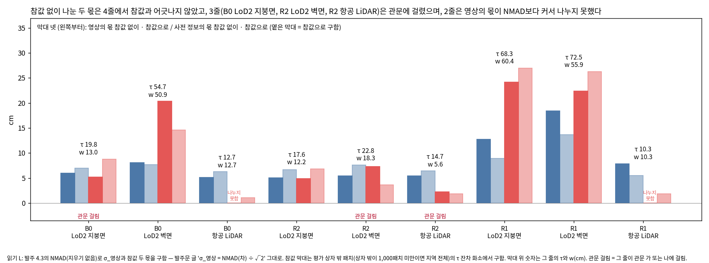
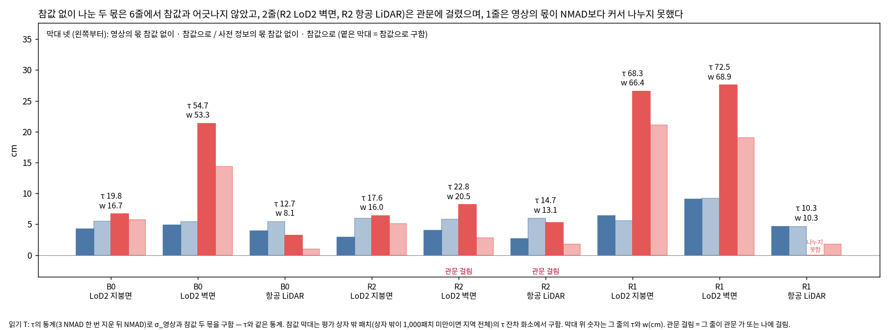

# 고친 판 시험 — 준비 보고 v1

- 작업: PHD-MAIN-FIXTEST-v1 (발주문 `본실험_고친판시험_발주문_v1.md`), 브랜치 `exp/main-experiment`
- 쓴 때: 2026-10-20 (KST). 일 1~3과 일 7의 결과, 학습 계획. scientific_verdict: null
- 숫자는 모두 [이 발주에서 냄]이다. 옮긴 값에는 출처를 단다.

## 1. 결론

1. **τ의 절차를 찾아 아홉 값을 다시 냈다.** 잔차 하나는 '학습 영상 한 장의 화소 하나'의 값이다(사전 정보 − MVS, 지붕은 연직, 벽은 법선 방향). 저장된 잔차 표본으로 다시 낸 τ 아홉 값이 표 A와 1e-8 m 안에서 같다. 멈춤 조건(0.1 mm)에 걸리지 않는다.
2. **영상의 몫은 패치 중심을 시점마다 투영해 두 시점의 잔차 차로 구했다.** 패치마다 쌍 10개까지, 줄마다 40만~325만 쌍이다.
3. **'NMAD'를 어떻게 읽느냐에 따라 w와 관문이 달라진다.** 발주 5.2의 식(σ_영상 = NMAD(차) ÷ √2)을 4.3의 NMAD 그대로 읽은 것을 **읽기 L**(주), τ와 같은 통계(3 NMAD를 한 번 지운 뒤의 NMAD)로 읽은 것을 **읽기 T**(기록)로 두었다. 시점 쌍의 차에는 이상치가 많아 두 읽기의 영상의 몫이 1.4~2배 다르다.
4. **관문 판정 (일 3).**
   - B173 주변 두 경우는 두 읽기 모두 걸렸다. 판 A를 학습하지 않는다. 항공 LiDAR는 읽기 L에서 관문 나(참값 없이 구한 사전 정보의 몫 2.25 cm가 사전 정보 면 자체의 평면 맞춤 흔들림 2.86 cm보다 작음), 읽기 T에서 관문 가(참값은 사전 정보의 몫이 작다고, 참값 없이는 영상의 몫이 작다고 함)에 걸렸다. LoD2는 두 읽기 모두 벽면 줄이 관문 가에 걸렸다.
   - B0 LoD2는 읽기 L에서 지붕면 줄이 관문 가에 걸렸다(참값 두 몫 비 1.26으로 문턱 1.25를 겨우 넘음). 읽기 T에서는 통과다.
   - R1 두 경우와 B0 항공 LiDAR는 두 읽기 모두 학습한다. 항공 LiDAR는 B0(읽기 L)와 R1(두 읽기)에서 영상의 몫이 NMAD보다 커 나누지 못했다(관문 다: w = τ, 학습은 함).
   - **폭이 좁아진 경우**(w ÷ τ < 0.8, LoD2는 지붕면): 읽기 L에는 없다. 읽기 T에서는 B0 항공 LiDAR(w 8.1 cm, τ 12.7 cm, 0.64)뿐이다.
5. **판 A는 두 읽기를 모두 학습한다.** 발주의 판 A 6회 안에서 읽기 L 3회(B0 항공 LiDAR, R1 항공 LiDAR, R1 LoD2)와 읽기 T 3회(B0 LoD2, B0 항공 LiDAR, R1 LoD2)를 돌린다. R1 항공 LiDAR는 두 읽기의 w가 같아(= τ) 한 번만 돌린다. 사용자 답을 기다리지 않으며, 10월 22일 판단 때 어느 읽기를 판 A로 볼지 고를 수 있다.
6. **판 A 예측의 대부분은 판단할 자리가 좁다.** 예측 A1, A2, A5, A8은 '폭이 좁아진 경우'에서 본다. 그런 경우는 읽기 T의 B0 항공 LiDAR 하나다. A1이 가장 크게 준다고 한 B173 주변 항공 LiDAR는 관문에 걸려 학습하지 않는다.
7. **일 2: r16** = r15 + `jbgs_judgment.py`만 바꿈(스위치 둘, 기본값 0). 기본값은 학습 전 계산과 고정 체크포인트 한 반복 모두에서 r15와 같다(기록만 다름). 판 A는 깊이 항이 당기는 화소만, 판 B는 결측 패치의 화소와 그 패치의 가우시안만 바꾼다. 판 B에서 읽기가 바뀐 결측 패치 수는 여섯 경우 모두 발주 표 2와 같다. 멈춤 조건에 걸린 것은 없다(4절).
8. **일 7:** unseen_1의 바둑판 칸은 그림의 결함이 아니라 패치 집합의 무늬다. 학습 영상 한 장이 그 삼각형 영역을 126 m 밖에서 비스듬히(벽 법선과 75°) 보아, 칸의 72 %가 '결측'이 되어 '보지 못한 패치'에서 빠졌다. 빠진 칸을 다른 색으로 칠해 다시 그렸다. 벽 있음 값은 그대로다(씨앗 0 92.0 %, 씨앗 1 92.7 %).
9. **학습:** 13회(판 A 6, 판 B 6, 함께 켠 판 1 = R1 항공 LiDAR). B173 주변 항공 LiDAR의 함께 켠 판은 판 A가 관문에 걸려 돌리지 않는다. 설정을 11:33:42에 저장하고(sha256 `f022c25f…`) 11:33에 학습을 시작했다. 끝 어림은 10월 20일 21~22시, 보고는 10월 21일 오전이다.

## 2. 일 1: 두 자료의 몫 나누기

### 2.1 τ의 절차 (발주 5.1)

τ는 버리는 기준 작업의 탐색 지역 실행(`scripts/phd/main_prep_discard_rule_v1/s03_stage1.py`, 판정 모듈 v5; 환산·허용 오차·정합 파일은 v6과 바이트까지 같음)에서 나왔다. 값은 `DR/s52/s03/<지역>/<사전 정보>/summary.json`의 `tolerance`에 있다.

| 물음 | 답 | 코드 |
|---|---|---|
| 잔차 하나 | 학습 영상 한 장의 화소 하나. 패치의 대표값이 아니다 | `s03_stage1.py:145` `r = (dm.ravel()[idx] - t.ravel()[idx]) * f` |
| 방향과 환산 | 지붕형(법선 \|n_z\| ≥ 0.5)은 연직 차, 벽형은 법선 방향 차. f = \|n·d\| ÷ \|n_z\|(지붕), \|n·d\|(벽). 부호: r = 사전 정보 − MVS (높이·바깥쪽) | `src/phd/prior_propagation_v6/conversion.py:21, 42-56` |
| 지붕면과 벽면 | 사전 정보 자신의 면 법선으로 나눈다(기울기 60° 이하 = 지붕형). LoD2 벽 τ는 화소 2,000개 이상일 때만 따로 내고, 항공 LiDAR는 벽이 TIN 면이 아니라 지붕 값을 쓴다 | `s03_stage1.py:251-256, 293-297` |
| MVS 깊이와 거르기 | 그 탐색 지역의 학습 영상으로 다시 만든 COLMAP 기하 깊이(`DR/mvs/<지역>/stereo/depth_maps/*.geometric.bin`). 유효 = 유한하고 0보다 큼. 따로 거르지 않음 | `s03_stage1.py:124-138` |
| 화소 | 정합한 사전 정보의 건물 면에 닿고, 닿은 점의 XY가 탐색 지역 안. 시점·면 종류마다 2만 개까지 무작위 | `s03_stage1.py:247-256` |
| 탐색 지역 | `PREP/step01/ranges.json` (B0: 직사각형, R2·R1: uv 상자). 학습 영상 B0 272장, R2 221장, R1 588장(깊이 지도 있는 582장) | `step01_ranges_views.py:20-27` |
| 정합 | 수평 Nuth·Kääb(관문 시점 40장의 NMAD가 줄 때만) + 연직 규칙. τ를 내는 렌더 전에 적용. 적용한 이동: B0 항공 LiDAR (−0.048, +0.043, 0) m, R2 항공 LiDAR (−0.056, +0.063, 0) m, 나머지 0 | `s03_stage1.py:149-241, 271-281` |
| 이상치 한 번 지우기 | 중앙값에서 3 NMAD 넘는 잔차를 한 번 지운 뒤 NMAD; τ = 2.5 × 그 NMAD | `src/phd/prior_propagation_v6/tolerance.py` `robust_width` |

**τ 다시 내기.** 저장된 잔차 표본(`residual_samples.npz`)에 같은 함수를 돌리면 아홉 값이 모두 표 A와 1e-8 m 안에서 같다(B0 19.7524 · 54.6984 · 12.6595, R2 17.5957 · 22.7829 · 14.7016, R1 68.2760 · 72.4575 · 10.3417 cm). 이 작업이 같은 사전 정보·정합·시점·MVS로 다시 렌더해 무작위로 다시 뽑은 표본도 0.3 % 안에서 같다(B0 LoD2 지붕 19.73, R1 LoD2 벽 72.49 cm 등).

### 2.2 영상의 몫 (발주 5.2)

- 잔차가 화소·시점 하나의 값이므로 발주 5.2의 앞 방법을 썼다.
- 패치마다 사전 정보 면 위의 패치 중심을 학습 영상마다 투영한다. 그 화소가 같은 패치에 닿고 τ의 잔차 화소(건물 면, MVS 유효, 지역 안)일 때만 그 시점의 잔차를 읽는다.
- 같은 패치를 본 두 시점의 잔차 차를 모은다. 패치마다 쌍은 10개까지 무작위다(씨앗 고정). σ_영상 = NMAD(차) ÷ √2.
- 95 % 구간: 패치를 1,000번 다시 뽑았다.
- 스크립트 `scripts/phd/main_fixtest_v1/w1_shares.py`, 줄마다의 쌍과 패치 수는 `tables/w_table.json`.

**NMAD의 두 읽기.**

- **읽기 L (주)**: 발주 4.3의 NMAD(1.4826 × 중앙 절대 편차, 지우기 없음)를 그대로 썼다. 발주 5.2의 식에 지우기가 없고, 5.2가 τ와 같게 하라고 적은 것(지역, 패치, MVS 깊이, 방향과 환산)에도 지우기가 없다.
- **읽기 T (기록)**: τ의 통계(3 NMAD 한 번 지운 뒤의 NMAD)를 썼다. 빼는 두 값(NMAD² − σ_영상²)이 같은 통계가 된다.
- 참값으로 구한 두 몫(관문에만 씀)도 그 읽기의 통계로 구했다. 비교하는 두 쪽이 같은 통계여야 하기 때문이다.
- 처음 셈에서 두 읽기를 모두 냈고, 참값과 맞는 쪽을 보고 고르지 않았다. 주 읽기를 L로 둔 근거는 발주문의 글이다.

### 2.3 표: 두 자료의 몫과 폭 w

전체 표(칸마다 값 하나)는 [tables/w_table.md](tables/w_table.md)에 있다. 아래는 줄마다의 요점이다(cm).

| 탐색 지역 | 줄 | τ | NMAD | σ_영상 L | w L | w÷τ L | σ_영상 T | w T | w÷τ T | 사전 정보 면 평면 맞춤 | 참값 사전 정보 몫 (L, 상자 밖) | 참값 영상 몫 (L, 상자 밖) |
|---|---|---:|---:|---:|---:|---:|---:|---:|---:|---:|---:|---:|
| B0 | LoD2 지붕면 | 19.75 | 7.90 | 5.95 | 12.98 | 0.66 | 4.24 | 16.66 | 0.84 | 0.00 | 8.80 | 6.96 |
| B0 | LoD2 벽면 | 54.70 | 21.88 | 8.05 | 50.86 | 0.93 | 4.84 | 53.34 | 0.98 | 0.00 | 14.63 | 7.71 |
| B0 | 항공 LiDAR | 12.66 | 5.06 | 5.14 | 12.66 (나누지 못함) | 1.00 | 3.90 | 8.08 | 0.64 | 1.57 | 1.06 | 6.26 |
| R2 | LoD2 지붕면 | 17.60 | 7.04 | 5.08 | 12.19 | 0.69 | 2.93 | 16.00 | 0.91 | 0.00 | 6.85 | 6.70 |
| R2 | LoD2 벽면 | 22.78 | 9.11 | 5.42 | 18.32 | 0.80 | 4.00 | 20.47 | 0.90 | 0.00 | 3.68 | 7.62 |
| R2 | 항공 LiDAR | 14.70 | 5.88 | 5.43 | 5.61 | 0.38 | 2.64 | 13.14 | 0.89 | 2.86 | 1.86 | 6.42 |
| R1 | LoD2 지붕면 | 68.28 | 27.31 | 12.76 | 60.37 | 0.88 | 6.36 | 66.40 | 0.97 | 0.00 | 26.98 | 8.92 |
| R1 | LoD2 벽면 | 72.46 | 28.98 | 18.45 | 55.89 | 0.77 | 9.03 | 68.85 | 0.95 | 0.00 | 26.27 | 13.65 |
| R1 | 항공 LiDAR | 10.34 | 4.14 | 7.88 | 10.34 (나누지 못함) | 1.00 | 4.67 | 10.34 (나누지 못함) | 1.00 | 0.96 | 1.86 | 5.53 |

- w의 95 % 구간 폭은 R2 항공 LiDAR 읽기 L이 0.9 cm(5.13~6.05 cm)로 가장 넓고, 나머지 줄은 0.5 cm 안이다. 표본이 커서 구간은 좁다.
- 잔차 중앙값(사전 정보 − MVS)은 −10.9~+7.4 cm다. R2 항공 LiDAR −6.2 cm, R1 LoD2 지붕 −10.9 cm처럼 한쪽으로 고르게 치우친 줄이 있다.
- 평면 맞춤 흔들림은 탐색 지역의 평지붕 조각(법선이 연직 5° 안, 이어진 넓이 10 m² 이상)으로 구했다. 사전 정보 면은 그 사전 정보 자신의 조각이고(LoD2 면은 평면이라 0), MVS와 참값은 지역마다 항공 LiDAR 면의 조각이다(B0 MVS 8.84·참값 2.20, R2 5.22·2.21, R1 4.25·1.88 cm, 읽기 T 기준). LoD2 면에서 고른 조각은 LoD2의 일반화가 섞여 기록으로만 남겼다.
- 확인 값(참값 두 몫의 제곱합 ÷ NMAD²)은 읽기 T에서 0.49~1.43, 읽기 L에서 0.57~2.02다. 지붕 줄은 읽기 T에서 1에 더 가깝다(B0 LoD2 1.02, R2 항공 LiDAR 1.12).
- 기관 정확도: 항공 LiDAR 지붕 12 cm, LoD2 지붕 100 cm (설정 prep_v2), 벽은 값 없음. 항공 LiDAR τ는 B0 12.66, R2 14.70 cm로 12 cm보다 크고 R1 10.34 cm만 작다.

### 2.4 그림 0

## 3. 일 3: 관문

관문 판정의 줄마다 근거는 [tables/w_table.md](tables/w_table.md)의 '관문' 표에 있다. 참값으로 구한 값은 평가 상자 밖의 것이다(모든 줄에서 상자 밖 참값 패치가 1만 개를 넘는다).

| 경우 | 읽기 L | 읽기 T |
|---|---|---|
| B0 LoD2 | 관문(지붕면 가: 참값 비 1.26, 참값은 영상 몫이 작음, 참값 없이는 사전 정보 몫이 작음) | 학습, w 지붕 16.7 · 벽 53.3 (0.84) |
| B0 항공 LiDAR | 학습, w = τ (나누지 못함) | 학습, w 8.1 (0.64, **폭이 좁아짐**) |
| B173 주변 LoD2 | 관문(벽면 가) | 관문(벽면 가) |
| B173 주변 항공 LiDAR | 관문(나: σ_사전 2.25 < 평면 맞춤 2.86) | 관문(가: 참값 비 3.33, 참값은 사전 정보 몫이 작음, 참값 없이는 영상 몫이 작음) |
| R1 LoD2 | 학습, w 지붕 60.4 · 벽 55.9 (0.88) | 학습, w 지붕 66.4 · 벽 68.9 (0.97) |
| R1 항공 LiDAR | 학습, w = τ (나누지 못함) | 학습, w = τ (나누지 못함) |

- 여섯 경우가 모두 걸리지는 않았으므로 발주 7절대로 여쭙지 않고 이어 간다.

## 4. 일 2: r16과 확인

### 4.1 r16

- r15를 복사해 `src/phd/forks/GeoGS-conf-guided-v1-r16`을 만들었다(`scripts/phd/main_fixtest_v1/build_fork_r16.py`). 바뀐 파일은 판정 모듈 `jbgs_judgment.py` 하나다. `train.py`, `scene/gaussian_model.py`, 판정 모듈 v6 사본은 r15와 바이트까지 같다([provenance/build_report_r16.json](provenance/build_report_r16.json), diff [provenance/patches/jbgs_judgment.py.diff](provenance/patches/jbgs_judgment.py.diff)).
- 스위치는 판정 모듈이 등록하므로 학습 본체는 고치지 않았다. Docker 이미지는 r15와 같은 `jointbuildgs:geogs-conf-guided-v1`이다(코드는 이미지에 들지 않고 읽기 전용으로 붙인다).

| 스위치 | 기본값(지금과 같음) | 켜면 |
|---|---|---|
| `--jbgs_sw_prior_share_band` (판 A) | 0: 허용 구간의 끝 τ | 1: 허용 구간의 끝 w. w 지도는 `--jbgs_prior_width_dir`(학습 영상마다, τ 지도와 같은 환산) |
| `--jbgs_sw_own_depth_release` (판 B) | 0: 결측 패치도 빌린 충돌·절단으로 놓을 수 있음 | 1: 결측 패치의 빌린 충돌(0)·섞임(2)을 일치(1)로 읽고, 결측 패치의 화소는 깊이 항에서 4τ를 넘어도 절단하지 않음 |

- **w 지도.** 0단계가 학습 영상마다 τ 지도를 만든 그 렌더와 환산(`s03_stage1_v6.py:353, 380`: 화소마다 τ_면 ÷ max(f, 0.001))에 τ 대신 w를 넣어 만들었다(`w_maps.py`). 같은 코드에 τ를 넣으면 저장된 τ 지도 1,558장(여섯 경우)이 비트까지 다시 나오는 것을 먼저 확인했다.

### 4.2 판 A가 바꾸는 곳 (발주 6.2)

| τ가 쓰이는 곳 | 무엇에 | 판 A에서 |
|---|---|---|
| 화소 τ 지도 `self.TAU` → `truncated_prior_loss` (`jbgs_judgment.py:439-480`) | 허용 구간의 끝(τ), 당김 구간의 위 끝과 절단(4τ), 4τ 넘는 화소 수 기록 | **허용 구간의 끝만 w**. 당김 w~4τ, 절단 4τ 그대로 |
| 화소 τ 지도 → `plain_prior_loss` | 구간 스위치를 끈 때의 유효 화소 표시 | 그대로 (판 A는 구간 스위치가 켜진 때만 허용) |
| `--jbgs_tau_roof`, `--jbgs_tau_wall` → `self.tau_kind` (`:784, 1587`) | 보호 조건(식 7)의 벗어남 한계 4τ, 기록 | 그대로 |
| `--jbgs_tau_v` → `self.tau_v` (`:778-781, 1963, 2090`) | 면 읽기 표지와 점검 표(기록), r6 경로의 보호 한계(저장소가 있으면 쓰지 않음) | 그대로 |
| 판정과 충돌 문턱 (0단계 산출: 표지·투표·전파, LoD2 1τ·항공 LiDAR 2τ) | 학습 전 판정 | 그대로 (학습에서 다시 내지 않음) |
| `--jbgs_trunc_hi` = 4 | 당김 구간의 위 끝 배수 | 그대로 |

- 허용 구간의 끝을 따로 들고 있는 다른 곳은 없다.

### 4.3 판 B가 바꾸는 곳 (발주 6.3)

- **결측 패치.** 학습 전 판정의 상태 2다: 그 패치를 본 시점이 하나 이상이고, 신뢰도 1 화소가 절반 이상인 시점(지지 시점)이 본 시점의 절반보다 적다(`src/phd/prior_propagation_v6/rule.py` `location_state`).
- **비가시 패치.** 여섯 경우 모두 판정이 없고(`unit_judgment` −1), 학습 영상의 패치 지도에 화소가 하나도 없다. 그래서 깊이 항에 들지 않고 판 B가 건드리지 않는다([tables/inv_check.md](tables/inv_check.md)).
- **섞임(2)은 지금 모든 통로에서 일치처럼 다뤄진다.** 초기화는 충돌인 결측 패치만 빼고, 깊이 항 가중 g_p와 보호 조건도 충돌만 본다. 밀도 제어는 보호 마스크를 따르고, 다시 읽기는 표의 값을 그대로 읽는다. 그래서 판 B가 섞임을 일치로 읽어도 결정은 바뀌지 않고 기록만 바뀐다(아래 확인에서 g_p가 바뀐 화소는 이전 판정이 충돌인 결측 패치의 화소와 정확히 같다).
- **구현.** 판정 단계 스위치(`switches.judgment_level`) 바로 뒤에서 결측 패치의 전파 표 J와 패치 표 J_loc를 한 번 고친다(`jbgs_judgment.py` `prop_init`). 여섯 통로(전파, 초기화, 깊이 항 가중, 기울기 보호와 불투명도 하한·다시 놓기 면제, 밀도 제어, 다시 읽기)가 모두 이 표를 읽으므로 한 곳에서 모두에 닿는다. 3단계의 '판정만 끈' 스위치가 닿은 여섯 곳과 같다. 근거 부족(3)은 그대로다.
- 절단 없음: `_g_init`이 학습 영상마다 '결측 패치의 화소' 지도를 만들고, 깊이 항이 그 화소에서 4τ 넘어도 당김을 이어 간다(근거 부족 결측 패치 포함).
- 판정 모듈 v6의 `asymmetric` 규칙은 쓰지 않았다. 그 규칙은 표지를 τ로 다시 내어(항공 LiDAR의 기본 규칙은 2τ) 지지 패치의 투표까지 바꾸기 때문이다.

### 4.4 확인 1: 학습 전 계산 (여섯 경우)

[tables/checks_compare_dry.md](tables/checks_compare_dry.md)

- **기본값 = r15.** r16 기본값과 r15에서 다른 것은 여섯 경우 모두 기록 넷(`fixes`의 두 값, `prior_width`, `own_depth`)뿐이다. 판정, 심을 점, 깊이 항 가중의 배열이 모두 같다.
- **판 B.** 여섯 경우 모두 깊은 점검을 통과했다. 패치 상태, E, 지지 패치의 투표, 처음 점의 자리, 신뢰도·패치·표지 지도가 같다. 판정은 결측 패치에서만, 충돌·섞임에서 일치로만 바뀌었다. 심는 점은 이전 판정이 충돌인 결측 패치의 점에서만 늘었고, g_p는 그 패치의 화소에서만 0 → 1로 바뀌었다(1 → 0은 없음).

| 경우 | 읽기가 바뀐 결측 패치 (충돌 · 섞임) | 평가 범위: 충돌 코드 4 · 코드 13 (표 2) | 평가 범위: 섞임 코드 4 + 13 (표 2) | 더 심는 점 | g_p 0 → 1 화소 | 첫 보호 (기본 → 판 B) |
|---|---|---|---|---:|---:|---|
| B0 LoD2 | 1,095 (921 · 174) | 108 · 22 (108 · 22) | 43 + 1 = 44 (44) | 921 | 47,210 | 4,094 → 5,015 |
| B0 항공 LiDAR | 116 (103 · 13) | 0 · 0 (0 · 0) | 4 + 0 = 4 (4) | 1 | 4,679 | 1,986 → 1,987 |
| B173 주변 LoD2 | 3,677 (2,427 · 1,250) | 57 · 26 (57 · 26) | 73 + 15 = 88 (88) | 2,427 | 90,562 | 39,366 → 41,793 |
| B173 주변 항공 LiDAR | 85 (32 · 53) | 10 · 9 (10 · 9) | 6 + 0 = 6 (6) | 18 | 2,267 | 4,639 → 4,657 |
| R1 LoD2 | 1,520 (1,266 · 254) | 99 · 139 (99 · 139) | 39 + 3 = 42 (42) | 1,266 | 191,059 | 3,025 → 4,291 |
| R1 항공 LiDAR | 593 (346 · 247) | 61 · 8 (61 · 8) | 2 + 0 = 2 (2) | 359 | 56,943 | 1,564 → 1,923 |

- 평가 범위의 빌린 충돌 수(코드 4 · 13)와 섞임 수가 여섯 경우 모두 발주 표 2와 같다. 섞임은 코드 4와 13을 더하면 표 2의 섞임 열이다.
- 단위 전체(상자 전체)의 수가 평가 범위보다 많다(예: B0 LoD2 충돌 921 가운데 평가 범위 코드 4·13은 130, 나머지는 평가 범위 밖이거나 참값이 없는 패치).
- 항공 LiDAR에서 더 심는 점이 패치 수보다 적은 것은 처음 점이 TIN 꼭짓점이라 패치 하나에 점이 없거나 적기 때문이다(B0 항공 LiDAR 103패치에 1점).

### 4.5 확인 2: 고정 체크포인트의 한 반복

[tables/checks_compare_probe.md](tables/checks_compare_probe.md). 1단계 본 방법의 15,000회 상태(B173 주변은 0단계 b1)를 불러 다시 읽기 한 번과 모든 학습 영상의 렌더·깊이 항 기울기를 한 번 낸다(3단계의 탐침에 이 작업의 기록을 더함: `probe_ckpt_ft.py`).

- **기본값 = r15.** 여섯 곳 모두 다른 것은 기록 셋(`fixes`)뿐이다. 깊이 항을 켤 화소와 그 구간, 기울기를 막을 가우시안, 밀도 제어의 면제, 불투명도 다시 놓기 면제, 정리 후보, 두 손실 값(영상마다)이 모두 같다.
- **판 B.** 바뀐 가우시안 결정은 모두 결측 패치에 앉은 가우시안이고, 보호는 더해지기만 했다(풀린 보호 0).

| 경우 | 보호 더함 (결측 패치 밖) | 새로 당기는 화소 | 그 가운데 절단을 풀어서 | 그 가운데 판정 읽기로 (g_p 0 → 1) | 결측 화소 밖에서 바뀐 화소 (새로 당김 · 놓임) |
|---|---|---:|---:|---:|---|
| B0 LoD2 | 13 (0) | 82,635 | 43,843 | 38,792 | 0 · 0 |
| B0 항공 LiDAR | 1 (0) | 5,660 | 1,082 | 4,578 | 0 · 0 |
| B173 주변 LoD2 | 101 (0) | 102,143 | 35,671 | 66,359 | 104 · 92 |
| B173 주변 항공 LiDAR | 2 (0) | 3,883 | 1,724 | 2,157 | 2 · 19 |
| R1 LoD2 | 90 (0) | 174,369 | 20,940 | 153,421 | 2 · 8 |
| R1 항공 LiDAR | 24 (0) | 21,330 | 2,145 | 19,177 | 2 · 15 |

- 결측 화소 밖에서 바뀐 화소(합해 최대 196)와 MVS 손실(영상마다 상대 3.5e-4 이하), 정리 후보(B0 LoD2 1, R1 LoD2 2)도 조금 바뀌었다. 까닭은 새로 보호된 가우시안에 다시 읽기가 불투명도 하한(0.5)을 걸어, 같은 반복의 렌더가 그 둘레에서 조금 달라진 것이다. 정리 후보에서 빠진 가우시안은 모두 새로 보호된 것이다. 하한은 보호의 일부라 판 B가 바꾸려는 것에서 나온 차이다.
- 이를 확인하려고 하한만 끈 탐침(기본값과 판 B)을 결측 화소 밖 변화가 가장 큰 B173 주변 LoD2와 R1 항공 LiDAR에서 더 돌렸다. **하한을 끄면 판 B가 바꾸는 것은 결측 패치의 화소와 그 패치의 가우시안뿐이다**: 결측 화소 밖에서 바뀐 화소 0, 놓인 화소 0, MVS 손실·정리 후보·E 같음, 보호 더함 101 · 24(모두 결측 패치). 새로 당기는 화소는 102,054 · 21,328이고, 절단을 풀어서 35,671 · 2,145, 판정 읽기로 66,383 · 19,183이다. 그러므로 앞의 작은 차이는 하한에서 온 것이다.

- **판 A.** 학습하는 여섯 경우·읽기에서 바뀐 것은 깊이 항이 당기는 화소뿐이다. 판정, 심을 점, g_p(학습 전 계산), 보호, 밀도 제어 면제, 다시 놓기 면제, 정리 후보, E, MVS 손실(고정 체크포인트)이 모두 같다. 새로 당기는 화소는 'g_p > 0이고 사전 정보와의 차가 w와 τ 사이인 화소'와 같다.

| 경우 · 읽기 | w ÷ τ (지붕) | w와 τ 사이의 일치 화소 | 새로 당기는 화소 | 그 밖에서 새로 당김 |
|---|---:|---:|---:|---:|
| B0 항공 LiDAR · L | 1.00 | 0 | 0 | 0 |
| B0 항공 LiDAR · T | 0.64 | 3,202,750 | 3,202,749 | 0 |
| B0 LoD2 · T | 0.84 | 470,099 | 470,101 | 2 |
| R1 LoD2 · L | 0.88 | 191,632 | 191,632 | 0 |
| R1 LoD2 · T | 0.97 | 35,622 | 35,622 | 0 |
| R1 항공 LiDAR · L(= T) | 1.00 | 0 | 0 | 0 |

  - B0 LoD2 읽기 T의 '밖' 2화소는 4τ 경계에 있다. 손실과 기록이 반올림을 달리 해, 비율로는 4τ인데 손실의 비교에서는 경계 안쪽으로 읽힌 화소다(47만 화소 가운데 2).
  - B0 항공 LiDAR 읽기 T의 1화소 차이(3,202,750 대 3,202,749)는 r15에서도 이미 당기던 경계(\|r\| = τ) 화소다.
- **함께 켠 판 (R1 항공 LiDAR).** w = τ라 판 B와 결정이 같다. 보호는 판 B와 같고, 새로 당기는 화소는 판 A와 판 B에서 바뀐 화소의 합집합과 정확히 같다(빠진 화소 0, 더해진 화소 0).

## 5. 일 7: unseen_1의 듬성듬성한 칸

자세한 답은 [tables/item7_unseen1.md](tables/item7_unseen1.md), 다시 그린 그림은 [figures/item7/unseen_1_v2.png](figures/item7/unseen_1_v2.png)다.

- 까닭: 왼쪽 위 삼각형 영역(4,542칸, 283.9 m², 면의 21.1 %)은 학습 영상 DJI_20241217101359_0032_D 한 장이 면 53을 126 m 밖에서 벽 법선과 75° 기울어 보는 곳이다. 그 영상의 화소 중심이 떨어진 칸은 '보는 시점 1장(결측)'이 되어 '학습 영상이 보지 못한 패치'에서 빠진다. 화소 하나가 벽에서 0.073 m²(칸 1.17개)를 덮어 칸의 71.7 %가 화소를 받고, 비껴간 28.3 %만 남아 대각선 무늬가 됐다.
- 패치 넓이(0.0625 m²), `in_eval`, 칸 격자(면 53 하나)는 삼각형 안팎이 같다. 그림의 래스터도 칸을 빠뜨리거나 겹치지 않았다. 앞 그림은 빠진 3,262칸을 투명하게 두어 흰 칸('없음')처럼 보였을 뿐이다.
- 한 일: 빠진 칸을 모래색으로 칠하고 이름을 달아 다시 그렸다(빈칸 채우기 그림은 고치지 않음).
- 벽 있음 값은 바뀌지 않는다: 씨앗 0 0.9199, 씨앗 1 0.9266(빈칸 채우기 json과 소수 네 자리까지 같음). 삼각형을 통째로 빼거나 모래색 칸까지 같은 규칙으로 세어도 ±0.5 %p 안이다.

## 6. 학습 계획

- 설정: `configs/phd/main_fixtest_v1/fixtest_v1.json` (저장 시각과 sha256은 `fixtest_v1.sha256.json`). w 표, 두 읽기의 관문 판정과 폭이 좁아진 경우, 스위치, 학습마다의 명령과 입력, 그림 자리, 읽는 규칙과 예측(발주 9.2, 10절 글 그대로)을 담았다. 대기열은 이 파일의 sha256이 저장 때와 같을 때만 돈다.
- 명령: 1단계 본 방법의 명령(3단계가 쓴 `s3_plan.train_args`)에 r16과 이 작업의 스위치를 더했다. 30,000회, 1024 × 741, LoD2 처음 방향 칸 방식, `expandable_segments:True`, 씨앗 0. 3단계의 모든 r15 학습처럼 `--data_device cpu`, 메모리 기록(500회마다), 메모리 부족 기록을 켰다(기록만, 결정은 그대로).
- 후처리: 3단계와 같은 단계(렌더와 화질, TSDF 0.05 m·0.25 m·300 m, 부유 가우시안, B173 주변의 가상 시점 메시, 지표, 고운 자, 띠, 받침, 심긴 점의 운명). TSDF는 한 번에 하나, R1 후처리는 CPU 자리를 잡고 혼자 한다.

| GPU | 차례 (발주 8.2의 경우 차례, 관문에 걸린 경우는 건너뜀) |
|---|---|
| 0 | 판 A B0 항공 LiDAR (읽기 L, w = τ) → 판 A B0 항공 LiDAR (읽기 T) → 판 A R1 항공 LiDAR (w = τ) → 판 A B0 LoD2 (읽기 T) → 판 A R1 LoD2 (읽기 L) → 판 A R1 LoD2 (읽기 T) |
| 1 | 판 B R1 LoD2 → 판 B B173 주변 항공 LiDAR → 판 B R1 항공 LiDAR → 판 B B0 LoD2 → 판 B B173 주변 LoD2 → 판 B B0 항공 LiDAR → 함께 켠 판 R1 항공 LiDAR |

- 한 GPU의 차례가 먼저 끝나면 다른 GPU의 다음 학습을 맡는다.
- 중간 보고: GPU마다 처음 두 학습(판 A B0 항공 LiDAR 두 읽기, 판 B R1 LoD2와 B173 주변 항공 LiDAR)의 후처리가 끝나면 낸다.
- w = τ인 판 A(B0 항공 LiDAR 읽기 L, R1 항공 LiDAR)와 함께 켠 판 R1 항공 LiDAR(w = τ라 판 B와 같은 설정)는 결정이 기본값과 같다. 발주대로 돌리고, 같은 설정을 다시 돌린 흔들림을 보는 데 함께 쓴다.
- 걸리는 때(어림): 학습 한 번 64~90분, 후처리 10~15분. GPU 하나에 6~7회라 약 9~10시간이다. 10월 20일 11:33에 시작했다.

## 7. 발주와 다른 점, 실행 중 바꾼 것

| 무엇 | 발주 | 한 것과 까닭 |
|---|---|---|
| 영상의 몫의 NMAD | 'σ_영상 = NMAD(차) ÷ √2' | 두 읽기(L: 지우기 없음, 주; T: τ처럼 한 번 지움)를 모두 냈다. 시점 쌍 차에 이상치가 많아 두 값이 크게 다르다(2.2절) |
| 판 A 학습 | 관문을 통과한 경우마다 1회 | 두 읽기 모두 학습(읽기 L 3회, 읽기 T 3회, 판 A 6회 안). 결과 이름 `fixA_*`(L), `fixAT_*`(T). 두 읽기의 w가 같은 R1 항공 LiDAR는 한 번 |
| 함께 켠 판 | B173 주변 항공 LiDAR, R1 항공 LiDAR | B173 주변 항공 LiDAR는 판 A가 관문에 걸려 돌리지 않는다. R1 항공 LiDAR는 w = τ라 판 B와 같은 설정이다 |
| 학습 차례 | 8.2의 표 | 관문에 걸린 학습을 건너뛰었다. 같은 경우의 두 읽기는 L, T 차례로 붙였다 |
| 중간 보고의 때 | 차례 2가 끝나면 | 차례 1·2의 판 A가 관문으로 빠져, GPU마다 처음 두 학습(판 A B0 항공 LiDAR 두 읽기, 판 B R1 LoD2와 B173 주변 항공 LiDAR)이 끝나면 낸다 |
| 그림 1 | B173 주변 항공 LiDAR 면 1 | 그 자리에는 판 A 결과가 없다. 발주의 그림은 그대로 두고(판 A 선 없음), 폭이 좁아진 B0 항공 LiDAR(읽기 T) 면 0의 같은 꼴 그림 1b를 학습 전에 더했다(설정 `figure_places_added`) |
| 그림 2의 '영상이 틀린 곳' | 거른 영상 오류 ∪ 코드 3 가운데 문턱 안 | 새 거리 지표 작업의 정의(`dm_common.Unit.img`: 거른 영상 오류에서 평가 범위의 전제 위배를 뺀 것 ∪ 문턱 안)를 썼다. 글자 그대로 합치면 전제 위배 245패치가 더 들어간다 |
| 평면 맞춤 흔들림 | 평지붕 조각마다 | MVS와 참값은 지역마다 항공 LiDAR 면의 평지붕 조각으로 구해 두 사전 정보 줄에 같이 적었다. LoD2 면에서 고른 조각은 LoD2의 일반화가 섞여 기록으로만 둔다 |
| 참값으로 구한 두 몫 | τ의 잔차와 같은 방식 | τ의 잔차 화소(시점마다 2만 개까지)에서 패치의 참값(빈칸 채우기 8.4의 라벨)을 빼어 구했다 |
| 고정 체크포인트 확인의 예상 목록 (판 B) | — | 첫 비교 뒤(10:5x) 불투명도 하한에서 오는 차이(MVS 손실, 정리 후보, 렌더를 읽는 화소 지도)를 판 B의 예상 목록에 더했고, 이를 하한을 끈 탐침으로 따로 확인했다 |
| 참고 열의 새 거리 지표 | 새 거리 지표 작업의 표에서 옮김 | 그 작업이 세지 않은 판정만 끈 본 방법, 영상만, 사전 정보 신뢰, 허용 구간 없애기를 같은 스크립트로 이 페이로드에 셌다(`dm_ft.py`) |

- 결과를 본 뒤 바꾼 것은 없다(학습 전).

## 8. 걸린 시간 (10월 20일, KST)

| 단계 | 때 | 걸린 시간 |
|---|---|---|
| 앞 작업 자리 찾기, 발주문 저장 | 09:45~10:00 | 약 15분 |
| r16 만들기 | ~10:00 | 1분 안 |
| 일 1: 영상의 몫(여섯 탐색 지역·사전 정보) | 10:11~10:21 | 합 13분 (지역마다 39~272초) |
| 일 1: w 표·관문·그림 0 | 10:24~10:30 | 1분 안 (여러 번 고쳐 냄) |
| w 지도 두 읽기 12벌(τ 지도 재현 확인 포함) | 10:27~10:39 | 합 12분 |
| 일 2: 학습 전 계산 25건 | 09:59~11:16 | 합 90분 (GPU 둘), 한 건 1.5~11분 |
| 일 2: 고정 체크포인트 한 반복 29건 | 10:21~11:32 | 합 94분 (GPU 둘), 한 건 0.8~5분 |
| 일 2: 비교 7번 | — | 합 15분 |
| 일 7 (하위 작업) | 09:54~10:15 | 약 21분 (도커 실행 합 약 2분) |
| 그림 자리 (하위 작업) | ~10:37 | 계산 97초 |
| 참고 결과의 새 거리 지표 (B173 주변) | 10:34~11:08 | 34분 (R1·B0는 학습 중에 이어서) |
| 설정 저장, 학습 시작 | 11:33 | — |

- 판 A의 학습 전 계산이 기본값보다 2~5배 오래 걸린 것(5~11분)은 처음 읽는 w 지도와, 같은 디스크에서 큰 메시를 읽던 참고 거리 셈이 겹친 탓이다. 거리 셈을 멈춘 뒤에는 다시 빨라졌다.
