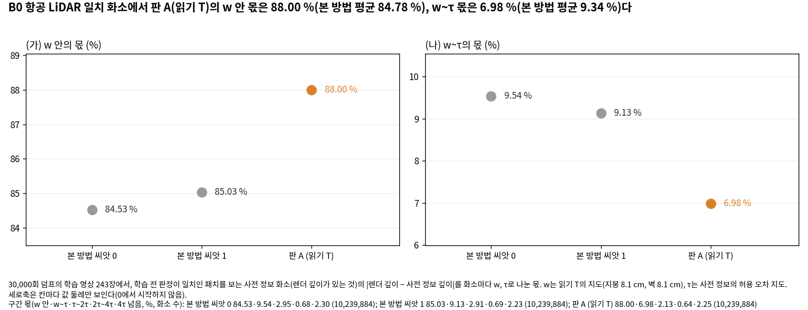

# 고친 판 시험 — 중간 보고 v1

- 작업: PHD-MAIN-FIXTEST-v1 (발주문 `본실험_고친판시험_발주문_v1.md` 8.2), 브랜치 `exp/main-experiment`
- 쓴 때: 2026-10-20 15:15 KST. scientific_verdict: null
- 발주 8.2와 14절대로 차례 2까지의 네 학습만 1번(예측 대 결과)과 7번(그림)의 꼴로 쓴다. 결정을 기다리지 않고 학습을 이어 간다.
- 값은 모두 [이 발주에서 냄]이다. 본 방법 두 씨앗과 참고 열은 새 거리 지표 작업과 같은 스크립트로 셌다(본 방법의 값은 그 작업의 표와 같다). 표 [tables/mid_values.md](tables/mid_values.md), 판정 [tables/mid_predictions.md](tables/mid_predictions.md).

## 네 학습

| GPU | 학습 | 결과 | 걸린 시간 | GPU 메모리 최대 | 가우시안 (사전 정보 출신) | 사전 정보 출신 불투명도 중앙값 |
|---|---|---|---:|---:|---:|---:|
| 0 | 판 A 읽기 L, B0 항공 LiDAR (w = τ = 12.7 cm) | PASS | 75분 | 11.7 GiB | 2,480,006 (262,992) | 0.69 |
| 0 | 판 A 읽기 T, B0 항공 LiDAR (w 8.1 cm, 폭이 좁아진 경우) | PASS | 69분 | 11.2 GiB | 2,365,969 (322,931) | 0.66 |
| 1 | 판 B, R1 LoD2 | PASS | 78분 | 17.4 GiB | 2,957,246 (1,245,049) | 0.23 |
| 1 | 판 B, B173 주변 항공 LiDAR | PASS | 83분 | 14.0 GiB | 3,816,502 (378,523) | 0.75 |

- 발주 차례 1·2의 GPU 0 자리(판 A, B173 주변 두 경우)는 관문에 걸려 학습하지 않았다. 그래서 다음 학습인 B0 항공 LiDAR의 두 읽기를 당겼다(준비 보고 3절).
- 멈춤 조건(메모리 부족, 실행 오류, NaN, 사전 정보 출신 불투명도 중앙값 0.05 미만)에 걸린 학습은 없다.

## 1. 예측 대 결과 (네 학습만)

판정 규칙은 결과를 보기 전에 커밋했다(`scripts/phd/main_fixtest_v1/pred_ft.py`, 44b92ddc).

- 방향을 말한 예측은 그 방향으로 기준을 넘으면 맞음이다. 같음이거나 반대 방향이면 틀림이다.
- 결과가 없거나 표본이 100점 미만이면 판단 불가다.
- 등급은 발주 9.2의 읽기다. 표본이 1만 점 미만이면 가능·근거 불완전까지다.
- A1과 B1은 여러 경우를 말한다. 아래 판정은 이 네 학습에 닿는 부분만이다.

| 예측 | 학습 | 판정 | 등급 | 근거 값 (본 방법 두 씨앗 평균 → 고친 판; 차, 기준; 표본) |
|---|---|---|---|---|
| A1 | 판 A 읽기 T, B0 항공 LiDAR | 틀림 | 같음 | 코드 2 거리 2.57 → 2.47 cm (−0.10, 0.58; 137,426). 치우침 −1.08 → −1.00 cm (+0.08, 0.50; 137,426), 학습 전 사전 정보는 −1.40 cm |
| A1 | 판 A 읽기 L, B0 항공 LiDAR | 판단 불가 | — | 읽기 L에는 폭이 좁아진 경우가 없다(이 경우 w = τ). 같은 값은 거리 2.57 → 2.57 cm, 치우침 −1.08 → −0.95 cm(둘 다 같음) |
| A1 | B173 주변 항공 LiDAR 부분 | 판단 불가 | — | 두 읽기 모두 관문에 걸려 판 A를 학습하지 않았다 |
| A8 | 판 A 읽기 T, B0 항공 LiDAR | 맞음 | 확인 | 판정이 일치인 화소 10,239,884개. w~τ 몫 9.34 → 6.98 % (−2.35 %p, 0.81), w 안 몫 84.78 → 88.00 % (+3.22 %p, 1.00) |
| A8 | 판 A 읽기 L, B0 항공 LiDAR | 판단 불가 | — | w = τ라 w~τ 구간이 비어 있다. w 안 몫 94.12 → 94.19 % |
| B1 | 판 B, B173 주변 항공 LiDAR | 틀림 | 같음 | 결측 R(0.2 m) 0.0 → 0.0 % (+0.00, 2.70; 111). 기준의 두 배 5.41을 넘지 않았다. 사전 정보 신뢰는 63.1 %다. R1·B0 항공 LiDAR 부분은 남은 학습이다 |
| B2 | 판 B, R1 LoD2 | 맞음 | 가능·근거 불완전 | 결측 R(0.2 m) 50.77 → 83.99 % (+33.22 %p, 7.51; 712), 판정만 끈 본 방법은 73.7 %. 결측 영역의 과거 형상 유입률(코드 13) 2.17 → 8.10 % (+5.93 %p, 0.35; 852), 판정만 끈 본 방법은 39.2 % |

### 함께 적는 값 (예측의 볼 값 밖, 같은 학습)

**같은 설정을 다시 돌린 흔들림.** 판 A 읽기 L(B0 항공 LiDAR)은 w = τ라 깊이 항이 당기는 화소까지 본 방법과 같은 학습이다(준비 보고 4.5: 새로 당기는 화소 0). 씨앗도 본 방법 씨앗 0과 같다.

- 그런데도 곳 여섯의 거리·R(τ) 12개 값 가운데 3개가 기준을 넘었다. 비가시 영역은 이 경우 값이 없다.
- 넘은 값: 영상이 틀린 곳 R(τ) 74.96 → 74.59 % (−0.37, 0.34; 1,755), 사전 정보가 틀린 곳 거리 8.65 → 9.19 cm (+0.53, 0.26; 359), 같은 곳 R(τ) 73.26 → 68.52 % (−4.74, 4.41; 359). 셋 모두 가능·근거 불완전이다.
- 학습 한 번의 읽기에서 이 정도는 같은 설정으로도 나온다.

**판 A 읽기 T(B0 항공 LiDAR)의 다른 곳.** 12개 값 가운데 6개가 기준을 넘었다(모두 가능·근거 불완전).

- 영상이 틀린 곳: 거리 9.25 → 8.16 cm, R(τ) 74.96 → 78.58 % (1,755).
- 사전 정보가 틀린 곳: 거리 8.65 → 9.02 cm, R(τ) 73.26 → 66.85 % (359).
- 조금 틀린 곳: R(τ) 73.16 → 70.06 % (177).
- 전체: R(τ) 92.84 → 93.07 % (2,063,378).
- 예측 A2, A5, A6의 판정은 모든 학습이 끝난 뒤 최종 보고에서 한다.

**판 B의 결측이 아닌 곳(B4의 볼 값, 거리·R(τ) 8개).**

- R1 LoD2는 2개가 기준을 넘었다(가능·근거 불완전): 사전 정보가 틀린 곳 거리 6.81 → 7.33 cm (55,198), 조금 틀린 곳 R(τ) 98.60 → 98.78 % (37,084).
- B173 주변 항공 LiDAR도 2개가 넘었다: 두 자료가 모두 맞는 곳 R(τ) 98.66 → 98.73 % (확인, 기준 0.01; 64,322), 사전 정보가 틀린 곳 R(τ) 98.23 → 98.07 % (가능·근거 불완전; 96,269).

**R의 기준이 작은 곳.** 발주 9.2의 '모은 흔들림 폭'은 새 거리 지표 작업에 F1(0.2 m), F1(τ), 거리로만 있다. 그래서 R(τ)와 R(0.2 m)의 기준은 그 경우의 흔들림 폭과 300 ÷ 표본 가운데 큰 값이다. 씨앗 둘이 거의 같고 표본이 큰 곳에서는 기준이 0.1 %p 아래가 된다(위의 B173 주변 두 자료가 모두 맞는 곳 0.01 %p).

**B173 주변 항공 LiDAR 결측 영역.** 평가 범위의 결측 패치는 유리 채광창 둘레의 18개(코드 4 17, 코드 13 1)뿐이다.

- 결과와 참값의 거리는 본 방법 94.2·97.7 cm, 판 B 103.5 cm다.
- 판 B에서 읽기가 바뀐 패치(잘못 놓았던 코드 4 10개, 맞게 놓았던 코드 13 9개, 섞임 코드 4 6개)의 R(0.2 m)와 유입률은 본 방법, 판 B, 판정만 끈 본 방법 모두 0 %다.
- 이 경우 판 B가 더 심는 점은 18개, 학습 전 깊이 항 가중이 0 → 1로 바뀐 화소는 2,267개다(준비 보고 4.4).

## 2. 그림

### 그림 1b (판 A 두 읽기)

B0 항공 LiDAR 면 0의 지지 일치 완만한 지붕 3,848행에서 높이 차(결과 − 참값)의 분포다.

- 중앙값은 본 방법 −1.5·−1.7 cm, 판 A 읽기 T −1.5 cm, 읽기 L −1.5 cm, 학습 전 사전 정보 −1.7 cm다.
- 학습한 결과의 곡선이 겹친다.
- 0.5 cm 칸의 봉우리는 같은 설정끼리도 칸 하나 넘게 흔들린다(본 방법 −1.8·−1.2, 읽기 L −0.2 cm).

### A8 그림 (판 A 읽기 T, B0 항공 LiDAR)

판정이 일치인 사전 정보 화소에서 렌더 깊이가 사전 정보 깊이로부터 w 안(가)과 w~τ(나)에 있는 몫이다. 판 A는 w 안이 늘고 w~τ가 줄었다.

### 그림 3 (판 B, R1 LoD2)

결과 메시가 사전 정보 면 0.2 m 안인 결측 패치 수다.

- 코드 4: 87 → 178 / 198. 위쪽 벽(x −5, y 53~58)이 판 B에서 짙어졌다.
- 코드 13: 7 → 13 / 158. (−8, 55) 둘레 한 곳에 몰려 있다.
- 읽기가 바뀐 패치 가운데 0.2 m 안: 코드 4 47 → 123 / 138, 코드 13 3 → 8 / 142.

### 그림 4 (판 B, B173 주변 항공 LiDAR)

유리 채광창 둘레 결측 패치의 참값 행 가운데 결과 메시 0.2 m 안은 본 방법과 판 B 모두 코드 4 0/111, 코드 13 2/2다. 판 B는 이 자리를 채우지 않았다.

## 3. 이어 가는 것

남은 학습은 9회다. 한 GPU가 먼저 끝나면 다른 GPU의 다음 학습을 맡는다.

| GPU | 차례 |
|---|---|
| 0 | 판 A R1 항공 LiDAR(w = τ; 학습 중, 15:33 끝 어림) → 판 A B0 LoD2 읽기 T → 판 A R1 LoD2 읽기 L → 판 A R1 LoD2 읽기 T |
| 1 | 판 B R1 항공 LiDAR(학습 중, 15:47 끝 어림) → 판 B B0 LoD2 → 판 B B173 주변 LoD2 → 판 B B0 항공 LiDAR → 함께 켠 판 R1 항공 LiDAR |

- 끝 어림은 10월 20일 21시 안팎, 최종 보고는 그 뒤 평가가 끝나면 낸다.

## 4. 결과를 본 뒤 바꾼 것

- 모두 그리는 방법만 바꿨고, 값과 판정 규칙은 그대로다.
- **그림 3:** 높이가 다른 벽 패치가 위에서 겹쳐(코드 4의 198개가 51자리에, 한 자리에 많게는 28개) 판 B의 변화가 보이지 않았다. 그래서 0.3 m 자리마다 묶어 0.2 m 안 몫을 파랑의 짙기로 그렸다(규칙 7). 코드 4와 13은 줄을 나눴다(규칙 8).
- **그림 1b:** 제목을 봉우리 대신 중앙값으로 썼다. 3,848행에서 봉우리가 같은 설정끼리도 칸 하나 넘게 흔들리기 때문이다.
- **A8 그림:** 막대 대신 점으로 그리고 세로축을 값 둘레로 좁혔다(규칙 10).
- **그림 4:** 결측 패치가 범위의 구석에 있어 확대 창을 더했다(규칙 10). 이것은 결과를 보기 전에 바꿨다.

## 5. 걸린 시간 (10월 20일, KST)

| 단계 | 때 | 걸린 시간 |
|---|---|---|
| 학습 4회 | 11:33~14:30 | 한 회 69~83분 (GPU 둘) |
| GPU 후처리 4회 (렌더·화질·TSDF, B173 주변은 가상 시점 메시까지) | 12:48~14:39 | 한 회 7~9분 (post 342~456초, run 39~179초) |
| 지표 단계 4회 | 13:08~14:57 | 한 회 4~19분 |
| 새 거리 지표 (이 작업 결과 4개, B0는 두 번째 참값까지) | 13:44~15:07 | 한 결과 2~10분, 곳 값·표·기제 1~2분 |
| 구간 몫 (A8) | — | 한 결과 35~39초 |
| 그림 넷 | — | 한 장 1초~6분 |
