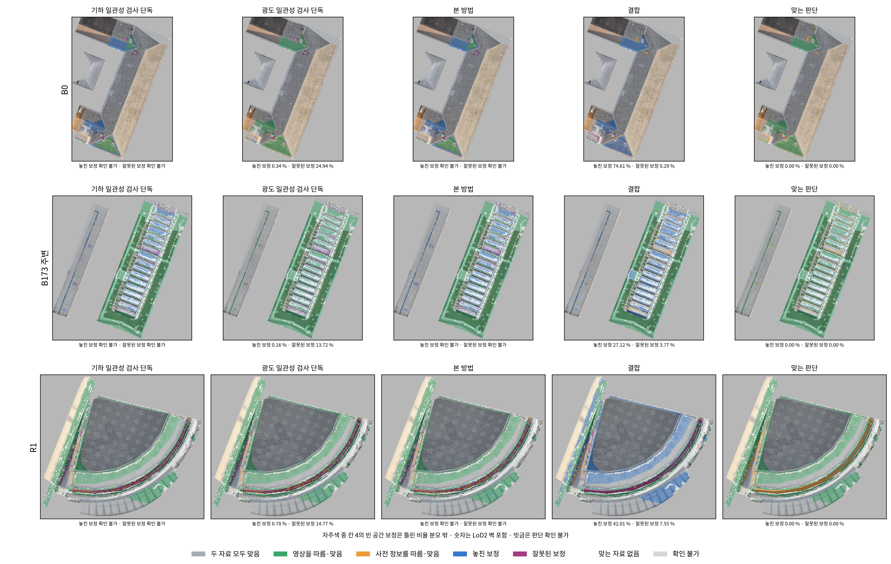
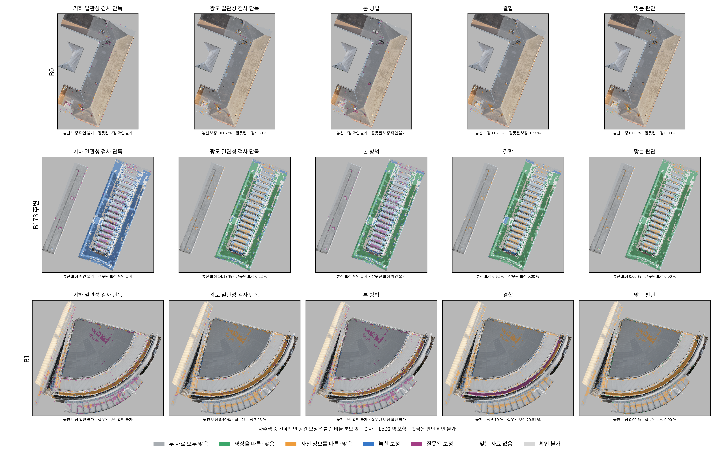

범위 [이 발주에서 냄]: B0_b10: LoD2 5동/82,117점/5,132.25m², ALS 5동/23,280점/1,592.89m²; B173nb_b10: LoD2 3동/141,534점/8,845.88m², ALS 3동/34,273점/2,285.87m²; R1rep_b10: LoD2 2동/79,054점/4,940.88m², ALS 2동/24,189점/1,610.53m²
표 7.1 본 방법(LoD2/ALS): B0_b10: 확인 불가/확인 불가; B173nb_b10: 확인 불가/확인 불가; R1rep_b10: 확인 불가/확인 불가
확인 불가: u_M 67,882개, 본 방법의 전체 비율 6/6칸; 원인별 넓이·하한·상한은 표 7.1. B0/R1의 별도 r8 영역 파일은 없음.
시간(초, 지역별 실행 합계): 기하 127.7, 누락 링 47.0, 시선 776.1, 사진 준비 561.7, 사진 읽기 222.3(점수에 포함), 사진 점수 전체 303.6, 참값 254.2, 표 0.9, 그림 33.8, 검산 1.0, 묶음 본문 3.0초.
장치: jointbuildgs:dev Docker, CPU nice 19·컨테이너 4 CPU/32 GiB 한도, GPU 1 float64 광도 일관성 검사만. GPU 대기 0초. 학습 없음. scientific_verdict: null.

# 판단 적용 보고 v1

## 1. 값
넓은 범위 오차 σ_W=2.138712cm [이 발주에서 냄]. 건물 10동(B0 5, B173 주변 3, R1 2). 이전 JUDGECHECK-v1 값 2.450354cm는 참고값이다. 지역별 r, 한계 25·50·75% 값과 이전 값은 [calibration_comparison](tables/calibration_comparison.md), t·아래 10%·표본 수·넓이는 [photo_thresholds](tables/photo_thresholds.md)에 있다.

| 지역 | 사전 정보 | 종류 | r (cm) | L 중앙값 (cm) | t | 유한한 기준 표본 수 |
| --- | --- | --- | ---: | ---: | ---: | ---: |
| B0_b10 | LoD2 | 지붕 | 7.752729 | 59.337165 | 0.0457919773315318 | 4998 |
| B0_b10 | LoD2 | 벽 | -19.864878 | 72.014443 | 0.002707979635261755 | 4165 |
| B0_b10 | ALS | 지붕 | 1.064362 | 8.706275 | 0.2330323686975117 | 4952 |
| B173nb_b10 | LoD2 | 지붕 | -1.654413 | 48.018823 | 0.13405972056655352 | 4776 |
| B173nb_b10 | LoD2 | 벽 | -1.849931 | 34.220911 | -0.04532413847787161 | 2227 |
| B173nb_b10 | ALS | 지붕 | 5.437032 | 23.670738 | 0.3757212232729167 | 3435 |
| R1rep_b10 | LoD2 | 지붕 | 3.963804 | 42.728888 | -0.007758972703794735 | 3351 |
| R1rep_b10 | LoD2 | 벽 | -1.646185 | 39.693821 | -0.04093611400771974 | 2272 |
| R1rep_b10 | ALS | 지붕 | 1.305485 | 12.890787 | 0.20698522862460156 | 4710 |

## 2. 표 7.1과 그림 7.1·7.2
오판 비율(%). 분모는 각 지역·사전 정보의 칸 1·2 전체 넓이로 모든 방식에 동일하다. 미판정(영역 9)이 분모에 있으면 단일 비율을 비워 둔다. [전체 표](tables/table7_1.md)에 확인된 놓친 보정·잘못된 보정 넓이, 일치로 섞은 넓이, 미판정 넓이 및 가능한 비율 하한·상한을 함께 저장했다. 하한·상한은 미판정 영역의 결과를 추정한 값이 아니다.

| 방식 | B0 LoD2 | B0 ALS | B173 LoD2 | B173 ALS | R1 LoD2 | R1 ALS |
| --- | ---: | ---: | ---: | ---: | ---: | ---: |
| 사전 정보 단독 | 74.89% | 12.02% | 86.10% | 85.51% | 84.78% | 6.91% |
| 영상 단독 | 25.11% | 87.98% | 13.90% | 14.49% | 15.22% | 93.09% |
| 기하 일관성 검사 단독 | 확인 불가 | 확인 불가 | 확인 불가 | 확인 불가 | 확인 불가 | 확인 불가 |
| 광도 일관성 검사 단독 | 25.28% | 19.32% | 13.87% | 14.39% | 15.56% | 13.57% |
| 결합 | 74.90% | 12.43% | 30.89% | 6.62% | 49.56% | 26.91% |
| 본 방법 | 확인 불가 | 확인 불가 | 확인 불가 | 확인 불가 | 확인 불가 | 확인 불가 |

본 방법의 미판정 상태를 남긴 산술 범위 [이 발주에서 냄]:

| 지역 | 사전 정보 | 오판율 하한–상한 | 미판정 넓이(m²) | 공통 분모(m²) |
| --- | --- | ---: | ---: | ---: |
| B0_b10 | LoD2 | 78.09–79.97% | 11.125000 | 590.375000 |
| B0_b10 | ALS | 69.76–77.43% | 2.716947 | 35.401400 |
| B173nb_b10 | LoD2 | 30.68–33.26% | 42.562500 | 1646.812500 |
| B173nb_b10 | ALS | 24.42–27.61% | 34.626859 | 1084.285982 |
| R1rep_b10 | LoD2 | 14.70–20.74% | 89.250000 | 1477.687500 |
| R1rep_b10 | ALS | 52.33–63.52% | 28.064871 | 250.777206 |

그림 7.1. 세 지역 LoD2의 판단과 참값 칸을 겹쳐 표시했다.
본 방법 분모(m²): B0_b10 590.38, B173nb_b10 1646.81, R1rep_b10 1477.69.

그림 7.2. 세 지역 항공 LiDAR 지붕의 판단과 참값 칸을 겹쳐 표시했다.
본 방법 분모(m²): B0_b10 35.40, B173nb_b10 1084.29, R1rep_b10 250.78.

각 3×5 합성 그림과 지역별 PNG 6개, 모두 300dpi 및 같은 이름 JSON. 바탕은 지역마다 한 번 만든 5cm 격자이며 두 사전 정보에 공통 사용했다. 위에서 가려지는 벽은 색칠에서 제외하고 수치에는 포함했다. 미판정은 빗금으로 표시했다.

## 3. 실험 세션 요청
[영역·근거 × 참값 칸](tables/section6_3_regions_by_truth.md), [B173 ALS 칸 2의 0.53m 분할](tables/section6_3_B173_ALS_cell2.md), [일치 영역 사전 정보 무게 분위수](tables/section6_3_prior_weight.md)와 [0.1 간격 분포](tables/section6_3_prior_weight_histogram.md)를 저장했다. 각 넓이·점 수·행 분모·출처는 반올림 전 JSON/CSV에 있다. 무게 분위수는 핵심점별 분포다. [r8 교차표](tables/section6_3_r8_cross.md)는 실제 파일이 있는 B173 주변만 제공한다.

## 4. 두 검사의 확인
[칸 0의 5% 확인](tables/five_percent_check.md)은 1.645/1.96/2.576에서 전체 칸 0 넓이를 분모로 썼다. L이 없는 칸 0이 있으면 전체 비율은 확인 불가다. [광도 판단 × 칸](tables/photo_by_truth.md)과 [벽 원통 5m·10m](tables/wall_5m_10m.md)를 함께 저장했다. [사진 점 범위](tables/photo_point_scope.md)에 이어 쓴 점과 새로 만든 점의 수·넓이가 있다.

## 5. 학습용 판단 파일
`training_regions/`의 B0_b10, B173nb_b10, R1rep_b10 × LoD2, ALS 총 6개 NPZ. [열과 TARGET 번호 대응](training_schema.md), [파일별 자료형·크기·SHA256](tables/file_schema.json)을 참고한다. 일치는 정밀도 가중 평균, 보존·결측은 사전 정보, 보정은 MVS, 빈 공간은 면 없음이다. r 미적용/적용 목표를 두 열로 냈고 단일 목표를 고르지 않았다. 확인 불가 목표를 학습하거나 삭제하는 처리는 하지 않았다.

## 6. 바꾼 것과 확인 불가
상속 파일은 원본 바이트를 보존하고 지역 입력 연결, 5m 벽, 지역 r·공통 σ_W, r 높이에서 한 번 채점, 자른 조각만 사용, 지역 τ와 공통 분모만 어댑터로 적용했다. [파일·줄 변경 기록](source_changes.md)에 근거와 범위를 기록했다. 원본 JPEG·4GiB 캐시·NumPy 큰 페이지 요청 끔을 처음부터 사용했다. CPU/GPU 일치 검산은 반복하지 않았다.
누락 u_M를 같은 링 정의로 다시 계산하여 ALS 44개(B0 2, B173 38, R1 4)를 복구했다. 복구가 B0 r에 영향을 주어 잠정 결과를 revisions/pre_ring 및 pre_ring_photo에 보존하고 B0 사진을 최종 r로 다시 계산했다. 잠정 B0 사진 준비·점수 248.5초는 위 최종 계산 시간과 별도다. 실패와 수정은 [issues](issues.md), 순서는 [progress](progress.md)에 남겼다.
영역 9와 참값 칸 9는 계산 불가 상태다. 불확실성을 대체하거나 분모에서 미판정 부분을 빼지 않았다. 일부 ALS의 건물 ID가 없어 건물별 σ_W 표본에는 넣지 않았으나 전체 핵심점 범위에는 남겼다. 칸 3·5·6은 틀린 비율 분모 밖이다. 결합은 저장된 in_change_25를 그대로 연결했고 메시는 만들지 않았다.
첫 지역 실측 전체 어림은 약 1.36시간으로 6시간 아래였다. 단계 시간은 실행 합계이며 병렬 CPU 작업이 겹친다. 사진 점수 시간에는 JPEG 읽기가 포함된다. 설정 SHA256은 첫 계산 전과 최종 값이 같으며 잠금 기록은 config에 있다. 표 7.1·6.3은 저장 핵심점으로 한 번 독립 검산했고, 그림은 한 번 생성·한 번 열어 확인했다. 묶음 무결성은 별도 delivery_receipt.json의 CRC·내부 SHA256 결과로 확인한다.

scientific_verdict: null
