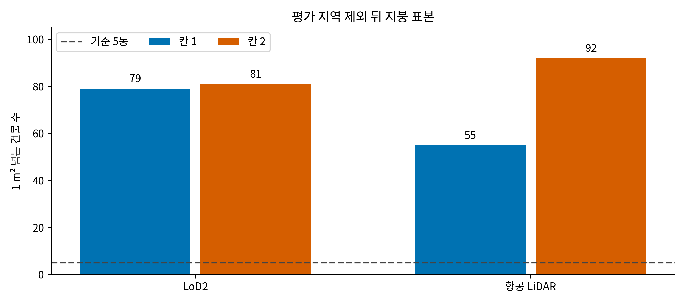
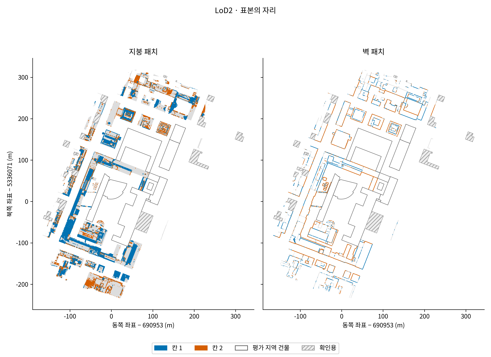
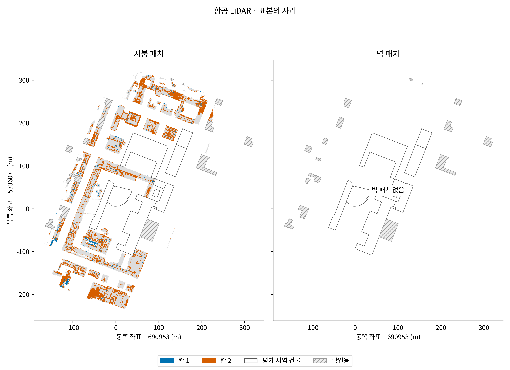
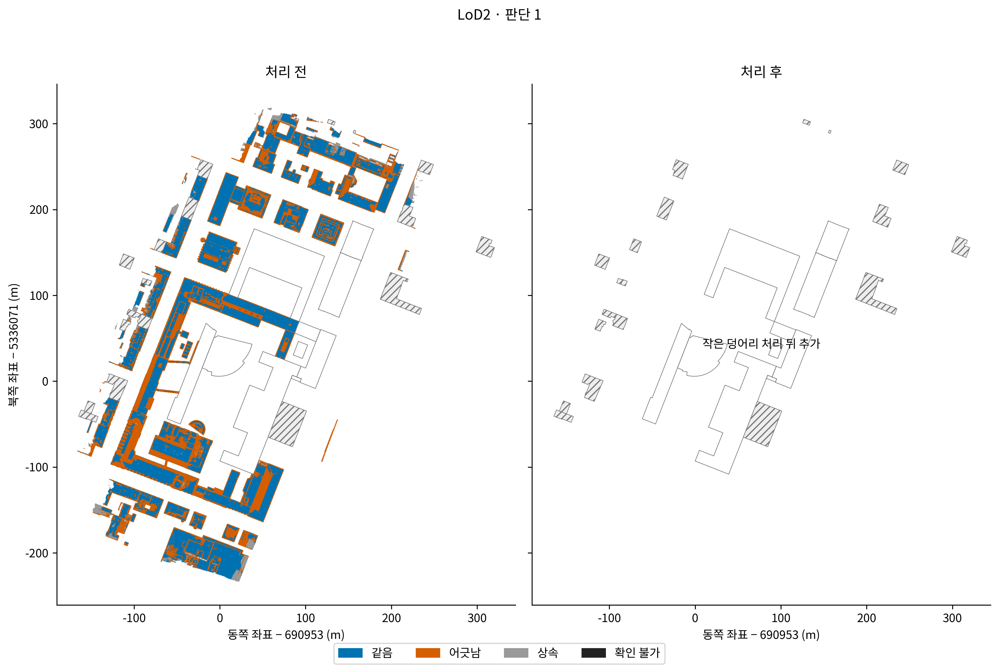
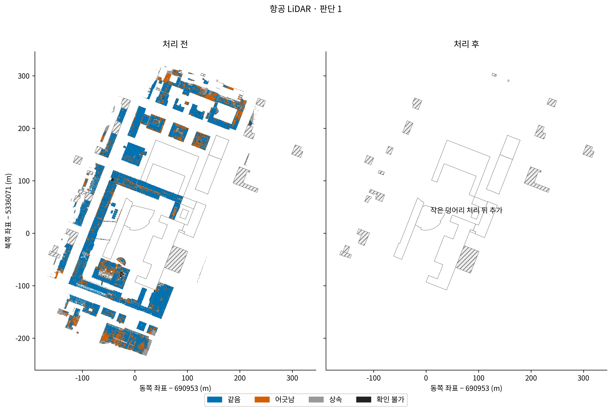
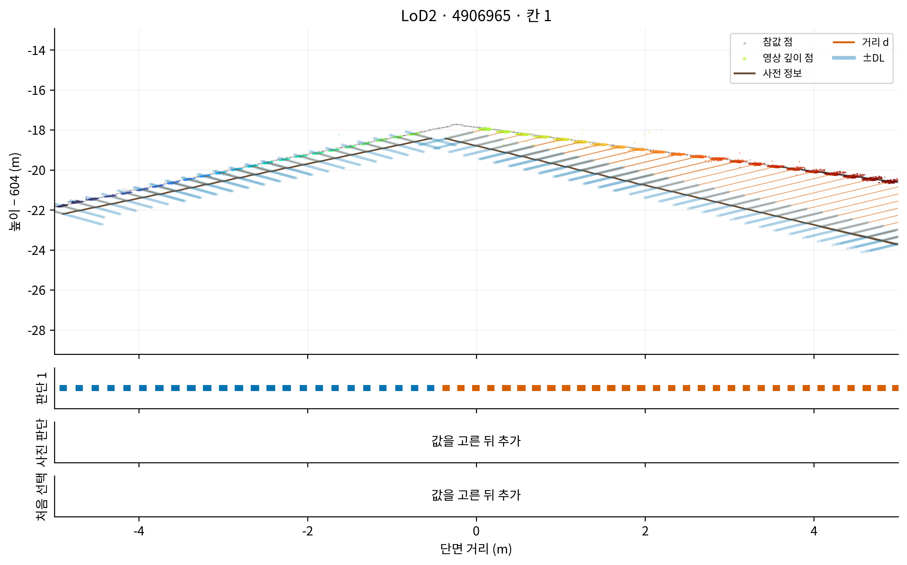
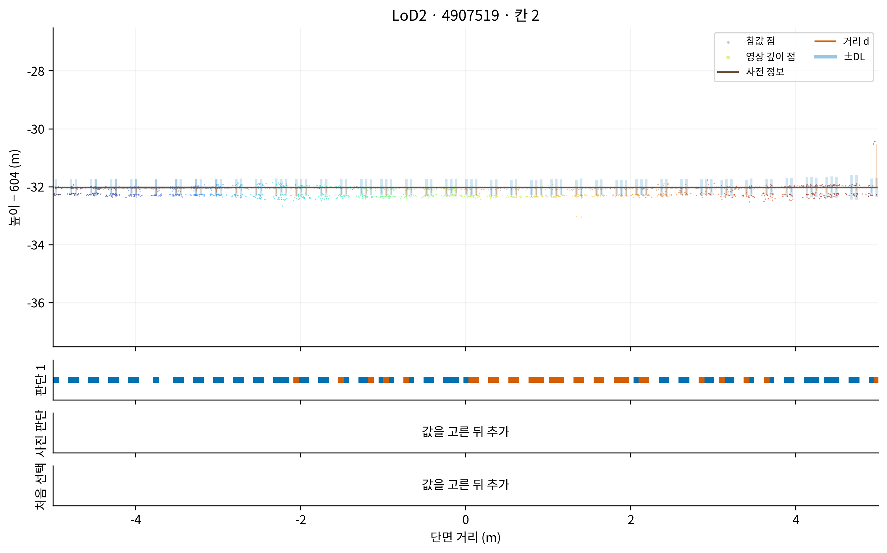
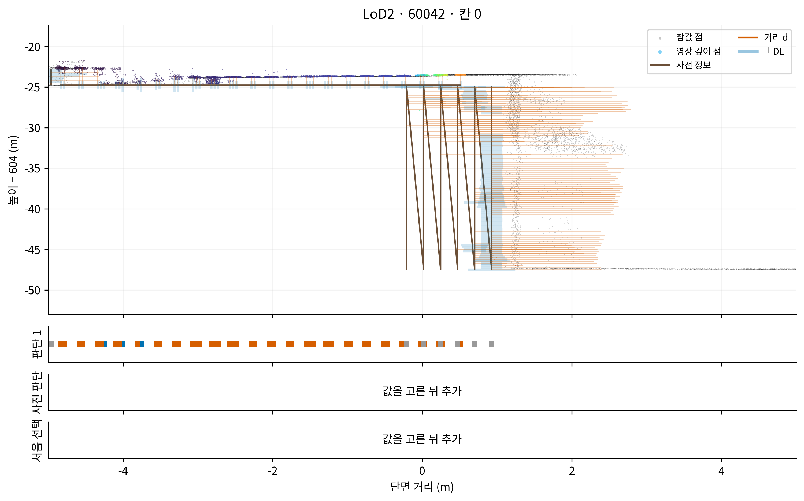
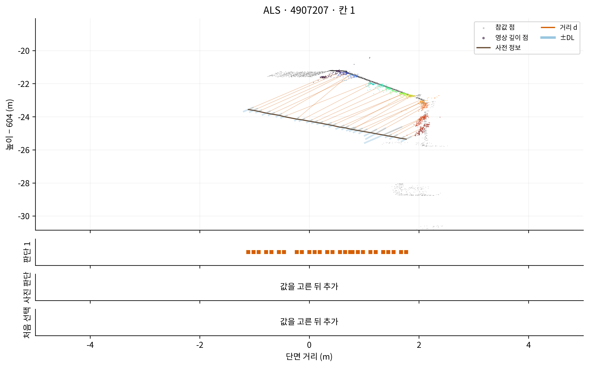
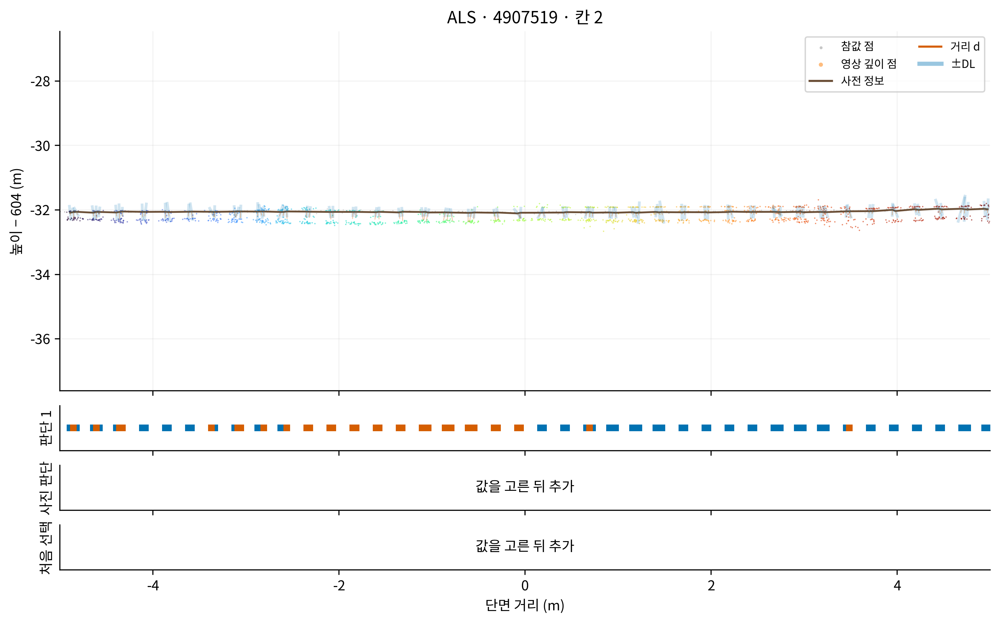

# 판단 숫자 셈 — 중간 보고 v1

표본 검사 통과. 평가 지역 건물 10동을 제외했다. [이 발주에서 냄]
LoD2 125동, 핵심점 2,129,735개. 항공 LiDAR 122동, 핵심점 501,913개.
고른 값: 원통 반지름은 아래 표에 기록했다. 최소 넓이·사진 조합·threshold2는 아직 정하지 않았다.
확인 불가: 원자료의 법선 1,091개, 항공 LiDAR 흔들림 9,192개.
표본 셈 50.35초. 원통 셈 시간 검사 통과. 한 구역 535.93초 × 24구역 = 약 3.57시간이다. 덩어리 분석과 그림 시간은 별도다.

## 범위와 표본 수

| 사전 정보 | 패치 | 건물 수 | 핵심점 수 | 넓이 m² | 칸 1 넓이 m² | 칸 1 >1 m² 건물 | 칸 1 상위 3동 비율 | 칸 2 넓이 m² | 칸 2 >1 m² 건물 | 칸 2 상위 3동 비율 |
|---|---|---:|---:|---:|---:|---:|---:|---:|---:|---:|
| LoD2 | 지붕 | 125 | 644,427 | 40276.687500 | 10248.125000 | 79 | 34.05% | 2673.375000 | 81 | 34.37% |
| LoD2 | 벽 | 125 | 1,485,308 | 92830.625350 | 9378.125002 | 99 | 43.81% | 5380.062500 | 78 | 20.65% |
| ALS | 지붕 | 122 | 501,913 | 33878.187377 | 558.695452 | 55 | 32.74% | 4843.277723 | 92 | 31.55% |
| ALS | 벽 | 0 | 0 | 0.000000 | 0.000000 | 0 | 해당 없음 | 0.000000 | 0 | 해당 없음 |

지붕에서 두 칸 모두 5동 이상이어야 한다. 네 조건 모두 통과했다. 비율의 분모는 해당 칸 전체 넓이다.

위 그림의 색은 넓히기 v2의 참값 칸이다. 아직 계산하지 않은 판단 1을 나타내지 않는다.

## 제외한 건물

| 건물 | 평가 범위 |
|---|---|
| DEBY_LOD2_108580335 | B173nb_b10, B173_b0 |
| DEBY_LOD2_108580336 | B0_b10 |
| DEBY_LOD2_4906968 | R1rep_b10 |
| DEBY_LOD2_4906975 | R1rep_b10 |
| DEBY_LOD2_4959322 | B0_b10 |
| DEBY_LOD2_4959323 | B0_b10 |
| DEBY_LOD2_4959324 | B0_b10 |
| DEBY_LOD2_4959326 | B173nb_b10, B173_b0 |
| DEBY_LOD2_4959460 | B173nb_b10 |
| DEBY_LOD2_4959793 | B0_b10 |

제외 목록과 외곽 표시에는 건물 번호와 GroundSurface XY만 썼다. 평가 지역과 확인용의 패치 측정 행은 해석하거나 집계하지 않았다. 압축 파일의 건너뛰기 과정에서 압축 바이트가 풀릴 수 있으므로 물리적인 디스크 읽기 자체가 없었다는 뜻은 아니다.

## 입력 연결

설정용 2,631,648개 패치를 기존 사진 판단과 patch_id로 연결했다. 판단이 없는 설정용 패치는 0개다. 새 사진 검사는 하지 않았다.

## 잠금과 진행 범위

후보 목록과 선택 규칙을 최초 표본 셈 전에 잠갔다. 단면 좌표는 잠긴 규칙으로 표본 셈 뒤 확정했고 원통 셈 전에 추가로 잠갔다. 이전 설정과 SHA-256을 보존했다. 최초 표본 셈 전에 단면 좌표까지 확정한 것은 아니다.

원통 반지름·검출 한계·처리 전 판단 1을 계산했다. 최소 넓이·처음 선택·민감도·확인용 셈은 아직 완료하지 않았다.

원자료·앞 작업 코드는 수정하지 않았다. CPU 컨테이너, nice 19, GPU 장치 없음, 메모리 상한 32 GB로 실행한다.

`scientific_verdict: null`

근거: [표본 수](tables/sample_counts.json), [건물별 표](tables/sample_buildings.csv), [입력 연결](tables/input_join.json), [확인 불가와 수정 기록](issues.md).

## 단계 가 계산 결과

| 사전 정보 | 패치 | 원통 반지름 m | 중앙값 20 도달 |
|---|---|---:|---|
| LoD2 | 지붕 | 0.075 | True |
| LoD2 | 벽 | 0.125 | True |
| ALS | 지붕 | 0.075 | True |
| ALS | 벽 | 해당 없음 | False |

| 사전 정보 | 패치 | 같음 m² | 어긋남 m² | 상속 m² | 확인 불가 m² |
|---|---|---:|---:|---:|---:|
| LoD2 | 지붕 | 28470.375000 | 9136.937500 | 2669.375000 | 0.000000 |
| LoD2 | 벽 | 39592.875000 | 23849.009317 | 29388.741033 | 0.000000 |
| ALS | 지붕 | 27039.308707 | 4388.156229 | 1929.454800 | 521.267641 |
| ALS | 벽 | 0.000000 | 0.000000 | 0.000000 | 0.000000 |

[후보 반지름 전체 표](tables/stage_a_radius_candidates.md), [지붕 형태별 판단 넓이](tables/stage_a_judgment_areas.md), [옛 규칙과의 비교](tables/stage_a_old_rule_comparison.md), [법선 확인](tables/stage_a_normal_checks.md).

항공 LiDAR의 25배 법선 규칙은 필요한 평면 맞춤 둘레와 잔차 표준 편차가 없어 확인 불가다. 미달 수를 0으로 적지 않았다. 법선 미정의 또는 n≥4에서 사전 정보 흔들림 미정의인 곳은 판단 번호 -1로 따로 보존하며, 상속으로 바꾸지 않았다.

## 판단 1 지도와 단면

처리 후 지도와 단면의 사진 판단·처음 선택은 단계 나 이후에 추가한다. 아직 없는 값을 회색 판단이나 0으로 표시하지 않았다.

확인: 전체 2,631,648행의 검출 한계·판단 식, 실제 자료 원통 270개 직접 비교, 앞 작업 입력 잠금, 공개 파일의 확인용 건물 번호 제외, PNG 300 dpi를 검사했다. 직접 비교의 최대 차이는 6.66e-16 m다. 과학적 결론은 내리지 않았다.
