범위: LoD2 125동, 핵심점 2,129,735개, 133,107.313 m².
범위: 항공 LiDAR 122동, 핵심점 501,913개, 33,878.187 m². 평가 지역 10동 제외.
고른 값: LoD2 지붕: r 0.075 m, A 2.3125 m², δ 0.3/점수 0.5/문턱 0.3 m; LoD2 벽: r 0.125 m, A 12.1875 m², δ 0.3/점수 0.5/문턱 0.3 m; 항공 LiDAR 지붕: r 0.075 m, A 36.0276 m², δ 0.3/점수 0/문턱 1.5 m.
확인 불가: 항공 LiDAR 법선의 25배 규칙, 수치 입력이 없는 판단, 지붕·벽 최소 넓이가 서로 다른 처리를 요구하는 덩어리. 세부 수는 아래 표.
걸린 시간: 최초 설정 잠금 2026-10-31T01:24:46.565222+09:00부터 보고 생성 2026-10-31T02:41:05.835076+09:00까지 76.3분. CPU만 사용. scientific_verdict: null.

# 판단 숫자 셈 — 보고 v1

이 보고의 새 계산값은 모두 **[이 발주에서 냄]**이다. 반올림 전 값·표본 수·출처는 같은 이름의 `tables/` JSON·CSV·Markdown에 있다. 값의 채택과 과학적 결론은 내리지 않았다.

## 1. 단계 가

제외 기준은 고정 GroundSurface XY가 평가 범위 넷 중 하나와 닿는 건물 전체다. 제외 번호: 108580335, 108580336, 4906968, 4906975, 4959322, 4959323, 4959324, 4959326, 4959460, 4959793.

목록·외곽에는 건물 번호와 GroundSurface XY만 썼고, 제외 건물의 측정 행은 해석·집계하지 않았다. 압축 배열의 건너뛰기에서 압축 바이트가 풀리는 일은 있을 수 있다. 물리적 디스크 읽기 자체가 전혀 없었다는 뜻은 아니다.

| 사전 정보/패치 | 건물 | 코어 | 넓이 m² | 칸 1 m² / >1 m² 동 / 상위 3동 | 칸 2 m² / >1 m² 동 / 상위 3동 |
|---|---|---|---|---|---|
| LoD2 지붕 | 125 | 644,427 | 40,276.688 | 10,248.125 / 79 / 34.051% | 2,673.375 / 81 / 34.367% |
| LoD2 벽 | 125 | 1,485,308 | 92,830.625 | 9,378.125 / 99 / 43.807% | 5,380.062 / 78 / 20.650% |
| 항공 LiDAR 지붕 | 122 | 501,913 | 33,878.187 | 558.695 / 55 / 32.736% | 4,843.278 / 92 / 31.546% |
| 항공 LiDAR 벽 | 0 | 0 | 0.000 | 0.000 / 0 / 확인 불가 | 0.000 / 0 / 확인 불가 |

지붕의 칸 1·2 각각 5동 기준을 통과했다. 항공 LiDAR 벽 패치는 없다. 기존 사진 판단은 설정용 2,631,648개 모두 연결되었다. 새 사진 검사는 하지 않았다.

법선은 기존 값 그대로다. 항공 LiDAR는 TIN 삼각형 법선이며, 법선을 만든 평면 맞춤 둘레와 거칠기가 없어 25배 규칙의 미달 수·넓이는 확인 불가다. 법선을 다시 구하지 않았다. [지붕 형태별 법선 표](tables/normal_checks.md).

후보별 점 수 중앙값(Q25–Q75). 아래 표의 통계와 <4 비율의 분모는 최대 반지름에서 점이 있는 코어다. 전체 코어·법선이 있는 코어를 분모로 한 <4 비율도 [분모별 표](tables/radius_sample_denominators.md)에 따로 실었다.

| 반지름 m | LoD2 지붕 | LoD2 벽 | 항공 LiDAR 지붕 |
|---|---|---|---|
| 0.05 | 17 (8–38); <4 9.925% | 4 (1–13); <4 49.151% | 16 (8–36); <4 9.494% |
| 0.075 | 39 (19–86); <4 4.841% | 8 (2–30); <4 30.912% | 37 (19–81); <4 4.204% |
| 0.1 | 69 (34–154); <4 3.507% | 14 (5–53); <4 21.776% | 66 (34–145); <4 2.923% |
| 0.125 | 108 (54–240); <4 2.877% | 22 (8–83); <4 17.395% | 103 (53–226); <4 2.349% |
| 0.15 | 156 (77–346); <4 2.482% | 32 (11–120); <4 14.862% | 149 (77–326); <4 2.013% |
| 0.2 | 278 (138–617); <4 1.988% | 58 (21–215); <4 11.748% | 266 (137–581); <4 1.599% |
| 0.25 | 435 (217–965); <4 1.651% | 91 (34–338); <4 9.643% | 416 (215–910); <4 1.331% |
| 0.3 | 627 (313–1,390); <4 1.357% | 133 (50–490); <4 7.992% | 600 (310–1,313); <4 1.086% |
| 0.4 | 1,118 (561–2,474); <4 0.836% | 242 (94–882); <4 5.393% | 1,070 (555–2,346); <4 0.671% |
| 0.5 | 1,752 (881–3,864); <4 0.380% | 390 (154–1,404); <4 3.195% | 1,677 (872–3,679); <4 0.355% |

원통은 ±5 m, 앞 작업의 바깥 첫 면 탐색과 그 중심 ±1 m 점 선택을 그대로 썼다. d는 바깥 +, s는 표본 표준 편차다. DL = 1.96√(s²/n+a²+2.75²+σp²), 단위 cm. a가 없으면 DL에서만 0으로 두고 표시했다. n<4만 상속이며, 법선·σp가 없어 계산할 수 없는 행은 -1로 보존했다.

| 사전 정보/패치 | 처리 | 같음 m² | 어긋남 m² | 상속 m² | 확인 불가 m² |
|---|---|---|---|---|---|
| LoD2 지붕 | 전 | 28,470.375 | 9,136.938 | 2,669.375 | 0.000 |
| LoD2 지붕 | 후 | 28,946.188 | 8,299.625 | 2,763.812 | 267.062 |
| LoD2 벽 | 전 | 39,592.875 | 23,849.009 | 29,388.741 | 0.000 |
| LoD2 벽 | 후 | 42,325.000 | 18,776.071 | 31,406.991 | 322.562 |
| 항공 LiDAR 지붕 | 전 | 27,039.309 | 4,388.156 | 1,929.455 | 521.268 |
| 항공 LiDAR 지붕 | 후 | 30,241.274 | 923.536 | 2,192.111 | 521.268 |

옛 max(DL, τ) 규칙과 달라진 넓이: LoD2 0.000 m², 항공 LiDAR 1,238.908 m². 옛 규칙은 비교에만 썼다.

[지붕 형태별 판단 넓이](tables/judgment_areas.md) · [반지름 표 전체](tables/radius_candidates.md).

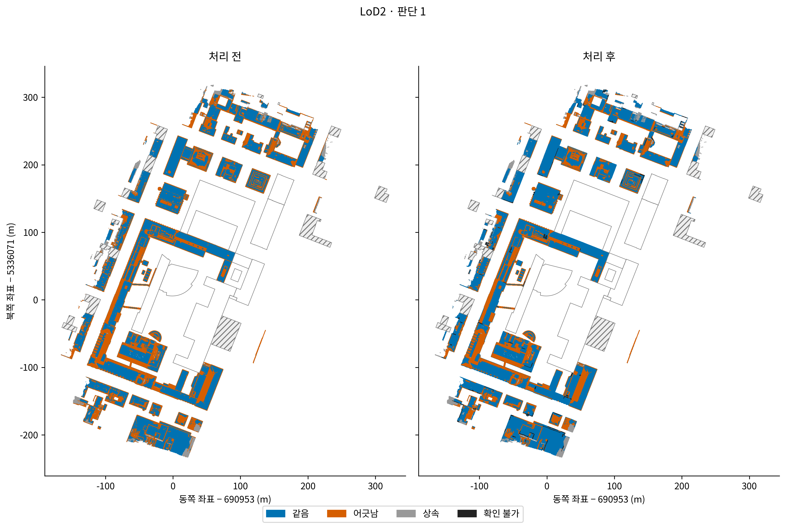

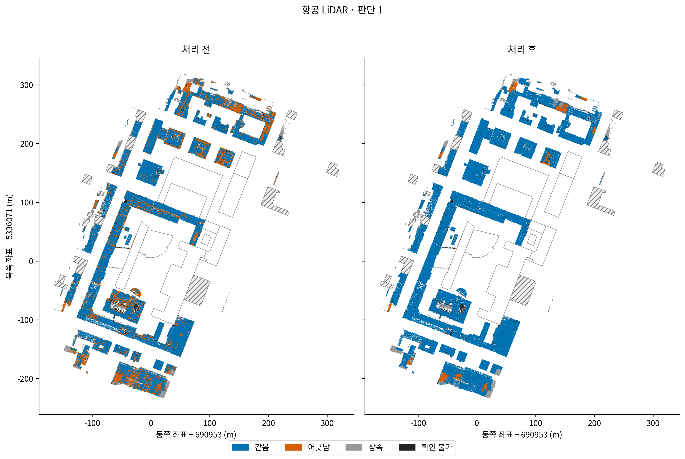

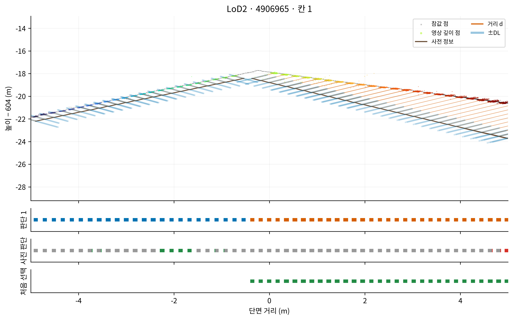

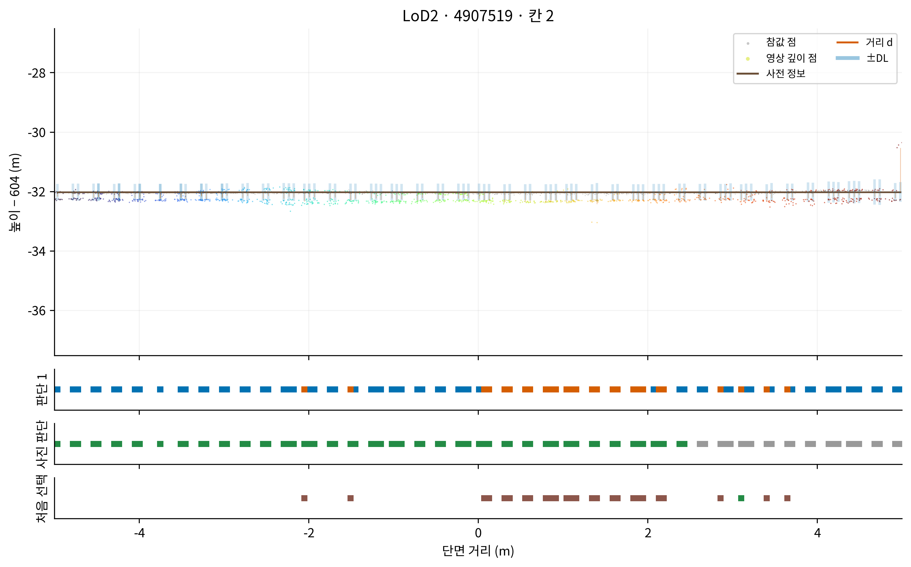

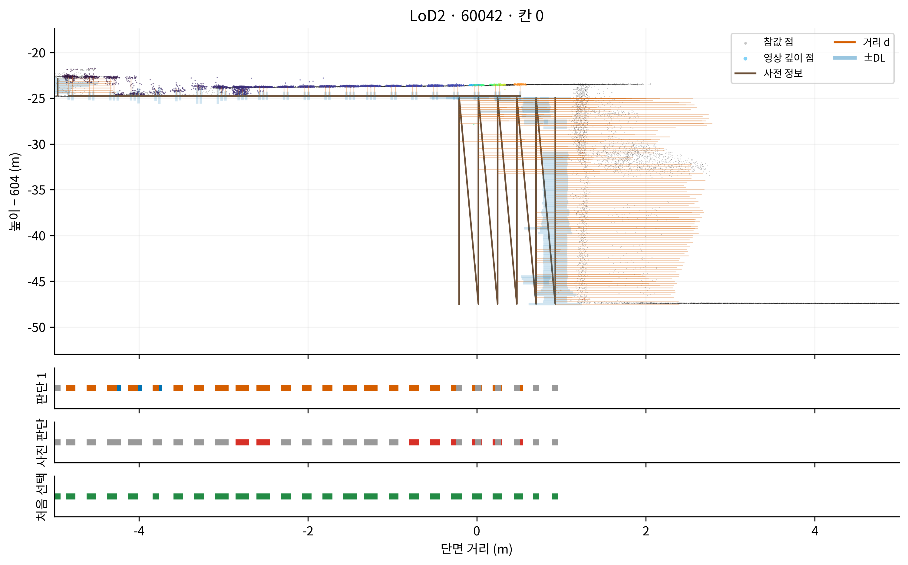

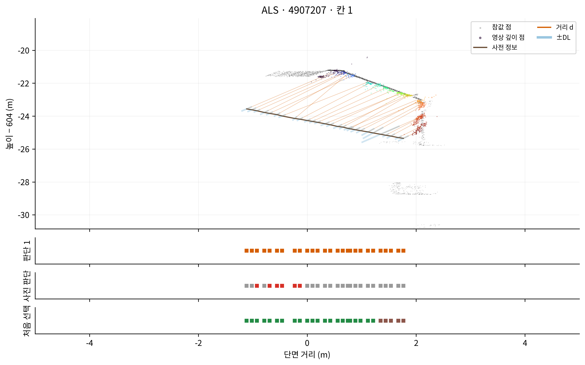

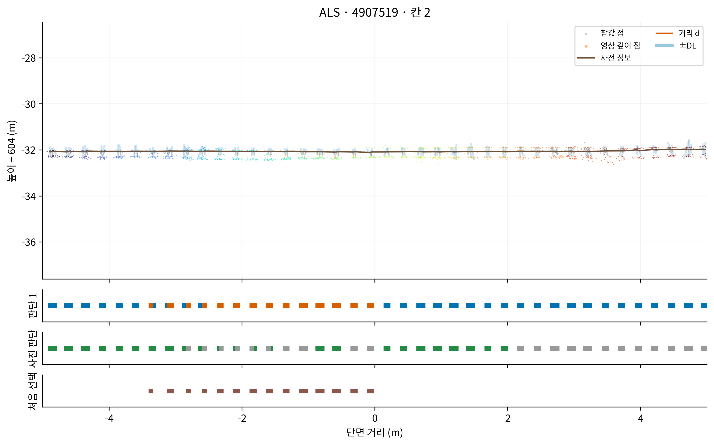

## 2. 최소 넓이

칸 0만 남긴 어긋남 덩어리의 건물별 최대 넓이에서 95% 값을 구했다. 칸 0이 10 m² 이상인 건물만 썼고, A를 엄격히 넘는 비율이 5% 이하가 되도록 higher 분위수를 사용했다.

| 사전 정보/패치 | 칸 0 코어 / m² | 어긋남 비율 | A용 건물 | A m² | A 초과 건물 비율 | A>1 m² |
|---|---|---|---|---|---|---|
| LoD2 지붕 | 355,090 / 22,193.125 | 0.969% | 79 | 2.312 | 3.797% | 예 |
| LoD2 벽 | 289,962 / 18,122.625 | 4.935% | 54 | 12.188 | 3.704% | 예 |
| 항공 LiDAR 지붕 | 382,513 / 25,769.702 | 6.120% | 80 | 36.028 | 3.750% | 예 |

작은 덩어리 처리 뒤 어긋남에서 같음·상속으로 빠진 넓이(m²):

| 패치 | 칸 0 | 칸 1 | 칸 2 | 칸 3 | 칸 4 | 칸 5 | 칸 6 |
|---|---|---|---|---|---|---|---|
| LoD2 지붕 | 81.688 | 186.000 | 111.125 | 95.312 | 20.688 | 18.750 | 56.688 |
| LoD2 벽 | 426.125 | 701.625 | 422.000 | 443.188 | 83.250 | 243.500 | 2,430.688 |
| 항공 LiDAR 지붕 | 1,278.070 | 175.406 | 1,384.207 | 279.501 | 103.341 | 49.588 | 194.508 |

칸 1·2의 값은 진짜 어긋남을 잃은 넓이다. -1로 남긴 지붕·벽 혼합 덩어리는 위 손실에 섞지 않았다. [혼합 덩어리 확인 불가](tables/mixed_cutoff_unavailable_by_cell.md), [작은 같음 섬의 칸별 수·넓이](tables/small_same_island_summary.md), [개별 작은 같음 섬](tables/small_same_islands.md), [건물 크기별 A](tables/minimum_area_by_building_size.md). 같음 섬은 처리하지 않았다.

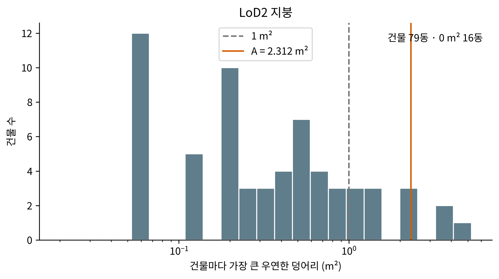

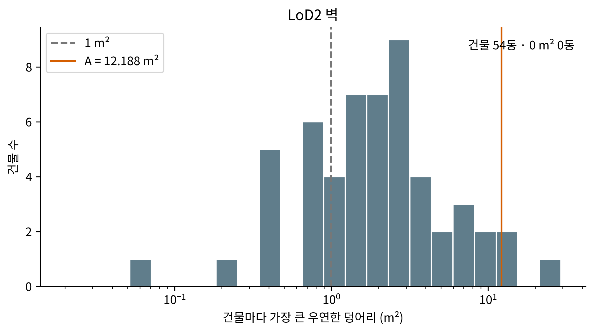

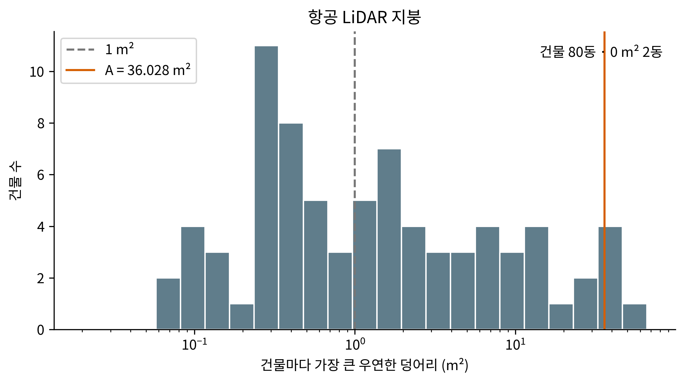

## 3. 사진 조건과 두 번째 문턱

기존 사진 판단 15개 × 문턱 9개를 모두 비교했다. 틀린 넓이는 칸 1의 보존 + 칸 2의 보정이며, 비율의 분모는 처리 후 어긋남 중 칸 0·1·2 넓이다. 칸 3·4·5·6은 선택 오차에서 제외하고 교차표에 넓이를 남겼다. 동률은 큰 문턱, 앞선 사진 순서다.

| 사전 정보/패치 | δ / 최소 점수 | 문턱 | 건물 동일 비중: 사진 번호 / 문턱 | 한 동 제외 시 변경 |
|---|---|---|---|---|
| LoD2 지붕 | 0.3 / 0.5 | 0.3 m | 5 / 0.3 m | 0/95 |
| LoD2 벽 | 0.3 / 0.5 | 0.3 m | 14 / 0.3 m | 0/100 |
| 항공 LiDAR 지붕 | 0.3 / 0 | 1.5 m | 0 / 1.5 m | 1/95 |

지붕·벽 통합 선택: LoD2 사진 번호 14, 문턱 0.3 m, 항공 LiDAR 사진 번호 12, 문턱 1.5 m. 사진 번호는 0부터 시작한다. [15가지 조건](tables/photo_candidates.md) · [전체 선택값](tables/selected_values.md).

한 동 제외에서 바뀐 건물과 새 조합은 각 `*_base_*_leave_one_out.md`에 있다. 건물 동일 비중은 평가 넓이가 있는 건물의 오차 비율 평균이다.

| 패치 | 방법 | 문턱 | 어긋남 m² | 평가 넓이 m² | 틀림 m² / 비율 | 칸 1 틀림 / 칸 2 틀림 m² |
|---|---|---|---|---|---|---|
| LoD2 지붕 | 고른 값 | 0.3 m | 8,299.625 | 6,453.688 | 1,472.938 / 22.823% | 1,064.062 / 408.875 |
| LoD2 지붕 | 사진 없음 | 0.3 m | 8,299.625 | 6,453.688 | 940.750 / 14.577% | 418.188 / 522.562 |
| LoD2 지붕 | 사진 보기 값 | 없음 | 8,299.625 | 6,453.688 | 3,366.000 / 52.156% | 3,258.500 / 107.500 |
| LoD2 벽 | 고른 값 | 0.3 m | 18,776.071 | 7,030.438 | 1,362.625 / 19.382% | 145.188 / 1,217.438 |
| LoD2 벽 | 사진 없음 | 0.3 m | 18,776.071 | 7,030.438 | 1,302.375 / 18.525% | 59.562 / 1,242.812 |
| LoD2 벽 | 사진 보기 값 | 없음 | 18,776.071 | 7,030.438 | 4,385.062 / 62.373% | 4,239.812 / 145.250 |
| 항공 LiDAR 지붕 | 고른 값 | 1.5 m | 923.536 | 843.723 | 17.193 / 2.038% | 6.011 / 11.182 |
| 항공 LiDAR 지붕 | 사진 없음 | 1.5 m | 923.536 | 843.723 | 15.096 / 1.789% | 10.415 / 4.682 |
| 항공 LiDAR 지붕 | 사진 보기 값 | 없음 | 923.536 | 843.723 | 38.905 / 4.611% | 15.790 / 23.115 |

[사진 판단별 넓이·틀린 넓이](tables/selection_comparison.md). 각 방법의 `*_photo_by_cell`과 `*_choice_by_cell` 파일에 사진 판단 × 참값 칸, 처음 선택 × 참값 칸을 따로 실었다.

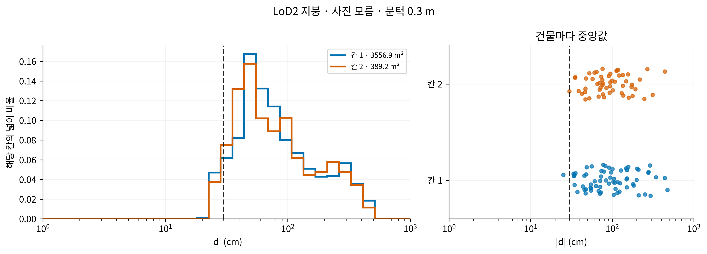

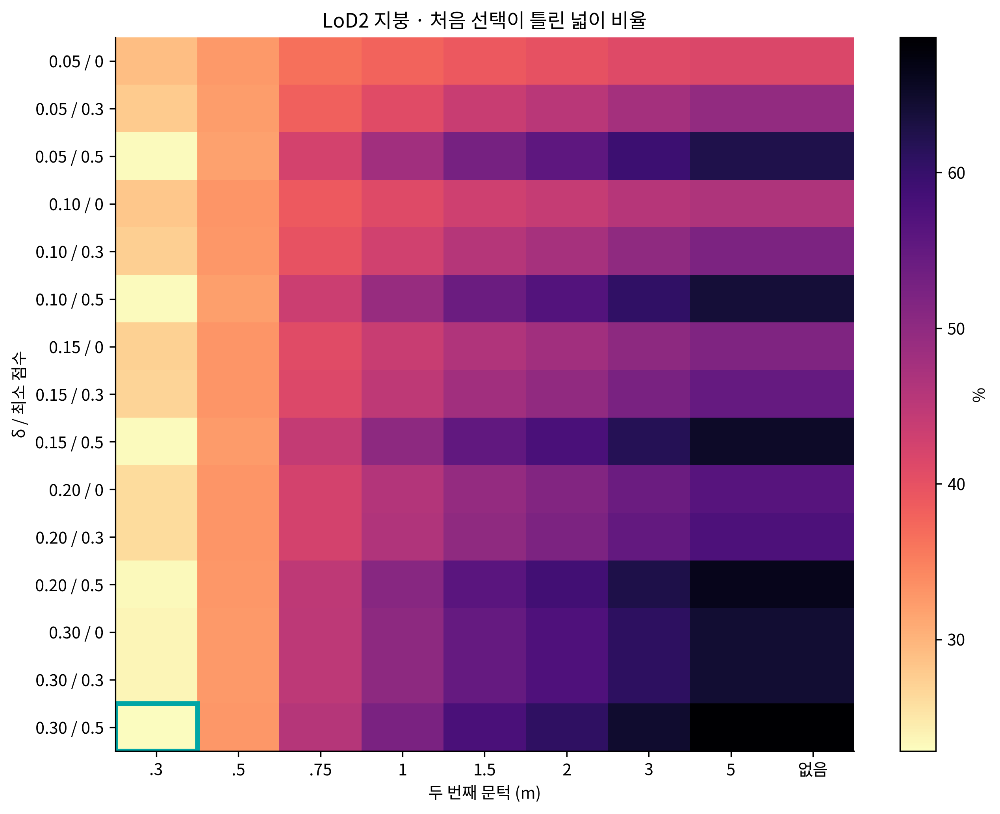

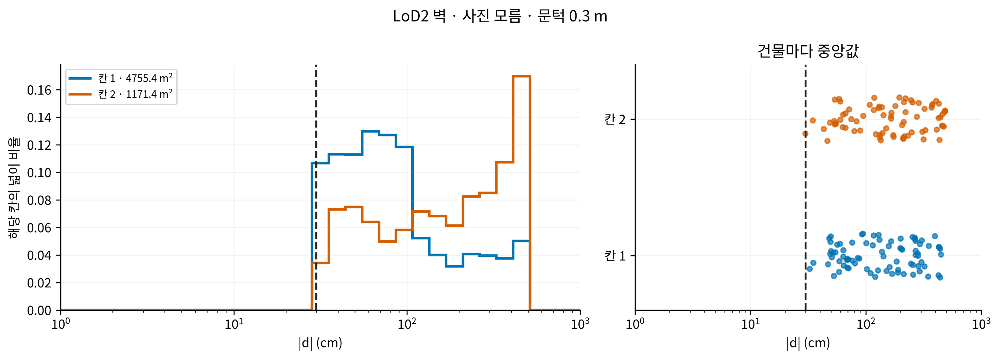

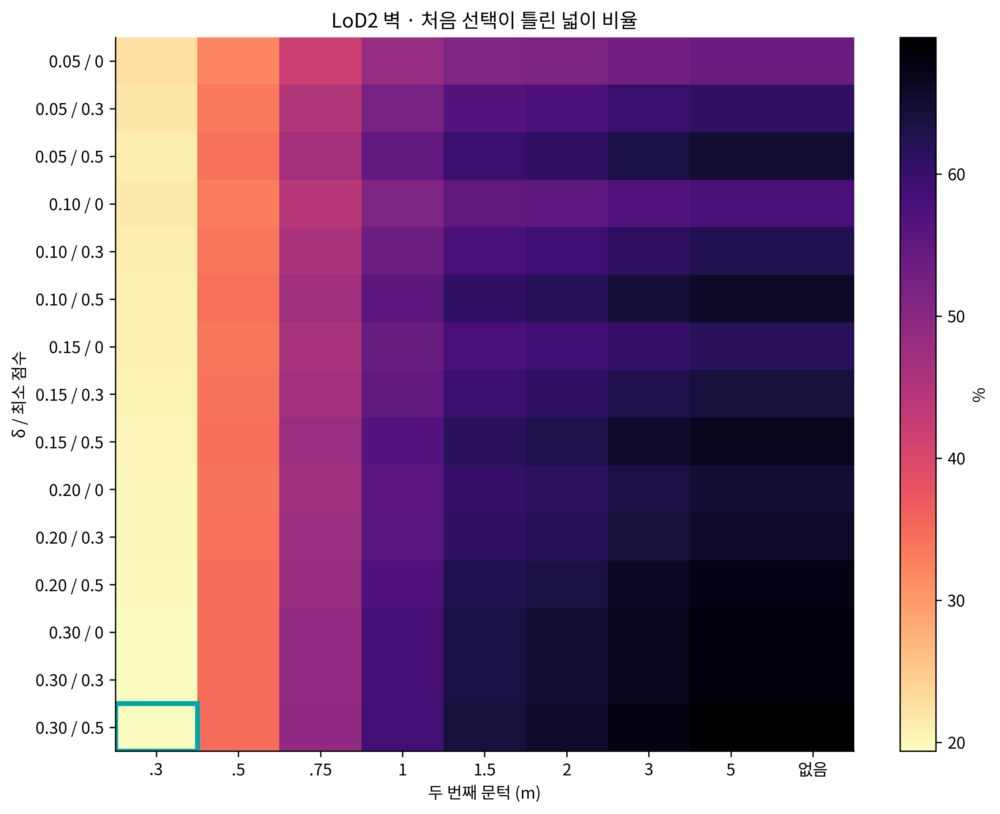

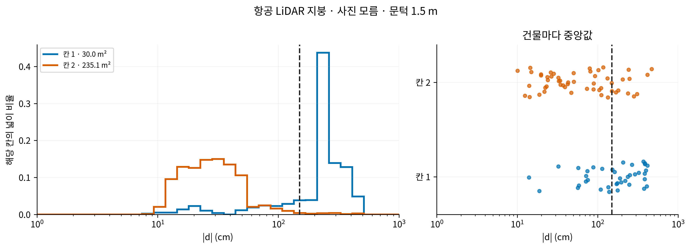

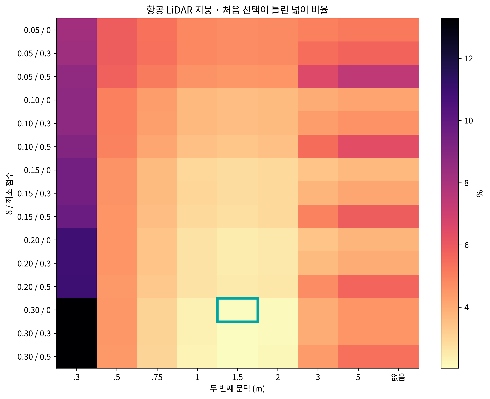

틀린 넓이가 큰 15동(지붕·벽을 각각 고른 실제 선택 합계):

| 사전 정보 | 순위 | 건물 | 어긋남 m² | 틀림 m² | 틀림 비율 |
|---|---|---|---|---|---|
| LoD2 | 1 | 4906967 | 1,739.317 | 291.875 | 29.666% |
| LoD2 | 2 | 60042 | 5,435.688 | 261.250 | 9.852% |
| LoD2 | 3 | 4906982 | 783.688 | 226.188 | 58.626% |
| LoD2 | 4 | 4906985 | 582.875 | 147.000 | 41.650% |
| LoD2 | 5 | 8573849 | 684.000 | 106.938 | 27.280% |
| LoD2 | 6 | 4907520 | 233.188 | 98.625 | 64.094% |
| LoD2 | 7 | 4959461 | 452.375 | 92.125 | 56.671% |
| LoD2 | 8 | 4906965 | 2,216.750 | 90.688 | 6.044% |
| LoD2 | 9 | 4907519 | 657.438 | 83.000 | 26.470% |
| LoD2 | 10 | 4906987 | 229.562 | 80.938 | 52.944% |
| LoD2 | 11 | 4906966 | 822.250 | 78.000 | 12.776% |
| LoD2 | 12 | 4959459 | 198.125 | 74.500 | 72.374% |
| LoD2 | 13 | 4959325 | 584.750 | 72.562 | 38.700% |
| LoD2 | 14 | 8573848 | 1,037.875 | 64.438 | 36.341% |
| LoD2 | 15 | 4907521 | 180.875 | 61.562 | 42.040% |
| 항공 LiDAR | 1 | 4959325 | 87.127 | 5.847 | 7.310% |
| 항공 LiDAR | 2 | 4907519 | 264.354 | 2.228 | 0.852% |
| 항공 LiDAR | 3 | 4907207 | 49.666 | 2.030 | 6.354% |
| 항공 LiDAR | 4 | 4906967 | 6.818 | 1.384 | 43.430% |
| 항공 LiDAR | 5 | 4906965 | 10.277 | 1.002 | 29.720% |
| 항공 LiDAR | 6 | 60042 | 3.864 | 0.466 | 30.027% |
| 항공 LiDAR | 7 | 4907206 | 0.726 | 0.438 | 81.040% |
| 항공 LiDAR | 8 | 4908025 | 0.687 | 0.392 | 63.304% |
| 항공 LiDAR | 9 | 4907514 | 1.354 | 0.317 | 50.876% |
| 항공 LiDAR | 10 | 4907179 | 0.992 | 0.280 | 40.080% |
| 항공 LiDAR | 11 | 4906966 | 2.676 | 0.250 | 14.962% |
| 항공 LiDAR | 12 | 4908028 | 0.313 | 0.210 | 100.000% |
| 항공 LiDAR | 13 | 4906969 | 1.746 | 0.189 | 100.000% |
| 항공 LiDAR | 14 | 4959336 | 1.654 | 0.184 | 22.759% |
| 항공 LiDAR | 15 | 8573849 | 0.866 | 0.140 | 20.804% |

[모든 건물](tables/selected_all_buildings.md).

## 4. 진단 값

| 패치 | 유효 코어 | 68.3% | 95% | 99% |
|---|---|---|---|---|
| LoD2 지붕 | 346803 | 0.594 | 1.297 | 1.957 |
| LoD2 벽 | 279149 | 0.709 | 2.017 | 28.624 |
| 항공 LiDAR 지붕 | 375238 | 0.986 | 2.094 | 3.025 |

위 값은 |d|/DL×1.96의 코어별 분위수다. [지붕 형태·n 구간별 전체 값](tables/model_quantiles.md).

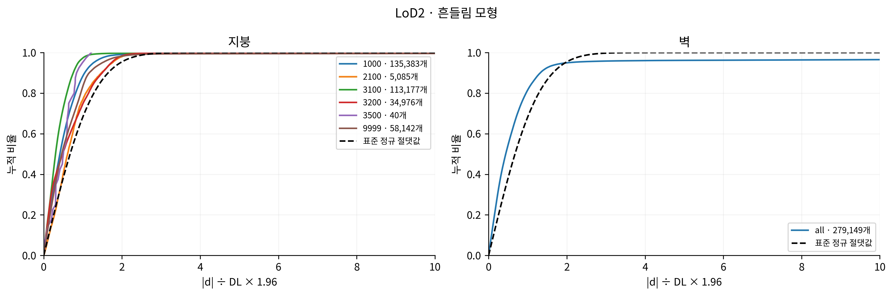

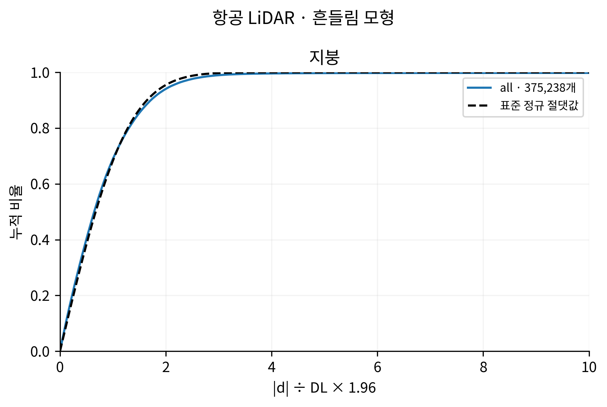

| 패치 | d 중앙값 cm | NMAD cm | 중앙값을 뺀 진단 어긋남 비율 |
|---|---|---|---|
| LoD2 지붕 | 3.437 | 8.642 | 0.850% |
| LoD2 벽 | -1.645 | 9.631 | 4.987% |
| 항공 LiDAR 지붕 | 2.188 | 3.867 | 4.279% |

위 중앙값은 실제 판단에서 빼지 않았다. |gt_p| 또는 |mvs_p|가 원통 반길이를 넘는 넓이(m²):

| 패치 | 칸 | 3 m | 5 m | 10 m |
|---|---|---|---|---|
| LoD2 지붕 | 1 | 663.312 | 176.312 | 0.000 |
| LoD2 지붕 | 2 | 90.188 | 36.688 | 0.000 |
| LoD2 벽 | 1 | 0.000 | 0.000 | 0.000 |
| LoD2 벽 | 2 | 0.000 | 0.000 | 0.000 |
| 항공 LiDAR 지붕 | 1 | 175.370 | 83.021 | 0.000 |
| 항공 LiDAR 지붕 | 2 | 116.989 | 46.706 | 0.000 |

## 5. 민감도

한 번에 한 설정만 바꿨다. 0.5 m는 기존 사진 작업별 묶음에서 사전순 첫 패치를 남기고 묶음 넓이를 더했다. 좌표·법선은 그 패치 그대로다. 선택된 패치의 참값 칸을 썼으므로 칸별 넓이는 기본값과 달라질 수 있다. 코어 간격에 따른 덩어리 연결 반지름의 기존 대체 규칙도 적용했다.

| 패치 | 설정 | 같음/어긋남/상속 | 칸 0 어긋남 | A m² | 사진/문턱 | 틀림 m² / 비율 | 사진 판단 비율 | 기본 조합 / 적용 틀림 m² |
|---|---|---|---|---|---|---|---|---|
| LoD2 지붕 | base | 71.868%/20.607%/6.862% | 0.969% | 2.312 | 14/0.3 m | 1,472.938 / 22.823% | 34.216% | 같음 |
| LoD2 벽 | base | 45.594%/20.226%/33.833% | 4.935% | 12.188 | 14/0.3 m | 1,362.625 / 19.382% | 9.948% | 같음 |
| LoD2 지붕 | confidence90 | 68.769%/23.734%/7.161% | 2.117% | 7.625 | 14/0.3 m | 2,145.562 / 28.155% | 36.420% | 같음 |
| LoD2 벽 | confidence90 | 43.098%/22.894%/33.861% | 6.041% | 12.188 | 12/0.3 m | 1,922.250 / 23.972% | 11.829% | 1,922.875 |
| LoD2 지붕 | confidence99 | 76.820%/15.781%/6.748% | 0.430% | 1.188 | 5/0.3 m | 565.438 / 11.839% | 42.755% | 567.438 |
| LoD2 벽 | confidence99 | 48.763%/16.900%/34.000% | 4.227% | 12.188 | 14/0.3 m | 1,027.125 / 18.320% | 9.950% | 같음 |
| LoD2 지붕 | length3 | 72.245%/19.799%/7.911% | 0.911% | 2.312 | 14/0.3 m | 1,510.188 / 24.240% | 34.121% | 같음 |
| LoD2 벽 | length3 | 46.530%/19.785%/33.661% | 2.143% | 2.812 | 14/0.3 m | 1,316.625 / 18.863% | 10.675% | 같음 |
| LoD2 지붕 | length10 | 71.692%/16.836%/6.765% | 1.058% | 3.438 | 14/0.3 m | 1,197.312 / 22.834% | 34.101% | 같음 |
| LoD2 벽 | length10 | 43.305%/18.058%/35.675% | 15.581% | 116.000 | 14/0.3 m | 994.438 / 14.435% | 9.091% | 같음 |
| 항공 LiDAR 지붕 | base | 89.265%/2.726%/6.471% | 6.120% | 36.028 | 12/1.5 m | 17.193 / 2.038% | 50.415% | 같음 |
| 항공 LiDAR 지붕 | confidence90 | 88.110%/3.627%/6.724% | 10.876% | 52.114 | 14/3 m | 16.356 / 1.391% | 52.520% | 18.265 |
| 항공 LiDAR 지붕 | confidence99 | 89.222%/3.015%/6.224% | 2.002% | 6.766 | 14/2 m | 66.237 / 7.771% | 36.457% | 73.744 |
| 항공 LiDAR 지붕 | length3 | 89.351%/2.540%/6.592% | 6.066% | 35.902 | 12/1.5 m | 16.294 / 2.022% | 48.866% | 같음 |
| 항공 LiDAR 지붕 | length10 | 88.995%/3.074%/6.265% | 6.183% | 36.028 | 12/1.5 m | 32.772 / 3.630% | 49.189% | 같음 |
| LoD2 지붕 | spacing050 | 70.754%/21.696%/6.922% | 1.009% | 2.500 | 14/0.3 m | 1,574.250 / 23.148% | 33.774% | 같음 |
| LoD2 벽 | spacing050 | 42.941%/23.836%/32.915% | 4.701% | 12.250 | 14/0.3 m | 1,720.125 / 21.246% | 9.680% | 같음 |
| 항공 LiDAR 지붕 | spacing050 | 84.159%/8.050%/6.278% | 6.100% | 37.209 | 14/2 m | 126.561 / 5.229% | 35.782% | 135.723 |

비율 합에서 남는 부분은 확인 불가다. [원값·확인 불가 비율](tables/sensitivity.md), [0.5 m 작업 구분 및 넓이 보존 검사](tables/spacing_group_audit.md).

## 6. 발주문의 사전 기대와 계산값

| 계산 전 기대 | 이번 계산 |
|---|---|
| DL 중앙값: 항공 LiDAR 약 8 cm / LoD2 평지붕 약 33 cm / 박공지붕 약 44 cm | 8.619 / 33.119 / 44.149 cm |
| 칸 0 어긋남 비율 약 5% | LoD2 지붕 0.969%; LoD2 벽 4.935%; 항공 LiDAR 지붕 6.120% |
| 지붕 A<1 m², 벽 A가 더 큼 | LoD2 지붕 2.312 m²; LoD2 벽 12.188 m²; 항공 LiDAR 지붕 36.028 m² |
| 항공 LiDAR 옛 규칙과 차이는 |d| 8~12.66 cm, 넓이가 작음 | 1,238.908 m²; |d| 7.679–12.660 cm; 크기 해석 없음 |
| 사진으로 칸 1 틀림 감소, 칸 2 비슷하거나 조금 증가 | 3절 두 기준선의 칸별 틀린 넓이와 나란히 표시; 결론 없음 |

[DL 표본 수·중앙값](tables/DL_medians.md).

## 7. 원사진 모음

처음 선택이 틀린 어긋남 코어를 같은 건물·참값 칸으로 연결했다. 넓이 순 20개씩, 건물당 최대 3개다. 원본 학습 사진에 사전 정보의 패치 지지 영역 테두리를 비췄다. 사진은 완전한 덩어리가 화면 안에 있는 후보 중 앞면 패치의 투영 넓이 합이 가장 큰 것으로 정했다. 각 패치 접평면에서 3 m 여백을 주었고 영상 끝에서는 잘랐다. 새 가림 검사·사진 점수·원인 이름은 붙이지 않았다.

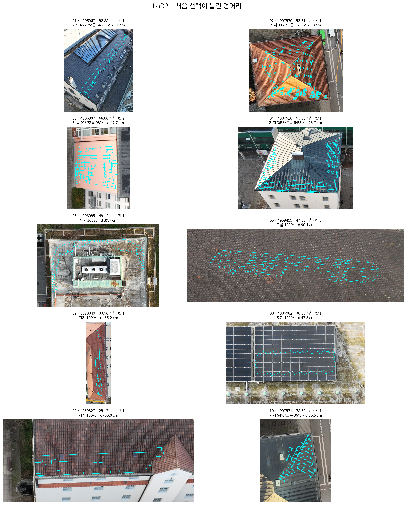

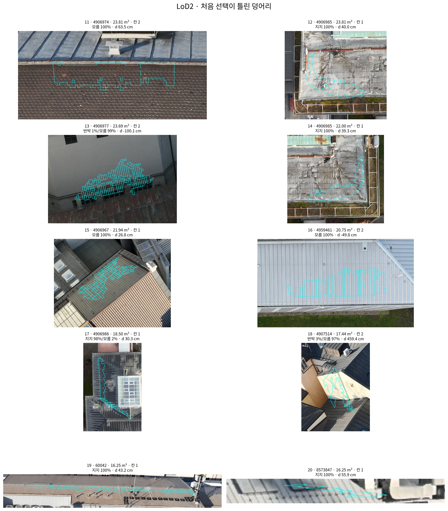

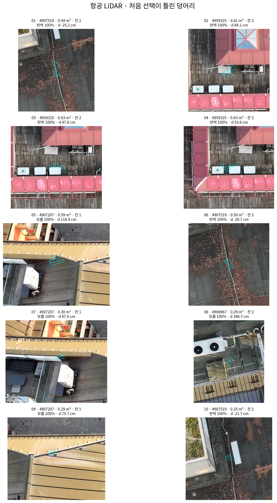

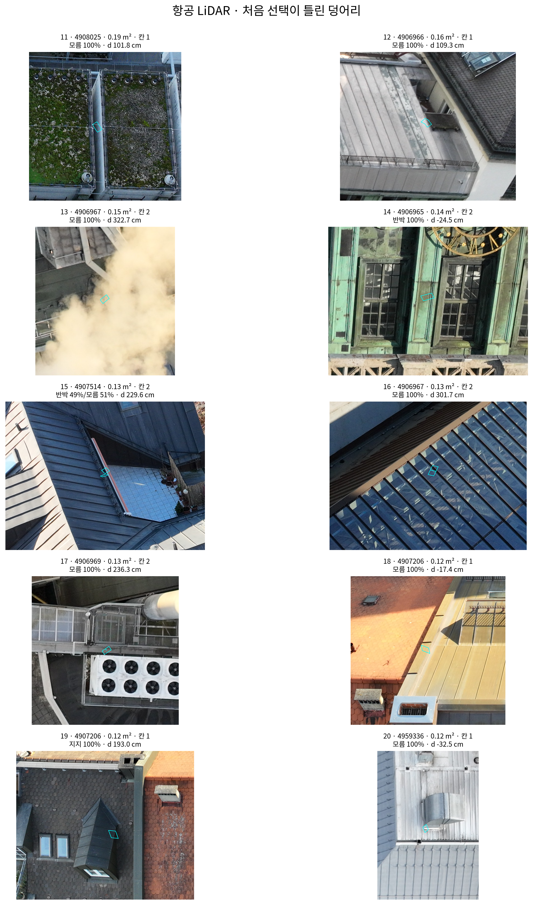

[모음 목록](tables/montage_inventory.md). 사진별 원본 SHA-256, 투영 좌표, 사용 패치는 그림 JSON에 있다.

## 8. 확인용 봉인

| 사전 정보 | 건물 | 코어 | 넓이 m² |
|---|---|---|---|
| LoD2 | 19 | 173,119 | 10,819.871 |
| 항공 LiDAR | 19 | 35,135 | 2,402.496 |

설정용에서 고른 값을 그대로 적용했다. 확인용의 값·판단은 전용 holdout 폴더에만 있다. 전달 ZIP에는 넣지 않았다.

[확인용 파일별 SHA-256](tables/holdout_counts_and_hashes.json). 이 공개 목록의 SHA-256: `0cefda2c6204abdb006b206d24744da2c9542f5d219adee869af1f0999d21858`.

## 9. 변경·확인 불가·시간

| 패치 | 값 | 확인 불가 코어 | 넓이 m² |
|---|---|---|---|
| LoD2 지붕 | a | 28366 | 1,772.875 |
| LoD2 지붕 | judgment_after | 4273 | 267.062 |
| LoD2 지붕 | mixed_cutoff | 4273 | 267.062 |
| LoD2 벽 | a | 408118 | 25,506.421 |
| LoD2 벽 | judgment_after | 5161 | 322.562 |
| LoD2 벽 | mixed_cutoff | 5161 | 322.562 |
| 항공 LiDAR 지붕 | normal | 1091 | 34.214 |
| 항공 LiDAR 지붕 | sigma_p | 9192 | 623.206 |
| 항공 LiDAR 지붕 | a | 14678 | 970.159 |
| 항공 LiDAR 지붕 | judgment_before | 7812 | 521.268 |
| 항공 LiDAR 지붕 | judgment_after | 7812 | 521.268 |

첫 규칙 잠금 뒤 표본 검사로 단면 좌표를 확정하고 원통 계산 전에 좌표를 잠갔다. 따라서 좌표까지 최초 표본 셈 전에 잠근 것은 아니다. 최소 넓이 시험 실행이 중간 보고 커밋보다 먼저 시작된 순서 오류는 중단 후 중간 보고 커밋 `52e91da1`을 완료해 바로잡았다.

수정 기록: 첫 면 탐색 시작 위치, NumPy 문자열 최소값, 최소 넓이 사전 키, cm 내보내기 정밀도, 0.5 m 지붕·벽 사진 작업 이름 충돌. 이전 결과·잠금·실패 로그를 보존했다. 지붕·벽 A가 서로 다른 처리를 요구하는 혼합 덩어리는 -1로 남겼다. [전체 기록](issues.md).

기본·민감도 집계 663.2초, 수정한 0.5 m 재집계 82.9초, 확인용 계산 104.5초. 원통의 사전 시간 어림은 한 구역 535.93초 × 24 = 3.57시간으로 72시간 기준을 통과했다. 설정용 원통 병렬 실행은 01:45:40–01:55:30 KST였다. 그림·검증·포장 시간은 위 집계 시간에 포함하지 않았다.

검증: 전체 기본 코어의 식·단계 가 값 보존, 실제 원통 270개 독립 직접 비교, 135개 조합과 건물 제외 선택의 별도 합계, A의 5% 조건, 앞 작업 잠금, 확인용 공개 제외, 그림 300 dpi. 상세는 [최종 검증](tables/final_validation.json).

핵심점 NPZ와 표로 판단·선택·오차 집계를 다시 확인할 수 있다. 원통·사진 투영을 처음부터 다시 계산하려면 잠금 파일이 가리키는 원 MVS·패치·사진 자료가 필요하다. ZIP의 SHA-256과 CRC는 파일 무결성 확인이며 과학적 타당성의 결론이 아니다.

`scientific_verdict: null`
