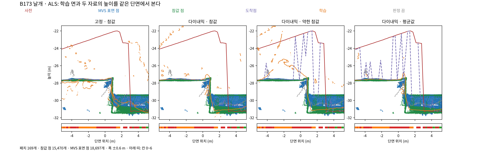
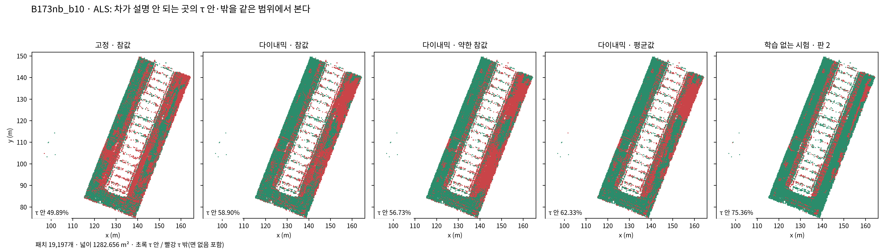
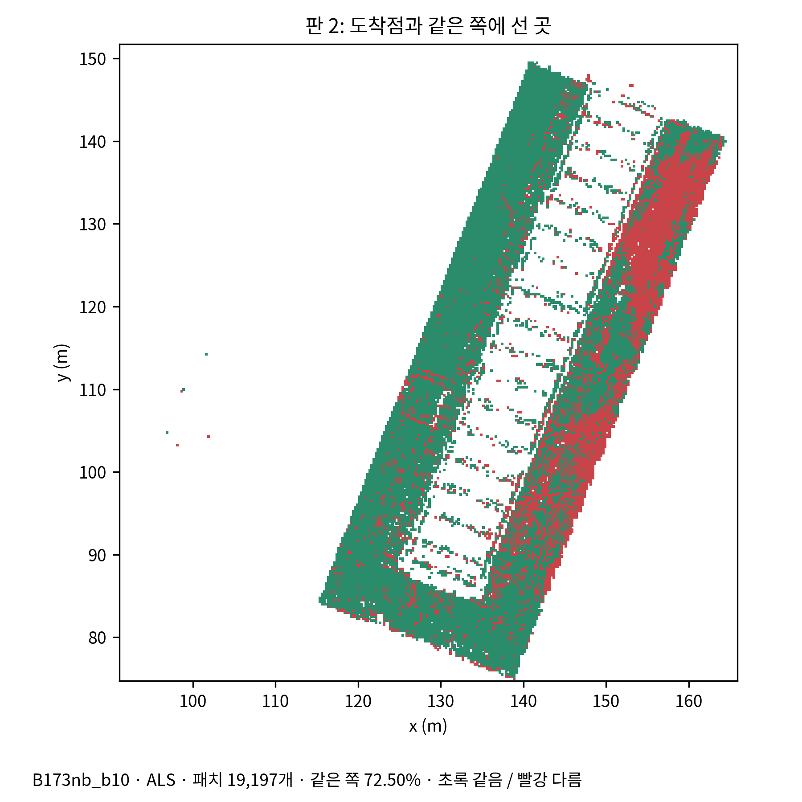
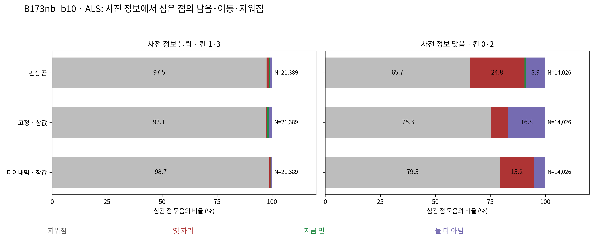
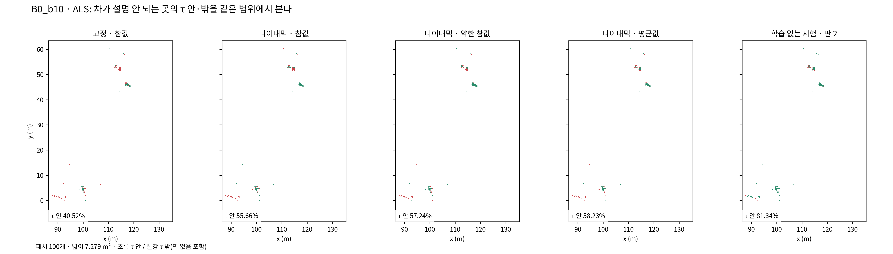
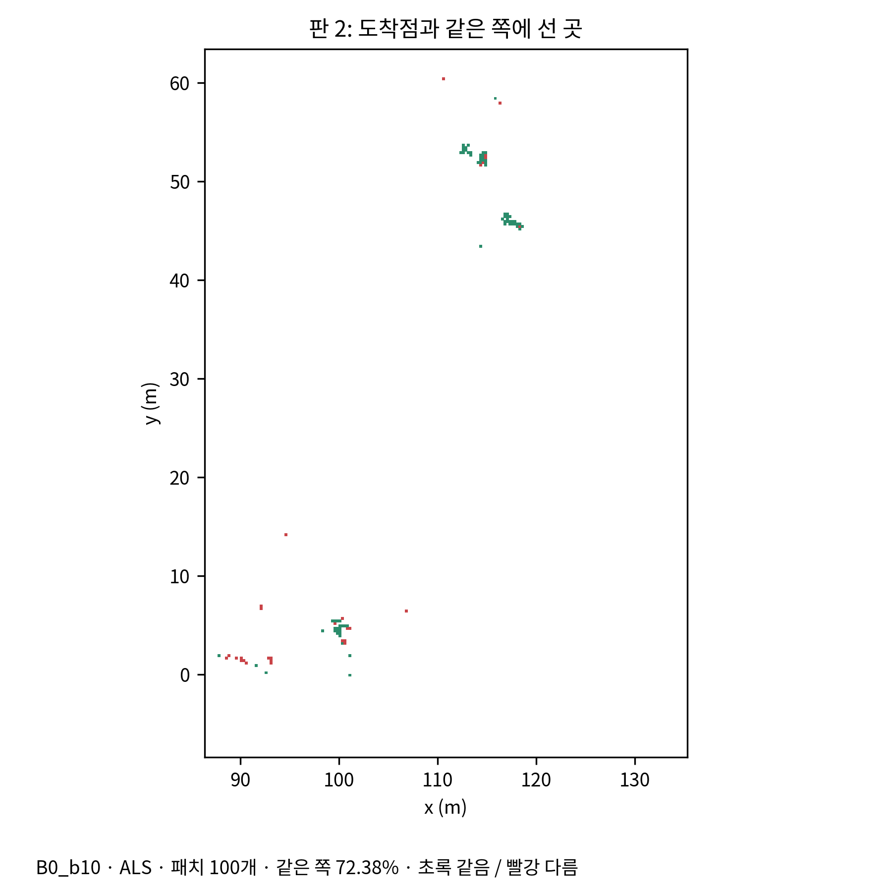
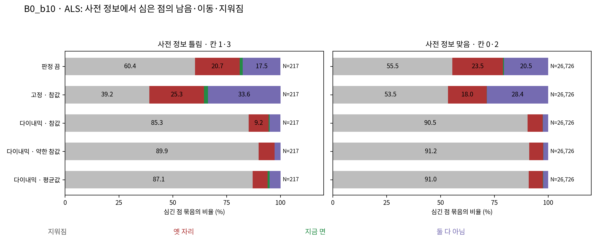

# 손실 학습 시험 — 항공 LiDAR 두 지역 8판 중간 보고

B173 주변과 B0의 네 판씩, 총 8판의 학습 후 실제 시점 메시·패치 채점 자료다. R1 및 LoD2의 결과까지 완성한 보고서는 아니다. scientific_verdict: null.

1단계 패치, 고정된 평가 범위, 동일한 바깥면 첫 교차 채점을 사용한다. 면 없음은 τ 밖으로 센다. N < 100은 표본 부족이다. 두 지역은 따로 비교한다.

## 먼저 볼 값

보존 칸의 τ 안 넓이는 보존 칸 전체에서 참값과 τ 이내인 면적이다. 면 없음 넓이는 전체 칸 0~3에서 결과 면을 만나지 못한 면적이다. 각 비율의 분모는 옆에 적었으며, 중단·미채점 결과를 0으로 넣지 않았다.

| 지역 | 결과 | 전체 τ 안 % | 보존 τ 안 m² | 보존 전체 m² | 보존 τ 안 % | 전체 면 없음 m² | 전체 면 없음 % |
|---|---|---:|---:|---:|---:|---:|---:|
| B173 주변 | 판정 끔 | 75.269943 | 44.023679 | 186.664247 | 23.584420 | 38.062186 | 1.735509 |
| B173 주변 | 1단계 본 방법 씨앗 0 | 74.557592 | 41.218889 | 186.664247 | 22.081834 | 37.100599 | 1.691664 |
| B173 주변 | 1단계 본 방법 씨앗 1 | 74.138416 | 33.464792 | 186.664247 | 17.927799 | 37.908312 | 1.728493 |
| B173 주변 | MVS | 72.088539 | 14.368089 | 186.664247 | 7.697290 | 68.918401 | 3.142449 |
| B173 주변 | 학습 전 사전 정보 | 38.587446 | 157.788204 | 186.664247 | 84.530491 | 1.766372 | 0.080541 |
| B173 주변 | 판 1 고정·참값 | 56.958397 | 79.207680 | 186.664247 | 42.433236 | 85.655172 | 3.905590 |
| B173 주변 | 판 2 다이내믹·참값 | 72.909156 | 154.261646 | 186.664247 | 82.641239 | 38.878918 | 1.772749 |
| B173 주변 | 판 3 다이내믹·약한 참값 | 70.020792 | 148.033937 | 186.664247 | 79.304923 | 38.571905 | 1.758750 |
| B173 주변 | 판 4 다이내믹·평균값 | 75.202141 | 152.749668 | 186.664247 | 81.831240 | 38.727534 | 1.765847 |
| B0 | 판정 끔 | 97.089322 | 9.969061 | 14.218576 | 70.112932 | 0.304123 | 0.019242 |
| B0 | 1단계 본 방법 씨앗 0 | 97.168053 | 9.785369 | 14.218576 | 68.821017 | 0.429243 | 0.027159 |
| B0 | 1단계 본 방법 씨앗 1 | 96.920472 | 9.633337 | 14.218576 | 67.751765 | 0.366660 | 0.023199 |
| B0 | MVS | 97.468111 | 5.369196 | 14.218576 | 37.761836 | 3.618254 | 0.228931 |
| B0 | 학습 전 사전 정보 | 99.254600 | 13.712837 | 14.218576 | 96.443107 | 0.208694 | 0.013204 |
| B0 | 판 1 고정·참값 | 68.122010 | 4.205786 | 14.218576 | 29.579516 | 11.759607 | 0.744045 |
| B0 | 판 2 다이내믹·참값 | 91.989280 | 11.739124 | 14.218576 | 82.561880 | 0.127538 | 0.008070 |
| B0 | 판 3 다이내믹·약한 참값 | 87.337844 | 10.654671 | 14.218576 | 74.934865 | 0.467345 | 0.029569 |
| B0 | 판 4 다이내믹·평균값 | 90.008074 | 10.192600 | 14.218576 | 71.685094 | 0.463810 | 0.029346 |

## B173 주변: 8.1 학습 없는 시험과 학습 후 결과

| 판 | 범위 | N | 전체 m² | 학습 없음 τ 안 % | 학습 τ 안 % | τ 안 m² | 학습 없음 면 없음 % | 학습 면 없음 % | 학습 면 없음 m² |
|---|---|---:|---:|---:|---:|---:|---:|---:|---:|
| 판 1 고정·참값 | 전체 칸 0~3 | 33020 | 2193.142699 | 83.404028 | 56.958397 | 1249.178919 | 0.000000 | 3.905590 | 85.655172 |
| 판 1 고정·참값 | 다듬기 | 10945 | 702.495997 | 100.000000 | 74.794016 | 525.424969 | 0.000000 | 0.121140 | 0.851002 |
| 판 1 고정·참값 | 보정 | 14497 | 968.400266 | 94.681584 | 59.720949 | 578.337829 | 0.000000 | 4.615450 | 44.696028 |
| 판 1 고정·참값 | 보존 | 2598 | 186.664247 | 92.692086 | 42.433236 | 79.207680 | 0.000000 | 0.282915 | 0.528101 |
| 판 1 고정·참값 | 이중 오류 | 4980 | 335.582189 | 10.952209 | 19.729427 | 66.208442 | 0.000000 | 11.794440 | 39.580041 |
| 판 1 고정·참값 | 차가 설명 안 됨 | 19197 | 1282.656271 | 73.965447 | 49.885432 | 639.858626 | 0.000000 | 6.567240 | 84.235112 |
| 판 1 고정·참값 | 설명 안 됨·보정 | 14387 | 960.104280 | 94.642140 | 59.931367 | 575.403622 | 0.000000 | 4.643515 | 44.582583 |
| 판 1 고정·참값 | 설명 안 됨·보존 | 104 | 7.563182 | 41.880807 | 42.594819 | 3.221524 | 0.000000 | 0.958426 | 0.072487 |
| 판 1 고정·참값 | MVS 없음·사전 맞음 · 표본 부족 | 17 | 1.457565 | 100.000000 | 13.457328 | 0.196149 | 0.000000 | 0.000000 | 0.000000 |
| 판 1 고정·참값 | MVS 없음·사전 틀림 | 175 | 12.521963 | 0.000000 | 6.921062 | 0.866653 | 0.000000 | 43.444738 | 5.440134 |
| 판 2 다이내믹·참값 | 전체 칸 0~3 | 33020 | 2193.142699 | 84.198672 | 72.909156 | 1599.001833 | 0.000000 | 1.772749 | 38.878918 |
| 판 2 다이내믹·참값 | 다듬기 | 10945 | 702.495997 | 100.000000 | 96.664899 | 679.067047 | 0.000000 | 0.126845 | 0.891078 |
| 판 2 다이내믹·참값 | 보정 | 14497 | 968.400266 | 100.000000 | 69.497952 | 673.018355 | 0.000000 | 2.492982 | 24.142048 |
| 판 2 다이내믹·참값 | 보존 | 2598 | 186.664247 | 94.061084 | 82.641239 | 154.261646 | 0.000000 | 0.120760 | 0.225416 |
| 판 2 다이내믹·참값 | 이중 오류 | 4980 | 335.582189 | 0.036459 | 27.610161 | 92.654784 | 0.000000 | 4.058730 | 13.620376 |
| 판 2 다이내믹·참값 | 차가 설명 안 됨 | 19197 | 1282.656271 | 75.355877 | 58.904536 | 755.542731 | 0.000000 | 2.918758 | 37.437633 |
| 판 2 다이내믹·참값 | 설명 안 됨·보정 | 14387 | 960.104280 | 100.000000 | 69.480586 | 667.086077 | 0.000000 | 2.502708 | 24.028603 |
| 판 2 다이내믹·참값 | 설명 안 됨·보존 | 104 | 7.563182 | 81.667624 | 29.901734 | 2.261523 | 0.000000 | 0.000000 | 0.000000 |
| 판 2 다이내믹·참값 | MVS 없음·사전 맞음 · 표본 부족 | 17 | 1.457565 | 100.000000 | 24.139928 | 0.351855 | 0.000000 | 0.000000 | 0.000000 |
| 판 2 다이내믹·참값 | MVS 없음·사전 틀림 | 175 | 12.521963 | 0.000000 | 20.510663 | 2.568338 | 0.000000 | 29.586588 | 3.704822 |
| 판 3 다이내믹·약한 참값 | 전체 칸 0~3 | 33020 | 2193.142699 | 80.287915 | 70.020792 | 1535.655883 | 0.000000 | 1.758750 | 38.571905 |
| 판 3 다이내믹·약한 참값 | 다듬기 | 10945 | 702.495997 | 100.000000 | 92.470050 | 649.598397 | 0.000000 | 0.111790 | 0.785320 |
| 판 3 다이내믹·약한 참값 | 보정 | 14497 | 968.400266 | 90.656007 | 66.945567 | 648.301049 | 0.000000 | 2.486622 | 24.080452 |
| 판 3 다이내믹·약한 참값 | 보존 | 2598 | 186.664247 | 93.742856 | 79.304923 | 148.033937 | 0.000000 | 0.120760 | 0.225416 |
| 판 3 다이내믹·약한 참값 | 이중 오류 | 4980 | 335.582189 | 1.619616 | 26.736371 | 89.722500 | 0.000000 | 4.017113 | 13.480717 |
| 판 3 다이내믹·약한 참값 | 차가 설명 안 됨 | 19197 | 1282.656271 | 68.552658 | 56.728270 | 727.628715 | 0.000000 | 2.903068 | 37.236378 |
| 판 3 다이내믹·약한 참값 | 설명 안 됨·보정 | 14387 | 960.104280 | 90.905690 | 66.978369 | 643.062187 | 0.000000 | 2.496292 | 23.967007 |
| 판 3 다이내믹·약한 참값 | 설명 안 됨·보존 | 104 | 7.563182 | 73.813553 | 24.895692 | 1.882907 | 0.000000 | 0.000000 | 0.000000 |
| 판 3 다이내믹·약한 참값 | MVS 없음·사전 맞음 · 표본 부족 | 17 | 1.457565 | 100.000000 | 29.703928 | 0.432954 | 0.000000 | 0.000000 | 0.000000 |
| 판 3 다이내믹·약한 참값 | MVS 없음·사전 틀림 | 175 | 12.521963 | 0.000000 | 18.513875 | 2.318301 | 0.000000 | 28.596926 | 3.580897 |
| 판 4 다이내믹·평균값 | 전체 칸 0~3 | 33020 | 2193.142699 | 70.009014 | 75.202141 | 1649.290260 | 0.000000 | 1.765847 | 38.727534 |
| 판 4 다이내믹·평균값 | 다듬기 | 10945 | 702.495997 | 100.000000 | 97.771360 | 686.839891 | 0.000000 | 0.065507 | 0.460183 |
| 판 4 다이내믹·평균값 | 보정 | 14497 | 968.400266 | 67.735410 | 73.863777 | 715.297009 | 0.000000 | 2.632360 | 25.491785 |
| 판 4 다이내믹·평균값 | 보존 | 2598 | 186.664247 | 92.159924 | 81.831240 | 152.749668 | 0.000000 | 0.057494 | 0.107321 |
| 판 4 다이내믹·평균값 | 이중 오류 | 4980 | 335.582189 | 1.466725 | 28.131317 | 94.403691 | 0.000000 | 3.775005 | 12.668245 |
| 판 4 다이내믹·평균값 | 차가 설명 안 됨 | 19197 | 1282.656271 | 50.994386 | 62.325459 | 799.421414 | 0.000000 | 2.949757 | 37.835239 |
| 판 4 다이내믹·평균값 | 설명 안 됨·보정 | 14387 | 960.104280 | 67.772373 | 73.902540 | 709.541446 | 0.000000 | 2.643290 | 25.378341 |
| 판 4 다이내믹·평균값 | 설명 안 됨·보존 | 104 | 7.563182 | 37.748833 | 30.021220 | 2.270560 | 0.000000 | 0.000000 | 0.000000 |
| 판 4 다이내믹·평균값 | MVS 없음·사전 맞음 · 표본 부족 | 17 | 1.457565 | 100.000000 | 29.703928 | 0.432954 | 0.000000 | 0.000000 | 0.000000 |
| 판 4 다이내믹·평균값 | MVS 없음·사전 틀림 | 175 | 12.521963 | 0.000000 | 20.025299 | 2.507561 | 0.000000 | 29.139278 | 3.648810 |

다듬기 칸(칸 0)의 참값까지 거리 중앙값은 면을 만난 패치에서 계산한다. 면 없음은 위 표에 별도로 남기며 τ 안 비율에서는 실패로 센다.

| 판 | 학습 없음 관측 N | 학습 없음 거리 중앙값 m | 학습 관측 N | 학습 거리 중앙값 m |
|---|---:|---:|---:|---:|
| 판 1 고정·참값 | 10945 | 0.018411 | 10937 | 0.043294 |
| 판 2 다이내믹·참값 | 10945 | 0.018783 | 10937 | 0.021113 |
| 판 3 다이내믹·약한 참값 | 10945 | 0.018790 | 10938 | 0.022586 |
| 판 4 다이내믹·평균값 | 10945 | 0.018790 | 10941 | 0.021216 |

## B0: 8.1 학습 없는 시험과 학습 후 결과

| 판 | 범위 | N | 전체 m² | 학습 없음 τ 안 % | 학습 τ 안 % | τ 안 m² | 학습 없음 면 없음 % | 학습 면 없음 % | 학습 면 없음 m² |
|---|---|---:|---:|---:|---:|---:|---:|---:|---:|
| 판 1 고정·참값 | 전체 칸 0~3 | 23084 | 1580.497720 | 99.746190 | 68.122010 | 1076.666817 | 0.000000 | 0.744045 | 11.759607 |
| 판 1 고정·참값 | 다듬기 | 22726 | 1554.508947 | 100.000000 | 68.777127 | 1069.146596 | 0.000000 | 0.666210 | 10.356293 |
| 판 1 고정·참값 | 보정 | 115 | 8.583459 | 96.877410 | 31.795104 | 2.729120 | 0.000000 | 3.158938 | 0.271146 |
| 판 1 고정·참값 | 보존 | 201 | 14.218576 | 92.931956 | 29.579516 | 4.205786 | 0.000000 | 7.051034 | 1.002557 |
| 판 1 고정·참값 | 이중 오류 · 표본 부족 | 42 | 3.186738 | 14.067076 | 18.367217 | 0.585315 | 0.000000 | 4.067204 | 0.129611 |
| 판 1 고정·참값 | 차가 설명 안 됨 | 100 | 7.279294 | 77.693537 | 40.524198 | 2.949875 | 0.000000 | 6.261741 | 0.455811 |
| 판 1 고정·참값 | 설명 안 됨·보정 · 표본 부족 | 45 | 3.260234 | 95.956737 | 46.143661 | 1.504391 | 0.000000 | 4.245193 | 0.138403 |
| 판 1 고정·참값 | 설명 안 됨·보존 · 표본 부족 | 39 | 2.660567 | 80.718884 | 43.439455 | 1.155736 | 0.000000 | 7.058503 | 0.187796 |
| 판 1 고정·참값 | MVS 없음·사전 맞음 · 표본 부족 | 5 | 0.462467 | 100.000000 | 54.350920 | 0.251355 | 0.000000 | 0.000000 | 0.000000 |
| 판 1 고정·참값 | MVS 없음·사전 틀림 · 표본 부족 | 3 | 0.324563 | 0.000000 | 0.000000 | 0.000000 | 0.000000 | 0.000000 | 0.000000 |
| 판 2 다이내믹·참값 | 전체 칸 0~3 | 23084 | 1580.497720 | 99.751980 | 91.989280 | 1453.888481 | 0.000000 | 0.008070 | 0.127538 |
| 판 2 다이내믹·참값 | 다듬기 | 22726 | 1554.508947 | 100.000000 | 92.474147 | 1437.518884 | 0.000000 | 0.004029 | 0.062635 |
| 판 2 다이내믹·참값 | 보정 | 115 | 8.583459 | 98.362315 | 47.844078 | 4.106677 | 0.000000 | 0.756142 | 0.064903 |
| 판 2 다이내믹·참값 | 보존 | 201 | 14.218576 | 95.831939 | 82.561880 | 11.739124 | 0.000000 | 0.000000 | 0.000000 |
| 판 2 다이내믹·참값 | 이중 오류 · 표본 부족 | 42 | 3.186738 | 0.000000 | 16.436729 | 0.523795 | 0.000000 | 0.000000 | 0.000000 |
| 판 2 다이내믹·참값 | 차가 설명 안 됨 | 100 | 7.279294 | 81.337573 | 55.657328 | 4.051460 | 0.000000 | 0.000000 | 0.000000 |
| 판 2 다이내믹·참값 | 설명 안 됨·보정 · 표본 부족 | 45 | 3.260234 | 100.000000 | 63.160119 | 2.059167 | 0.000000 | 0.000000 | 0.000000 |
| 판 2 다이내믹·참값 | 설명 안 됨·보존 · 표본 부족 | 39 | 2.660567 | 100.000000 | 60.041223 | 1.597437 | 0.000000 | 0.000000 | 0.000000 |
| 판 2 다이내믹·참값 | MVS 없음·사전 맞음 · 표본 부족 | 5 | 0.462467 | 100.000000 | 31.585604 | 0.146073 | 0.000000 | 0.000000 | 0.000000 |
| 판 2 다이내믹·참값 | MVS 없음·사전 틀림 · 표본 부족 | 3 | 0.324563 | 0.000000 | 31.737523 | 0.103008 | 0.000000 | 0.000000 | 0.000000 |
| 판 3 다이내믹·약한 참값 | 전체 칸 0~3 | 23084 | 1580.497720 | 99.489841 | 87.337844 | 1380.372636 | 0.000000 | 0.029569 | 0.467345 |
| 판 3 다이내믹·약한 참값 | 다듬기 | 22726 | 1554.508947 | 100.000000 | 87.787488 | 1364.664358 | 0.000000 | 0.012747 | 0.198154 |
| 판 3 다이내믹·약한 참값 | 보정 | 115 | 8.583459 | 48.962160 | 50.545275 | 4.338533 | 0.000000 | 0.756142 | 0.064903 |
| 판 3 다이내믹·약한 참값 | 보존 | 201 | 14.218576 | 95.182100 | 74.934865 | 10.654671 | 0.000000 | 1.436765 | 0.204288 |
| 판 3 다이내믹·약한 참값 | 이중 오류 · 표본 부족 | 42 | 3.186738 | 5.947408 | 22.439043 | 0.715073 | 0.000000 | 0.000000 | 0.000000 |
| 판 3 다이내믹·약한 참값 | 차가 설명 안 됨 | 100 | 7.279294 | 60.374429 | 57.240683 | 4.166717 | 0.000000 | 0.000000 | 0.000000 |
| 판 3 다이내믹·약한 참값 | 설명 안 됨·보정 · 표본 부족 | 45 | 3.260234 | 56.028583 | 68.534478 | 2.234384 | 0.000000 | 0.000000 | 0.000000 |
| 판 3 다이내믹·약한 참값 | 설명 안 됨·보존 · 표본 부족 | 39 | 2.660567 | 96.527137 | 55.819179 | 1.485107 | 0.000000 | 0.000000 | 0.000000 |
| 판 3 다이내믹·약한 참값 | MVS 없음·사전 맞음 · 표본 부족 | 5 | 0.462467 | 100.000000 | 31.585604 | 0.146073 | 0.000000 | 0.000000 | 0.000000 |
| 판 3 다이내믹·약한 참값 | MVS 없음·사전 틀림 · 표본 부족 | 3 | 0.324563 | 0.000000 | 36.524953 | 0.118547 | 0.000000 | 0.000000 | 0.000000 |
| 판 4 다이내믹·평균값 | 전체 칸 0~3 | 23084 | 1580.497720 | 99.379800 | 90.008074 | 1422.575550 | 0.000000 | 0.029346 | 0.463810 |
| 판 4 다이내믹·평균값 | 다듬기 | 22726 | 1554.508947 | 100.000000 | 90.511594 | 1407.010823 | 0.000000 | 0.004169 | 0.064813 |
| 판 4 다이내믹·평균값 | 보정 | 115 | 8.583459 | 33.555614 | 55.781840 | 4.788012 | 0.000000 | 2.268426 | 0.194709 |
| 판 4 다이내믹·평균값 | 보존 | 201 | 14.218576 | 92.691936 | 71.685094 | 10.192600 | 0.000000 | 1.436765 | 0.204288 |
| 판 4 다이내믹·평균값 | 이중 오류 · 표본 부족 | 42 | 3.186738 | 3.979661 | 18.329598 | 0.584116 | 0.000000 | 0.000000 | 0.000000 |
| 판 4 다이내믹·평균값 | 차가 설명 안 됨 | 100 | 7.279294 | 37.343615 | 58.233920 | 4.239018 | 0.000000 | 0.000000 | 0.000000 |
| 판 4 다이내믹·평균값 | 설명 안 됨·보정 · 표본 부족 | 45 | 3.260234 | 15.466625 | 77.020958 | 2.511063 | 0.000000 | 0.000000 | 0.000000 |
| 판 4 다이내믹·평균값 | 설명 안 됨·보존 · 표본 부족 | 39 | 2.660567 | 83.219225 | 53.059571 | 1.411685 | 0.000000 | 0.000000 | 0.000000 |
| 판 4 다이내믹·평균값 | MVS 없음·사전 맞음 · 표본 부족 | 5 | 0.462467 | 100.000000 | 31.585604 | 0.146073 | 0.000000 | 0.000000 | 0.000000 |
| 판 4 다이내믹·평균값 | MVS 없음·사전 틀림 · 표본 부족 | 3 | 0.324563 | 0.000000 | 36.524953 | 0.118547 | 0.000000 | 0.000000 | 0.000000 |

다듬기 칸(칸 0)의 참값까지 거리 중앙값은 면을 만난 패치에서 계산한다. 면 없음은 위 표에 별도로 남기며 τ 안 비율에서는 실패로 센다.

| 판 | 학습 없음 관측 N | 학습 없음 거리 중앙값 m | 학습 관측 N | 학습 거리 중앙값 m |
|---|---:|---:|---:|---:|
| 판 1 고정·참값 | 22726 | 0.013461 | 22572 | 0.057230 |
| 판 2 다이내믹·참값 | 22726 | 0.013446 | 22725 | 0.020627 |
| 판 3 다이내믹·약한 참값 | 22726 | 0.013446 | 22723 | 0.020800 |
| 판 4 다이내믹·평균값 | 22726 | 0.013446 | 22725 | 0.018541 |

## 8.4 같은 규칙으로 계산한 지표별 문턱

단위 폭은 2.8 × |prop_ALS_s0 − prop_ALS_s1| / √2다. 비율의 문턱 단위는 %p, 거리 중앙값의 문턱은 m다. 모은 폭이 없는 지표는 자료 없음이며, 거리에 300/N을 적용하지 않는다. 차이가 최댓값의 두 배를 넘으면 수치 차이 확인, 최댓값 초과부터 두 배 이하는 가능·근거 불완전이다. 이 표는 판정 문턱을 제공하며 방법론의 과학적 판정을 하지 않는다.

| 지역 | 범위 | 지표 | N | 모은 폭 | 단위 폭 | 300/N | 최댓값 |
|---|---|---|---:|---:|---:|---:|---:|
| B173 주변 | 전체 칸 0~3 | τ 안 % | 33020 | 자료 없음 | 0.829927 | 0.009085 | 0.829927 |
| B173 주변 | 전체 칸 0~3 | 면 없음 % | 33020 | 자료 없음 | 0.072918 | 0.009085 | 0.072918 |
| B173 주변 | 다듬기 | τ 안 % | 10945 | 자료 없음 | 0.137599 | 0.027410 | 0.137599 |
| B173 주변 | 다듬기 | 면 없음 % | 10945 | 자료 없음 | 0.000000 | 0.027410 | 0.027410 |
| B173 주변 | 다듬기 | 거리 중앙값 m | 10938 | 자료 없음 | 0.000013 | 적용 없음 | 0.000013 |
| B173 주변 | 보정 | τ 안 % | 14497 | 자료 없음 | 0.060719 | 0.020694 | 0.060719 |
| B173 주변 | 보정 | 면 없음 % | 14497 | 자료 없음 | 0.085020 | 0.020694 | 0.085020 |
| B173 주변 | 보존 | τ 안 % | 2598 | 자료 없음 | 8.224569 | 0.115473 | 8.224569 |
| B173 주변 | 보존 | 면 없음 % | 2598 | 자료 없음 | 0.000000 | 0.115473 | 0.115473 |
| B173 주변 | 이중 오류 | τ 안 % | 4980 | 자료 없음 | 1.312283 | 0.060241 | 1.312283 |
| B173 주변 | 이중 오류 | 면 없음 % | 4980 | 자료 없음 | 0.231197 | 0.060241 | 0.231197 |
| B173 주변 | 차가 설명 안 됨 | τ 안 % | 19197 | 자료 없음 | 0.310289 | 0.015627 | 0.310289 |
| B173 주변 | 차가 설명 안 됨 | 면 없음 % | 19197 | 자료 없음 | 0.105910 | 0.015627 | 0.105910 |
| B173 주변 | 설명 안 됨·보정 | τ 안 % | 14387 | 자료 없음 | 0.063471 | 0.020852 | 0.063471 |
| B173 주변 | 설명 안 됨·보정 | 면 없음 % | 14387 | 자료 없음 | 0.085755 | 0.020852 | 0.085755 |
| B173 주변 | 설명 안 됨·보존 | τ 안 % | 104 | 자료 없음 | 3.694161 | 2.884615 | 3.694161 |
| B173 주변 | 설명 안 됨·보존 | 면 없음 % | 104 | 자료 없음 | 0.000000 | 2.884615 | 2.884615 |
| B173 주변 | MVS 없음·사전 맞음 | τ 안 % | 17 | 자료 없음 | 11.016157 | 17.647059 | 17.647059 |
| B173 주변 | MVS 없음·사전 맞음 | 면 없음 % | 17 | 자료 없음 | 0.000000 | 17.647059 | 17.647059 |
| B173 주변 | MVS 없음·사전 틀림 | τ 안 % | 175 | 자료 없음 | 2.086240 | 1.714286 | 2.086240 |
| B173 주변 | MVS 없음·사전 틀림 | 면 없음 % | 175 | 자료 없음 | 5.169605 | 1.714286 | 5.169605 |
| B0 | 전체 칸 0~3 | τ 안 % | 23084 | 자료 없음 | 0.490186 | 0.012996 | 0.490186 |
| B0 | 전체 칸 0~3 | 면 없음 % | 23084 | 자료 없음 | 0.007840 | 0.012996 | 0.012996 |
| B0 | 다듬기 | τ 안 % | 22726 | 자료 없음 | 0.432464 | 0.013201 | 0.432464 |
| B0 | 다듬기 | 면 없음 % | 22726 | 자료 없음 | 0.000000 | 0.013201 | 0.013201 |
| B0 | 다듬기 | 거리 중앙값 m | 22726 | 자료 없음 | 0.002113 | 적용 없음 | 0.002113 |
| B0 | 보정 | τ 안 % | 115 | 자료 없음 | 5.104004 | 2.608696 | 5.104004 |
| B0 | 보정 | 면 없음 % | 115 | 자료 없음 | 0.000000 | 2.608696 | 2.608696 |
| B0 | 보존 | τ 안 % | 201 | 자료 없음 | 2.117012 | 1.492537 | 2.117012 |
| B0 | 보존 | 면 없음 % | 201 | 자료 없음 | 0.871450 | 1.492537 | 1.492537 |
| B0 | 이중 오류 | τ 안 % | 42 | 자료 없음 | 8.961568 | 7.142857 | 8.961568 |
| B0 | 이중 오류 | 면 없음 % | 42 | 자료 없음 | 0.000000 | 7.142857 | 7.142857 |
| B0 | 차가 설명 안 됨 | τ 안 % | 100 | 자료 없음 | 0.613285 | 3.000000 | 3.000000 |
| B0 | 차가 설명 안 됨 | 면 없음 % | 100 | 자료 없음 | 1.702195 | 3.000000 | 3.000000 |
| B0 | 설명 안 됨·보정 | τ 안 % | 45 | 자료 없음 | 5.145233 | 6.666667 | 6.666667 |
| B0 | 설명 안 됨·보정 | 면 없음 % | 45 | 자료 없음 | 0.000000 | 6.666667 | 6.666667 |
| B0 | 설명 안 됨·보존 | τ 안 % | 39 | 자료 없음 | 0.043675 | 7.692308 | 7.692308 |
| B0 | 설명 안 됨·보존 | 면 없음 % | 39 | 자료 없음 | 4.657195 | 7.692308 | 7.692308 |
| B0 | MVS 없음·사전 맞음 | τ 안 % | 5 | 자료 없음 | 0.000000 | 60.000000 | 60.000000 |
| B0 | MVS 없음·사전 맞음 | 면 없음 % | 5 | 자료 없음 | 0.000000 | 60.000000 | 60.000000 |
| B0 | MVS 없음·사전 틀림 | τ 안 % | 3 | 자료 없음 | 62.837090 | 100.000000 | 100.000000 |
| B0 | MVS 없음·사전 틀림 | 면 없음 % | 3 | 자료 없음 | 0.000000 | 100.000000 | 100.000000 |

## 8.2 도착점과 같은 쪽

| 지역 | 판 | 범위 | N | 넓이 m² | 같은 쪽 % |
|---|---|---|---:|---:|---:|
| B0 | 판 1 고정·참값 | 차가 설명 안 됨 | 100 | 7.279294 | 44.405556 |
| B0 | 판 1 고정·참값 | 설명 안 됨·보정 | 45 | 3.260234 | 53.091021 |
| B0 | 판 1 고정·참값 | 설명 안 됨·보존 | 39 | 2.660567 | 38.950685 |
| B0 | 판 2 다이내믹·참값 | 차가 설명 안 됨 | 100 | 7.279294 | 72.382948 |
| B0 | 판 2 다이내믹·참값 | 설명 안 됨·보정 | 45 | 3.260234 | 78.257829 |
| B0 | 판 2 다이내믹·참값 | 설명 안 됨·보존 | 39 | 2.660567 | 51.082581 |
| B0 | 판 3 다이내믹·약한 참값 | 차가 설명 안 됨 | 100 | 7.279294 | 46.342596 |
| B0 | 판 3 다이내믹·약한 참값 | 설명 안 됨·보정 | 45 | 3.260234 | 56.467674 |
| B0 | 판 3 다이내믹·약한 참값 | 설명 안 됨·보존 | 39 | 2.660567 | 53.381514 |
| B0 | 판 4 다이내믹·평균값 | 차가 설명 안 됨 | 100 | 7.279294 | 27.340680 |
| B0 | 판 4 다이내믹·평균값 | 설명 안 됨·보정 | 45 | 3.260234 | 19.638998 |
| B0 | 판 4 다이내믹·평균값 | 설명 안 됨·보존 | 39 | 2.660567 | 46.521908 |
| B173 주변 | 판 1 고정·참값 | 차가 설명 안 됨 | 19197 | 1282.656271 | 61.422021 |
| B173 주변 | 판 1 고정·참값 | 설명 안 됨·보정 | 14387 | 960.104280 | 64.228503 |
| B173 주변 | 판 1 고정·참값 | 설명 안 됨·보존 | 104 | 7.563182 | 25.835194 |
| B173 주변 | 판 2 다이내믹·참값 | 차가 설명 안 됨 | 19197 | 1282.656271 | 72.502013 |
| B173 주변 | 판 2 다이내믹·참값 | 설명 안 됨·보정 | 14387 | 960.104280 | 74.508231 |
| B173 주변 | 판 2 다이내믹·참값 | 설명 안 됨·보존 | 104 | 7.563182 | 48.695412 |
| B173 주변 | 판 3 다이내믹·약한 참값 | 차가 설명 안 됨 | 19197 | 1282.656271 | 56.661604 |
| B173 주변 | 판 3 다이내믹·약한 참값 | 설명 안 됨·보정 | 14387 | 960.104280 | 66.868265 |
| B173 주변 | 판 3 다이내믹·약한 참값 | 설명 안 됨·보존 | 104 | 7.563182 | 44.520051 |
| B173 주변 | 판 4 다이내믹·평균값 | 차가 설명 안 됨 | 19197 | 1282.656271 | 50.755471 |
| B173 주변 | 판 4 다이내믹·평균값 | 설명 안 됨·보정 | 14387 | 960.104280 | 55.432700 |
| B173 주변 | 판 4 다이내믹·평균값 | 설명 안 됨·보존 | 104 | 7.563182 | 45.550307 |

## 8.5 칸 0과 칸 2의 심긴 점 운명

| 지역 | 결과 | 칸 | 심긴 N | 지워짐 % | 옛 자리 % | 지금 면 % | 둘 다 아님 % |
|---|---|---|---:|---:|---:|---:|---:|
| B173 주변 | nojudge_ALS_s0 | cell_0 | 11339 | 61.725020 | 28.362289 | 0.273393 | 9.639298 |
| B173 주변 | nojudge_ALS_s0 | cell_2 | 2687 | 82.620022 | 9.750651 | 1.935244 | 5.694083 |
| B173 주변 | lt_fixgt_ALS_s0 | cell_0 | 11339 | 73.357439 | 7.796102 | 0.211659 | 18.634800 |
| B173 주변 | lt_fixgt_ALS_s0 | cell_2 | 2687 | 83.624860 | 6.512840 | 0.707108 | 9.155192 |
| B173 주변 | lt_dyngt_ALS_s0 | cell_0 | 11339 | 77.052650 | 17.585325 | 0.202840 | 5.159185 |
| B173 주변 | lt_dyngt_ALS_s0 | cell_2 | 2687 | 89.579457 | 5.284704 | 0.930406 | 4.205434 |
| B173 주변 | lt_dynsoft_ALS_s0 | cell_0 | 11339 | 76.964459 | 17.311932 | 0.185202 | 5.538407 |
| B173 주변 | lt_dynsoft_ALS_s0 | cell_2 | 2687 | 87.272051 | 6.512840 | 1.190919 | 5.024191 |
| B173 주변 | lt_dynnow_ALS_s0 | cell_0 | 11339 | 77.775818 | 16.915072 | 0.149925 | 5.159185 |
| B173 주변 | lt_dynnow_ALS_s0 | cell_2 | 2687 | 89.318943 | 5.359137 | 1.079271 | 4.242650 |
| B0 | nojudge_ALS_s0 | cell_0 | 26469 | 55.491329 | 23.506744 | 0.434471 | 20.567456 |
| B0 | nojudge_ALS_s0 | cell_2 | 257 | 61.089494 | 21.789883 | 2.334630 | 14.785992 |
| B0 | lt_fixgt_ALS_s0 | cell_0 | 26469 | 53.390759 | 17.987079 | 0.124674 | 28.497488 |
| B0 | lt_fixgt_ALS_s0 | cell_2 | 257 | 64.980545 | 14.785992 | 0.000000 | 20.233463 |
| B0 | lt_dyngt_ALS_s0 | cell_0 | 26469 | 90.475651 | 6.951528 | 0.128452 | 2.444369 |
| B0 | lt_dyngt_ALS_s0 | cell_2 | 257 | 89.883268 | 7.782101 | 0.778210 | 1.556420 |
| B0 | lt_dynsoft_ALS_s0 | cell_0 | 26469 | 91.185916 | 6.483056 | 0.105784 | 2.225245 |
| B0 | lt_dynsoft_ALS_s0 | cell_2 | 257 | 89.883268 | 8.171206 | 0.000000 | 1.945525 |
| B0 | lt_dynnow_ALS_s0 | cell_0 | 26469 | 90.981903 | 6.547282 | 0.139786 | 2.331029 |
| B0 | lt_dynnow_ALS_s0 | cell_2 | 257 | 87.937743 | 7.782101 | 0.000000 | 4.280156 |

칸 1·3과 0·2 묶음까지 포함한 전체 수와 비율은 [운명 표](tables/fates_all.md)에 있다.

## 그림

B173 단면의 자리·폭·축은 앞 전달 자료와 같다. B0는 발주에 미리 정한 단면이 없어 임의 단면을 추가하지 않았다.

## 남은 것과 바꾼 것

핵심 8.1·8.2·8.5는 8/8판이다. 가상 시점·부유점·두 축 등 추가 지표까지 마친 판은 3/8이다. R1 항공 LiDAR 4판을 더한 12판 비교와 LoD2를 포함한 24조건 전체 보고는 아직 미완료다.

이번에는 완료된 B0 항공 LiDAR 모델의 실제 시점 메시와 핵심 채점을 먼저 처리하도록 순서만 조정했다. 진행 중 학습은 그대로 마쳤다. 손실·학습·채점·단면 설정은 바꾸지 않았다. 사용자 승인으로 후처리 시작 조건은 56 GiB 이상 60초, 컨테이너 한도는 40 GiB로 조정했다. 이전 64/48 GiB 기록은 보존했고 기하 계산 설정은 유지했다. B0와 B173 및 R1의 LoD2 고정 판은 중단 기록을 유지한다. 재학습하거나 정상 완료로 바꾸지 않았다.

[사진 표](tables/photo.md), [불투명도·PSNR 관측](tables/monitor_v2_observations.md), [전체 패치 표](tables/patch_scores_all.md), [세부 값](tables/eight_arm_values.json), [지역별 문턱](tables/eight_arm_thresholds.json), [변화량과 문턱 비교](tables/numerical_changes.md). 과학적 판정은 별도다.
