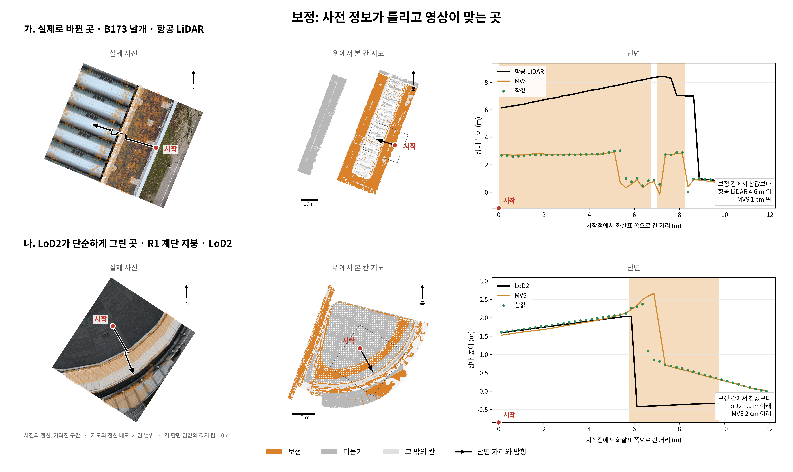

2행×3열의 보정 그림을 만들었다. `figures/영역예시_보정.png` 또는 같은 이름의 PDF를 연다.
원본·표시 사진은 `figures/crops/`, 숫자와 출처는 `tables/`에 있다. 전달 ZIP은 외부 작업 폴더에 둔다.
그림·CPU 검증·두 번째 독립 점검은 PASS. 발주 숫자 대조는 B173 두 값이 달라 PARTIAL이며, scientific_verdict: null이다.

## 1. 그림과 숫자

- 가: 띠 209패치, 보정 134패치. 항공 LiDAR − 참값 **+455.634143 cm**, MVS − 참값 **+0.799515 cm**.
- 나: 띠 231패치, 보정 63패치. LoD2 − 참값 **−101.606734 cm**, MVS − 참값 **−1.949133 cm**.

그림은 입력 셋만 표시한다. 전체 구간의 모든 MVS 점이 참값과 일치한다는 뜻은 아니다. 전환부의 국소 차이를 그대로 남겼다.

## 2. 맞춰 보기

| 예 | 값 | 발주문 | 이번 계산 | 차이 | 점검 |
|---|---|---:|---:|---:|---|
| a | 띠 지붕꼴 패치 수 | 210 | 209 | -1 | PARTIAL |
| a | 보정 패치 수 | 134 | 134 | 0 | PASS |
| a | 사전 정보 − 참값 (cm) | +484.100000 | +455.634143 | -28.465857 | PARTIAL |
| a | MVS − 참값 (cm) | +0.800000 | +0.799515 | -0.000485 | PASS |
| b | 띠 지붕꼴 패치 수 | 231 | 231 | 0 | PASS |
| b | 보정 패치 수 | 63 | 63 | 0 | PASS |
| b | 사전 정보 − 참값 (cm) | -101.600000 | -101.606734 | -0.006734 | PASS |
| b | MVS − 참값 (cm) | -1.900000 | -1.949133 | -0.049133 | PASS |

**B173 높이 차이의 원인 확인:** 보정 134패치의 `median(-gt_p)`는 +484.110141 cm로 발주 값과 일치한다. 그러나 발주 2.5절이 정한 연직 높이 차이 `median(-gt_p × normal_z)`는 +455.634143 cm다. 법선 연직 성분은 0.849~0.986이다. 지시된 높이 차이를 그림에 쓰고 두 값을 보존했다.

**B173 패치 수:** 지정 좌표로 구한 길이는 11.948691643858 m다. 패치 71107의 진행 거리는 11.948907496432 m로 끝을 약 0.216 mm 벗어나 제외된다. 진단용으로 끝만 12 m까지 늘리면 210개다. 초안의 반올림 전 좌표·코드가 없으므로 원인을 확정하지 않는다. 최종 계산에는 지정 좌표를 그대로 썼다.

**초안 모양:** LiDAR가 높게 이어지다 약 9 m에서 내려오는 형태와 LoD2 단 경계가 MVS·참값보다 앞서는 형태는 같다. B173의 낮아지는 구간 요철은 완전히 같지 않다. 이번 그림은 [0, 0.25), [0.25, 0.5) … 칸의 중앙에 중앙값을 놓고, 마지막 칸은 정확한 끝에서 자른다. 초안 생성 코드·칸별 배열은 제공되지 않아 요철 차이의 정확한 원인은 확인 불가다. 세로축은 요청대로 각 단면 참값 최저 칸을 0 m로 옮겼다.

## 3. 처음 보는 사람 점검

두 하위 에이전트는 각각 제목·줄 제목을 숨긴 그림 파일 하나만 열었다. 코드·표·앞 점검 답을 주지 않았다. 다음은 답 전문이다.

### 첫 점검

1. **참값과의 일치 여부**
   - **위 예:** 항공 LiDAR는 약 0–8.5 m에서 참값보다 크게 높고, 마지막 구간에서 참값에 가까워집니다. MVS는 전반적으로 참값을 잘 따라갑니다. 다만 약 5–7 m의 급격히 낮아지는 구간에서는 일부 점과 어긋나며, 약 8.4 m의 전환부에도 차이가 보입니다.
   - **아래 예:** LoD2는 처음 약 0–5.7 m에서는 참값과 가깝지만, 약 6 m에서 급락한 뒤 참값보다 낮게 이어집니다. MVS는 대부분 잘 맞지만 **약 6.5–7.3 m에서 참값이 이미 낮아졌는데도 높은 값을 유지하는 국소적 불일치**가 뚜렷합니다. 따라서 MVS 전체가 참값과 일치한다고 읽히지는 않습니다.

2. **시작점과 진행 방향**
   - **위 예: 연결이 불명확함.** 사진은 왼쪽 빨간 점에서 오른쪽으로 진행합니다. 지도는 오른쪽 빨간 점에서 왼쪽 위로 진행합니다. 단면은 왼쪽 0 m에서 오른쪽으로 진행합니다. 사진과 지도 모두 왼쪽에 길처럼 보이는 긴 띠가 있는데, 빨간 점은 사진에서는 그 띠에 가까운 지붕 가장자리, 지도에서는 반복 구조물의 반대쪽 가장자리에 있습니다. 그림만 보면 동일한 시작점인지 확신하기 어렵습니다.
   - **아래 예: 시작점이 같은 곳으로 읽힘.** 사진과 지도 모두 넓은 안쪽 지붕 면의 빨간 점에서 오른쪽 아래로 나아가며, 곡선 모양의 밝은 지붕 띠를 가로지릅니다. 단면은 이 이동을 왼쪽 0 m부터 오른쪽으로 나타낸 것으로 읽힙니다.

3. **사진에서 단면이 지나는 대상**
   - **위 사진:** 주황색 점이 덧씌워진 어두운 지붕 면에서, 밝은 회색의 반복되는 지붕 구조물 쪽으로 지나가는 것으로 보입니다. 중간에 경계나 단차처럼 보이는 부분이 있습니다. 밝은 구조물이 채광창인지 별도 지붕인지, 점선으로 표시된 가려진 구간의 실제 표면은 사진만으로 판단하기 어렵습니다.
   - **아래 사진:** 넓고 어두운 지붕 면에서 곡선형 경계를 넘어, 밝은 곡선형 지붕 띠 쪽으로 지나가는 것으로 보입니다. 경계에 단차나 돌출부가 있는 듯하지만, 정확한 높이와 짧은 점선 구간의 형태는 사진만으로 확정하기 어렵습니다.

### 고친 것

첫 점검의 B173 시작점 연결이 불명확해 사진을 지도처럼 북쪽이 위가 되도록 회전하고 북쪽 표시를 더했다. 사진 선택·자른 상자·단면·수치·색은 그대로다. 원본 사진 조각의 화소는 바꾸지 않았다. 그림 회전 때 생긴 빈 모서리는 투명 처리해 흰 바탕을 유지했다.

### 두 번째 점검

1. **참값과의 일치**
   - **위 예:** 항공 LiDAR는 약 0–8.5 m에서 참값보다 크게 높고, 약 9 m 이후에는 참값과 맞습니다. MVS는 대체로 참값을 따릅니다. 다만 약 5.3–7.2 m의 움푹한 구간에서는 참값보다 낮아지는 부분이 있고, 약 8.4 m의 급격한 높이 변화에서도 국소 차이가 보입니다. 따라서 MVS가 전 구간에서 정확히 일치하는 것은 아닙니다.
   - **아래 예:** LoD2는 약 0–5.8 m에서는 참값과 가깝지만, 약 6 m부터 급락하여 참값보다 낮습니다. MVS는 앞부분과 약 7.4 m 이후에서 잘 맞습니다. 그러나 약 6.5–7.3 m에서는 참값이 이미 낮아졌는데 MVS가 높은 상태를 유지하거나 늦게 내려가므로, 뚜렷한 국소 불일치가 있습니다.

2. **시작점과 진행 방향**
   - **위 예 — 시작점이 같은 곳으로 읽힘.** 사진의 빨간 점은 오른쪽 주황·갈색 띠의 바깥 가장자리 부근에 있고, 화살표는 왼쪽 위의 밝은 반복 지붕 쪽으로 갑니다. 지도에서도 빨간 점이 오른쪽 주황색 띠에 있고, 화살표가 왼쪽 위의 밝은 가운데 부분을 향합니다. 단면은 이 빨간 점을 거리 0으로 삼아 화살표 방향으로 이동한 결과를 왼쪽에서 오른쪽으로 나타낸 것으로 읽힙니다. 정확히 같은 지점인지 대조할 뚜렷한 표식은 부족하지만, 전체적인 대응은 이해됩니다.
   - **아래 예 — 시작점이 같은 곳으로 읽힘.** 사진에서는 넓은 짙은 회색 지붕 안쪽에서 시작하여 오른쪽 아래의 굽은 가장자리로 향합니다. 지도에서도 가운데 회색 면에서 오른쪽 아래 주황색 곡선 띠와 그 바깥쪽을 향합니다. 단면은 그 이동 순서를 왼쪽에서 오른쪽으로 보여주는 것으로 읽힙니다.

3. **사진에서 단면 선이 지나는 대상**
   - **위 예:** 오른쪽의 갈색·주황색 지붕 띠에서 시작해, 경계 부분을 지나 왼쪽의 밝은 반원통형 지붕으로 들어가는 선처럼 보입니다. 선이 꺾이고 일부가 점선으로 표시되어 있어 경계에서 어떤 면을 통과하는지, 작은 돌출부나 틈을 지나는지는 판단하기 어렵습니다.
   - **아래 예:** 넓은 짙은 회색 지붕에서 시작해 황갈색의 굽은 지붕 띠, 밝은 가장자리 부분을 거쳐 어두운 홈 또는 처마 부근으로 향하는 것으로 보입니다. 밝은 띠와 어두운 부분이 각각 지붕면·수직 턱·배수로 중 무엇인지, 단면의 급격한 높이 변화가 사진의 어느 경계에 해당하는지는 사진만으로 확정하기 어렵습니다.

두 예 모두 “시작점이 같은 곳으로 읽힘”으로 확인됐다. 사진만으로 정확한 지붕 부재나 단차 경계를 확정하기 어렵다는 답도 유지한다.

## 4. 고른 사진과 근거

- **a** `DJI_20241217091243_0144_D`. XMP 촬영 시각 `2024-12-17T08:12:57.696825 UTC`, 광축–연직 0.996°, XMP 짐벌 -90°. 상자 [2060, 335, 3415, 1422], 1355×1087화소. 가려짐 15.063% (1.800 m), 확인 불가 0%. 시야·4 m 범위를 통과한 47개 중 연직 4개에 순위를 적용했다.
- **b** `DJI_20241217084729_0148_D`. XMP 촬영 시각 `2024-12-17T07:47:43.540519 UTC`, 광축–연직 0.781°, XMP 짐벌 -90°. 상자 [3882, 450, 5149, 1804], 1267×1354화소. 가려짐 5.417% (0.648 m), 확인 불가 0%. 시야·4 m 범위를 통과한 99개 중 연직 5개에 순위를 적용했다.

학습 영상은 `S0/fork_inputs/s61/<경우>/scene_<사전 정보>/images`, 카메라는 같은 장면의 `sparse/0/`에서 확인했다. 원본은 `phase-payloads/p0-audit/data/raw/uav/Images.zip`, 원본 카메라는 `data/work/mvs/triangulated/`다. 학습용은 1024×741이어서, 같은 촬영본의 5280×3956 원본을 자르고 해당 렌즈 모델로 투영했다. 고른 사진마다 학습·원본 표정의 차이는 0이며, 원본 조각은 원본 화소와 일치한다.

단면 전체가 학습 영상·원본 안에 있고 둘레 4 m 상자를 담을 수 있는 후보를 썼다. 연직 후보에서 가려진 길이가 가장 짧은 순, 투영된 선이 긴 순으로 골랐다. 두 예 모두 가려짐이 20% 아래라 경사 영상으로 넓히지 않았다. 모든 후보와 순위는 `candidates_a.json`, `candidates_b.json`에 있다.

## 5. 바꾼 것, 한계, 시간

- 최초 설정 잠금: 2026-10-24T00:10:43.957255+09:00. SHA-256 `c706006dbcff060cf2ae00a6de2c4bd244ceef95f8677864f2a5aebda047314a`. 첫 그림보다 앞선다. 원래 설정은 그대로 두고 `amendment_01/02.json`과 각각의 잠금 기록을 추가했다. 이전 그림·선택 기록은 외부 작업 폴더 `revision_01/02/`에 보존했다.
- 첫 시야 점검에서 렌즈 다항식을 보정된 시야 밖까지 적용한 후보가 발견돼 실제 학습 영상 안에 드는지도 확인하도록 고쳤다. 첫 그림에서는 B173 주변 4 m가 잘려, 발주 2.3절을 만족하는 후보만 받도록 보완했다. 가려진 선 조각의 점선이 끊겨 보이도록 연속 구간을 합쳤다. 독립 점검 후에는 표시 방향만 바꿨다.
- 가려짐은 단면 둘레 10 m의 참값을 원본 영상에 투영한 깊이 비교다. 4화소 격자, 주변 3×3 최소 깊이, 0.25 m 여유, 진행 거리 약 0.05 m 간격을 잠갔다. 점군 간격·단 경계 보간의 영향을 받는 근사이며, 범위 밖 가림 물체는 검사하지 못한다. 점선은 이 계산 결과다.
- 지도 점선 네모는 사진 상자를 단면 참값 중앙 높이의 평면으로 역투영한 범위다. 실제 여러 높이에서의 경계는 조금 다를 수 있다.
- 배열은 `U/patch_values/`의 고리 1.5 m, MVS 판 가다. 참값 가림 점군은 `S1/v3/box_gt/<경우>/gt_points.npz`다. 좌표는 EPSG:25832 − [690953, 5336071, 604] m, 북쪽은 +y다. 원본 전체 영상·점군은 전달 ZIP에 넣지 않는다.
- 검증 50개 PASS: 설정·입력 SHA-256, 독립 띠 계산·중앙값, 같은 시작·끝 좌표, 투영 왕복, 원본 화소, 4 m 범위, 해상도, 300 dpi, CPU 제한. PNG는 5940×3540, PDF도 제공한다.
- 학습·GPU 사용 없음. Docker의 GPU 장치 없음, `CUDA_VISIBLE_DEVICES=''`, nice 19, 메모리 한도 7.5 GB를 확인했다. 가장 큰 그림 프로세스의 기록된 메모리는 약 0.74 GB다. 큰 참값 배열은 10만 점씩 읽어 필요한 범위만 남겼다.
- 다른 영역은 `examples`의 영역 이름·줄 제목·경우·좌표·띠 폭·칠할 칸·색을 추가해 같은 스크립트를 사용한다. 이번에는 두 예만 그렸다. 새 작업에서는 새 설정을 잠그며, 이번 잠금 파일을 덮어쓰지 않는다.
- 기록 범위: 2026-10-24T00:10:38.290547+09:00~2026-10-24T00:29:38.820088+09:00, 약 19.0분. 탐색·작성·두 번의 독립 점검을 포함한다. 실행별 로그는 ZIP의 `logs/`에 있다.
- 쓰기는 지정한 설정·스크립트·문서·외부 작업 폴더로 제한했다. 기존 결과·방법 코드·다른 작업의 변경 사항은 고치지 않았다. 커밋·푸시의 최종 결과와 커밋 번호는 외부 `delivery_receipt.json`과 ZIP에 기록한다.
