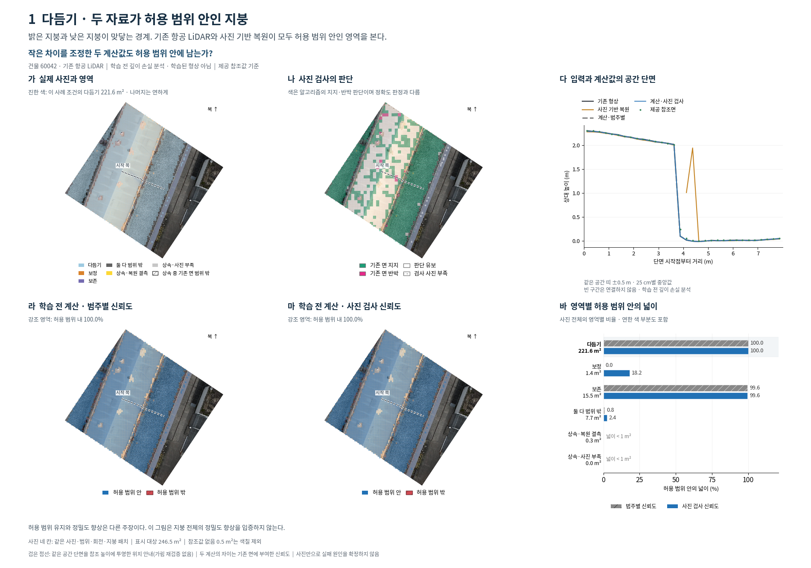
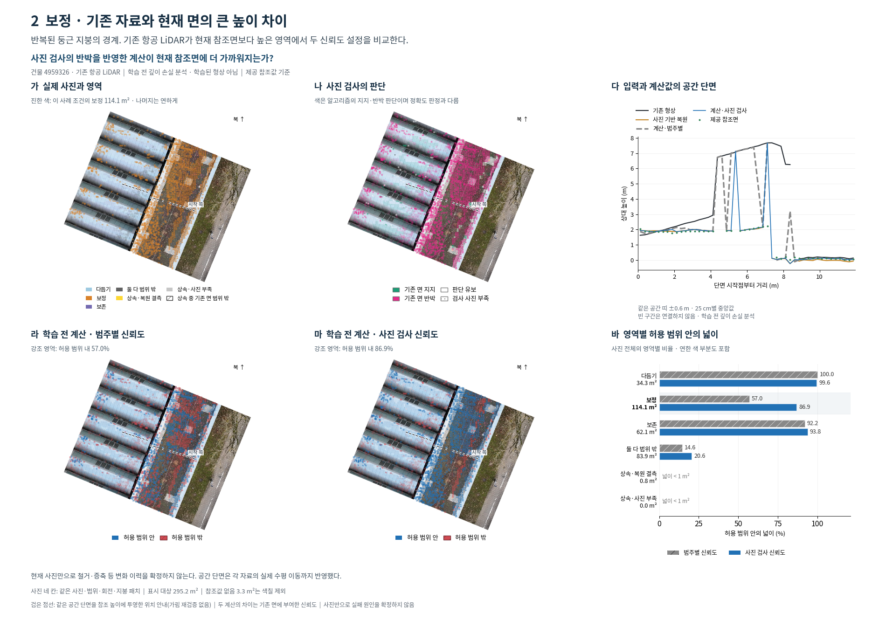
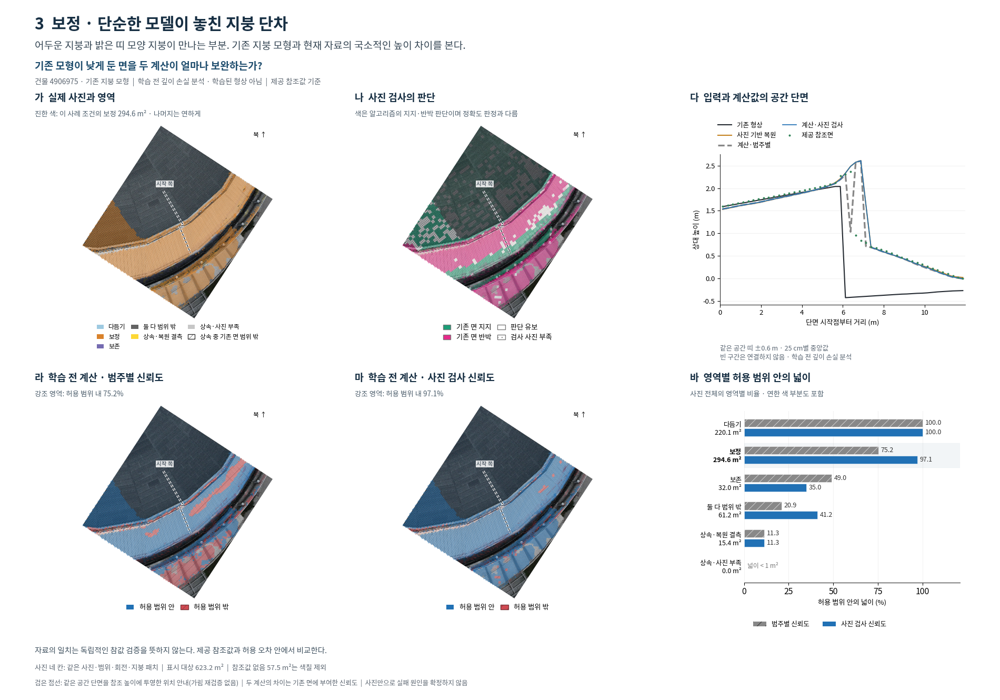
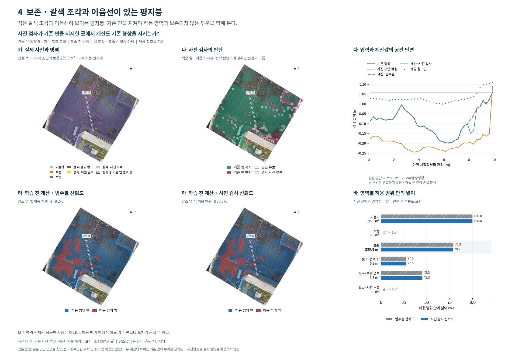
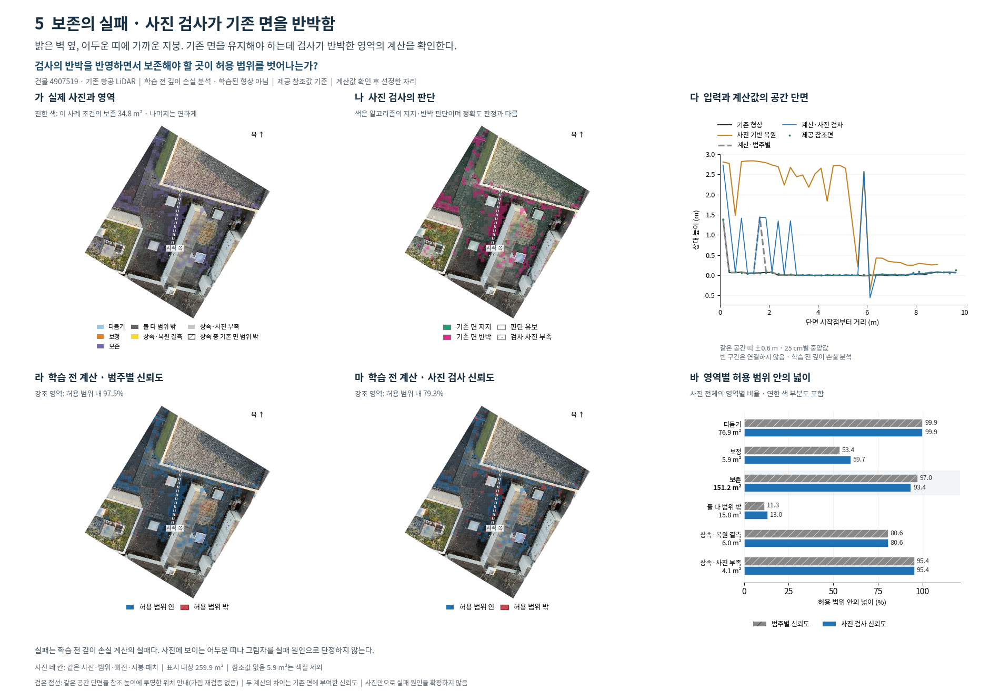
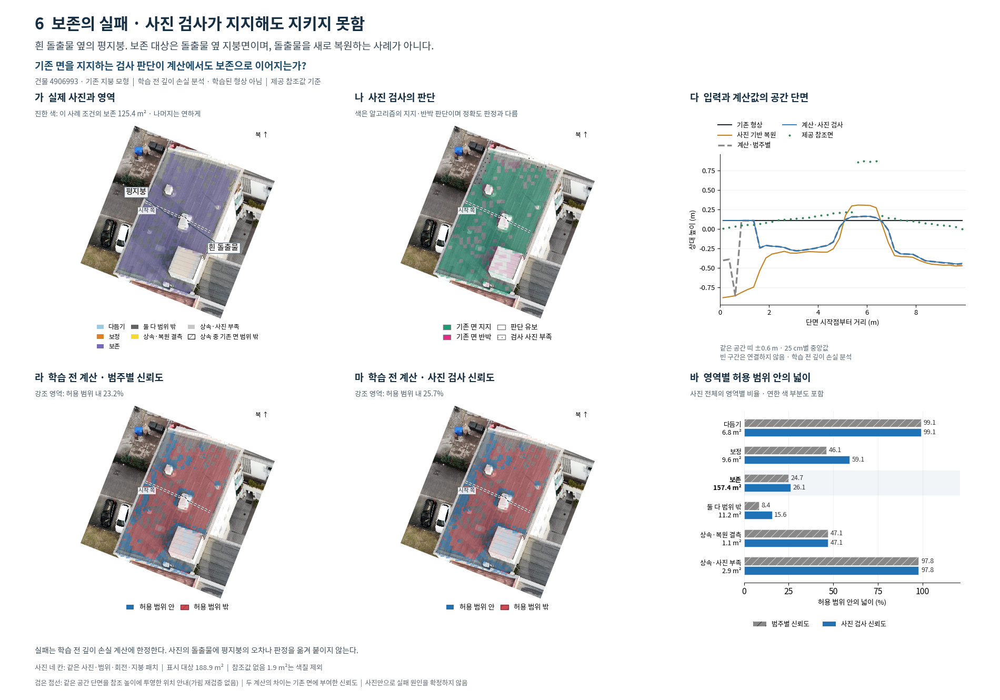
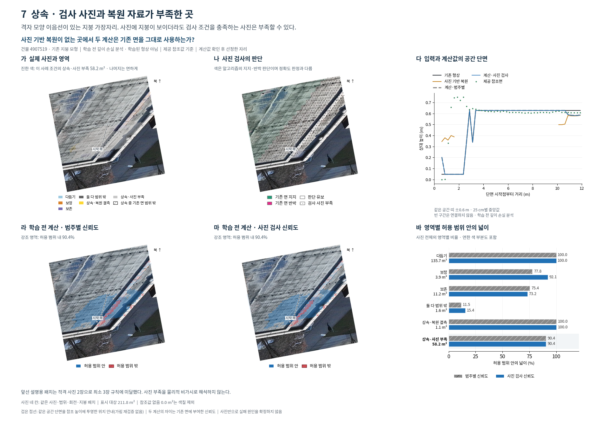
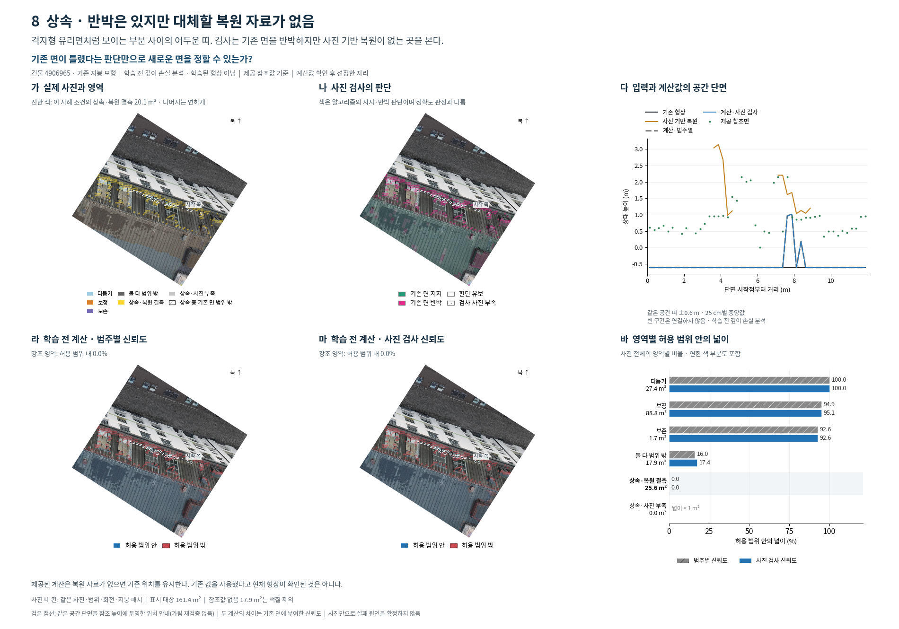

# 영역별 사진 검사와 학습 전 계산 비교

여덟 장 모두 원래 두 줄·세 칸 구성이다. 실제 사진의 영역, 사진 검사의 판단, 두 신뢰도 설정의 계산값과 영역별 비율을 함께 본다.

**모든 계산값은 제공된 학습 전 깊이 손실 최소점이다. 학습된 형상이나 메시가 아니며, 향후 학습 결과를 예측한 그림도 아니다.**

## 읽는 순서

가: 기존 면과 사진 기반 복원의 제공 참조값 기준 영역. 나: 사진 검사 알고리즘의 판단. 다: 같은 공간 띠의 입력·계산값 단면. 라·마: 제공 참조값 기준 허용 범위 안팎. 바: 각 영역의 참조값이 있는 지붕 넓이로 계산한 비율.

A·S와 한 패치의 별도 오차 판정은 제거했다. 네 사진의 원본, 자른 범위, 회전, 색칠 대상 패치가 같다. 진한 색은 사례의 영역 조건에 해당하는 모든 패치다. 5번은 검사 반박, 6번은 검사 지지, 8번은 검사 반박이면서 기존 면이 허용 범위 밖인 조건을 추가한다. 강조 영역 선정에 두 계산값의 성공/실패는 사용하지 않았다.

라·마의 사진 위 비율은 강조 영역을 분모로 한다. 바의 막대는 사진 전체의 각 영역을 분모로 하므로 범위가 다르며 그 차이를 그림에 표시했다. 원래 영역별 비율은 모두 보존한다. 지역의 수치를 다른 부위나 지붕 전체 성능으로 확대하지 않는다.

## 단면 대응 수정

이전 단면은 기존 패치의 XY에 모든 높이를 놓았다. 새 단면은 기존 형상, MVS, 참조면, 두 최소점 각각에 대해 `XYZ = centre + displacement × normal`을 구하고, 각자의 실제 XY가 같은 단면 띠 안에 드는 경우만 집계한다. 원래 단면의 시작·끝 XY와 폭은 유지했다. 25 cm 구간의 높이 중앙값을 사용하며 결측을 연결하지 않는다.

따라서 각 곡선은 같은 공간 띠의 집계지만 같은 패치 집합을 강제하지 않는다. 이것은 제공값의 공간 배치이며 새 표면 재구성이나 손실 최적화가 아니다. 사진 점선은 그 단면의 참조 높이를 투영한 위치 안내다. 투영 패치와 위치선의 가림을 재검증하지 않았고, 독립적인 같은 표면의 진실을 확정하지 않는다.

좌표는 EPSG:25832에서 [690953, 5336071, 604] m를 뺀 기존 모델 좌표이며, 북쪽은 +Y이다. 각 JSON에 좌표계를 기록했다. 사진 위치선의 원본 사진 범위 포함 여부와 잘라내기·회전 변환도 별도로 검증했다.

## 계산과 판정

`z_category`와 `z_check`는 전달받은 값이다. 높이는 `centre_z + z × normal_z`, 허용 범위 판정은 `abs(z − gt_p) <= tau`이다. 두 설정은 기존 면의 유효 확률을 정하는 방식이 다르다. 학습·새 사진 검사·새 최소점 계산은 실행하지 않았다. 원 손실의 세부 구현은 이 전달 ZIP에 없으므로 재구현하거나 추정하지 않았다.

영역별 비율은 원래 여섯 패널의 값과 일치한다. 영역/검사 사진도 두 계산 사진과 같은 참조값이 있는 지붕 패치로 통일했다. 기존 그림과 ZIP은 그대로 보존했다.

## 1. 다듬기 · 두 자료가 허용 범위 안인 지붕

밝은 지붕과 낮은 지붕이 맞닿는 경계. 기존 항공 LiDAR와 사진 기반 복원이 모두 허용 범위 안인 영역을 본다.

작은 차이를 조정한 두 계산값도 허용 범위 안에 남는가?

강조 영역 221.6 m²: 범주별 100.0%, 사진 검사 기반 100.0%. 사진 전체 다듬기 221.6 m²: 100.0% / 100.0%.

허용 범위 유지와 정밀도 향상은 다른 주장이다. 이 그림은 지붕 전체의 정밀도 향상을 입증하지 않는다.

## 2. 보정 · 기존 자료와 현재 면의 큰 높이 차이

반복된 둥근 지붕의 경계. 기존 항공 LiDAR가 현재 참조면보다 높은 영역에서 두 신뢰도 설정을 비교한다.

사진 검사의 반박을 반영한 계산이 현재 참조면에 더 가까워지는가?

강조 영역 114.1 m²: 범주별 57.0%, 사진 검사 기반 86.9%. 사진 전체 보정 114.1 m²: 57.0% / 86.9%.

현재 사진만으로 철거·증축 등 변화 이력을 확정하지 않는다. 공간 단면은 각 자료의 실제 수평 이동까지 반영했다.

## 3. 보정 · 단순한 모델이 놓친 지붕 단차

어두운 지붕과 밝은 띠 모양 지붕이 만나는 부분. 기존 지붕 모형과 현재 자료의 국소적인 높이 차이를 본다.

기존 모형이 낮게 둔 면을 두 계산이 얼마나 보완하는가?

강조 영역 294.6 m²: 범주별 75.2%, 사진 검사 기반 97.1%. 사진 전체 보정 294.6 m²: 75.2% / 97.1%.

자료의 일치는 독립적인 참값 검증을 뜻하지 않는다. 제공 참조값과 허용 오차 안에서 비교한다.

## 4. 보존 · 갈색 조각과 이음선이 있는 평지붕

작은 갈색 조각과 이음선이 보이는 평지붕. 기존 면을 지켜야 하는 영역과 보존되지 않은 부분을 함께 본다.

사진 검사가 기존 면을 지지한 곳에서 계산도 기존 형상을 지키는가?

강조 영역 239.8 m²: 범주별 79.2%, 사진 검사 기반 78.7%. 사진 전체 보존 239.8 m²: 79.2% / 78.7%.

보존 영역 전체가 성공한 사례는 아니다. 허용 범위 안에 남아도 기존 면보다 오차가 커질 수 있다.

## 5. 보존의 실패 · 사진 검사가 기존 면을 반박함

밝은 벽 옆, 어두운 띠에 가까운 지붕. 기존 면을 유지해야 하는데 검사가 반박한 영역의 계산을 확인한다.

검사의 반박을 반영하면서 보존해야 할 곳이 허용 범위를 벗어나는가?

강조 영역 34.8 m²: 범주별 97.5%, 사진 검사 기반 79.3%. 사진 전체 보존 151.2 m²: 97.0% / 93.4%.

실패는 학습 전 깊이 손실 계산의 실패다. 사진에 보이는 어두운 띠나 그림자를 실패 원인으로 단정하지 않는다.

## 6. 보존의 실패 · 사진 검사가 지지해도 지키지 못함

흰 돌출물 옆의 평지붕. 보존 대상은 돌출물 옆 지붕면이며, 돌출물을 새로 복원하는 사례가 아니다.

기존 면을 지지하는 검사 판단이 계산에서도 보존으로 이어지는가?

강조 영역 125.4 m²: 범주별 23.2%, 사진 검사 기반 25.7%. 사진 전체 보존 157.4 m²: 24.7% / 26.1%.

실패는 학습 전 깊이 손실 계산에 한정한다. 사진의 돌출물에 평지붕의 오차나 판정을 옮겨 붙이지 않는다.

## 7. 상속 · 검사 사진과 복원 자료가 부족한 곳

격자 모양 이음선이 있는 지붕 가장자리. 사진에 지붕이 보이더라도 검사 조건을 충족하는 사진은 부족할 수 있다.

사진 기반 복원이 없는 곳에서 두 계산은 기존 면을 그대로 사용하는가?

강조 영역 58.2 m²: 범주별 90.4%, 사진 검사 기반 90.4%. 사진 전체 상속·사진 부족 58.2 m²: 90.4% / 90.4%.

앞선 설명용 패치는 적격 사진 2장으로 최소 3장 규칙에 미달했다. 사진 부족을 물리적 비가시로 해석하지 않는다.

## 8. 상속 · 반박은 있지만 대체할 복원 자료가 없음

격자형 유리면처럼 보이는 부분 사이의 어두운 띠. 검사는 기존 면을 반박하지만 사진 기반 복원이 없는 곳을 본다.

기존 면이 틀렸다는 판단만으로 새로운 면을 정할 수 있는가?

강조 영역 20.1 m²: 범주별 0.0%, 사진 검사 기반 0.0%. 사진 전체 상속·복원 결측 25.6 m²: 0.0% / 0.0%.

제공된 계산은 복원 자료가 없으면 기존 위치를 유지한다. 기존 값을 사용했다고 현재 형상이 확인된 것은 아니다.

## 검증과 한계

수치·원본 보존·공간 대응 검사 634/634 통과. 저자 시각 검토를 완료했으며 독립적인 제목 숨김 검토는 이번 개정에서 수행하지 않았다. `scientific_verdict: null`.

재실행: `python scripts/phd/main_regionfig_v2/run_six_panel.py render 2`. `prepare`, `verify`, `finish`, `package` 단계도 같은 실행기를 사용한다. 사용자가 승인한 이번 개정 전용 정책은 CPU 1개, RAM 2 GiB, 추가 swap/GPU 없음, 여유 32 GiB 이상 시작, 24 GiB 미만 중단이다. 기존 학습·후처리를 수정하거나 중단하지 않는다.
