면 순도 90% 이상 면의 넓이 비율(지역별 범위): 항공 LiDAR 지붕 48.7~99.0%; LoD2 지붕 5.2~91.6%; LoD2 벽 0.6~13.2%. [이 발주에서 냄]
통째로 한 영역인 면의 넓이 비율: 항공 LiDAR 지붕 0.0~1.8%; LoD2 지붕 0.0~6.3%; LoD2 벽 0.0~4.4%. [이 발주에서 냄]
판단·참값 짝이 맞은 넓이 / 연결된 면의 평가 넓이: 항공 LiDAR 지붕 65.0~93.4%; LoD2 지붕 60.3~83.5%; LoD2 벽 7.4~52.5%. [이 발주에서 냄]
확인 불가: 셀 수 없음·칸 4~6을 남겼다. 관측 없음과 칸 3(둘 다 틀림)은 짝 맞음과 분리했다. 항공 LiDAR 벽 자료는 없다.
걸린 시간: r2 집계·그림 실행 2.8분. 준비·코드 작성·검증 시간은 별도 실행 기록. [이 발주에서 냄]

# 영역 지도와 면 요약 · r2

판단은 기존 패치 그대로다. 여기서는 묶어서 세고 표시하는 단위만 LoD2 면으로 바꿨다. 결론을 내리지 않으며 `scientific_verdict: null`을 유지한다. 모든 계산값은 [이 발주에서 냄]이다. 네 지역은 서로 겹치므로 합쳐 하나의 모집단처럼 해석하지 않는다.

## 면 나누기와 분모

LoD2는 원래 면 번호를 쓴다. 원본 면 ID와 `_poly` ID는 외곽·구멍 좌표가 정확히 같을 때만 연결했다. 지붕 이름은 원본 면 넓이 순서, 벽 이름은 바깥 법선 방향이다. 두 사전 정보와 두 판에 같은 원래 면을 쓴다.

항공 LiDAR의 빈 건물 번호는 사용자 답변에 따라 **이 발주에서 구한 연결**이다. 패치 중심이 LoD2 GroundSurface 평면 범위에 유일하게 들어가면 그 건물로 연결한다. 범위 밖은 1 m 안 후보 건물이 하나일 때만 연결한다. 겹침·복수 후보·범위 없음은 붙지 않음이다. 같은 건물 지붕 다각형 안이면 거리 0, 밖이면 평면 경계까지 최단거리로 면을 고른다. 1 m 밖은 붙지 않음이다. 같은 거리의 면은 원본 ID 순서로 고르고 동률 수를 따로 기록했다. 높이를 연결에 쓰지 않았다.

평가 넓이는 원래 패치 넓이의 합이다. 위 지도는 평가 패치 중심을 0.25 m 칸에 모은 래스터다. 겹친 칸은 영역별 넓이 합이 가장 큰 색을 쓰며 동률은 코드 순서다. 래스터 칸 수를 평가 넓이로 대신하지 않았다. 빨간 점선은 칸 0~2와 일치·보존·보정의 짝이 다른 칸을 같은 면 안에서 네 방향 이웃끼리 연결한 윤곽이다. 벽은 위에서 겹치므로 펼친 그림도 함께 본다.

짝 맞음은 일치↔칸 0, 보존↔칸 2, 보정↔칸 1이다. 표의 짝맞음 비율은 전체 평가 넓이가 분모다. 비교 가능한 칸만의 비율도 원본 CSV에 별도로 있다. 사전 정보만 틀린 넓이는 칸 1+3, 영상만 틀린 넓이는 칸 2+3이며 공통 분모는 칸 0~3이다. 관측 없음·사라짐·셀 수 없음과 칸 3~6은 각각 별도 열로 남겼다.

1 m² 미만 면은 공개 면 표에서 종류별 “작은 면”으로 묶었다. 아래 상위 20개 표에는 원래 개별 면을 넓이순으로 고른 뒤 나머지를 합했다. 순도 분포는 작은 면도 원래 한 면씩 센다. “통째로”는 양의 넓이를 가진 패치의 영역이 하나뿐인 경우이며 90% 기준과 다르다.

| 지역 | 항공 LiDAR 붙지 않은 넓이 m² | 비율 |
|---|---:|---:|
| B0 | 1.782 | 0.1% |
| B173 주변 | 0.185 | 0.0% |
| B173만 | 0.137 | 0.0% |
| R1 | 2.719 | 0.2% |
| 개발용 | 0.000 | 0.0% |
| 확인용 | 0.000 | 0.0% |

B173은 평면 범위가 같아도 높이가 다를 수 있다. 표와 그림의 이름·경계는 기존 LoD2 면이다. 이 연결은 현재 높이가 맞다는 뜻이 아니다.

## 지역별 면 표와 지도

지=지붕, 벽 이름은 방향. 순도는 가장 넓은 영역의 비율. 전체 영역 비율·참값 칸·두 단독 비교는 각 CSV/JSON에 있다. 전체 지도 옆 사진은 평가 넓이가 가장 큰 건물 한 채다. 건물별 지도와 사진은 그림 목록에 따로 있다. 사진은 원래 화면 범위까지만 보인다.

### B0

| 사전 정보 | 건물·면 | 넓이 m² | 가장 넓은 영역 | 순도 | 짝맞음 |
|---|---|---:|---|---:|---:|
| LoD2 | B0/벽동 | 1258.8 | 일치 | 76.6% | 67.7% |
| LoD2 | B0/벽서 5 | 627.0 | 일치 | 79.7% | 60.2% |
| LoD2 | B0/지1 | 619.2 | 일치 | 97.3% | 91.3% |
| ALS | B0/지1 | 594.9 | 일치 | 99.6% | 95.8% |
| LoD2 | B0/지2 | 580.9 | 일치 | 92.5% | 89.3% |
| ALS | B0/지2 | 566.0 | 일치 | 98.3% | 91.1% |
| LoD2 | B0/벽북 2 | 370.5 | 일치 | 87.9% | 73.9% |
| LoD2 | B0/벽남 2 | 365.8 | 일치 | 65.3% | 48.2% |
| LoD2 | 4959322/벽남 | 166.5 | 일치 | 78.0% | 7.0% |
| LoD2 | 4959322/벽북 | 163.9 | 일치 | 85.5% | 24.8% |
| LoD2 | B0/벽북 1 | 109.2 | 일치 | 88.9% | 35.3% |
| LoD2 | B0/지3 | 103.6 | 일치 | 99.9% | 91.7% |
| LoD2 | 4959322/지1 | 96.8 | 일치 | 97.4% | 87.1% |
| ALS | B0/지3 | 93.5 | 일치 | 99.7% | 98.0% |
| ALS | 4959322/지1 | 87.4 | 일치 | 94.9% | 93.4% |
| LoD2 | B0/벽남 1 | 70.4 | 관측 없음 | 68.9% | 0.1% |
| LoD2 | B0/지5 | 59.1 | 일치 | 100.0% | 63.8% |
| LoD2 | B0/지4 | 58.8 | 일치 | 98.1% | 40.3% |
| LoD2 | B0/지6 | 58.6 | 보정 | 57.3% | 63.2% |
| LoD2 | 4959324/벽남 | 58.1 | 관측 없음 | 57.4% | 0.0% |
| 합계 | 나머지 38개 | 614.6 | — | — | 52.0% |

[ALS 면 전체 표](tables/faces_B0_b10_ALS_r2.csv)
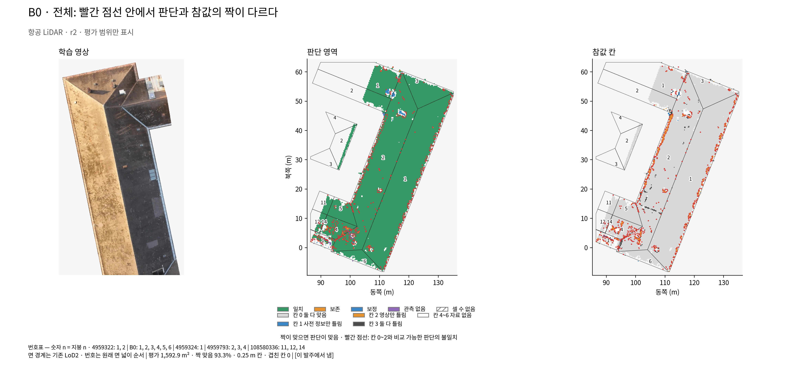

[LoD2 면 전체 표](tables/faces_B0_b10_LoD2_r2.csv)
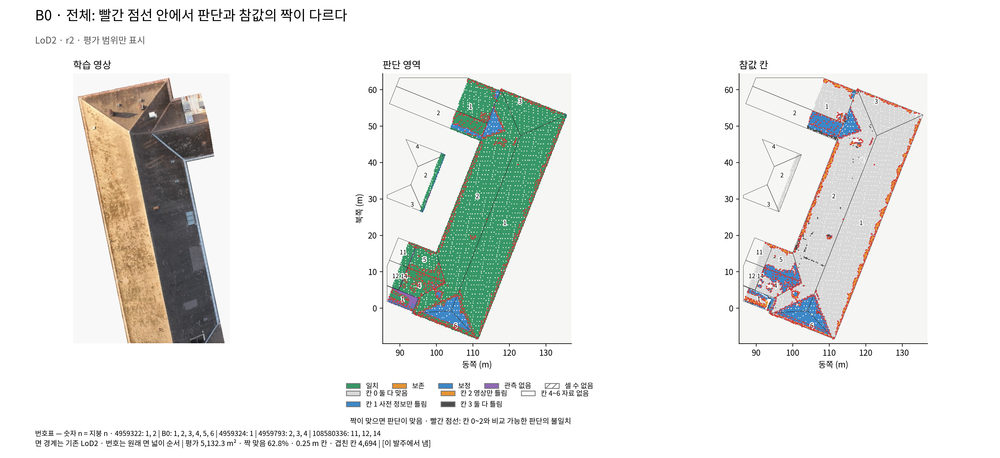

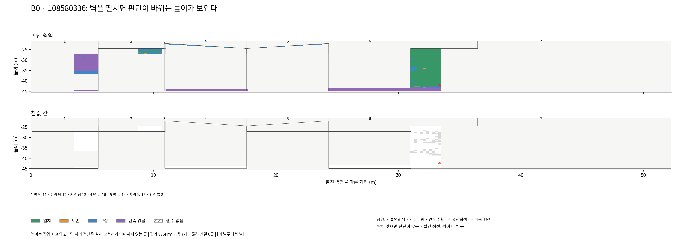

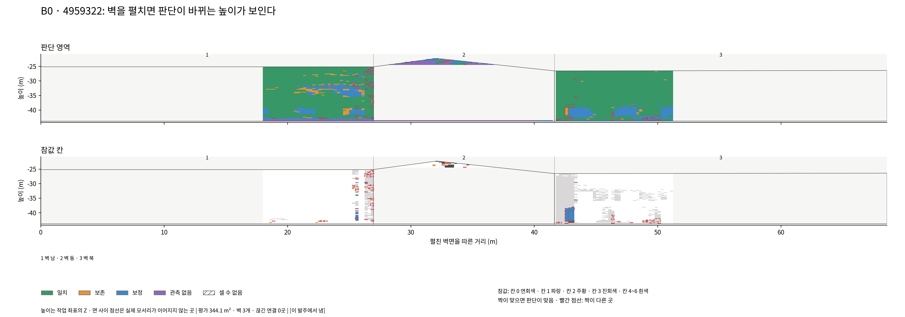

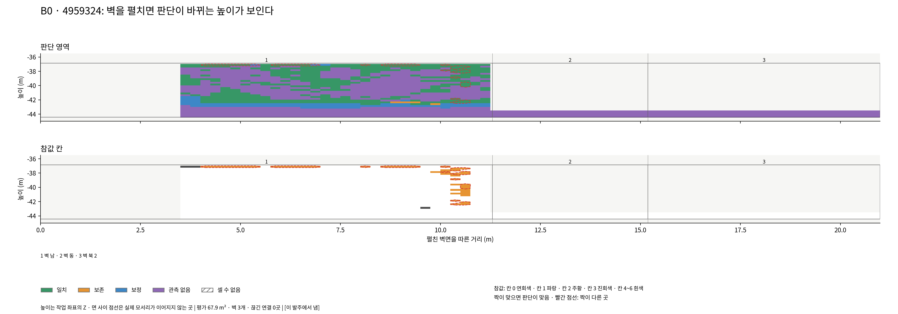

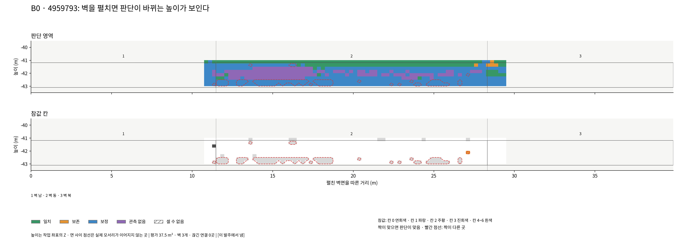

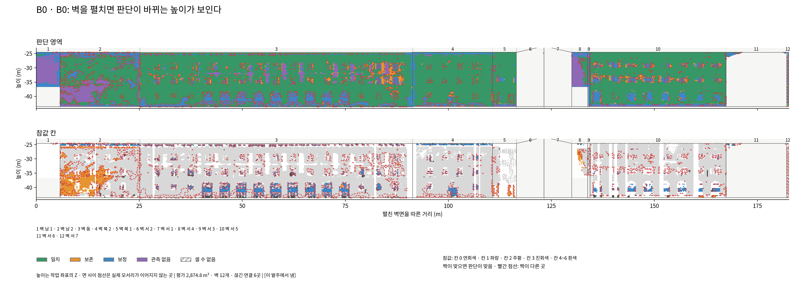

### B173 주변

| 사전 정보 | 건물·면 | 넓이 m² | 가장 넓은 영역 | 순도 | 짝맞음 |
|---|---|---:|---|---:|---:|
| LoD2 | B173/벽서 2 | 1347.5 | 일치 | 70.5% | 46.6% |
| LoD2 | B173/벽동 5 | 1347.5 | 관측 없음 | 85.4% | 0.0% |
| LoD2 | 4959460/벽동 8 | 682.0 | 일치 | 88.5% | 29.7% |
| LoD2 | 4959460/지1 | 581.4 | 일치 | 99.6% | 89.3% |
| LoD2 | B173/지1 | 578.6 | 보정 | 99.7% | 87.3% |
| ALS | B173/지1 | 567.0 | 보정 | 99.2% | 86.1% |
| LoD2 | B173/지2 | 566.9 | 보정 | 100.0% | 90.7% |
| ALS | 4959460/지1 | 560.0 | 일치 | 84.6% | 80.0% |
| ALS | B173/지2 | 534.9 | 보정 | 99.5% | 87.3% |
| LoD2 | B173/벽동 2 | 514.2 | 관측 없음 | 63.9% | 3.1% |
| LoD2 | B173/벽서 5 | 509.2 | 관측 없음 | 64.9% | 17.7% |
| LoD2 | 4959460/벽동 6 | 286.8 | 일치 | 84.8% | 42.2% |
| LoD2 | B173/벽남 2 | 280.7 | 일치 | 63.0% | 0.1% |
| LoD2 | 4959460/벽북 2 | 155.0 | 일치 | 73.1% | 1.6% |
| LoD2 | B173/벽남 3 | 142.6 | 일치 | 66.4% | 0.0% |
| LoD2 | B173/벽남 1 | 137.1 | 일치 | 69.0% | 0.0% |
| LoD2 | B173/벽북 2 | 115.8 | 관측 없음 | 61.5% | 0.0% |
| LoD2 | B173/지3 | 58.8 | 일치 | 76.4% | 45.6% |
| LoD2 | B173/지4 | 52.9 | 일치 | 72.0% | 4.4% |
| LoD2 | B173/지6 | 52.9 | 일치 | 62.2% | 19.4% |
| 합계 | 나머지 85개 | 2059.7 | — | — | 19.6% |

B173: 평면 범위가 같아도 높이가 다를 수 있음.

[ALS 면 전체 표](tables/faces_B173nb_b10_ALS_r2.csv)
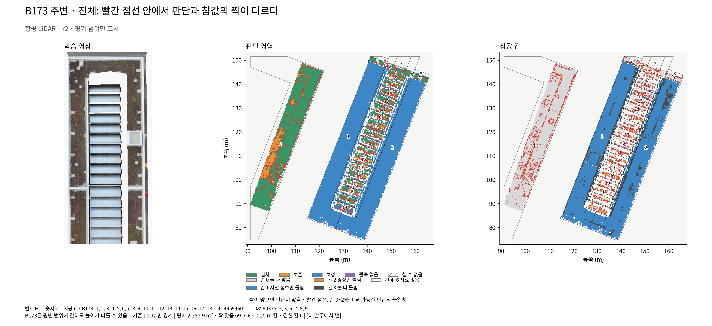

[LoD2 면 전체 표](tables/faces_B173nb_b10_LoD2_r2.csv)
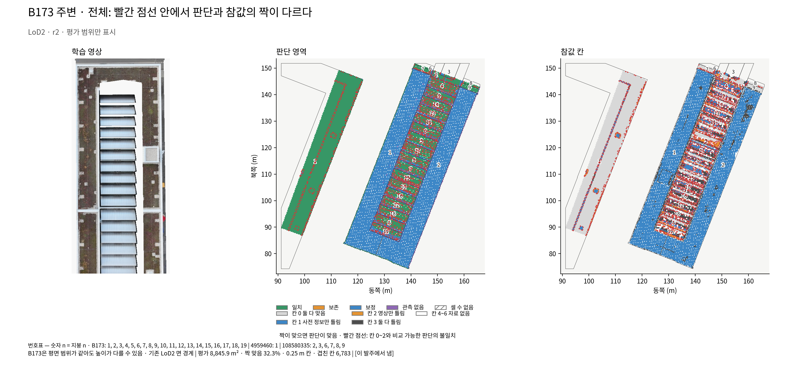

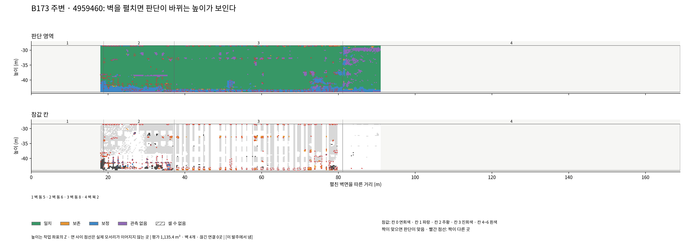

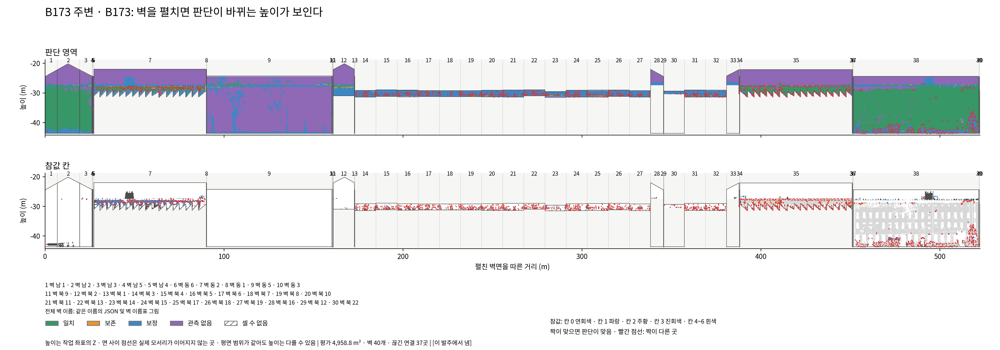

### B173만

| 사전 정보 | 건물·면 | 넓이 m² | 가장 넓은 영역 | 순도 | 짝맞음 |
|---|---|---:|---|---:|---:|
| LoD2 | B173/벽서 2 | 1347.5 | 일치 | 71.8% | 44.1% |
| LoD2 | B173/벽동 5 | 1347.5 | 관측 없음 | 85.0% | 0.0% |
| LoD2 | B173/지1 | 578.6 | 보정 | 99.6% | 86.9% |
| ALS | B173/지1 | 567.9 | 보정 | 99.2% | 85.5% |
| LoD2 | B173/지2 | 566.9 | 보정 | 99.9% | 90.8% |
| ALS | B173/지2 | 533.3 | 보정 | 99.5% | 88.0% |
| LoD2 | B173/벽동 2 | 514.2 | 관측 없음 | 64.5% | 3.1% |
| LoD2 | B173/벽서 5 | 509.2 | 관측 없음 | 65.0% | 17.6% |
| LoD2 | B173/벽남 2 | 280.7 | 일치 | 64.8% | 0.1% |
| LoD2 | B173/벽남 3 | 142.6 | 일치 | 69.7% | 0.0% |
| LoD2 | B173/벽남 1 | 137.1 | 일치 | 69.8% | 0.0% |
| LoD2 | B173/벽북 2 | 115.8 | 관측 없음 | 61.1% | 0.1% |
| LoD2 | B173/지3 | 58.8 | 일치 | 72.4% | 43.8% |
| LoD2 | B173/지4 | 52.9 | 일치 | 71.3% | 3.7% |
| LoD2 | B173/지6 | 52.9 | 일치 | 59.9% | 19.5% |
| LoD2 | B173/지5 | 52.9 | 일치 | 68.2% | 20.4% |
| LoD2 | B173/지15 | 49.9 | 일치 | 73.0% | 23.9% |
| LoD2 | B173/지8 | 49.9 | 일치 | 67.8% | 25.8% |
| LoD2 | B173/지9 | 49.9 | 일치 | 65.5% | 31.8% |
| LoD2 | B173/지11 | 49.9 | 일치 | 67.1% | 24.7% |
| 합계 | 나머지 79개 | 1800.0 | — | — | 17.6% |

B173: 평면 범위가 같아도 높이가 다를 수 있음.

[ALS 면 전체 표](tables/faces_B173_b0_ALS_r2.csv)
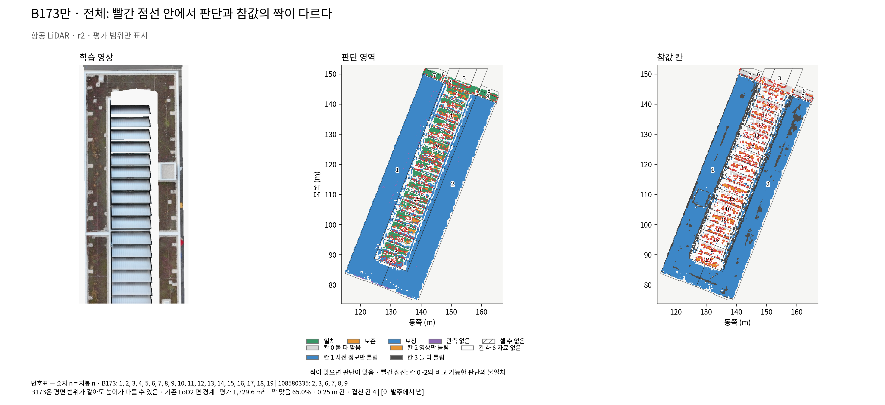

[LoD2 면 전체 표](tables/faces_B173_b0_LoD2_r2.csv)
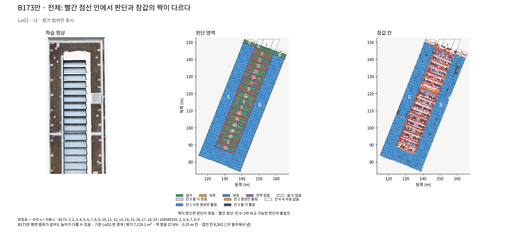

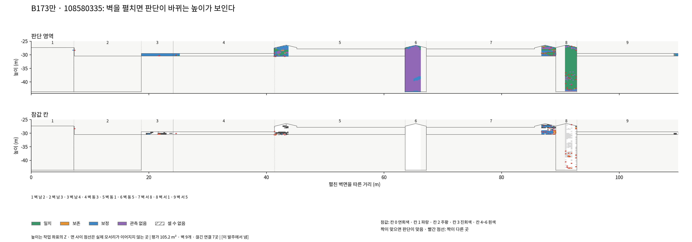

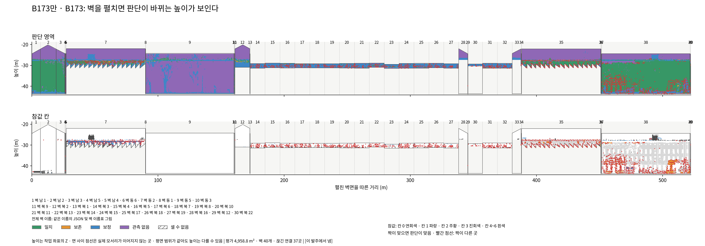

### R1

| 사전 정보 | 건물·면 | 넓이 m² | 가장 넓은 영역 | 순도 | 짝맞음 |
|---|---|---:|---|---:|---:|
| LoD2 | 4906975/지1 | 751.6 | 일치 | 79.2% | 84.7% |
| ALS | 4906975/지1 | 713.0 | 일치 | 97.2% | 82.8% |
| LoD2 | R1/벽동 2 | 673.4 | 보정 | 53.9% | 6.6% |
| LoD2 | 4906975/벽북 6 | 603.6 | 일치 | 70.9% | 22.6% |
| LoD2 | 4906975/지2 | 359.7 | 보정 | 82.0% | 67.9% |
| ALS | 4906975/지2 | 297.2 | 일치 | 92.8% | 88.5% |
| LoD2 | 4906975/지3 | 246.8 | 보정 | 76.7% | 71.1% |
| LoD2 | 4906975/지4 | 208.8 | 보정 | 64.9% | 64.2% |
| ALS | 4906975/지4 | 195.7 | 일치 | 89.4% | 68.2% |
| LoD2 | R1/벽동 1 | 169.0 | 관측 없음 | 36.0% | 3.9% |
| LoD2 | 4906975/지5 | 123.5 | 보정 | 79.6% | 29.1% |
| LoD2 | 4906975/지6 | 119.3 | 보정 | 64.0% | 54.3% |
| ALS | 4906975/지5 | 104.2 | 보정 | 78.5% | 4.0% |
| ALS | R1/지5 | 101.7 | 일치 | 85.5% | 69.3% |
| LoD2 | R1/지5 | 96.6 | 보정 | 95.4% | 72.4% |
| LoD2 | R1/벽북 3 | 88.8 | 보정 | 69.5% | 1.2% |
| LoD2 | 4906975/벽남 1 | 87.4 | 관측 없음 | 60.2% | 0.0% |
| ALS | 4906975/지3 | 80.1 | 일치 | 61.7% | 44.1% |
| LoD2 | 4906975/벽서 3 | 77.2 | 보정 | 47.3% | 16.7% |
| LoD2 | R1/지8 | 65.5 | 보정 | 86.1% | 71.9% |
| 합계 | 나머지 85개 | 1385.6 | — | — | 6.1% |

[ALS 면 전체 표](tables/faces_R1rep_b10_ALS_r2.csv)
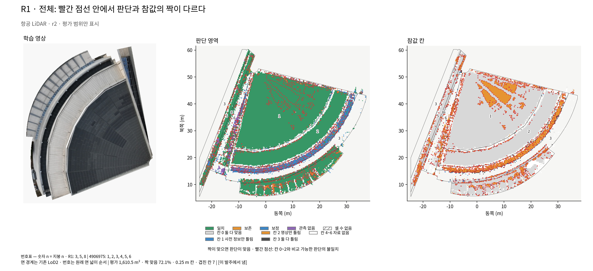

[LoD2 면 전체 표](tables/faces_R1rep_b10_LoD2_r2.csv)
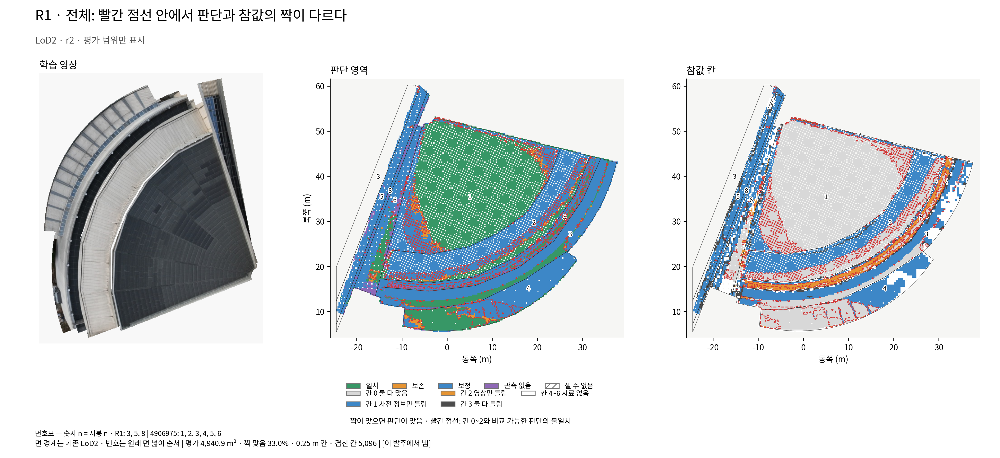

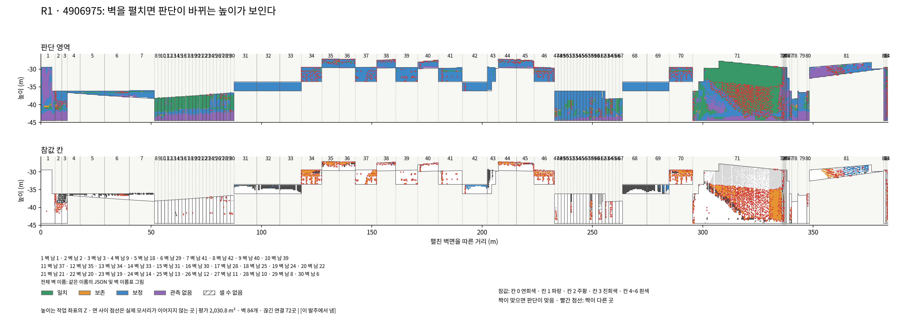

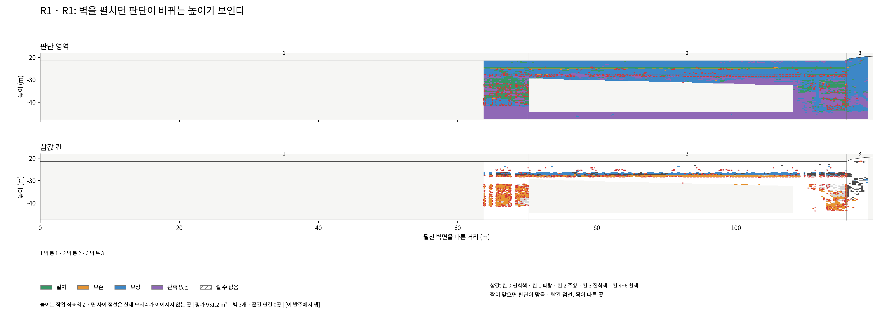

## 면 순도 분포

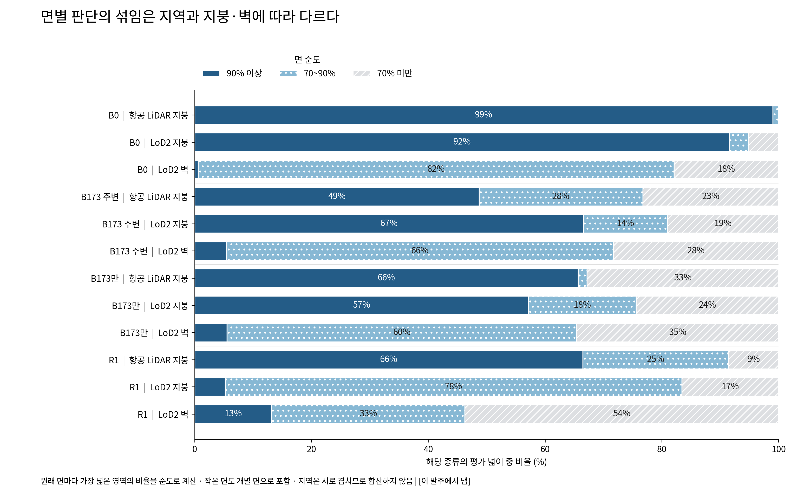

[면 수·넓이·영역별 순도](tables/purity_r2.csv). 개발용과 확인용은 이 표와 합계 표에만 있으며 그림은 없다. 확인용의 면별·패치별 값은 외부 `holdout/`에만 있고 묶음에서 제외했다.

벽 그림의 가로축은 남→동→북→서 순으로 이어 놓은 각 벽면의 실제 가로 길이 합이다. 서로 맞닿지 않는 면 사이에는 점선과 연결 수를 표시했다. 건물 실제 둘레가 끊김 없이 이어진다는 뜻은 아니다. 높이는 공통 작업 좌표 Z다.

## 판의 차이

r2 묶음을 먼저 작성했다. r7은 별도 잠금 출력과 완료 기록을 확인한 뒤 같은 코드·면 연결로 추가한다.

## 입력과 재현

실제 입력: `PH/main_target_v1/PHD-MAIN-TARGET-v1/r2/targets/`, 참값은 `PH/main_stage1_v1/PHD-MAIN-STAGE1-v1/regions_v3/`. 면 다각형은 `main_design_realchange_survey_v1/.../s1/lod2_buildings.json`와 `main_widen0_v2/.../inputs/lod2_context_buildings.json`; 면 번호 대응은 `main_prep_discard_rule_v1/.../s02_box/` 및 WIDEN의 타일별 면 표다. 개발용·확인용은 JUDGENUM 입력과 TARGET의 r2 단계 0 파일을 정확한 패치 ID로 연결했다. 학습 영상은 STAGE0의 `fork_inputs/s61/<지역>/split.json` 중 학습 목록만 사용했다.

r7 입력은 TARGET `r7/targets/`, 개발용·확인용은 `r7/stage0/development/`·`holdout/r7/stage0/`의 저장된 사라짐 표시다. 설정에서 사라짐 코드 5를 확인했다. 공개 파일은 [그림·표 목록](파일목록.md), 입력 해시와 검증 결과는 묶음의 실행 기록에 있다. Docker 읽기 전용 입력과 전용 출력 마운트, CPU 2개·메모리 8 GiB로 실행했다.

재현: `bash scripts/phd/main_regionview_v1/run_cpu.sh measure measure.py r2`, 이어 `render.py r2`, `verify.py r2`, `report.py r2`. r7도 같은 명령의 판 인수만 r7로 바꾼다. 원본 입력은 묶음에 없으므로 해시가 같은 외부 자료가 있어야 다시 계산할 수 있다. SHA-256·ZIP 검사는 파일 무결성 근거이며 과학적 결론이나 사용자 그림 승인을 뜻하지 않는다.
