<!-- PHD-MAIN-STAGE3-v1 최종 보고 -->
# 본 실험 3단계와 1단계 보강 — 보고서 v1

- 작업: `PHD-MAIN-STAGE3-v1` (발주문 v1, 2026-10-13). 준비 10-13 23:46 ~ 10-14 10:40, 학습 10-14 10:41 ~ 10-15 10:14, 3단계 학습·후처리 끝 10-15 10:21:42. `scientific_verdict: null`.
- **범위.** 영상 수의 효과(3단계)는 B0 한 곳에서 LoD2로만 보았다. 판정만 끈 본 방법(1단계 보강)은 단위마다 씨앗 하나다.
- 앞 보고: [준비 보고](본실험_3단계_준비보고_v1.md), [중간 보고](본실험_3단계_중간보고_v1.md). 중간 보고에 낸 저자 3장의 값은 그대로다.
- 브랜치 `exp/main-experiment`, 폴더 `JointBuildGS-exp`. 페이로드 `JointBuildGS-artifacts/phase-payloads/phd/main_stage3_v1/PHD-MAIN-STAGE3-v1/`.
- 설정 `configs/phd/main_stage3_v1/stage3_v1.json`은 첫 학습 전(10-14 10:40:37)에 저장했다. 그 뒤 고친 것은 모두 시각과 까닭을 설정과 [9.3](#93-실행-중-바꾼-것-시각과-까닭)에 적었다.
- 앞 단계의 공식 판정과 표는 고치지 않았다. 이 보고서의 값은 모두 이 발주에서 냈다('이 발주에서 냄'). 결과를 본 뒤 더한 측정과 그림은 '결과를 본 뒤 더함'으로 표시했다.
- 학습 27회 가운데 26회는 첫 시도에 끝났다. 연직 포함 13장 본 방법은 GPU 메모리 부족으로 두 번 멈췄다. 사용자 결정에 따라 래스터라이저 메모리 고침(cull3)을 넣어 세 번째 시도에 끝났다([5.2](#52-gpu-메모리-부족과-래스터라이저-고침)).

## 답 모음

| 물음 | 답 한 줄 | 얼마나 확실한가 (3절) |
|---|---|---|
| 3-1 영상이 줄 때 본 방법은 영상만보다 덜 나빠지는가 | 일부 조건에서만 덜 나빠졌다: 저자 3장. 결측 영역에서는 저자 9장부터 크게 덜 나빠졌다 | 저자 3장 확인; 저자 15장·9장은 기준 안 |
| 3-2 영상이 줄수록 사전 정보에 기대는 몫이 커지는가 | 영상이 줄어 사전 정보에 맡긴 곳이 늘어도(3.2 % → 71.1 %), 결과는 그곳을 사전 정보로 받쳤다(상속률 99.3 % → 96.2 %) | 기준 안 (패치 2만 넘음) |
| 3-3 그러면서도 바뀐 곳의 과거 형상은 계속 막는가 | 계속 막지는 못했다. 저자 3장에서는 사전 정보 신뢰와 다르지 않았다. 한 벽(LoD2 면 22)을 학습 전 판정이 '일치'로 본 곳이다 | 가능, 근거 불완전 (표본 5,465점) |
| 3-4 연직 영상을 넣은 같은 수의 조건에서는 | 달라졌다. 전체 완전성과 '본 방법 − 영상만'이 커졌다. 상속률은 같았다. 시점 방향과 영상의 겹침이 함께 바뀐 결과다 | 전체 완전성과 '본 방법 − 영상만': 세 짝 모두 확인 (씨앗 하나, 기준의 두 배 넘음). 상속률: 기준 안 |
| 보강-1 판정 없이 강건한 손실만으로 과거 형상을 막는가 | LoD2의 두 단위(R1, B0)에서는 모자랐다. 판정을 끄니 과거 형상이 더 들어왔다. 나머지 네 단위에서는 같았다 | R1 LoD2 확인; B0 LoD2 확인(기준의 1.7배) |
| 보강-2 절단 거리보다 먼 과거 형상은 판정 없이도 지워지는가 | 대부분 지워졌지만 본 방법보다 덜 지워졌다(98.4 % 대 99.5 %). 먼 과거 형상에서도 판정이 일부를 맡았다 | 확인 (기준 0.46 %p) |
| 보강-3 판정을 끄면 영상이 틀린 곳의 맞는 사전 정보를 더 지키는가 | 다섯 단위에서 더 지켰다. R1 LoD2에서는 과거 형상과 맞바꿨다 | 확인 |
| 보강-4 판정 없이도 못 본 곳과 결측 영역을 메우는가 | 못 본 곳의 맞는 사전 정보는 판정 없이도 메웠다. 결측 영역은 R1 LoD2에서 맞바꿈이었다 | 확인 (B173 주변, R1 LoD2) |
| 2단계 다시 시도 | 유효성 판정의 전파 끄기는 본 방법과 같았다. 절단 배수 8배는 '둔감하다'로 읽지 못했다 | 두 학습 모두 첫 시도에 끝남 |

## 1. 이 발주가 알려고 한 것

본 방법의 주장은 이렇다. 영상이 확인한 곳에서는 영상을 따르고, 확인하지 못한 곳에서는 사전 정보를 지킨다. 1단계는 그 주장대로 결과가 나오는지 보았고, 2단계는 장치를 하나씩 빼서 어느 장치가 그 일을 했는지 보았다. 이 발주는 두 가지를 더 묻는다. 영상이 줄어도 주장이 성립하는가(3단계), 그리고 유효성 판정이 꼭 필요한가(1단계 보강)이다.

**3단계: 관측의 양.** B0에서 학습 영상을 243장에서 13장 이하로 줄이면 결측 영역과 비가시 영역이 는다. 그때 무게가 사전 정보 쪽으로 옮겨 가는 본 방법을 묻는다.

| 물음 | 연구 질문 | 답이 되는 값 | 나란히 놓을 것 |
|---|---|---|---|
| 3-1. 영상이 줄 때 본 방법은 영상만보다 덜 나빠지는가 | 상호 보완 | 전체 완전성, 결측 영역 완전성, 비가시 영역 완전성 | 영상만 |
| 3-2. 영상이 줄수록 결과가 사전 정보에 기대는 몫이 커지는가 | 신뢰 배분 | 영상이 확인하지 못한 넓이 몫, 상속률 | 영상 수의 차례 |
| 3-3. 그러면서도 영상이 본 바뀐 곳의 과거 형상은 계속 막는가 | 오류 차단 | 관측된 사전 정보 오류 영역의 과거 형상 유입률 | 고친 GeoGS, 영상만 |
| 3-4. 연직 영상을 넣은 같은 수의 조건에서는 어떻게 달라지는가 | 신뢰 배분, 상호 보완 | 3-1~3-3의 값 | 같은 수의 저자 조건 |

**1단계 보강: 판정만 끈 본 방법.** 본 방법에서 유효성 판정만 끄고, 관측 신뢰도 마스크와 손실의 세 구간(허용 구간, 당김 구간, 절단 구간)은 그대로 둔 것이다. 본 방법과의 차이가 곧 유효성 판정의 몫이다.

| 물음 | 연구 질문 | 답이 되는 값 | 나란히 놓을 것 |
|---|---|---|---|
| 보강-1. 판정 없이 강건한 손실만으로도 바뀐 곳의 과거 형상을 막는가 | 오류 차단 | 관측된 사전 정보 오류 영역의 과거 형상 유입률 | 본 방법 두 씨앗, 영상만, 사전 정보 신뢰 |
| 보강-2. 과거 형상이 절단 거리보다 먼 곳에서는 판정 없이도 지워지는가 | 오류 차단 | B173 주변 항공 LiDAR 날개에 심긴 점의 운명, 그 덩어리의 과거 형상 유입률 | 본 방법 두 씨앗, 사전 정보 신뢰 |
| 보강-3. 판정을 끄면 영상이 틀린 곳에서 맞는 사전 정보를 더 지키는가 | 오류 차단 | 관측 오류 유입률 | 본 방법 두 씨앗, 영상만 |
| 보강-4. 판정 없이도 못 본 곳과 깊이가 없는 곳을 메우는가 | 상호 보완 | 상속률, 가우시안이 받친 몫, 못 본 곳 과거 형상, 결측 영역 완전성, 결측 영역의 과거 형상 유입률 | 본 방법 두 씨앗, 영상만 |

여기에 2단계 다시 시도 두 학습과, 1·2단계 결과를 정리하는 데 쓸 측정(8절, 학습 없음)을 함께 했다.

**읽는 기준(발주 7.1).** '달라졌다'는 지표마다 세 값 가운데 가장 큰 값을 넘을 때다: 2단계 준비에서 모은 흔들림 폭, 그 단위의 두 씨앗 흔들림 폭(2.8 × |씨앗 0 − 씨앗 1| ÷ √2), 표본 세 점이 바뀌는 몫. 두 방법의 차이를 조건 사이에서 다시 비교할 때는 √2를 곱한다. 씨앗이 하나인 3단계 조건은 다른 조건의 흔들림 폭을 빌려 쓰므로, 기준의 두 배를 넘을 때만 '확인'이다.

## 2. 물음마다의 답

### 2.1 (3-1) 영상이 줄 때 본 방법은 영상만보다 덜 나빠지는가

**답: 일부 조건에서만 덜 나빠졌다 — 저자 3장. 저자 15장과 9장에서는 영상만과의 차이가 영상 전체 때와 같았다. 다만 결측 영역만 보면 저자 9장부터 크게 덜 나빠졌다.**

- 숫자는 전체 완전성(0.2 m)이다. 평가 범위의 참값 점 206만 개 가운데 결과 면(학습 시점 TSDF 메시)이 0.2 m 안에 있는 몫이다. 크면 장면을 더 많이 바르게 담은 것이다. 모든 조건이 같은 참값 점을 쓰므로 조건 사이에서 바로 비교할 수 있다.
- 조건마다 '본 방법 − 영상만'을 구해, 영상 전체의 같은 차이(0.31 %p)와 비교한다. 기준은 차이의 차이라 5.66 %p다(×√2).

| 조건 | 본 방법 | 영상만 | 본 방법 − 영상만 | 영상 전체 차이와의 차이 | 등급 |
|---|---:|---:|---:|---:|---|
| 영상 전체 (243장) | 95.52 | 95.21 | 0.31 | — | — |
| 저자 15장 | 40.19 | 39.31 | 0.88 | 0.56 | 기준 안 |
| 저자 9장 | 38.01 | 34.97 | 3.04 | 2.72 | 기준 안 |
| 저자 3장 (두 씨앗) | 26.88 | 16.37 | 10.50 | 10.19 | **확인, 덜 나빠짐** |
| 연직 포함 13장 | 72.83 | 58.92 | 13.91 | 13.60 | 확인, 덜 나빠짐 (기준의 두 배 넘음) |
| 연직 포함 8장 | 75.81 | 49.10 | 26.71 | 26.40 | 확인, 덜 나빠짐 (기준의 두 배 넘음) |
| 연직 포함 2장 | 39.45 | 17.41 | 22.04 | 21.73 | 확인, 덜 나빠짐 (기준의 두 배 넘음) |

- **어디서 덜 나빠졌나.** 조건 안의 '본 방법 − 영상만'을 영역마다 구했다(%p, 0.2 m).
  - 결측 영역 완전성(코드 4: MVS가 서지 않은 곳에서 사전 정보와 맞는 곳): 저자 15장 +2.8(기준 안), 9장 **+32.7**, 3장 **+31.6**(둘 다 확인). 0.5 m에서는 +10.1, +51.4, +41.2다.
  - 비가시 영역 완전성(코드 5: 어느 학습 영상에도 보이지 않는 곳): 저자 조건 가운데서는 3장에서만 +1.7로 확인이다(연직 포함 8장은 +2.1). 값 자체가 작다(본 방법 5 % 남짓). 학습 시점 TSDF 메시는 학습 영상에 보이지 않는 면을 담지 못하기 때문이다.
  - 가상 시점 메시로 센 비가시 영역 완전성(참고): 저자 15장 +56.0(확인), 9장 +50.7(가능, 근거 불완전), 3장 +36.0(확인).
  - 연직 포함 조건(3-4에서 짝과 비교): 결측 영역 +68.3, +54.2, +52.3 %p, 비가시 영역 +5.0, +2.1, +0.7 %p(13장, 8장, 2장; 0.2 m).
- **저자 15장·9장의 전체 차이가 작은 까닭(아는 만큼).** 결측 영역의 참값 점은 전체의 1.8 %(15장)와 2.5 %(9장)뿐이다. 그래서 결측 영역에서 30 %p 넘게 차이가 나도 전체 완전성에는 1 %p 안팎만 보인다. 비가시 영역(전체의 6 %)은 학습 시점 메시가 두 방법 모두 거의 담지 못한다.

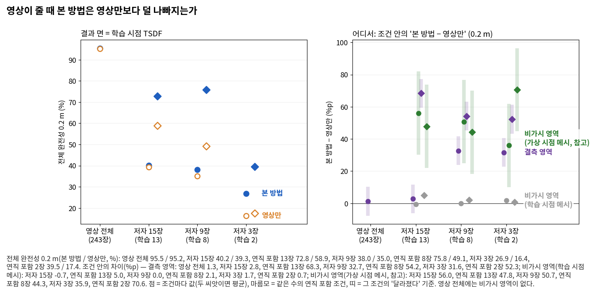

**예시: 영상이 줄어 못 본 벽을 사전 정보가 메우는가 (저자 3장, 비가시 일치 영역의 벽 정면, LoD2 면 20)**

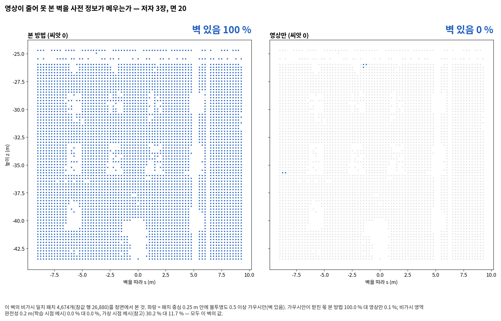

- 이 벽의 비가시 일치 패치 4,674개(참값 행 26,880)에서, 패치 중심 0.25 m 안에 불투명한 가우시안이 선 몫은 본 방법 99.96 %, 영상만 0.11 %다.
- 비가시 영역 완전성(0.2 m)은 학습 시점 메시로 두 방법 모두 0 %다. 가상 시점 메시로는 30.2 % 대 11.7 %다.

### 2.2 (3-2) 영상이 줄수록 결과가 사전 정보에 기대는 몫이 커지는가

**답: 영상이 줄어 사전 정보에 맡긴 곳이 늘어도, 결과는 그곳을 사전 정보로 받쳤다. 영상이 확인하지 못한 넓이는 3.2 %(영상 전체)에서 49.4 %, 53.5 %, 71.1 %(저자 15장, 9장, 3장)로 커졌고, 결과는 그 가운데 못 본 곳(비가시 일치 패치)의 99.3 %, 99.6 %, 96.2 %를 사전 정보로 받쳤다.**

- 숫자 둘을 함께 쓴다.
  - 영상이 확인하지 못한 넓이 몫: 평가 범위 가운데 결측 영역과 비가시 영역(코드 4, 5, 13, 14)의 넓이 몫이다. 학습 전 값이고, 판정이 사전 정보에 맡긴 몫이다. 흔들림이 없다.
  - 상속률: 비가시 일치 패치 가운데 패치 중심 0.25 m 안에 사전 정보 출신의 불투명한 가우시안이 있는 몫이다. 크면 맡긴 곳을 실제로 사전 정보로 받친 것이다.
- 저자 3장의 상속률은 저자 15장보다 3.03 %p 낮지만 기준(4.03 %p, 모은 흔들림 폭) 안이다. 두 씨앗은 96.40 %와 96.04 %다.
- 연직 포함 조건: 영상이 확인하지 못한 넓이 몫은 64.1 %, 80.9 %, 88.7 %다. 상속률은 98.1 %, 96.4 %, 99.6 %다(3-4에서 짝과 비교).

| 조건 | 영상이 확인하지 못한 넓이 몫 | 상속률 | 저자 15장과의 차이 (기준) |
|---|---:|---:|---|
| 영상 전체 | 3.2 % | — (비가시 영역 없음) | |
| 저자 15장 | 49.4 % | 99.25 % | 출발점 |
| 저자 9장 | 53.5 % | 99.62 % | +0.37 (4.03) 기준 안 |
| 저자 3장 | 71.1 % | 96.22 % (96.40 · 96.04) | −3.03 (4.03) 기준 안 |

- **함께 적는 것** ([tables/q32_extra.md](tables/q32_extra.md); 같은 셈을 다른 영역에서 함).
  - 결측 일치 패치(코드 4)에서 사전 정보 출신이 받친 몫: 영상 전체 74.4 %, 저자 15장 93.7 %, 9장 97.0 %, 3장 87.5 %. 영상만은 출신을 가리지 않고도 7.3 %, 13.2 %, 13.2 %, 23.8 %만 받쳤다.
  - 지지 일치 패치(코드 2)에서 사전 정보 출신이 받친 몫(참고): 34.7 %, 60.5 %, 64.1 %, 57.8 %. 처음 점의 영상 점이 14,503개, 4,689개, 2,824개, 23개로 줄어든다. 사전 정보 점은 13만~14만 개로 거의 같다. 그래서 이 몫은 사전 정보에 실제로 기댔는지와 상관없이 커질 수 있다(발주 7.2). 참고로만 둔다.
- 까닭(아는 만큼): 저자 3장에서 상속률이 3 %p 낮아진 것은 다시 읽기에서 보호가 풀린 수의 차이일 수 있다. 8.7에서 풀림의 99.5 % 이상이 '가우시안 신뢰도 E가 0.5를 넘음'이었다. 다만 3단계 조건마다의 풀림은 세지 않았다.

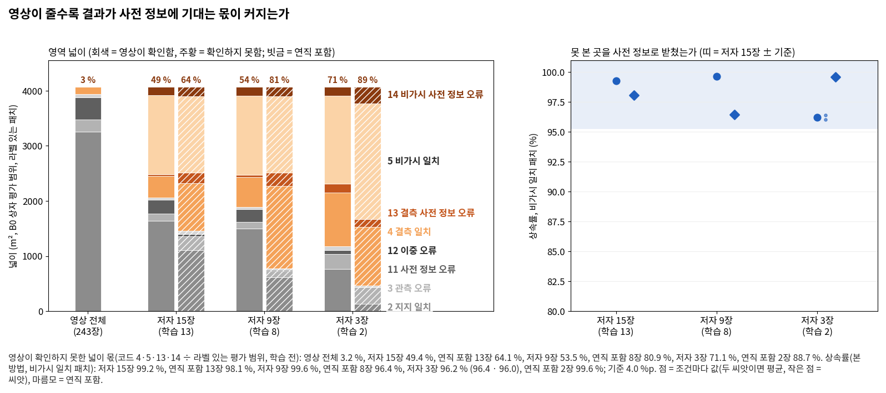

### 2.3 (3-3) 그러면서도 영상이 본 바뀐 곳의 과거 형상은 계속 막는가

**답: 계속 막지는 못했다. 저자 3장에서는 사전 정보 신뢰(고친 GeoGS)와 다르지 않았고, 영상만보다 과거 형상을 더 들였다. 읽은 나머지 조건(저자 15장, 9장, 연직 포함 13장, 8장, 2장)에서는 막았다.**

- 숫자는 관측된 사전 정보 오류 영역(코드 11)의 과거 형상 유입률이다. 코드 11은 영상이 지금 모습을 보았고 사전 정보가 그와 다른 곳(바뀐 곳)이다. 그 솎은 참값 점 가운데 결과 면이 사전 정보 쪽이나 양쪽에 선 몫이다. 크면 바뀐 곳에 옛 모양이 들어온 것이다.
- '막았다'는 본 방법이 고친 GeoGS보다 기준을 넘게 낮고, 영상만보다 기준을 넘게 높지 않은 것이다.

| 조건 | 본 방법 | 영상만 | 고친 GeoGS (남은 처음 점) | 표본 | − GeoGS (기준) | − 영상만 (기준) | 읽음 |
|---|---:|---:|---|---:|---:|---:|---|
| 영상 전체 | 11.98 | 13.29 | 42.83 (99,881) | 32,880 | −30.85 (5.46) | −1.31 (5.46) | 막았다 |
| 저자 15장 | 4.31 | 3.98 | 38.76 (29,835) | 20,268 | −34.45 | +0.33 | 막았다 |
| 저자 9장 | 4.61 | 4.35 | 32.14 (26,865) | 18,816 | −27.53 | +0.26 | 막았다 |
| 저자 3장 (두 씨앗) | 26.25 (27.63 · 24.87) | 11.79 | 29.75 (14,458) | 5,465 | −3.50 | **+14.46** | **사전 정보 신뢰와 다르지 않았다; 영상만보다 더 들였다** |
| 연직 포함 13장 | 21.63 | 18.81 | 43.95 (61,801) | 3,338 | −22.32 | +2.82 | 막았다 |
| 연직 포함 8장 | 16.46 | 20.12 | 46.67 (38,403) | 1,665 | −30.21 | −3.66 | 막았다 |
| 연직 포함 2장 | 24.48 | 19.79 | 75.00 (6,776) | 192 | −50.52 | +4.69 | 막았다 |

- 기준 5.46 %p는 저자 3장 본 방법 두 씨앗의 단위 흔들림이다. 고친 GeoGS는 씨앗이 하나라 자체 흔들림을 모른다. 그래서 GeoGS와의 비교에도 본 방법의 값을 쓴다.
- 코드 11의 표본은 영상이 줄면 줄어든다(401 m² → 64 m²). 저자 3장과 연직 포함 조건은 1만 점 미만이라 답이 '가능, 근거 불완전'까지다. 연직 포함 2장은 192점이다.

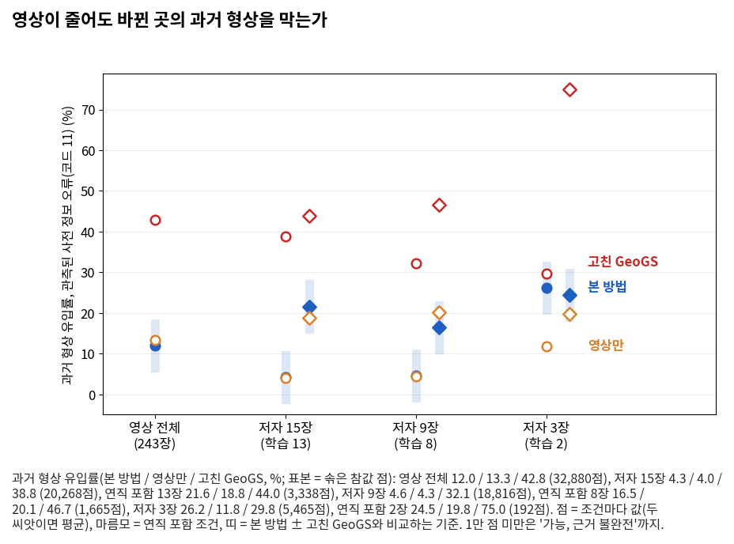

**막지 못한 모습 (결과를 본 뒤 더함; [tables/meas8_where33.md](tables/meas8_where33.md))**

- 저자 3장의 코드 11 행 5,465개 가운데 3,596개(66 %)가 한 벽(LoD2 면 22)에 있다. 그 벽의 유입률은 본 방법 35.1 %·33.8 %, 영상만 15.0 %·16.9 %, 고친 GeoGS 21.0 %다. 지붕(1,869행)에서는 본 방법이 13.2 %·7.8 %로 고친 GeoGS 46.7 %보다 훨씬 낮다.
- 같은 면 22의 코드 11은 다른 조건에도 많다(영상 전체 9,080행, 저자 15장 9,033행, 9장 8,881행). 거기서 본 방법 유입률은 6.2 %, 7.7 %, 7.2 %였다. 저자 3장에서만 이 벽을 막지 못했다.
- 학습 전 판정을 보면, 저자 3장에서 면 22의 코드 11 넓이 42.5 m² 가운데 30.5 m²(72 %)를 '일치'로 판정했다. 다른 조건에서는 그 몫이 40~44 %였다. 판정이 이 벽의 바뀐 곳 대부분을 사전 정보 쪽으로 지켰고, 결과는 그 벽의 3분의 1 남짓에 사전 정보 쪽 면을 두었다.
- 왜 '일치'로 판정됐는지는 보지 않았다(9.2 확인 불가). 영상 두 장의 MVS가 이 벽 아래층을 어떻게 보았는지 봐야 한다(제안 2).

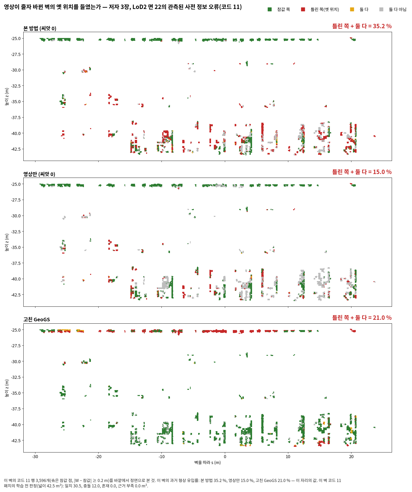

- 그림 아래 숫자는 이 벽(면 22, 3,596행)의 값이다.

**예시 자리 (학습 전에 정한 단면; 그림 아래 숫자는 그 단면 띠의 값)**

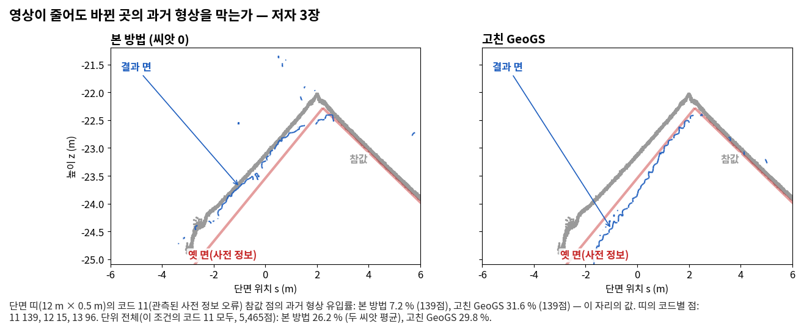

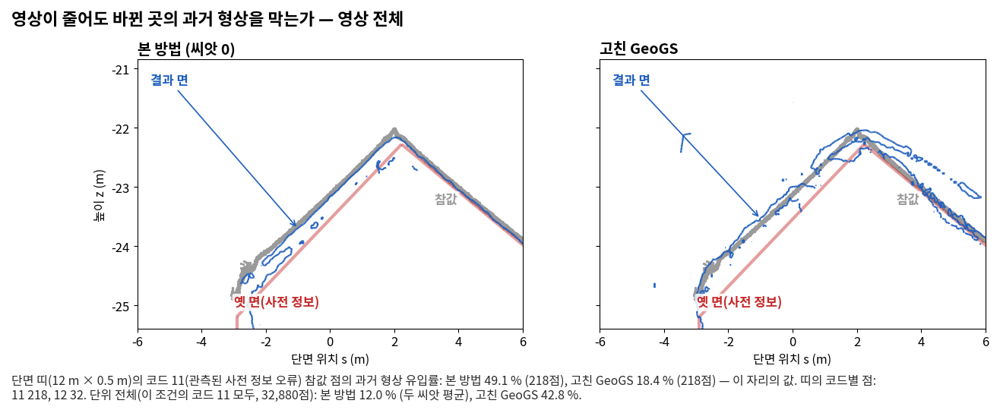

- 이 단면에서는 단위 전체와 반대로 나왔다. 저자 3장은 본 방법 7.2 % 대 고친 GeoGS 31.6 %(139점), 영상 전체는 49.1 % 대 18.4 %(218점)다.
- 영상 전체의 49.1 %는 대부분 '양쪽'(45.9 %)이다. 이 자리의 옛 면은 참값보다 0.3 m쯤 아래라, 참값 쪽 면과 옛 면 쪽 창(±0.15 m)에 함께 걸친 면이 양쪽으로 세어졌다.
- 이 예시 자리는 저자 3장의 단위 모습(면 22)을 보여 주지 않는다. 그래서 위의 벽 정면 그림을 더했다(결과를 본 뒤 더함).

**대가: 바뀐 곳이 관측, 결측, 비가시로 어떻게 나뉘는가**

| 조건 | 11 관측: 넓이 · 유입률 (본 방법 / 영상만 / 고친 GeoGS) | 12 이중 오류 | 13 결측 (참고) | 14 비가시: 넓이 · 못 본 곳 과거 형상 (본 방법) |
|---|---|---|---|---|
| 영상 전체 | 401 m² · 12.0 / 13.3 / 42.8 % | 61 m² · 50.6 / 46.6 / 48.5 % | 2 m² · 12.5 / 4.2 / 8.9 % | 0 m² |
| 저자 15장 | 248 m² · 4.3 / 4.0 / 38.8 % | 40 m² · 32.9 / 30.4 / 47.3 % | 22 m² · 24.6 / 10.9 / 24.1 % | 154 m² · 86.1 % |
| 저자 9장 | 229 m² · 4.6 / 4.3 / 32.1 % | 41 m² · 26.9 / 25.5 / 35.9 % | 39 m² · 26.8 / 4.9 / 21.5 % | 155 m² · 87.6 % |
| 저자 3장 | 64 m² · 26.2 / 11.8 / 29.8 % | 76 m² · 27.7 / 15.5 / 21.7 % | 165 m² · 36.6 / 6.5 / 19.6 % | 159 m² · 90.6 % |
| 연직 포함 13장 | 45 m² · 21.6 / 18.8 / 44.0 % | 60 m² · 37.6 / 27.1 / 33.4 % | 193 m² · 70.8 / 5.7 / 25.4 % | 166 m² · 98.5 % |
| 연직 포함 8장 | 22 m² · 16.5 / 20.1 / 46.7 % | 30 m² · 53.3 / 25.9 / 29.7 % | 246 m² · 80.0 / 8.3 / 26.7 % | 166 m² · 95.5 % |
| 연직 포함 2장 | 3 m² · 24.5 / 19.8 / 75.0 % | 27 m² · 12.7 / 5.2 / 34.8 % | 138 m² · 57.2 / 1.7 / 14.3 % | 296 m² · 99.6 % |

- 영상이 줄면서 바뀐 곳 대부분이 관측된 곳(11)에서 결측(13)과 비가시(14)로 옮겨 갔다.
- 결측 사전 정보 오류(13)에서는 모든 조건에서 본 방법이 영상만보다 높다(저자 3장 +30 %p, 연직 포함 8장 +72 %p). 까닭의 후보(확인하지 않음): 결측 패치는 같은 면 가까운 지지 패치의 판정을 이어받는데, 이어받은 판정이 '일치'면 바뀐 결측 패치에도 사전 정보를 채운다.
- 비가시(14)는 두 자료만으로는 버릴 근거가 없는 곳이라 읽는 규칙 없이 값만 적는다. 못 본 곳 과거 형상은 86~100 %다.

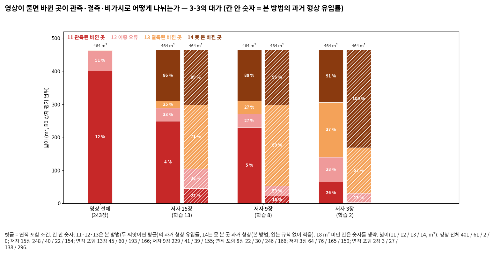

### 2.4 (3-4) 연직 영상을 넣은 같은 수의 조건에서는 어떻게 달라지는가

**답: 연직 영상을 넣은 조건에서 달라졌다. 세 짝 모두에서 본 방법의 전체 완전성이 높았고(+32.6, +37.8, +12.6 %p), 영상만과의 차이도 커졌다(+13.0, +23.7, +11.5 %p). 상속률은 짝끼리 같았다. 이 차이는 시점 방향과 영상의 겹침이 함께 바뀐 결과로 읽는다. 시점 방향 하나의 효과가 아니다.**

- 숫자는 같은 수의 짝(저자 ○장 ↔ 연직 포함 ○장)마다의 차이(연직 포함 − 저자)다. 3-1과 3-3은 방법 사이 차이를 짝끼리 비교하고(기준 ×√2), 전체 완전성과 3-2의 두 값은 짝끼리 바로 비교한다. 연직 포함 조건은 씨앗 하나라 기준의 두 배를 넘을 때만 '확인'이다.

| 짝 | 전체 완전성: 본 방법 값의 차이 | 전체 완전성: (본 방법 − 영상만)의 차이 | 과거 형상 유입률: (본 방법 − GeoGS)의 차이 | 결측 영역 완전성: (본 방법 − 영상만)의 차이 | 상속률: 본 방법 값의 차이 | 영상이 확인하지 못한 넓이 몫 |
|---|---|---|---|---|---|---|
| 저자 15장 ↔ 연직 포함 13장 | +32.64 (0.73) 확인 | +13.03 (5.66) 확인 | +12.13 (7.73) 가능, 근거 불완전 | +65.51 (12.60) 확인 | −1.19 (4.03) 기준 안 | 49.4 → 64.1 % |
| 저자 9장 ↔ 연직 포함 8장 | +37.80 (0.73) 확인 | +23.67 (5.66) 확인 | −2.68 (7.73) 기준 안 | +21.51 (12.60) 가능, 근거 불완전 | −3.19 (4.03) 기준 안 | 53.5 → 80.9 % |
| 저자 3장 ↔ 연직 포함 2장 | +12.58 (0.73) 확인 | +11.54 (5.66) 확인 | −47.02 (7.73) 확인 (표본 192점) | +20.67 (12.60) 가능, 근거 불완전 | +3.38 (4.03) 기준 안 | 71.1 → 88.7 % |

- **짝마다 바뀐 것(학습 전).**
  - 연직 영상: 2장, 2장, 1장.
  - 지지 일치 넓이(MVS가 서고 사전 정보와 맞는 곳)는 연직 포함 쪽이 오히려 작다. 1,636 → 1,109 m², 1,501 → 617 m², 766 → 126 m²다. 그래서 영상이 확인하지 못한 넓이 몫이 커진다.
  - 학습 전 판정의 미판정 몫이 커진다. 저자 9장 15.3 %가 연직 포함 8장 59.5 %, 저자 3장 25.5 %가 연직 포함 2장 44.1 %다([6절](#6-준비-결과-50-54)).
- 그런데도 연직 포함 조건의 전체 완전성은 높다(본 방법 75.8 % 대 38.0 %, 39.5 % 대 26.9 %). 영상만도 높다(49.1 % 대 35.0 %). 위에서 본 영상이 지붕을 넓게 담아 학습 시점 메시가 지붕을 덮는 것으로 보인다(확인하지 않음). 그 위에서 본 방법은 영상만과의 차이를 더 벌렸다.
- 과거 형상 유입률은 짝끼리 방법 사이의 차이로만 읽는다. 조건마다 영역 파일이 달라 같은 '코드 11'이라도 다른 자리이기 때문이다(발주 7.1).
  - (본 방법 − 고친 GeoGS)의 차이는 13장 짝에서 +12.1 %p(가능, 근거 불완전), 8장 짝에서 −2.7 %p(기준 안), 2장 짝에서 −47.0 %p다.
  - 13장 짝의 +12.1은 본 방법이 GeoGS보다 낮은 정도가 줄었다는 뜻이다(저자 15장 −34.5 %p, 연직 포함 13장 −22.3 %p). 연직 포함 13장도 3-3에서는 '막았다'다.
  - 2장 짝의 −47.0은 연직 포함 2장의 코드 11이 3 m²(192점)뿐이라 무게를 두지 않는다.
- 7.1 표의 '본 방법 값의 차이' 열은 전체 완전성과 상속률에서만 읽는다. 영역에 매인 다른 지표는 위와 같은 까닭으로 읽지 않는다.

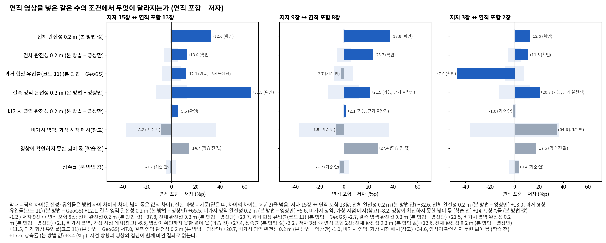

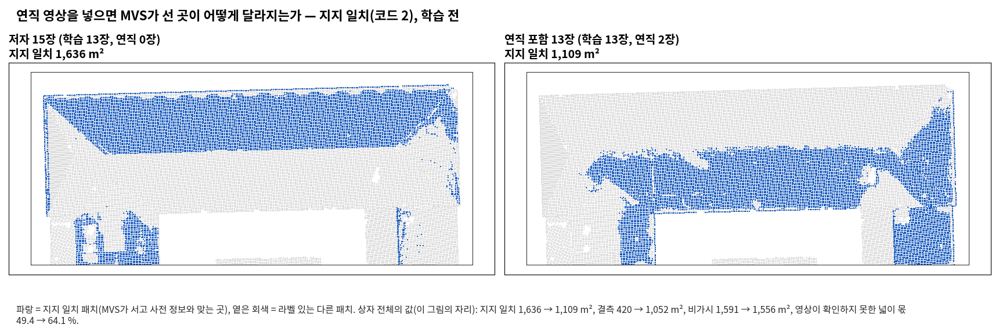

- 지도 아래 숫자는 B0 상자 전체(이 그림의 자리)의 값이다. 지지 일치 1,636 m² 대 1,109 m², 영상이 확인하지 못한 넓이 몫 49.4 % 대 64.1 %.

### 2.5 보강-1. 판정 없이 강건한 손실만으로도 바뀐 곳의 과거 형상을 막는가

**답: LoD2의 두 단위(B0, R1)에서는 모자랐다 — 판정을 끄니 바뀐 곳의 과거 형상이 더 들어왔다. B173 주변과 항공 LiDAR에서는 판정 없이도 같았다.**

- 숫자는 관측된 사전 정보 오류 영역(코드 11)의 과거 형상 유입률이다. 결과가 틀린 쪽(사전 정보 쪽)이나 양쪽에 면을 둔 참값 점의 몫으로, 크면 바뀐 곳에 옛 모양이 들어온 것이다. 판정만 끈 본 방법을 본 방법 두 씨앗 평균과 비교한다.
  - R1 LoD2: 25.45 % 대 7.63 %(8.51·6.76), 차이 +17.82 %p(기준 3.46). 본 방법(0)과 사전 정보 신뢰(1) 사이의 '어디쯤'은 0.50이다. 판정이 일한 몫이 본 방법과 사전 정보 신뢰 차이의 절반이다.
  - B0 LoD2: 14.75 % 대 11.98 %(12.10·11.86), +2.77 %p(기준 1.64). 어디쯤 0.09.
  - B173 주변 LoD2: 7.99 % 대 6.81 %, +1.18 %p(기준 1.64) — 같았다.
  - 항공 LiDAR 셋: B0 41.22 % 대 42.75 %(262점), B173 주변 0.15 % 대 0.03 %, R1 23.78 % 대 24.86 %(555점) — 모두 같았다. B0와 R1 항공 LiDAR는 표본이 1만 점 미만이라 '가능, 근거 불완전'까지다.
- 함께 적는 것.
  - 과거 형상 잔존율(심긴 사전 정보 점이 옛 자리에 남은 몫): R1 LoD2 23.29 % 대 3.55 %(크게 나빠짐), B0 LoD2 14.21 % 대 12.00 %(기준 2.22 안).
  - 사전 정보 오류 영역에 심긴 점의 운명(R1 LoD2, 11,518점): 판정만 끔 지워짐 57.5 %·옛 자리 12.9 % 대 본 방법 92.9·94.3 %·1.2·1.1 %.

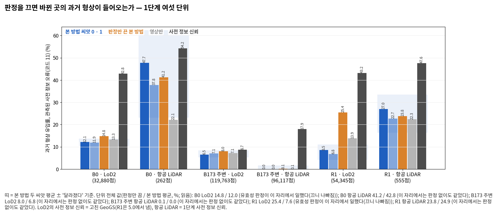

**예시: 가까운 옛 면에서 판정을 끄면 끌려가는가 (R1 LoD2 손실의 판정 반영 덩어리, 8.4와 같은 자리)**

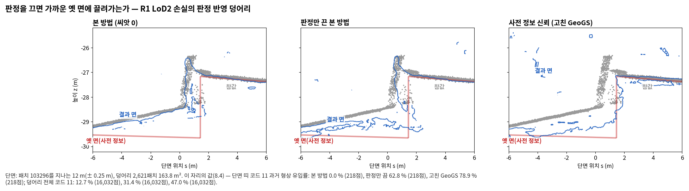

- 이 자리의 값(단면 띠 코드 11, 218점): 본 방법 0.0 %·1.4 %, 판정만 끔 62.8 %, 고친 GeoGS 78.9 %. 덩어리 전체(16,032점): 12.7 %·5.3 %, 31.4 %, 47.0 %.
- 2단계의 '손실에서만 판정 끄기'는 같은 자리에서 58.3 %(덩어리 23.9 %)였다. 판정만 끈 본 방법은 그와 비슷하게 옛 면에 끌려갔다.
- 까닭(아는 만큼): 이 덩어리는 판정이 충돌이고 τ < |참값 − 사전 정보| ≤ 4τ인 패치다. 판정이 없으면 이 어긋남은 손실의 당김 구간(τ~4τ) 안이라 결과를 사전 정보 쪽으로 당긴다. 판정이 있으면 충돌 패치의 사전 정보 깊이 항이 꺼진다.

### 2.6 보강-2. 과거 형상이 절단 거리보다 먼 곳에서는 판정 없이도 지워지는가

**답: 대부분 지워졌지만 본 방법보다는 덜 지워졌다 — 먼 과거 형상에서도 판정이 일부를 맡았다(어디쯤 0.29). 날개 덩어리의 과거 형상 유입률은 판정 없이도 같았다.**

- 숫자는 B173 주변 항공 LiDAR 날개에 심긴 옛 점 15,360개 가운데 학습이 끝날 때 지워진 몫이다.
  - 판정만 끔 98.4 % 대 본 방법 99.6 %·99.4 %(평균 99.5 %), 사전 정보 신뢰 95.7 %.
  - 판정만 끔과 본 방법의 차이 −1.1 %p는 기준 0.46 %p(두 씨앗의 단위 흔들림; 세 점의 몫 0.02 %p)를 넘는다. 어디쯤 = (98.4 − 99.5) ÷ (95.7 − 99.5) = 0.29.
- 날개 덩어리 전체의 과거 형상 유입률: 판정만 끔 0.1 % 대 본 방법 0.0 %·0.0 %, 사전 정보 신뢰 18.6 %. 12 m 단면 띠(591점): 0.0 % 대 0.0 %, 사전 정보 신뢰 2.4 %.
  - 결과 면에는 옛 박공이 남지 않았다. 다만 심긴 점 1.6 %가 지워지지 않고 남았다(옛 자리 0.6 %, 지금 지붕 0.4 %, 둘 다 아님 0.7 %).
- 마지막 후손이 지워진 반복: 판정만 끔 최소 600·중앙 600·최대 12,200, 본 방법 600·600·13,500 / 14,800, 사전 정보 신뢰 600·1,300·14,700. 판정만 끔이 더 늦게 지운 것은 아니다. 1·2단계의 '판정은 남은 몇 %를 더 일찍 지웠다'는 이 셈으로는 받쳐지지 않는다(남은 몫이 다를 뿐 지운 때는 비슷함).
- 사전 정보 신뢰와의 차이(95.7 % 대 99.5 %)는 판정과 손실의 구간 나눔을 함께 끈 짝과의 차이다. 판정만 끈 결과(98.4 %)가 그 사이에 있으므로, 대략 판정의 몫이 0.29, 구간 나눔의 몫이 나머지로 갈린다.

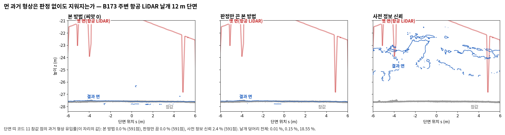

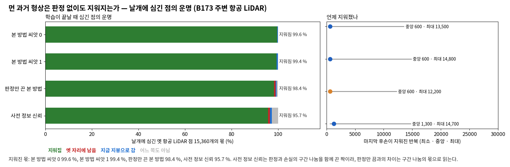

### 2.7 보강-3. 판정을 끄면 영상이 틀린 곳에서 맞는 사전 정보를 더 지키는가

**답: 여섯 단위 가운데 다섯에서 관측 오류 유입률이 줄었다. R1 LoD2에서는 맞바꿈이다 — 과거 형상이 함께 들어왔다(2단계 R1 LoD2 손실의 판정 반영 끄기와 같은 꼴). B173 주변 두 사전 정보와 B0 항공 LiDAR에서는 잃은 것 없이 맞는 사전 정보를 더 지켰다.**

- 숫자는 관측 오류 영역(코드 3: 영상이 틀리고 사전 정보가 맞는 곳) 전체의 유입률이다. 결과가 영상의 틀린 깊이를 따른 몫으로, 작으면 맞는 사전 정보를 지킨 것이다.
  - R1 LoD2: 8.09 % 대 20.26 %(−12.17 %p, 기준 1.57). 과거 형상 유입률은 +17.82 %p → 맞바꿈. 2단계 '손실에서만 판정 끄기'는 과거 형상 7.6 → 19.8 %, 관측 오류 20.3 → 8.1 %였다. 같은 꼴이다.
  - B173 주변 LoD2 55.03 % 대 61.25 %(−6.22), B173 주변 항공 LiDAR 78.25 % 대 84.29 %(−6.04), B0 항공 LiDAR 29.85 % 대 35.66 %(−5.82), R1 항공 LiDAR 34.84 % 대 41.16 %(−6.32): 과거 형상 유입률은 기준 안 → '판정을 끄니 잃은 것 없이 맞는 사전 정보를 더 지켰다'. B0·R1 항공 LiDAR의 과거 형상은 표본이 1만 점 미만이라 '가능, 근거 불완전'.
  - B0 LoD2: 20.50 % 대 21.16 %(기준 안) → '이 자리에서 판정은 영상이 틀린 곳의 맞는 사전 정보를 놓지 않았다'.
- 문턱 이내 값(관문 조건 2의 영역; 모든 칸이 1만 점 미만이라 '가능, 근거 불완전'): R1 LoD2 14.47 % 대 10.65 %(나빠짐), B173 주변 LoD2 67.44 % 대 65.88 %(나빠짐), B173 주변 항공 LiDAR 87.78 % 대 89.02 %(좋아짐), 나머지 셋은 같음.
  - 문턱의 뜻(8.6): LoD2는 1·τ로 손실의 허용 구간과 같은 τ, 같은 방향이다. 그래서 LoD2의 '문턱 이내' 영상 오류는 결과가 영상을 따라도 허용 구간 안이라 손실이 사전 정보 쪽으로 당기지 않는 곳이다. 판정을 꺼도 이 영역의 유입률이 줄지 않은(R1·B173 LoD2에서 오히려 늘어난) 것과 맞는다. 항공 LiDAR는 2·τ라, 문턱 이내에 당김 구간(τ~2τ)이 섞인다.

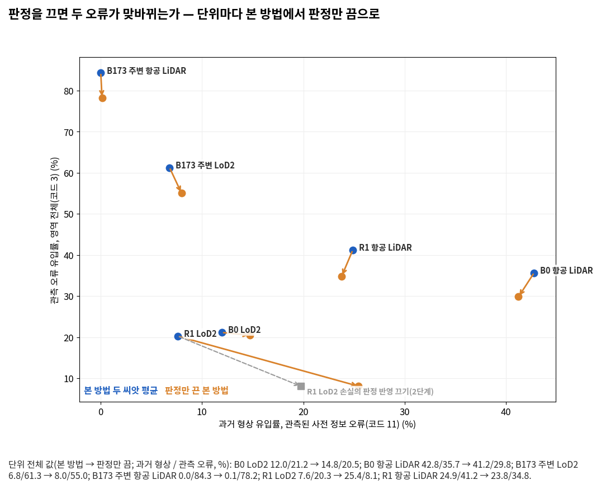

### 2.8 보강-4. 판정 없이도 못 본 곳과 깊이가 없는 곳을 메우는가

**답: 못 본 곳의 맞는 사전 정보는 판정 없이도 메웠다(B173 주변). 결측 영역은 맞바꿈이다 — R1 LoD2에서 판정을 끄니 완전성은 커지고 과거 형상도 크게 들어왔다.**

- 비가시 영역(패치가 넉넉한 B173 주변):
  - 상속률(비가시 일치 패치 가운데 사전 정보 출신 가우시안이 받친 몫) LoD2 79.48 % 대 79.33 %, 가우시안이 받친 몫 80.37 % 대 80.39 % — 같았다 → '못 본 곳의 맞는 사전 정보는 판정 없이도 메웠다'.
  - 못 본 곳 과거 형상(충돌로 미룬 패치): LoD2 6.25 % 대 7.56 %(기준 4.24 안) — 판정이 막은 흔적 없음. 항공 LiDAR 0.90 % 대 0.20 %(기준 0.10 넘음) → '판정이 못 본 곳의 과거 형상을 막았다'(값 자체는 작음).
- 결측 영역(맞바꿈으로 읽음):
  - R1 LoD2: 결측 영역 완전성 73.74 % 대 50.77 %(+22.97, 기준 7.50) → '판정이 결측 영역의 맞는 사전 정보를 막았다'. 결측 영역의 과거 형상 유입률 39.20 % 대 2.17 %(+37.03, 기준 0.35) → '판정이 결측 영역의 과거 형상을 막았다'. 둘 다 크다.
  - B173 주변 LoD2: 완전성 같음(96.23 % 대 96.45 %), 과거 형상 26.42 % 대 20.76 %(+5.66, 기준 4.26) → 판정이 과거 형상을 막았다.
  - B0 LoD2·항공 LiDAR, B173 주변 항공 LiDAR: 같음(표본이 작은 칸은 표본 부족).
  - R1 항공 LiDAR: 완전성 32.90 % 대 31.72 % — 판정을 꺼도 채우지 못했다. 1단계에서 덜 채운 까닭이 판정 밖에 있다는 근거다(8.5와 함께 봄).

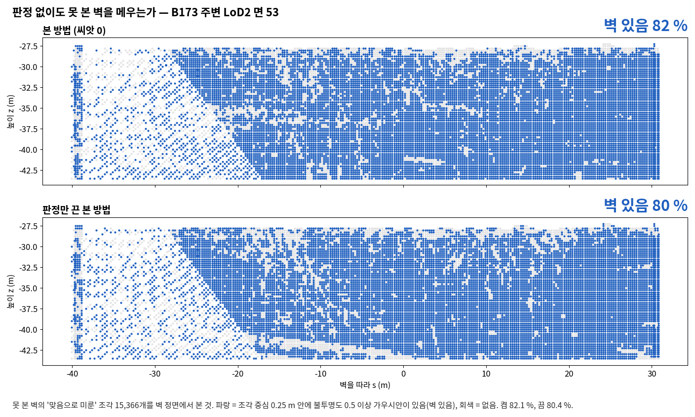

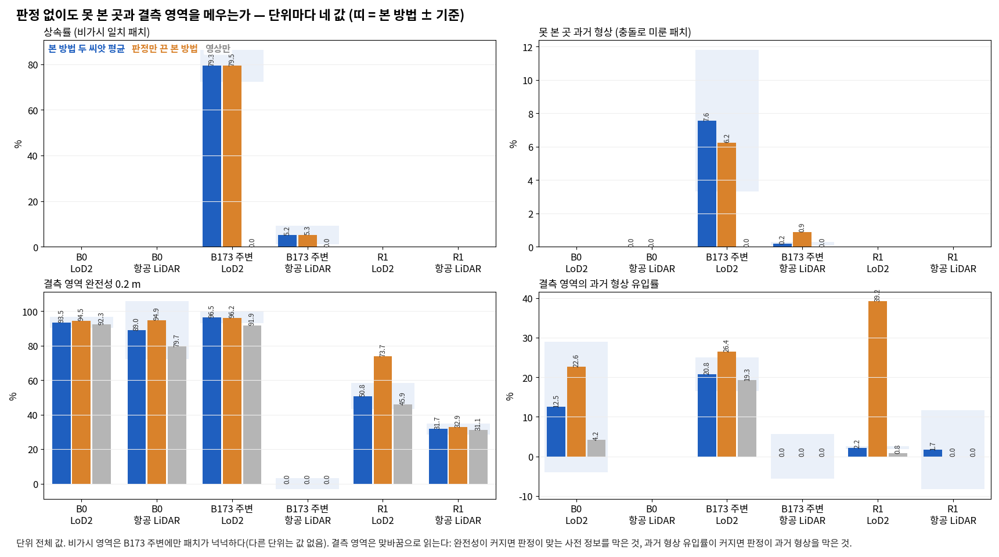

### 2.9 2단계 다시 시도

| 학습 | 이번 결과 | 읽음 |
|---|---|---|
| 유효성 판정의 전파 끄기 · B173 주변 LoD2 | PASS(66분, 시도 1) | 결측 영역의 과거 형상 유입률 24.26 % 대 본 방법 20.76 %(21.83·19.68), 차이 3.50 %p < 기준 4.26; 결측 영역 완전성 96.09 % 대 96.45 % → 두 값 모두 같음. 이 자리에서 판정의 전파를 끄는 일의 양(이어받은 판정이 있는 결측 패치 2,749개)에서 맞바꿈은 보이지 않았다. 뜬 조각 몫은 1.60 % 대 1.30 %(기준 0.26)로 나빠졌다 |
| 절단 배수 8배 · R1 LoD2 | PASS(64분, 시도 1) | 관문 조건 1~4의 판단이 본 방법과 같다(1·3·4 충족, 2 판별 불가). 과거 형상 유입률 9.59 % 대 7.63 %(기준 3.46 안). 보정률 곡선은 가장 작은 오류 구간(0~1τ)에서 55.5 %로 기준 띠(59.0~63.6 %) 아래다(2배는 69.3 %로 위). 그래서 '둔감하다'고 쓰지 않는다: τ 안쪽의 작은 오류를 고치는 몫이 절단 배수에 따라 달라진다(2배 > 4배 > 8배) |

- 둘 다 2단계와 고침에서는 GPU 메모리 부족으로 끝나지 못했는데, 이번에는 첫 시도에 끝났다(r15). 학습 코드는 2단계(r13)·고침(r14)과 결정이 같은 판이다.

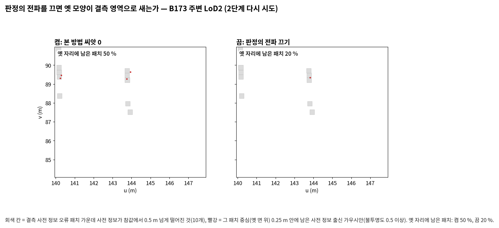

- 이 그림의 자리(결측 사전 정보 오류 패치 10개)는 2단계 그림 자리 정의를 그대로 썼다. 표본이 작아 '옛 자리에 남은 패치' 몫(켬 50 %, 끔 20 %)은 읽지 않는다. 답은 위 표의 단위 전체 값(371점)이다.

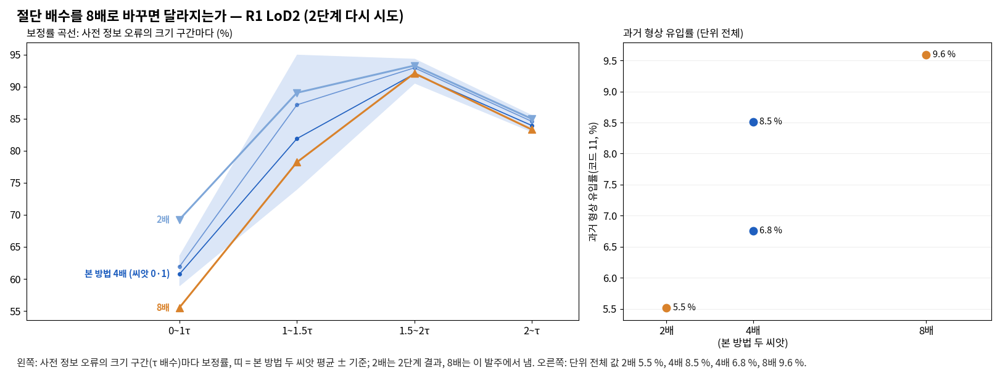

## 3. 얼마나 확실한가

| 물음 | 등급 | 까닭 (표본, 씨앗, 기준, 빌려 쓴 흔들림 폭) |
|---|---|---|
| 3-1 저자 3장 | 확인 | 두 씨앗(본 방법·영상만). 차이의 차이 10.19 %p > 기준 5.66 %p. 참값 점 206만 |
| 3-1 저자 15장·9장 | 기준 안 | 씨앗 하나라 저자 3장과 영상 전체의 흔들림 폭을 빌려 씀. 0.56·2.72 %p < 5.66 %p |
| 3-1 결측 영역 (9장·3장) | 확인 | +32.7·+31.6 %p > 기준 8.91 %p의 두 배(9장) / 기준(3장, 두 씨앗). 참값 점 5만·9만 |
| 3-1 비가시 영역 | 저자 3장만 확인 | 학습 시점 메시는 못 본 면을 담지 못해 값이 0~7 %. 가상 시점 메시 값은 참고 |
| 3-2 | 기준 안 | 상속률의 패치 2만 3천~2만 5천. 저자 3장 두 씨앗(96.40·96.04). 모은 흔들림 폭 4.03 %p |
| 3-3 저자 15장·9장 | 확인 ('막았다') | 표본 2만·1.9만점. 고친 GeoGS와 27~34 %p 차이(기준의 5배 넘음). GeoGS는 씨앗 하나라 자체 흔들림을 모름 |
| 3-3 저자 3장 | 가능, 근거 불완전 | 표본 5,465점(관문 지표 1만 미만). 두 씨앗 27.63·24.87 % |
| 3-3 연직 포함 조건 | 가능, 근거 불완전 | 표본 3,338·1,665·192점. 씨앗 하나 |
| 3-4 | 전체 완전성: 확인 / 그 밖: 가능, 근거 불완전 또는 기준 안 | 연직 포함 조건은 씨앗 하나라 기준의 두 배를 넘어야 확인. 시점 방향과 겹침이 함께 바뀜 |
| 보강-1 R1 LoD2 | 확인 | +17.82 %p > 기준 3.46 %p의 5배. 표본 5만 4천 |
| 보강-1 B0 LoD2 | 확인 (기준의 1.7배) | +2.77 %p > 기준 1.64 %p. 판정만 끈 쪽이 씨앗 하나라, 3단계의 '두 배' 규칙을 대면 '가능, 근거 불완전'이다 |
| 보강-1 B0·R1 항공 LiDAR | 가능, 근거 불완전 | 표본 262·555점 |
| 보강-2 | 확인 | −1.1 %p, 기준 0.46 %p(두 씨앗)의 2.4배. 심긴 점 15,360개 |
| 보강-3 | 확인 | 다섯 단위의 −6 %p 안팎과 R1 LoD2의 −12.2 %p 모두 기준(1.57~2.67 %p)의 두 배 넘음. 문턱 이내 값은 모두 1만 점 미만이라 가능, 근거 불완전 |
| 보강-4 비가시 (B173 주변) | 기준 안 / 항공 LiDAR 못 본 곳 과거 형상만 확인 | 패치 15,366·2,991개. 항공 LiDAR의 값 차이는 0.7 %p로 작다 |
| 보강-4 결측 (R1 LoD2) | 확인 | 완전성 +22.97 %p(기준 7.50), 과거 형상 +37.03 %p(기준 0.35). 표본 712·852점 |
| 다시 시도 (전파 끄기) | 기준 안 | 결측 영역의 과거 형상 표본 371점 |
| 다시 시도 (절단 8배) | 관문 조건 1~4 같음; 보정률 곡선이 띠 밖 | 보정률은 2단계의 곡선 띠 규칙. 씨앗 하나 |
| 8.5 | 가르지 못함 (가능, 근거 불완전) | 두 사전 정보의 결측 일치 영역은 같은 화소가 아님 |

## 4. 알게 된 것과 넘길 물음

**알게 된 것**

1. **영상이 줄어도 맡긴 곳은 사전 정보로 받쳤다.** 영상이 확인하지 못한 넓이가 71 %까지 커져도 상속률은 96~100 %였다. 결측 영역은 영상만보다 30~55 %p 더 채웠다(저자 9장부터).
2. **그러나 영상이 아주 적으면 오류 차단이 약해진다.** 저자 3장(학습 2장)에서 한 벽(면 22)의 바뀐 곳을 학습 전 판정이 '일치'로 보았다. 그 벽에서 결과가 과거 형상을 따랐다. 판정의 입력인 MVS가 얇아지는 곳에서 판정이 틀릴 수 있다.
3. **연직 영상을 넣은 조건은 MVS가 선 넓이가 오히려 작았다.** 그런데도 결과의 전체 완전성은 컸다. 시점과 겹침이 함께 바뀌어, 이 차이를 시점 방향 하나의 효과로 읽을 수는 없다.
4. **유효성 판정은 LoD2의 '가까운 옛 면'에서 일한다.** 가까운 옛 면은 참값과 사전 정보의 차이가 τ보다 크고 4τ 이하인 곳이다. R1 LoD2에서 판정을 끄니 과거 형상 유입률이 7.6 %에서 25.5 %로 올랐다. 그 덩어리의 단면에서는 0~1 %가 63 %가 되었다. 이 차이는 손실의 당김 구간 안이라, 강건한 손실만으로는 사전 정보 쪽으로 끌려간다.
5. **먼 과거 형상은 절단이 대부분 지운다.** B173 날개의 옛 점은 판정 없이도 98.4 %가 지워졌다. 판정은 1.1 %p를 더 지웠다.
6. **판정은 영상이 틀린 곳의 맞는 사전 정보를 일부 놓는다.** 판정을 끄니 여섯 단위 가운데 다섯에서 관측 오류 유입률이 6~12 %p 줄었다. 오류 차단과 맞바꾼 몫이다. R1 LoD2에서는 그만큼 과거 형상이 들어왔고, 나머지 넷에서는 과거 형상이 같았다.
7. **R1 결측 영역을 덜 채운 까닭은 판정 밖에 있다.** 판정을 꺼도 항공 LiDAR 결측 영역 완전성은 31.7 %에서 32.9 %로 그대로였다. 앞을 가린 면의 절반이 그 패치 면이 아닌 다른 면이었다(8.5).
8. **GPU 메모리 부족의 까닭은 소수 가우시안의 화면 상자가 발산한 데 있었다.** 디스크가 카메라 평면을 지나는 가우시안이다. 결과를 바꾸지 않는 고침(cull3)으로 풀렸다(5.2).

**넘길 물음** (넓히기와 결과 정리로)

| 물음 | 넘길 곳 | 근거 |
|---|---|---|
| 영상이 아주 적을 때 학습 전 판정의 '일치'가 왜 틀리는가 (저자 3장 면 22) | 결과 정리 (판정 검증) | 3-3 |
| 영상 수의 효과가 다른 지역과 항공 LiDAR에서도 같은가 | 넓히기 | 범위 |
| 판정만 끈 본 방법을 영상 수 조건에서 돌릴 것인가, 둘째 씨앗을 둘 것인가 | 넓히기 | 보강 결과(LoD2 두 단위에서 판정이 일함) |
| 과거 형상 유입률을 늘어난 곳·줄어든 곳으로 나눠 논문 6.2 항목 5에 쓸 것인가 | 결과 정리 | 8.1 |
| LoD2 사전 정보 오류의 표현 차이와 실제 변화를 나눠 쓸 것인가, 두 사전 정보의 시기 | 결과 정리 | 8.2, 9.2 |
| 전체 완전성(학습 시점 메시)은 못 본 면을 담지 못한다. 가상 시점 메시를 정식 지표로 둘 것인가 | 결과 정리 | 3-1 |
| 고친 GeoGS의 흔들림 | 넓히기 | 씨앗 하나 |
| 래스터라이저 고침 cull3을 이후 학습의 기본으로 둘 것인가 | 넓히기 | 5.2, 제안 1 |

## 5. 실험 구성과 실제로 돈 학습

### 5.1 구성과 학습마다의 시간·메모리

| 묶음 | 학습 | 수 | 코드 | 실제 |
|---|---|---:|---|---|
| 3단계 | B0 영상 수 조건 여섯 × 본 방법, 영상만, 고친 GeoGS (저자 15장 본 방법은 2단계 짝을 씀) | 17 | r15 (= r14 + 메모리 부족 기록, 기본 꺼짐) / 고친 GeoGS | 17회 결과. 연직 포함 13장 본 방법만 세 번째 시도(cull3) |
| 3단계 | 저자 3장 본 방법과 영상만의 둘째 씨앗 | 2 | r15 | 2회 결과 |
| 1단계 보강 | 판정만 끈 본 방법 × 여섯 단위, 씨앗 0 | 6 | r15, `--jbgs_sw_judgment 0` | 6회 결과 |
| 2단계 다시 시도 | 유효성 판정의 전파 끄기 · B173 주변 LoD2, 절단 배수 8배 · R1 LoD2 | 2 | r15 | 2회 결과, 둘 다 첫 시도 |
| 계 | | 27 | | 27회 결과, 시도 29번 |

- r15는 r14에 메모리 부족 기록 처리기만 더한 판이다. 기본값은 꺼짐이다. 학습 전 계산과 체크포인트 한 반복에서 r14와 다른 값이 0개였다(준비 보고 4.1).
- 학습마다 코드, GPU, 시작과 끝, 걸린 분, GPU 메모리 최대, 몇 번째 시도, 후처리 시간과 호스트 메모리는 아래 표다([tables/times.md](tables/times.md)).

| 차례 | 조건 | 결과 | 무엇 | 코드 | GPU | 학습 시작 | 끝 | 분 | GPU 메모리 최대 (MiB; 학습 전 사용 뺌) | 시도 | 상태 | 후처리 시작 (학습 끝 뒤 기다린 분) | post·run (초) | post 중 호스트 여유 최소 (GB) |
|---|---|---|---|---|---|---|---|---|---|---|---|---|---|---|
| 1 | B0a3 | prop_LoD2_s0 | 본 방법 씨앗 0 | r15 | 0 | 10-14 10:41 | 10-14 11:06 | 25 | 2,999 (2,541) | 1 | PASS | 10-14 11:06 (0) | 85·97 (run 다시 함) | 48 |
| 1 | B0a3 | prop_LoD2_s1 | 본 방법 씨앗 1 | r15 | 1 | 10-14 10:43 | 10-14 11:08 | 25 | 2,514 (2,423) | 1 | PASS | 10-14 11:08 (0) | 83·102 (run 다시 함) | 44 |
| 1 | B0a3 | imgonly_s0 | 영상만 씨앗 0 | r15 | 0 | 10-14 11:07 | 10-14 11:31 | 24 | 3,895 (3,437) | 1 | PASS | 10-14 11:31 (0) | 102·98 | 45 |
| 1 | B0a3 | imgonly_s1 | 영상만 씨앗 1 | r15 | 1 | 10-14 11:09 | 10-14 11:32 | 23 | 2,452 (2,361) | 1 | PASS | 10-14 11:33 (1) | 74·94 | 45 |
| 1 | B0a3 | trust_LoD2_fix1 | 사전 정보 신뢰(GeoGS) 고친 판 | 고친 GeoGS (fix1) | 0 | 10-14 11:36 | 10-14 12:28 | 52 | 7,267 (6,806) | 1 | PASS | 10-14 21:07 (520) | 41·91 | 93 |
| 2 | B0a15 | imgonly_s0 | 영상만 씨앗 0 | r15 | 0 | 10-14 11:40 | 10-14 12:32 | 53 | 7,207 (5,588) | 1 | PASS | 10-14 12:32 (0) | 105·66 | 48 |
| 2 | B0a15 | trust_LoD2_fix1 | 사전 정보 신뢰(GeoGS) 고친 판 | 고친 GeoGS (fix1) | 1 | 10-14 11:41 | 10-14 12:08 | 28 | 4,080 (3,989) | 1 | PASS | 10-14 21:05 (537) | 98·91 | 84 |
| 2 | B0a9 | prop_LoD2_s0 | 본 방법 씨앗 0 | r15 | 0 | 10-14 12:35 | 10-14 13:01 | 26 | 3,341 (2,880) | 1 | PASS | 10-14 13:01 (0) | 74·74 | 50 |
| 2 | B0a9 | imgonly_s0 | 영상만 씨앗 0 | r15 | 0 | 10-14 13:04 | 10-14 13:27 | 23 | 3,143 (2,685) | 1 | PASS | 10-14 13:27 (0) | 68·63 | 52 |
| 2 | B0a9 | trust_LoD2_fix1 | 사전 정보 신뢰(GeoGS) 고친 판 | 고친 GeoGS (fix1) | 0 | 10-14 13:29 | 10-14 13:53 | 24 | 3,133 (2,675) | 1 | PASS | 10-14 21:08 (435) | 70·79 | 88 |
| 2 | B0n13 | prop_LoD2_s0 (앞 시도) | 본 방법 씨앗 0 | r15 | 1 | 10-14 21:10 | 10-14 21:34 | 24 | 23,896 (23,805) | 1 | OOM | — (—) | —·— | — |
| 2 | B0n13 | prop_LoD2_s0 (앞 시도) | 본 방법 씨앗 0 | r15 | 1 | 10-14 21:34 | 10-14 21:56 | 22 | 23,976 (23,885) | 2 | OOM | — (—) | —·— | — |
| 2 | B0n13 | prop_LoD2_s0 | 본 방법 씨앗 0 | r15 + cull3 래스터라이저 | 0 | 10-15 09:21 | 10-15 10:14 | 54 | 12,586 (12,128) | 3 | PASS | 10-15 10:14 (0) | 84·78 | 86 |
| 2 | B0n13 | imgonly_s0 | 영상만 씨앗 0 | r15 | 0 | 10-14 21:13 | 10-14 22:09 | 56 | 8,014 (7,556) | 1 | PASS | 10-14 22:09 (0) | 84·77 | 83 |
| 2 | B0n13 | trust_LoD2_fix1 | 사전 정보 신뢰(GeoGS) 고친 판 | 고친 GeoGS (fix1) | 1 | 10-14 21:56 | 10-14 22:43 | 48 | 6,684 (6,593) | 1 | PASS | 10-14 22:43 (0) | 73·79 | 87 |
| 2 | B0n8 | prop_LoD2_s0 | 본 방법 씨앗 0 | r15 | 0 | 10-14 22:12 | 10-14 22:44 | 32 | 4,263 (3,805) | 1 | PASS | 10-14 22:45 (0) | 91·90 | 80 |
| 2 | B0n8 | imgonly_s0 | 영상만 씨앗 0 | r15 | 0 | 10-14 22:48 | 10-14 23:18 | 30 | 4,093 (3,635) | 1 | PASS | 10-14 23:18 (0) | 94·84 | 78 |
| 2 | B0n8 | trust_LoD2_fix1 | 사전 정보 신뢰(GeoGS) 고친 판 | 고친 GeoGS (fix1) | 1 | 10-14 22:51 | 10-14 23:23 | 32 | 3,624 (3,533) | 1 | PASS | 10-14 23:23 (0) | 79·79 | 83 |
| 2 | B0n2 | prop_LoD2_s0 | 본 방법 씨앗 0 | r15 | 0 | 10-14 23:23 | 10-14 23:47 | 24 | 3,061 (2,603) | 1 | PASS | 10-14 23:47 (0) | 42·64 | 91 |
| 2 | B0n2 | imgonly_s0 | 영상만 씨앗 0 | r15 | 1 | 10-14 23:25 | 10-14 23:47 | 22 | 2,472 (2,381) | 1 | PASS | 10-14 23:47 (0) | 39·68 | 93 |
| 2 | B0n2 | trust_LoD2_fix1 | 사전 정보 신뢰(GeoGS) 고친 판 | 고친 GeoGS (fix1) | 1 | 10-14 23:49 | 10-15 00:12 | 23 | 2,082 (1,991) | 1 | PASS | 10-15 00:12 (0) | 32·74 | 84 |
| 3 | B0_b10 | nojudge_LoD2_s0 | 판정만 끈 본 방법 | r15 | 0 | 10-14 23:50 | 10-15 01:00 | 70 | 12,640 (12,182) | 1 | PASS | 10-15 01:00 (0) | 352·34 | 53 |
| 3 | B0_b10 | nojudge_ALS_s0 | 판정만 끈 본 방법 | r15 | 1 | 10-15 00:15 | 10-15 01:19 | 64 | 11,454 (11,363) | 1 | PASS | 10-15 01:19 (0) | 365·28 | 55 |
| 3 | B173nb_b10 | nojudge_LoD2_s0 | 판정만 끈 본 방법 | r15 | 0 | 10-15 01:08 | 10-15 02:21 | 73 | 12,735 (12,277) | 1 | PASS | 10-15 02:21 (0) | 315·171 | 57 |
| 3 | B173nb_b10 | nojudge_ALS_s0 | 판정만 끈 본 방법 | r15 | 1 | 10-15 01:27 | 10-15 02:36 | 69 | 11,334 (11,243) | 1 | PASS | 10-15 02:36 (0) | 338·164 | 49 |
| 3 | R1rep_b10 | nojudge_LoD2_s0 | 판정만 끈 본 방법 | r15 | 0 | 10-15 02:29 | 10-15 03:59 | 90 | 20,344 (19,886) | 1 | PASS | 10-15 04:05 (7) | 454·39 | 56 |
| 3 | R1rep_b10 | nojudge_ALS_s0 | 판정만 끈 본 방법 | r15 | 1 | 10-15 02:44 | 10-15 03:58 | 74 | 14,898 (14,807) | 1 | PASS | 10-15 03:58 (0) | 433·41 | 58 |
| 4 | B173nb_b10 | abl_prop_LoD2_s0 | 유효성 판정의 전파 끄기 (2단계 다시 시도) | r15 | 1 | 10-15 04:14 | 10-15 05:20 | 66 | 11,910 (11,819) | 1 | PASS | 10-15 05:26 (6) | 319·160 | 65 |
| 4 | R1rep_b10 | sens_trunc8_LoD2_s0 | 절단 배수 8배 (2단계 다시 시도) | r15 | 0 | 10-15 04:14 | 10-15 05:18 | 64 | 14,061 (13,603) | 1 | PASS | 10-15 05:18 (0) | 440·49 | 58 |

#### 대기열이 멈춰 있던 시간 (따로 적음; 사용자 지시 10-14 저녁 5번)

| 무엇 | 때 | 길이 |
|---|---|---|
| 대기열 전체: GeoGS 후처리가 호스트 메모리 70 GB를 기다림 (문턱은 그대로) | 10-14 13:53 → 10-14 21:06:00 | 7.22시간 |
| GPU 1 빔 (B0a15/trust_LoD2_fix1 학습 끝 → 다음 학습 시작; 초까지 receipt 시각) | 10-14 12:08:51 → 10-14 21:10:51 | 9.03시간 |
| GPU 0 빔 (B0a9/trust_LoD2_fix1 학습 끝 → 다음 학습 시작; 초까지 receipt 시각) | 10-14 13:53:29 → 10-14 21:13:41 | 7.34시간 |
| titiler 둘과 tensorboard 멈춤 → 다시 켬 | 10-14 21:05:51 → 10-15 10:21:43 | 13.26시간 |
| 3단계 학습·후처리가 끝난 시각 (두 대기열 끝 → 대기열 밖 후처리 끝) | 10-15 10:19:44 → 10-15 10:21:42 | |

MemAvailable: 멈추기 전 64.8 GB, 멈춘 뒤 99.9 GB. 기다린 GeoGS 후처리 셋의 post 중 호스트 여유 최소: B0a15/trust_LoD2_fix1 84 GB, B0a3/trust_LoD2_fix1 93 GB, B0a9/trust_LoD2_fix1 88 GB.

#### 래스터라이저 고침의 결정을 기다린 시간 (따로 적음)

| 무엇 | 때 | 길이 |
|---|---|---|
| 큰 대기열(차례 2~4) 끝 → cull3 다시 돌리기 시작 (01:3x에 여쭙고 09:2x에 답을 받음; 세 서비스는 꺼 둔 채) | 10-15 05:38:30 → 10-15 09:21:00 | 3.71시간 |

#### GPU에 학습이 없던 때 (한 시간 넘는 틈; 밤의 cull 시험은 GPU를 잡았지만 학습은 아님)

| GPU | 앞 학습 끝 → 다음 학습 시작 | 길이 |
|---|---|---|
| 0 | B0a9/trust_LoD2_fix1 10-14 13:53 → B0n13/imgonly_s0 10-14 21:13 | 7.34시간 |
| 0 | R1rep_b10/sens_trunc8_LoD2_s0 10-15 05:18 → B0n13/prop_LoD2_s0 10-15 09:21 | 4.04시간 |
| 0 | B0n13/prop_LoD2_s0 10-15 10:14 → (이 GPU의 마지막 학습) | — |
| 1 | B0a15/trust_LoD2_fix1 10-14 12:08 → B0n13/prop_LoD2_s0 10-14 21:10 | 9.03시간 |
| 1 | B173nb_b10/abl_prop_LoD2_s0 10-15 05:20 → (이 GPU의 마지막 학습) | — |

### 5.2 GPU 메모리 부족과 래스터라이저 고침

**무슨 일이 있었나.** 연직 포함 13장 본 방법(`B0n13/prop_LoD2_s0`)이 r15에서 두 번 멈췄다. 4절 7번대로 같은 설정으로 한 번 더 돌렸고, 그래도 멈춰 '학습이 끝까지 돌지 못함'으로 적고 넘어갔다(10-14 21:56).

| 시도 | 때 (GPU 1) | 멈춘 반복 | 그때의 영상 | 가우시안 (보임) | 화면 반지름 1만 px 넘는 가우시안 | 반지름 99분위 · 최대 (px) | 닿은 타일 합 | 못 얻은 메모리 |
|---|---|---:|---|---|---:|---|---:|---|
| 1 (r15) | 21:10 → 21:34 | 11,706 | DJI_20241217101128_0013_D | 6,586,023 (774,025) | 131,196 | 367,899 · 16.6억 | 4억 235만 | 역전파에서 1.18 GiB (PyTorch 할당 21.6 GiB) |
| 2 (r15) | 21:34 → 21:56 | 7,810 | DJI_20241217101146_0022_D | 4,710,641 (577,757) | 161,897 | 1,159,639 · 20.0억 | 4억 9,175만 | 렌더에서 16.55 GiB 한 번에 |
| 3 (r15 + cull3) | 10-15 09:21 → 10:14 (GPU 0) | — | — | 4,227,821 (30,000회) | — | — | — | 끝까지 돎. GPU 메모리 최대 12,586 MiB (PyTorch 할당 최대 10.5 GiB) |

**왜 났나 (진단, 사용자 물음 "처리 방법의 문제 아니야?"에 대한 답).** 하드웨어가 모자란 것이 아니라 래스터라이저가 몇몇 가우시안을 처리하는 방식에서 났다.

- 2DGS 래스터라이저는 가우시안마다 화면 상자를 구하고, 그 상자가 닿는 16×16 타일마다 (타일, 가우시안) 짝을 하나씩 만들어 정렬한다. 짝 하나에 약 40바이트가 든다.
- 상자는 가우시안의 변환 행렬 T의 셋째 행으로 구한다. d = 9(T₂ₓ² + T₂ᵧ²) − T₂𝓏²가 0에 가깝거나 0보다 크면 상자가 발산한다. 0보다 큰 것은 디스크의 3σ 테두리가 카메라 평면을 지날 때다.
- 발산한 가우시안 하나는 화면의 타일 약 3,000개 모두에 닿는다. 시도 2의 4억 9천만 짝은 약 20 GB다. 보통 렌더는 300만~600만 짝이다.
- 같은 조건의 영상만 결과(끝까지 돎)에서 래스터라이저의 규칙대로 화면 반지름을 CPU로 다시 구했다(`oomdiag_s3.py`, [tables/meas8_oomdiag_B0n13_imgonly_s0.json](tables/meas8_oomdiag_B0n13_imgonly_s0.json)).
  - 가우시안 259만 개 가운데 4만 7천 개(1.8 %)가 어느 영상에서든 화면 상자가 발산했다.
  - 영상 0002 하나를 보면, 발산한 1,328개의 99.6 %가 d > 0이었다. 그 영상에서의 깊이 중앙값은 1.4 m, 카메라까지의 거리 중앙값은 86 m였다. 화면 밖 옆쪽에서 카메라 평면 가까이에 놓인 가우시안이다.
- 연직 포함 13장은 세 비행의 영상을 섞은 조건이다. 메모리 부족은 이 조건의 본 방법에서만 났다. 왜 이 조건에서 그런 가우시안이 많이 생기는지는 가르지 않았다.

**고침과 같음 시험 (사용자 결정 10-14 22:2x '만들고, 통과하면 다시 돌림').** 계산을 바꾸지 않고 메모리만 줄이는 고침을 만들고, 결과가 같은지 먼저 시험했다.

| 판 | 무엇 | 시험 결과 |
|---|---|---|
| rebuild0 (대조) | 고치지 않은 소스를 같은 방법으로 다시 빌드 | 기존 이미지와 기계어(SASS)가 같음 → 아래 차이는 빌드가 아니라 고침에서 남 |
| cull1 | 전처리 커널 안에서 시야 밖 가우시안의 타일을 뺌 | 순전파가 같지 않음 → 쓰지 않음 |
| cull2 | 따로 된 커널에서 같은 규칙 | 순전파가 같지 않음 → 쓰지 않음. 진단(10-15 01:07): 시야 밖 규칙이 영상 아래 가장자리의 보통 가우시안까지 뺌 |
| **cull3** | 따로 된 커널. d > 0이고, 3.4σ 구가 대칭 시야 밖이고, 중심이 영상 밖 3 px 넘는 가우시안만 타일을 0으로 둠(반지름은 그대로 둬 밀도 제어 통계가 같음) | 세 결과(B0 본 방법, 연직 포함 13장 영상만, 저자 9장 본 방법)의 38영상에서 **순전파와 반지름이 비트까지 같음**. 기울기는 기존 이미지를 두 번 돌린 차이와 같은 크기(상대 1e-7~1e-6)지만, 미리 정한 기준(기존 한 쌍 차이의 두 배 안)을 두 결과에서 넘음 |

- 기울기 기준은 결과 전에 정했으므로 바꾸지 않았다. 01:3x에 사용자에게 여쭈었고, 09:2x에 '**cull3을 쓰고 다시 돌림**'을 받았다.
- cull3으로 다시 돈 학습은 이 하나다(`B0n13/prop_LoD2_s0`, 세 번째 시도). 다른 학습은 모두 기존 이미지다. 이 결과는 기존 학습을 한 번 더 돌린 것과 같은 무게로 읽는다. 다만 래스터라이저가 다른 판임을 표와 그림에 밝혔다.
- 2단계 다시 시도 둘은 2단계와 고침 발주에서 GPU 메모리로 끝나지 못했던 학습이다. 이번에는 기존 이미지(r15)로 첫 시도에 끝났다.
- 고친 GeoGS(공식 래스터라이저)에는 같은 고침을 넣지 않았다. 이 발주에서 GeoGS는 메모리로 멈춘 일이 없다.
- 파일: `src/phd/forks/diff-surfel-rasterization-cull3/cull3.patch`, `Dockerfile.geogs-conf-guided-v1-cull2`(`--build-arg PATCH=cull3.patch`), 시험 `scripts/phd/main_stage3_v1/cull1_check_s3.py`, 진단 `cull_diag_s3.py`. 이미지 `jointbuildgs:geogs-conf-guided-v1-cull3`(_C 라이브러리 sha256 e88ed6d7…, 기존 5ed58449…).

## 6. 준비 결과 (5.0~5.4)

자세한 것은 [준비 보고](본실험_3단계_준비보고_v1.md)에 있다. 여기에는 요약과 표만 옮긴다.

| 준비 | 결과 | 멈춤 |
|---|---|---|
| 5.0 R1 고친 GeoGS 후처리 | 혼자 돌려 끝났다(9분). 관문 조건 1을 고친 GeoGS로 다시 냈다: 본 방법 7.63 % 대 고친 GeoGS 43.20 % → 충족 | 없음 |
| 5.1 조건의 학습 전 자료 | 여섯 조건이 설계 설정 v2와 같은 영상이다. 허용 오차와 정합은 모두 B0 값이다 | 여쭘 1회(학습 영상 2장) → 설계대로 2장으로 돌림 |
| 5.2 고친 GeoGS 조건별 준비 | DA3 축척은 모든 조건의 모든 영상이 0.9~1.1 안이다. 남은 처음 점은 저자 3장 14,458, 연직 포함 2장 6,776(10만 가운데) | 없음 |
| 5.3 판정만 끈 본 방법의 스위치 | `--jbgs_sw_judgment 0` 하나가 판정을 읽는 모든 통로에 닿는다. 새 스위치는 필요 없었다 | 없음 |
| 5.4 학습 전 판정의 셈 | 영상이 줄수록 '잘못 놓음'과 미판정이 는다(저자 3장 21.8 %와 25.5 %). 마스크는 영상 오류의 18~93 %를 거른다 | — |

**5.0 관문 조건 1 (고친 GeoGS로 다시 냄, 공식 판정 옆에)**

| 단위 | 본 방법 (두 씨앗 평균) | GeoGS 1단계 | 고친 GeoGS | 표본 | 공식 r · 판정 | 고친 자 r · 판정 | 고친 GeoGS로 다시 냄 r · 판정 |
|---|---|---|---|---|---|---|---|
| B0 · LoD2 | 11.98 % | 43.56 % | 42.83 % | 32,880 | 8.22 %p · 충족 | 1.64 %p · 충족 | 1.64 %p · 충족 |
| B173 주변 · LoD2 | 6.81 % | 10.17 % | 8.67 % | 119,763 | 8.22 %p · 판별 불가 | 1.64 %p · 충족 | 1.64 %p · 충족 |
| R1 · LoD2 | 7.63 % | 36.96 % | **43.20 %** | 54,345 | 8.22 %p · 충족 | 1.64 %p · 충족 | 1.64 %p · **충족 (이 발주에서 냄)** |

**5.1 영역 코드별 넓이**

**영역 코드별 넓이 (m², B0 상자 평가 범위, LoD2)**

| 조건 | 학습 영상 | 2 지지 일치 | 3 관측 오류 | 4 결측 일치 | 5 비가시 일치 | 11 사전 정보 오류 | 12 이중 오류 | 13 결측 사전 정보 오류 | 14 비가시 사전 정보 오류 | 영상이 확인하지 못한 넓이 몫 | (코드 0, 라벨 없음) |
|---|---:|---:|---:|---:|---:|---:|---:|---:|---:|---:|---:|
| 영상 전체 (1단계 B0, 학습 243장) | 243 | 3,260 | 216 | 128 | 0 | 401 | 61 | 2 | 0 | 3.2 % | 1,063 |
| 저자 15장 | 13 | 1,636 | 134 | 398 | 1,437 | 248 | 40 | 22 | 154 | 49.4 % | 1,063 |
| 저자 9장 | 8 | 1,501 | 120 | 542 | 1,442 | 229 | 41 | 39 | 155 | 53.5 % | 1,063 |
| 저자 3장 | 2 | 766 | 272 | 974 | 1,594 | 64 | 76 | 165 | 159 | 71.1 % | 1,063 |
| 연직 포함 13장 | 13 | 1,109 | 247 | 858 | 1,390 | 45 | 60 | 193 | 166 | 64.1 % | 1,063 |
| 연직 포함 8장 | 8 | 617 | 109 | 1,489 | 1,390 | 22 | 30 | 246 | 166 | 80.9 % | 1,063 |
| 연직 포함 2장 | 2 | 126 | 305 | 1,069 | 2,105 | 3 | 27 | 138 | 296 | 88.7 % | 1,063 |

- 영상이 확인하지 못한 넓이 몫 = 코드 4·5·13·14의 넓이 ÷ 라벨이 있는 평가 범위(코드 2~14)의 넓이. 학습 전 값이다.
- 코드 0은 평가 범위 안이지만 참값 라벨이 없거나 뺀 패치다(몫의 분모에 넣지 않음).
- 영상 전체는 1단계 B0(0단계 상자 판정, 1단계 영역 파일 v3), 저자 15장은 2단계 것, 나머지는 이 발주에서 냄.

**평가 범위 패치의 판정 상태 (m², 코드 0 포함)**

| 조건 | 지지 | 결측 | 비가시 |
|---|---:|---:|---:|
| 영상 전체 (1단계 B0, 학습 243장) | 4,899 | 202 | 32 |
| 저자 15장 | 2,229 | 502 | 2,402 |
| 저자 9장 | 2,011 | 713 | 2,409 |
| 저자 3장 | 1,266 | 1,299 | 2,567 |
| 연직 포함 13장 | 1,806 | 1,320 | 2,006 |
| 연직 포함 8장 | 940 | 2,187 | 2,006 |
| 연직 포함 2장 | 613 | 1,503 | 3,017 |

**5.2 고친 GeoGS 조건별 준비**

| 조건 | 가림 검사 카메라 (학습 + 평가) | 남은 처음 점 | 빠진 점: 두 카메라 시야 밖 / 가림 | 빠진 점: 지붕 / 벽 (표본 중) | 많이 빠진 면 (면 번호, 빠짐/표본) | DA3 묶음 (장) | 0.9~1.1 밖 영상 | 축척 최소 / 중앙 / 최대 |
|---|---:|---:|---|---|---|---|---:|---|
| 저자 15장 | 15 | 29,835 | 27,217 / 42,948 | 19,963 / 30,011 · 50,202 / 69,989 | 48(지붕) 4,452/4,459, 50(지붕) 4,018/4,018, 70(벽) 3,866/3,866 | 7+6 | 0 | 0.988 / 0.990 / 0.999 |
| 저자 9장 | 9 | 26,865 | 32,180 / 40,955 | 20,850 / 30,011 · 52,285 / 69,989 | 48(지붕) 4,456/4,459, 50(지붕) 4,018/4,018, 70(벽) 3,866/3,866 | 8 | 0 | 0.992 / 0.993 / 0.994 |
| 저자 3장 | 3 | 14,458 | 48,748 / 36,794 | 24,182 / 30,011 · 61,360 / 69,989 | 48(지붕) 4,457/4,459, 46(지붕) 4,020/4,736, 50(지붕) 4,018/4,018 | 2 | 0 | 1.003 / 1.003 / 1.003 |
| 연직 포함 13장 | 15 | 61,801 | 0 / 38,199 | 3,053 / 30,011 · 35,146 / 69,989 | 22(벽) 3,466/5,348, 99(벽) 3,344/3,344, 52(벽) 2,562/2,562 | 7+6 | 0 | 0.983 / 0.989 / 0.992 |
| 연직 포함 8장 | 9 | 38,403 | 10,440 / 51,157 | 11,789 / 30,011 · 49,808 / 69,989 | 22(벽) 5,339/5,348, 41(지붕) 4,136/4,441, 70(벽) 3,864/3,866 | 8 | 0 | 0.961 / 0.987 / 0.992 |
| 연직 포함 2장 | 3 | 6,776 | 73,949 / 19,275 | 27,894 / 30,011 · 65,330 / 69,989 | 22(벽) 5,348/5,348, 46(지붕) 4,736/4,736, 48(지붕) 4,459/4,459 | 2 | 0 | 0.998 / 1.000 / 1.002 |

- 영상 전체(고침 발주, B0 장면 카메라 278 = 학습 243 + 평가 35): 남은 처음 점 99,881(빠진 119점은 모두 벽). DA3 0.9~1.1 밖 영상 3장(약 1.52).
- 처음 점 표본은 고침 발주의 B0와 같은 10만 점(씨앗 0), 300점 점검은 모든 조건에서 공식 함수와 같다. RANSAC은 10장 이상 묶음에서만 켜져 모두 꺼짐.

**5.4 학습 전 판정과 마스크**

**학습 전 판정의 다섯 갈래 (B0 상자 평가 범위, LoD2, 지지 + 결측 패치; 넓이 m²와 몫)**

| 조건 | 맞게 지킴 | 잘못 지킴 | 맞게 놓음 | 잘못 놓음 | 미판정 | 판정한 넓이 | 비가시 (판정 없음) |
|---|---:|---:|---:|---:|---:|---:|---:|
| 영상 전체 (1단계 B0, 학습 243장) | 3,364 (82.7 %) | 148 (3.6 %) | 316 (7.8 %) | 237 (5.8 %) | 3 (0.1 %) | 4,069 | 0 |
| 저자 15장 | 1,845 (74.4 %) | 93 (3.7 %) | 211 (8.5 %) | 142 (5.7 %) | 187 (7.6 %) | 2,478 | 1,591 |
| 저자 9장 | 1,667 (67.4 %) | 91 (3.7 %) | 206 (8.3 %) | 131 (5.3 %) | 377 (15.3 %) | 2,472 | 1,597 |
| 저자 3장 | 978 (42.2 %) | 63 (2.7 %) | 180 (7.8 %) | 506 (21.8 %) | 590 (25.5 %) | 2,316 | 1,753 |
| 연직 포함 13장 | 1,151 (45.8 %) | 43 (1.7 %) | 92 (3.6 %) | 400 (15.9 %) | 827 (32.9 %) | 2,513 | 1,556 |
| 연직 포함 8장 | 688 (27.4 %) | 30 (1.2 %) | 52 (2.1 %) | 247 (9.8 %) | 1,495 (59.5 %) | 2,512 | 1,556 |
| 연직 포함 2장 | 151 (9.1 %) | 5 (0.3 %) | 64 (3.9 %) | 712 (42.7 %) | 735 (44.1 %) | 1,668 | 2,401 |

- 1단계 민감도 비교(`sens_count.counts`)와 같은 셈: 판정이 일치인데 참 라벨이 일치면 맞게 지킴, 충돌이면 잘못 지킴; 판정이 충돌인데 참이 충돌이면 맞게 놓음, 일치면 잘못 놓음; 혼재·근거 부족(이어받음)은 미판정. 참 라벨 = 1단계 v3 라벨(B0 상자; 모든 조건의 패치가 B0 상자와 같음).

**관측 신뢰도 마스크가 영상 오류를 거른 몫과 놓친 몫 (학습 전, B0 상자 평가 범위, LoD2)**

| 조건 | 학습 영상 | 화소 | 영상 오류 (몫) | 거름 (마스크 0) | 놓침 (마스크 1) | 놓침 중 \|M−P\| < 1τ (허용 구간) | 1τ~충돌 문턱 (당김 구간) | 충돌 문턱 넘음 (판정이 놓음) |
|---|---:|---:|---:|---:|---:|---:|---:|---:|
| 영상 전체 (243장) | 243 | 4,411,836 | 606,821 (13.8 %) | 37.4 % | 62.6 % | 46.2 % | 0.0 % | 16.4 % |
| 저자 15장 | 13 | 729,415 | 132,205 (18.1 %) | 18.1 % | 81.9 % | 76.4 % | 0.0 % | 5.5 % |
| 저자 9장 | 8 | 447,053 | 83,360 (18.6 %) | 21.8 % | 78.2 % | 73.8 % | 0.0 % | 4.4 % |
| 저자 3장 | 2 | 84,205 | 59,492 (70.7 %) | 69.1 % | 30.9 % | 19.2 % | 0.0 % | 11.7 % |
| 연직 포함 13장 | 13 | 331,393 | 235,084 (70.9 %) | 89.3 % | 10.7 % | 4.5 % | 0.0 % | 6.1 % |
| 연직 포함 8장 | 8 | 302,406 | 242,299 (80.1 %) | 93.0 % | 7.0 % | 1.4 % | 0.0 % | 5.5 % |
| 연직 포함 2장 | 2 | 23,484 | 14,358 (61.1 %) | 65.4 % | 34.6 % | 12.6 % | 0.0 % | 22.0 % |

- 영상 오류 = 걸러 내기 전 광도 깊이가 참값 깊이(상자 참값 점의 z 버퍼)에서 τ(그 화소의 깊이 환산)보다 먼 화소. 몫의 분모는 영상 오류 화소.
- 놓친 오류를 |MVS − 사전 정보| ÷ τ로 셋으로 나눔. LoD2의 충돌 문턱은 1τ라 가운데(당김 구간) 갈래는 비어야 한다.
- 화소 = 사전 정보 깊이·참값 깊이·광도 깊이가 모두 있고, 화소의 패치가 평가 범위 안인 화소(학습 영상 전체 합).

## 7. 물음마다 숫자 표 전체

표의 md와 json은 [tables/](tables/)에 있다. 아래는 md를 그대로 옮긴 것이다. 결과 이름은 `prop_LoD2_s0`(본 방법 씨앗 0), `imgonly_s0`(영상만), `trust_LoD2_fix1`(고친 GeoGS), `nojudge_<사전 정보>_s0`(판정만 끈 본 방법)이다. 조건 키는 `B0_b10`(영상 전체), `B0a15`·`B0a9`·`B0a3`(저자 15장·9장·3장), `B0n13`·`B0n8`·`B0n2`(연직 포함 13장·8장·2장)다.

### 7.1 3단계 ([tables/stage3.md](tables/stage3.md))

#### 결과 상태

| 조건 | 본 방법 | 영상만 | 고친 GeoGS |
|---|---|---|---|
| 영상 전체 | prop_LoD2_s0: PASS, prop_LoD2_s1: PASS | imgonly_s0: PASS | PASS |
| 저자 15장 | prop_LoD2_s0: PASS | imgonly_s0: PASS | PASS |
| 저자 9장 | prop_LoD2_s0: PASS | imgonly_s0: PASS | PASS |
| 저자 3장 | prop_LoD2_s0: PASS, prop_LoD2_s1: PASS | imgonly_s0: PASS, imgonly_s1: PASS | PASS |
| 연직 포함 13장 | prop_LoD2_s0: PASS | imgonly_s0: PASS | PASS |
| 연직 포함 8장 | prop_LoD2_s0: PASS | imgonly_s0: PASS | PASS |
| 연직 포함 2장 | prop_LoD2_s0: PASS | imgonly_s0: PASS | PASS |

#### 3-1 전체 완전성 (0.2 m, %)

| 조건 | 본 방법 (씨앗) | 영상만 (씨앗) | 고친 GeoGS | 본 방법 − 영상만 | 영상 전체의 차이와의 차이 | 기준 (×√2) | 등급 |
|---|---|---|---|---|---|---|---|
| 영상 전체 | 95.52 (95.71 · 95.34) | 95.21 (95.21) | 74.51 | 0.31 | — | 5.66 | 값 없음 |
| 저자 15장 | 40.19 (40.19) | 39.31 (39.31) | 40.74 | 0.88 | 0.56 | 5.66 | 기준 안 |
| 저자 9장 | 38.01 (38.01) | 34.97 (34.97) | 40.91 | 3.04 | 2.72 | 5.66 | 기준 안 |
| 저자 3장 | 26.88 (26.98 · 26.77) | 16.37 (15.36 · 17.38) | 19.09 | 10.50 | 10.19 | 5.66 | 확인 · 덜 나빠짐(차이가 커짐) |
| 연직 포함 13장 | 72.83 (72.83) | 58.92 (58.92) | 71.48 | 13.91 | 13.60 | 5.66 | 확인 · 덜 나빠짐(차이가 커짐) |
| 연직 포함 8장 | 75.81 (75.81) | 49.10 (49.10) | 74.69 | 26.71 | 26.40 | 5.66 | 확인 · 덜 나빠짐(차이가 커짐) |
| 연직 포함 2장 | 39.45 (39.45) | 17.41 (17.41) | 24.81 | 22.04 | 21.73 | 5.66 | 확인 · 덜 나빠짐(차이가 커짐) |

- 답: 일부 조건에서만 덜 나빠졌다: 저자 3장

#### 3-1 어디서: 조건 안의 '본 방법 − 영상만' (%p)

| 조건 | 결측 0.2 m | 결측 0.5 m | 비가시 0.2 m | 비가시 0.5 m | 비가시, 가상 시점 메시 0.2 m (참고) | 가우시안이 받친 몫 |
|---|---|---|---|---|---|---|
| 영상 전체 | 1.27 (기준 안; n 12433) | 1.13 (기준 안; n 12433) | — (값 없음; n 0) | — (값 없음; n 0) | — (값 없음; n —) | — (값 없음; n —) |
| 저자 15장 | 2.82 (기준 안; n 37860) | 10.05 (가능, 근거 불완전; n 37860) | -0.67 (기준 안; n 129710) | -1.07 (기준 안; n 129710) | 56.01 (확인; n 129710) | 94.25 (확인; n 22993) |
| 저자 9장 | 32.72 (확인; n 51373) | 51.36 (확인; n 51373) | 0.01 (기준 안; n 130201) | -0.30 (기준 안; n 130201) | 50.72 (가능, 근거 불완전; n 130201) | 94.92 (확인; n 23078) |
| 저자 3장 | 31.58 (확인; n 91100) | 41.23 (확인; n 91100) | 1.71 (확인; n 144160) | 3.00 (확인; n 144160) | 35.95 (확인; n 144160) | 92.66 (확인; n 25498) |
| 연직 포함 13장 | 68.33 (확인; n 78830) | 71.95 (확인; n 78830) | 4.95 (확인; n 132005) | 11.89 (확인; n 132005) | 47.78 (가능, 근거 불완전; n 132005) | 98.02 (확인; n 22245) |
| 연직 포함 8장 | 54.23 (확인; n 136557) | 43.32 (확인; n 136557) | 2.07 (확인; n 132005) | 3.09 (확인; n 132005) | 44.26 (가능, 근거 불완전; n 132005) | 96.25 (확인; n 22245) |
| 연직 포함 2장 | 52.25 (확인; n 97332) | 70.81 (확인; n 97332) | 0.73 (기준 안; n 197786) | 1.75 (가능, 근거 불완전; n 197786) | 70.58 (확인; n 197786) | 99.06 (확인; n 33676) |

#### 3-2 무게가 사전 정보로 옮겨 가는가

| 조건 | 영상이 확인하지 못한 넓이 몫 | 상속률 (비가시 일치 패치) | 가우시안이 받친 몫 | 저자 15장과의 차이 (상속률) | 기준 | 등급 |
|---|---|---|---|---|---|---|
| 영상 전체 | 3.2 | — | — | — | — | — |
| 저자 15장 | 49.4 | 99.25 | 99.26 | 0.00 | 4.03 | — |
| 저자 9장 | 53.5 | 99.62 | 99.62 | 0.37 | 4.03 | 기준 안 |
| 저자 3장 | 71.1 | 96.22 | 96.22 | -3.03 | 4.03 | 기준 안 |
| 연직 포함 13장 | 64.1 | 98.06 | 98.06 | — | 4.03 | 3-4에서 짝과 비교 |
| 연직 포함 8장 | 80.9 | 96.43 | 96.43 | — | 4.03 | 3-4에서 짝과 비교 |
| 연직 포함 2장 | 88.7 | 99.60 | 99.60 | — | 4.03 | 3-4에서 짝과 비교 |

- 답: 영상이 줄어 사전 정보에 맡긴 곳이 늘어도, 결과는 그곳을 사전 정보로 받쳤다

#### 3-3 관측된 바뀐 곳의 과거 형상 유입률 (%)

| 조건 | 본 방법 (씨앗) | 영상만 | 고친 GeoGS (남은 처음 점) | 표본 | − GeoGS (기준) | − 영상만 (기준) | 읽음 |
|---|---|---|---|---|---|---|---|
| 영상 전체 | 11.98 (12.10 · 11.86) | 13.29 | 42.83 (99881) | 32880 | -30.85 (5.46; 확인) | -1.31 (5.46; 기준 안) | 막았다 |
| 저자 15장 | 4.31 (4.31) | 3.98 | 38.76 (29835) | 20268 | -34.45 (5.46; 확인) | 0.33 (5.46; 기준 안) | 막았다 |
| 저자 9장 | 4.61 (4.61) | 4.35 | 32.14 (26865) | 18816 | -27.53 (5.46; 확인) | 0.26 (5.46; 기준 안) | 막았다 |
| 저자 3장 | 26.25 (27.63 · 24.87) | 11.79 | 29.75 (14458) | 5465 | -3.50 (5.46; 기준 안) | 14.46 (5.46; 가능, 근거 불완전) | 사전 정보 신뢰와 다르지 않았다 |
| 연직 포함 13장 | 21.63 (21.63) | 18.81 | 43.95 (61801) | 3338 | -22.32 (5.46; 가능, 근거 불완전) | 2.82 (5.46; 기준 안) | 막았다 |
| 연직 포함 8장 | 16.46 (16.46) | 20.12 | 46.67 (38403) | 1665 | -30.21 (5.46; 가능, 근거 불완전) | -3.66 (5.46; 기준 안) | 막았다 |
| 연직 포함 2장 | 24.48 (24.48) | 19.79 | 75.00 (6776) | 192 | -50.52 (5.46; 가능, 근거 불완전) | 4.69 (5.46; 기준 안) | 막았다 |

- 답: 막지 못한 조건: 저자 3장(사전 정보 신뢰와 다르지 않았다) (읽은 조건: 저자 15장, 저자 9장, 저자 3장, 연직 포함 13장, 연직 포함 8장, 연직 포함 2장; 뺀 조건: 없음)

**대가: 사전 정보 오류 네 갈래의 넓이와 유입률 (본 방법 / 영상만 / 고친 GeoGS, %)**

| 조건 | 11 넓이 · 유입률 | 12 넓이 · 유입률 | 13 넓이 · 유입률 | 14 넓이 · 못 본 곳 과거 형상(본 방법) |
|---|---|---|---|---|
| 영상 전체 | 401 m² · 12.0 / 13.3 / 42.8 | 61 m² · 50.6 / 46.6 / 48.5 | 2 m² · 12.5 / 4.2 / 8.9 | 0 m² · — |
| 저자 15장 | 248 m² · 4.3 / 4.0 / 38.8 | 40 m² · 32.9 / 30.4 / 47.3 | 22 m² · 24.6 / 10.9 / 24.1 | 154 m² · 86.1 |
| 저자 9장 | 229 m² · 4.6 / 4.3 / 32.1 | 41 m² · 26.9 / 25.5 / 35.9 | 39 m² · 26.8 / 4.9 / 21.5 | 155 m² · 87.6 |
| 저자 3장 | 64 m² · 26.2 / 11.8 / 29.8 | 76 m² · 27.7 / 15.5 / 21.7 | 165 m² · 36.6 / 6.5 / 19.6 | 159 m² · 90.6 |
| 연직 포함 13장 | 45 m² · 21.6 / 18.8 / 44.0 | 60 m² · 37.6 / 27.1 / 33.4 | 193 m² · 70.8 / 5.7 / 25.4 | 166 m² · 98.5 |
| 연직 포함 8장 | 22 m² · 16.5 / 20.1 / 46.7 | 30 m² · 53.3 / 25.9 / 29.7 | 246 m² · 80.0 / 8.3 / 26.7 | 166 m² · 95.5 |
| 연직 포함 2장 | 3 m² · 24.5 / 19.8 / 75.0 | 27 m² · 12.7 / 5.2 / 34.8 | 138 m² · 57.2 / 1.7 / 14.3 | 296 m² · 99.6 |

#### 3-4 연직 영상을 넣은 같은 수의 짝 (연직 포함 − 저자)

| 짝 | 지표 | (본 방법 − 영상만)의 차이 (기준 ×√2; 등급) | (본 방법 − 고친 GeoGS)의 차이 (기준; 등급) | 본 방법 값의 차이 (기준; 등급) |
|---|---|---|---|---|
| 저자 15장 ↔ 연직 포함 13장 | 전체 완전성 (0.2 m) | 13.03 (5.66; 확인) | 1.90 (1.04; 가능, 근거 불완전) | 32.64 (0.73; 확인) |
| 저자 15장 ↔ 연직 포함 13장 | 과거 형상 유입률 | 2.49 (7.73; 기준 안) | 12.13 (7.73; 가능, 근거 불완전) | 17.32 (5.46; 확인) |
| 저자 15장 ↔ 연직 포함 13장 | 결측 영역 완전성(0.2 m) | 65.51 (12.60; 확인) | 2.87 (4.65; 기준 안) | 6.90 (3.29; 확인) |
| 저자 15장 ↔ 연직 포함 13장 | 비가시 영역 완전성 (0.2 m) | 5.62 (1.06; 확인) | 5.39 (1.04; 확인) | -1.76 (0.73; 확인) |
| 저자 15장 ↔ 연직 포함 13장 | 비가시 영역 완전성, 가상 시점 메시 (0.2 m; 참고) | -8.23 (36.60; 기준 안) | -23.24 (36.60; 기준 안) | -22.82 (25.88; 기준 안) |
| 저자 15장 ↔ 연직 포함 13장 | 상속률 (비가시 일치 패치; 3-2) | — | — | -1.19 (4.03; 기준 안) |
| 저자 15장 ↔ 연직 포함 13장 | 바뀐 것 | 연직 영상 2장, 지지 일치 1,636 → 1,109 m², 결측 420 → 1,052 m², 비가시 1,591 → 1,556 m² | 영상이 확인하지 못한 넓이 몫 49.4 → 64.1 % | |
| 저자 9장 ↔ 연직 포함 8장 | 전체 완전성 (0.2 m) | 23.67 (5.66; 확인) | 4.02 (1.04; 확인) | 37.80 (0.73; 확인) |
| 저자 9장 ↔ 연직 포함 8장 | 과거 형상 유입률 | -3.92 (7.73; 기준 안) | -2.68 (7.73; 기준 안) | 11.85 (5.46; 확인) |
| 저자 9장 ↔ 연직 포함 8장 | 결측 영역 완전성(0.2 m) | 21.51 (12.60; 가능, 근거 불완전) | -17.77 (4.65; 확인) | 10.40 (3.29; 확인) |
| 저자 9장 ↔ 연직 포함 8장 | 비가시 영역 완전성 (0.2 m) | 2.06 (1.06; 가능, 근거 불완전) | 3.50 (1.04; 확인) | -2.91 (0.73; 확인) |
| 저자 9장 ↔ 연직 포함 8장 | 비가시 영역 완전성, 가상 시점 메시 (0.2 m; 참고) | -6.46 (36.60; 기준 안) | -21.19 (36.60; 기준 안) | -19.64 (25.88; 기준 안) |
| 저자 9장 ↔ 연직 포함 8장 | 상속률 (비가시 일치 패치; 3-2) | — | — | -3.19 (4.03; 기준 안) |
| 저자 9장 ↔ 연직 포함 8장 | 바뀐 것 | 연직 영상 2장, 지지 일치 1,501 → 617 m², 결측 581 → 1,735 m², 비가시 1,597 → 1,556 m² | 영상이 확인하지 못한 넓이 몫 53.5 → 80.9 % | |
| 저자 3장 ↔ 연직 포함 2장 | 전체 완전성 (0.2 m) | 11.54 (5.66; 확인) | 6.86 (1.04; 확인) | 12.58 (0.73; 확인) |
| 저자 3장 ↔ 연직 포함 2장 | 과거 형상 유입률 | -9.77 (7.73; 가능, 근거 불완전) | -47.02 (7.73; 확인) | -1.77 (5.46; 기준 안) |
| 저자 3장 ↔ 연직 포함 2장 | 결측 영역 완전성(0.2 m) | 20.67 (12.60; 가능, 근거 불완전) | 4.29 (4.65; 기준 안) | -9.67 (3.29; 확인) |
| 저자 3장 ↔ 연직 포함 2장 | 비가시 영역 완전성 (0.2 m) | -0.98 (1.06; 기준 안) | -0.25 (1.04; 기준 안) | -4.19 (0.73; 확인) |
| 저자 3장 ↔ 연직 포함 2장 | 비가시 영역 완전성, 가상 시점 메시 (0.2 m; 참고) | 34.63 (36.60; 기준 안) | 22.49 (36.60; 기준 안) | 24.74 (25.88; 기준 안) |
| 저자 3장 ↔ 연직 포함 2장 | 상속률 (비가시 일치 패치; 3-2) | — | — | 3.38 (4.03; 기준 안) |
| 저자 3장 ↔ 연직 포함 2장 | 바뀐 것 | 연직 영상 1장, 지지 일치 766 → 126 m², 결측 1,139 → 1,207 m², 비가시 1,753 → 2,401 m² | 영상이 확인하지 못한 넓이 몫 71.1 → 88.7 % | |

### 7.2 3-2에 함께 적는 것 ([tables/q32_extra.md](tables/q32_extra.md))

비가시 일치 패치의 상속률과 같은 셈(패치 중심 0.25 m 안에 불투명도 0.5 이상의 가우시안; 사전 정보 출신 = 덤프 출신 1)을 결측 일치(코드 4)와 지지 일치(코드 2) 패치에서 했다. 지지 일치의 사전 정보 출신 몫은 참고로만 둔다(영상이 줄면 영상 점이 줄어, 실제로 사전 정보에 기댔는지와 상관없이 커질 수 있다).

| 조건 | 결측 일치 패치 | 본 방법: 사전 정보 출신이 받친 몫 (%) | 본 방법: 가우시안이 받친 몫 (%) | 영상만: 가우시안이 받친 몫 (%) | 지지 일치 패치 | 본 방법: 사전 정보 출신 몫 (참고, %) | 본 방법: 가우시안 (%) | 영상만: 가우시안 (%) | 처음 점: 사전 정보 · 영상 (본 방법) | 처음 점: 영상 (영상만) |
|---|---:|---|---|---|---:|---|---|---|---|---|
| 영상 전체 | 2,052 | 74.4 (74.4 · 74.4) | 75.3 (75.4 · 75.1) | 7.3 | 52,164 | 34.7 (34.3 · 35.0) | 39.7 (40.1 · 39.4) | 29.2 | 142,731 · 14,503 | 14,503 |
| 저자 15장 | 6,362 | 93.7 | 94.0 | 13.2 | 26,180 | 60.5 | 63.7 | 60.5 | 140,978 · 4,689 | 4,689 |
| 저자 9장 | 8,664 | 97.0 | 97.0 | 13.2 | 24,021 | 64.1 | 66.5 | 65.1 | 141,379 · 2,824 | 2,824 |
| 저자 3장 | 15,576 | 87.5 (87.8 · 87.1) | 87.5 (87.8 · 87.1) | 23.8 (21.1 · 26.5) | 12,254 | 57.8 (57.8 · 57.9) | 57.8 (57.8 · 57.9) | 40.3 (37.0 · 43.5) | 130,696 · 23 | 23 |
| 연직 포함 13장 | 13,736 | 86.8 | 86.8 | 11.3 | 17,746 | 55.7 | 56.1 | 50.0 | 137,232 · 470 | 470 |
| 연직 포함 8장 | 23,819 | 92.0 | 92.0 | 17.4 | 9,872 | 67.6 | 68.2 | 56.0 | 134,844 · 247 | 247 |
| 연직 포함 2장 | 17,098 | 74.6 | 74.6 | 2.2 | 2,019 | 72.5 | 72.6 | 35.3 | 127,205 · 3 | 3 |

### 7.3 저자 3장 두 씨앗의 흔들림 ([tables/seeds.md](tables/seeds.md))

**저자 3장 두 씨앗의 흔들림 (이 발주에서 냄)**

| 지표 | 본 방법 씨앗 0 · 1 | 본 방법 단위 흔들림 폭 | 영상만 씨앗 0 · 1 | 영상만 단위 흔들림 폭 | 영상 전체 본 방법 단위 흔들림 폭 | 모은 흔들림 폭(2단계) |
|---|---|---|---|---|---|---|
| 전체 완전성 (0.2 m) | 26.98 · 26.77 | 0.42 | 15.36 · 17.38 | 4.00 | 0.73 | — |
| 결측 영역 완전성(0.2 m) | 63.51 · 65.03 | 3.01 | 30.44 · 34.94 | 8.91 | 3.29 | 3.29 |
| 비가시 영역 완전성 (0.2 m) | 5.31 · 4.94 | 0.73 | 3.23 · 3.61 | 0.75 | — | — |
| 비가시 영역 완전성, 가상 시점 메시 (0.2 m; 참고) | 46.89 · 59.96 | 25.88 | 17.92 · 17.03 | 1.76 | — | — |
| 전체 완전성, 가상 시점 메시 (0.2 m; 참고, 메시까지 거리) | 52.43 · 62.33 | 19.60 | 29.18 · 31.51 | 4.61 | — | — |
| 상속률 | 96.40 · 96.04 | 0.71 | 0.00 · 0.00 | 0.00 | — | 4.03 |
| 가우시안이 받친 몫 | 96.40 · 96.04 | 0.71 | 3.07 · 4.06 | 1.96 | — | 3.81 |
| 못 본 곳 과거 형상 | 90.58 · 90.66 | 0.16 | 0.00 · 0.00 | 0.00 | — | — |
| 과거 형상 유입률 | 27.63 · 24.87 | 5.46 | 10.96 · 12.63 | 3.31 | 0.48 | 1.64 |
| 결측 영역의 과거 형상 유입률 | 38.90 · 34.29 | 9.13 | 5.23 · 7.84 | 5.17 | 16.51 | — |
| 관측 오류 유입률(영역 전체) | 9.40 · 9.38 | 0.04 | 10.79 · 10.22 | 1.13 | 0.63 | 1.57 |
| 과거 형상 잔존율 | 66.99 · 63.41 | 7.09 | 0.00 · 0.00 | 0.00 | 2.22 | 1.31 |
| 뜬 조각 몫 | 0.00 · 0.00 | 0.00 | 0.00 · 0.00 | 0.00 | 18.87 | — |

**앞 묶음 다섯 학습의 시간과 메모리**

| 학습 | 상태 | 시간 (분) | nvidia-smi 최대 − 시작 (GiB) | PyTorch 할당 최대 (GiB) | 마지막 가우시안 수 | NaN 가우시안 |
|---|---|---:|---:|---:|---:|---:|
| prop_LoD2_s0 | PASS | 25 | 2.5 | 2.0 | 908,902 | 1,837 |
| prop_LoD2_s1 | PASS | 25 | 2.4 | 1.9 | 862,799 | 1,887 |
| imgonly_s0 | PASS | 24 | 3.4 | 1.9 | 914,751 | 1,223 |
| imgonly_s1 | PASS | 23 | 2.3 | 1.8 | 865,854 | 1,163 |
| trust_LoD2_fix1 | PASS | 52 | 6.6 | — | — | 977 |

### 7.4 1단계 보강 ([tables/sup.md](tables/sup.md))

- '어디쯤'은 (판정만 끈 값 − 본 방법) ÷ (사전 정보 신뢰 − 본 방법)이다. 0이면 본 방법, 1이면 사전 정보 신뢰와 같다. LoD2의 사전 정보 신뢰는 다른 구현(고친 GeoGS)이라 참고로만 둔다.
- 항공 LiDAR의 사전 정보 신뢰는 본 방법에서 판정과 손실의 구간 나눔을 함께 끈 짝이다. 그래서 항공 LiDAR의 '어디쯤'은 둘의 차이를 판정의 몫과 구간 나눔의 몫으로 가른다.

#### B0 · LoD2 (판정만 끈 본 방법: PASS)

| 물음 | 지표 | 판정만 끔 | 본 방법 (씨앗 0 · 1) | 영상만 | 사전 정보 신뢰 | 차이 (기준) | 표본 | 읽음 | 어디쯤 (0 = 본 방법, 1 = 사전 정보 신뢰) |
|---|---|---|---|---|---|---|---|---|---|
| 보강-1 | 과거 형상 유입률 | 14.75 | 11.98 (12.10 · 11.86) | 13.29 | 42.83 | 2.77 (1.64) | 32880 | 유효성 판정이 이 자리에서 일했다(끄니 나빠짐) | 0.09 |
| 보강-1 | 과거 형상 잔존율 | 14.21 | 12.00 (11.44 · 12.56) | 0.00 | — | 2.21 (2.22) | 4468 | 이 자리에서는 판정 없이도 같았다 | — |
| 보강-3 | 관측 오류 유입률(영역 전체) | 20.50 | 21.16 (21.00 · 21.32) | 21.04 | 12.71 | -0.66 (1.57) | 18858 | 이 자리에서는 판정 없이도 같았다 | 0.08 |
| 보강-3 | 관측 오류 유입률(문턱 이내, 관문 조건 2) | 14.06 | 15.50 (14.84 · 16.15) | 15.62 | 46.35 | -1.44 (2.59) | 384 | 이 자리에서는 판정 없이도 같았다 | -0.05 |
| 보강-3 | 과거 형상 유입률 | 14.75 | 11.98 (12.10 · 11.86) | 13.29 | 42.83 | 2.77 (1.64) | 32880 | 유효성 판정이 이 자리에서 일했다(끄니 나빠짐) | 0.09 |
| 보강-4 | 상속률 | — | — (— · —) | — | — | — (4.03) | — | 값 없음 | — |
| 보강-4 | 가우시안이 받친 몫 | — | — (— · —) | — | — | — (3.81) | — | 값 없음 | — |
| 보강-4 | 못 본 곳 과거 형상 | — | — (— · —) | — | — | — (—) | 0 | 값 없음 | — |
| 보강-4 | 결측 영역 완전성(0.2 m) | 94.55 | 93.55 (94.38 · 92.72) | 92.28 | 29.32 | 1.00 (3.29) | 12433 | 이 자리에서는 판정 없이도 같았다 | -0.02 |
| 보강-4 | 결측 영역의 과거 형상 유입률 | 22.62 | 12.50 (16.67 · 8.33) | 4.17 | 8.93 | 10.12 (16.51) | 168 | 이 자리에서는 판정 없이도 같았다 | — |

#### B0 · 항공 LiDAR (판정만 끈 본 방법: PASS)

| 물음 | 지표 | 판정만 끔 | 본 방법 (씨앗 0 · 1) | 영상만 | 사전 정보 신뢰 | 차이 (기준) | 표본 | 읽음 | 어디쯤 (0 = 본 방법, 1 = 사전 정보 신뢰) |
|---|---|---|---|---|---|---|---|---|---|
| 보강-1 | 과거 형상 유입률 | 41.22 | 42.75 (47.71 · 37.79) | 22.14 | 54.20 | -1.53 (19.64) | 262 | 이 자리에서는 판정 없이도 같았다 | — |
| 보강-1 | 과거 형상 잔존율 | 14.29 | 10.71 (16.67 · 4.76) | 0.00 | 21.43 | 3.58 (23.58) | 42 | 표본 부족 | — |
| 보강-3 | 관측 오류 유입률(영역 전체) | 29.85 | 35.66 (35.52 · 35.81) | 34.29 | 13.02 | -5.82 (1.57) | 4231 | 이 자리에서는 판정이 손해였다(끄니 좋아짐) | 0.26 |
| 보강-3 | 관측 오류 유입률(문턱 이내, 관문 조건 2) | 49.69 | 49.48 (49.28 · 49.69) | 51.53 | 31.90 | 0.20 (0.81) | 489 | 이 자리에서는 판정 없이도 같았다 | -0.01 |
| 보강-3 | 과거 형상 유입률 | 41.22 | 42.75 (47.71 · 37.79) | 22.14 | 54.20 | -1.53 (19.64) | 262 | 이 자리에서는 판정 없이도 같았다 | — |
| 보강-4 | 상속률 | — | — (— · —) | — | — | — (4.03) | — | 값 없음 | — |
| 보강-4 | 가우시안이 받친 몫 | — | — (— · —) | — | — | — (3.81) | — | 값 없음 | — |
| 보강-4 | 못 본 곳 과거 형상 | 0.00 | 0.00 (0.00 · 0.00) | — | — | 0.00 (150.00) | 2 | 표본 부족 | — |
| 보강-4 | 결측 영역 완전성(0.2 m) | 94.92 | 88.98 (93.22 · 84.75) | 79.66 | 97.74 | 5.94 (16.77) | 177 | 이 자리에서는 판정 없이도 같았다 | — |
| 보강-4 | 결측 영역의 과거 형상 유입률 | — | — (— · —) | — | — | — (—) | 0 | 값 없음 | — |

#### B173 주변 · LoD2 (판정만 끈 본 방법: PASS)

| 물음 | 지표 | 판정만 끔 | 본 방법 (씨앗 0 · 1) | 영상만 | 사전 정보 신뢰 | 차이 (기준) | 표본 | 읽음 | 어디쯤 (0 = 본 방법, 1 = 사전 정보 신뢰) |
|---|---|---|---|---|---|---|---|---|---|
| 보강-1 | 과거 형상 유입률 | 7.99 | 6.81 (6.54 · 7.08) | 7.27 · 7.02 | 8.67 | 1.18 (1.64) | 119763 | 이 자리에서는 판정 없이도 같았다 | 가르지 못함 |
| 보강-1 | 과거 형상 잔존율 | 1.61 | 0.90 (0.94 · 0.86) | 0.00 · 0.00 | — | 0.71 (1.31) | 16846 | 이 자리에서는 판정 없이도 같았다 | — |
| 보강-3 | 관측 오류 유입률(영역 전체) | 55.03 | 61.25 (61.93 · 60.58) | 58.57 · 59.17 | 24.09 | -6.22 (2.67) | 12410 | 이 자리에서는 판정이 손해였다(끄니 좋아짐) | 0.17 |
| 보강-3 | 관측 오류 유입률(문턱 이내, 관문 조건 2) | 67.44 | 65.88 (66.25 · 65.50) | 57.21 · 60.23 | 27.29 | 1.57 (1.48) | 1594 | 유효성 판정이 이 자리에서 일했다(끄니 나빠짐) — 가능, 근거 불완전(표본 1만 미만) | -0.04 |
| 보강-3 | 과거 형상 유입률 | 7.99 | 6.81 (6.54 · 7.08) | 7.27 · 7.02 | 8.67 | 1.18 (1.64) | 119763 | 이 자리에서는 판정 없이도 같았다 | 가르지 못함 |
| 보강-4 | 상속률 | 79.48 | 79.33 (81.08 · 77.58) | 0.00 · 0.00 | — | 0.15 (6.93) | 15366 | 이 자리에서는 판정 없이도 같았다 | — |
| 보강-4 | 가우시안이 받친 몫 | 80.37 | 80.39 (82.05 · 78.73) | 2.23 · 2.12 | — | -0.02 (6.57) | 15366 | 이 자리에서는 판정 없이도 같았다 | — |
| 보강-4 | 못 본 곳 과거 형상 | 6.25 | 7.56 (6.49 · 8.63) | 0.00 · 0.00 | — | -1.31 (4.24) | 2991 | 이 자리에서는 판정 없이도 같았다 | — |
| 보강-4 | 결측 영역 완전성(0.2 m) | 96.23 | 96.45 (96.20 · 96.71) | 90.80 · 92.94 | 93.79 | -0.22 (3.29) | 6314 | 이 자리에서는 판정 없이도 같았다 | — |
| 보강-4 | 결측 영역의 과거 형상 유입률 | 26.42 | 20.76 (21.83 · 19.68) | 18.87 · 19.68 | 34.23 | 5.66 (4.26) | 371 | 유효성 판정이 이 자리에서 일했다(끄니 나빠짐) | 0.42 |

#### B173 주변 · 항공 LiDAR (판정만 끈 본 방법: PASS)

| 물음 | 지표 | 판정만 끔 | 본 방법 (씨앗 0 · 1) | 영상만 | 사전 정보 신뢰 | 차이 (기준) | 표본 | 읽음 | 어디쯤 (0 = 본 방법, 1 = 사전 정보 신뢰) |
|---|---|---|---|---|---|---|---|---|---|
| 보강-1 | 과거 형상 유입률 | 0.15 | 0.03 (0.02 · 0.03) | 0.04 · 0.07 | 17.94 | 0.12 (1.64) | 96117 | 이 자리에서는 판정 없이도 같았다 | 0.01 |
| 보강-1 | 과거 형상 잔존율 | 0.78 | 0.12 (0.13 · 0.11) | 0.00 · 0.00 | 1.30 | 0.66 (1.31) | 15195 | 이 자리에서는 판정 없이도 같았다 | — |
| 보강-3 | 관측 오류 유입률(영역 전체) | 78.25 | 84.29 (84.30 · 84.28) | 85.01 · 86.06 | 49.17 | -6.04 (1.57) | 7881 | 이 자리에서는 판정이 손해였다(끄니 좋아짐) | 0.17 |
| 보강-3 | 관측 오류 유입률(문턱 이내, 관문 조건 2) | 87.78 | 89.02 (89.20 · 88.84) | 86.33 · 86.39 | 52.60 | -1.24 (0.71) | 3388 | 이 자리에서는 판정이 손해였다(끄니 좋아짐) — 가능, 근거 불완전(표본 1만 미만) | 0.03 |
| 보강-3 | 과거 형상 유입률 | 0.15 | 0.03 (0.02 · 0.03) | 0.04 · 0.07 | 17.94 | 0.12 (1.64) | 96117 | 이 자리에서는 판정 없이도 같았다 | 0.01 |
| 보강-4 | 상속률 | 5.32 | 5.19 (5.01 · 5.38) | 0.00 · 0.00 | 4.17 | 0.13 (4.03) | 15366 | 이 자리에서는 판정 없이도 같았다 | — |
| 보강-4 | 가우시안이 받친 몫 | 7.22 | 7.24 (7.22 · 7.26) | — · — | 5.26 | -0.02 (3.81) | 15366 | 이 자리에서는 판정 없이도 같았다 | — |
| 보강-4 | 못 본 곳 과거 형상 | 0.90 | 0.20 (0.20 · 0.20) | 0.00 · 0.00 | 2.14 | 0.70 (0.10) | 2991 | 유효성 판정이 이 자리에서 일했다(끄니 나빠짐) | 0.36 |
| 보강-4 | 결측 영역 완전성(0.2 m) | 0.00 | 0.00 (0.00 · 0.00) | 0.00 · 0.00 | 63.06 | 0.00 (3.29) | 111 | 이 자리에서는 판정 없이도 같았다 | 0.00 |
| 보강-4 | 결측 영역의 과거 형상 유입률 | 0.00 | 0.00 (0.00 · 0.00) | 0.00 · 0.00 | 30.19 | 0.00 (5.66) | 53 | 표본 부족 | 0.00 |

#### R1 · LoD2 (판정만 끈 본 방법: PASS)

| 물음 | 지표 | 판정만 끔 | 본 방법 (씨앗 0 · 1) | 영상만 | 사전 정보 신뢰 | 차이 (기준) | 표본 | 읽음 | 어디쯤 (0 = 본 방법, 1 = 사전 정보 신뢰) |
|---|---|---|---|---|---|---|---|---|---|
| 보강-1 | 과거 형상 유입률 | 25.45 | 7.63 (8.51 · 6.76) | 13.88 | 43.20 | 17.82 (3.46) | 54345 | 유효성 판정이 이 자리에서 일했다(끄니 나빠짐) | 0.50 |
| 보강-1 | 과거 형상 잔존율 | 23.29 | 3.55 (4.21 · 2.89) | 0.00 | — | 19.74 (2.61) | 11518 | 유효성 판정이 이 자리에서 일했다(끄니 나빠짐) | — |
| 보강-3 | 관측 오류 유입률(영역 전체) | 8.09 | 20.26 (19.95 · 20.57) | 19.96 | 9.63 | -12.17 (1.57) | 31764 | 이 자리에서는 판정이 손해였다(끄니 좋아짐) | 1.14 |
| 보강-3 | 관측 오류 유입률(문턱 이내, 관문 조건 2) | 14.47 | 10.65 (10.73 · 10.57) | 12.20 | 22.28 | 3.82 (0.49) | 615 | 유효성 판정이 이 자리에서 일했다(끄니 나빠짐) — 가능, 근거 불완전(표본 1만 미만) | 0.33 |
| 보강-3 | 과거 형상 유입률 | 25.45 | 7.63 (8.51 · 6.76) | 13.88 | 43.20 | 17.82 (3.46) | 54345 | 유효성 판정이 이 자리에서 일했다(끄니 나빠짐) | 0.50 |
| 보강-4 | 상속률 | — | — (— · —) | — | — | — (4.03) | — | 값 없음 | — |
| 보강-4 | 가우시안이 받친 몫 | — | — (— · —) | — | — | — (3.81) | — | 값 없음 | — |
| 보강-4 | 못 본 곳 과거 형상 | — | — (— · —) | — | — | — (—) | — | 값 없음 | — |
| 보강-4 | 결측 영역 완전성(0.2 m) | 73.74 | 50.77 (48.88 · 52.67) | 45.93 | 71.91 | 22.97 (7.50) | 712 | 이 자리에서는 판정이 손해였다(끄니 좋아짐) | 1.09 |
| 보강-4 | 결측 영역의 과거 형상 유입률 | 39.20 | 2.17 (2.11 · 2.23) | 0.82 | 8.69 | 37.03 (0.35) | 852 | 유효성 판정이 이 자리에서 일했다(끄니 나빠짐) | 5.68 |

#### R1 · 항공 LiDAR (판정만 끈 본 방법: PASS)

| 물음 | 지표 | 판정만 끔 | 본 방법 (씨앗 0 · 1) | 영상만 | 사전 정보 신뢰 | 차이 (기준) | 표본 | 읽음 | 어디쯤 (0 = 본 방법, 1 = 사전 정보 신뢰) |
|---|---|---|---|---|---|---|---|---|---|
| 보강-1 | 과거 형상 유입률 | 23.78 | 24.86 (27.03 · 22.70) | 22.34 | 47.57 | -1.08 (8.57) | 555 | 이 자리에서는 판정 없이도 같았다 | -0.05 |
| 보강-1 | 과거 형상 잔존율 | 29.67 | 11.54 (9.89 · 13.19) | 0.00 | 25.27 | 18.13 (6.53) | 91 | 표본 부족 | 1.32 |
| 보강-3 | 관측 오류 유입률(영역 전체) | 34.84 | 41.16 (41.40 · 40.93) | 45.27 | 7.30 | -6.32 (1.57) | 15581 | 이 자리에서는 판정이 손해였다(끄니 좋아짐) | 0.19 |
| 보강-3 | 관측 오류 유입률(문턱 이내, 관문 조건 2) | 39.44 | 41.47 (42.70 · 40.24) | 42.50 | 30.74 | -2.03 (4.87) | 1506 | 이 자리에서는 판정 없이도 같았다 | 0.19 |
| 보강-3 | 과거 형상 유입률 | 23.78 | 24.86 (27.03 · 22.70) | 22.34 | 47.57 | -1.08 (8.57) | 555 | 이 자리에서는 판정 없이도 같았다 | -0.05 |
| 보강-4 | 상속률 | — | — (— · —) | — | — | — (4.03) | — | 값 없음 | — |
| 보강-4 | 가우시안이 받친 몫 | — | — (— · —) | — | — | — (3.81) | — | 값 없음 | — |
| 보강-4 | 못 본 곳 과거 형상 | — | — (— · —) | — | — | — (—) | — | 값 없음 | — |
| 보강-4 | 결측 영역 완전성(0.2 m) | 32.90 | 31.72 (32.11 · 31.33) | 31.07 | 91.91 | 1.18 (3.29) | 383 | 이 자리에서는 판정 없이도 같았다 | 0.02 |
| 보강-4 | 결측 영역의 과거 형상 유입률 | 0.00 | 1.67 (3.33 · 0.00) | 0.00 | 80.00 | -1.67 (10.00) | 30 | 표본 부족 | -0.02 |

### 7.5 2단계 다시 시도 ([tables/retry.md](tables/retry.md))

#### B173 주변 · LoD2 · `abl_prop_LoD2_s0` — PASS

| 구분 | 지표 | 비교 (씨앗 0 · 1) | 비교 평균 | 이 학습 | 차이 | 기준 | 표본 | 읽음 |
|---|---|---|---|---|---|---|---|---|
| 주 | 결측 영역의 과거 형상 유입률 | 21.83 · 19.68 | 20.76 | 24.26 | 3.50 | 4.26 | 371 | 같음(기준 안) |
| 주 | 결측 영역 완전성(0.2 m) | 96.20 · 96.71 | 96.45 | 96.09 | -0.37 | 3.29 | 6314 | 같음(기준 안) |
| 함께 | 과거 형상 유입률 | 6.54 · 7.08 | 6.81 | 6.92 | 0.11 | 1.64 | 119763 | 같음(기준 안) |
| 함께 | 과거 형상 잔존율 | 0.94 · 0.86 | 0.90 | 0.84 | -0.06 | 1.31 | 16846 | 같음(기준 안) |
| 늘 | 세부 정확도(지지 일치 완만한 지붕 산포), 새 읽기 (cm) | 2.22 · 2.14 | 2.18 | 2.17 | -0.01 | 0.52 | 32634 | 같음(기준 안) |
| 늘 | 세부 정확도(지지 일치 완만한 지붕 산포), 지금 읽기 (cm) | 2.24 · 2.17 | 2.21 | 2.19 | -0.02 | 0.94 | 32634 | 같음(기준 안) |
| 늘 | 뜬 조각 몫 | 1.24 · 1.37 | 1.30 | 1.60 | 0.30 | 0.26 | 32634 | 나빠짐 |

#### R1 · LoD2 · `sens_trunc8_LoD2_s0` — PASS

| 구분 | 지표 | 비교 (씨앗 0 · 1) | 비교 평균 | 이 학습 | 차이 | 기준 | 표본 | 읽음 |
|---|---|---|---|---|---|---|---|---|
| 주 | 과거 형상 유입률 | 8.51 · 6.76 | 7.63 | 9.59 | 1.95 | 3.46 | 54345 | 같음(기준 안) |
| 함께 | 과거 형상 잔존율 | 4.21 · 2.89 | 3.55 | 4.16 | 0.61 | 2.61 | 11518 | 같음(기준 안) |
| 늘 | 세부 정확도(지지 일치 완만한 지붕 산포), 새 읽기 (cm) | 4.91 · 5.27 | 5.09 | 4.91 | -0.18 | 0.71 | 74638 | 같음(기준 안) |
| 늘 | 세부 정확도(지지 일치 완만한 지붕 산포), 지금 읽기 (cm) | 6.37 · 5.70 | 6.04 | 5.34 | -0.70 | 1.33 | 76410 | 같음(기준 안) |
| 늘 | 뜬 조각 몫 | 16.10 · 5.99 | 11.04 | 6.18 | -4.87 | 20.02 | 76434 | 같음(기준 안) |

## 8. 결과 정리에 쓸 측정 (8절, 학습 없음; 모두 '이 발주에서 냄')

앞 보고서의 표는 고치지 않았다. 대상은 1단계 여섯 단위와 B0 저자 15장, 그 자리의 2단계 학습, 그리고 판정만 끈 본 방법이다. LoD2의 사전 정보 신뢰는 1단계 GeoGS와 고친 GeoGS를 함께 적는다.

### 8.1 과거 형상 유입률을 변화의 방향으로 나누기 ([tables/meas8_dir.md](tables/meas8_dir.md))

- 나눈 방법: 코드 11의 솎은 참값 점을 사전 정보 면에 대한 자리로 둘로 나눈다. 참값이 면 바깥(지붕은 위, LoD2 벽은 LoD2 면 법선 쪽)이면 '늘어난 곳', 안이면 '줄어든 곳'이다. 항공 LiDAR 벽은 패치 면 법선을 z ≥ 0으로 뒤집은 방향이라 바깥이 보장되지 않는다(표 아래 주석).
- 알게 된 것: 줄어든 곳에서는 본 방법이 사전 정보 신뢰보다 확실히 낮다.
  - B0 LoD2: 본 방법 6.0 % 대 고친 GeoGS 61.3 %.
  - B173 주변 항공 LiDAR: 0.0 % 대 18.1 %.
  - R1 LoD2: 1.5 % 대 30.8 %.
- 늘어난 곳에서는 영상만도 본 방법만큼 높다.
  - B0 LoD2: 본 방법 20.0 %, 영상만 24.8 %, 고친 GeoGS 18.9 %.
  - B173 주변 LoD2: 43.0 %, 48.8 %, 47.7 %.
  - 늘어난 곳에서는 옛 면 자리(참값 아래·안)에 다른 면(벽 밑동, 아래층 지붕 등)이 실제로 있어, 이 지표가 사전 정보의 영향만을 세지 않는 것으로 보인다. 늘어난 곳의 값은 방법 사이의 차이로만 읽는 것이 맞다.
- 판정만 끈 본 방법은 늘어난 곳에서 더 올랐다(R1 LoD2 31.9 % 대 10.8 %, B0 LoD2 26.0 % 대 20.0 %). 줄어든 곳도 R1 LoD2 5.4 % 대 1.5 %로 올랐다.

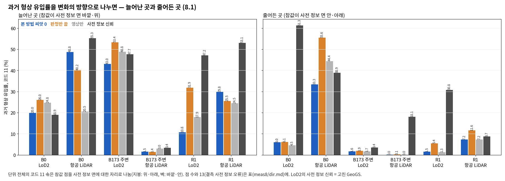

### 8.2 실제 변화와 LoD2 표현 차이 나누기 ([tables/meas8_change.md](tables/meas8_change.md))

- 저장소에는 변화 목록이 없다. 그래서 같은 자리의 항공 LiDAR로 나눴다.
  - 패치마다: 항공 LiDAR가 참값과 그 지역 항공 LiDAR 단위의 허용 오차 안이면 '표현 차이로 봄', 어긋나면 '실제 변화로 봄', 그 자리에 항공 LiDAR 면이 없으면 '가르지 못함'.
- 두 사전 정보가 만들어진 시기는 확인하지 못했다(확인 불가).
  - 저장소의 자료 범위 문서는 항공 LiDAR를 'UAS 대비 시점차 TO VERIFY', LoD2를 'acquisition/model vintage TO VERIFY'로 적고 있다(`docs/research/03_DATA_AND_BASELINE_SCOPE.md` 2절).
  - 시기가 다르면 그 사이의 변화가 섞인다. 예를 들어 항공 LiDAR가 LoD2보다 뒤면, LoD2 이후 항공 LiDAR 이전의 변화는 '표현 차이로 봄'에 들어간다.
- 넓이 (코드 11):
  - B0: 표현 차이 205 m², 실제 변화 5 m², 가르지 못함 186 m².
  - B173 주변: 134 m², 1,010 m², 211 m².
  - R1: 385 m², 16 m², 260 m².
  - B0와 R1의 'LoD2 사전 정보 오류'는 대부분 표현 차이다. B173 주변만 실제 변화가 대부분이다(철거된 날개 등).
- 과거 형상 유입률(본 방법 씨앗 0):
  - B173 주변 실제 변화 0.7 %(95,157점) 대 고친 GeoGS 3.0 %, 영상만 1.1 %. 실제로 바뀐 곳은 본 방법이 막았다.
  - 표현 차이에서는 본 방법과 영상만이 비슷하다. B0 12.8 % 대 16.9 %, B173 주변 52.5 % 대 56.4 %, R1 7.8 % 대 16.5 %.
  - B173 주변의 표현 차이 + 줄어든 곳(1,855점)은 본 방법 71.8 %, 영상만 76.0 %다. LoD2가 단순하게 그린 자리를 영상도 같은 모양으로 보는 곳으로 보인다.

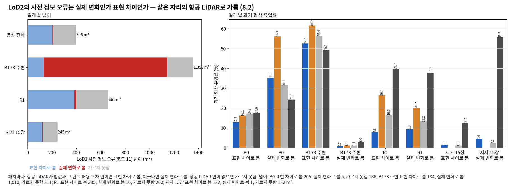

### 8.3 과거 형상만 칠한 판별 지도 ([figures/map83_*.png](figures/))

- 여섯 단위마다 세 칸(본 방법 씨앗 0, 영상만, 사전 정보 신뢰; LoD2는 고친 GeoGS, R1 LoD2는 5.0에서 낸 것)에 코드 11만 네 갈래로 칠했다. 그림 아래 숫자는 '단위 전체'다.
- 8.4의 예시 자리(B173 주변의 날개 단면, R1 LoD2의 손실 덩어리 단면)를 지도 위에 표시했다.

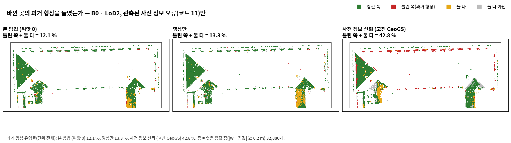

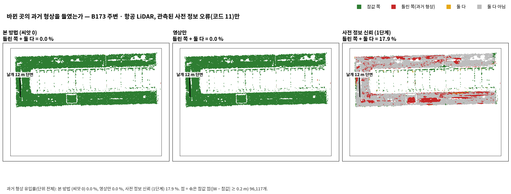

- 나머지 넷(B0 항공 LiDAR, B173 주변 LoD2, R1 LoD2·항공 LiDAR)은 [figures/](figures/)에 있다.

### 8.4 예시 자리의 숫자 ([tables/meas8_places.md](tables/meas8_places.md), [tables/meas8_blob.md](tables/meas8_blob.md), [tables/meas8_wing.md](tables/meas8_wing.md))

| 예시 자리 | 이 자리의 값 (과거 형상 유입률, 코드 11) | 단위 전체 |
|---|---|---|
| B173 주변 항공 LiDAR 날개 12 m 단면 (591점) | 본 방법 0.0 %·0.0 %, 영상만 0.0 %·0.0 %, 사전 정보 신뢰 2.4 %, 판정만 끔 0.0 %; 날개 덩어리 전체(91,433점) 0.0·0.0, 0.0·0.0, 18.6, 0.1 % | 0.03 %, 0.06 %, 17.94 %, 0.15 % |
| R1 LoD2 손실의 판정 반영 덩어리 (2,621패치 163.8 m²; 덩어리 코드 11 16,032점, 단면 띠 218점) | 덩어리: 본 방법 12.7·5.3 %, 손실의 판정 반영 끄기 23.9 %, 영상만 15.3 %, 1단계 GeoGS 36.7 %, 고친 GeoGS 47.0 %, 판정만 끔 31.4 %; 단면 띠: 0.0·1.4, 58.3, 4.1, 41.3, 78.9, 62.8 % | 7.63 %, 19.8 %(2단계), 13.88 %, —, 43.20 %, 25.45 % |

- R1 덩어리는 판정이 충돌이고 τ < |참값 − 사전 정보| ≤ 4τ인 패치로 고른 것이라 코드 3이 없다. 단면 띠의 코드 3은 29점이다. 그 관측 오류 유입률은 본 방법 0.0 %, 고친 GeoGS 62.1 %, 판정만 끔 0.0 %다. 맞바꿈의 관측 오류 쪽은 '단위 전체' 값(보강-3)으로 적는다.
- 앞 보고서와 결론별 그림 가운데 그림 아래 숫자가 단위 전체 값이었던 예시는 목록으로 적고, 그 자리의 값을 같은 방법으로 냈다([tables/meas8_places.md](tables/meas8_places.md): 단면 12곳 × 결과, 면 53).

### 8.5 R1 결측 영역의 진단 ([tables/meas8_miss85.md](tables/meas8_miss85.md))

**읽음: 가르지 못함 (가능, 근거 불완전).**

- 셈: R1 결측 일치 영역(코드 4)의 학습 영상 화소마다 렌더 깊이를 정한 가우시안을 셌다. 출신(사전 정보 / 영상 SfM 점, 처음 점 자신 / 후손)과 자리(그 패치 면 위 / 다른 면)로 나눴다.
  - 각 출신 묶음만 렌더한 깊이가 전체 깊이와 0.05 m 안이면 그 묶음을 앞으로 셌다.
  - 어느 묶음도 0.05 m 안이 아니면 '섞임'이다. 여러 출신의 가우시안이 함께 깊이를 만든 화소다.

| 결과 | 화소 · 패치 | 사전 정보 자신 / 후손 (%) | 영상 자신 / 후손 (%) | 섞임 (%) | 같은 면 / 다른 면 (%) | 앞면과 참값의 거리 중앙값 (m) | 학습 전 판정: 충돌 · 일치 · 혼재 (패치) |
|---|---|---|---|---|---|---|---|
| R1 LoD2 본 방법 | 10,166 · 198 | 2 / 29 | 0 / 22 | 48 | 46 / 54 | 0.23 | 99 · 60 · 39 |
| R1 항공 LiDAR 본 방법 | 5,232 · 63 | 0 / 33 | 0 / 16 | 51 | 49 / 51 | 0.07 | 61 · 0 · 2 |
| R1 영상만 (LoD2 영역) | 10,166 · 198 | 0 / 0 | 0 / 100 | 0 | 37 / 63 | 0.24 | 99 · 60 · 39 |
| R1 영상만 (항공 LiDAR 영역) | 5,232 · 63 | 0 / 0 | 0 / 99 | 1 | 49 / 51 | 0.08 | 61 · 0 · 2 |
| R1 항공 LiDAR 유효성 판정의 전파 끄기 (2단계) | 5,232 · 63 | 0 / 51 | 0 / 9 | 40 | 50 / 50 | 0.08 | 61 · 0 · 2 |
| (요약) B0 LoD2 본 방법 | 326,462 · 2,052 | 23 / 18 | 2 / 11 | 47 | 96 / 4 | 3.69 | 108 · 1895 · 43 |
| (요약) B0 항공 LiDAR 본 방법 | 3,606 · 30 | 11 / 15 | 0 / 11 | 63 | 88 / 12 | 0.09 | 0 · 26 · 4 |
| (요약) B173 주변 LoD2 본 방법 | 58,281 · 1,225 | 13 / 29 | 0 / 10 | 48 | 91 / 9 | 0.07 | 57 · 1077 · 73 |
| (요약) B173 주변 항공 LiDAR 본 방법 | 401 · 17 | 0 / 27 | 0 / 0 | 73 | 32 / 68 | 0.59 | 10 · 1 · 6 |

- 앞: 화소마다 결과 전체의 렌더 깊이에 0.05 m 안으로 먼저 닿는 가우시안 묶음(출신 넷). 어느 묶음도 0.05 m 안이 아니면 섞임(여러 출신이 함께 깊이를 만듦).
- 자리: 앞 점이 그 화소의 패치 면에서 0.5 m 안이면 같은 면, 아니면 다른 면.
- 읽는 규칙(발주 8.5): 두 사전 정보의 본 방법 행에서 가장 큰 출신 갈래(섞임 제외)와 가장 큰 자리 갈래가 같고 몫이 둘 다 절반을 넘으면 '자리의 탓', 가장 큰 갈래가 다르고 몫이 둘 다 절반을 넘으면 '사전 정보 종류의 탓', 그 밖은 '가르지 못함'.
- 가장 큰 갈래: LoD2 출신 사전 정보 후손 29 %, 자리 다른 면 54 %; 항공 LiDAR 출신 사전 정보 후손 33 %, 자리 다른 면 51 %
- 읽음: **가르지 못함 (가능, 근거 불완전)**

- 아는 만큼: R1 결측 영역의 앞면은 절반이 그 패치 면이 아닌 다른 면이다. B0·B173 주변 LoD2(같은 면 91~96 %)와 B0 항공 LiDAR(88 %)와 크게 다르다(B173 주변 항공 LiDAR는 화소 401개뿐). 영상만도 LoD2 영역에서 63 %가 다른 면이다. 판정을 꺼도 항공 LiDAR 결측 완전성이 그대로였던 것(보강-4)과 함께 보면, R1 결측 영역을 덜 채운 까닭은 판정보다 그 자리에서 다른 면이 앞을 가리는 데 있을 가능성이 크다. 그 '다른 면'이 무엇인지(이웃 건물, 처마, 나무)는 이 셈으로 가르지 않았다.
- 학습 전 판정(R1 LoD2 코드 4 패치 198개)은 충돌 99, 일치 60, 혼재 39다. 항공 LiDAR(63개)는 충돌 61, 혼재 2다.

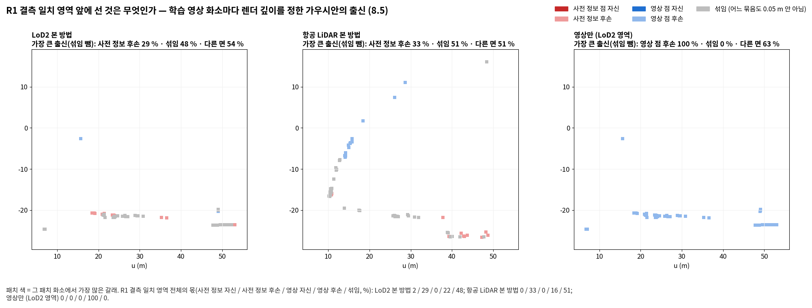

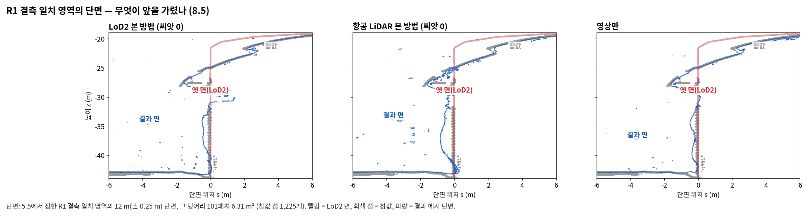

### 8.6 관측 오류 문턱의 뜻 (코드 확인; [tables/meas8_code86.json](tables/meas8_code86.json))

- 지표 코드의 문턱: 관측 오류(코드 3) 패치 가운데 |premise value| > k·τ이면 '전제 위배', 아니면 '문턱 이내'다.
  - `src/phd/metrics_v3/premise.py:15` — `viol = (code == OBS_ERROR) & np.isfinite(pv) & (np.abs(pv) > k * t)`
  - `src/phd/metrics_v3/premise.py:16` — `within = (code == OBS_ERROR) & ~viol`
  - `scripts/phd/main_stage1_v1/regions_v3.py:300` — `prem.split(a["code_ext_v3"], a["premise_value"], a["tau"], K_CONFLICT[prior], ...)`
- 문턱을 대는 어긋남은 MVS와 사전 정보 사이다(MVS와 참값이 아님).
  - `regions_v3.py:286` — `pval = np.where(a["v1_kept"], a["mvs_minus_prior"], pmed)`
  - `regions_v3.py:174` — `pv.append(dz + va[m])  # z_MVS - z_prior`
- k: `regions_v3.py:36` — `K_CONFLICT = {"LoD2": 1.0, "ALS": 2.0}`. 판정 규칙의 기본값과 같다.
  - `src/phd/prior_propagation_v6/rules.py:112` — `DEFAULT_BY_PRIOR = {"LoD2": "current", "ALS": "margin_all_2", ...}`
  - `rules.py:22–23` — current t = 1.0, margin_all_2 t = 2.0
- τ: 면 종류별 허용 오차다(지붕은 연직, 벽은 법선 방향). 영역 파일의 τ는 모든 단위에서 0단계 허용 오차와 같다. B0 LoD2는 지붕 0.198 m, 벽 0.547 m다. B0 조건 키는 모두 B0 값이다.
- 손실의 허용 구간도 같은 τ, 같은 방향이다.
  - 판정의 화소 잔차: `s03_stage1_v6.py:152` — `r = (MVS 깊이 − 사전 정보 깊이) × f`
  - 학습이 읽는 τ 지도: `:380` — `τ / f`(f는 깊이 1 m당 측정 방향 거리, `conversion.py:53`)
  - 손실: `jbgs_judgment.py:334–335` — |r| ≤ τ면 0
- 그래서 LoD2의 문턱(1·τ)은 손실의 허용 오차와 같다. 확인한 수: LoD2 '문턱 이내' 패치의 |premise value|/τ는 모든 단위에서 1 이하다(최대 0.99~1.00).
  - LoD2의 '문턱 이내' 영상 오류는 결과가 영상을 따라도 허용 구간 안이라, 손실이 사전 정보 쪽으로 당기지 않는 곳이다. 관문 조건 2와 보강-3을 읽을 때 이 점을 쓴다.
  - 항공 LiDAR는 k = 2라 '문턱 이내'의 34~70 %만 τ 안이다. 나머지는 당김 구간이다.

### 8.7 다시 읽기가 보호를 푸는 때 ([tables/meas8_reread.md](tables/meas8_reread.md))

| 다시 읽는 주기 (B173 주변 LoD2) | 다시 읽기 수 | 풀린 것 합 | E가 0.5 넘음 | 앉은 패치가 충돌 | 벗어남 > 4τ | 상속률 (2단계) |
|---|---:|---:|---:|---:|---:|---:|
| 250회 | 121 | 152,178 | 151,572 (99.6 %) | 396 | 432 | 71.6 % |
| 500회 (본 방법 씨앗 0) | 61 | 81,272 | 80,864 (99.5 %) | 287 | 301 | 81.1 % |
| 1,000회 | 31 | 45,147 | 44,908 (99.5 %) | 182 | 182 | 86.1 % |
| 다시 읽지 않음 | 1 | 0 | 0 | 0 | 0 | 99.9 % |

- 풀림의 99.5 % 이상이 '가우시안 신뢰도 E가 0.5를 넘음' 때문이었다. 판정이 충돌인 패치로 옮겨 감과 4τ 넘게 벗어남은 합쳐 1 % 미만이다.
- '가림 판정이 바뀜(지금 장면에서 보이게 됨)'은 기록에 따로 없다. 그 경우는 다시 읽기에서 E가 0.5를 넘으므로 'E가 0.5 넘음'에 든다.
- 다시 읽을수록 풀리는 수가 쌓여(250회 15만, 1,000회 4.5만) 상속률이 낮아진다. 3단계 상속률의 차이(저자 15장 99.25 % → 저자 3장 96.2 %)도 다시 읽기에서 E가 0.5를 넘어 풀린 수의 차이일 수 있다. 다만 3단계 조건마다의 풀림은 세지 않았다.

### 8.8 측정 표 전체

**8.1 과거 형상 유입률을 변화의 방향으로 나눔 (이 발주에서 냄)** — 늘어난 곳 = 참값이 사전 정보 면의 바깥(지붕은 위), 줄어든 곳 = 안

| 단위 | 결과 | 코드 11 늘어난 곳: 점 · 유입률 | 코드 11 줄어든 곳: 점 · 유입률 | 코드 13 늘어난 곳 | 코드 13 줄어든 곳 |
|---|---|---|---|---|---|
| B0 · LoD2 | prop_LoD2_s0 | 14,303 · 20.0 % | 18,577 · 6.0 % | 130 · 18.5 % | 38 · 10.5 % |
| B0 · LoD2 | prop_LoD2_s1 | 14,303 · 19.5 % | 18,577 · 6.0 % | 130 · 7.7 % | 38 · 10.5 % |
| B0 · LoD2 | imgonly_s0 | 14,303 · 24.8 % | 18,577 · 4.5 % | 130 · 2.3 % | 38 · 10.5 % |
| B0 · LoD2 | trust_LoD2 | 14,303 · 20.1 % | 18,577 · 61.6 % | 130 · 18.5 % | 38 · 31.6 % |
| B0 · LoD2 | trust_LoD2_fix1 | 14,303 · 18.9 % | 18,577 · 61.3 % | 130 · 0.8 % | 38 · 36.8 % |
| B0 · LoD2 | abl_densj_LoD2_s0 | 14,303 · 14.0 % | 18,577 · 5.3 % | 130 · 6.2 % | 38 · 23.7 % |
| B0 · LoD2 | nojudge_LoD2_s0 | 14,303 · 26.0 % | 18,577 · 6.1 % | 130 · 26.2 % | 38 · 10.5 % |
| B0 · ALS | prop_ALS_s0 | 244 · 48.8 % | 18 · 33.3 % | — | — |
| B0 · ALS | prop_ALS_s1 | 244 · 38.5 % | 18 · 27.8 % | — | — |
| B0 · ALS | imgonly_s0 | 244 · 20.5 % | 18 · 44.4 % | — | — |
| B0 · ALS | trust_ALS | 244 · 55.3 % | 18 · 38.9 % | — | — |
| B0 · ALS | nojudge_ALS_s0 | 244 · 40.2 % | 18 · 55.6 % | — | — |
| B173 주변 · LoD2 | prop_LoD2_s0 | 14,191 · 43.0 % | 105,572 · 1.6 % | 111 · 16.2 % | 260 · 24.2 % |
| B173 주변 · LoD2 | prop_LoD2_s1 | 14,191 · 47.4 % | 105,572 · 1.7 % | 111 · 16.2 % | 260 · 21.1 % |
| B173 주변 · LoD2 | imgonly_s0 | 14,191 · 48.8 % | 105,572 · 1.7 % | 111 · 16.2 % | 260 · 20.0 % |
| B173 주변 · LoD2 | trust_LoD2 | 14,191 · 38.8 % | 105,572 · 6.3 % | 111 · 46.9 % | 260 · 28.8 % |
| B173 주변 · LoD2 | trust_LoD2_fix1 | 14,191 · 47.7 % | 105,572 · 3.4 % | 111 · 26.1 % | 260 · 37.7 % |
| B173 주변 · LoD2 | abl_prop_LoD2_s0 | 14,191 · 45.7 % | 105,572 · 1.7 % | 111 · 20.7 % | 260 · 25.8 % |
| B173 주변 · LoD2 | abl_prot_LoD2_s0 | 14,191 · 47.1 % | 105,572 · 1.7 % | 111 · 16.2 % | 260 · 22.3 % |
| B173 주변 · LoD2 | sens_e250_LoD2_s0 | 14,191 · 43.8 % | 105,572 · 1.6 % | 111 · 17.1 % | 260 · 24.2 % |
| B173 주변 · LoD2 | sens_e1000_LoD2_s0 | 14,191 · 44.7 % | 105,572 · 1.6 % | 111 · 16.2 % | 260 · 20.0 % |
| B173 주변 · LoD2 | sens_enone_LoD2_s0 | 14,191 · 44.2 % | 105,572 · 1.7 % | 111 · 27.0 % | 260 · 44.6 % |
| B173 주변 · LoD2 | nojudge_LoD2_s0 | 14,191 · 53.4 % | 105,572 · 1.9 % | 111 · 15.3 % | 260 · 31.1 % |
| B173 주변 · ALS | prop_ALS_s0 | 938 · 1.5 % | 95,179 · 0.0 % | 2 · 0.0 % | 51 · 0.0 % |
| B173 주변 · ALS | prop_ALS_s1 | 938 · 1.9 % | 95,179 · 0.0 % | 2 · 0.0 % | 51 · 0.0 % |
| B173 주변 · ALS | imgonly_s0 | 938 · 3.0 % | 95,179 · 0.0 % | 2 · 0.0 % | 51 · 0.0 % |
| B173 주변 · ALS | trust_ALS | 938 · 3.4 % | 95,179 · 18.1 % | 2 · 0.0 % | 51 · 31.4 % |
| B173 주변 · ALS | abl_band_ALS_s0 | 938 · 1.2 % | 95,179 · 0.0 % | 2 · 0.0 % | 51 · 0.0 % |
| B173 주변 · ALS | nojudge_ALS_s0 | 938 · 1.4 % | 95,179 · 0.1 % | 2 · 0.0 % | 51 · 0.0 % |
| R1 · LoD2 | prop_LoD2_s0 | 41,175 · 10.8 % | 13,170 · 1.5 % | 177 · 0.0 % | 675 · 2.7 % |
| R1 · LoD2 | prop_LoD2_s1 | 41,175 · 8.6 % | 13,170 · 1.1 % | 177 · 0.0 % | 675 · 2.8 % |
| R1 · LoD2 | imgonly_s0 | 41,175 · 17.9 % | 13,170 · 1.3 % | 177 · 0.0 % | 675 · 1.0 % |
| R1 · LoD2 | trust_LoD2 | 41,175 · 38.5 % | 13,170 · 32.3 % | 177 · 0.0 % | 675 · 24.0 % |
| R1 · LoD2 | trust_LoD2_fix1 | 41,175 · 47.2 % | 13,170 · 30.8 % | 177 · 0.0 % | 675 · 11.0 % |
| R1 · LoD2 | abl_band_LoD2_s0 | 41,175 · 16.5 % | 13,170 · 1.1 % | 177 · 1.1 % | 675 · 0.3 % |
| R1 · LoD2 | abl_lossj_LoD2_s0 | 41,175 · 25.1 % | 13,170 · 3.2 % | 177 · 1.7 % | 675 · 8.2 % |
| R1 · LoD2 | sens_trunc2_LoD2_s0 | 41,175 · 6.9 % | 13,170 · 1.2 % | 177 · 1.1 % | 675 · 0.9 % |
| R1 · LoD2 | sens_trunc8_LoD2_s0 | 41,175 · 12.2 % | 13,170 · 1.3 % | 177 · 1.1 % | 675 · 0.7 % |
| R1 · LoD2 | nojudge_LoD2_s0 | 41,175 · 31.9 % | 13,170 · 5.4 % | 177 · 0.6 % | 675 · 49.3 % |
| R1 · ALS | prop_ALS_s0 | 486 · 29.8 % | 69 · 7.2 % | 26 · 3.9 % | 4 · 0.0 % |
| R1 · ALS | prop_ALS_s1 | 486 · 25.3 % | 69 · 4.3 % | 26 · 0.0 % | 4 · 0.0 % |
| R1 · ALS | imgonly_s0 | 486 · 24.5 % | 69 · 7.2 % | 26 · 0.0 % | 4 · 0.0 % |
| R1 · ALS | trust_ALS | 486 · 53.1 % | 69 · 8.7 % | 26 · 76.9 % | 4 · 100.0 % |
| R1 · ALS | abl_prop_ALS_s0 | 486 · 24.1 % | 69 · 17.4 % | 26 · 0.0 % | 4 · 0.0 % |
| R1 · ALS | abl_initx_ALS_s0 | 486 · 21.6 % | 69 · 8.7 % | 26 · 0.0 % | 4 · 0.0 % |
| R1 · ALS | nojudge_ALS_s0 | 486 · 25.5 % | 69 · 11.6 % | 26 · 0.0 % | 4 · 0.0 % |
| B0 저자 15장 · LoD2 | prop_LoD2_s0 | 7,303 · 2.0 % | 12,965 · 5.6 % | 1,388 · 16.4 % | 237 · 73.0 % |
| B0 저자 15장 · LoD2 | abl_prop_LoD2_s0 | 7,303 · 2.7 % | 12,965 · 5.5 % | 1,388 · 26.7 % | 237 · 67.1 % |
| B0 저자 15장 · LoD2 | abl_prot_LoD2_s0 | 7,303 · 2.0 % | 12,965 · 5.5 % | 1,388 · 9.5 % | 237 · 59.5 % |
| B0 저자 15장 · LoD2 | sens_dist05_LoD2_s0 | 7,303 · 2.4 % | 12,965 · 5.6 % | 1,388 · 24.9 % | 237 · 71.3 % |
| B0 저자 15장 · LoD2 | imgonly_s0 | 7,303 · 1.6 % | 12,965 · 5.3 % | 1,388 · 2.7 % | 237 · 59.1 % |
| B0 저자 15장 · LoD2 | trust_LoD2_fix1 | 7,303 · 19.6 % | 12,965 · 49.6 % | 1,388 · 16.6 % | 237 · 67.5 % |

- 점 = 솎은 주 행(|s_W| ≥ 0.2 m). 바깥 방향: 지붕은 +z, LoD2 벽은 LoD2 면 법선. 항공 LiDAR 벽은 패치 면 법선을 z ≥ 0으로 뒤집은 방향이라 바깥이 보장되지 않는다(지붕·벽 갈래는 json에 따로).

**8.2 실제 변화와 LoD2 표현 차이 (LoD2만, 이 발주에서 냄)** — 같은 참값 점의 항공 LiDAR 사전 정보가 참값과 맞으면 표현 차이, 어긋나면 실제 변화

##### B0 · LoD2

- 패치(코드 11): 표현 차이로 봄 3,281 (205.1 m²), 실제 변화로 봄 81 (5.1 m²), 가르지 못함 2,978 (186.1 m²)

| 결과 | 표현 차이: 점 · 유입률 | 실제 변화: 점 · 유입률 | 가르지 못함 | 늘어난·실제 | 늘어난·표현 | 줄어든·실제 | 줄어든·표현 |
|---|---|---|---|---|---|---|---|
| prop_LoD2_s0 | 17,223 · 12.8 % | 296 · 35.1 % | 15,361 · 10.8 % | 290 · 35.9 % | 10,386 · 20.6 % | 6 · 0.0 % | 6,837 · 1.1 % |
| prop_LoD2_s1 | 17,223 · 12.3 % | 296 · 35.8 % | 15,361 · 10.9 % | 290 · 36.5 % | 10,386 · 19.9 % | 6 · 0.0 % | 6,837 · 0.7 % |
| imgonly_s0 | 17,223 · 16.9 % | 296 · 31.4 % | 15,361 · 8.8 % | 290 · 32.1 % | 10,386 · 27.6 % | 6 · 0.0 % | 6,837 · 0.7 % |
| trust_LoD2 | 17,223 · 17.1 % | 296 · 41.9 % | 15,361 · 73.3 % | 290 · 42.8 % | 10,386 · 20.3 % | 6 · 0.0 % | 6,837 · 12.1 % |
| trust_LoD2_fix1 | 17,223 · 17.6 % | 296 · 24.3 % | 15,361 · 71.5 % | 290 · 24.8 % | 10,386 · 21.7 % | 6 · 0.0 % | 6,837 · 11.5 % |
| abl_densj_LoD2_s0 | 17,223 · 8.5 % | 296 · 28.7 % | 15,361 · 9.4 % | 290 · 29.3 % | 10,386 · 13.7 % | 6 · 0.0 % | 6,837 · 0.6 % |
| nojudge_LoD2_s0 | 17,223 · 16.1 % | 296 · 56.1 % | 15,361 · 12.4 % | 290 · 57.2 % | 10,386 · 26.1 % | 6 · 0.0 % | 6,837 · 0.9 % |

##### B173 주변 · LoD2

- 패치(코드 11): 표현 차이로 봄 2,146 (134.1 m²), 실제 변화로 봄 16,168 (1,010.5 m²), 가르지 못함 3,375 (210.9 m²)

| 결과 | 표현 차이: 점 · 유입률 | 실제 변화: 점 · 유입률 | 가르지 못함 | 늘어난·실제 | 늘어난·표현 | 줄어든·실제 | 줄어든·표현 |
|---|---|---|---|---|---|---|---|
| prop_LoD2_s0 | 9,760 · 52.5 % | 95,157 · 0.7 % | 14,846 · 13.6 % | 1,972 · 32.6 % | 7,905 · 48.0 % | 93,185 · 0.0 % | 1,855 · 71.8 % |
| prop_LoD2_s1 | 9,760 · 58.0 % | 95,157 · 0.8 % | 14,846 · 13.7 % | 1,972 · 36.2 % | 7,905 · 54.3 % | 93,185 · 0.1 % | 1,855 · 73.4 % |
| imgonly_s0 | 9,760 · 56.4 % | 95,157 · 1.1 % | 14,846 · 14.5 % | 1,972 · 51.6 % | 7,905 · 51.7 % | 93,185 · 0.0 % | 1,855 · 76.0 % |
| trust_LoD2 | 9,760 · 33.6 % | 95,157 · 6.3 % | 14,846 · 19.7 % | 1,972 · 32.6 % | 7,905 · 38.1 % | 93,185 · 5.7 % | 1,855 · 14.2 % |
| trust_LoD2_fix1 | 9,760 · 49.1 % | 95,157 · 3.0 % | 14,846 · 18.5 % | 1,972 · 47.7 % | 7,905 · 52.0 % | 93,185 · 2.0 % | 1,855 · 37.0 % |
| abl_prop_LoD2_s0 | 9,760 · 53.7 % | 95,157 · 0.9 % | 14,846 · 14.4 % | 1,972 · 38.5 % | 7,905 · 50.1 % | 93,185 · 0.1 % | 1,855 · 69.3 % |
| abl_prot_LoD2_s0 | 9,760 · 52.8 % | 95,157 · 1.1 % | 14,846 · 15.4 % | 1,972 · 50.6 % | 7,905 · 47.6 % | 93,185 · 0.0 % | 1,855 · 74.8 % |
| sens_e250_LoD2_s0 | 9,760 · 51.3 % | 95,157 · 0.8 % | 14,846 · 14.5 % | 1,972 · 34.1 % | 7,905 · 46.9 % | 93,185 · 0.1 % | 1,855 · 70.3 % |
| sens_e1000_LoD2_s0 | 9,760 · 54.3 % | 95,157 · 0.7 % | 14,846 · 13.7 % | 1,972 · 33.0 % | 7,905 · 50.0 % | 93,185 · 0.0 % | 1,855 · 72.6 % |
| sens_enone_LoD2_s0 | 9,760 · 52.2 % | 95,157 · 0.8 % | 14,846 · 14.6 % | 1,972 · 36.1 % | 7,905 · 47.9 % | 93,185 · 0.1 % | 1,855 · 70.4 % |
| nojudge_LoD2_s0 | 9,760 · 61.6 % | 95,157 · 1.1 % | 14,846 · 17.2 % | 1,972 · 43.9 % | 7,905 · 58.4 % | 93,185 · 0.2 % | 1,855 · 75.1 % |

##### R1 · LoD2

- 패치(코드 11): 표현 차이로 봄 6,154 (384.6 m²), 실제 변화로 봄 255 (15.9 m²), 가르지 못함 4,164 (260.2 m²)

| 결과 | 표현 차이: 점 · 유입률 | 실제 변화: 점 · 유입률 | 가르지 못함 | 늘어난·실제 | 늘어난·표현 | 줄어든·실제 | 줄어든·표현 |
|---|---|---|---|---|---|---|---|
| prop_LoD2_s0 | 35,402 · 7.8 % | 1,067 · 9.3 % | 17,876 · 9.8 % | 1,027 · 9.2 % | 25,036 · 10.5 % | 40 · 10.0 % | 10,366 · 1.3 % |
| prop_LoD2_s1 | 35,402 · 4.9 % | 1,067 · 12.2 % | 17,876 · 10.1 % | 1,027 · 12.7 % | 25,036 · 6.5 % | 40 · 0.0 % | 10,366 · 1.0 % |
| imgonly_s0 | 35,402 · 16.5 % | 1,067 · 13.2 % | 17,876 · 8.8 % | 1,027 · 13.6 % | 25,036 · 22.8 % | 40 · 2.5 % | 10,366 · 1.2 % |
| trust_LoD2 | 35,402 · 31.2 % | 1,067 · 35.3 % | 17,876 · 48.4 % | 1,027 · 35.4 % | 25,036 · 33.2 % | 40 · 32.5 % | 10,366 · 26.4 % |
| trust_LoD2_fix1 | 35,402 · 39.7 % | 1,067 · 37.6 % | 17,876 · 50.5 % | 1,027 · 37.9 % | 25,036 · 46.2 % | 40 · 30.0 % | 10,366 · 23.9 % |
| abl_band_LoD2_s0 | 35,402 · 13.4 % | 1,067 · 13.0 % | 17,876 · 11.5 % | 1,027 · 13.5 % | 25,036 · 18.7 % | 40 · 0.0 % | 10,366 · 0.7 % |
| abl_lossj_LoD2_s0 | 35,402 · 20.6 % | 1,067 · 18.3 % | 17,876 · 18.2 % | 1,027 · 19.0 % | 25,036 · 27.7 % | 40 · 0.0 % | 10,366 · 3.4 % |
| sens_trunc2_LoD2_s0 | 35,402 · 3.9 % | 1,067 · 8.0 % | 17,876 · 8.6 % | 1,027 · 7.9 % | 25,036 · 5.2 % | 40 · 10.0 % | 10,366 · 0.8 % |
| sens_trunc8_LoD2_s0 | 35,402 · 9.2 % | 1,067 · 10.3 % | 17,876 · 10.3 % | 1,027 · 10.4 % | 25,036 · 12.6 % | 40 · 7.5 % | 10,366 · 1.1 % |
| nojudge_LoD2_s0 | 35,402 · 26.4 % | 1,067 · 20.2 % | 17,876 · 23.9 % | 1,027 · 20.7 % | 25,036 · 35.0 % | 40 · 5.0 % | 10,366 · 5.6 % |

##### B0 저자 15장 · LoD2

- 패치(코드 11): 표현 차이로 봄 1,958 (122.4 m²), 실제 변화로 봄 11 (0.7 m²), 가르지 못함 1,955 (122.2 m²)

| 결과 | 표현 차이: 점 · 유입률 | 실제 변화: 점 · 유입률 | 가르지 못함 | 늘어난·실제 | 늘어난·표현 | 줄어든·실제 | 줄어든·표현 |
|---|---|---|---|---|---|---|---|
| prop_LoD2_s0 | 10,021 · 1.3 % | 45 · 4.4 % | 10,202 · 7.2 % | 44 · 4.5 % | 5,329 · 2.3 % | 1 · 0.0 % | 4,692 · 0.2 % |
| abl_prop_LoD2_s0 | 10,021 · 1.6 % | 45 · 4.4 % | 10,202 · 7.3 % | 44 · 4.5 % | 5,329 · 2.8 % | 1 · 0.0 % | 4,692 · 0.3 % |
| abl_prot_LoD2_s0 | 10,021 · 1.3 % | 45 · 8.9 % | 10,202 · 7.1 % | 44 · 9.1 % | 5,329 · 2.3 % | 1 · 0.0 % | 4,692 · 0.2 % |
| sens_dist05_LoD2_s0 | 10,021 · 1.6 % | 45 · 6.7 % | 10,202 · 7.2 % | 44 · 6.8 % | 5,329 · 2.7 % | 1 · 0.0 % | 4,692 · 0.3 % |
| imgonly_s0 | 10,021 · 1.1 % | 45 · 2.2 % | 10,202 · 6.8 % | 44 · 2.3 % | 5,329 · 1.8 % | 1 · 0.0 % | 4,692 · 0.2 % |
| trust_LoD2_fix1 | 10,021 · 12.2 % | 45 · 55.6 % | 10,202 · 64.8 % | 44 · 54.5 % | 5,329 · 22.8 % | 1 · 100.0 % | 4,692 · 0.2 % |

- 두 사전 정보의 시기: 항공 LiDAR는 2022년 자료(LAZ 머리 작성일 2022-06-16, GPS 시각 2022-02-27; `docs/evidence/p0-audit/w1-input-diagnostics/reports/data_inventory.md`). LoD2(B0 건물 DEBY_LOD2_4959323)는 기록 작성일 2025-04-04, 평면 현행일(Grundrissaktualitaet) 2025-02-17, 지붕 높이 자료 출처 코드 1000이다(원본 CityGML 속성). 현재 참값과 영상은 2024-12-17이다. 시기가 다르므로 두 사전 정보 사이의 변화가 섞일 수 있다(항공 LiDAR 이후 LoD2 이전에 바뀐 곳은 '표현 차이'로 잘못 갈릴 수 있음).

**8.4 앞 그림의 자리 값 (이 발주에서 냄)**

| 자리 | 단위 | 결과 | 코드 11: 점 · 유입률 · 참값 쪽 | 코드 3: 점 · 유입률 | 코드 12: 점 · 유입률 |
|---|---|---|---|---|---|
| B173_wing | LoD2 | prop_LoD2_s0 | 607 · 0.0 % · 100.0 % | — | — |
| B173_wing | LoD2 | prop_LoD2_s1 | 607 · 0.0 % · 100.0 % | — | — |
| B173_wing | LoD2 | imgonly_s0 | 607 · 0.0 % · 100.0 % | — | — |
| B173_wing | LoD2 | trust_LoD2 | 607 · 11.0 % · 15.0 % | — | — |
| B173_wing | LoD2 | trust_LoD2_fix1 | 607 · 0.7 % · 64.7 % | — | — |
| B173_wing | LoD2 | abl_prop_LoD2_s0 | 607 · 0.0 % · 100.0 % | — | — |
| B173_wing | LoD2 | abl_prot_LoD2_s0 | 607 · 0.0 % · 100.0 % | — | — |
| B173_wing | LoD2 | sens_e250_LoD2_s0 | 607 · 0.0 % · 100.0 % | — | — |
| B173_wing | LoD2 | sens_e1000_LoD2_s0 | 607 · 0.0 % · 100.0 % | — | — |
| B173_wing | LoD2 | sens_enone_LoD2_s0 | 607 · 0.0 % · 100.0 % | — | — |
| B173_wing | LoD2 | nojudge_LoD2_s0 | 607 · 0.0 % · 100.0 % | — | — |
| B173_wing | ALS | prop_ALS_s0 | 591 · 0.0 % · 100.0 % | — | 1 · 0.0 % |
| B173_wing | ALS | prop_ALS_s1 | 591 · 0.0 % · 100.0 % | — | 1 · 0.0 % |
| B173_wing | ALS | imgonly_s0 | 591 · 0.0 % · 100.0 % | — | 1 · 0.0 % |
| B173_wing | ALS | trust_ALS | 591 · 2.4 % · 0.0 % | — | 1 · 0.0 % |
| B173_wing | ALS | abl_band_ALS_s0 | 591 · 0.0 % · 100.0 % | — | 1 · 0.0 % |
| B173_wing | ALS | nojudge_ALS_s0 | 591 · 0.0 % · 100.0 % | — | 1 · 0.0 % |
| B173_sawtooth | LoD2 | prop_LoD2_s0 | 38 · 36.8 % · 44.7 % | 84 · 10.7 % | 420 · 44.3 % |
| B173_sawtooth | LoD2 | prop_LoD2_s1 | 38 · 42.1 % · 39.5 % | 84 · 15.5 % | 420 · 44.0 % |
| B173_sawtooth | LoD2 | imgonly_s0 | 38 · 28.9 % · 52.6 % | 84 · 7.1 % | 420 · 34.5 % |
| B173_sawtooth | LoD2 | trust_LoD2 | 38 · 0.0 % · 89.5 % | 84 · 0.0 % | 420 · 3.8 % |
| B173_sawtooth | LoD2 | trust_LoD2_fix1 | 38 · 2.6 % · 55.3 % | 84 · 0.0 % | 420 · 5.7 % |
| B173_sawtooth | LoD2 | abl_prop_LoD2_s0 | 38 · 52.6 % · 31.6 % | 84 · 11.9 % | 420 · 45.0 % |
| B173_sawtooth | LoD2 | abl_prot_LoD2_s0 | 38 · 36.8 % · 36.8 % | 84 · 10.7 % | 420 · 37.1 % |
| B173_sawtooth | LoD2 | sens_e250_LoD2_s0 | 38 · 39.5 % · 36.8 % | 84 · 13.1 % | 420 · 44.8 % |
| B173_sawtooth | LoD2 | sens_e1000_LoD2_s0 | 38 · 39.5 % · 44.7 % | 84 · 10.7 % | 420 · 44.3 % |
| B173_sawtooth | LoD2 | sens_enone_LoD2_s0 | 38 · 39.5 % · 39.5 % | 84 · 20.2 % | 420 · 42.1 % |
| B173_sawtooth | LoD2 | nojudge_LoD2_s0 | 38 · 44.7 % · 39.5 % | 84 · 14.3 % | 420 · 46.9 % |
| B173_sawtooth | ALS | prop_ALS_s0 | 33 · 0.0 % · 72.7 % | — | 421 · 0.0 % |
| B173_sawtooth | ALS | prop_ALS_s1 | 33 · 0.0 % · 60.6 % | — | 421 · 0.0 % |
| B173_sawtooth | ALS | imgonly_s0 | 33 · 0.0 % · 72.7 % | — | 421 · 0.0 % |
| B173_sawtooth | ALS | trust_ALS | 33 · 3.0 % · 48.5 % | — | 421 · 1.2 % |
| B173_sawtooth | ALS | abl_band_ALS_s0 | 33 · 0.0 % · 84.9 % | — | 421 · 0.0 % |
| B173_sawtooth | ALS | nojudge_ALS_s0 | 33 · 0.0 % · 72.7 % | — | 421 · 0.0 % |
| R1_low_roof | LoD2 | prop_LoD2_s0 | 84 · 0.0 % · 88.1 % | 237 · 28.7 % | 83 · 49.4 % |
| R1_low_roof | LoD2 | prop_LoD2_s1 | 84 · 0.0 % · 86.9 % | 237 · 29.1 % | 83 · 37.4 % |
| R1_low_roof | LoD2 | imgonly_s0 | 84 · 0.0 % · 91.7 % | 237 · 27.4 % | 83 · 39.8 % |
| R1_low_roof | LoD2 | trust_LoD2 | 84 · 36.9 % · 32.1 % | 237 · 11.0 % | 83 · 98.8 % |
| R1_low_roof | LoD2 | trust_LoD2_fix1 | 84 · 29.8 % · 23.8 % | 237 · 10.1 % | 83 · 98.8 % |
| R1_low_roof | LoD2 | abl_band_LoD2_s0 | 84 · 0.0 % · 79.8 % | 237 · 27.0 % | 83 · 51.8 % |
| R1_low_roof | LoD2 | abl_lossj_LoD2_s0 | 84 · 0.0 % · 65.5 % | 237 · 9.3 % | 83 · 69.9 % |
| R1_low_roof | LoD2 | sens_trunc2_LoD2_s0 | 84 · 0.0 % · 84.5 % | 237 · 27.0 % | 83 · 41.0 % |
| R1_low_roof | LoD2 | sens_trunc8_LoD2_s0 | 84 · 0.0 % · 84.5 % | 237 · 27.4 % | 83 · 28.9 % |
| R1_low_roof | LoD2 | nojudge_LoD2_s0 | 84 · 1.2 % · 71.4 % | 237 · 5.5 % | 83 · 72.3 % |
| R1_low_roof | ALS | prop_ALS_s0 | 7 · 28.6 % · 28.6 % | 169 · 44.4 % | 2 · 0.0 % |
| R1_low_roof | ALS | prop_ALS_s1 | 7 · 0.0 % · 42.9 % | 169 · 50.3 % | 2 · 0.0 % |
| R1_low_roof | ALS | imgonly_s0 | 7 · 0.0 % · 71.4 % | 169 · 47.3 % | 2 · 0.0 % |
| R1_low_roof | ALS | trust_ALS | 7 · 71.4 % · 28.6 % | 169 · 0.6 % | 2 · 50.0 % |
| R1_low_roof | ALS | abl_prop_ALS_s0 | 7 · 0.0 % · 57.1 % | 169 · 42.6 % | 2 · 0.0 % |
| R1_low_roof | ALS | abl_initx_ALS_s0 | 7 · 0.0 % · 57.1 % | 169 · 43.8 % | 2 · 0.0 % |
| R1_low_roof | ALS | nojudge_ALS_s0 | 7 · 42.9 % · 14.3 % | 169 · 46.8 % | 2 · 0.0 % |
| R1_translucent | LoD2 | prop_LoD2_s0 | 206 · 12.6 % · 87.4 % | 60 · 51.7 % | 16 · 0.0 % |
| R1_translucent | LoD2 | prop_LoD2_s1 | 206 · 13.1 % · 86.9 % | 60 · 50.0 % | 16 · 0.0 % |
| R1_translucent | LoD2 | imgonly_s0 | 206 · 2.4 % · 97.6 % | 60 · 56.7 % | 16 · 0.0 % |
| R1_translucent | LoD2 | trust_LoD2 | 206 · 6.8 % · 33.5 % | 60 · 21.7 % | 16 · 0.0 % |
| R1_translucent | LoD2 | trust_LoD2_fix1 | 206 · 28.2 % · 38.8 % | 60 · 13.3 % | 16 · 87.5 % |
| R1_translucent | LoD2 | abl_band_LoD2_s0 | 206 · 14.6 % · 85.4 % | 60 · 45.0 % | 16 · 0.0 % |
| R1_translucent | LoD2 | abl_lossj_LoD2_s0 | 206 · 9.7 % · 63.1 % | 60 · 16.7 % | 16 · 0.0 % |
| R1_translucent | LoD2 | sens_trunc2_LoD2_s0 | 206 · 14.1 % · 85.9 % | 60 · 45.0 % | 16 · 0.0 % |
| R1_translucent | LoD2 | sens_trunc8_LoD2_s0 | 206 · 2.4 % · 97.1 % | 60 · 50.0 % | 16 · 0.0 % |
| R1_translucent | LoD2 | nojudge_LoD2_s0 | 206 · 19.4 % · 70.4 % | 60 · 13.3 % | 16 · 12.5 % |
| R1_translucent | ALS | prop_ALS_s0 | — · — | 27 · 25.9 % | 4 · 100.0 % |
| R1_translucent | ALS | prop_ALS_s1 | — · — | 27 · 29.6 % | 4 · 100.0 % |
| R1_translucent | ALS | imgonly_s0 | — · — | 27 · 25.9 % | 4 · 100.0 % |
| R1_translucent | ALS | trust_ALS | — · — | 27 · 25.9 % | 4 · 100.0 % |
| R1_translucent | ALS | abl_prop_ALS_s0 | — · — | 27 · 25.9 % | 4 · 100.0 % |
| R1_translucent | ALS | abl_initx_ALS_s0 | — · — | 27 · 29.6 % | 4 · 100.0 % |
| R1_translucent | ALS | nojudge_ALS_s0 | — · — | 27 · 25.9 % | 4 · 100.0 % |
| B0_wall_eaves | LoD2 | prop_LoD2_s0 | 94 · 41.5 % · 58.5 % | 39 · 48.7 % | 7 · 85.7 % |
| B0_wall_eaves | LoD2 | prop_LoD2_s1 | 94 · 41.5 % · 57.5 % | 39 · 33.3 % | 7 · 100.0 % |
| B0_wall_eaves | LoD2 | imgonly_s0 | 94 · 43.6 % · 55.3 % | 39 · 43.6 % | 7 · 71.4 % |
| B0_wall_eaves | LoD2 | trust_LoD2 | 94 · 80.8 % · 17.0 % | 39 · 46.2 % | 7 · 85.7 % |
| B0_wall_eaves | LoD2 | trust_LoD2_fix1 | 94 · 81.9 % · 17.0 % | 39 · 23.1 % | 7 · 85.7 % |
| B0_wall_eaves | LoD2 | abl_densj_LoD2_s0 | 94 · 4.3 % · 84.0 % | 39 · 38.5 % | 7 · 42.9 % |
| B0_wall_eaves | LoD2 | nojudge_LoD2_s0 | 94 · 21.3 % · 69.2 % | 39 · 46.2 % | 7 · 71.4 % |
| B0_wall_eaves | ALS | prop_ALS_s0 | — · — | 21 · 42.9 % | — |
| B0_wall_eaves | ALS | prop_ALS_s1 | — · — | 21 · 38.1 % | — |
| B0_wall_eaves | ALS | imgonly_s0 | — · — | 21 · 57.1 % | — |
| B0_wall_eaves | ALS | trust_ALS | — · — | 21 · 19.1 % | — |
| B0_wall_eaves | ALS | nojudge_ALS_s0 | — · — | 21 · 4.8 % | — |
| obs_section | LoD2 | prop_LoD2_s0 | 103 · 13.6 % · 72.8 % | 132 · 67.4 % | 142 · 0.0 % |
| obs_section | LoD2 | prop_LoD2_s1 | 103 · 42.7 % · 38.8 % | 132 · 70.5 % | 142 · 0.0 % |
| obs_section | LoD2 | imgonly_s0 | 103 · 21.4 % · 36.9 % | 132 · 69.7 % | 142 · 1.4 % |
| obs_section | LoD2 | trust_LoD2 | 103 · 87.4 % · 1.0 % | 132 · 28.8 % | 142 · 62.0 % |
| obs_section | LoD2 | trust_LoD2_fix1 | 103 · 83.5 % · 6.8 % | 132 · 12.1 % | 142 · 61.3 % |
| obs_section | LoD2 | abl_band_LoD2_s0 | 103 · 42.7 % · 34.0 % | 132 · 70.5 % | 142 · 2.1 % |
| obs_section | LoD2 | abl_lossj_LoD2_s0 | 103 · 8.7 % · 63.1 % | 132 · 11.4 % | 142 · 0.7 % |
| obs_section | LoD2 | sens_trunc2_LoD2_s0 | 103 · 1.9 % · 80.6 % | 132 · 68.9 % | 142 · 1.4 % |
| obs_section | LoD2 | sens_trunc8_LoD2_s0 | 103 · 10.7 % · 70.9 % | 132 · 68.9 % | 142 · 0.0 % |
| obs_section | LoD2 | nojudge_LoD2_s0 | 103 · 42.7 % · 48.5 % | 132 · 9.8 % | 142 · 12.7 % |
| obs_section | ALS | prop_ALS_s0 | 12 · 0.0 % · 58.3 % | 142 · 67.6 % | 7 · 57.1 % |
| obs_section | ALS | prop_ALS_s1 | 12 · 25.0 % · 41.7 % | 142 · 64.1 % | 7 · 57.1 % |
| obs_section | ALS | imgonly_s0 | 12 · 16.7 % · 0.0 % | 142 · 79.6 % | 7 · 57.1 % |
| obs_section | ALS | trust_ALS | 12 · 41.7 % · 58.3 % | 142 · 2.1 % | 7 · 100.0 % |
| obs_section | ALS | abl_prop_ALS_s0 | 12 · 50.0 % · 16.7 % | 142 · 64.8 % | 7 · 57.1 % |
| obs_section | ALS | abl_initx_ALS_s0 | 12 · 16.7 % · 50.0 % | 142 · 73.2 % | 7 · 57.1 % |
| obs_section | ALS | nojudge_ALS_s0 | 12 · 50.0 % · 8.3 % | 142 · 65.5 % | 7 · 57.1 % |

**B173 주변 LoD2 면 53 (못 본 벽의 '맞음으로 미룬' 조각 15,366개 가운데 면 53 위 14,970개)**

| 결과 | 면 53만: 벽 있음 · 사전 정보 출신 | 모두(앞 그림): 벽 있음 · 사전 정보 출신 |
|---|---|---|
| prop_LoD2_s0 | 82.1 % · 81.2 % | 82.1 % · 81.1 % |
| prop_LoD2_s1 | 78.9 % · 77.8 % | 78.7 % · 77.6 % |
| imgonly_s0 | 2.1 % · 0.0 % | 2.2 % · 0.0 % |
| imgonly_s1 | 1.9 % · 0.0 % | 2.1 % · 0.0 % |
| abl_prot_LoD2_s0 | 1.9 % · 1.1 % | 2.0 % · 1.1 % |
| nojudge_LoD2_s0 | 80.6 % · 79.7 % | 80.4 % · 79.5 % |

**8.4 R1 LoD2 손실의 판정 반영 덩어리 (그 자리의 값, 이 발주에서 냄)**

- 덩어리: 2,621패치, 163.8 m², 참값 점 213,666(2단계 그림 자리와 같은 규칙으로 다시 고름: 같음). 판정이 충돌이고 τ < |참값 − 사전 정보| ≤ 4τ인 코드 11 지붕 패치로 고른 덩어리라 코드 12·13·3 행은 없다.

| 결과 | 덩어리 코드 11: 점 · 과거 형상 유입률 | 단면 띠 코드 11: 점 · 유입률 | 단면 띠 코드 3: 점 · 관측 오류 유입률 |
|---|---|---|---|
| prop_LoD2_s0 | 16,032 · 12.7 % | 218 · 0.0 % | 29 · 0.0 % |
| prop_LoD2_s1 | 16,032 · 5.3 % | 218 · 1.4 % | 29 · 0.0 % |
| abl_lossj_LoD2_s0 | 16,032 · 23.9 % | 218 · 58.3 % | 29 · 0.0 % |
| imgonly_s0 | 16,032 · 15.3 % | 218 · 4.1 % | 29 · 0.0 % |
| trust_LoD2 | 16,032 · 36.7 % | 218 · 41.3 % | 29 · 44.8 % |
| trust_LoD2_fix1 | 16,032 · 47.0 % | 218 · 78.9 % | 29 · 62.1 % |
| nojudge_LoD2_s0 | 16,032 · 31.4 % | 218 · 62.8 % | 29 · 0.0 % |

**B173 주변 날개 (이 발주에서 냄)**

| 단위 · 결과 | 심긴 점 | 지워짐 | 옛 자리에 남음 | 지금 지붕으로 | 둘 다 아님 | 마지막 후손이 지워진 반복 (최소 / 중앙 / 최대) |
|---|---:|---:|---:|---:|---:|---|
| ALS/prop_ALS_s0 | 15,360 | 99.6 % | 0.0 % | 0.3 % | 0.1 % | 600 / 600 / 13500 |
| ALS/prop_ALS_s1 | 15,360 | 99.4 % | 0.0 % | 0.4 % | 0.1 % | 600 / 600 / 14800 |
| ALS/trust_ALS | 15,360 | 95.7 % | 0.8 % | 0.9 % | 2.6 % | 600 / 1300 / 14700 |
| ALS/nojudge_ALS_s0 | 15,360 | 98.4 % | 0.6 % | 0.4 % | 0.7 % | 600 / 600 / 12200 |
| LoD2/prop_LoD2_s0 | 16,336 | 99.4 % | 0.0 % | 0.4 % | 0.1 % | 600 / 600 / 14400 |
| LoD2/prop_LoD2_s1 | 16,336 | 99.5 % | 0.1 % | 0.3 % | 0.1 % | 600 / 600 / 12100 |
| LoD2/nojudge_LoD2_s0 | 16,336 | 98.6 % | 0.5 % | 0.3 % | 0.6 % | 600 / 600 / 14700 |

| 단위 · 결과 | 12 m 단면 띠: 참값 점 · 과거 형상 유입률 · 참값 쪽 | 날개 덩어리 전체: 참값 점 · 과거 형상 유입률 · 참값 쪽 |
|---|---|---|
| ALS/prop_ALS_s0 | 591 · 0.0 % · 100.0 % | 91,433 · 0.0 % · 99.8 % |
| ALS/prop_ALS_s1 | 591 · 0.0 % · 100.0 % | 91,433 · 0.0 % · 99.8 % |
| ALS/imgonly_s0 | 591 · 0.0 % · 100.0 % | 91,433 · 0.0 % · 99.9 % |
| ALS/imgonly_s1 | 591 · 0.0 % · 100.0 % | 91,433 · 0.0 % · 99.8 % |
| ALS/trust_ALS | 591 · 2.4 % · 0.0 % | 91,433 · 18.6 % · 1.8 % |
| ALS/nojudge_ALS_s0 | 591 · 0.0 % · 100.0 % | 91,433 · 0.1 % · 99.7 % |
| LoD2/prop_LoD2_s0 | 607 · 0.0 % · 100.0 % | 96,872 · 0.0 % · 99.9 % |
| LoD2/prop_LoD2_s1 | 607 · 0.0 % · 100.0 % | 96,872 · 0.1 % · 99.9 % |
| LoD2/imgonly_s0 | 607 · 0.0 % · 100.0 % | 96,872 · 0.0 % · 99.9 % |
| LoD2/imgonly_s1 | 607 · 0.0 % · 100.0 % | 96,872 · 0.0 % · 99.9 % |
| LoD2/trust_LoD2 | 607 · 11.0 % · 15.0 % | 96,872 · 5.6 % · 61.5 % |
| LoD2/trust_LoD2_fix1 | 607 · 0.7 % · 64.7 % | 96,872 · 2.0 % · 89.8 % |
| LoD2/nojudge_LoD2_s0 | 607 · 0.0 % · 100.0 % | 96,872 · 0.2 % · 99.7 % |

**8.7 다시 읽기가 보호를 푸는 때와 까닭 (B173 주변 LoD2; 이 발주에서 냄)**

| 결과 (주기) | 다시 읽기 수 | 처음 보호 | 마지막 보호 | 풀린 것 합 | E가 0.5 넘음 | 앉은 패치가 충돌(전파·지지) | 벗어남 > 4τ | 까닭 여럿 | 까닭 못 찾음 | 상속률 (2단계) |
|---|---:|---:|---:|---:|---:|---:|---:|---:|---:|---:|
| prop_LoD2_s0 (500) | 61 | 39,366 | 30,179 | 81,272 | 80,864 | 287 | 301 | 180 | 0 | 81.1 % |
| prop_LoD2_s1 (500) | 61 | 39,366 | 29,134 | 79,794 | 79,427 | 277 | 256 | 166 | 0 | 77.6 % |
| sens_e250_LoD2_s0 (250) | 121 | 39,366 | 30,209 | 152,178 | 151,572 | 396 | 432 | 221 | 0 | 71.6 % |
| sens_e1000_LoD2_s0 (1000) | 31 | 39,366 | 30,758 | 45,147 | 44,908 | 182 | 182 | 125 | 0 | 86.1 % |
| sens_enone_LoD2_s0 (다시 읽지 않음) | 1 | 39,366 | 39,366 | 0 | 0 | 0 | 0 | 0 | 0 | 99.9 % |

- '가림 판정이 바뀜(지금 장면에서 보이게 됨)'은 기록에 따로 없고, 그 경우 가우시안 신뢰도 E가 다시 읽기에서 0.5를 넘으므로 'E가 0.5 넘음'에 든다.

| 조건 | 결과 | 전체 행 · 유입률 | 지붕 행 · 유입률 | 벽 행 · 유입률 | 저자 3장의 큰 면 셋 (면: 행 · 유입률) |
|---|---|---|---|---|---|
| B0_b10 | prop_LoD2_s0 | 32,880 · 12.1 % | 19,521 · 14.7 % | 13,359 · 8.3 % | 22: 9,080 · 6.2 %; 1: 3,959 · 44.1 %; 6: 2,790 · 10.8 % |
| B0_b10 | prop_LoD2_s1 | 32,880 · 11.9 % | 19,521 · 14.2 % | 13,359 · 8.4 % | 22: 9,080 · 4.6 %; 1: 3,959 · 40.8 %; 6: 2,790 · 10.9 % |
| B0_b10 | imgonly_s0 | 32,880 · 13.3 % | 19,521 · 18.2 % | 13,359 · 6.1 % | 22: 9,080 · 3.9 %; 1: 3,959 · 60.6 %; 6: 2,790 · 9.7 % |
| B0_b10 | trust_LoD2_fix1 | 32,880 · 42.8 % | 19,521 · 18.1 % | 13,359 · 78.9 % | 22: 9,080 · 84.9 %; 1: 3,959 · 14.0 %; 6: 2,790 · 21.3 % |
| B0a15 | prop_LoD2_s0 | 20,268 · 4.3 % | 10,852 · 1.5 % | 9,416 · 7.6 % | 22: 9,033 · 7.7 %; 1: 3,011 · 0.4 %; 6: 1,884 · 5.1 % |
| B0a15 | imgonly_s0 | 20,268 · 4.0 % | 10,852 · 1.2 % | 9,416 · 7.2 % | 22: 9,033 · 7.4 %; 1: 3,011 · 0.4 %; 6: 1,884 · 3.6 % |
| B0a15 | trust_LoD2_fix1 | 20,268 · 38.8 % | 10,852 · 13.0 % | 9,416 · 68.4 % | 22: 9,033 · 71.2 %; 1: 3,011 · 23.4 %; 6: 1,884 · 28.8 % |
| B0a9 | prop_LoD2_s0 | 18,816 · 4.6 % | 9,770 · 2.3 % | 9,046 · 7.1 % | 22: 8,881 · 7.2 %; 1: 2,829 · 0.9 %; 6: 1,451 · 9.9 % |
| B0a9 | imgonly_s0 | 18,816 · 4.3 % | 9,770 · 2.2 % | 9,046 · 6.7 % | 22: 8,881 · 6.8 %; 1: 2,829 · 0.8 %; 6: 1,451 · 9.4 % |
| B0a9 | trust_LoD2_fix1 | 18,816 · 32.1 % | 9,770 · 8.7 % | 9,046 · 57.4 % | 22: 8,881 · 58.5 %; 1: 2,829 · 23.8 %; 6: 1,451 · 7.4 % |
| B0a3 | prop_LoD2_s0 | 5,465 · 27.6 % | 1,869 · 13.2 % | 3,596 · 35.1 % | 22: 3,596 · 35.1 %; 1: 1,493 · 13.5 %; 6: 317 · 9.5 % |
| B0a3 | prop_LoD2_s1 | 5,465 · 24.9 % | 1,869 · 7.8 % | 3,596 · 33.8 % | 22: 3,596 · 33.8 %; 1: 1,493 · 7.4 %; 6: 317 · 6.9 % |
| B0a3 | imgonly_s0 | 5,465 · 11.0 % | 1,869 · 3.2 % | 3,596 · 15.0 % | 22: 3,596 · 15.0 %; 1: 1,493 · 3.5 %; 6: 317 · 2.2 % |
| B0a3 | imgonly_s1 | 5,465 · 12.6 % | 1,869 · 4.3 % | 3,596 · 16.9 % | 22: 3,596 · 16.9 %; 1: 1,493 · 4.4 %; 6: 317 · 3.8 % |
| B0a3 | trust_LoD2_fix1 | 5,465 · 29.8 % | 1,869 · 46.7 % | 3,596 · 21.0 % | 22: 3,596 · 21.0 %; 1: 1,493 · 40.3 %; 6: 317 · 77.0 % |

**같은 면의 코드 11 패치가 학습 전에 받은 판정 (넓이 m²: 일치 / 충돌 / 혼재 / 근거 부족; 상태 지지 / 결측)**

| 조건 | 면 | 넓이 | 일치 | 충돌 | 혼재 | 근거 부족 | 지지 | 결측 |
|---|---|---:|---:|---:|---:|---:|---:|---:|
| B0_b10 | 22 | 109.5 | 43.4 | 66.1 | 0.0 | 0.0 | 109.5 | 0.0 |
| B0_b10 | 1 | 45.7 | 0.0 | 45.7 | 0.0 | 0.0 | 45.7 | 0.0 |
| B0_b10 | 6 | 32.2 | 3.3 | 28.9 | 0.0 | 0.0 | 32.2 | 0.0 |
| B0a15 | 22 | 108.6 | 47.2 | 61.3 | 0.0 | 0.0 | 108.6 | 0.0 |
| B0a15 | 1 | 34.8 | 0.0 | 34.8 | 0.0 | 0.0 | 34.8 | 0.0 |
| B0a15 | 6 | 21.0 | 5.2 | 15.8 | 0.0 | 0.0 | 21.0 | 0.0 |
| B0a9 | 22 | 105.9 | 46.3 | 59.6 | 0.0 | 0.0 | 105.9 | 0.0 |
| B0a9 | 1 | 32.7 | 0.0 | 32.7 | 0.0 | 0.0 | 32.7 | 0.0 |
| B0a9 | 6 | 16.3 | 5.5 | 10.8 | 0.0 | 0.0 | 16.3 | 0.0 |
| B0a3 | 22 | 42.5 | 30.5 | 12.0 | 0.0 | 0.0 | 42.5 | 0.0 |
| B0a3 | 1 | 17.2 | 0.5 | 16.8 | 0.0 | 0.0 | 17.2 | 0.0 |
| B0a3 | 6 | 3.7 | 0.9 | 2.8 | 0.0 | 0.0 | 3.7 | 0.0 |

## 9. 제안, 확인 불가, 실행 중 바꾼 것, 걸린 시간과 자원

### 9.1 제안 (고치지 않음)

1. **래스터라이저 메모리 고침 cull3을 이후 학습의 기본으로 둔다.**
   - 이 발주에서는 메모리로 멈춘 학습 하나에만 썼다(사용자 결정 10-15 09:2x).
   - 근거:
     - 순전파·반지름이 비트까지 같다(세 결과 38영상).
     - 기울기는 기존 이미지끼리의 반올림 잡음 수준이다(상대 1e-6).
     - 연직 포함 13장 본 방법이 두 번 멈춘 뒤 cull3으로 끝났다.
   - 넓히기에서 영상 조건이 섞이면(여러 비행) 같은 멈춤이 다시 날 수 있다.
   - 고친 GeoGS 이미지(공식 래스터라이저)에는 같은 고침이 들어가 있지 않다.
2. **저자 3장의 벽(면 22)을 학습 전 판정이 왜 '일치'로 봤는지 본다.**
   - 3-3이 '막지 못함'이 된 까닭의 첫 후보다.
   - 영상 두 장의 MVS가 그 벽 아래층을 어떻게 보았는지(깊이 지도, 표본 수, 투표)를 패치마다 세면 가를 수 있다.
3. **'과거 형상 유입률'을 늘어난 곳과 줄어든 곳으로 나눠 보고한다(8.1).**
   - 늘어난 곳에서는 영상만도 높아, 이 지표가 사전 정보의 영향 말고 다른 면의 존재도 함께 센다.
   - 논문의 '변화의 방향' 검증은 줄어든 곳 값으로 하는 것이 맞아 보인다.
4. **LoD2 사전 정보 오류의 표현 차이와 실제 변화를 나눠 쓴다(8.2).**
   - B0·R1의 코드 11은 대부분 표현 차이다.
   - '바뀐 곳에서 과거 형상을 막는다'는 말은 B173 주변(실제 변화 1,010 m²)에서 가장 직접 받쳐진다.
5. **R1 결측 영역의 '다른 면'이 무엇인지 단면 몇 곳에서 가른다(8.5).**
   - 이웃 건물, 처마, 나무 가운데 무엇인지 보면, 판정 밖의 까닭을 확인할 수 있다.
6. **cull 시험의 기울기 기준을 미리 다시 정한다.**
   - 기존 이미지 한 쌍의 차이로 잡음 폭을 정한 이번 기준(2배)은 좁았다.
   - 다음에 비슷한 '결과는 같고 메모리만' 고침을 시험할 때는 기존 이미지를 서너 번 돌려 잡음의 폭을 먼저 정한다.

### 9.2 확인 불가 항목과 까닭

| 항목 | 까닭 |
|---|---|
| 두 사전 정보가 만들어진 시기(8.2) | 저장소 자료 범위 문서에 'TO VERIFY'로 남아 있음 |
| 8.5 '다른 면'의 정체 | 셈이 출신·자리만 가름; 면의 종류는 가르지 않음 |
| 저자 3장 면 22의 판정 까닭 | 결과를 본 뒤 찾은 것; 학습 전 MVS·투표를 패치마다 보지 않음 |
| 고친 GeoGS 자체의 흔들림 | 조건마다 한 번(발주 범위 밖) |
| 3단계 조건마다의 다시 읽기 풀림 수 | 8.7은 B173 주변 LoD2의 다시 읽는 주기 실험만 셈 |

### 9.3 실행 중 바꾼 것 (시각과 까닭)

| 시각 | 바꾼 것 | 까닭 |
|---|---|---|
| 10-14 10:45 | 설정 고침: B0 조건의 가상 시점 메시와 그 완전성을 참고값으로 더함 | 학습 시점 TSDF는 못 본 면을 담지 못함(3단계 결과 전) |
| 10-14 11:2x | NaN 가우시안을 평가에서 뺌(사용자 답) | 저자 3장 결과의 0.1–0.2 %; 덤프=PLY 점검이 멈춤 |
| 10-14 11:40 | 나머지 22회 대기열을 중간 보고 전에 시작 | 결정할 것이 없었음(6.5) |
| 10-14 11:40–12:28 | GPU 0에 학습 둘이 얹힘 | 대기열의 '빈 GPU' 문턱(2,000 MiB) 아래에서 GeoGS가 돌던 순간 |
| 10-14 11:56 | 가상 시점 메시 완전성의 요약 셈을 정확한 거리로 | 결과 하나에 12분 |
| 10-14 13:53–21:06 | 대기열이 GeoGS 후처리의 호스트 메모리(70 GB)를 기다리며 멈춤 → 21:05:51 사용자 지시로 titiler 둘·tensorboard 멈춤 | 6절 시간 표 |
| 10-14 21:17 | B0a3 고친 GeoGS의 가상 시점 완전성을 손으로 셈 | 차례 1 대기열이 옛 코드로 떠 있었음 |
| 10-14 21:29 | 3-3 '막지 못한 모습' 측정(where33)과 B0 조건 코드 11 지도 — 결과를 본 뒤 더함 | 7.2 3-3의 '그 모습' |
| 10-14 22:2x | 래스터라이저 메모리 고침을 만듦(사용자 결정) | 연직 포함 13장 본 방법이 두 번 GPU 메모리로 멈춤 |
| 10-14 22:49, 23:21 | cull1, cull2가 같음 시험을 통과하지 못함 → 쓰지 않음 | 시야 밖 판정이 영상 아래 가장자리의 보통 가우시안까지 뺌(10-15 01:07 진단) |
| 10-15 01:27 | cull3 시험: 순전파·반지름 비트 같음, 기울기 기준(한 쌍의 2배)은 넘음 → 여쭘 | 기준은 결과 전에 정했으므로 바꾸지 않고 사용자에게 여쭘 |
| 10-15 09:2x(01:3x에 여쭘) | cull3을 쓰고 연직 포함 13장 본 방법을 다시 돌림(사용자 결정) | 위 |
| 10-15 05:38–09:21 | 큰 대기열이 끝난 뒤 다시 돌리기까지 세 서비스를 꺼 둔 채 기다림 | 사용자 결정이 날 때까지 3단계 학습이 끝나지 않은 상태 |
| 10-15 09:2x | 그림 고침과 더함: 3-2·3-3 대가·3-4·보강·다시 시도·8.x 그림, 2단계 함수에서 빌려 온 제목의 쓰지 않는 낱말 둘을 내 함수와 제목으로 바꿈 | 9절 규칙과 4절 6번 |
| 10-15 09:46 | progress.md 정정 줄: 09:21 줄의 '사용자 결정(10-15 01:3x)'은 01:3x에 여쭈고 09:2x에 답을 받은 것 | 결정 시각을 바로 적으려고 |
| 10-15 09:5x | 표 코드 고침: 3-2 표와 3-4 짝 비교에 연직 포함 조건의 상속률을 넣음(값은 이미 구해져 있었고 표에서만 빠져 있었음). 3-4 그림도 같은 값을 읽게 함 | 발주 7.2 3-4 '3-2의 두 값은 짝끼리 바로 비교' |
| 10-15 09:5x | 표의 지표 이름을 이 발주의 이름으로 바꿈(과거 형상 유입률, 결측 영역 완전성, 관측 오류 유입률, 세부 정확도). json 키는 그대로 | 4절 6번 |
| 10-15 10:0x | 3-2에 함께 적는 값(`support32_s3.py`: 결측 일치·지지 일치 패치의 같은 셈, 처음 점의 구성)을 냄. 영상만의 처음 점은 첫 기록(100회)의 가우시안 수로 셈 | 발주 7.2; 중간 보고에서 최종 보고로 미룬 값 |
| 10-15 10:0x | 8.5 표를 json에서 만드는 스크립트(`miss85_table_s3.py`)를 더함. 셈은 그대로 | 보고서의 표와 json을 맞추려고 |
| 10-15 10:0x | 시간 표(`times_s3.py`)에 앞 시도 줄, 결정을 기다린 시간, 한 시간 넘는 GPU 틈을 더함. GPU 1이 빈 시간을 초까지 다시 구함: 중간 보고의 9.05시간은 끝 시각을 분까지만 쓴 값이고, 초까지는 9.03시간 | 4절 7번 '몇 번째 시도', 사용자 지시 5번 |

- 진단에 쓴 스크립트와 이미지는 결과를 바꾸지 않는다.
  - 스크립트: `oomdiag_s3.py`, `cull1_check_s3.py`, `cull_diag_s3.py`
  - 이미지(rebuild0, cull1, cull2): 진단과 비교에만 썼다.
- 학습에 쓴 고친 이미지는 cull3 하나이고, 학습 하나(B0n13/prop_LoD2_s0)에만 썼다.

### 9.4 걸린 시간과 자원

| 무엇 | 때 | 길이 |
|---|---|---|
| 준비 (학습 없음) | 10-13 23:46 → 10-14 10:40 | 10.9시간 |
| 학습 27회 (시도 29번) | 10-14 10:41 → 10-15 10:14 | 학습만 합쳐 20.6 GPU·시간 |
| **대기열 전체가 멈춰 있던 시간** (GeoGS 후처리가 호스트 메모리 70 GB를 기다림; 문턱은 그대로) | **10-14 13:53 → 21:06** | **7.22시간** |
| GPU 1에 학습이 없던 시간 (같은 멈춤) | 10-14 12:08:51 → 21:10:51 | 9.03시간 |
| GPU 0에 학습이 없던 시간 (같은 멈춤) | 10-14 13:53:29 → 21:13:41 | 7.34시간 |
| 래스터라이저 고침 만들기와 시험 (학습은 계속 돎) | 10-14 22:2x → 10-15 01:27 | 약 3시간 |
| **고침의 결정을 기다린 시간** (큰 대기열 끝 → cull3 학습 시작; 세 서비스는 꺼 둔 채) | **10-15 05:38:30 → 09:21:00** | **3.71시간** |
| titiler 둘과 tensorboard를 꺼 둔 시간 | 10-14 21:05:51 → 10-15 10:21:43 | 13.26시간 |
| 3단계 학습·후처리가 끝난 시각 | 10-15 10:21:42 | |

- 학습마다의 시간과 메모리는 5.1의 표다. GPU 메모리 최대는 R1 LoD2 판정만 끔이 20,344 MiB로 가장 컸다. 3단계 조건의 포크 학습은 2.5~8 GiB였다.
- 후처리 중 호스트 메모리의 여유는 최소 44 GB(저자 3장 본 방법 씨앗 1)였다. 이 발주의 컨테이너에는 커널의 메모리 부족 기록이 없다. 커널 기록에는 10-15 06:30~07:01에 다른 컨테이너 둘의 메모리 한도 초과가 있는데, 이 발주의 일이 돌지 않던 때다(큰 대기열은 05:38에 끝남).
- 멈춤의 까닭과 조치: 13:53부터 대기열의 다음 단계가 GeoGS 후처리였고, 그 후처리는 호스트 메모리 여유 70 GB를 기다리게 짜여 있었다. 여유는 65 GB였다. 사용자 지시(10-14 21:0x)로 세 서비스를 멈추자 여유가 99.9 GB가 되었고, 대기열은 10초 뒤(21:06:00)에 다시 돌았다. 세 서비스는 3단계의 남은 학습과 후처리가 모두 끝날 때까지 꺼 두었다(`hold_services_s3.py`, `logs/services_hold.json`).

### 9.5 설정의 기록

- 처음 저장 10-14 10:40:37 (sha256 521e6f1d…). 고침 10:45:09(가상 시점 메시), 21:31:56과 21:40:15(사용자 결정과 결과 뒤 바꾼 것), 10-15 10:24:45(이 보고서: 래스터라이저 고침의 결정, cull 판의 내력, 세 서비스 꺼 둠, 9.3의 10-15 줄). 마지막 sha256 25c0d2c03fc2586269214129185586f4f011bc41ebc3df017e7eb2728fbe3bce.
