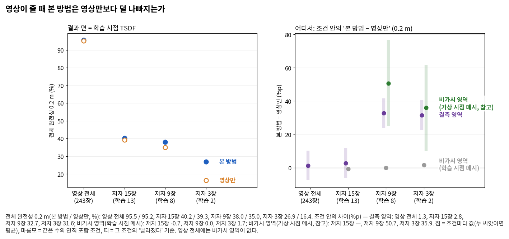
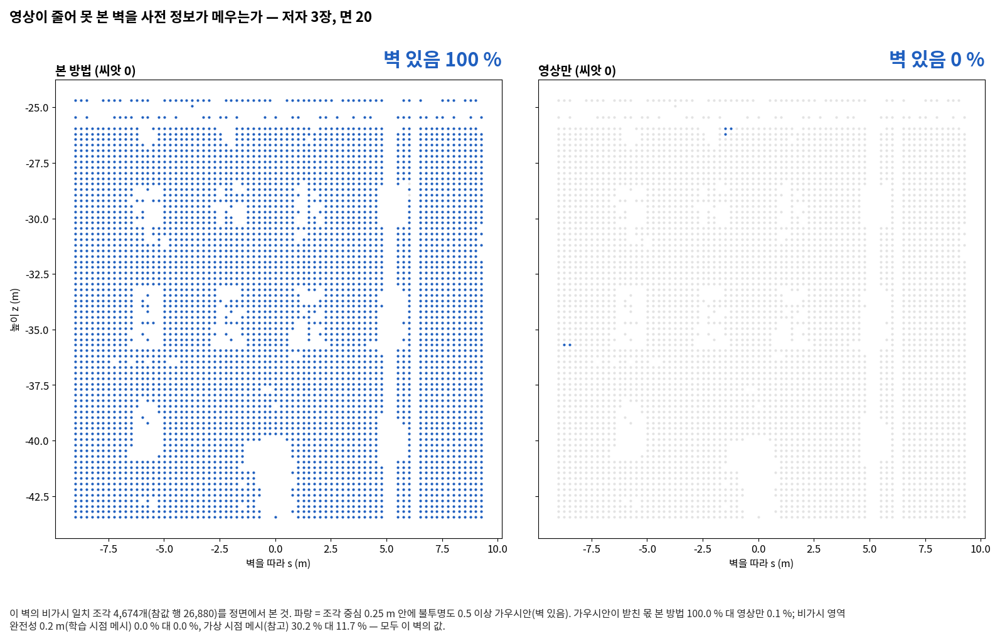
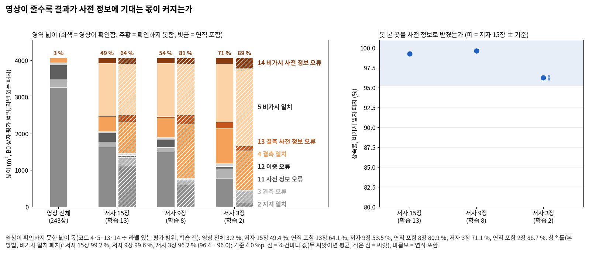
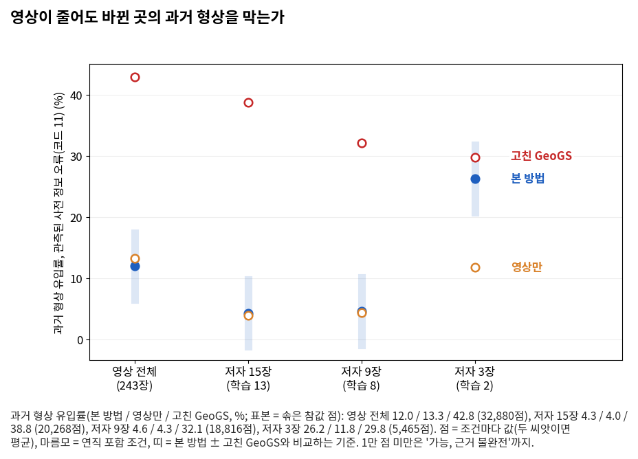

<!-- PHD-MAIN-STAGE3-v1 중간 보고 -->
# 본 실험 3단계와 1단계 보강 — 중간 보고 v1 (앞 묶음: 저자 3장 다섯 번)

- 작업: `PHD-MAIN-STAGE3-v1` (발주문 v1, 2026-10-13). 앞 묶음(차례 1)의 학습은 10-14 10:41 ~ 12:28에 돌았고, 마지막 후처리와 지표는 21:16에 끝났다. `scientific_verdict: null`.
- 설정: `configs/phd/main_stage3_v1/stage3_v1.json`.
  - 10:40:37 저장, sha256 `521e6f1d…`.
  - 10:45:09 고침: 가상 시점 메시의 참고값을 더했다. 3단계 결과가 나오기 전이다. sha256 `eb3af3ae…`.
  - 21:31:56 기록 더함: 결과 뒤에 바뀐 것과 사용자 결정 둘을 `changes_after_results`, `user_decisions`에 적었다. 값과 읽는 규칙은 그대로다. sha256 `2074ff69…`. 21:4x로 적었던 항목 하나의 시각을 21:29로 고침(sha256 `4bd33d7e…`).
- 범위: B0 한 곳, LoD2만. 저자 3장은 학습 영상 2장과 평가 영상 1장이다(사용자 답 10-14 09:3x, '설계대로 2장').
- 1·2단계와 고침의 공식 판정과 표는 고치지 않았다. 이 보고의 값은 모두 '이 발주에서 냄'이다.
- 표: [tables/interim/](tables/interim/) (`stage3`, `seeds`, `times`, `where33`). 그림: [figures/interim/](figures/interim/). 그림마다 숫자 json이 옆에 있다.
- 저자 15장·9장의 값도 표에 있다. 나머지 대기열에서 이미 끝난 것이다. 그 읽기는 최종 보고에서 한다. 이 보고는 저자 3장을 읽는다.
- **결정할 것은 없다.** 나머지 대기열(차례 2~4, 22회)은 11:40에 이미 시작했다(5절 2).
  - 13:53부터 21:06까지 GeoGS 후처리의 호스트 메모리를 기다리며 멈춰 있었다.
  - 사용자 지시로 titiler 둘과 tensorboard를 멈춘 뒤 다시 돌고 있다(5절 5, 시간 표 6절).

## 1. 답 먼저 (저자 3장)

1. **3-1. 본 방법은 영상만보다 덜 나빠졌다 (확인).**
   - 숫자: 전체 완전성(0.2 m)의 '본 방법 − 영상만'이 영상 전체 0.31 %p에서 저자 3장 10.50 %p로 커졌다. 차이의 차이 10.19 %p는 기준 5.66 %p를 넘는다.
   - 덜 나빠진 곳은 결측 영역이다(+31.58 %p, 확인).
   - 비가시 영역은 학습 시점 메시로는 +1.71 %p뿐이다. 학습 시점 메시에는 못 본 면이 담기지 않기 때문이다. 가상 시점 메시(참고)로는 +35.95 %p다.
2. **3-2. 영상이 확인하지 못한 넓이는 커졌고, 결과는 못 본 곳을 사전 정보로 받쳤다.**
   - 영상이 확인하지 못한 넓이 몫(학습 전)은 영상 전체 3.2 %, 저자 15장 49.4 %, 저자 3장 71.1 %로 커졌다.
   - 결과는 그 가운데 못 본 곳(비가시 일치 패치)의 96.2 %를 사전 정보로 받쳤다. 저자 15장은 99.25 %였다. 차이 −3.03 %p는 기준 4.03 %p 안이다.
3. **3-3. 저자 3장에서는 막지 못했다. '사전 정보 신뢰와 다르지 않았다' (가능, 근거 불완전).**
   - 숫자: 과거 형상 유입률이 본 방법 26.25 %, 고친 GeoGS 29.75 %다. 차이 −3.50 %p는 기준 5.46 %p 안이다.
   - 영상만(11.79 %)보다는 14.46 %p 높다. 곧 '영상만보다 과거 형상을 더 들였다'.
   - 등급이 '가능, 근거 불완전'까지인 것은 표본이 5,465점으로 1만 점 미만이기 때문이다.
   - 모습(결과를 본 뒤 더함): 코드 11 행의 66 %가 벽 하나(LoD2 면 22)에 있다. 그 벽에서 본 방법 유입률은 35 %·34 %다. 같은 벽의 바뀐 넓이 72 %가 학습 전에 '일치'로 판정됐다. 다른 조건에서는 40–44 %였다(3.3절).
   - 저자 15장·9장(참고)의 본 방법은 4.31 %·4.61 %로, 고친 GeoGS 38.76 %·32.14 %보다 낮았다.
4. **가장 어려운 조건에서도 학습과 후처리는 끝까지 돌았다.**
   - 다섯 번 모두 첫 시도에 PASS했다. GPU 메모리 최대는 포크 2.3–3.4 GiB, 고친 GeoGS 6.6 GiB다(nvidia-smi 최대 − 시작).
   - 다섯 결과 모두 NaN 가우시안이 0.1–0.2 % 생겼다. 사용자 답(10-14 11:2x)대로 평가에서 뺐다.
5. **두 씨앗의 흔들림이 크다(4절).**
   - 과거 형상 유입률의 단위 흔들림 폭은 5.46 %p다. 모은 폭 1.64 %p의 세 배다. 이 값이 3단계 모든 조건의 3-3 기준이 된다(7.1).
   - 가상 시점 메시의 비가시 완전성은 씨앗 사이가 46.9 % 대 60.0 %다. 이 참고값은 크게 다를 때만 읽을 수 있다.

## 2. 돈 학습과 메모리

| 학습 | 학습 시각 | 분 | GPU 최대 − 시작 (nvidia-smi) | PyTorch 할당 최대 | 마지막 가우시안 | NaN 가우시안 (평가에서 뺌) | 후처리 post · run (초) | post 중 호스트 여유 최소 |
|---|---|---:|---:|---:|---:|---:|---|---:|
| 본 방법 씨앗 0 | 10:41 ~ 11:06 (GPU 0) | 25 | 2.5 GiB | 2.0 GiB | 908,902 | 1,837 (0.20 %) | 85 · 97 (run 다시 함) | 48 GB |
| 본 방법 씨앗 1 | 10:43 ~ 11:08 (GPU 1) | 25 | 2.4 GiB | 1.9 GiB | 862,799 | 1,887 (0.22 %) | 83 · 102 (run 다시 함) | 44 GB |
| 영상만 씨앗 0 | 11:07 ~ 11:31 (GPU 0) | 24 | 3.4 GiB | 1.9 GiB | 914,751 | 1,223 (0.13 %) | 102 · 98 | 45 GB |
| 영상만 씨앗 1 | 11:09 ~ 11:32 (GPU 1) | 23 | 2.3 GiB | 1.8 GiB | 865,854 | 1,163 (0.13 %) | 74 · 94 | 45 GB |
| 고친 GeoGS | 11:36 ~ 12:28 (GPU 0) | 52 | 6.6 GiB | — | 990,176 (PLY) | 977 (0.10 %) | 41 · 91 (21:06에 시작; 학습 끝 뒤 8.6시간 기다림) | 93 GB |

- 코드: 포크 r15다. r15는 r14에 메모리 부족 기록만 더한 것이다(`--jbgs_oom_record 1`). 메모리 부족은 한 번도 나지 않아 기록도 없다. 고친 GeoGS는 고침 발주의 fix1이다.
- NaN 가우시안은 영상만에도 생겼다. 사전 정보와 상관없이, 학습 영상 2장 조건에서 나는 것으로 본다.
  - 본 방법 두 결과는 run 단계의 점검(덤프 행 = PLY 행)에서 멈췄다. 사용자 답 뒤 그 단계를 다시 했다(11:23, 11:39).
  - 고친 GeoGS는 PLY에서 NaN 행을 빼고 읽었다.
- 고친 GeoGS의 52분은 혼자 돈 시간과 비교하지 않는다. GPU 0에 학습이 하나 더 얹혀 돌았기 때문이다(5절 3).
- 시간과 자원의 전체 표는 [tables/interim/times.md](tables/interim/times.md)에 있다.

## 3. 물음마다 숫자와 그림

### 3.1 (3-1) 영상이 줄 때 본 방법은 영상만보다 덜 나빠지는가

전체 완전성은 건물 면 참값 점 가운데 결과 면(학습 시점 TSDF)에서 0.2 m 안에 든 몫이다. 모든 조건이 같은 참값 점을 쓰므로 값을 바로 비교한다. 크면 덜 빠뜨린 것이다.

| 조건 | 본 방법 (씨앗) | 영상만 (씨앗) | 고친 GeoGS | 본 방법 − 영상만 | 영상 전체 차이와의 차이 (기준 ×√2) | 등급 |
|---|---|---|---:|---:|---:|---|
| 영상 전체 | 95.52 (95.71 · 95.34) | 95.21 | 74.51 | 0.31 | — | — |
| 저자 3장 | 26.88 (26.98 · 26.77) | 16.37 (15.36 · 17.38) | 19.09 | 10.50 | 10.19 (5.66) | 확인 · 덜 나빠짐 |
| (참고) 저자 15장 · 9장 | 40.19 · 38.01 | 39.31 · 34.97 | 40.74 · 40.91 | 0.88 · 3.04 | 0.56 · 2.72 (5.66) | 기준 안 · 기준 안 |

- 기준 5.66 %p는 저자 3장 영상만 두 씨앗의 단위 흔들림 4.00 %p에 √2를 곱한 값이다. 본 방법(0.42, 영상 전체 0.73)보다 커서 이 값을 쓴다(7.1).

**어디서 (저자 3장, 조건 안의 '본 방법 − 영상만')**

| 영역 | 본 방법 (씨앗) | 영상만 (씨앗) | 차이 (기준) | 등급 |
|---|---|---|---:|---|
| 결측 영역 완전성 0.2 m | 63.51 · 65.03 | 30.44 · 34.94 | +31.58 (8.91) | 확인 |
| 결측 영역 완전성 0.5 m | | | +41.23 (6.99) | 확인 |
| 비가시 영역 완전성 0.2 m (학습 시점 메시) | 5.31 · 4.94 | 3.23 · 3.61 | +1.71 (0.75) | 확인 |
| 비가시 영역 완전성 0.5 m (학습 시점 메시) | | | +3.00 (1.09) | 확인 |
| 비가시 영역 완전성 0.2 m (가상 시점 메시, 참고) | 46.89 · 59.96 | 17.92 · 17.03 | +35.95 (25.88) | 확인 |
| 가우시안이 받친 몫 (비가시 일치 패치) | 96.40 · 96.04 | 3.07 · 4.06 | +92.66 (3.81) | 확인 |

- 비가시 영역의 답이 되는 값은 발주문대로 학습 시점 메시의 값이다. 그러나 그 메시는 학습 영상이 보지 못한 면을 담지 못한다.
  - 그래서 본 방법이 못 본 벽에 가우시안을 세워도 값이 5 % 안팎에 머문다.
  - 가상 시점 메시(학습 시점 + 못 본 패치 둘레의 가상 시점 8개; 설정 고침 10:45)로 센 값을 참고로 둔다.

- 예시 벽(학습 전에 정한 자리: 저자 3장 비가시 일치 벽 가운데 참값 점이 가장 많은 면 20)의 값이다.
  - 벽 있음: 본 방법 100 % 대 영상만 0.1 %.
  - 학습 시점 메시 완전성(0.2 m): 0.0 % 대 0.0 %.
  - 가상 시점 메시(참고): 30.2 % 대 11.7 %.
- 본 방법은 이 벽 전체에 사전 정보 가우시안을 세웠다. 학습 시점 메시로는 그것이 하나도 세어지지 않는다.

### 3.2 (3-2) 영상이 줄수록 결과가 사전 정보에 기대는 몫이 커지는가

- 영상이 확인하지 못한 넓이 몫: 코드 4·5·13·14의 넓이를 라벨 있는 평가 범위로 나눈 것이다. 학습 전 값이라 흔들림이 없다.
- 상속률: 비가시 일치 패치 가운데 사전 정보 출신 가우시안이 받친 몫이다. 크면 못 본 곳을 사전 정보로 받친 것이다.

| 조건 | 영상이 확인하지 못한 넓이 몫 | 상속률 (씨앗) | 저자 15장과의 차이 (기준) | 읽음 |
|---|---:|---|---:|---|
| 영상 전체 | 3.2 % | — (비가시 영역 없음) | | |
| 저자 15장 (2단계 짝) | 49.4 % | 99.25 | 0 | 출발점 |
| (참고) 저자 9장 | 53.5 % | 99.62 | +0.37 (4.03) | 기준 안 |
| 저자 3장 | 71.1 % | 96.22 (96.40 · 96.04) | −3.03 (4.03) | 기준 안 |

- 답 한 줄: 영상이 줄수록 영상이 확인하지 못한 넓이가 3.2 %에서 71.1 %로 커졌다. 결과는 그 가운데 못 본 곳(비가시 일치 패치)의 96.2 %를 사전 정보로 받쳤다.
- 연직 포함 조건의 넓이 몫은 학습 전 값으로 이미 있다. 13장 64.1 %, 8장 80.9 %, 2장 88.7 %다.
- 함께 적을 값은 최종 보고에서 낸다. 결측 일치 패치의 같은 셈, 지지 일치 패치에서 사전 정보 출신이 받친 몫과 처음 점의 구성이다.

### 3.3 (3-3) 그러면서도 영상이 본 바뀐 곳의 과거 형상은 계속 막는가

과거 형상 유입률은 관측된 사전 정보 오류 영역(코드 11)의 솎은 참값 점 가운데, 결과가 틀린 쪽(사전 정보 쪽)이나 양쪽 모두에 면을 둔 몫이다. 크면 바뀐 곳에 옛 모양이 들어온 것이다.

| 조건 | 본 방법 (씨앗) | 영상만 (씨앗) | 고친 GeoGS (남은 처음 점) | 표본 | − GeoGS (기준) | − 영상만 (기준) | 읽음 |
|---|---|---|---|---:|---:|---:|---|
| 영상 전체 | 11.98 (12.10 · 11.86) | 13.29 | 42.83 (99,881) | 32,880 | −30.85 (5.46) | −1.31 (5.46) | 막았다 |
| 저자 3장 | 26.25 (27.63 · 24.87) | 11.79 (10.96 · 12.63) | 29.75 (14,458) | 5,465 | −3.50 (5.46) | +14.46 (5.46) | 사전 정보 신뢰와 다르지 않았다; 영상만보다 더 들였다 |
| (참고) 저자 15장 · 9장 | 4.31 · 4.61 | 3.98 · 4.35 | 38.76 · 32.14 | 20,268 · 18,816 | −34.45 · −27.53 | +0.33 · +0.26 | 막았다 · 막았다 |

- 기준 5.46 %p는 저자 3장 본 방법 두 씨앗의 단위 흔들림이다. 고친 GeoGS는 씨앗이 하나라 자체 흔들림을 모른다. 그래서 GeoGS와의 비교에도 본 방법의 값을 쓴다(7.1).
- 표본 5,465점은 1만 점 미만이다. 그래서 저자 3장의 답은 '가능, 근거 불완전'까지다.

**막지 못한 모습 (결과를 본 뒤 더함; [where33](tables/interim/where33.md))**

| 저자 3장의 코드 11 행 | 행 | 본 방법 (씨앗 0 · 1) | 영상만 (씨앗 0 · 1) | 고친 GeoGS |
|---|---:|---|---|---:|
| 벽 (모두 LoD2 면 22) | 3,596 | 35.1 · 33.8 % | 15.0 · 16.9 % | 21.0 % |
| 지붕 | 1,869 | 13.2 · 7.8 % | 3.2 · 4.3 % | 46.7 % |
| 모두 | 5,465 | 27.6 · 24.9 % | 11.0 · 12.6 % | 29.8 % |

- 같은 면 22의 코드 11 행은 다른 조건에도 많다. 영상 전체 9,080행, 저자 15장 9,033행, 9장 8,881행이다.
  - 거기서 본 방법 유입률은 6.2 %(씨앗 0), 7.7 %, 7.2 %였다.
  - 저자 3장에서만 이 벽이 막히지 않았다.
- 학습 전 판정(그 조건의 저장소, 넓이 가중)을 보면 이렇다.
  - 저자 3장에서 면 22의 코드 11 넓이는 42.5 m²다. 그 가운데 30.5 m²(72 %)가 '일치'로 판정됐다.
  - 다른 조건에서는 그 몫이 40–44 %였다: 영상 전체 43.4/109.5 m², 저자 15장 47.2/108.6 m², 9장 46.3/105.9 m².
  - 판정이 이 벽의 바뀐 곳 대부분을 사전 정보 쪽으로 지켰고, 결과는 그 벽의 3분의 1 남짓에 사전 정보 쪽 면을 두었다.
  - 왜 '일치'로 판정됐는지는 아직 보지 않았다. 두 장의 MVS가 이 벽을 어떻게 보았는지를 봐야 한다.
- 지붕에서는 본 방법이 고친 GeoGS보다 훨씬 낮다(13.2·7.8 % 대 46.7 %).
- 학습 전 판정 셈(5.4, 저자 3장)은 이렇다.
  - 맞게 지킴 42.2 %, 잘못 지킴 2.7 %, 맞게 놓음 7.8 %, 잘못 놓음 21.8 %, 미판정 25.5 %.
  - 영상 전체는 82.7 %, 3.6 %, 7.8 %, 5.8 %, 0.1 %였다.

**예시 자리 (학습 전에 정한 단면; 그림 아래 숫자는 그 자리의 값)**

- 이 단면에서는 단위 전체와 반대로 나왔다.
  - 저자 3장: 본 방법 7.2 % 대 고친 GeoGS 31.6 % (139점).
  - 영상 전체: 49.1 % 대 18.4 % (218점).
- 영상 전체의 본 방법 49.1 %는 대부분 '둘 다'(45.9 %)다.
  - 이 자리의 옛 면은 참값보다 0.3 m쯤 아래다. 그래서 두 창이 ±0.15 m로 좁다.
  - 참값 쪽에 붙은 면과 그 아래 0.15 m 남짓에 걸친 면이 함께 세어졌다. 단면 선 하나에는 잘 보이지 않는다.
- 저자 3장의 단위 모습은 위의 벽(면 22)에서 생긴다. 이 예시 자리는 그 모습을 보여 주지 않는다. 최종 보고에는 면 22 벽을 정면으로 본 네 갈래 그림을 더한다(결과를 본 뒤 더함).

**대가 (저자 3장; 넓이와 본 방법 / 영상만 / 고친 GeoGS 유입률)**

| 갈래 | 영상 전체 넓이 | 저자 3장 넓이 | 저자 3장 유입률 |
|---|---:|---:|---|
| 11 관측된 사전 정보 오류 | 401 m² | 64 m² | 26.2 / 11.8 / 29.8 % |
| 12 이중 오류 | 61 m² | 76 m² | 27.7 / 15.5 / 21.7 % |
| 13 결측 사전 정보 오류 (참고) | 2 m² | 165 m² | 36.6 / 6.5 / 19.6 % |
| 14 비가시 사전 정보 오류 | 0 m² | 159 m² | 못 본 곳 과거 형상(본 방법) 90.6 % |

- 영상이 줄면서 바뀐 곳 대부분이 관측된 곳(11)에서 결측(13)과 비가시(14)로 옮겨 갔다.
- 결측 사전 정보 오류(13)에서는 본 방법이 영상만보다 30 %p 높다.
- 비가시(14)는 두 자료만으로는 버릴 근거가 없는 곳이다. 읽는 규칙 없이 값만 적는다.

### 3.4 (3-4) 연직 포함 조건

- 연직 포함 13·8·2장의 학습이 아직이다. 최종 보고에서 낸다.

## 4. 저자 3장 두 씨앗의 흔들림

단위 흔들림 폭은 2.8 × |씨앗 0 − 씨앗 1| ÷ √2다. 3단계 모든 조건에는 이 값과 영상 전체의 같은 값 가운데 큰 것을 쓴다(7.1).

| 지표 | 본 방법 씨앗 0 · 1 | 본 방법 폭 | 영상만 씨앗 0 · 1 | 영상만 폭 | 영상 전체 본 방법 폭 | 모은 폭 (2단계) |
|---|---|---:|---|---:|---:|---:|
| 전체 완전성 (0.2 m) | 26.98 · 26.77 | 0.42 | 15.36 · 17.38 | 4.00 | 0.73 | — |
| 결측 일치 완전성 (0.2 m) | 63.51 · 65.03 | 3.01 | 30.44 · 34.94 | 8.91 | 3.29 | 3.29 |
| 비가시 영역 완전성 (0.2 m) | 5.31 · 4.94 | 0.73 | 3.23 · 3.61 | 0.75 | — | — |
| 비가시, 가상 시점 메시 (0.2 m; 참고) | 46.89 · 59.96 | 25.88 | 17.92 · 17.03 | 1.76 | — | — |
| 상속률 | 96.40 · 96.04 | 0.71 | 0 · 0 | 0 | — | 4.03 |
| 가우시안이 받친 몫 | 96.40 · 96.04 | 0.71 | 3.07 · 4.06 | 1.96 | — | 3.81 |
| 과거 형상 유입률 | 27.63 · 24.87 | 5.46 | 10.96 · 12.63 | 3.31 | 0.48 | 1.64 |
| 결측 영역의 과거 형상 유입률 | 38.90 · 34.29 | 9.13 | 5.23 · 7.84 | 5.17 | 16.51 | — |
| 관측 오류 유입률 (영역 전체) | 9.40 · 9.38 | 0.04 | 10.79 · 10.22 | 1.13 | 0.63 | 1.57 |
| 과거 형상 잔존율 | 66.99 · 63.41 | 7.09 | 0 · 0 | 0 | 2.22 | 1.31 |

- 영상 2장에서는 씨앗만 바꿔도 바뀐 곳의 결과가 크게 흔들린다. 과거 형상 유입률 폭 5.46 %p는 영상 전체(0.48)의 11배다.
- 이 폭이 3단계 모든 조건의 3-3 기준이 된다(7.1). 그래서 씨앗이 하나인 조건에서도 이보다 작은 차이는 '달라졌다'로 읽지 않는다.
- 가상 시점 메시의 완전성은 씨앗 사이가 13 %p 벌어졌다. 참고값으로만 둔다.

## 5. 실행 중 바꾼 것과 멈춤

1. **NaN 가우시안을 평가에서 뺌 (10-14 11:2x, 사용자 답).**
   - 무엇이 났나: 저자 3장의 다섯 결과 모두에 NaN 가우시안이 0.1–0.2 % 생겼다. gpu_s1의 '덤프 행 = PLY 행' 점검이 그 행에서 멈췄다.
   - 학습 결과 파일은 그대로 두었다. 평가만 바꿨다.
     - 유한한 행만 담은 거울(`<결과>.finite`, `nan_clean_s3.py`)을 만들었다.
     - run 단계 점검은 NaN을 같게 본다(`gpu_s3.py`).
     - 고친 GeoGS는 PLY의 NaN 행을 읽을 때 뺀다(`<결과>.nanmask`).
2. **나머지 22회 대기열을 11:40에 시작.**
   - 이때 결정할 것이 없었다. NaN은 이미 답을 받았다. 발주문 6.5의 '결정이 필요 없으면 이어 간다'를 따랐다.
   - 이 보고가 늦어진 까닭은 앞 묶음의 마지막 후처리(고친 GeoGS)가 아래 5번의 대기에 걸렸기 때문이다.
3. **GPU 0에 학습 둘이 얹힘 (11:40 ~ 12:28).**
   - 저자 15장 영상만이 GPU 0에서 시작됐다. 그때 저자 3장 고친 GeoGS가 같은 GPU에서 돌고 있었다.
   - 대기열의 '빈 GPU' 문턱은 2,000 MiB다. GeoGS가 그 순간 그보다 적게 쓰고 있었다.
   - 둘 다 PASS했고 결과에는 영향이 없다. 걸린 시간(52분, 53분)은 다른 학습과 비교하지 않는다.
4. **가상 시점 메시 완전성의 셈 고침 (11:56).**
   - 요약 줄을 400점/m² 표본에서 정확한 거리로 바꿨다. 결과 하나에 12분이 걸렸기 때문이다.
   - 고친 뒤 생긴 형 오류를 고쳐 12:10에 다시 셌다. 표는 그 뒤에 냈다.
5. **대기열 멈춤과 서비스 멈춤.**
   - 13:53부터 대기열이 멈췄다. GeoGS 후처리가 시작 조건인 호스트 여유 70 GB를 기다렸기 때문이다(`run_s3.py` POST_NEED_GB).
   - 21:05:51에 사용자 지시로 titiler 둘(cartography-review-titiler-1, aerial_survey_manager-titiler-1)과 jbgs-tensorboard-6006을 멈췄다. MemAvailable은 64.8 GB에서 99.9 GB가 됐다.
   - 21:05:51 ~ 21:06:00 사이에 대기열이 다시 돌았다. 70 GB 문턱은 낮추지 않았다.
   - 기다리던 GeoGS 후처리 셋(저자 15장·9장·3장)은 21:10 ~ 21:13에 끝났다. post 중 호스트 여유는 최소 84–93 GB였다.
   - 세 서비스는 3단계의 남은 학습과 후처리가 모두 끝날 때까지 꺼 둔다. 끝나면 감시(`hold_services_s3.py`, 세션과 따로 떠 있음)가 다시 켜고, 켠 시각을 progress.md에 적는다.
6. **B0a3 고친 GeoGS의 가상 시점 메시 완전성을 손으로 셈 (21:17).**
   - 차례 1 대기열은 10:41에 떠서 10:45 고침의 가상 시점 단계를 모른다.
   - 같은 스크립트와 같은 입력으로 한 번 셌다.
7. **그림 고침 (21:2x; 값은 그대로).**
   - 이름을 마지막 점 옆으로 옮겼다. 겹치던 곳이 있었다.
   - 조건 차례 그림에 숫자 줄을 넣었다(9절 6·11).
   - 예시 벽 두 칸을 나란히 두었다.
   - 예시 단면에는 '단위 전체' 값을 덧붙였다(9절 11).
   - 3-2 그림(`cond32`)을 처음 그렸다.
8. **3-3 '막지 못한 모습' 측정 더함 (21:29; 결과를 본 뒤 더함).**
   - `where33_s3.py`: 코드 11 행을 면 종류와 LoD2 면으로 나누고, 그 패치의 학습 전 판정을 센다.
   - `figs8_s3.py map83`의 B0 조건 판(코드 11 지도)도 더했다. 다만 저자 3장은 코드 11이 상자 가장자리의 가는 띠와 작은 조각뿐이라 위에서 본 지도로는 읽히지 않는다. 이 보고에는 넣지 않았다.

## 6. 시간 표 (대기열이 멈춰 있던 시간은 따로)

| 무엇 | 때 | 길이 |
|---|---|---|
| 앞 묶음 학습 다섯 | 10-14 10:41 → 12:28 | 1.8시간 |
| 앞 묶음 포크 후처리와 지표 (NaN 처리로 다시 한 것 포함) | 11:06 → 12:10 | 1.1시간 |
| 고친 GeoGS 후처리와 지표 | 21:06 → 21:16 (+ 가상 시점 셈 21:17) | 0.2시간 |
| **대기열 전체가 멈춰 있던 시간** (GeoGS 후처리가 호스트 여유 70 GB를 기다림) | **13:53 → 21:06** | **7.22시간** |
| **GPU 1이 빈 시간** (저자 15장 고친 GeoGS 학습 끝 → 다음 학습 시작) | **12:08 → 21:10:51** | **9.05시간** |
| **GPU 0이 빈 시간** (저자 9장 고친 GeoGS 학습 끝 → 다음 학습 시작) | **13:53 → 21:13:41** | **7.34시간** |
| 앞 묶음 고친 GeoGS 후처리가 기다린 시간 (학습 끝 → post 시작) | 12:28 → 21:06:49 | 8.6시간 |
| titiler 둘과 tensorboard를 멈춰 둠 | 21:05:51 → (3단계 학습·후처리가 끝날 때) | — |

- 자료: `logs/services_hold.json`, `tables/interim/times.md`. 다음 학습의 시작 시각은 학습 컨테이너의 시작 시각이다.

## 7. 다음

- 차례 2~4의 남은 17회가 돈다. 21:10부터 연직 포함 13장의 본 방법과 영상만이 돈다.
  - 3단계 나머지 아홉: 연직 포함 13·8·2장의 세 방법.
  - 1단계 보강 여섯: 판정만 끈 본 방법.
  - 2단계 다시 시도 둘.
- 학습과 후처리가 모두 끝나면 감시가 대기열 밖 후처리 하나(2단계 짝 저자 15장 본 방법의 가상 시점 메시)를 하고 세 서비스를 다시 켠다.
- 8절 측정:
  - 8.6(관측 오류 문턱의 뜻)은 코드로 확인했다. LoD2의 문턱은 1·τ로, 손실의 허용 구간과 같은 τ, 같은 방향이다. 항공 LiDAR는 2·τ다. 최종 보고에 코드 줄과 함께 옮긴다.
  - 8.5(렌더)는 GPU에 학습이 없을 때 한다.
  - 나머지는 보강 학습 뒤 판정만 끈 결과를 더해 다시 낸다.
- 최종 보고는 발주문 11절의 차례로 쓴다. 저자 3장의 면 22 벽 그림(3-3 모습)을 더한다.
