# ALS r8 15,000회 점검 [이 발주에서 냄]

기하 기준: PASS. 건강: PASS_HEALTH. 기하 기준은 기록이며 22:20 결정대로 학습 중단에 쓰지 않는다.

[구현·초기 입력 점검](구현과_초기점검_r8.md)

| 항목 | 기존 방법 7,000회 | r7 7,000회 | r8 | 문턱 | 통과 |
|---|---:|---:|---:|---:|---|
| 칸 0~3 뜬 면 | 11.642% | 25.059% | 3.022% | ≤13.642% | True |
| 일치 영역 τ 안 | 73.220% | 76.191% | 92.222% | ≥71.220% | True |
| 칸 0~3 면 없음 | 2.931% | 2.196% | 2.112% | ≤3.931% | True |

| 화소 구분 | 목표 화소 수 | 기존 방법 폭 안 | r7 폭 안 | r8 폭 안 | r8 깊이 없음 |
|---|---:|---:|---:|---:|---:|
| 전체 | 114,558,537 | 45.331% | 46.499% | 64.598% | 0.000% |
| 사전 패치 | 11,861,349 | 47.835% | 70.479% | 86.296% | 0.000% |
| 배경 MVS | 102,697,188 | 45.042% | 43.730% | 62.092% | 0.000% |
| 사전 지붕 | 11,861,349 | 47.835% | 70.479% | 86.296% | 0.000% |
| 사전 벽 | 0 | 확인 불가 | 확인 불가 | 확인 불가 | 확인 불가 |
| 관측 없음 | 4,636,054 | 52.874% | 72.626% | 86.926% | 0.000% |
| 사라짐 | 0 | 확인 불가 | 확인 불가 | 확인 불가 | 확인 불가 |
| 일치 | 4,608,847 | 43.507% | 71.942% | 87.701% | 0.000% |
| 보존 | 986,188 | 24.981% | 67.561% | 85.779% | 0.000% |
| 보정 | 1,630,260 | 59.564% | 62.000% | 80.844% | 0.000% |
| 사전 원값 | 7,111,573 | 44.697% | 69.632% | 86.356% | 0.000% |
| 사전 대체 | 4,749,776 | 52.533% | 71.746% | 86.206% | 0.000% |

| 현재 출신 | 그리는 몫 | 폭 밖 최대 기여 몫 | 틀린 몫 / 그리는 몫 |
|---|---:|---:|---:|
| background | 15.788% | 22.532% | 1.427211 |
| released | 28.849% | 34.553% | 1.197721 |
| patch | 55.363% | 42.915% | 0.775144 |

| 현재 출신 | 수 | 접선 1 m 초과 | 긴 축 중앙(m) | 불투명도 중앙 | 법선 이동 중앙(m) | 접선 이동 중앙(m) |
|---|---:|---:|---:|---:|---:|---:|
| patch | 132,107 | 99,192 | 0.396385 | 0.377698 | 0.147960 | 1.852057 |
| background | 2,568,256 | 2,557,419 | 1.158757 | 0.377242 | 84.561415 | 173.748637 |
| released | 139,181 | 132,998 | 0.933940 | 0.345428 | 1.579527 | 16.882171 |

처음 1 m 초과 배경에서 살아남은 부모 157개, 자손 2,495,095개. 크기·불투명도·이동 전체 배열은 저장 증거에 있다.

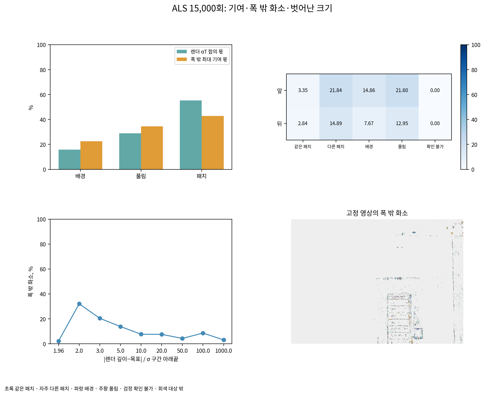

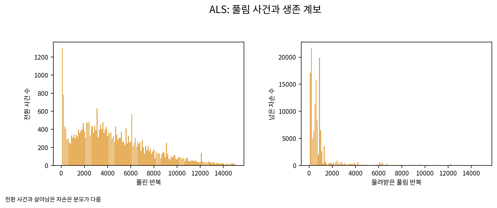

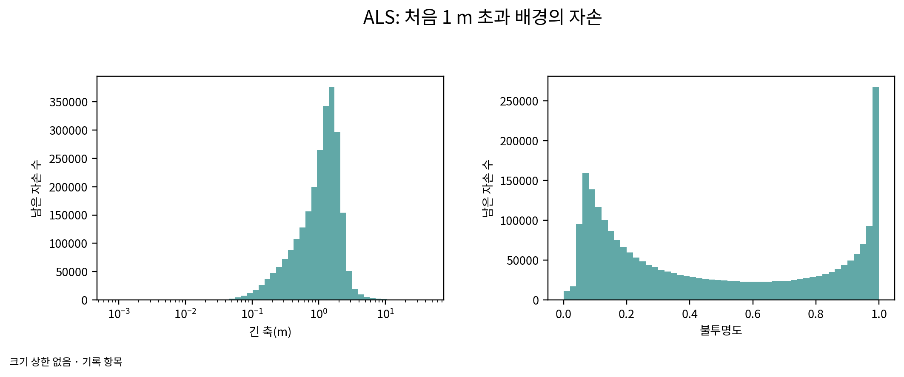

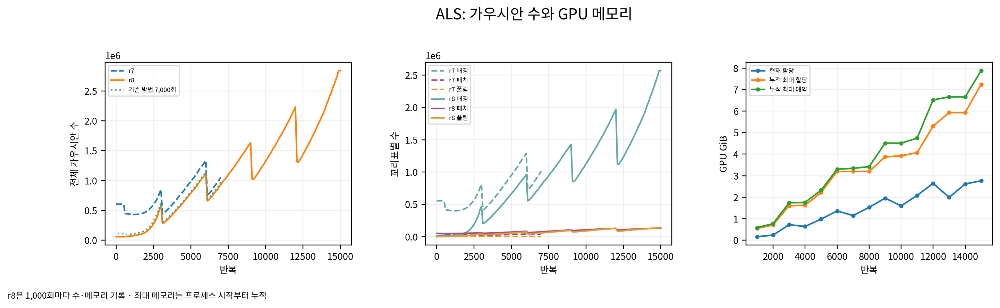

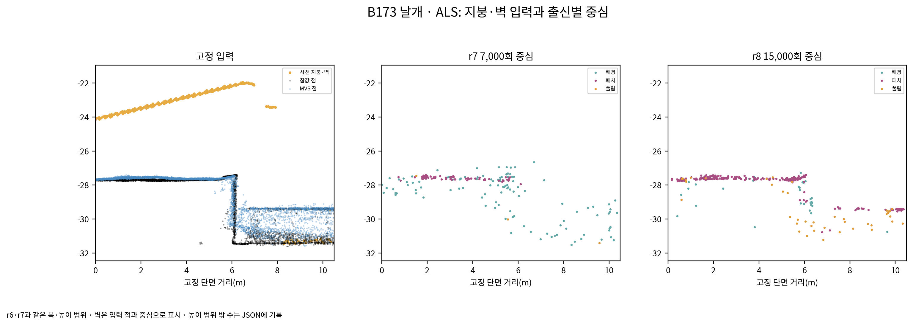

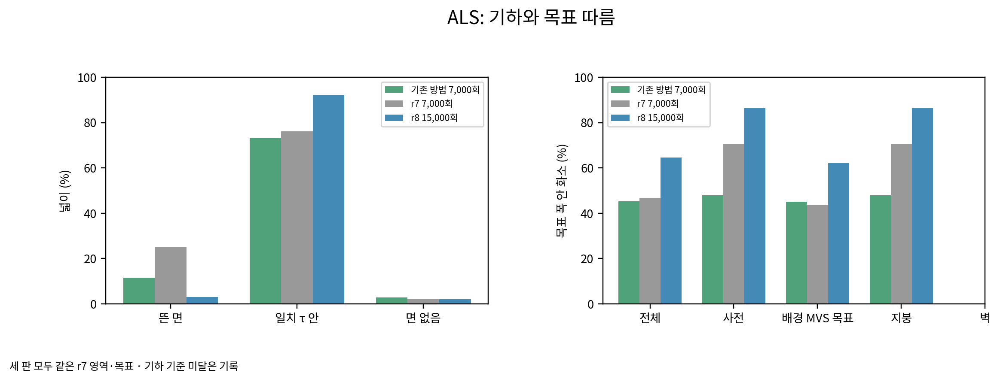

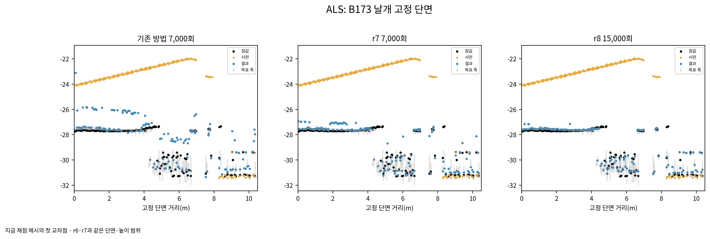

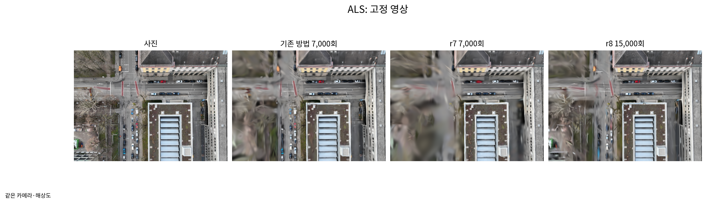

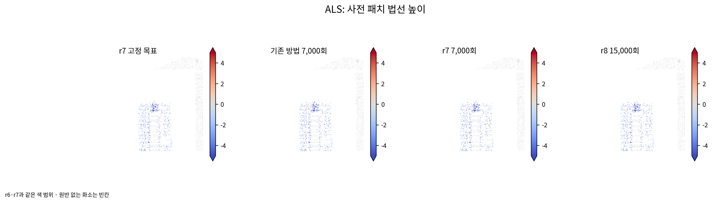

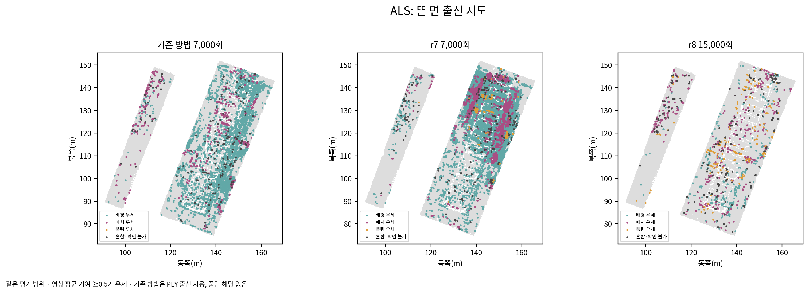

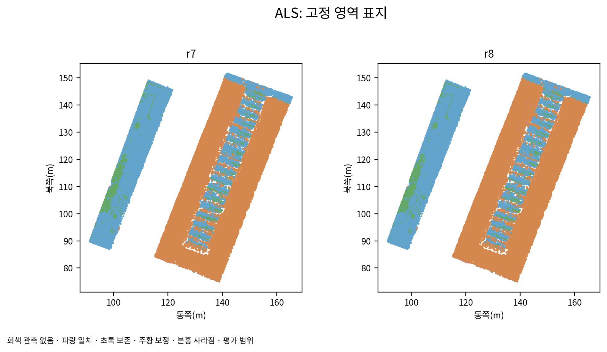

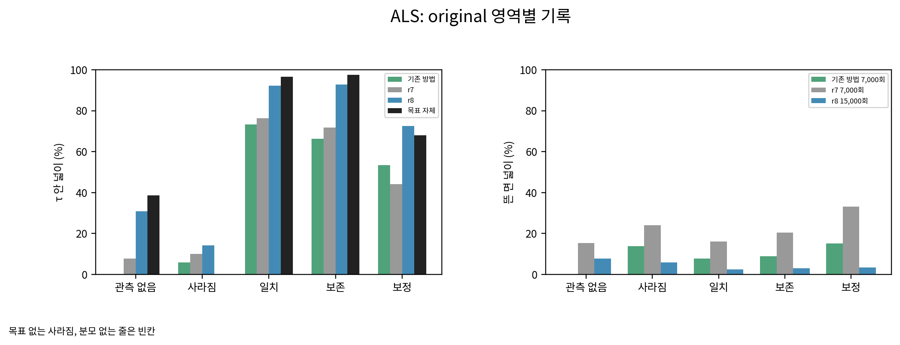

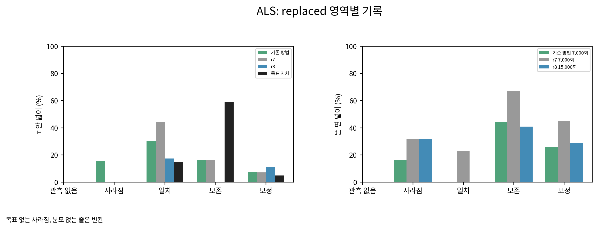

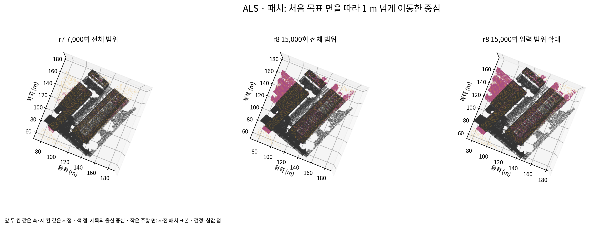

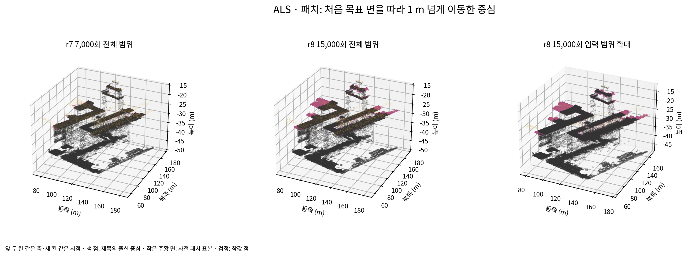

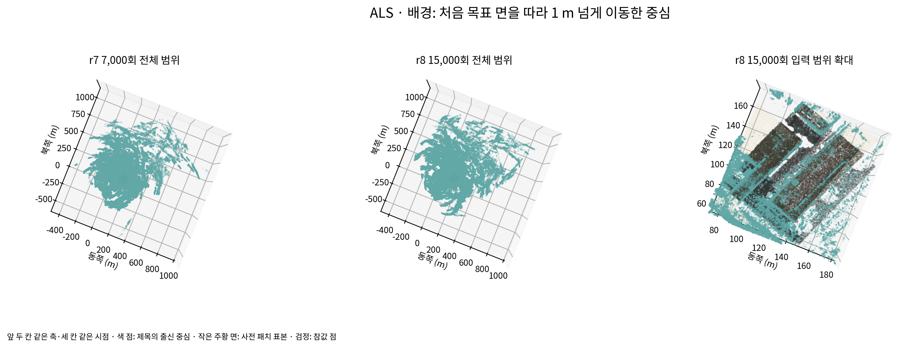

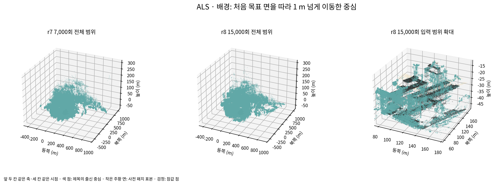

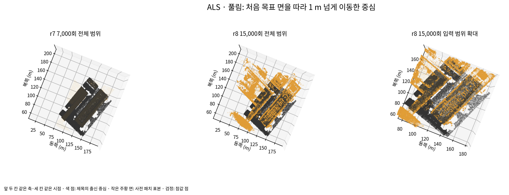

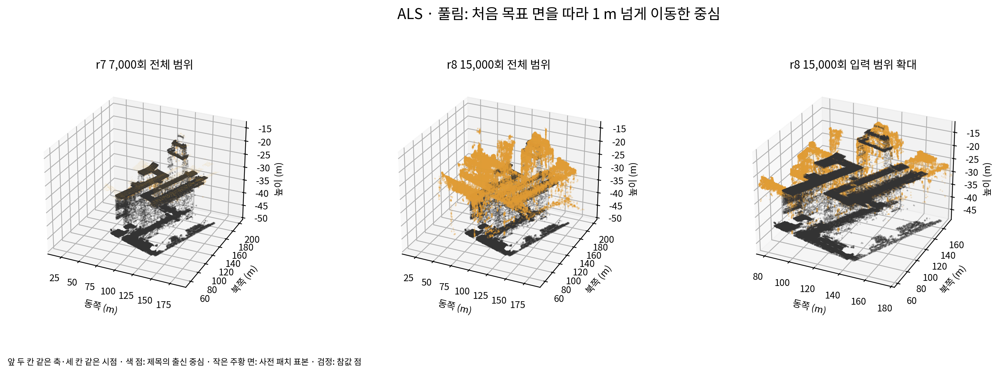

scientific_verdict: null.
