# LoD2 r8 7,000회 점검 [이 발주에서 냄]

기하 기준: PASS. 건강: PASS_HEALTH. 기하 기준은 기록이며 22:20 결정대로 학습 중단에 쓰지 않는다.

[구현·초기 입력 점검](구현과_초기점검_r8.md)

| 항목 | 기존 방법 7,000회 | r7 7,000회 | r8 | 문턱 | 통과 |
|---|---:|---:|---:|---:|---|
| 칸 0~3 뜬 면 | 15.787% | 8.926% | 8.811% | ≤17.787% | True |
| 일치 영역 τ 안 | 63.077% | 71.455% | 73.829% | ≥61.077% | True |
| 칸 0~3 면 없음 | 2.462% | 2.369% | 2.285% | ≤3.462% | True |

| 화소 구분 | 목표 화소 수 | 기존 방법 폭 안 | r7 폭 안 | r8 폭 안 | r8 깊이 없음 |
|---|---:|---:|---:|---:|---:|
| 전체 | 115,995,219 | 48.589% | 49.849% | 50.656% | 0.002% |
| 사전 패치 | 17,150,221 | 54.378% | 58.801% | 63.015% | 0.000% |
| 배경 MVS | 98,844,998 | 47.584% | 48.296% | 48.512% | 0.003% |
| 사전 지붕 | 10,860,286 | 70.233% | 73.489% | 78.155% | 0.000% |
| 사전 벽 | 6,289,935 | 27.002% | 33.439% | 36.873% | 0.000% |
| 관측 없음 | 5,047,177 | 52.501% | 50.188% | 53.426% | 0.000% |
| 사라짐 | 0 | 확인 불가 | 확인 불가 | 확인 불가 | 확인 불가 |
| 일치 | 8,818,619 | 57.190% | 63.737% | 67.877% | 0.000% |
| 보존 | 46,852 | 39.277% | 34.701% | 41.761% | 0.000% |
| 보정 | 3,237,573 | 49.865% | 59.129% | 65.025% | 0.000% |
| 사전 원값 | 11,841,809 | 55.775% | 62.905% | 67.564% | 0.000% |
| 사전 대체 | 5,308,412 | 51.263% | 49.646% | 52.866% | 0.000% |

| 현재 출신 | 그리는 몫 | 폭 밖 최대 기여 몫 | 틀린 몫 / 그리는 몫 |
|---|---:|---:|---:|
| background | 13.097% | 19.956% | 1.523703 |
| released | 16.401% | 25.862% | 1.576828 |
| patch | 70.502% | 54.183% | 0.768526 |

| 현재 출신 | 수 | 접선 1 m 초과 | 긴 축 중앙(m) | 불투명도 중앙 | 법선 이동 중앙(m) | 접선 이동 중앙(m) |
|---|---:|---:|---:|---:|---:|---:|
| patch | 152,870 | 111,134 | 0.425628 | 0.346534 | 0.105753 | 1.588038 |
| background | 286,563 | 283,324 | 1.365527 | 0.272287 | 72.503394 | 112.589795 |
| released | 578,801 | 572,151 | 1.161569 | 0.264457 | 17.494848 | 121.355967 |

처음 1 m 초과 배경에서 살아남은 부모 125개, 자손 266,571개. 크기·불투명도·이동 전체 배열은 저장 증거에 있다.

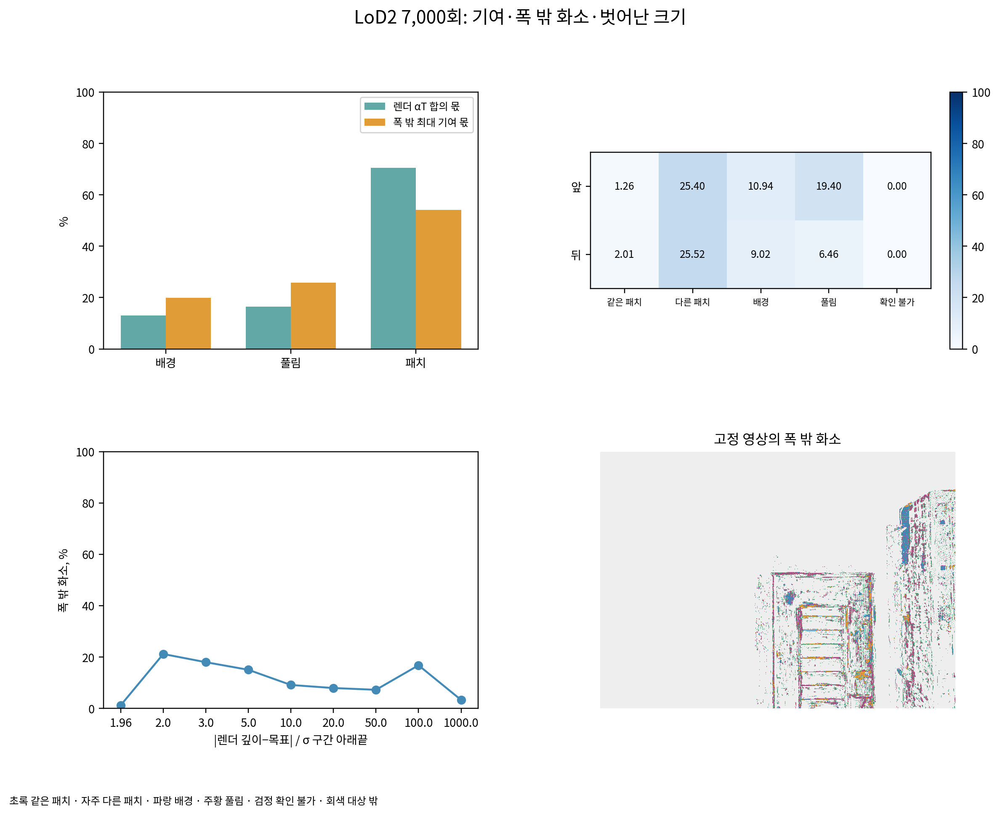

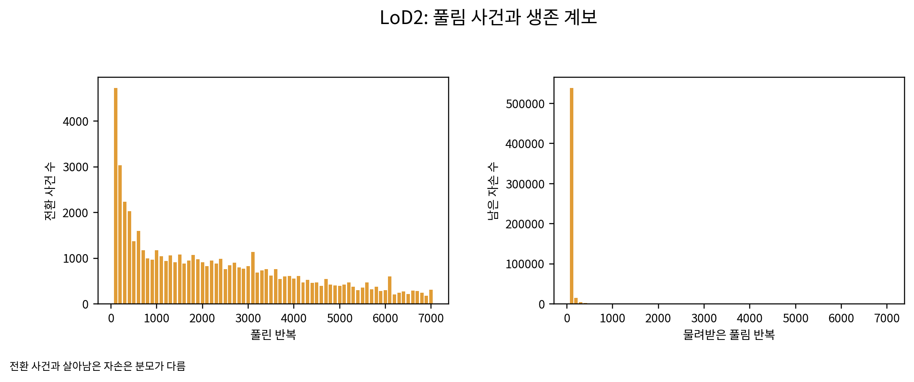

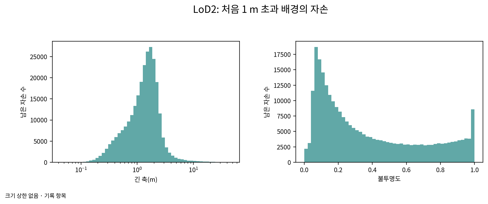

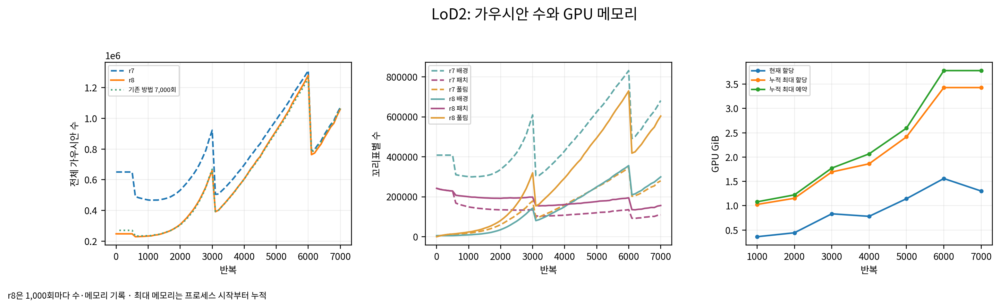

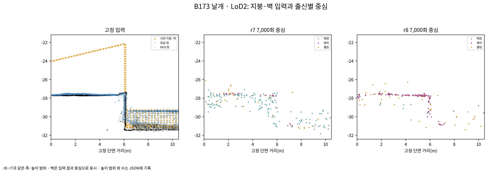

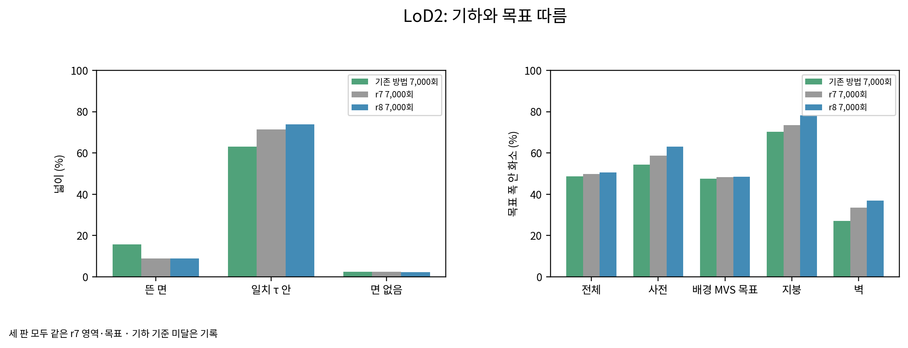

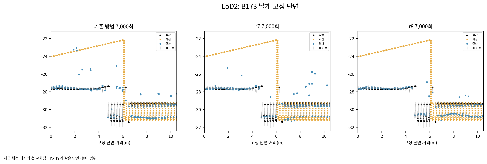

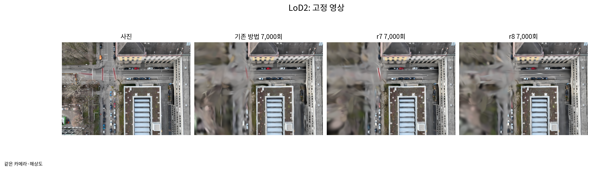

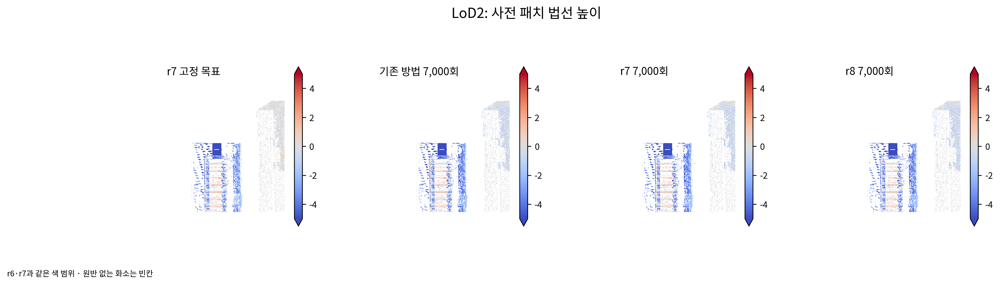

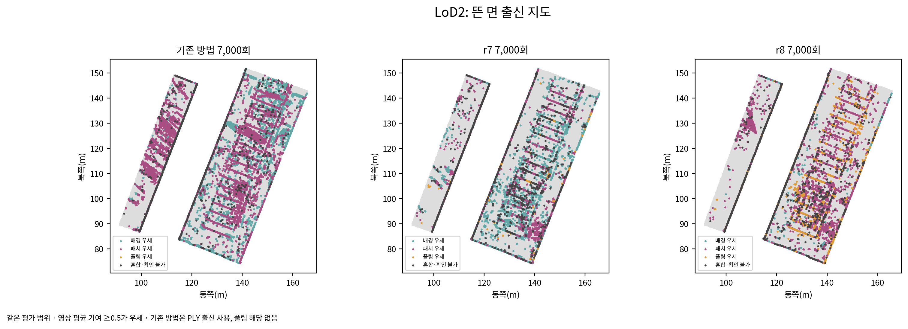

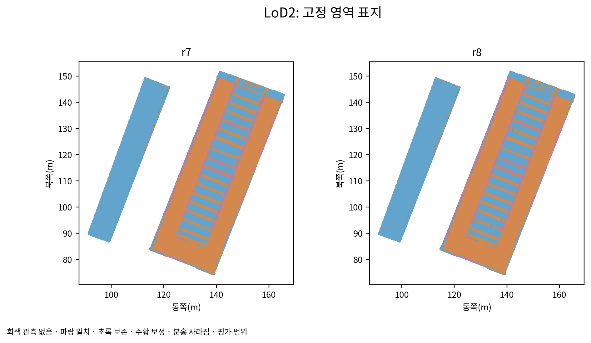

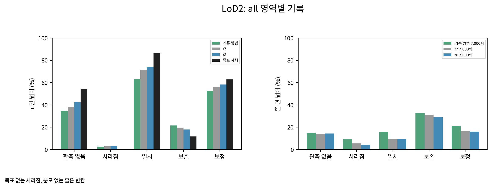

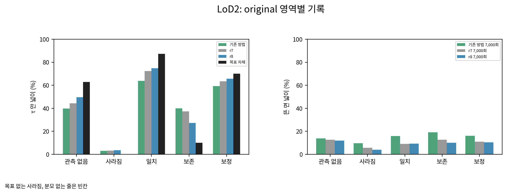

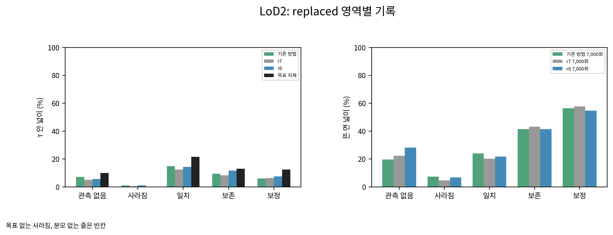

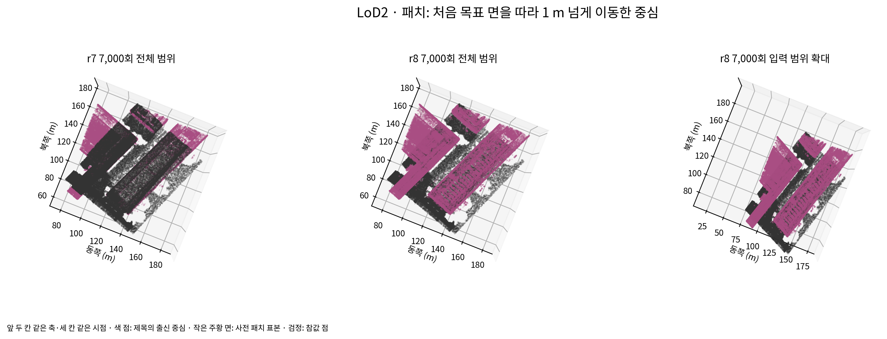

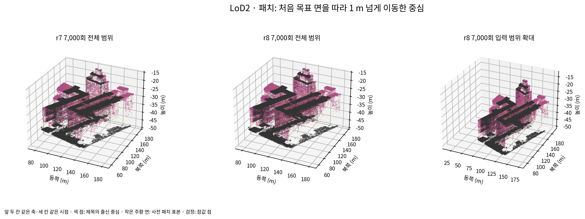

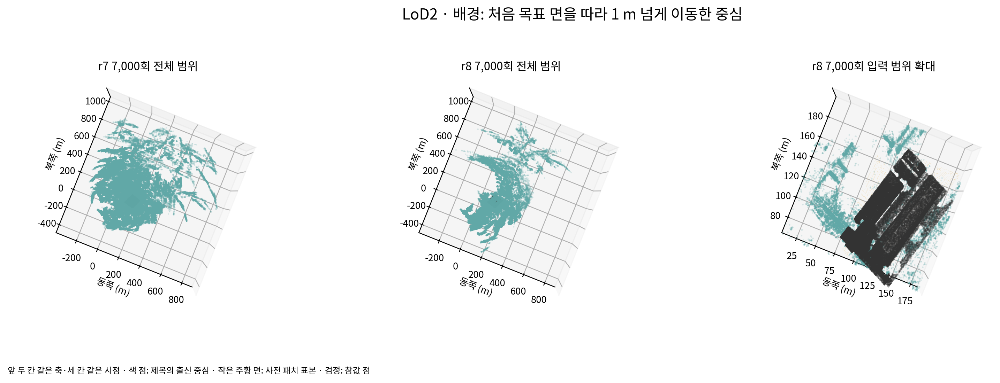

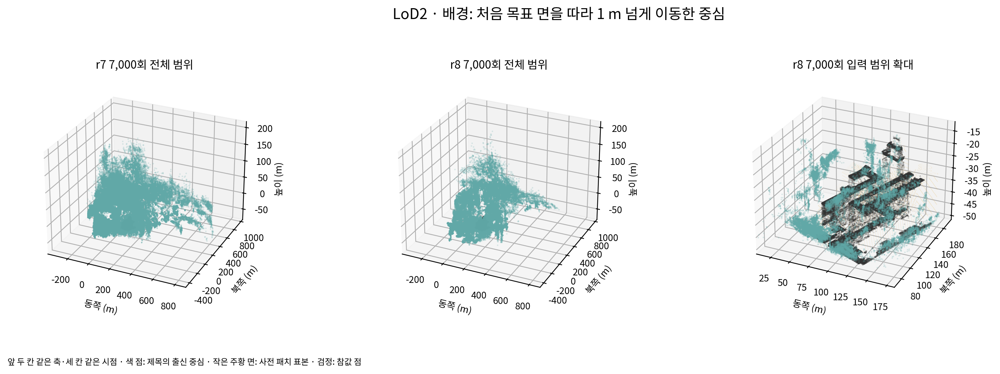

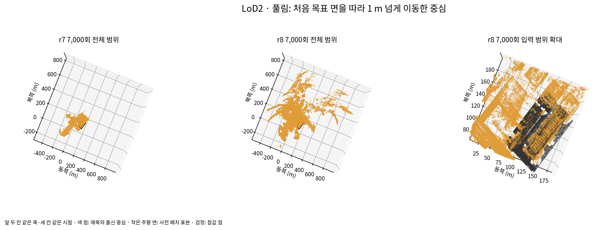

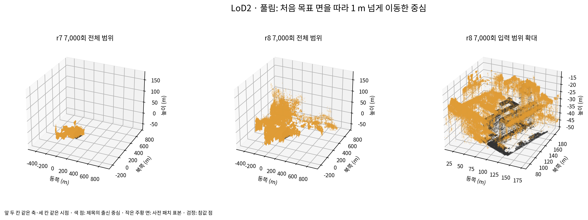

scientific_verdict: null.
