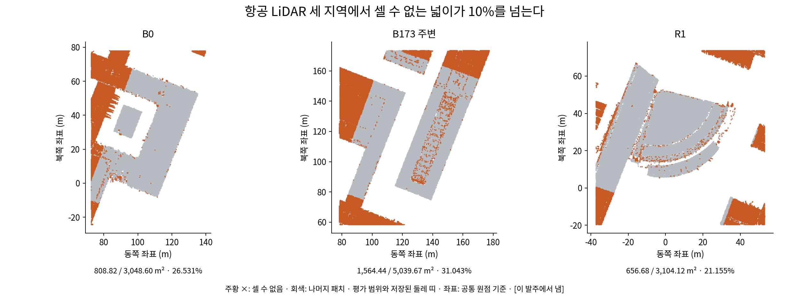
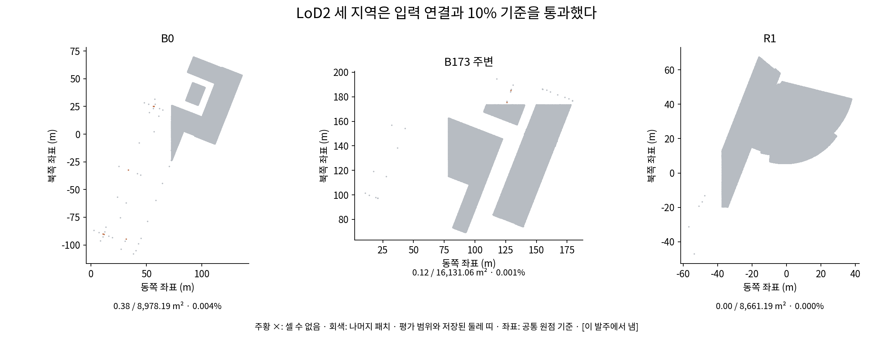
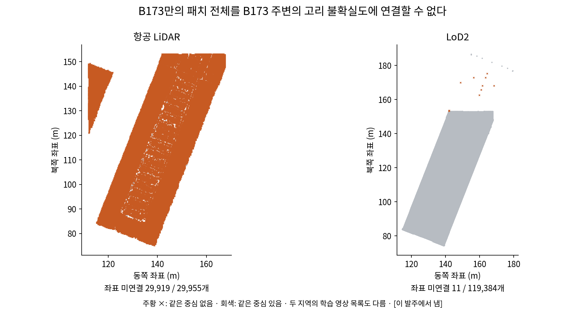

# 영역별 목표 학습 — 단계 0 중단 보고

판단 정확도: 개발용·확인용·실험 지역 모두 미실행. 단계 0 입력에서 중단했다.
7,000회 점검: 미실행. 학습 0판이다.
8판의 네 값: 확인 불가. 목표와 모델을 만들지 않았다.
GS와 목표로 바로 만든 메시 비교: 미실행.
확인 불가: 항공 LiDAR 사전 정보 정밀도 누락, B173만 고리 불확실도 연결. 입력 감사 실행 2.63초. scientific_verdict: null.

## 단계 0: 입력 중단 근거

발주문 2.8의 두 조건에 걸렸다. 설정을 2026-10-31T23:33:07.918406+09:00에 잠갔으며, 해시는 `447e888fc46317b88f337ba337593b4db7eb891f62e39b989c54270ae4afa406`이다.
기준의 분모는 영역 파일의 모든 패치 넓이(평가 범위와 저장된 둘레 띠)이다. MVS 고리 u가 없는 경우의 허용 대체(a 또는 0)와 사전 정보 σ_P가 없는 경우를 구별했다. 후자는 발주문 2.5에 따라 셀 수 없음이다.

| 지역 | 사전 정보 | 전체 넓이 m² | 셀 수 없음 m² | 비율 | 입력 상태 |
|---|---|---:|---:|---:|---|
| B0 | 항공 LiDAR | 3048.60 | 808.82 | 26.531% | 10% 초과 |
| B0 | LoD2 | 8978.19 | 0.38 | 0.004% | 통과 |
| B173 주변 | 항공 LiDAR | 5039.67 | 1564.44 | 31.043% | 10% 초과 |
| B173 주변 | LoD2 | 16131.06 | 0.12 | 0.001% | 통과 |
| B173만 | 항공 LiDAR | 2021.30 | 확인 불가 | 확인 불가 | 불확실도 연결 실패 |
| B173만 | LoD2 | 7461.50 | 확인 불가 | 확인 불가 | 불확실도 연결 실패 |
| R1 | 항공 LiDAR | 3104.12 | 656.68 | 21.155% | 10% 초과 |
| R1 | LoD2 | 8661.19 | 0.00 | 0.000% | 통과 |

[이 발주에서 냄]. B173만의 빈 값은 0이 아니다. 다른 세 지역의 LoD2 통과는 입력 검사 통과이며 판단 확정 완료를 뜻하지 않는다.

항공 LiDAR의 원본 `u_prior`는 UNCERT `u2_merge.py`에서 `als_status == 0`일 때만 `als_u`를 넣고, 나머지는 NaN으로 남긴다. 그 값을 √(u_prior²+0.0275²)로 바꾸어도 NaN은 남는다. 법선 없음과 정밀도 없음의 각각의 수·넓이, 평가 범위·둘레 띠 비율, 원본 상태 번호는 `tables/stop_verification.json`에 있다. 과거 LOSSTRAIN의 단위 중앙값 대체는 이번 발주에 없으므로 적용하지 않았다.

B173만 항공 LiDAR는 29,955개 중 같은 중심이 36개이고, LoD2는 119,384개 중 11개의 같은 중심이 없다. B173만과 B173 주변의 학습 영상 목록도 같지 않다. 같은 중심이 있는 것만으로 같은 MVS 불확실도를 보장하지 않으며, 이번에는 전달하지 않았다.

T2 혼합, 사진 판단 재계산, 깊이 목표 생성은 미실행이다. 확인용 건물의 판단 정확도도 열지 않았다. 민감도 판으로 바꾸지 않았다.

## LoD2 정밀도 값의 출처

수치 연결은 JUDGENUM `detection.prior_sigma` → PHOTOCHECK `uncertainty`와 `prepare.py` → PHOTOCHECK 발주문 부록 C의 2026-10-26 새 값까지 확인했다. LOSSTRAIN `direct_stage1_v2.json`에는 소수 여섯 자리의 값과 2026-10-26 사용자 수정안 출처가 있다. 이 파일들에는 최초 추정 계산과 모집단, 참값 사용 여부가 기록되어 있지 않다. 따라서 구축 기준인지, 자료 추정인지, 참값을 사용했는지는 **확인 불가**다. 참값을 쓰지 않았다고 인증하지 않는다. 이번 중단 상태에서 이 값을 사용한 목표·학습은 없다.

## 단계 1과 단계 2

최신 바탕 후보는 `GeoGS-conf-guided-v1-r18`이다. 해당 폴더의 마지막 추적 변경 커밋은 `f614090ab5444090182890c6c43505a3a4e5af8f`이며, 현재 폴더에는 미추적 파일도 있어 그 커밋을 전체 코드의 바이트 식별자로 삼지 않았다. 새 r19 구현과 학습 전 단위 점검, 7,000회 점검은 단계 0에서 중단하여 시작하지 않았다. 목표 메시·최종 메시·채점·비교 방법 표와 대표 자리 결과 그림은 모두 미실행이다.

## 재개에 필요한 결정

1. 항공 LiDAR 정밀도가 없는 패치의 처리: 현재 규칙을 유지할지, 참값 없이 다시 구하는 절차를 추가할지, 명시적인 대체 규칙을 승인할지 결정이 필요하다.
2. B173만의 고리 불확실도: 해당 단위의 MVS 입력으로 같은 정의의 u를 별도로 구하는 추가 작업이 필요하다. 주변 단위의 최근접 값을 복사하지 않는다.
3. LoD2 정밀도의 원 추정 근거를 확보해야 참값 미사용을 확인할 수 있다.

발주문 1.8과 2.8의 중단 뒤 질문 규칙 때문에 후속 계산을 보류한다. 방법의 효과나 과학적 결론은 내리지 않는다.

## 바꾼 것과 검증

이번 작업의 설정·CPU 실행기·입력 감사·검산·보고서·그림만 새로 만들었다. 기존 설정·결과·포크는 수정하지 않았다. Docker에서 GPU 없이 실행했으며 원본은 읽기 전용으로 연결했다. 별도 검산에서 원본 해시, 넓이 합, 누락 조건, B173 좌표 대응을 확인했다. 그림은 전체 패치로 그렸고 숫자 원본은 같은 이름의 JSON에 남겼다. 확인용 패치 값은 공개 산출물에 없다.

재현: `bash scripts/phd/main_target_v1/run_cpu.sh audit audit_inputs.py`, 이어서 `bash scripts/phd/main_target_v1/run_cpu.sh verify verify_stop_report.py`. 원본 외부 자료가 필요하다. 이 재현은 중단 근거만 재계산하며 학습을 실행하지 않는다.
