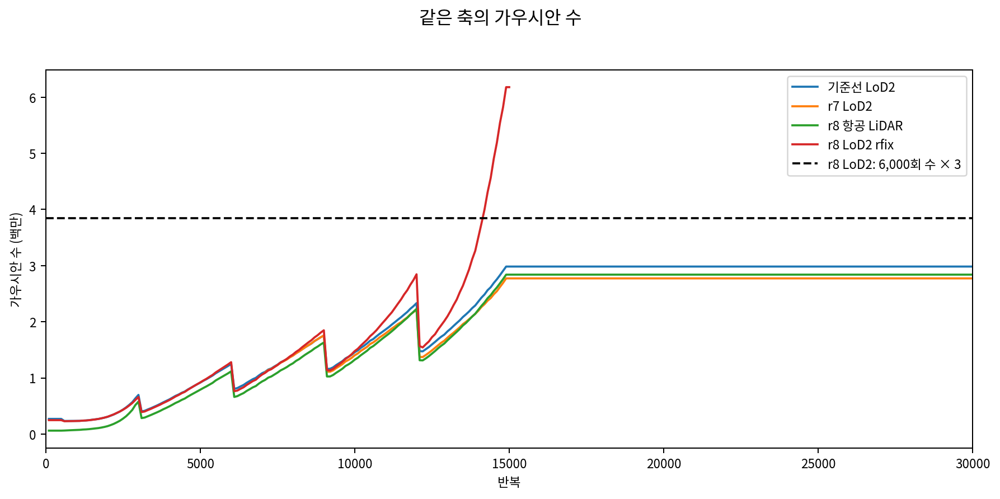
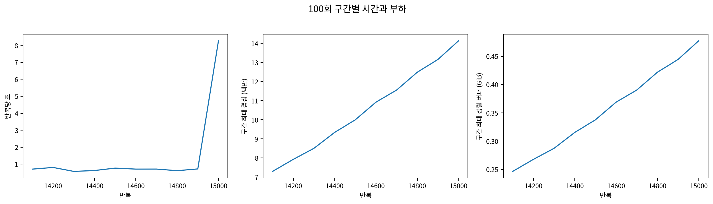
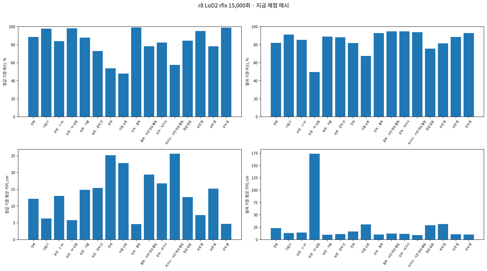
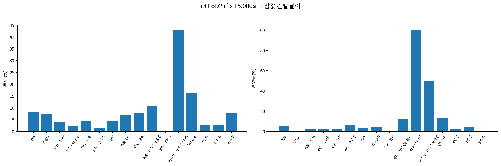
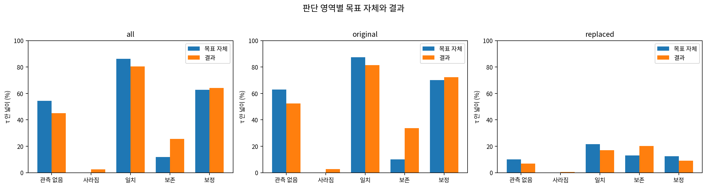
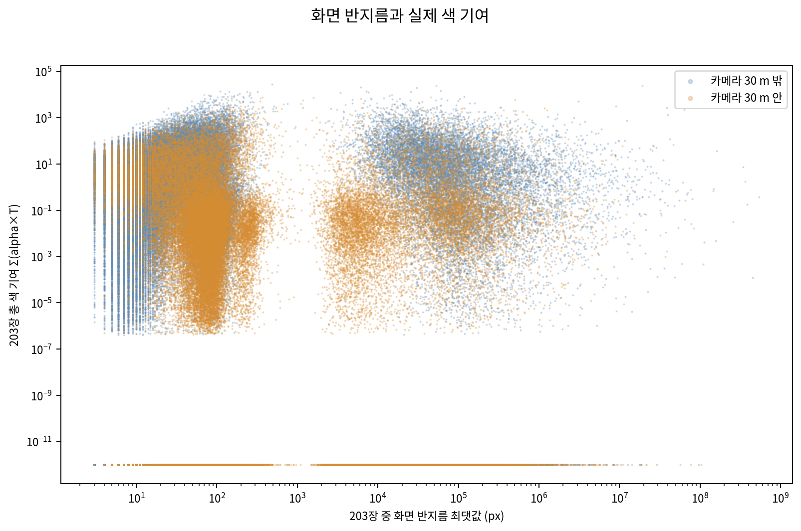
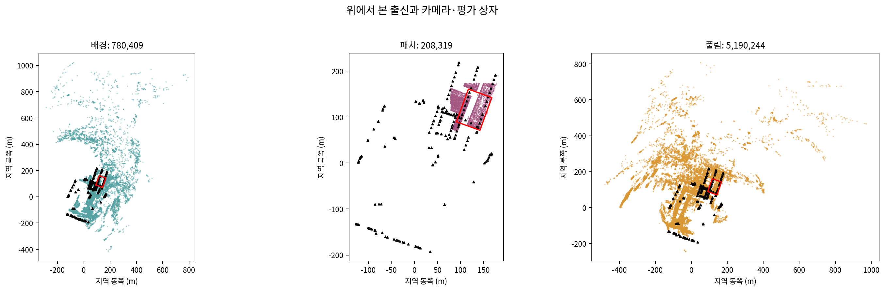
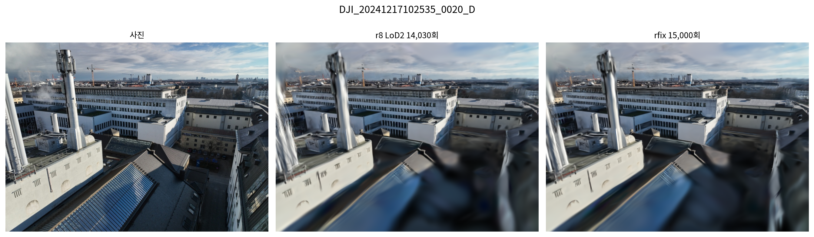
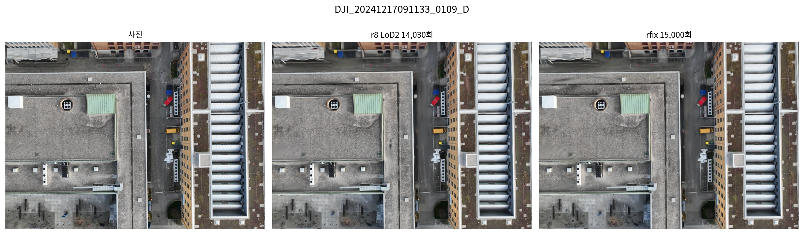
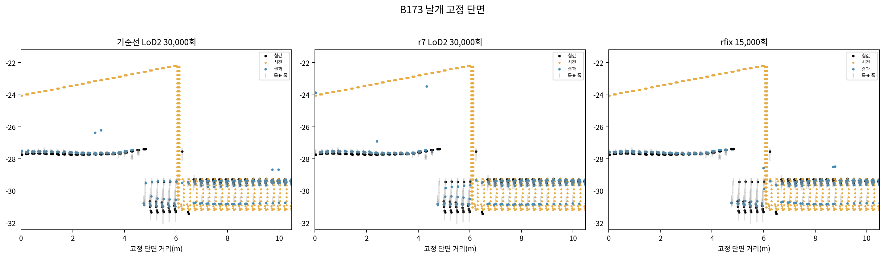

# r8 LoD2 렌더러 교체 이어 학습 결과

상태: STOPPED_HEALTH_OR_EXECUTION. 완료 반복: 15,000. scientific_verdict: null.

[진행 설정과 사용자 기준 변경](../진행.md) · [실행 예외](../실행예외.md)

중단 사유: `TARGET_STOP_count_gt_3x_6000`. 가우시안 6,178,972개 / 6,000회 1,280,149개 = 4.826760배. 완전 상태와 PLY를 저장했다. 자동 재개하지 않았다.

| 전체 지금 메시 | 값 |
|---|---:|
| n_gt | 3881308 |
| n_result_E | 2691989 |
| area_m2 | 5239.3125 |
| unscorable_area_m2 | 3606.5625 |
| total_eval_area_m2 | 8845.875 |
| R_tau | 0.8865117120310988 |
| P_tau | 0.8198629340610233 |
| gt_mean_cm | 12.18461890465943 |
| result_mean_cm | 23.340525774423032 |
| floating_fraction | 0.08387312266638038 |
| no_surface_fraction | 0.05103245893425903 |

재개 첫 영상은 DJI_20241217102535_0020_D이며 겹침 1,986,099개, 정렬 버퍼 72,047,487바이트였다. 같은 14,030회 상태의 사전 점검과 일치한다.

12칸·세 합계·전체의 점 수, 넓이와 모든 값은 [채점 표](tables/axes71.md), 판단 영역별 원값·대체값 비교는 [목표와 결과 표](tables/result_vs_target.md)에 있다.

추가 입력항 검사는 160개 행 모두 바이트 단위 일치다. 상대 L2 재판정은 이전 1,680개 비교 모두 1e-4 이내다. 이전 판정은 삭제하지 않았다.

현재 학습 빌드는 ae90687632d7…이며 속도 개선 후보를 학습에 쓰지 않았다. 나머지 여섯 판은 시작하지 않았다.

채점표의 area_m2는 표면 채점 가능 넓이, unscorable_area_m2는 같은 평가 칸의 표면 채점 제외 넓이, total_eval_area_m2는 두 넓이의 합이다. 뜬 면·면 없음 비율의 분모는 area_m2다. R·P의 점 모집단과 넓이 모집단은 원래 AXES71-v2 정의를 그대로 사용했다.

100회 구간의 반복당 시간은 해당 구간의 실제 경과 시간이다. 다시 붙이기·건강 검사·기록·정기 상태 저장과 해당 반복의 점검 렌더 시간을 포함한다. 첫 구간은 14,031~14,100회의 70회다.

산점도에서는 로그 축 표시를 위해 반지름 0을 0.1 px, 총 색 기여 0을 1e-12에 놓았다. 원래 배열과 교차표의 0은 그대로다.

이 문서는 첫 15,000회 중단 시점의 기록이다. 후속 사용자 결정으로 수 검사만 해제한 이어 학습은 [전체 보고서](../보고서.md)에 별도로 기록한다.

[기록 정의](../기록정의.md)
