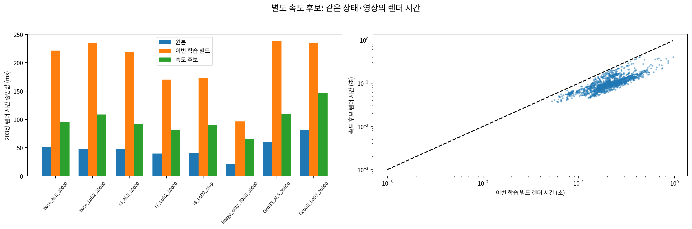
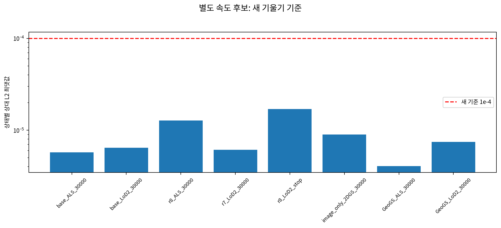

# 렌더러 속도 후보 검증

scientific_verdict: null

이 빌드는 준비·검증만 했다. r8 LoD2 이어 학습에는 적용하지 않았다. 작은 원래 사각형(16타일 이하)은 등록을 유지하고, 큰 사각형은 4×4타일 묶음의 보수적 구간 검사 후 개별 타일 검사를 한다. 반환 반지름과 수치 커널은 그대로다. 작은 사각형에서는 실제 기여가 없는 타일을 일부 유지할 수 있다.

렌더 출력·반지름: 8개 상태 × 203장 모두 바이트 단위 일치. 기울기: 8 × 30장 × 7항목 모두 상대 L2 ≤ 1e-4. 상태별 최대 차 20개 행의 화소별 덧셈 입력항: 160개 모두 바이트 단위 일치. 합성 4경우 × 3빌드: 12개 통과. 수치 커널 기계어: 12개 일치.

[상태별 표](tables/speed_summary.md) · [영상별 부하](tables/speed_views.csv) · [기울기](tables/speed_gradients.csv) · [입력항](tables/speed_addends.csv)

시간은 같은 프로세스에서 원본·현재 학습용·속도 후보 순으로 렌더 호출 전후 CUDA를 동기화해 잰 값이다. 기여 재집계와 디스크 쓰기 시간은 제외했다.

CDGS는 기존 준비용 차이 파일만 있으며 실행된 저장 상태가 없다. 이번 수치 대조 범위는 저장 상태가 있는 2DGS 계열 세 빌드다.

두 상태(r8 LoD2 중단, GeoGS LoD2)는 기존 요약 순위만으로 최대 차 20개 행을 증명할 수 없어 같은 30장 기울기를 다시 기록했다. 전역 64개 행을 정확히 보존한 순위에서 20개를 골랐으며, 이 두 상태의 최종 입력항 표는 보강된 순위를 사용한다. 기존 결과와 추가 420개 상대 L2 비교는 모두 보존했다. [순위 증명](tables/speed_ranking.md) · [추가 기울기](tables/speed_ranking_repeat_gradients.csv).
