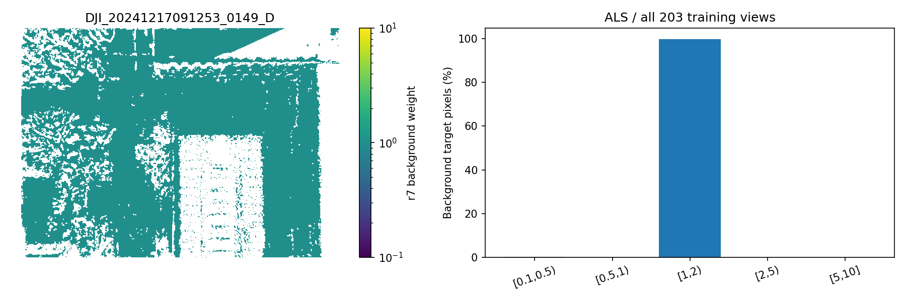
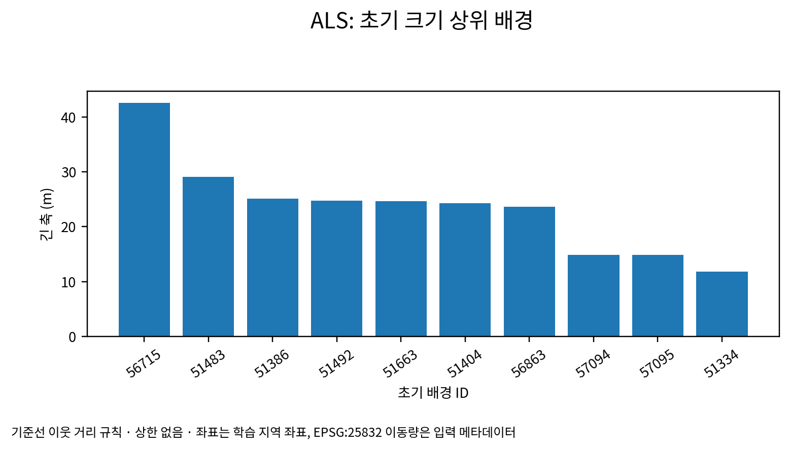
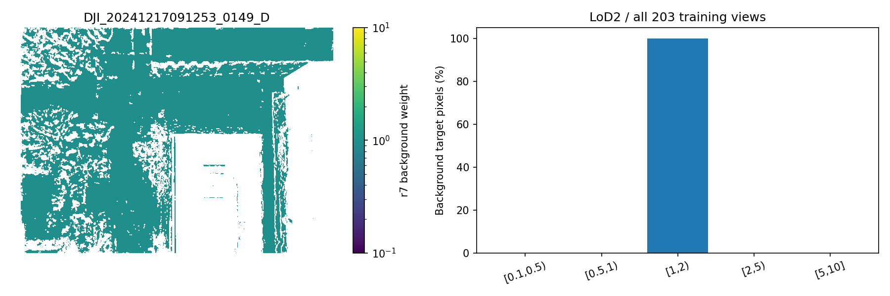
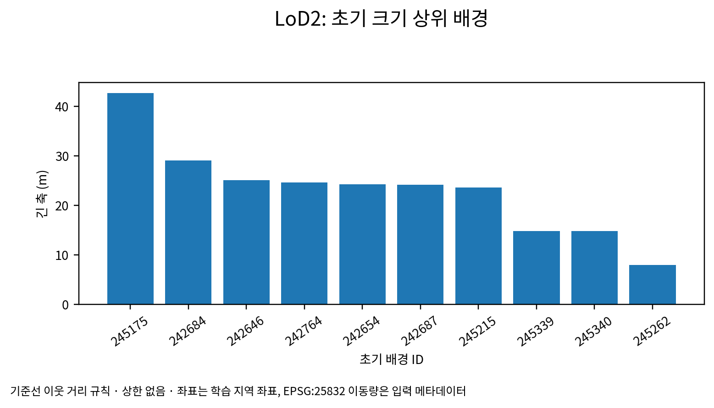
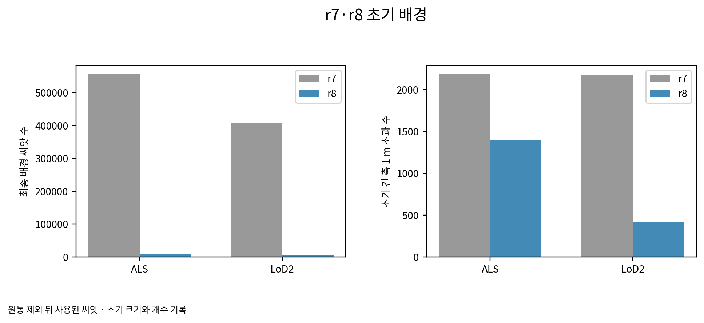

# r8 구현·학습 전 점검 [이 발주에서 냄]

설정 잠금: 2026-11-01T22:28:01.631569+09:00. SHA-256 `547ad0ef1d24e9b4228dadfd6598c11e24cbe4a7da89e0595c03da1ed468d639`.

r21 파일을 보존하고 r22를 만들었다. 변경 파일·줄은 `tables/r22_changes_r8.json`과 `.patch`에 있다. 단계 0 판단·목표는 r7 파일을 그대로 사용한다. 패치 씨앗, 전체 목표 깊이·σ·소유 패치 배열, 패치 화소 무게는 r7과 바이트 단위로 같다. 유효한 배경 화소 무게는 모두 1이고 σ_ref는 r7의 모든 목표 화소 중앙값 그대로다.

기준선 `model/input.ply`와 장면 `points3D.ply`의 SHA-256이 같다. 그 점 순서의 `origin.npy == 0`으로 SfM을 골랐다. 사전 정보 점은 제외하고 기존 원통 제외 코드와 원통 배열을 그대로 적용했다. 기준선 SfM에는 추가 솎기를 하지 않았다. 배경은 기준선 RGB·불투명도 0.1·원래 무작위 회전을 보존하고, 현재 초기 점 집합에서 기준선 이웃 거리 크기 규칙을 적용했다. 패치·배경 처음 불투명도는 모두 0.1이며 기준선과 같다. 크기 상한은 없다. 배경 이동 진단의 법선은 이 초기 회전의 z축이며 묶기에는 쓰지 않는다. 배경 씨앗 σ는 같은 단위·사전 정보의 기존 배경 지도 대체값을 진단용으로만 보존한다.

| 사전 정보 | 판 | 입력 배경 후보 | 원통 제외 | 최종 배경 씨앗 | 초기 크기 1 m 초과 |
|---|---|---:|---:|---:|---:|
| ALS | r7 | 18,985,897 | 2,408,378 | 555,259 | 2,182 |
| ALS | r8 | 11,970 | 1,689 | 10,281 | 1,401 |
| LoD2 | r7 | 18,985,897 | 9,492,139 | 408,243 | 2,176 |
| LoD2 | r8 | 11,970 | 6,532 | 5,438 | 419 |

### ALS r8 큰 배경 상위 열 개

| 초기 ID | 동쪽(m) | 북쪽(m) | 높이(m) | 긴 축(m) |
|---|---:|---:|---:|---:|
| 56715 | 135.327545 | 72.262688 | 21.422825 | 42.551487 |
| 51483 | 134.006317 | 84.681610 | -76.025146 | 29.118645 |
| 51386 | 149.467896 | 101.913055 | -94.987999 | 25.076889 |
| 51492 | 142.313568 | 105.550278 | -65.929970 | 24.756512 |
| 51663 | 152.434311 | 108.415977 | -89.410500 | 24.672874 |
| 51404 | 100.493721 | 94.768402 | 8.261089 | 24.281239 |
| 56863 | 105.272110 | 98.125565 | -67.521744 | 23.619905 |
| 57094 | 94.331436 | 98.074417 | -6.979964 | 14.860439 |
| 57095 | 94.668037 | 97.949417 | -6.709980 | 14.842859 |
| 51334 | 138.532150 | 93.171364 | -45.217186 | 11.835530 |

### LoD2 r8 큰 배경 상위 열 개

| 초기 ID | 동쪽(m) | 북쪽(m) | 높이(m) | 긴 축(m) |
|---|---:|---:|---:|---:|
| 245175 | 135.327545 | 72.262688 | 21.422825 | 42.710052 |
| 242684 | 134.006317 | 84.681610 | -76.025146 | 29.118645 |
| 242646 | 149.467896 | 101.913055 | -94.987999 | 25.076889 |
| 242764 | 152.434311 | 108.415977 | -89.410500 | 24.672874 |
| 242654 | 100.493721 | 94.768402 | 8.261089 | 24.281239 |
| 242687 | 142.313568 | 105.550278 | -65.929970 | 24.200031 |
| 245215 | 105.272110 | 98.125565 | -67.521744 | 23.650658 |
| 245339 | 94.331436 | 98.074417 | -6.979964 | 14.860439 |
| 245340 | 94.668037 | 97.949417 | -6.709980 | 14.842859 |
| 245262 | 85.268311 | 85.102966 | -51.691532 | 7.994668 |

r7은 원통 제외 뒤 0.25 m 복셀 솎기를 했다. 위 표의 원통 제외 수와 최종 씨앗 수 사이에는 그 솎기가 포함되어 있다. r8은 기준선 SfM 집합에 원통 제외만 적용했다.

실제 초기화 점검에서 패치의 위치·크기·불투명도·회전은 r7 초기 저장 배열과 바이트 단위로 같았다. 배경 RGB·불투명도·회전은 기준선 초기 배열과 같고 크기는 기준선 이웃 거리 연산과 일치했다. σ=1 m 법선 0.8 m 유지, 접선 0.6 m 풀림, 복제·분할·지우기, Adam·난수·영상 순서·목표 상태를 포함한 재개 점검을 통과했다. 9,000회 모의 관측에서 불투명도 유예 중에도 수 3배 중단과 메모리 기록이 작동함을 확인했다.

## r7 배경 화소 무게 기록

배경 화소의 σ는 화소마다 측정한 값이 아니라 같은 단위·사전 정보의 유효한 원 지붕 u 중앙값에서 구한 대체값이다. 대체 비율 100%, 화소별 측정 비율 0%. 학습 화소와 배경 씨앗의 불확실도 출처는 다르다.

| 사전 정보 | [0.1,0.5) | [0.5,1) | [1,2) | [2,5) | [5,10] | 끝 0.1 | 끝 10 |
|---|---:|---:|---:|---:|---:|---:|---:|
| ALS | 0.121382% | 0.000000% | 99.878618% | 0.000000% | 0.000000% | 0.000000% | 0.000000% |
| LoD2 | 0.000000% | 0.000000% | 100.000000% | 0.000000% | 0.000000% | 0.000000% | 0.000000% |

학습·채점 상태는 시점별 보고서에 별도로 적는다. r7 LoD2는 참고용 계속, r7 ALS는 다시 잇지 않음, 나머지 여섯 판 미시작.

scientific_verdict: null.
