# r7 단계 0: 사라짐 판단

사용자의 2026-11-01 후속 결정에 따라, 각 유효 MVS 화소를 3차원으로 되돌린 뒤 같은 단위·사전 정보의 단계 0 패치 중심 중 1 m 안의 최근접 패치를 찾았다. 그 패치의 원값 u를 사용하고, 이웃이 없거나 대체 u이면 같은 단위·사전 정보의 원값 u 중앙값을 썼다. 동률은 원 패치 순서를 따른다. 실험 지역의 단위는 잠긴 site이며, 개발용·확인용은 기존 불확실도 대체에 사용한 건물 단위다.

3×3 창의 유효 깊이 중앙값과 각 화소 σ_M 중앙값을 사용했다. σ_M=√(u²+0.0275²), m=1.96√(σ_M²+σ_P²)이며 σ_P는 검사 대상 패치의 값이다. 학습 영상에서 뚫고 봄 2장 이상이면서 증거 영상의 절반을 넘을 때만 사라짐이다. 검사 대상 패치 u 방식은 참고로만 계산했다.

두 설정은 첫 계산 전 19:21:44 KST에 잠갔다. 단계 0 설정 SHA-256 `41bb40b5f28a174e68ecc6f145a240de22af9e7c361ed8975f0788c803c889d0`; 학습 설정 SHA-256 `726c55587cd333d5a8611bf05aec10d5caf275f39488dfb6be4ad256241c2b95`. 참값은 이 판단 계산에서 읽지 않았고, 저장된 판단의 정확도를 세는 데만 사용했다. 사라짐 외 영역의 판단·목표·폭은 그대로다.

확인용은 집계 수·넓이·비율만 공개했다. 상세 패치와 단위 식별자는 봉인 폴더에 남긴다. 참값 면을 측정할 수 없는 곳은 맞게 지운 넓이로 세지 않는다.

## 실험 지역 · 평가 범위

| 단위 | 사전 정보 | 면 | 이전 관측 없음(m²) | 사라짐(m²) | 남은 관측 없음(m²) | 패치 u 참고(m²) | 중앙값 대체 화소 비율 |
|---|---|---|---:|---:|---:|---:|---:|
| B0 | ALS | 지붕 | 2.027 | 0.000 | 2.027 | 0.000 | 86.98% |
| B0 | LoD2 | 지붕 | 11.688 | 0.000 | 11.688 | 0.000 | 63.61% |
| B0 | LoD2 | 벽 | 299.191 | 0.000 | 299.191 | 0.000 | 65.28% |
| B173 주변 | ALS | 지붕 | 9.266 | 6.715 | 2.551 | 6.864 | 87.65% |
| B173 주변 | LoD2 | 지붕 | 8.438 | 2.000 | 6.438 | 2.438 | 60.71% |
| B173 주변 | LoD2 | 벽 | 2452.812 | 970.750 | 1482.062 | 948.938 | 82.70% |
| R1 | ALS | 지붕 | 30.810 | 0.000 | 30.810 | 0.000 | 64.17% |
| R1 | LoD2 | 지붕 | 39.188 | 12.562 | 26.625 | 12.562 | 63.47% |
| R1 | LoD2 | 벽 | 653.188 | 2.688 | 650.500 | 2.250 | 76.11% |
| B173만 | ALS | 지붕 | 12.358 | 8.113 | 4.246 | 8.915 | 81.75% |
| B173만 | LoD2 | 지붕 | 11.562 | 2.938 | 8.625 | 3.750 | 57.18% |
| B173만 | LoD2 | 벽 | 2373.625 | 979.938 | 1393.688 | 951.625 | 87.69% |

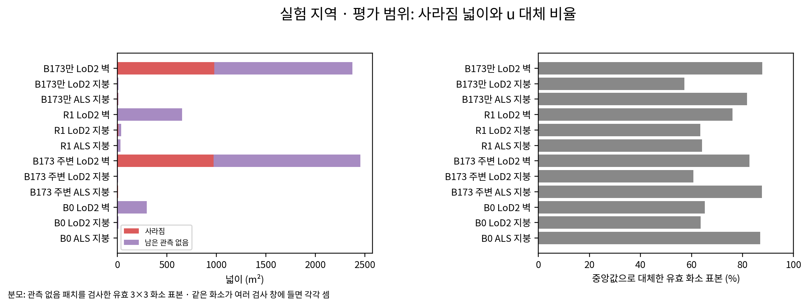

## 실험 지역 · 둘레 띠

| 단위 | 사전 정보 | 면 | 이전 관측 없음(m²) | 사라짐(m²) | 남은 관측 없음(m²) | 패치 u 참고(m²) | 중앙값 대체 화소 비율 |
|---|---|---|---:|---:|---:|---:|---:|
| B0 | ALS | 지붕 | 790.302 | 1.813 | 788.489 | 1.813 | 90.05% |
| B0 | LoD2 | 지붕 | 202.625 | 3.312 | 199.312 | 3.625 | 90.00% |
| B0 | LoD2 | 벽 | 1205.188 | 3.000 | 1202.188 | 2.938 | 85.21% |
| B173 주변 | ALS | 지붕 | 1481.729 | 3.406 | 1478.324 | 3.406 | 98.05% |
| B173 주변 | LoD2 | 지붕 | 1218.562 | 11.500 | 1207.062 | 12.188 | 95.90% |
| B173 주변 | LoD2 | 벽 | 2214.062 | 13.000 | 2201.062 | 12.125 | 83.24% |
| R1 | ALS | 지붕 | 612.261 | 37.007 | 575.254 | 37.076 | 94.74% |
| R1 | LoD2 | 지붕 | 154.812 | 145.438 | 9.375 | 145.625 | 94.15% |
| R1 | LoD2 | 벽 | 1041.438 | 12.625 | 1028.812 | 12.625 | 89.24% |
| B173만 | ALS | 지붕 | 215.124 | 0.336 | 214.788 | 0.336 | 97.12% |
| B173만 | LoD2 | 지붕 | 79.938 | 3.688 | 76.250 | 3.750 | 89.83% |
| B173만 | LoD2 | 벽 | 115.625 | 0.500 | 115.125 | 0.562 | 63.01% |

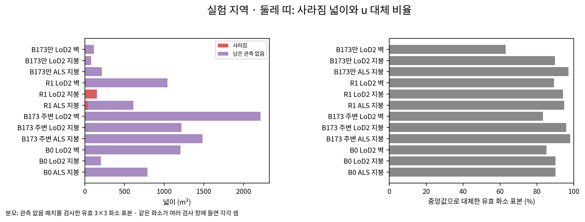

## 개발용 · 평가 범위

| 단위 | 사전 정보 | 면 | 이전 관측 없음(m²) | 사라짐(m²) | 남은 관측 없음(m²) | 패치 u 참고(m²) | 중앙값 대체 화소 비율 |
|---|---|---|---:|---:|---:|---:|---:|
| 집계 | ALS | 지붕 | 1717.599 | 42.503 | 1675.096 | 41.968 | 77.05% |
| 집계 | LoD2 | 지붕 | 2236.812 | 74.812 | 2162.000 | 71.250 | 73.45% |
| 집계 | LoD2 | 벽 | 25933.766 | 298.375 | 25635.391 | 281.000 | 67.39% |

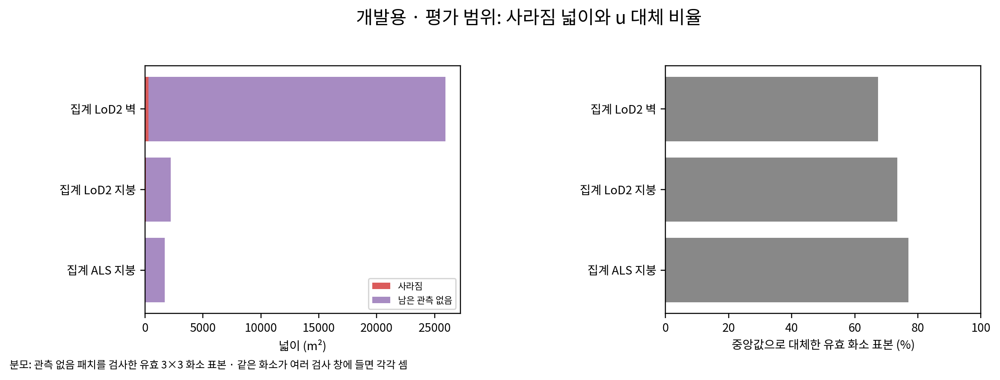

## 확인용 · 평가 범위

| 단위 | 사전 정보 | 면 | 이전 관측 없음(m²) | 사라짐(m²) | 남은 관측 없음(m²) | 패치 u 참고(m²) | 중앙값 대체 화소 비율 |
|---|---|---|---:|---:|---:|---:|---:|
| 집계 | ALS | 지붕 | 139.565 | 1.515 | 138.050 | 1.501 | 84.70% |
| 집계 | LoD2 | 지붕 | 218.625 | 1.438 | 217.188 | 1.812 | 77.45% |
| 집계 | LoD2 | 벽 | 2745.886 | 36.875 | 2709.011 | 34.438 | 78.43% |

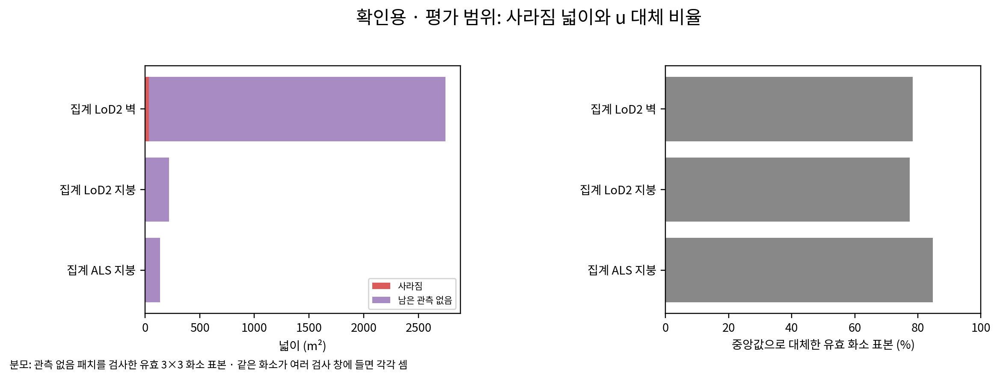

## 사라짐으로 옮긴 넓이의 참값 점검

확인 불가에는 해당 위치의 참값 면 측정값 부재가 포함된다. 특히 없어진 벽은 기존 면 찾기에서 참값이 없을 수 있으므로, 이 표만으로 삭제 정확도가 높다고 결론 내리지 않는다.

| 집합 | 사전 정보 | 사라짐(m²) | 맞게 지움(m²) | 잘못 지움(m²) | 참값 확인 불가(m²) |
|---|---|---:|---:|---:|---:|
| B173 주변 | ALS | 6.715 | 6.432 | 0.219 | 0.064 |
| B173 주변 | LoD2 | 972.750 | 12.438 | 0.312 | 960.000 |
| 개발용 | ALS | 42.503 | 1.927 | 39.559 | 1.018 |
| 개발용 | LoD2 | 373.188 | 81.562 | 75.062 | 216.562 |
| 확인용 | ALS | 1.515 | 0.077 | 1.343 | 0.095 |
| 확인용 | LoD2 | 38.312 | 2.312 | 9.438 | 26.562 |

값은 이 기록을 본 뒤 바꾸지 않았다. 개발용 항공 LiDAR에서는 사라짐 42.503 m² 중 39.559 m²가 잘못 지움으로 측정됐다. 단계 0 정확도는 기록이며, 발주된 7,000회 건강·기하 기준으로 진행 여부를 판단한다.

## 정확도와 단면

원값·대체 별 정확도 및 모두 지킴·모두 지움·패치 u 참고 줄은 `tables/disappearance_accuracy_r7.json`에 기록했다. 아래 그림의 회색은 참값 확인 불가다.

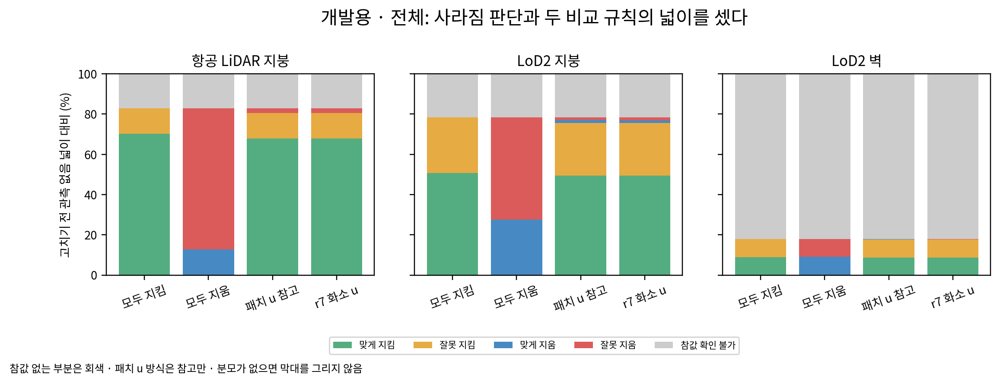

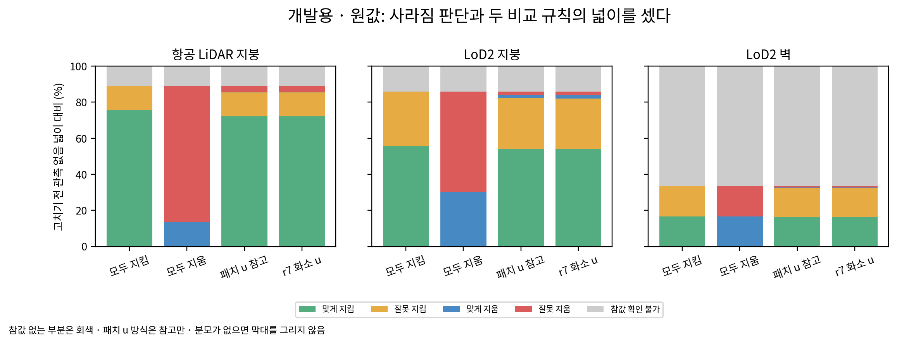

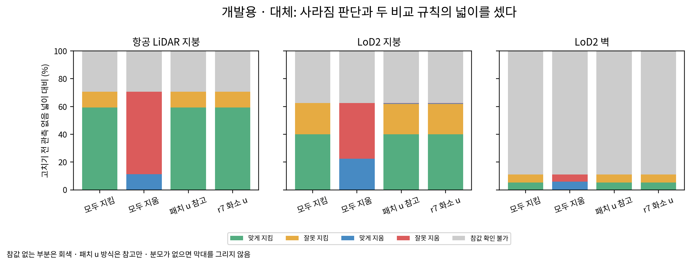

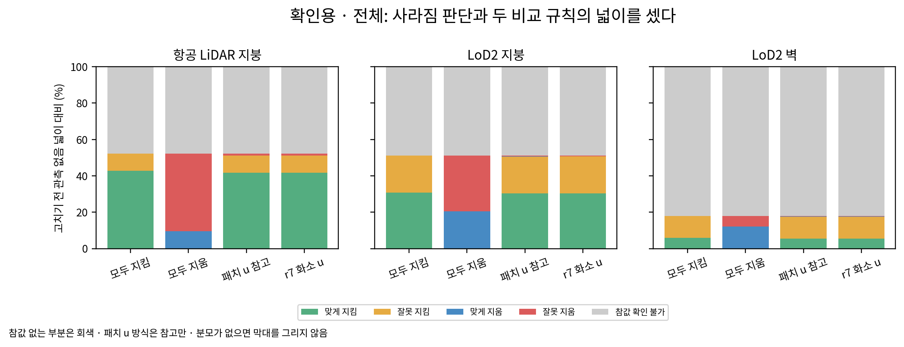

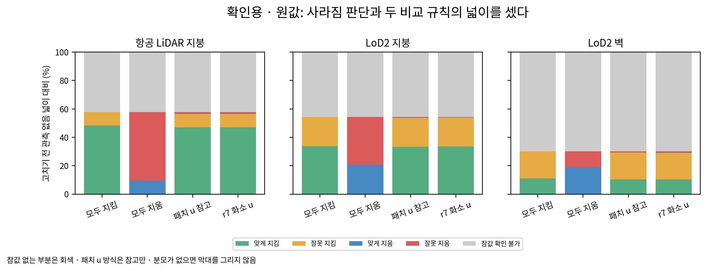

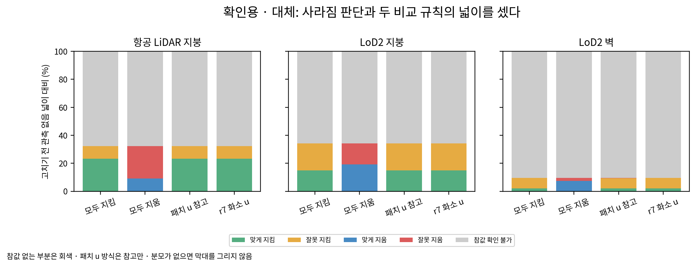

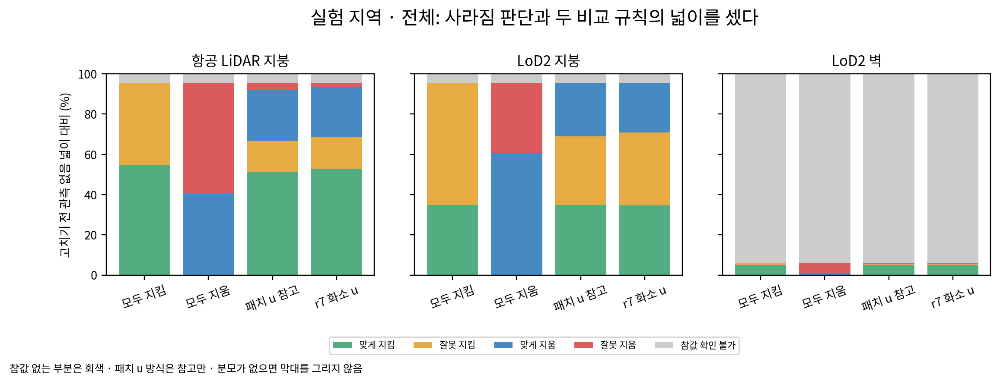

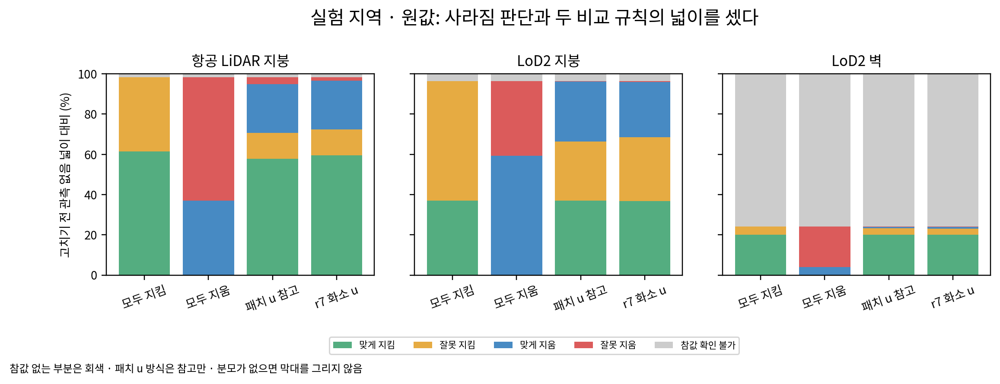

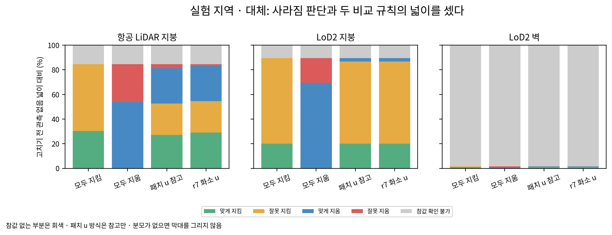

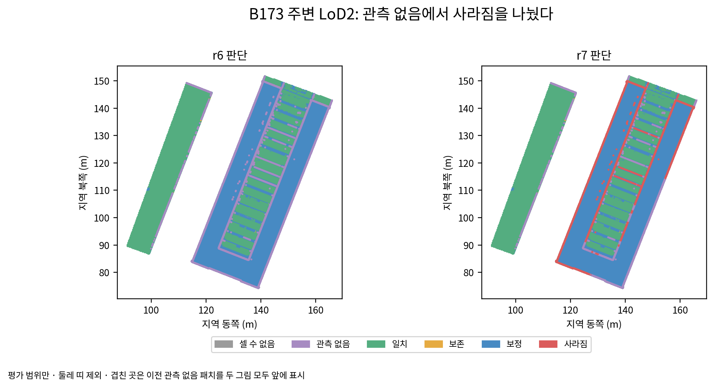

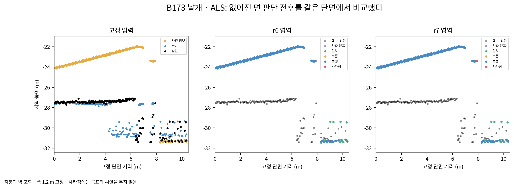

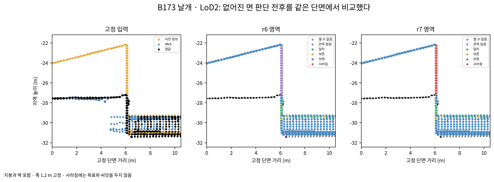

`scientific_verdict: null`
2026-11-01T19:54:37.360738+09:00
