# 7,000회 점검 · r4n

항공 LiDAR 판의 목표 따름 32.724%가 발주 3.6과 11/1 r3 결정의 80% 기준에 미달해 두 판을 멈췄다. 두 판의 7,000회 모델을 보존했다. 나머지 여섯 판과 30,000회 학습은 진행하지 않았다. [이 발주에서 냄]

3.5는 사용자가 씨앗 위치·패치 하나씩의 렌더·목표 높이 복원으로 통과 처리했다. 학습 후 목표 따름의 분모는 사전 패치 원반과 배경 MVS를 포함한 모든 유효 목표 화소이며, 렌더 깊이 없음도 미달로 센다. 아래의 분해 표는 원인을 살펴보는 기록이며 통과 기준을 바꾸지 않는다.

## ALS

전체 목표 따름: 37,488,398 / 114,560,443 = **32.724%** (FAIL, 기준 80%).

| 목표 화소 구분 | 화소 수 | 목표 ±1.96σ 안 | 깊이 없음 |
|---|---:|---:|---:|
| 전체 | 114,560,443 | 32.724% | 0.005% |
| 사전 패치 | 11,876,159 | 67.616% | 0.000% |
| 배경 MVS | 102,684,284 | 28.688% | 0.006% |
| 사전 지붕 | 11,876,159 | 67.616% | 0.000% |
| 사전 벽 | 0 | 확인 불가 | 확인 불가 |
| 관측 없음 | 4,657,373 | 66.138% | 0.000% |
| 일치 | 4,607,515 | 70.571% | 0.000% |
| 보존 | 985,920 | 65.075% | 0.000% |
| 보정 | 1,625,351 | 65.015% | 0.000% |
| 사전 원값 | 7,117,882 | 68.957% | 0.000% |
| 사전 대체 | 4,758,277 | 65.610% | 0.000% |

저장 당시 가우시안 570,903개, 6,000회 기록 대비 0.6378배, 불투명도 중앙값 0.417041, 법선 폭 수치 잔차 최대 0.009443 mm. 마지막 손실 기록은 6,900회이며 모두 유한하다.
목표 따름 미달로 7,000회 밀도 제어 뒤 건강 영수증은 생성되지 않았다. 위 값은 밀도 제어 직전 저장 모델을 독립 계산한 기록으로 구분한다.

처음 1 m 초과 배경 씨앗 2,182개 중 303개 계보의 자손 **274,872개**가 남았다. 원래 씨앗 자신과 복제·분할 자손을 같은 불변 init_id 계보로 합쳐 센다.

| 남은 큰 배경 계보 자손 | 최솟값 | 중앙값 | 95% 분위 | 최댓값 |
|---|---:|---:|---:|---:|
| 긴 축 크기 (m) | 0.031450 | 2.244705 | 9.346271 | 48.787403 |
| 불투명도 | 0.000886 | 0.554206 | 0.999976 | 1.000000 |
| 원 목표의 법선 방향 이동 (m) | 0.000000 | 0.102044 | 0.120625 | 3.101353 |
| 원 목표 면을 따른 이동 (m) | 0.131125 | 162.529175 | 292.662817 | 679.186279 |

크기는 활성화된 두 접선 축 중 큰 값이다. 법선 이동은 각 부모의 서로 다른 σ 폭과 함께 해석한다. 접선 이동을 묶지 않은 발주 규칙에 따라 큰 이동이 남았다. 이 사실만으로 뜬 면이나 인과를 확정하지 않으며 추가 멈춤 기준으로 쓰지 않는다.

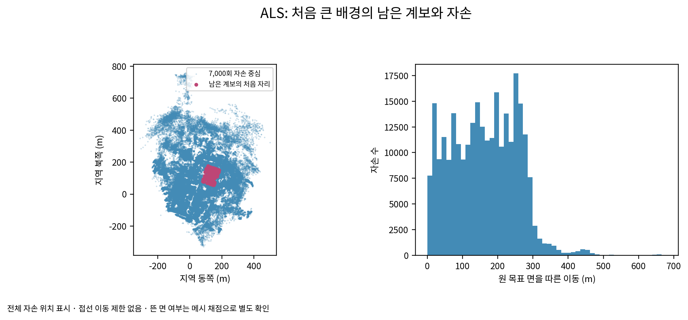

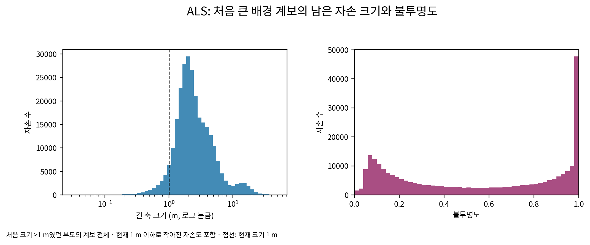

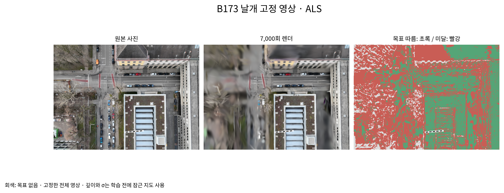

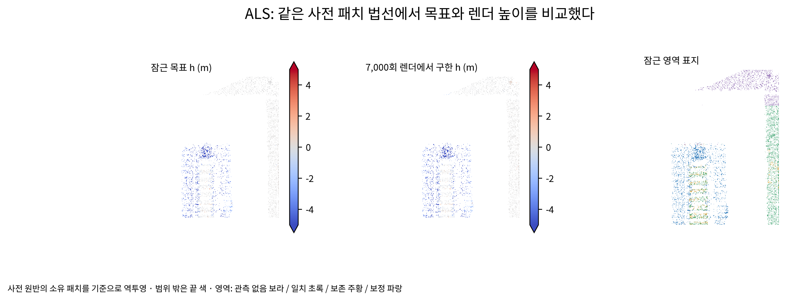

현재 메시의 칸 0~3 뜬 면: **21.227%** (FAIL, 기준 5%).

| 구분 | 영역 | 평가 넓이 (m²) | 결과 τ 안 | 목표 자체 τ 안 |
|---|---|---:|---:|---:|
| all | 관측 없음 | 5.873 | 10.763% | 8.991% |
| all | 일치 | 755.104 | 59.274% | 96.404% |
| all | 보존 | 145.776 | 60.322% | 97.500% |
| all | 보정 | 1300.370 | 53.519% | 67.434% |
| original | 관측 없음 | 5.474 | 11.546% | 9.644% |
| original | 일치 | 754.101 | 59.308% | 96.512% |
| original | 보존 | 145.355 | 60.497% | 97.611% |
| original | 보정 | 1288.212 | 53.958% | 68.024% |
| replaced | 관측 없음 | 0.398 | 0.000% | 0.000% |
| replaced | 일치 | 1.003 | 33.658% | 14.992% |
| replaced | 보존 | 0.421 | 0.000% | 59.161% |
| replaced | 보정 | 12.158 | 6.932% | 4.881% |

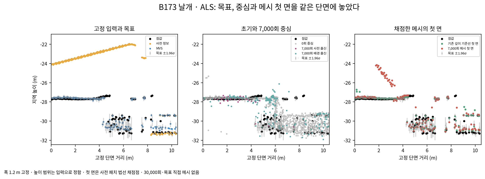

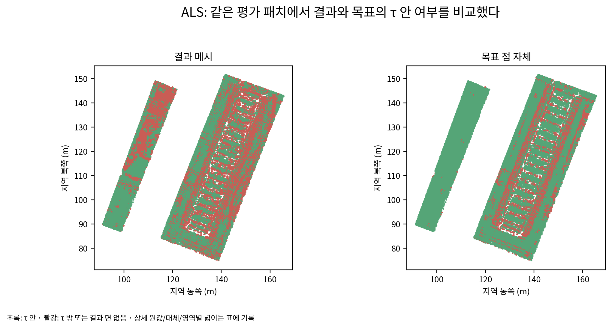

뜬 면 패치 중 배경 렌더 기여가 절반 이상인 곳 3,976개, 처음 1 m 초과 배경 계보 기여가 절반 이상인 곳 84개. 출신 연관 기록이며 인과 확정이 아니다.

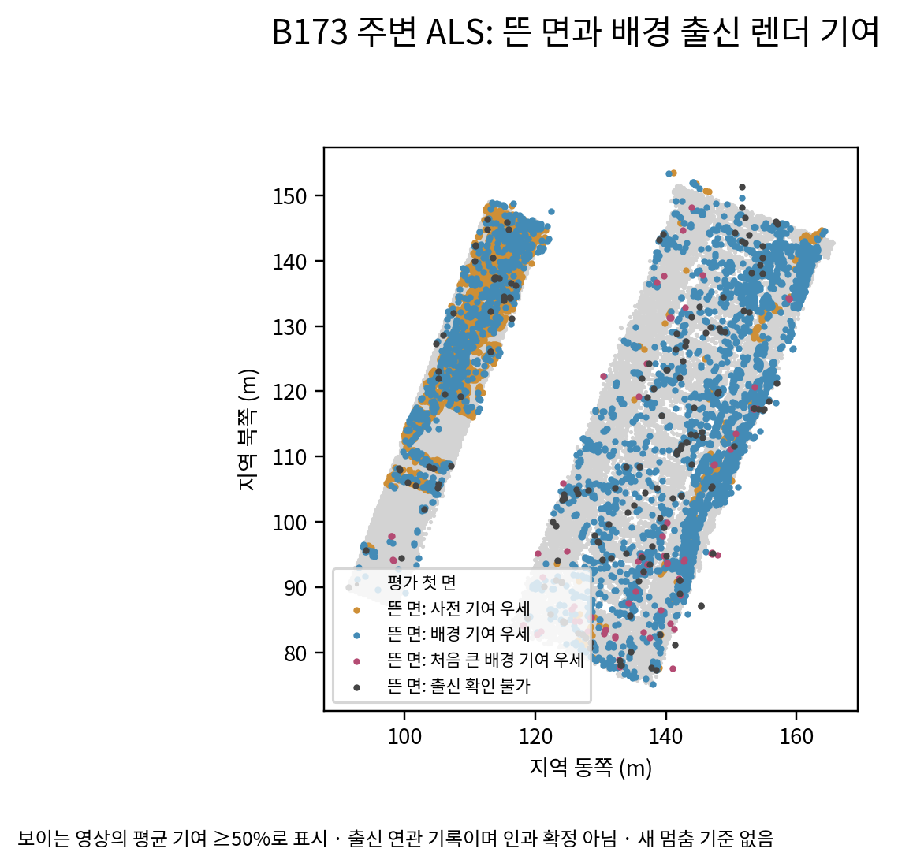

## LoD2

전체 목표 따름: 39,780,811 / 116,051,001 = **34.279%** (FAIL, 기준 80%).

공동 중단으로 끊긴 점검 영상을 저장 모델로 마저 렌더했다. 원래 저장된 영상은 보존했고 재렌더한 네 영상의 깊이가 바이트 단위로 같음을 확인했다. 추가 최적화는 0회다.

| 목표 화소 구분 | 화소 수 | 목표 ±1.96σ 안 | 깊이 없음 |
|---|---:|---:|---:|
| 전체 | 116,051,001 | 34.279% | 0.007% |
| 사전 패치 | 17,415,076 | 55.753% | 0.000% |
| 배경 MVS | 98,635,925 | 30.487% | 0.008% |
| 사전 지붕 | 10,531,098 | 72.426% | 0.000% |
| 사전 벽 | 6,883,978 | 30.247% | 0.000% |
| 관측 없음 | 5,745,362 | 42.260% | 0.000% |
| 일치 | 8,712,716 | 64.079% | 0.000% |
| 보존 | 45,127 | 39.305% | 0.000% |
| 보정 | 2,911,871 | 57.720% | 0.000% |
| 사전 원값 | 11,543,901 | 62.398% | 0.000% |
| 사전 대체 | 5,871,175 | 42.689% | 0.000% |

저장 당시 가우시안 772,985개, 6,000회 기록 대비 0.4969배, 불투명도 중앙값 0.386023, 법선 폭 수치 잔차 최대 0.018465 mm. 마지막 손실 기록은 6,900회이며 모두 유한하다.
목표 따름 미달로 7,000회 밀도 제어 뒤 건강 영수증은 생성되지 않았다. 위 값은 밀도 제어 직전 저장 모델을 독립 계산한 기록으로 구분한다.

처음 1 m 초과 배경 씨앗 2,166개 중 341개 계보의 자손 **217,367개**가 남았다. 원래 씨앗 자신과 복제·분할 자손을 같은 불변 init_id 계보로 합쳐 센다.

| 남은 큰 배경 계보 자손 | 최솟값 | 중앙값 | 95% 분위 | 최댓값 |
|---|---:|---:|---:|---:|
| 긴 축 크기 (m) | 0.038338 | 2.134993 | 9.137456 | 47.147503 |
| 불투명도 | 0.001422 | 0.513678 | 0.999910 | 1.000000 |
| 원 목표의 법선 방향 이동 (m) | 0.000000 | 0.099670 | 0.115047 | 2.666080 |
| 원 목표 면을 따른 이동 (m) | 0.020556 | 176.294769 | 294.298627 | 687.399902 |

크기는 활성화된 두 접선 축 중 큰 값이다. 법선 이동은 각 부모의 서로 다른 σ 폭과 함께 해석한다. 접선 이동을 묶지 않은 발주 규칙에 따라 큰 이동이 남았다. 이 사실만으로 뜬 면이나 인과를 확정하지 않으며 추가 멈춤 기준으로 쓰지 않는다.

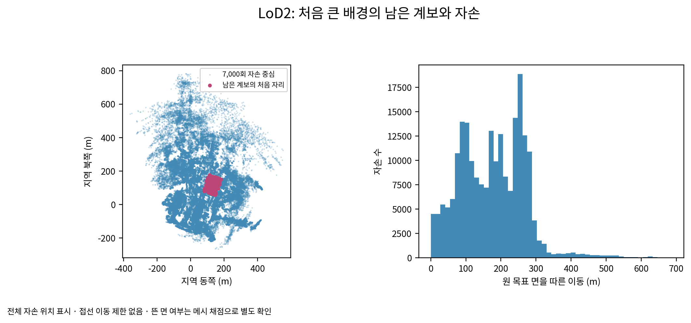

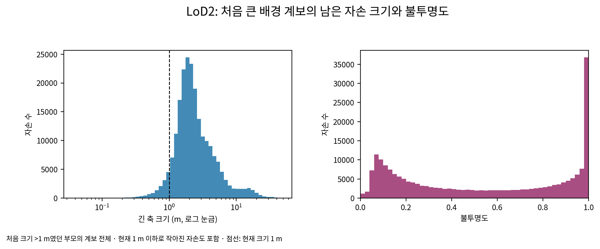

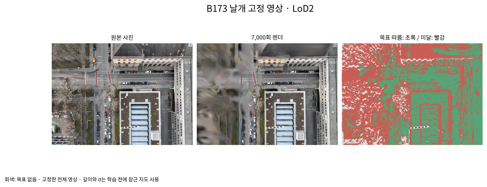

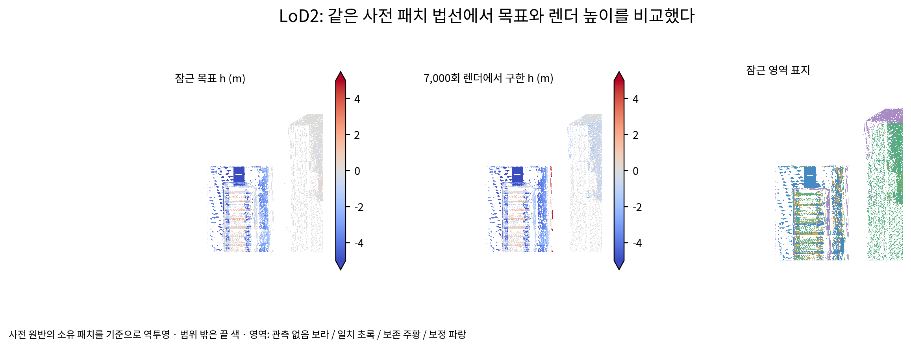

현재 메시의 칸 0~3 뜬 면: **21.712%** (FAIL, 기준 5%).

| 구분 | 영역 | 평가 넓이 (m²) | 결과 τ 안 | 목표 자체 τ 안 |
|---|---|---:|---:|---:|
| all | 관측 없음 | 217.188 | 23.281% | 51.281% |
| all | 일치 | 3151.812 | 64.052% | 86.278% |
| all | 보존 | 17.438 | 22.222% | 11.828% |
| all | 보정 | 1852.875 | 45.581% | 62.811% |
| original | 관측 없음 | 182.375 | 27.245% | 58.842% |
| original | 일치 | 3102.562 | 64.852% | 87.305% |
| original | 보존 | 6.875 | 37.273% | 10.000% |
| original | 보정 | 1616.750 | 51.411% | 70.164% |
| replaced | 관측 없음 | 34.812 | 2.513% | 11.670% |
| replaced | 일치 | 49.250 | 13.706% | 21.574% |
| replaced | 보존 | 10.562 | 12.426% | 13.018% |
| replaced | 보정 | 236.125 | 5.664% | 12.467% |

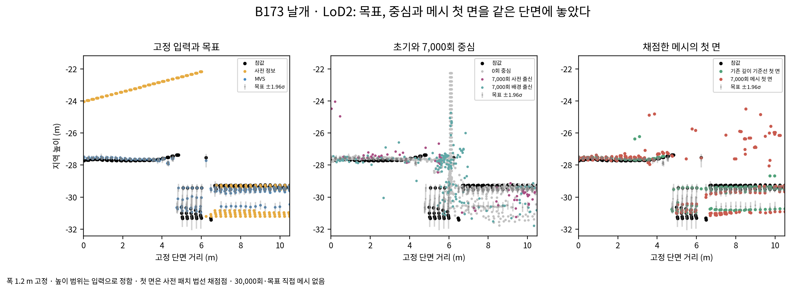

뜬 면 패치 중 배경 렌더 기여가 절반 이상인 곳 14,503개, 처음 1 m 초과 배경 계보 기여가 절반 이상인 곳 57개. 출신 연관 기록이며 인과 확정이 아니다.

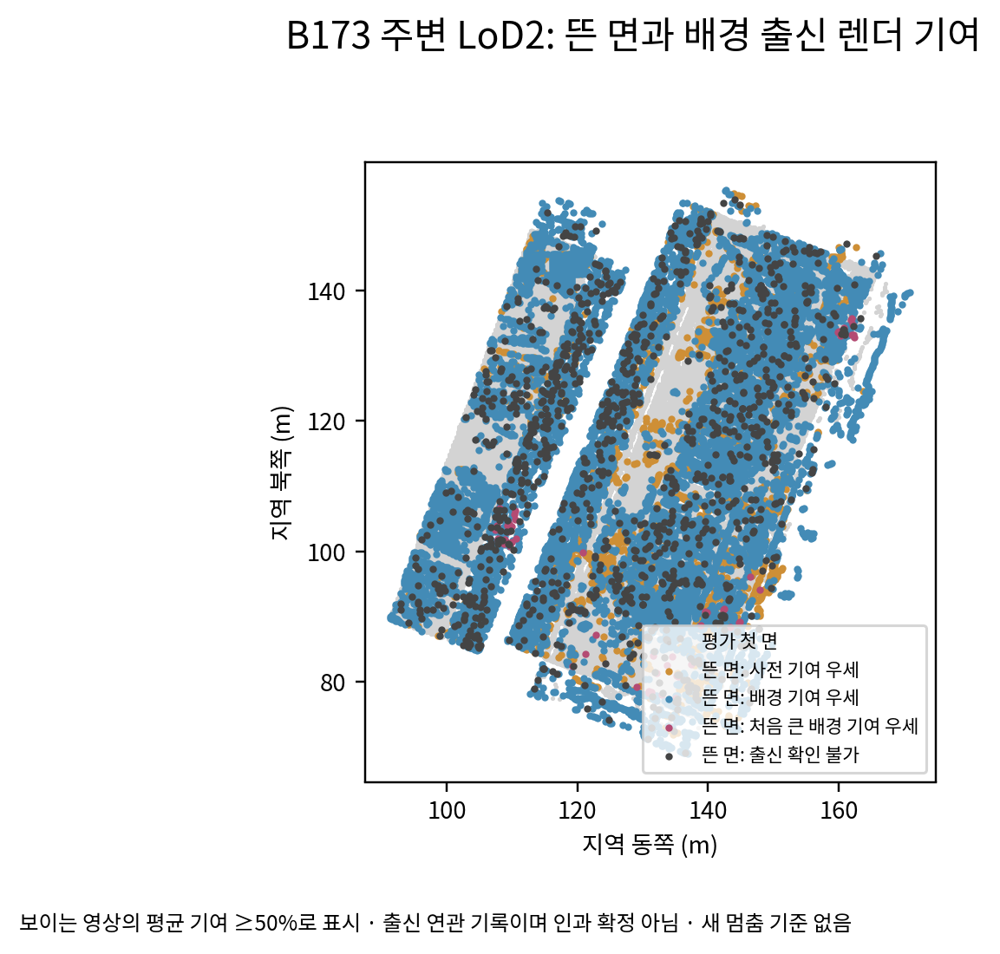

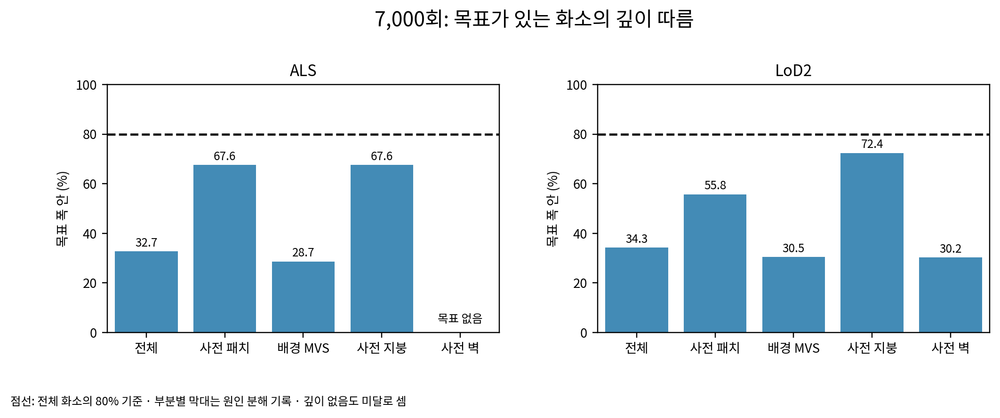

처음 불투명도는 사전·배경 모두 0.1로 기준선과 같다. [불투명도 실제 배열](처음불투명도_r4n.md)과 [처음 크기 상위 열 개](초기배경_크기_r3.md)를 함께 보존한다.

현재 메시의 채점은 기존 MESHPATCH 첫 면 채점이며, 참값은 메시 평가 범위와 채점에만 쓴다. 판단·목표·손실·폭에는 넣지 않았다. 배경 출신 지도는 저장된 렌더 기여에 따라 구분하며 보이는 영상이 없는 점은 확인 불가로 둔다.

최종 메시·30,000회·나머지 여섯 판·비교 방법의 새 채점은 수행하지 않았다. scientific_verdict: null.

2026-11-01T16:51:03.091490+09:00
