# r6 · 7,000회 점검

[이 발주에서 냄] r19와 r4n 결과를 보존하고 r20에서 배경·풀림 묶기를 해제했다. 패치 꼬리표만 같은 단위의 잠근 목표점에 다시 붙인다. 단계 0, 씨앗, 목표 지도, 손실·무게와 λ, 학습률과 밀도 제어 일정은 그대로다.

설정 잠금: 2026-11-01 17:46 KST. SHA-256 `1fce3f0a7b9142e37ec3c9c323dec589ba998ad725e73cf23cf49342c9d35593`.

두 판은 7,000회 상태를 저장한 뒤 계속 학습하다가, ALS 9,000회 정기 불투명도 초기화 직후의 기존 감시 조건으로 공동 중단했다. 이는 아래 7,000회 기하 판정과 별개이며 [경위 보고](정기초기화_감시중단_r6.md)에 기록했다.

판정 기준은 건강·칸 0~3 뜬 면 5% 이하·일치 영역 결과 τ 안(항공 LiDAR 69.3%, LoD2 74.1% 이상)·칸 0~3 면 없음 비율 비증가다. 전체 화소 목표 따름 80%는 기록만 한다.

## ALS · FAIL

| 항목 | r4n 7,000회 | r6 7,000회 | 기준 |
|---|---:|---:|---:|
| 뜬 면 | 21.227% | 10.775% | ≤5% |
| 일치 영역 결과 τ 안 | 59.274% | 84.918% | ≥69.300% |
| 칸 0~3 면 없음 | 2.890% | 2.530% | r4n 이하 |

r4n의 저장 메시를 같은 첫 면 탐색·칸·넓이 분모로 다시 채점했다. 문서의 반올림된 69.3%/74.1%를 통과 문턱으로 적용하고 실제 상승 폭도 별도 기록했다.

| 목표 화소 구분 | 화소 수 | 폭 안 | 깊이 없음 |
|---|---:|---:|---:|
| 전체 | 114,560,443 | 47.797% | 0.002% |
| 사전 패치 | 11,876,159 | 73.192% | 0.000% |
| 배경 MVS | 102,684,284 | 44.860% | 0.002% |
| 사전 지붕 | 11,876,159 | 73.192% | 0.000% |
| 사전 벽 | 0 | 확인 불가 | 확인 불가 |
| 관측 없음 | 4,657,373 | 74.494% | 0.000% |
| 일치 | 4,607,515 | 74.276% | 0.000% |
| 보존 | 985,920 | 72.373% | 0.000% |
| 보정 | 1,625,351 | 66.883% | 0.000% |
| 사전 원값 | 7,117,882 | 72.792% | 0.000% |
| 사전 대체 | 4,758,277 | 73.791% | 0.000% |

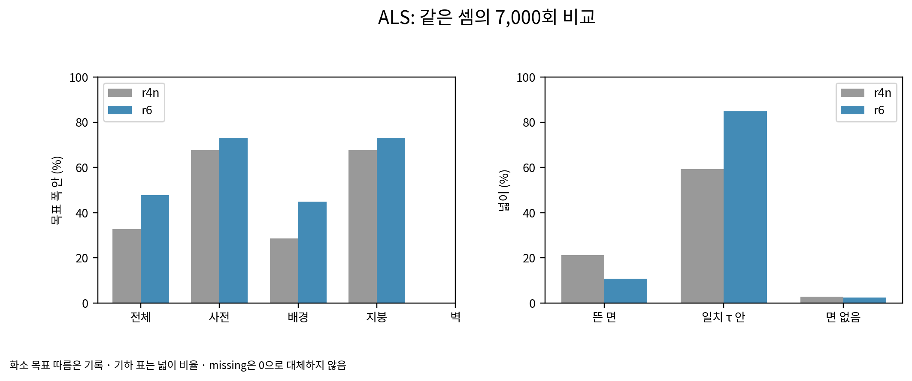

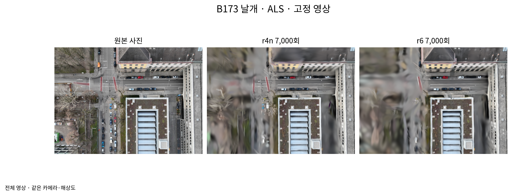

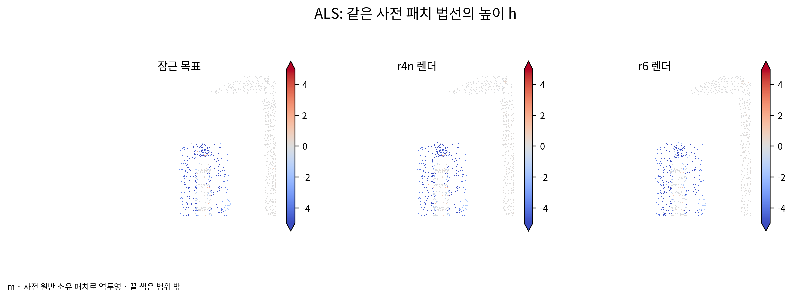

처음 1 m 초과 배경 씨앗 2,182개 중 394개 계보의 자손 742,549개가 남았다. 초기 상위 열 개는 r4n과 같은 초기 배열이므로 [기존 목록](초기배경_크기_r3.md)을 계승한다.

| 처음 큰 배경의 남은 자손 | 최소 | 중앙 | 95% | 최대 |
|---|---:|---:|---:|---:|
| 긴 축(m) | 0.005257 | 1.337429 | 2.699951 | 46.882973 |
| 불투명도 | 0.000823 | 0.261993 | 0.946751 | 1.000000 |
| 법선 이동(m) | 0.000084 | 36.508408 | 77.134857 | 188.514908 |
| 접선 이동(m) | 0.070376 | 219.560425 | 383.854889 | 906.434143 |

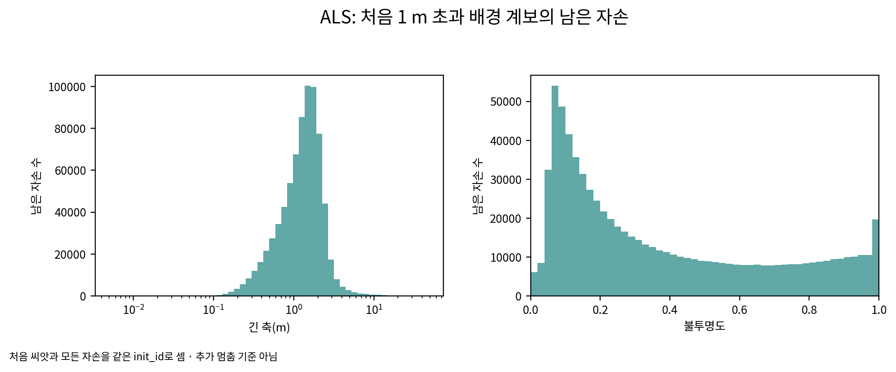

| 현재 꼬리표 | 수 | 처음 목표 면을 따라 1 m 초과 | 긴 축 중앙값(m) | 불투명도 중앙값 | 법선 이동 중앙값(m) | 접선 이동 중앙값(m) |
|---|---:|---:|---:|---:|---:|---:|
| 패치 | 36,332 | 26,096 | 0.263799 | 0.387248 | 0.082182 | 1.554468 |
| 배경 | 936,467 | 904,302 | 1.209816 | 0.273240 | 22.717997 | 163.616536 |
| 풀림 | 4,895 | 3,739 | 0.493406 | 0.308588 | 0.504940 | 1.661825 |

현재 풀림: 4,895/41,227 = 11.873%. 재연결 점검 호출 326회에서 0.5 m 안 연결 갱신 9,761,637건(같은 목표 번호 유지 포함), 목표 번호가 바뀐 사건 1,210,927건, 풀림 전환 사건 18,309회. 사건 합에는 이후 삭제된 가우시안도 포함한다. 이동은 r5와 같이 처음 씨앗의 목표·법선 기준이며 현재 목표로 다시 쓴 이동이 아니다.

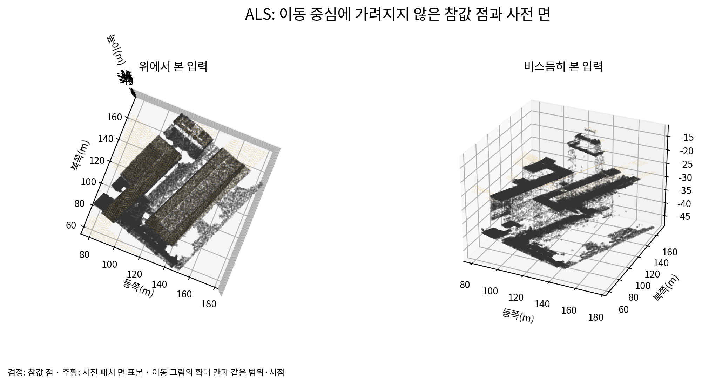

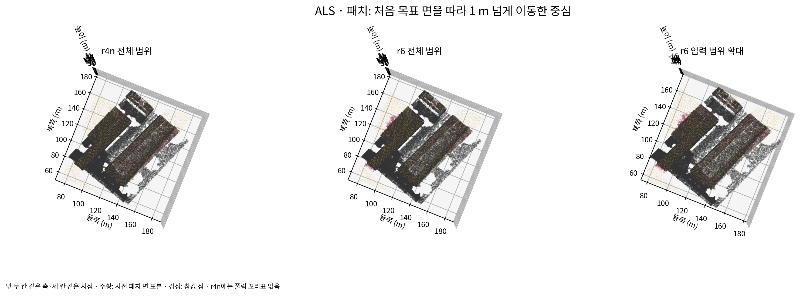

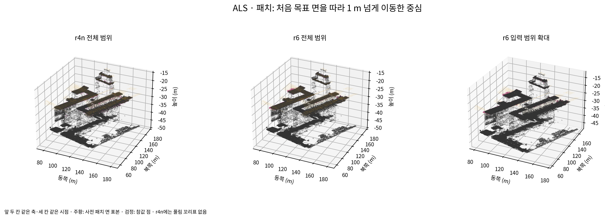

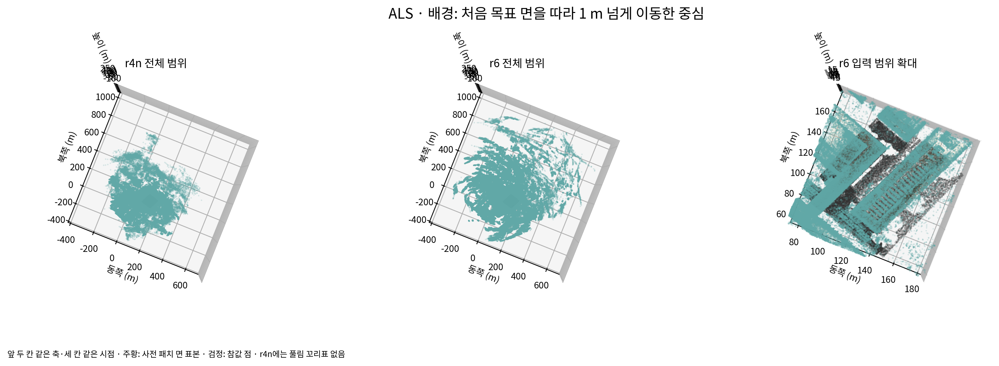

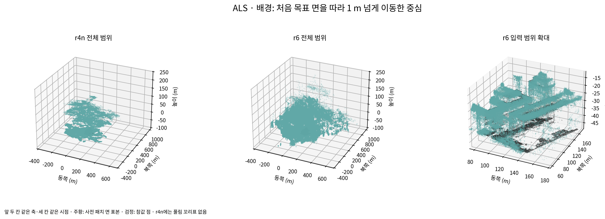

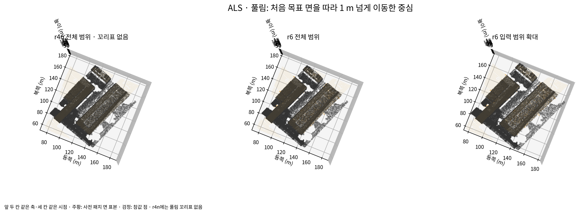

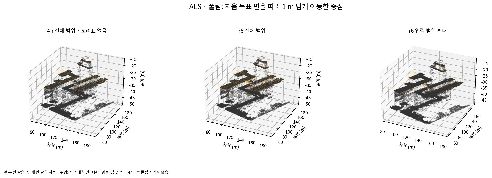

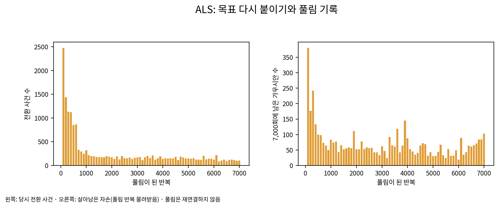

건물 목표점 0.5 m 안의 수: 배경 54,857개, 풀림 2,312개, 패치 36,332개. 모든 목표 화소의 평균 렌더 기여(배경·풀림·패치): 9.159%, 0.267%, 2.913%.

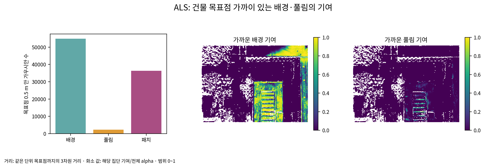

| 깊이 방향 | 같은 현재 패치 | 다른 현재 패치 | 배경 | 풀림 | 확인 불가 |
|---|---:|---:|---:|---:|---:|
| 앞(가림 방향) | 2.572% | 7.962% | 38.451% | 1.112% | 0.000% |
| 뒤(비침 방향) | 1.764% | 8.669% | 37.629% | 1.840% | 0.000% |

방향과 최대 렌더 기여의 분해다. 방향만으로 물리적 원인을 확정하지 않는다. 현재 붙은 목표와 처음 부모의 패치 계보를 구분하여 두 교차표 모두 JSON에 보존했다.

| 처음 계보 기준(r5와 같은 셈) | 같은 처음 패치 | 다른 처음 패치 | 배경 | 확인 불가 |
|---|---:|---:|---:|---:|
| r4n 앞 | 0.072% | 6.570% | 49.534% | 0.000% |
| r4n 뒤 | 0.085% | 6.544% | 37.195% | 0.000% |
| r6 앞 | 0.101% | 11.545% | 38.451% | 0.000% |
| r6 뒤 | 0.117% | 12.156% | 37.629% | 0.000% |

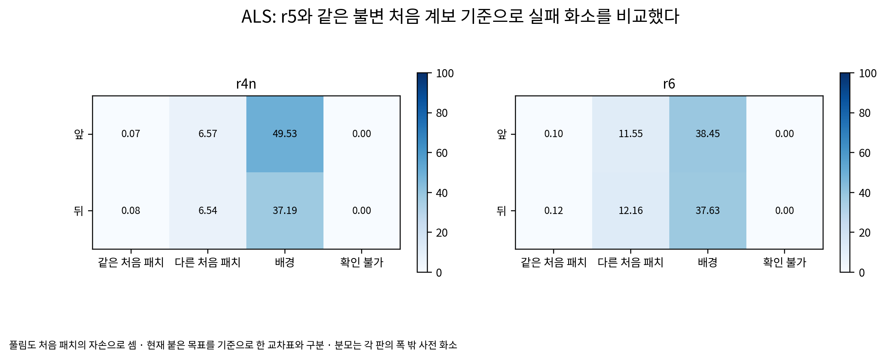

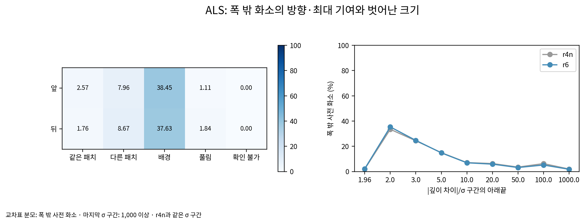

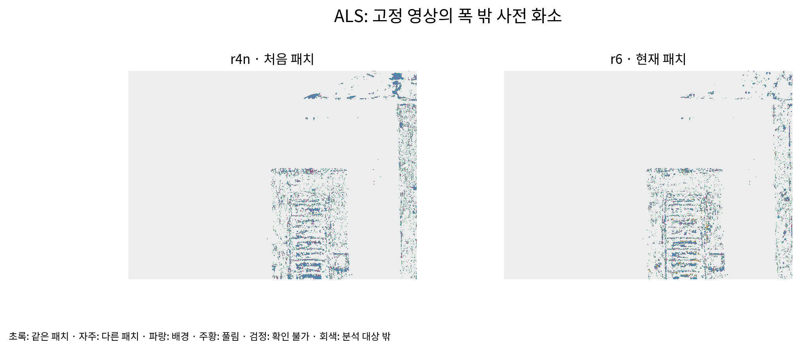

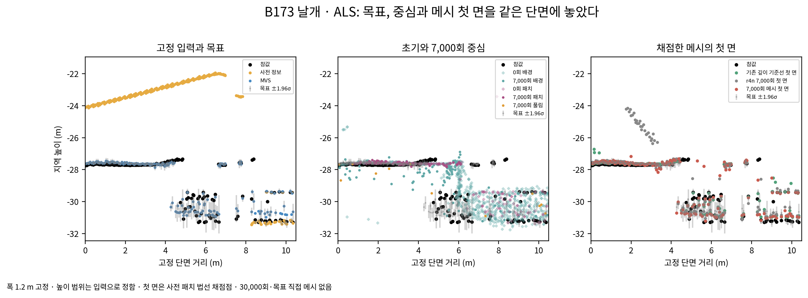

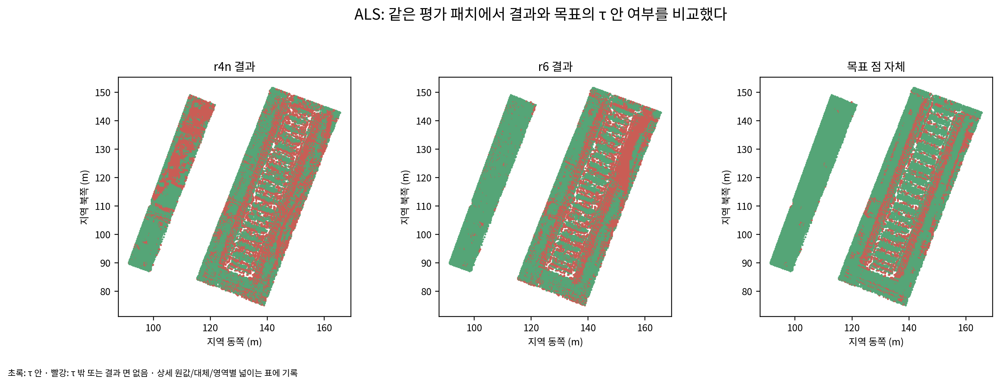

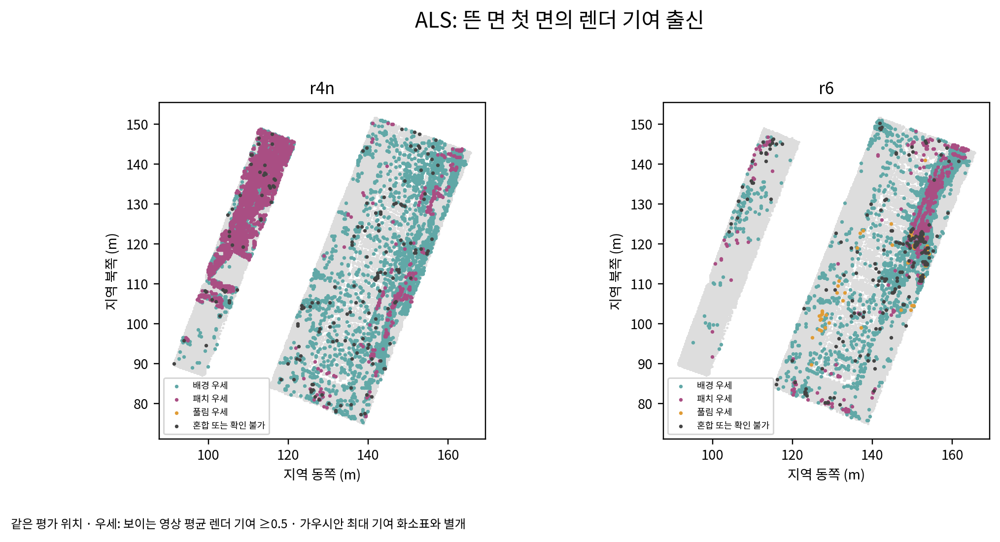

| 구분 | 영역 | 넓이(m²) | 결과 τ 안 | 목표 자체 τ 안 |
|---|---|---:|---:|---:|
| 전체 | 관측 없음 | 5.873 | 9.500% | 8.991% |
| 전체 | 일치 | 755.104 | 84.918% | 96.404% |
| 전체 | 보존 | 145.776 | 84.765% | 97.500% |
| 전체 | 보정 | 1300.370 | 56.634% | 67.434% |
| 원값 | 관측 없음 | 5.474 | 10.191% | 9.644% |
| 원값 | 일치 | 754.101 | 85.008% | 96.512% |
| 원값 | 보존 | 145.355 | 85.010% | 97.611% |
| 원값 | 보정 | 1288.212 | 57.102% | 68.024% |
| 대체 | 관측 없음 | 0.398 | 0.000% | 0.000% |
| 대체 | 일치 | 1.003 | 17.423% | 14.992% |
| 대체 | 보존 | 0.421 | 0.000% | 59.161% |
| 대체 | 보정 | 12.158 | 7.025% | 4.881% |

건강: PASS_HEALTH; 처음 사전 패치에서 심은 계보(풀림 포함)의 불투명도 중앙값 0.410624; 가우시안 1,015,746, 6,000회 1,295,940. 전체 상태 SHA-256 `8aecaf462d09dd7272811c6471a1c55ed1cc7f2db854a15a790ef369e8fd0938`.

## LoD2 · FAIL

| 항목 | r4n 7,000회 | r6 7,000회 | 기준 |
|---|---:|---:|---:|
| 뜬 면 | 21.712% | 18.252% | ≤5% |
| 일치 영역 결과 τ 안 | 64.052% | 67.681% | ≥74.100% |
| 칸 0~3 면 없음 | 2.046% | 1.996% | r4n 이하 |

r4n의 저장 메시를 같은 첫 면 탐색·칸·넓이 분모로 다시 채점했다. 문서의 반올림된 69.3%/74.1%를 통과 문턱으로 적용하고 실제 상승 폭도 별도 기록했다.

| 목표 화소 구분 | 화소 수 | 폭 안 | 깊이 없음 |
|---|---:|---:|---:|
| 전체 | 116,051,001 | 50.385% | 0.000% |
| 사전 패치 | 17,415,076 | 57.396% | 0.000% |
| 배경 MVS | 98,635,925 | 49.147% | 0.000% |
| 사전 지붕 | 10,531,098 | 74.744% | 0.000% |
| 사전 벽 | 6,883,978 | 30.858% | 0.000% |
| 관측 없음 | 5,745,362 | 45.635% | 0.000% |
| 일치 | 8,712,716 | 64.898% | 0.000% |
| 보존 | 45,127 | 36.003% | 0.000% |
| 보정 | 2,911,871 | 58.485% | 0.000% |
| 사전 원값 | 11,543,901 | 63.294% | 0.000% |
| 사전 대체 | 5,871,175 | 45.801% | 0.000% |

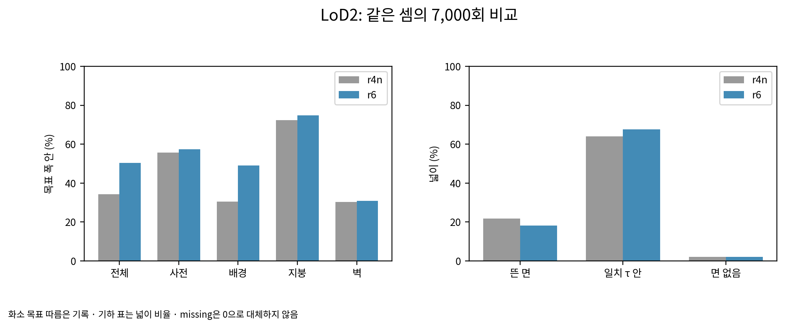

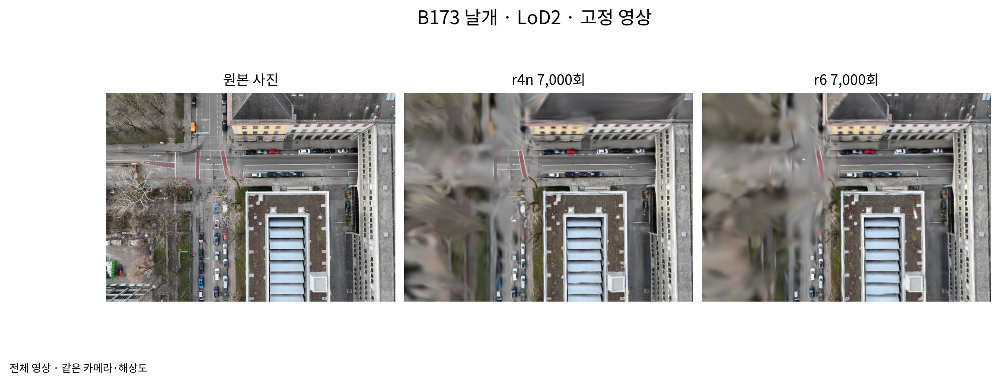

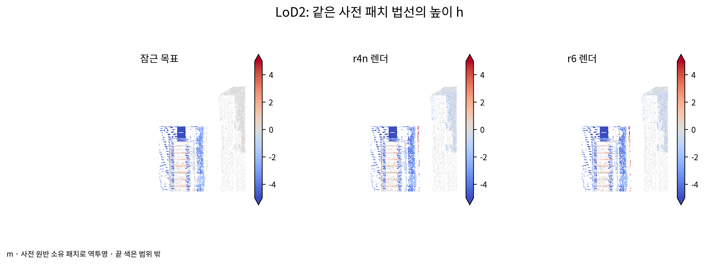

처음 1 m 초과 배경 씨앗 2,166개 중 408개 계보의 자손 617,188개가 남았다. 초기 상위 열 개는 r4n과 같은 초기 배열이므로 [기존 목록](초기배경_크기_r3.md)을 계승한다.

| 처음 큰 배경의 남은 자손 | 최소 | 중앙 | 95% | 최대 |
|---|---:|---:|---:|---:|
| 긴 축(m) | 0.012380 | 1.355659 | 2.784187 | 45.491856 |
| 불투명도 | 0.000782 | 0.267444 | 0.946371 | 1.000000 |
| 법선 이동(m) | 0.000058 | 14.171676 | 75.146349 | 213.058060 |
| 접선 이동(m) | 0.057767 | 217.808350 | 397.474605 | 901.112366 |

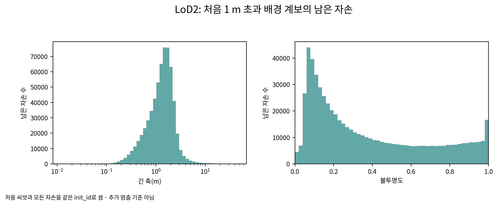

| 현재 꼬리표 | 수 | 처음 목표 면을 따라 1 m 초과 | 긴 축 중앙값(m) | 불투명도 중앙값 | 법선 이동 중앙값(m) | 접선 이동 중앙값(m) |
|---|---:|---:|---:|---:|---:|---:|
| 패치 | 106,803 | 78,584 | 0.376087 | 0.369690 | 0.087223 | 1.614652 |
| 배경 | 759,702 | 727,082 | 1.210654 | 0.283179 | 10.757806 | 195.974844 |
| 풀림 | 201,499 | 196,571 | 1.104740 | 0.271230 | 4.713188 | 26.361344 |

현재 풀림: 201,499/308,302 = 65.358%. 재연결 점검 호출 326회에서 0.5 m 안 연결 갱신 41,032,947건(같은 목표 번호 유지 포함), 목표 번호가 바뀐 사건 5,210,884건, 풀림 전환 사건 65,750회. 사건 합에는 이후 삭제된 가우시안도 포함한다. 이동은 r5와 같이 처음 씨앗의 목표·법선 기준이며 현재 목표로 다시 쓴 이동이 아니다.

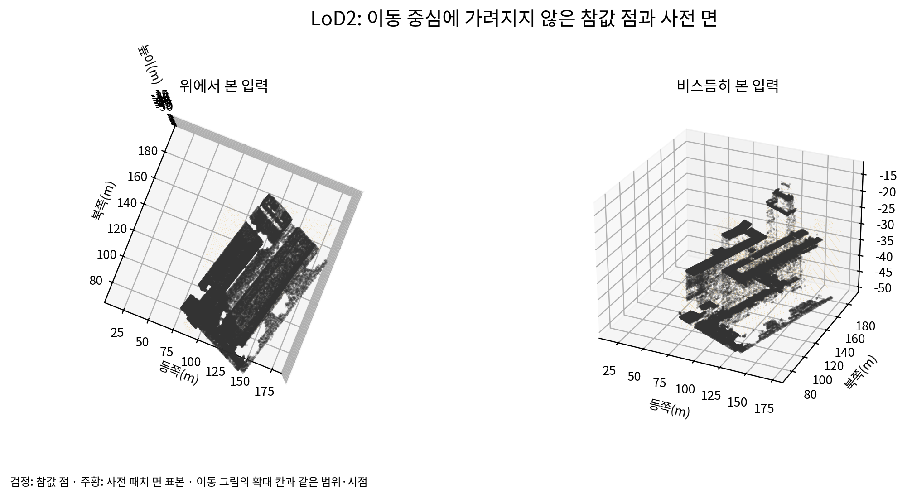

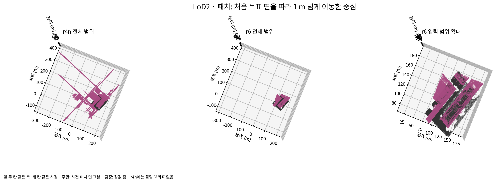

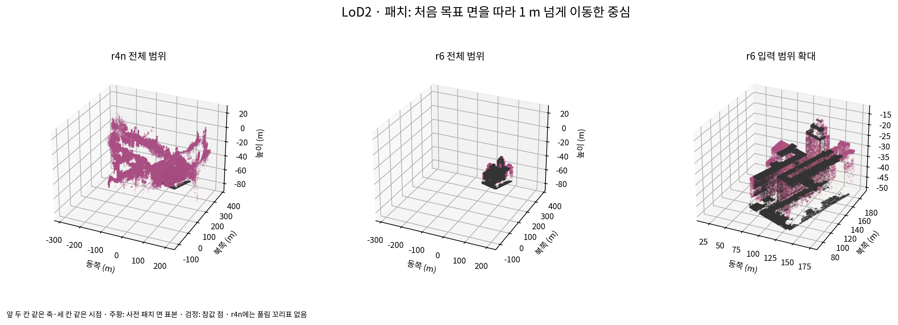

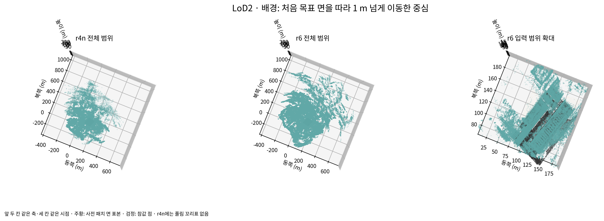

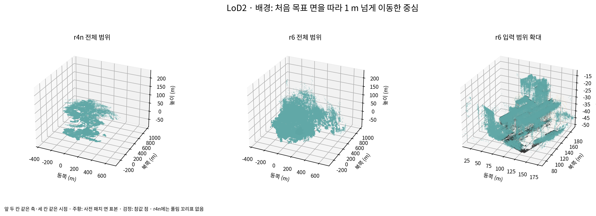

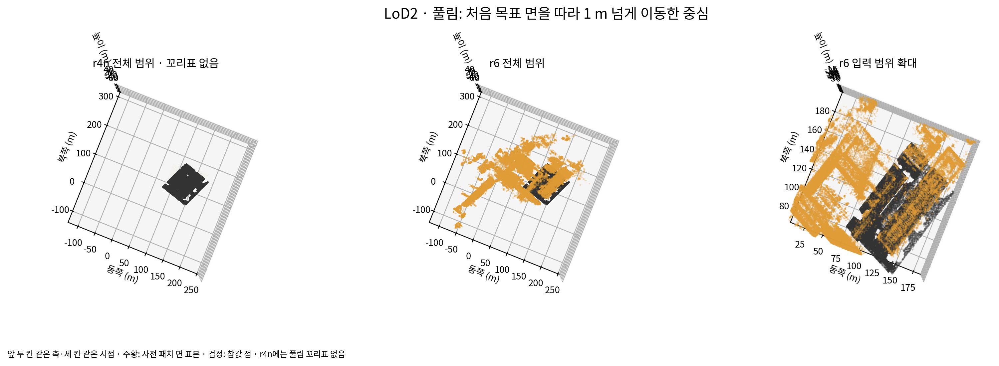

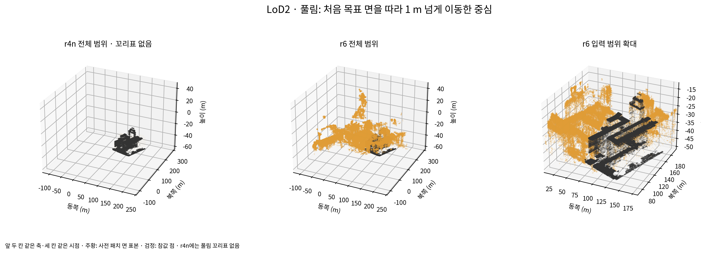

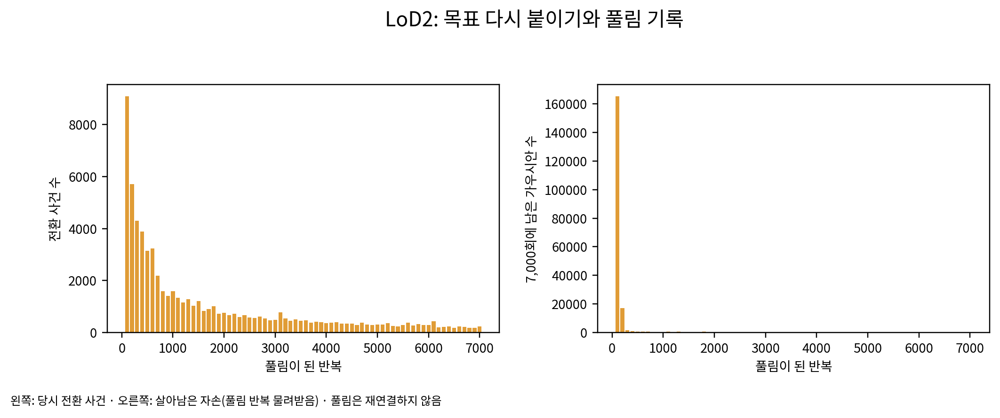

건물 목표점 0.5 m 안의 수: 배경 51,923개, 풀림 9,247개, 패치 106,803개. 모든 목표 화소의 평균 렌더 기여(배경·풀림·패치): 6.999%, 0.830%, 7.410%.

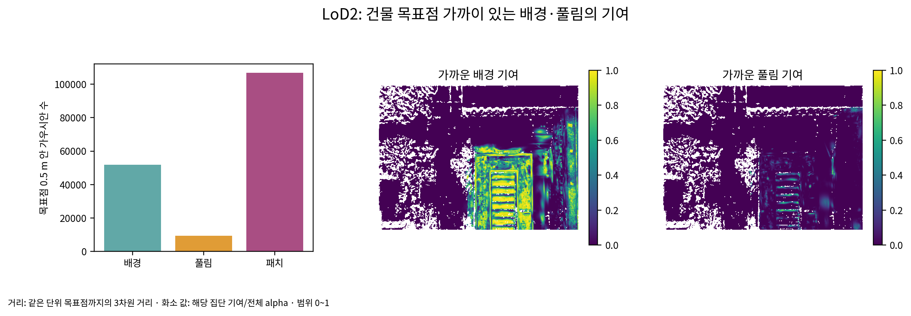

| 깊이 방향 | 같은 현재 패치 | 다른 현재 패치 | 배경 | 풀림 | 확인 불가 |
|---|---:|---:|---:|---:|---:|
| 앞(가림 방향) | 1.191% | 14.798% | 23.461% | 12.613% | 0.000% |
| 뒤(비침 방향) | 1.341% | 17.657% | 26.083% | 2.855% | 0.000% |

방향과 최대 렌더 기여의 분해다. 방향만으로 물리적 원인을 확정하지 않는다. 현재 붙은 목표와 처음 부모의 패치 계보를 구분하여 두 교차표 모두 JSON에 보존했다.

| 처음 계보 기준(r5와 같은 셈) | 같은 처음 패치 | 다른 처음 패치 | 배경 | 확인 불가 |
|---|---:|---:|---:|---:|
| r4n 앞 | 0.083% | 20.806% | 37.088% | 0.000% |
| r4n 뒤 | 0.068% | 11.619% | 30.336% | 0.000% |
| r6 앞 | 0.090% | 28.512% | 23.461% | 0.000% |
| r6 뒤 | 0.084% | 21.770% | 26.083% | 0.000% |

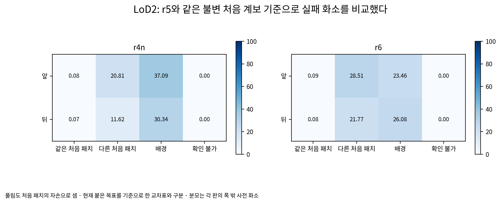

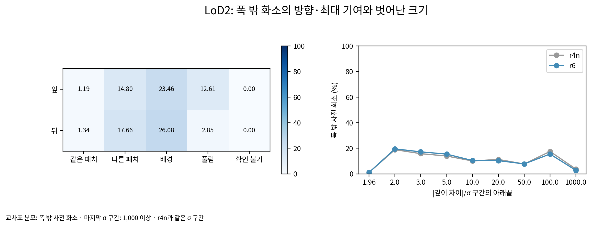

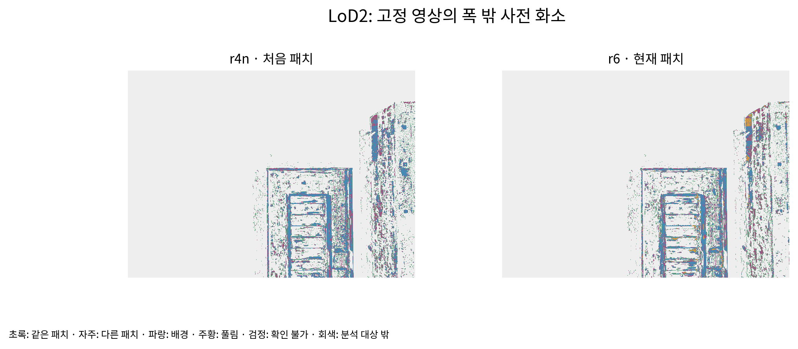

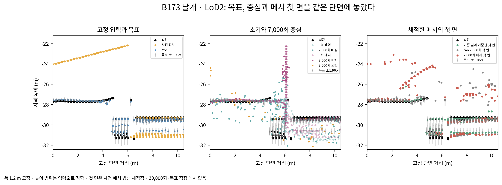

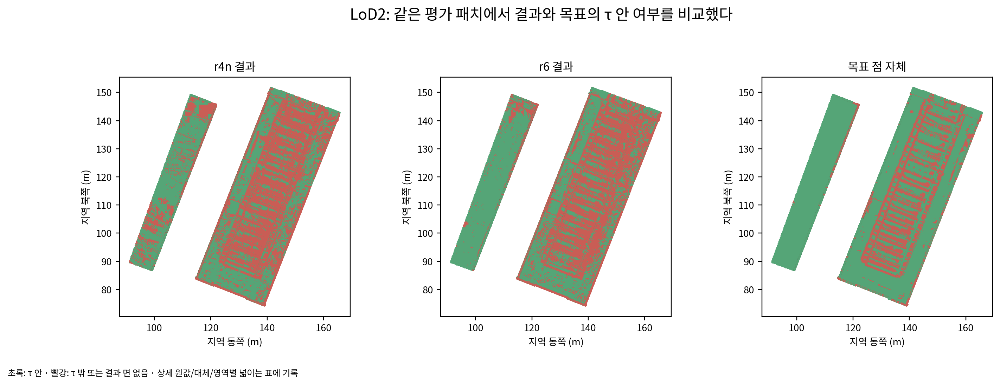

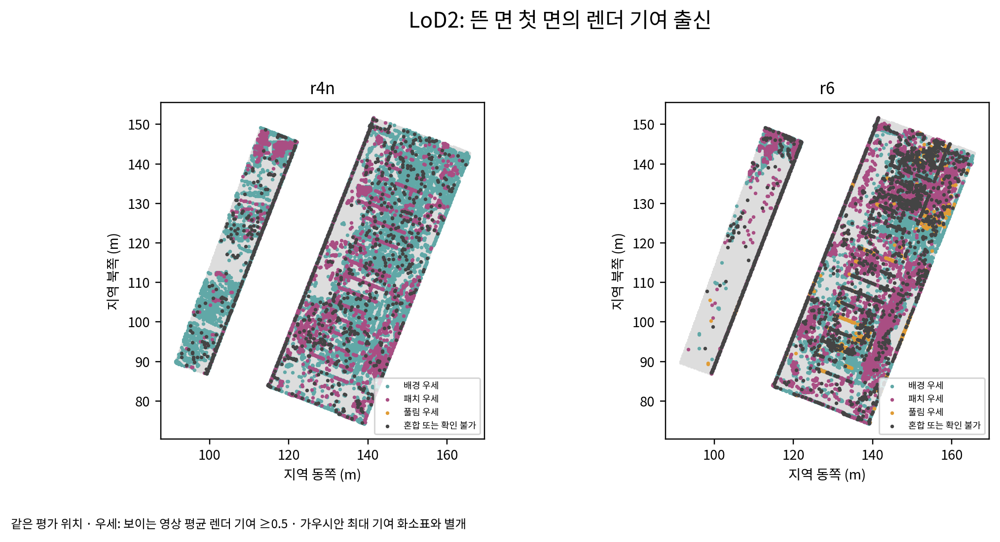

| 구분 | 영역 | 넓이(m²) | 결과 τ 안 | 목표 자체 τ 안 |
|---|---|---:|---:|---:|
| 전체 | 관측 없음 | 217.188 | 26.014% | 51.281% |
| 전체 | 일치 | 3151.812 | 67.681% | 86.278% |
| 전체 | 보존 | 17.438 | 17.921% | 11.828% |
| 전체 | 보정 | 1852.875 | 45.524% | 62.811% |
| 원값 | 관측 없음 | 182.375 | 30.123% | 58.842% |
| 원값 | 일치 | 3102.562 | 68.510% | 87.305% |
| 원값 | 보존 | 6.875 | 26.364% | 10.000% |
| 원값 | 보정 | 1616.750 | 51.191% | 70.164% |
| 대체 | 관측 없음 | 34.812 | 4.488% | 11.670% |
| 대체 | 일치 | 49.250 | 15.482% | 21.574% |
| 대체 | 보존 | 10.562 | 12.426% | 13.018% |
| 대체 | 보정 | 236.125 | 6.723% | 12.467% |

건강: PASS_HEALTH; 처음 사전 패치에서 심은 계보(풀림 포함)의 불투명도 중앙값 0.336832; 가우시안 1,105,655, 6,000회 1,351,843. 전체 상태 SHA-256 `5599433e13a1d81f94e6ad7ee70c86eeaee1c9b80b288591b7af3a1b7174c543`.

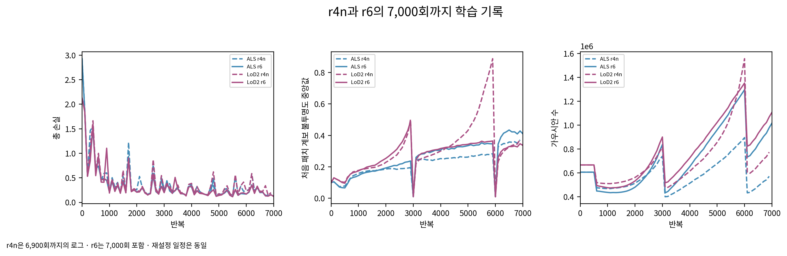

## 구현·검증 범위

r20 변경 파일·줄은 `tables/r20_changes_r6.json`과 패치 파일에 기록했다. 목표 검색은 같은 단위·사전 정보의 유효 단계 0 목표점 전체이며, 거리 동률은 원 패치 번호가 작은 것을 택한다. 꼬리표와 init_id를 별도로 유지하며, 배경·풀림은 묶지 않는다.

저장에는 Adam 모멘트·매개변수 묶음, 난수 상태, 영상 순서와 남은 영상 목록, 현재 꼬리표·목표 번호·풀림 시각·6,000회 수가 포함된다. 작은 예제의 결정적 100회 연속/이어 학습은 모델·Adam·영상 순서가 바이트 단위로 같았다. 이는 실제 실험 영상의 100회 재학습 비교를 뜻하지 않는다.

채점용 7,000회 모델은 밀도 제어 직전이며, 이어 학습용 전체 상태는 그 반복의 밀도 제어·목표 갱신 뒤다. 15,000·30,000회 전체 상태는 해당 반복에 도달한 경우에만 생성된다. 중단으로 미도달한 반복을 완료로 적지 않는다.

참값은 채점·점검에만 사용했다. 대체 패치는 원값과 별도 줄로 기록했다. scientific_verdict: null.

2026-11-01T18:28:29.971424+09:00
