# r7 · 7,000회 점검

[이 발주에서 냄] r20을 보존하고 r21에서 관측 없음의 사라짐 판단, 폭과 접선 거리를 함께 쓰는 목표 재연결, 정기 불투명도 초기화 뒤 500회 감시 예외를 구현했다. 배경·풀림은 묶지 않으며 손실·학습률·밀도 제어 일정은 그대로다.

[단계 0 사라짐 판단·정확도·대체 비율](단계0_사라짐_점검_r7.md)을 별도로 기록했다. 사라짐은 목표와 씨앗을 받지 않으며, 원반이 없어진 화소는 기존 MVS 목표 규칙을 따른다.

기존 깊이 손실 기준선은 r5 비교에 쓰인 r15의 30,000회 저장 상태에 기록된 구현 해시를 현재 코드와 대조했다. 같은 원래 설정·씨앗·영상 나눔으로 새 두 판을 7,000회까지만 실행했다. 학습률 일정의 전체 반복 수는 30,000으로 유지하고, 출력 위치·7,000회 저장·7,000회 종료만 바꿨다. 처음 input.ply도 원 기준선과 바이트 단위로 같았다. 상세 차이는 `baseline7k.r7.json`에 남겼다.

배경 씨앗은 신뢰도 마스크를 통과한 MVS 점이며, 기존 깊이 손실 기준선의 초기 SfM 희소점과 다르다. 초기 크기와 불투명도 규칙은 기준선과 같고, 큰 배경의 처음 열 개·계보는 [초기 씨앗 확인](초기배경_크기_r7.md)에 적었다.

메시 기하 비율의 분모는 기존 MESHPATCH와 같은 평가 범위의 채점 가능 참값 패치 넓이다. 참값 면 측정이 없는 패치는 그 분모에서 빠진다. 면 없음은 참값 채점이 가능한 위치에서 결과 메시의 첫 면을 찾지 못한 경우다. 단계 0의 참값 확인 불가와 구분한다.

판정은 같은 사전 정보의 기존 방법 7,000회와 비교한다: 뜬 면 +2%p 이하, 일치 영역 τ 안 −2%p 이상, 칸 0~3 면 없음 +1%p 이하. 건강 검사는 별도다. 목표 폭 안 화소 비율과 추가 계보 진단은 기록이며 통과 문턱이 아니다.

배경 씨앗 위치·학습 영상·기존 기준선의 초기 점은 r5와 같다(이번 초기 입력 검증에서 대조). [씨앗 범위와 영상 시야를 겹친 지도](중단후_비교진단_r5.md)는 이 입력에 그대로 해당한다. 시야 지도는 입력 지붕 중앙 높이의 평면과 카메라 절두체의 교차이며 실제 가림을 반영한 관측 영역과 구분한다.

## ALS · FAIL

| 항목 | 기존 방법 7,000회 | r6 7,000회 | r7 7,000회 | r7 기준 |
|---|---:|---:|---:|---:|
| 뜬 면 | 11.642% | 10.775% | 25.059% | ≤13.642% |
| 일치 영역 τ 안 | 73.220% | 84.918% | 76.191% | ≥71.220% |
| 칸 0~3 면 없음 | 2.931% | 2.530% | 2.196% | ≤3.931% |

7,000회 건강: PASS_HEALTH; 가우시안 1,055,539개, 처음 패치 계보의 불투명도 중앙값 0.396547.

| 목표 화소 구분 | 화소 수 | 기존 방법 폭 안 | r7 폭 안 | r7 깊이 없음 |
|---|---:|---:|---:|---:|
| 전체 | 114,558,537 | 45.331% | 46.499% | 0.000% |
| 사전 패치 | 11,861,349 | 47.835% | 70.479% | 0.000% |
| 배경 MVS | 102,697,188 | 45.042% | 43.730% | 0.000% |
| 사전 지붕 | 11,861,349 | 47.835% | 70.479% | 0.000% |
| 사전 벽 | 0 | 확인 불가 | 확인 불가 | 확인 불가 |
| 관측 없음 | 4,636,054 | 52.874% | 72.626% | 0.000% |
| 사라짐 | 0 | 확인 불가 | 확인 불가 | 확인 불가 |
| 일치 | 4,608,847 | 43.507% | 71.942% | 0.000% |
| 보존 | 986,188 | 24.981% | 67.561% | 0.000% |
| 보정 | 1,630,260 | 59.564% | 62.000% | 0.000% |
| 사전 원값 | 7,111,573 | 44.697% | 69.632% | 0.000% |
| 사전 대체 | 4,749,776 | 52.533% | 71.746% | 0.000% |

사라짐에는 사전 원반이 없으므로 사라짐 소유 화소는 0개다. 그 자리의 MVS 목표 화소는 배경 행에 포함된다. 메시 채점의 사라짐 영역은 고정 패치 위치로 별도 집계했다.

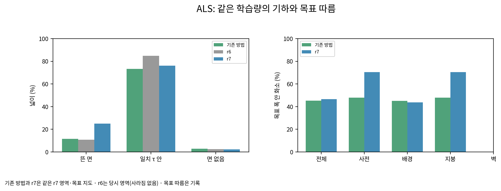

| 구분 | 영역 | 넓이(m²) | r7 결과 τ 안 | 목표 자체 τ 안 | 기존 방법 τ 안 | r7 뜬 면 |
|---|---|---:|---:|---:|---:|---:|
| all | 관측 없음 | 0.982 | 7.746% | 38.684% | 0.000% | 15.356% |
| all | 사라짐 | 4.891 | 9.251% | 확인 불가 | 6.591% | 24.670% |
| all | 일치 | 755.104 | 76.191% | 96.404% | 73.220% | 16.119% |
| all | 보존 | 145.776 | 71.656% | 97.500% | 66.097% | 20.546% |
| all | 보정 | 1300.370 | 43.850% | 67.434% | 52.994% | 33.239% |
| original | 관측 없음 | 0.982 | 7.746% | 38.684% | 0.000% | 15.356% |
| original | 사라짐 | 4.493 | 10.071% | 확인 불가 | 5.779% | 24.021% |
| original | 일치 | 754.101 | 76.234% | 96.512% | 73.278% | 16.110% |
| original | 보존 | 145.355 | 71.816% | 97.611% | 66.241% | 20.412% |
| original | 보정 | 1288.212 | 44.196% | 68.024% | 53.423% | 33.127% |
| replaced | 관측 없음 | 0.000 | 확인 불가 | 확인 불가 | 확인 불가 | 확인 불가 |
| replaced | 사라짐 | 0.398 | 0.000% | 확인 불가 | 15.757% | 32.001% |
| replaced | 일치 | 1.003 | 44.367% | 14.992% | 30.142% | 23.183% |
| replaced | 보존 | 0.421 | 16.467% | 59.161% | 16.467% | 66.807% |
| replaced | 보정 | 12.158 | 7.172% | 4.881% | 7.509% | 45.109% |

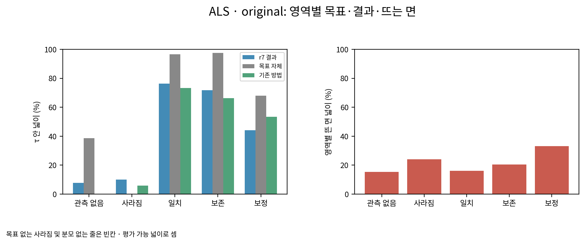

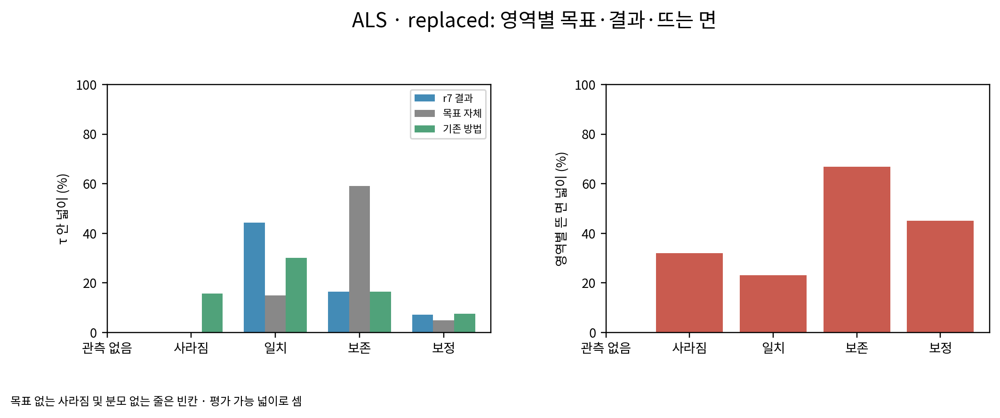

| 현재 출신 | 그리는 몫 | 폭 밖 최대 기여 몫 | 틀린 몫 / 그리는 몫 |
|---|---:|---:|---:|
| background | 75.540% | 78.802% | 1.0432 |
| released | 0.994% | 1.253% | 1.2604 |
| patch | 23.466% | 19.944% | 0.8499 |

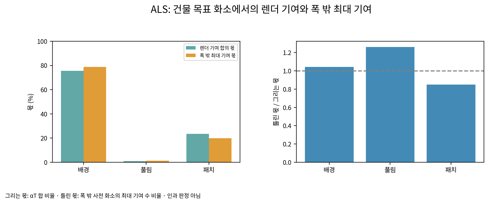

그리는 몫은 사전 목표 원반 화소에서 αT 기여를 합한 비율이다. 틀린 몫은 폭 밖 사전 화소의 최대 기여 가우시안을 센 비율이다. 두 비율의 분모가 다르며, 관계를 기록한 것으로 원인을 확정하지 않는다.

| 깊이 방향 | 같은 현재 패치 | 다른 현재 패치 | 배경 | 풀림 | 확인 불가 |
|---|---:|---:|---:|---:|---:|
| 앞 | 2.468% | 8.192% | 45.213% | 0.572% | 0.000% |
| 뒤 | 1.596% | 7.688% | 33.590% | 0.681% | 0.000% |

| 현재 출신 | 수 | 처음 목표 면을 따라 1 m 초과 | 긴 축 중앙(m) | 불투명도 중앙 | 법선 이동 중앙(m) | 접선 이동 중앙(m) |
|---|---:|---:|---:|---:|---:|---:|
| patch | 38,133 | 27,222 | 0.266108 | 0.368460 | 0.089857 | 1.531110 |
| background | 975,245 | 942,669 | 1.234216 | 0.275582 | 10.045986 | 160.827573 |
| released | 3,030 | 2,338 | 0.493608 | 0.339202 | 0.521884 | 1.732412 |

풀림 3,030/41,163 = 7.361%. 현재 목표 재연결과 별개로 이동은 처음 씨앗의 목표·법선에서 잰 값이다.

처음 1 m 초과 배경 2,182개에서 421개 부모 계보, 자손 775,480개가 남았다. 크기·불투명도·이동 분포는 그림 JSON과 전체 NPZ에 보존했다.

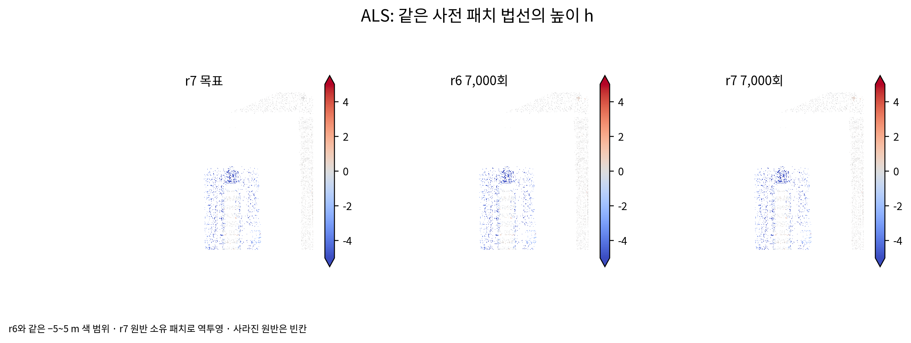

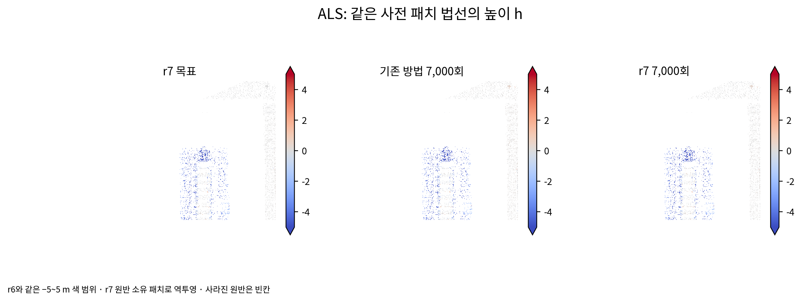

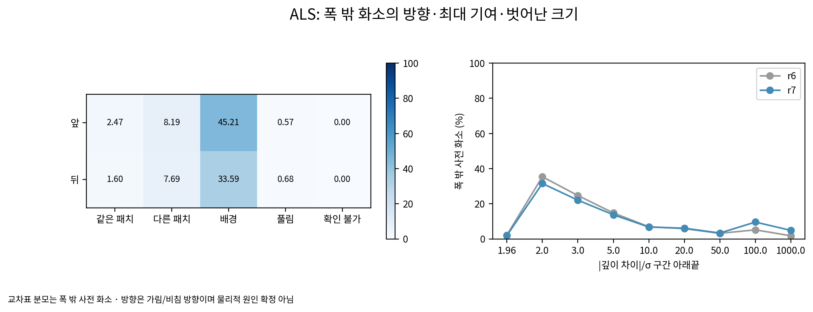

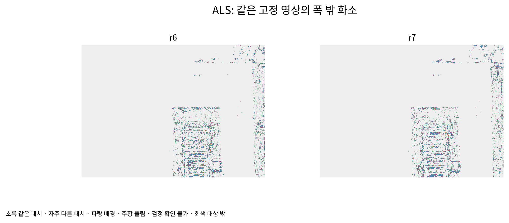

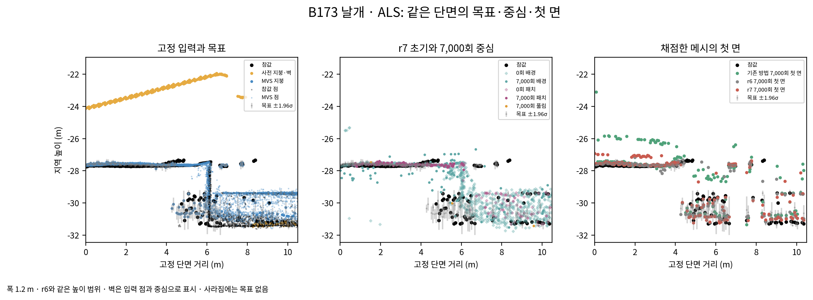

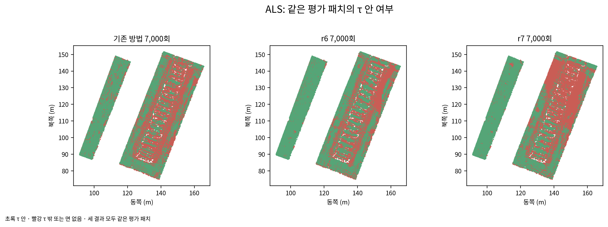

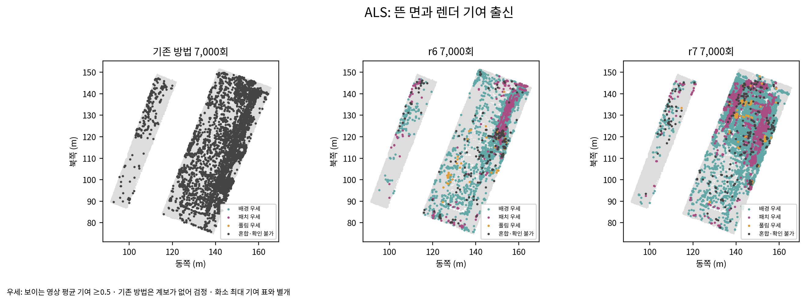

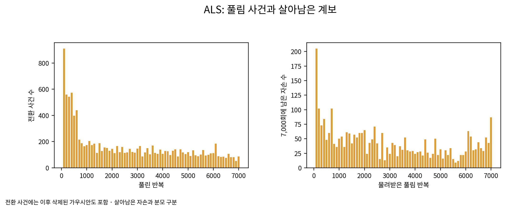

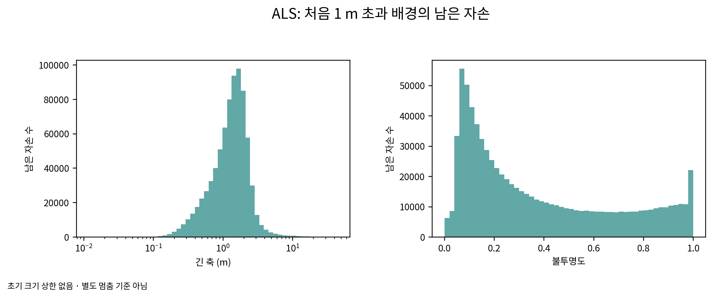

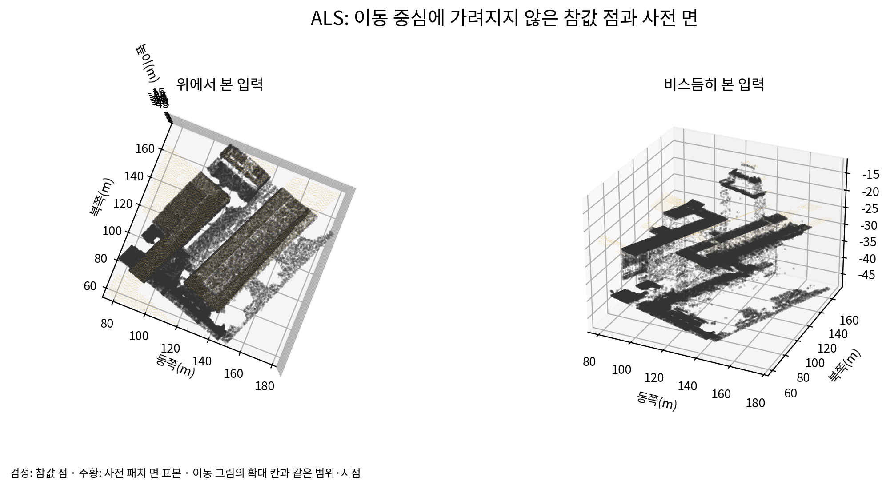

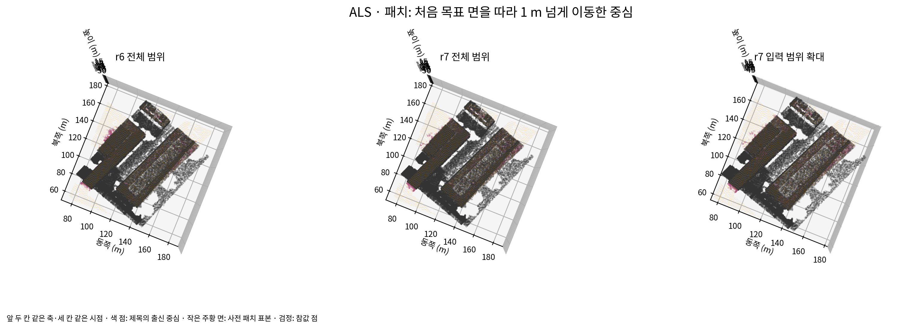

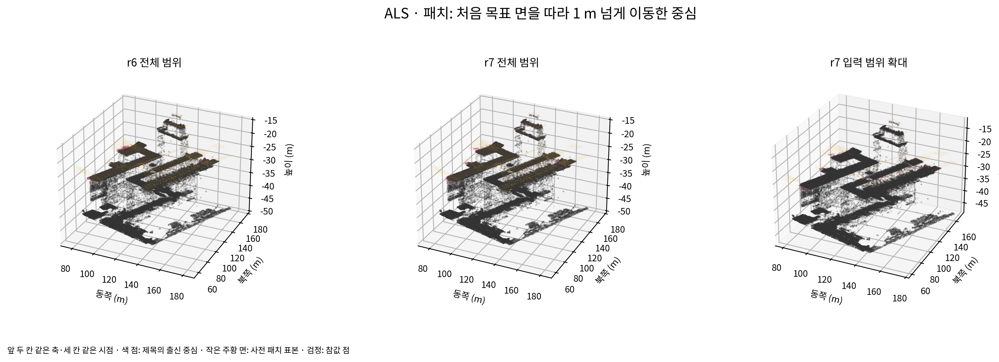

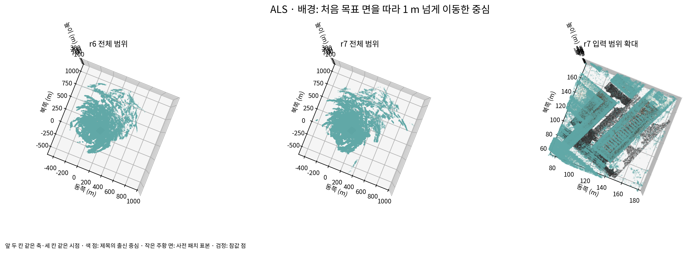

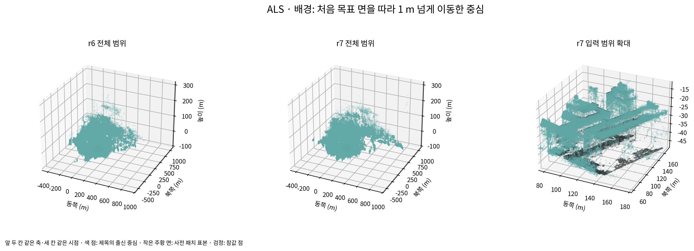

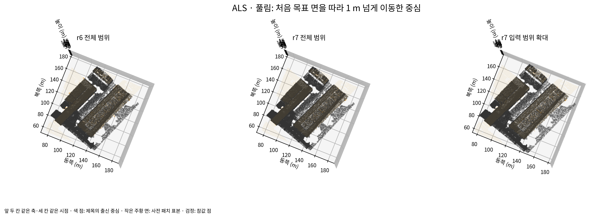

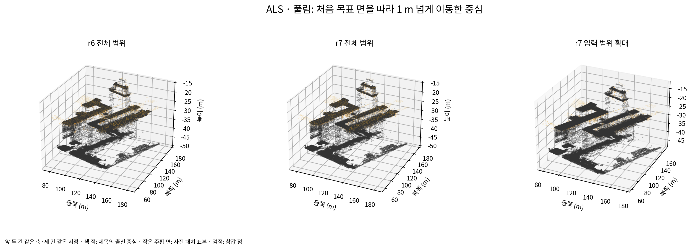

## LoD2 · PASS

| 항목 | 기존 방법 7,000회 | r6 7,000회 | r7 7,000회 | r7 기준 |
|---|---:|---:|---:|---:|
| 뜬 면 | 15.787% | 18.252% | 8.926% | ≤17.787% |
| 일치 영역 τ 안 | 63.077% | 67.681% | 71.455% | ≥61.077% |
| 칸 0~3 면 없음 | 2.462% | 1.996% | 2.369% | ≤3.462% |

7,000회 건강: PASS_HEALTH; 가우시안 1,070,675개, 처음 패치 계보의 불투명도 중앙값 0.322321.

| 목표 화소 구분 | 화소 수 | 기존 방법 폭 안 | r7 폭 안 | r7 깊이 없음 |
|---|---:|---:|---:|---:|
| 전체 | 115,995,219 | 48.589% | 49.849% | 0.000% |
| 사전 패치 | 17,150,221 | 54.378% | 58.801% | 0.000% |
| 배경 MVS | 98,844,998 | 47.584% | 48.296% | 0.000% |
| 사전 지붕 | 10,860,286 | 70.233% | 73.489% | 0.000% |
| 사전 벽 | 6,289,935 | 27.002% | 33.439% | 0.000% |
| 관측 없음 | 5,047,177 | 52.501% | 50.188% | 0.000% |
| 사라짐 | 0 | 확인 불가 | 확인 불가 | 확인 불가 |
| 일치 | 8,818,619 | 57.190% | 63.737% | 0.000% |
| 보존 | 46,852 | 39.277% | 34.701% | 0.000% |
| 보정 | 3,237,573 | 49.865% | 59.129% | 0.000% |
| 사전 원값 | 11,841,809 | 55.775% | 62.905% | 0.000% |
| 사전 대체 | 5,308,412 | 51.263% | 49.646% | 0.000% |

사라짐에는 사전 원반이 없으므로 사라짐 소유 화소는 0개다. 그 자리의 MVS 목표 화소는 배경 행에 포함된다. 메시 채점의 사라짐 영역은 고정 패치 위치로 별도 집계했다.

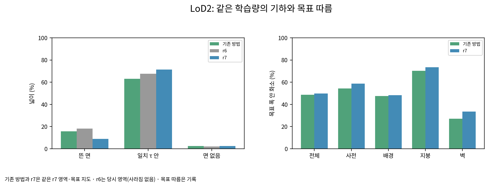

| 구분 | 영역 | 넓이(m²) | r7 결과 τ 안 | 목표 자체 τ 안 | 기존 방법 τ 안 | r7 뜬 면 |
|---|---|---:|---:|---:|---:|---:|
| all | 관측 없음 | 141.562 | 38.057% | 54.349% | 34.570% | 14.260% |
| all | 사라짐 | 75.625 | 2.810% | 확인 불가 | 2.727% | 5.537% |
| all | 일치 | 3151.812 | 71.455% | 86.278% | 63.077% | 9.274% |
| all | 보존 | 17.438 | 19.713% | 11.828% | 21.505% | 31.183% |
| all | 보정 | 1852.875 | 56.217% | 62.811% | 52.499% | 16.930% |
| original | 관측 없음 | 118.688 | 44.392% | 62.875% | 39.863% | 12.691% |
| original | 사라짐 | 63.688 | 3.238% | 확인 불가 | 3.042% | 5.692% |
| original | 일치 | 3102.562 | 72.392% | 87.305% | 63.840% | 9.099% |
| original | 보존 | 6.875 | 37.273% | 10.000% | 40.000% | 12.727% |
| original | 보정 | 1616.750 | 63.492% | 70.164% | 59.286% | 10.956% |
| replaced | 관측 없음 | 22.875 | 5.191% | 10.109% | 7.104% | 22.404% |
| replaced | 사라짐 | 11.938 | 0.524% | 확인 불가 | 1.047% | 4.712% |
| replaced | 일치 | 49.250 | 12.437% | 21.574% | 14.975% | 20.305% |
| replaced | 보존 | 10.562 | 8.284% | 13.018% | 9.467% | 43.195% |
| replaced | 보정 | 236.125 | 6.406% | 12.467% | 6.035% | 57.835% |

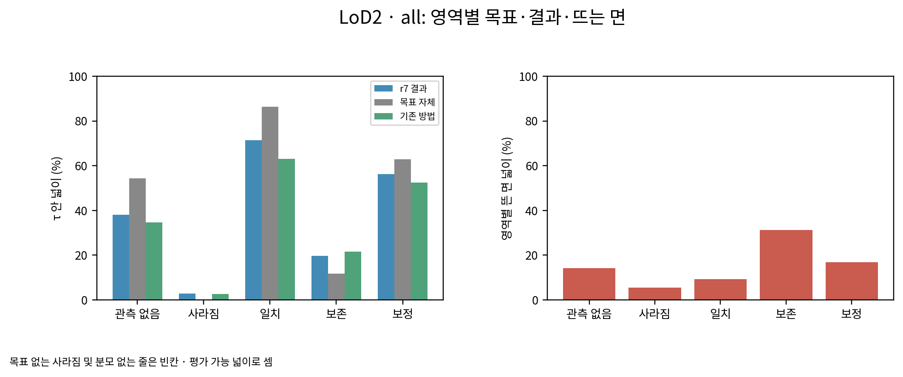

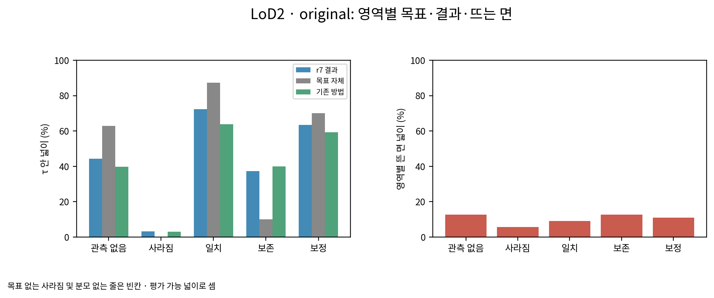

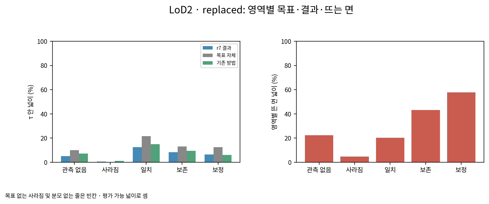

| 현재 출신 | 그리는 몫 | 폭 밖 최대 기여 몫 | 틀린 몫 / 그리는 몫 |
|---|---:|---:|---:|
| background | 46.876% | 52.782% | 1.1260 |
| released | 9.237% | 14.571% | 1.5775 |
| patch | 43.887% | 32.647% | 0.7439 |

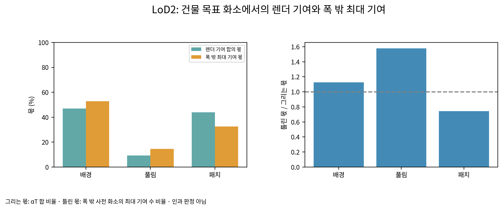

그리는 몫은 사전 목표 원반 화소에서 αT 기여를 합한 비율이다. 틀린 몫은 폭 밖 사전 화소의 최대 기여 가우시안을 센 비율이다. 두 비율의 분모가 다르며, 관계를 기록한 것으로 원인을 확정하지 않는다.

| 깊이 방향 | 같은 현재 패치 | 다른 현재 패치 | 배경 | 풀림 | 확인 불가 |
|---|---:|---:|---:|---:|---:|
| 앞 | 1.088% | 15.176% | 30.087% | 12.468% | 0.000% |
| 뒤 | 1.321% | 15.063% | 22.695% | 2.103% | 0.000% |

| 현재 출신 | 수 | 처음 목표 면을 따라 1 m 초과 | 긴 축 중앙(m) | 불투명도 중앙 | 법선 이동 중앙(m) | 접선 이동 중앙(m) |
|---|---:|---:|---:|---:|---:|---:|
| patch | 106,839 | 80,291 | 0.382896 | 0.359540 | 0.095482 | 1.675267 |
| background | 654,359 | 620,551 | 1.176799 | 0.289952 | 26.014185 | 173.189197 |
| released | 270,820 | 267,634 | 1.104941 | 0.264172 | 7.934127 | 47.561670 |

풀림 270,820/377,659 = 71.710%. 현재 목표 재연결과 별개로 이동은 처음 씨앗의 목표·법선에서 잰 값이다.

처음 1 m 초과 배경 2,176개에서 384개 부모 계보, 자손 511,426개가 남았다. 크기·불투명도·이동 분포는 그림 JSON과 전체 NPZ에 보존했다.

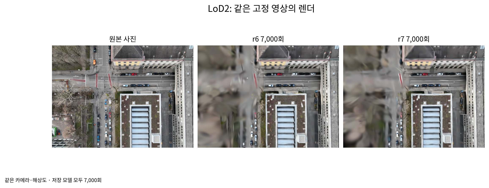

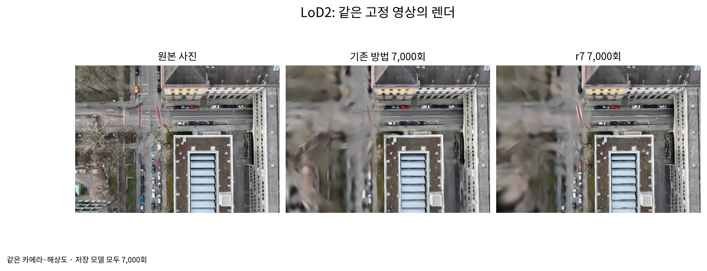

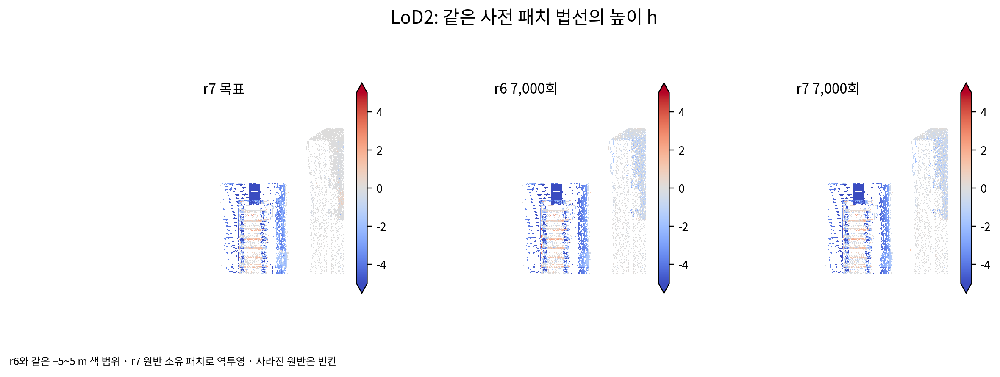

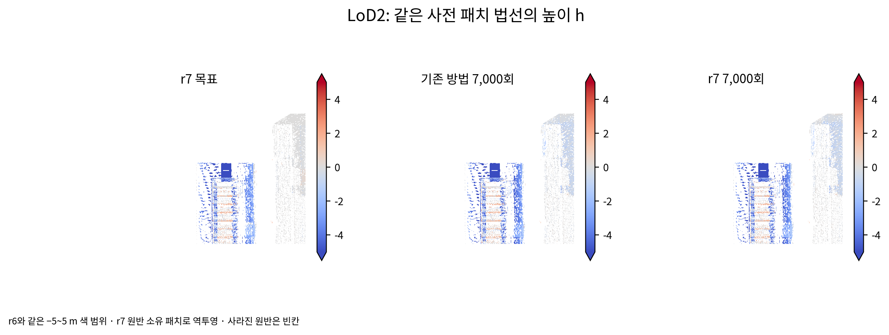

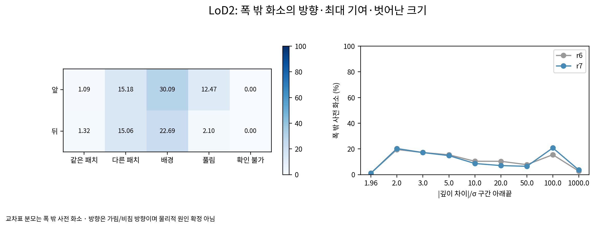

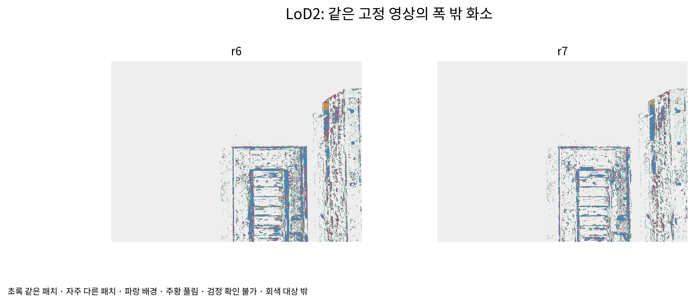

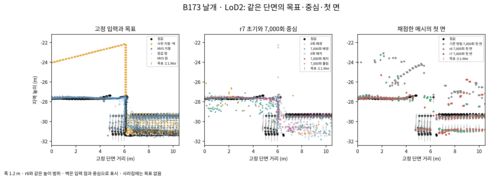

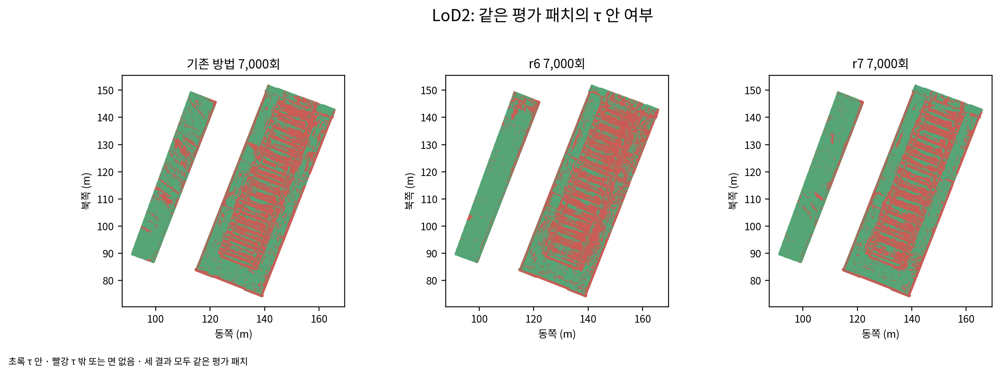

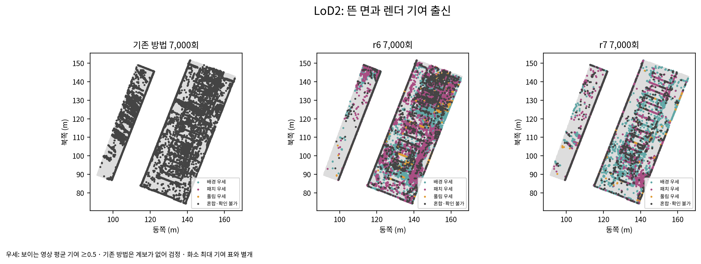

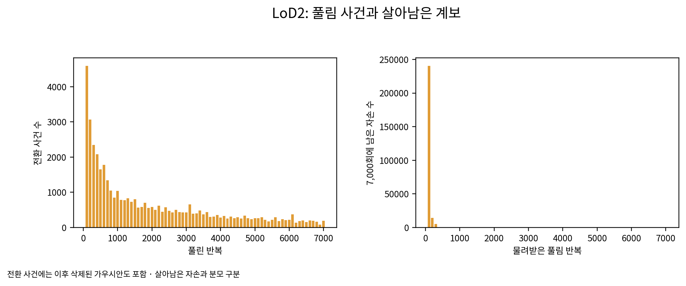

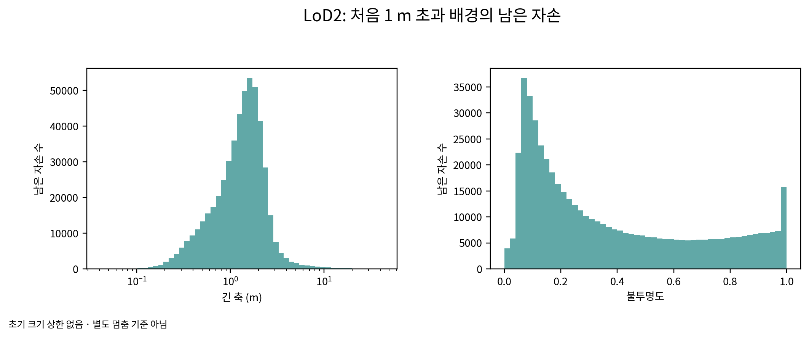

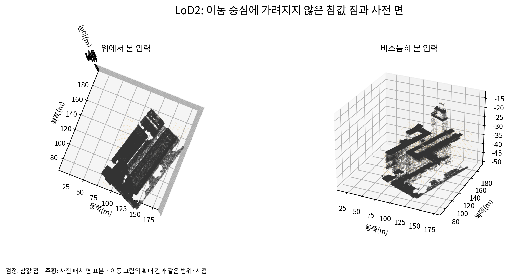

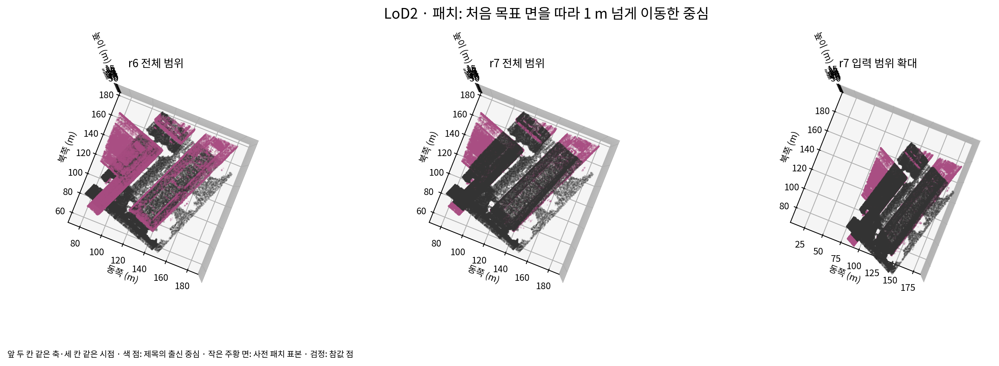

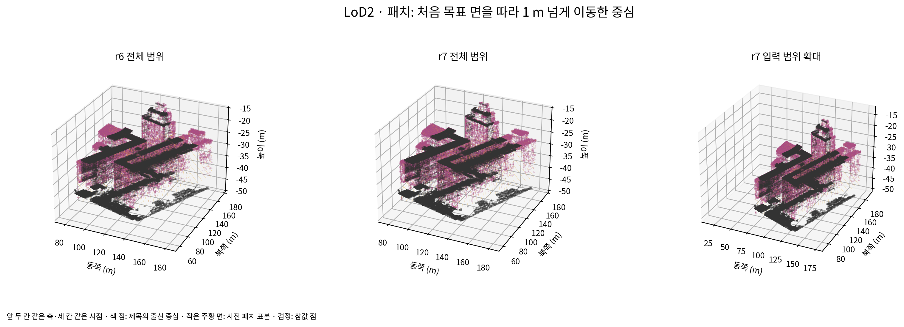

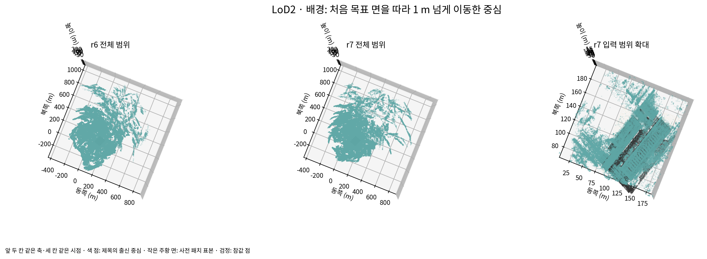

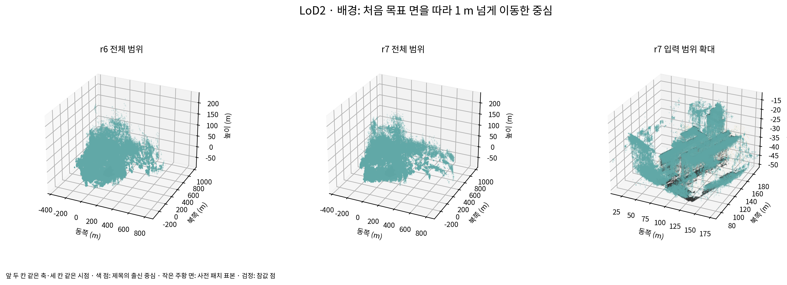

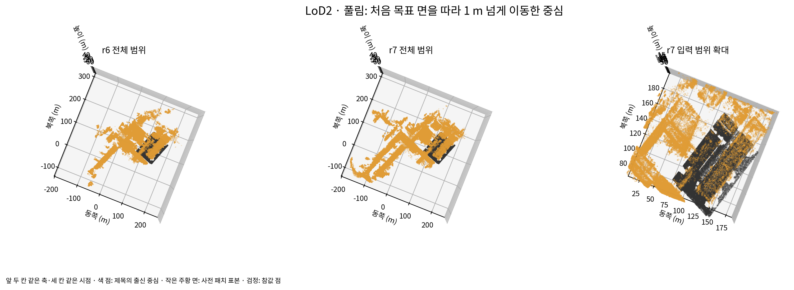

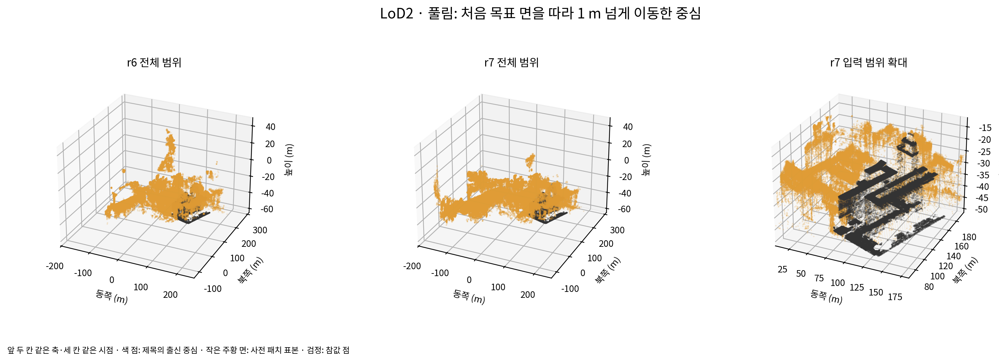

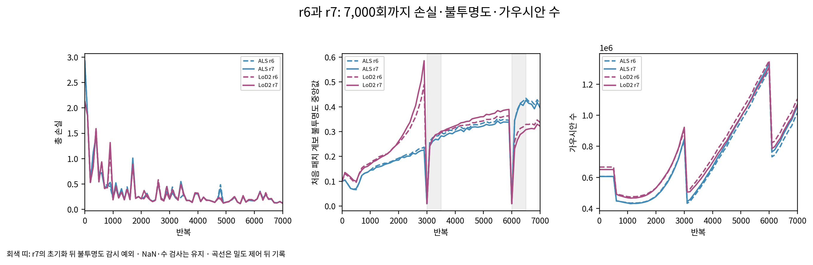

## 구현과 검증

새 판의 변경 파일·줄은 `tables/r21_changes_r7.json`과 패치에 남겼다. σ=1 m 목표에서 법선 방향 0.8 m의 씨앗 유지, 접선 방향 0.6 m의 풀림 및 자식 상속, 임의 법선 731개 질의의 전수 후보 대조를 통과했다. 작은 결정적 예제의 100회 연속/재개는 모델·Adam·난수·영상 순서·동적 목표 상태가 같았다.

7,000회 채점 PLY·스냅숏은 밀도 제어 직전이고, 이어 학습 상태는 해당 반복의 밀도 제어와 목표 갱신 뒤다. 실제 전체 상태의 Adam과 해시를 별도 검증했다. 15,000·30,000회는 도달한 경우만 완료로 적는다.

렌더 깊이 재집계, 계보 교차표, 2,048개 독립 첫 면 광선과 넓이 합계를 검증했다. 최대 기여 진단은 저장 깊이와 203개 영상 모두 바이트 단위 재현을 확인한다.

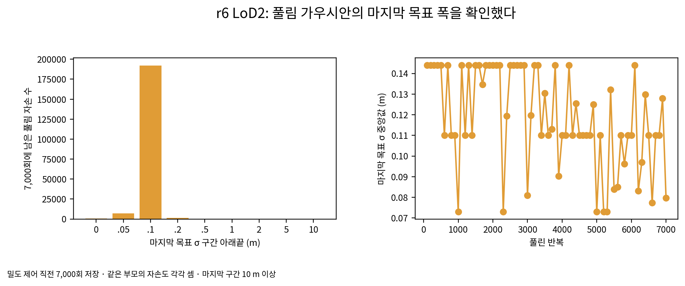

`scientific_verdict: null`
2026-11-01T20:35:41.612102+09:00
