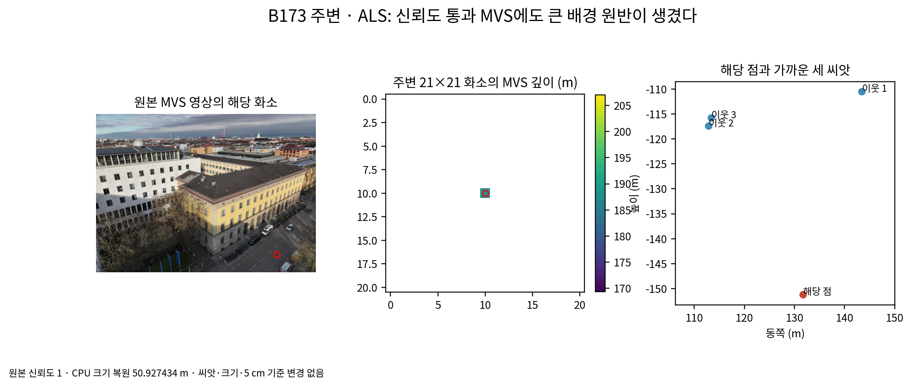

# r2 단계 1 첫 초기 렌더 실패 진단

2026-11-01 15:29 KST. B173 주변 × 항공 LiDAR. 최적화 0회. 나머지 고정 대표 자리의 초기 렌더와 진단은 진행 중이다. scientific_verdict: null.

| 점검 | r1 | r2 | 기준 |
|---|---:|---:|---:|
| 전체 학습 영상 목표 화소 깊이 오차 중앙값 | 39.562180 m | 45.716564 m | 0.05 m 이하 |
| 사전 패치 목표 화소만 | 4.569275 m | 13.470203 m | 진단용 분리 값 |
| 최대 배경 원반 크기 | 42.538944 m | 50.927437 m | 기준선 최근접 거리 규칙 유지 |

신뢰도 마스크를 통과한 MVS A 점을 원통 밖에서 0.25 m로 솎고 기준선 크기 규칙을 적용했다. 가장 큰 원반의 원본 MVS 화소는 `DJI_20241217101359_0032_D`의 (842, 656)이며 신뢰도 값은 1, 깊이는 188.197388 m다. 주변 21×21 화소에서 신뢰도를 통과한 유효 깊이는 이 점 하나다. 가까운 세 씨앗까지 거리는 48.464081, 51.314878, 52.903938 m다. 그 거리 제곱 평균의 제곱근을 CPU로 구하면 50.927434 m로 GPU 초기 크기와 일치한다.

법선이 없어 사용자 지정대로 연직 위를 적용했다. 고리 u도 없어 같은 단위·면 종류 중앙값으로 대체했다. 이 점을 임의로 제외하거나 크기를 줄이지 않았다.

고정 B173 날개 영상에서, 두 렌더에 모두 깊이가 있는 같은 사전 화소 91,576개를 비교했다. 전체 초기 장면의 오차 중앙값은 5.063246 m, 사전 씨앗만 남긴 진단은 0.023571 m다. 후자는 전체 초기 장면 사전 화소의 75.866%만 깊이가 남는다. 배경 제외를 학습 초기화나 통과 값으로 사용하지 않았다.

합성 카메라 깊이 50 m 평면의 오차 중앙값은 0.000011 m이고, 카메라 행렬 차이는 0이다. 목표 위치의 float32 반올림 오차와 법선 회전도 점검했다. 현재 확인된 큰 오차는 MVS로 바꾼 배경에도 고립된 점과 큰 원반이 남는 문제와 연결된다. 모든 원반의 기여를 개별 분해한 결과는 아니다.

11/1 결정 1의 기준선 크기 규칙과 5 cm 기준을 유지했다. 결정 5는 3.5 통과 뒤 7,000회로 진행하도록 했으므로 학습을 시작하지 않았다. 다음 초기화 변경은 별도 방법 결정이 필요하다. 현재 설정·결과는 보존하고 나머지 대표 자리의 학습 없는 점검과 전달 묶음을 마무리한다.

근거: `tables/r2_background_geometry_B173nb_b10_ALS.json`, 외부 작업 폴더 `r2/preflight/B173nb_b10_ALS/initial_render.json`, `r2/diagnose/B173nb_b10_ALS/diagnosis.json`.
