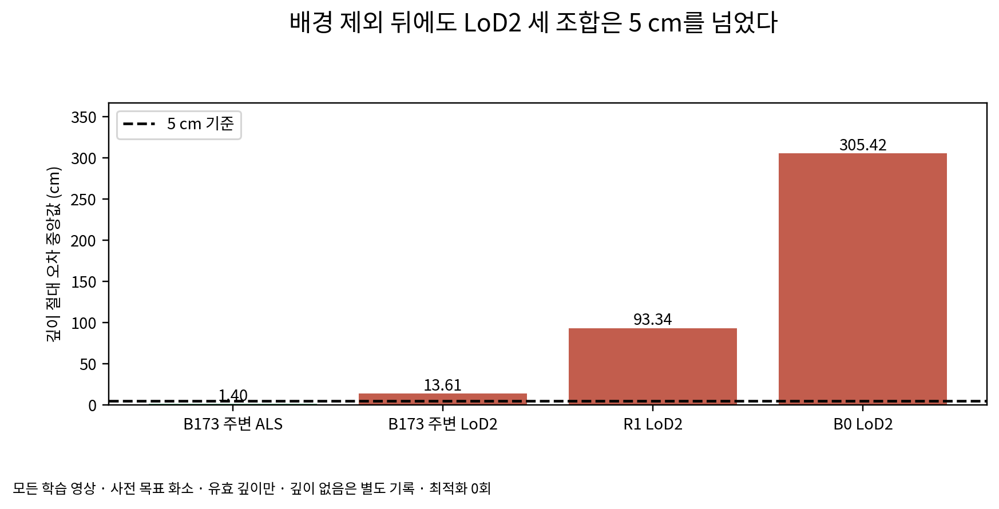
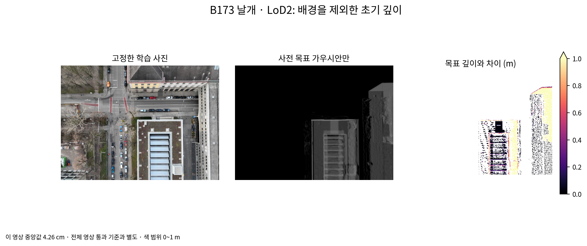
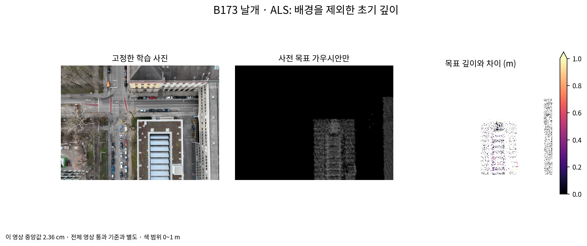
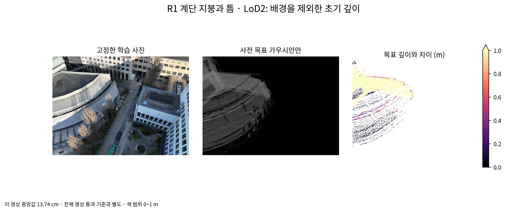
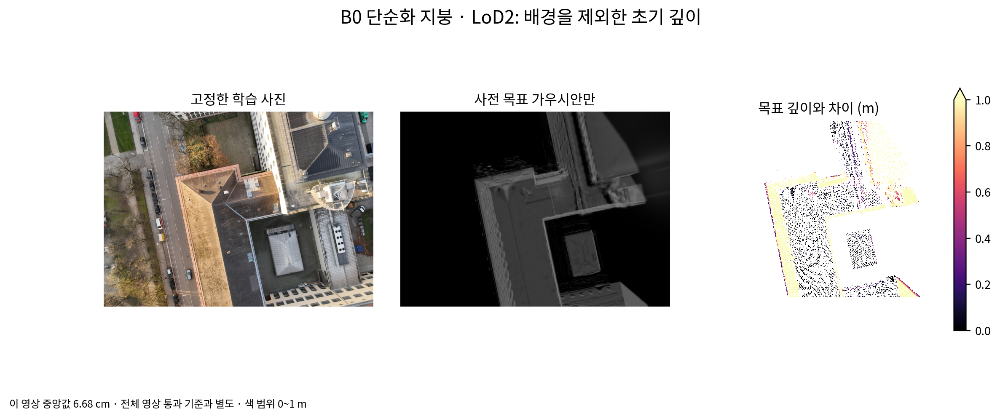
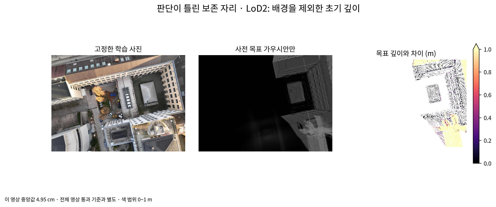

# 11/1 r3: 배경을 제외한 3.5 재검사

**LoD2 세 조합이 5 cm를 넘어 학습 전 중단했다. 최적화 0회이며, 7,000회 결과는 없다.**

사용자 결정대로 배경 크기 상한·외톨이 제거를 쓰지 않았다. 통과 판단은 사전 패치 목표에 심은 가우시안만 렌더한 깊이로 바꿨다. r2 판단·목표·지도·초기 사전 크기는 그대로다. r3 설정은 첫 계산 전 15:39:20, 검사 코드는 15:43:30에 잠갔다.

| 조합 | 영상 수 | 깊이 오차 중앙값 (cm) | 깊이 없음 (%) | 5 cm |
|---|---:|---:|---:|---|
| B173 주변 ALS | 203 | 1.3952 | 43.43830 | 통과 |
| B173 주변 LoD2 | 203 | 13.6093 | 0.00079 | 미충족 |
| R1 LoD2 | 333 | 93.3388 | 0.00002 | 미충족 |
| B0 LoD2 | 243 | 305.4241 | 0.00022 | 미충족 |

모든 학습 영상의 사전 패치 목표 화소 중 양의 유한 렌더 깊이가 있는 화소를 합쳐 중앙값을 구했다. 깊이 없음은 성공에 포함하지 않았다. 항공 LiDAR의 43.44% 깊이 없음도 별도로 드러내며 추가 멈춤 기준으로 만들지 않는다.

## 원인 확인

B173 날개 고정 영상은 LoD2 중앙값 4.26 cm로 통과하지만, 같은 단위의 전체 203장 중앙값은 13.61 cm다. 좋은 한 장만으로 전체 검사를 바꾸지 않았다.

목표 지도는 가장 가까운 패치 원반의 깊이이고, 기준선 렌더 깊이는 여러 반투명 가우시안의 기여를 합친 기대 깊이(`depth_ratio=0`)다. 배경을 제외해도 앞뒤의 지붕·벽이 함께 기여한다. 아래 개별 패치 검사로 씨앗 위치 오차와 겹침의 영향을 구분했다.

| 고정 자리 | 표본 수 | 그 화소의 패치만 렌더한 오차 중앙값 / 최댓값 (mm) | 같은 표본의 전체 사전 렌더 오차 중앙값 (cm) |
|---|---:|---:|---:|
| B173 주변 LoD2 자리 1 | 24 | 0.01144 / 0.03433 | 3.978 |
| R1 LoD2 자리 2 | 24 | 0.00763 / 0.01907 | 9.037 |
| B0 LoD2 자리 3 | 24 | 0.00763 / 0.03052 | 1.690 |
| B0 LoD2 자리 4 | 24 | 0.00763 / 0.02289 | 15.722 |

표본은 고정 영상의 유효 화소를 순서대로 24개 등간격 선택했다. 이 분해는 원인 확인용이며 새 통과 기준이 아니다. 씨앗 위치·법선은 목표와 float32 반올림 수준으로 맞았다. 깊이 종류 변경, 지붕·벽 분리, 개별 패치 검사로의 기준 변경을 학습에 적용하지 않았다.

## 남은 상태

배경 포함 r2 렌더는 참고값으로 마무리하며, 초기 크기 1 m 초과 배경의 수와 상위 열 개를 별도 표로 낸다. 7,000회 자손 잔존·크기·불투명도와 뜬 면 지도는 학습 전 중단으로 확인 불가다. 이 항목들을 0 또는 성공으로 적지 않는다.

재개에는 3.5 깊이 비교 방식에 대한 후속 결정이 필요하다. 사용자 결정 4의 “통과하면” 조건을 충족하지 못했기 때문이다. 배경의 크기 규칙, 밀도 제어 일정, 정밀도와 5 cm 기준은 바꾸지 않았다.

`scientific_verdict: null`
