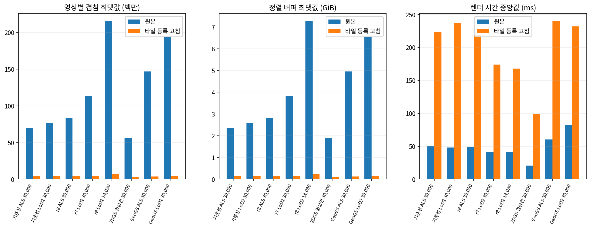
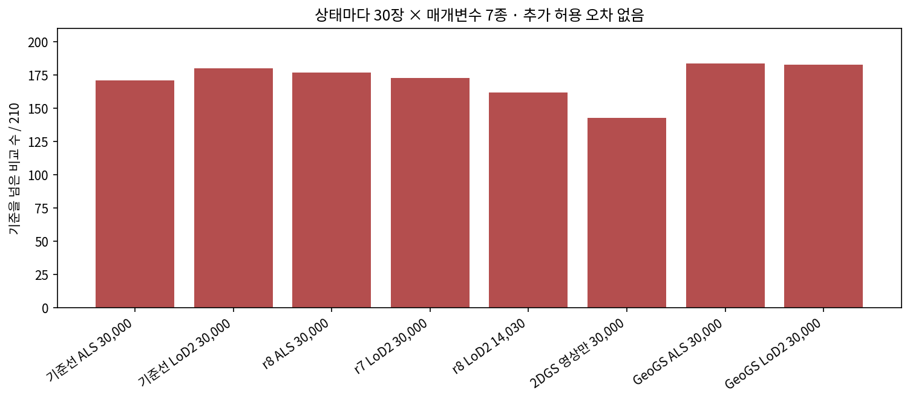

# 렌더러 화면 상자 고침 — 1~3단계 점검

- 작업: PHD-MAIN-TARGET-v1, 2026-11-03 10:40 발주문.
- 작성: 2026-11-03T12:07:02.883795+09:00
- 기술 판정: **STOP_GRADIENT_PARITY**. 1~3단계의 요청한 저장 상태 비교를 완료했다. 기울기 같음 조건을 충족하지 못해 r8 LoD2 이어 학습을 시작하지 않았다. 나머지 여섯 판도 시작하지 않았다.
- `scientific_verdict: null`. 학술 결론과 결과 해석은 이 문서에 두지 않는다.

## 1. 잠금과 범위

`rfix.json` 잠금 시각은 2026-11-03T10:44:16.754167+09:00, SHA256은 `4a295c72fa185a88ec5e6f915de22d613d4e66d3999289998c072810b3fe8773`이다. 첫 모델 계산 전에 대상 8개 상태, 학습 영상 203장, 상태마다 역전파 30장, 판정식, 조건부 학습 설정을 고정했다. `rfix.lock.json`은 원본 입력·소스 1,058개를 묶는다. 새 렌더러는 빌드별 잠금, 실제 실행은 상태별 소스·바이너리 잠금을 남겼다.

판정식은 영상·출력 또는 영상·매개변수마다 `max_abs(원본 A − 고침) ≤ max_abs(원본 A − 원본 B)`다. 허용 오차를 더하지 않았다. 유한/비유한 위치가 같고 `radii`가 바이트 단위로 같으며, 상태별 203장 겹침 합이 줄어야 한다. 기울기 영상은 이전 모의에서 겹침이 가장 큰 다섯 장, 0020, 0109를 포함해 첫 셈 전에 30장을 고정했다.

원본 모델·학습 코드·설치된 렌더러는 읽기 전용으로 썼다. 이전 화면 크기 정리 패치 다섯 개는 적용하지 않았고 밀도 제어와 정리 차례를 바꾸지 않았다. 이번 실행의 최적화 횟수는 0이다. 조건부 이어 학습, 새 메시 추출, 새 30,000회 채점은 실행하지 않았다.

이전 모의의 출신/자리 배열과 색 기여 계측 바이너리는 이전 전달물의 봉인된 SHA256을 계승했다. 이 파생 입력들의 현재 바이트 확인은 첫 rfix 렌더 뒤에 수행했으며, 이를 새 계산 전 잠금으로 소급 표기하지 않았다. 파일별 근거는 `reused_input_bindings.json`에 있다. 원래 입력·코드의 사전 잠금과 이 파생 입력의 이전 봉인을 구분한다.

## 2. 상태별 결과

| 상태 | 출력/203 | 기울기/30 | 실패 비교/210 | 겹침 합 원본→고침 | 버퍼 최대 GiB 원본→고침 | 렌더 중앙 ms 원본→고침 |
|---|---|---|---|---|---|---|
| 기준선 ALS 30,000 | 203 | 0 | 171 | 5,561,060,603 → 325,219,951 | 2.3495 → 0.1521 | 50.51 → 223.61 |
| 기준선 LoD2 30,000 | 203 | 0 | 180 | 6,136,685,900 → 326,999,386 | 2.5965 → 0.1507 | 48.07 → 237.15 |
| r8 ALS 30,000 | 203 | 0 | 177 | 5,554,886,672 → 305,314,534 | 2.8265 → 0.1407 | 48.92 → 219.40 |
| r7 LoD2 30,000 | 203 | 0 | 173 | 4,648,485,631 → 305,286,905 | 3.8139 → 0.1420 | 41.05 → 174.13 |
| r8 LoD2 14,030 | 203 | 0 | 162 | 5,292,767,933 → 364,950,831 | 7.2611 → 0.2480 | 41.49 → 167.98 |
| 2DGS 영상만 30,000 | 203 | 0 | 143 | 2,946,037,973 → 289,814,602 | 1.8815 → 0.0856 | 20.66 → 98.50 |
| GeoGS ALS 30,000 | 203 | 0 | 184 | 7,312,509,050 → 352,116,680 | 4.9555 → 0.1294 | 60.44 → 239.59 |
| GeoGS LoD2 30,000 | 203 | 0 | 183 | 7,237,190,454 → 392,550,618 | 6.5274 → 0.1481 | 82.19 → 231.86 |

모든 출력의 영상별 차는 `rfix/tables/all_render_outputs.*`, 기울기 1,680개 비교는 `gradient_comparisons.*`에 있다. 표의 상태 전체 최댓값 두 개는 요약값이며, 통과 여부는 같은 영상·같은 매개변수의 차끼리 비교했다.

r8 LoD2 중단 상태의 0020 영상에서 겹침은 214,976,330 → 1,986,099개, 정렬 버퍼는 7,796,493,183 → 72,047,487바이트였다. 렌더 시간은 405.318 → 982.727 ms였다. 버퍼 감소와 실행 시간 증가는 별도 관측값이다. 원본 시간은 색 기여 계측을 하지 않은 두 번째 원본 실행을 썼다. 최초 실행의 계측 포함 시간도 원시 JSON에 보존했다. GPU 최대 할당·예약량은 `per_view_full_load.*`와 상태 요약에 있다. 시간은 해당 실행 관측값이며 반복 시간 벤치마크로 확대하지 않는다.

## 3. 터진 가우시안–영상 쌍

영상마다 `radii > hypot(width,height)`인 쌍을 센다. 가우시안 하나가 여러 영상에서 잡히면 영상마다 한 쌍이다. 실제 색 기여는 원래 렌더러가 채택한 화소의 `alpha × T` 합과 최댓값이다. alpha 문턱 이후의 가림/조기 종료 때문에 실제 기여가 없는 경우도 0으로 기록한다. 타일 등록용 가능성 검사는 T를 사용하지 않아 이러한 실제 기여 집계와 구분된다.

| 상태 | 터진 쌍 수 | 전체 겹침 중 몫 | 실제 색 기여 쌍 수 | 터진 쌍 중 색 기여 |
|---|---|---|---|---|
| 기준선 ALS 30,000 | 1,400,315 | 75.5945% | 1,892 | 0.1351% |
| 기준선 LoD2 30,000 | 1,599,766 | 78.2321% | 1,970 | 0.1231% |
| r8 ALS 30,000 | 1,410,669 | 76.1216% | 2,799 | 0.1984% |
| r7 LoD2 30,000 | 1,123,181 | 72.4395% | 2,241 | 0.1995% |
| r8 LoD2 14,030 | 1,202,015 | 68.2023% | 256 | 0.0213% |
| 2DGS 영상만 30,000 | 532,900 | 54.0658% | 1,342 | 0.2518% |
| GeoGS ALS 30,000 | 1,792,557 | 73.2352% | 5,177 | 0.2888% |
| GeoGS LoD2 30,000 | 1,662,960 | 68.3418% | 8,168 | 0.4912% |

쌍마다 중심 깊이, 중심 투영 위치와 영상 밖 거리, 원판의 가까운/먼 깊이, `d`, 실제 기여 합·최댓값을 `states/<상태>/bursts/<영상>.npz`에 저장했다. 출신 × 가로 4칸 × 높이 4칸 × 가까운 카메라 30 m 여부의 분포는 `burst_groups.*`에 있다. 분위수는 최소·25·50·75·95·최대다. 카메라 30 m 주 집계는 203장 가운데 가장 가까운 카메라 중심을 기준으로 한다. 해당 영상 카메라까지의 거리와 그 카메라 30 m 여부도 원시 자료에 별도로 있다.

가로 칸은 평가 상자 안 / 밖 50 m 안 / 50~200 m / 200 m 넘음이다. 높이 경계는 공통 지역 좌표로 −43.640 m, −10.180 m, 0.476505482 m다. 네 칸은 지면 아래 / 지면~지붕 최고+10 m / 그 위~카메라 중앙값 / 그 위다. EPSG:25832 XY와 기존 지역 높이 변환을 계승했다. 출신 코드와 경계 원본은 이전 모의 및 `boundaries.json`을 따른다.

원본 `cuda_rasterizer/auxiliary.h:185–200`의 `in_frustum`은 중심의 카메라 깊이가 0.2 m 이하이면 거른다. 같은 조건문의 화면 X/Y 검사는 주석으로 꺼져 있다. `forward.cu:184–187`에서 이를 호출한다. `forward.cu`의 `compute_aabb`는 `d == 0`만 거르며, 작은 비영(非零) d는 나눗셈에 들어간다. 원판 깊이 범위는 `Tw.z ± 3·sqrt(Tw.x²+Tw.y²)`, 기록한 분모는 `9·(Tw.x²+Tw.y²)−Tw.z²`다. 고침은 이 원본 전처리와 `radii` 반환을 그대로 보존한다.

표의 d는 원본이 반환한 변환행렬에서 같은 식으로 float32 재계산한 진단값이다. 원본 CUDA 전처리의 내부 d를 바꾸거나 잘라서 사용한 값이 아니다.

## 4. 별도 렌더러의 수정 범위

원본 사각형 안의 각 타일에서, 원본 화소 식으로 `depth ≥ 0.2 m`이고 `alpha ≥ 1/255`가 될 수 있는 정수 화소가 하나라도 있는지 검사한다. 없으면 그 타일을 등록하지 않는다. 원판이 앞 평면을 가로지르는 경우에도 화소별 원본 깊이 조건을 사용한다. 낮은 주파수 필터의 `min(rho3d,rho2d)`도 포함한다. T나 다른 가우시안의 가림 결과는 이 검사에 쓰지 않는다.

바깥 방향 반올림 구간 계산으로 확실히 불가능한 타일을 먼저 제외한다. 분모가 0을 걸치거나 비유한 값이 있거나 경계가 확정되지 않으면 원본 float 화소 식을 직접 검사한다. 이는 원본 등록 범위에서 기여 불가능한 타일을 빼기 위한 구현이다. 화면 반지름의 이상값 자체를 고치거나 새 화소 지지 범위를 더하지 않는다.

수정은 `rasterizer_impl.cu`의 `rf_count` 호출과 `duplicateWithKeys` 타일 조건, 새 `rfix_tiles.cuh`다. `ext.cpp`와 같은 CU에는 이전 r8 정렬 버퍼 감시의 관측 인터페이스를 함께 넣었다. 검사 중 중단 장치는 비활성이고, 수치 커널에는 관여하지 않는다. 원본 `forward.cu`, `backward.cu`, `auxiliary.h`, `config.h`의 바이트는 세 빌드에서 모두 같다. 각 차이 파일은 ZIP의 `renderer_patches/`에 있다.

| 구현 | 원본 바이너리 SHA256 | 별도 빌드 SHA256 |
|---|---|---|
| baseline_r15 | 5ed584496a1f4f8d7bb8c2fb5d0e849a7d5e76924d89043eeb101dc83c9dd0a8 | ae90687632d79f2a7278319f1d38604339ba5ee9e67103945a9758ec9459a602 |
| target_r22 | 5ed584496a1f4f8d7bb8c2fb5d0e849a7d5e76924d89043eeb101dc83c9dd0a8 | ae90687632d79f2a7278319f1d38604339ba5ee9e67103945a9758ec9459a602 |
| target_r21_r7 | 5ed584496a1f4f8d7bb8c2fb5d0e849a7d5e76924d89043eeb101dc83c9dd0a8 | ae90687632d79f2a7278319f1d38604339ba5ee9e67103945a9758ec9459a602 |
| image_only_2DGS_adapter | c08d524330f098e1e350e265f53d6efbc27a8f9e0822e4e55293edc5a83714a0 | faa81706092141516cee5d2255b03e750561e1903c461d4c1b629f7f99b2946a |
| GeoGS_adapter | 5ed584496a1f4f8d7bb8c2fb5d0e849a7d5e76924d89043eeb101dc83c9dd0a8 | 4e700c10cd703795c9d1c16e104d32beba8fecf0288af7c683f1c17cf1dbfeba |
| CDGS_adapter_v2 | 완료 학습 없음 | 미적용 패치만 준비 |
| r8_LoD2_recorded_resume_actual_guard_build | ae7579bf038bca4d1a23d5ce6e42aaa4a064bc3c296bcb2860d79bfe9e25b6b0 | ae90687632d79f2a7278319f1d38604339ba5ee9e67103945a9758ec9459a602 |

r15·r21·r22는 target 빌드를 공유하며 영상만 2DGS와 GeoGS는 각각의 원본 Docker 이미지에서 따로 빌드했다. CDGS 어댑터는 준비 기록에 완료 학습 판이 없었다. CDGS의 3D conic alpha 식에 맞춘 같은 타일 조건의 미적용 패치를 별도로 준비했고 `git apply --check`만 통과했다. CDGS 새 바이너리나 저장 모델 검증 완료로 표기하지 않는다.

r8 LoD2의 **기록용 이어 학습**은 기본 설치 바이너리와 별도로 `jbgs_r8_record_guard.so`를 사용했다(SHA256 `ae7579bf038bca4d1a23d5ce6e42aaa4a064bc3c296bcb2860d79bfe9e25b6b0`). 이번 원본 A/B 대조는 이전 모의와 같은 기본 설치 바이너리를 썼다. 두 바이너리를 같다고 표시하지 않는다. 실제 감시 빌드의 네 원본 소스와 네 sm_86 수치 커널 명령어는 기본 빌드와 같음을 추가 확인했다. 이 출처 확인은 첫 rfix 렌더 뒤에 수행했으며 기존 감시 빌드의 이전 잠금을 따로 보존했다. [구분 기록](rfix/실행빌드_기록감시.md)에 경로·해시·확인 범위를 적었다. 이 추가 코드 확인은 현재 기울기 실패 판정을 바꾸지 않는다.

## 5. 단위 점검과 기울기 차이의 기록

세 빌드에서 렌즈 앞 기울임·화면 밖 상자·앞 평면 걸침·보통 가우시안의 네 경우를 점검했다. 화소 출력과 반지름이 같고, 타일 수는 독립 화소 참조 셈과 같다. target 빌드에는 d가 0에 가까운 여섯 경우를 덧붙였다. 반지름 450,975 px인 경우 1,410 → 27타일, 43,739,636 px인 화면 밖 경우 3,008 → 0타일이었으며 출력과 반환 반지름은 같았다. `unit_comparison.*`, `extra_near_plane_units.*`에 전체 수가 있다.

| 상태 | 기울기 최대 차 | 원본 반복 최대 차 | 실패 비교 수 |
|---|---|---|---|
| 기준선 ALS 30,000 | 8.33533704e-08 | 4.51691449e-08 | 171 |
| 기준선 LoD2 30,000 | 3.58559191e-08 | 2.23517418e-08 | 180 |
| r8 ALS 30,000 | 2.34693289e-07 | 3.91155481e-08 | 177 |
| r7 LoD2 30,000 | 6.33299351e-08 | 2.88709998e-08 | 173 |
| r8 LoD2 14,030 | 4.76837158e-07 | 2.38418579e-07 | 162 |
| 2DGS 영상만 30,000 | 7.68899918e-06 | 3.12924385e-07 | 143 |
| GeoGS ALS 30,000 | 4.991889e-07 | 3.7625432e-07 | 184 |
| GeoGS LoD2 30,000 | 3.98606062e-07 | 3.51108611e-07 | 183 |

기울기 비교는 저장 상태에서 원래 학습 손실을 같은 가중치로 계산했다. 위치·SH DC·나머지 SH·크기·회전·불투명도와 화면 위치 기울기를 모두 비교했다. 파라미터를 갱신하거나 최적화기를 실행하지 않았다. 손실의 원본 함수와 입력 지도는 역전파 전에 따로 해시를 남겼다. 손실 종류와 가중치는 `provenance.json`의 `losses`, 모든 실제 손실 스칼라는 `same_losses.*`에 있다.

차이가 큰 가우시안의 행 ID·지역 좌표·영상·매개변수·차이 크기는 `differing_gaussians.*`, 해당 원본 A/B/고침 기울기 배열은 `gradients/<상태>/*_differing_rows.npz`에 있다. 이 파일은 다음 재설계가 같은 대상을 확인할 수 있게 보존한다.

추가 관측에서는 첫 실패 영상 0020의 위치·DC·화면 위치 기울기 차이가 가장 큰 행 3271259, 3055338, 2351355를 골랐다. 세 행 모두 화소별 원자적 덧셈 **입력항은 바이트 단위로 같았고** 서로 다른 항은 0개였다. 실제 합산 후 기울기 차이는 `atomic_addend_probe.*`에 따로 있다. 원본 역전파는 `backward.cu:421–443` 등에서 `atomicAdd`로 합산한다. 이 세 행의 관측은 전체 기울기 같음을 대신하지 않으며 잠근 실패 판정을 바꾸지 않는다. 관측용 빌드는 전달한 고침 빌드와 분리했다. 나머지 행의 차이 원인은 이 관측만으로 확정하지 않는다.

CPU 기울기 차 집계는 뒤의 상태에서 동일한 65,536행 청크 계산을 병렬로 실행하고 원래 순서로 합쳤다. 실제 실패 행을 반복한 검증 입력에서 일곱 매개변수의 원래/병렬 결과 사전이 정확히 같음을 확인했다. CUDA 계산·판정식·원시 기울기를 바꾸지 않았으며 검증 영수증과 코드 해시를 남겼다.

컴파일된 바이너리도 CPU 도구 `cuobjdump --dump-sass`로 대조했다. 세 빌드 모두 sm_86의 원본/고침 `renderCUDA` 두 함수와 `preprocessCUDA` 두 함수의 명령어 목록과 인코딩이 정확히 같았다(총 12개 비교). 원문과 함수별 SHA256은 `sass_audit/`, 표는 `native_kernel_sass.*`에 있다. 바뀐 타일 목록과 실행 순서는 이 코드 동일성의 검사 대상이 아니며, 이 관측으로 기울기 수치 실패 판정을 대체하지 않는다.

## 6. 기존 GeoGS·2DGS 채점의 메시 출처

GeoGS 항공 LiDAR의 전체 R/P는 0.5474095330749325 / 0.47920042874658025, 영상만 2DGS의 ALS τ 전체 R/P는 0.3997773431018615 / 0.4199856431272774다. 기존 AXES71-v2와 이번 모의의 지우기 전 값이 반올림 전까지 같다. 기존 전체 줄의 메시도 학습 영상 203장, TSDF 0.05 m, sdf truncation 0.25 m, depth truncation 300 m였다.

다만 기존 `a3_metrics.py:22–45`는 `c_inh_invis`, `c_invis_wrong` 두 칸에서 가상 시점 메시가 있으면 그 메시를 썼다. 모의는 이 두 칸도 학습 영상 메시를 썼다. 따라서 전체 줄의 동일성과 모든 칸의 메시 규칙 동일성은 다르다. 기존 경로·post.json·거리 메타 해시와 칸별 차이는 `rfix/기존메시_출처.md`, `mesh_history.json`, `mesh_history_summary.*`에 있다.

## 7. 보존·실패·전달 경계

첫 CUDA 빌드는 상수 헤더 누락으로 실패했고, 이미지 전용 단위 점검 첫 실행은 합성 크기 자료형 문제로 실패했다. 관측용 빌드는 생성기 치환 범위 오류로 한 번 실패했다. 모두 계산 대상·실패 로그를 보존하고 해당 구현 오류만 고쳤다. 첫 그림의 한글 폰트 등록 문제는 데이터와 그림 시점을 유지한 폰트 전용 실행기로 고쳤다. `issues.md`와 `failures/`에 기록했다. 실패한 기울기 결과는 재실행으로 골라 바꾸지 않았다.

ZIP에는 보고서, md/json/csv 표, png/pdf/json 그림, 잠금 설정, 원본과 고친 빌드의 출처·차이 파일, 단위 점검 및 수치 비교 기록, 실행 스크립트, 무결성 목록을 넣는다. 큰 모델·화소별 원시 배열·별도 컴파일 바이너리는 외부 경로·크기·SHA256 목록으로 연결한다. ZIP만으로 원본 학습 자료 전체를 대체하지 않는다. ZIP CRC와 SHA256 검증은 전달물 무결성 점검이며 학술 판정이 아니다.

발주문 3단계 통과 조건 미충족으로 조건부 이어 학습은 실행하지 않았다. 따라서 4단계 이어 학습 ZIP과 새 30,000회 결과는 없다. `scientific_verdict: null`을 유지한다.
