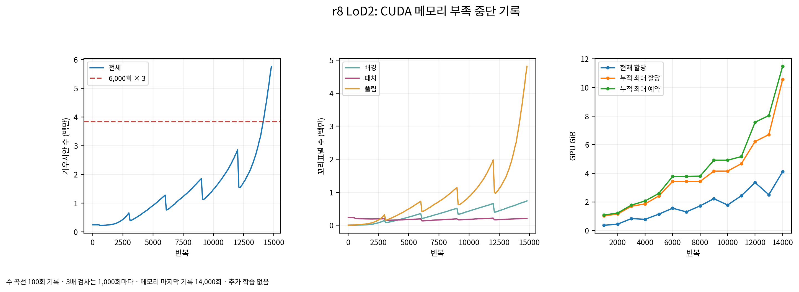

# r8 LoD2 실행 중단 기록

- 중단 시각: 2026-11-02T00:27:23.752444+09:00. 진행 표시 14,830회 직후 forward 렌더링에서 CUDA 메모리 부족. 종료 코드 1.
- 물리 GPU 1을 독립 사용했다(오류문의 GPU 0은 컨테이너 내부 번호). r8 항공 LiDAR는 30,000회 정상 종료했으며 영향을 받지 않았다.
- 7,000회 채점 PLY와 최적화 전체 상태는 보존했다. 15,000·30,000회 PLY와 전체 상태는 없다. 자동 재시도하지 않는다.

| 반복 | 전체 | 6,000회 대비 | 배경 | 패치 | 풀림 |
|---:|---:|---:|---:|---:|---:|
| 6,000 | 1,280,149 | 1.000000 | 355,786 | 194,673 | 729,690 |
| 14,000 | 3,557,869 | 2.779262 | 632,374 | 197,526 | 2,727,969 |
| 14,200 | 4,032,674 | 3.150160 | 660,412 | 202,047 | 3,170,215 |
| 14,800 | 5,762,626 | 4.501528 | 739,776 | 209,627 | 4,813,223 |

3배 한계는 3,840,447개다. 마지막 정기 검사 14,000회는 한계 이내였다. 100회 기록에서 처음 넘은 때는 14,200회지만, 잠긴 3배 검사 간격은 1,000회다. 다음 15,000회 검사·저장 전에 CUDA 오류가 발생했다. 간격과 멈춤 문턱을 바꾸지 않았다.

마지막 건강 기록의 불투명도 중앙값은 0.575514078, 법선 방향 최대 폭 초과는 8.17314094e-06 m다.

```text
torch.cuda.OutOfMemoryError: CUDA out of memory. Tried to allocate 15.69 GiB. GPU 0 has a total capacty of 23.56 GiB of which 15.46 GiB is free. Process 2348970 has 8.00 GiB memory in use. Of the allocated memory 7.43 GiB is allocated by PyTorch, and 214.98 MiB is reserved by PyTorch but unallocated. If reserved but unallocated memory is large try setting max_split_size_mb to avoid fragmentation.  See documentation for Memory Management and PYTORCH_CUDA_ALLOC_CONF
```



r8 결정 4의 건강 검사 중단·질문 조건에 따라 LoD2 추가 학습은 후속 결정을 기다린다. 저장된 모델의 읽기 전용 채점은 계속한다. 나머지 여섯 판은 시작하지 않는다. scientific_verdict: null.

수치·원본 파일 해시·저장 상태 목록: [JSON](tables/r8_LoD2_stop.json).
