# 영역별 목표 학습 보고 v1 · 초기 렌더 점검 중단

## 1. 현재 결과

판단 정확도: 개발용·확인용·실험 지역의 원값/대체 분리 표와 그림 완료.
7,000회 점검: 미실행. 학습 전 3.5의 초기 렌더 깊이 5 cm 기준 미충족.
8판의 네 값: 확인 불가. 초기 6판과 B173 자체 불확실도 추가 2판의 목표만 고정됨.
GS와 목표 직접 메시 비교: 확인 불가. 둘 다 아직 생성 전.
단계 0 통과, 목표 지도·묶기·상속 통과. 최적화 0회. `scientific_verdict: null`.

## 2. 단계 0

설정 SHA-256: `8fe56883d6f29303b1f31c3de739b0dae303f75d3b6a9f26c32a51d15a714a97`. 10/31 결정으로 r0를 보존하고 r1을 잠근 뒤 재계산했다. 평가 범위만 10% 중단 기준에 넣고, 띠는 별도로 셌다. [이 발주에서 냄].

### 둘째 문턱

전체 u의 T2는 **0.530253 m**, 큰 무리 넓이 비율은 **44.36%**이다. a만 사용한 민감도는 0.294134 m이며, 발주 참고값 0.855 m와 다르다. 결과를 맞추기 위한 재선택은 하지 않았다.

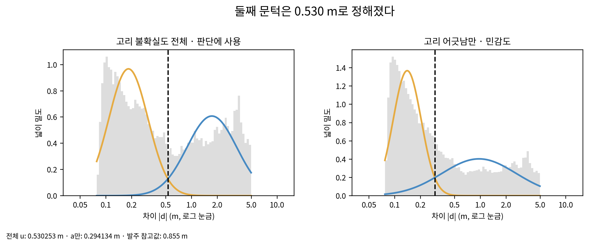

### 정밀도 출처와 대체

2026-10-26 방법 재정리 세션이 참값 없이 구한 값이다. 정밀한 MVS(u 5 cm 이하)와 LoD2의 차 분포를 두 무리로 맞추고, 좁은 무리의 폭에서 MVS 흔들림을 뺐다. 참값으로 한 같은 셈(평지붕 17.1 cm)은 점검에만 썼다.
위 문장은 사용자가 제공한 출처 설명이다. 원 추정 세션을 이번 작업에서 독립 재현했다는 뜻은 아니다.
대체값은 같은 단위·같은 사전 정보·같은 면 종류의 유효한 원값 중앙값이다. 실험 단위는 평가 범위와 저장 띠를 함께 사용하고, 개발/확인용은 건물 ID별로 별도 집계했다. u=0 대체는 없다. 법선 누락에는 목표를 주지 않았다.

| 지역 | 사전 정보 | 평가 넓이 m² | 셀 수 없음 % | 대체 넓이 m² |
|---|---|---:|---:|---:|
| B0 | ALS | 1592.89 | 0.1181 | 11.60 |
| B0 | LoD2 | 5132.25 | 0.0000 | 318.82 |
| B173 주변 | ALS | 2285.87 | 0.1326 | 79.00 |
| B173 주변 | LoD2 | 8845.88 | 0.0000 | 2972.69 |
| R1 | ALS | 1610.53 | 0.3254 | 70.94 |
| R1 | LoD2 | 4940.88 | 0.0000 | 877.56 |
| B173만 | ALS | 1729.58 | 0.1472 | 78.30 |
| B173만 | LoD2 | 7129.06 | 0.0000 | 2873.62 |

지역·사전 정보·평가/띠별 대체 수와 넓이는 [전체 CSV](tables/replacement_area_r1.csv). u 대체와 σP 대체, 둘의 합집합을 각각 기록했다.

### 영역 넓이와 판단 정확도

[영역 넓이](tables/area_r1.csv), [실험 정확도](tables/experimental_accuracy_r1.csv), [개발·확인용 정확도](tables/judgment_accuracy_r1.csv). 모든 표는 원값, 대체, 전체 줄을 분리한다.
틀린 비율의 분모는 유의 차이가 있는 칸 0·1·2 넓이이며, 분자는 칸 1의 보존 + 칸 2의 보정이다. 실험 지역은 S1의 고정 참값 코드를 의미에 따라 0~6으로 변환했다. 개발·확인용은 JUDGENUM의 고정 칸을 사용했다. 실험 지역의 참값은 목표 파일 저장 후 정확도 계산에만 읽었다.
확인용 상세 패치 값은 외부 payload의 `holdout/`에만 있다. 공개 보고서와 그림에는 집계 수·넓이·비율만 있다.

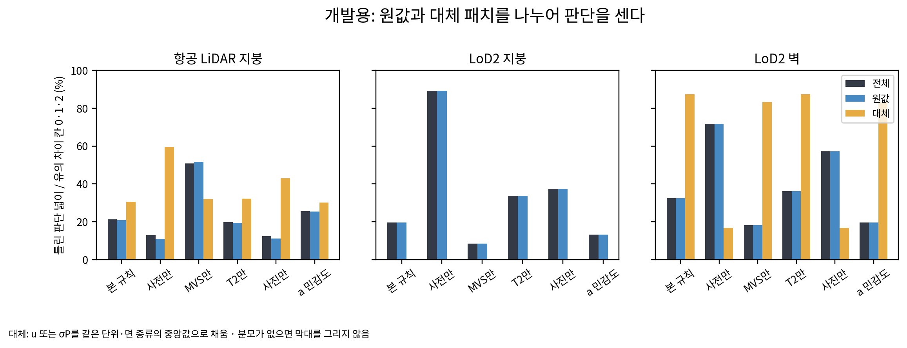
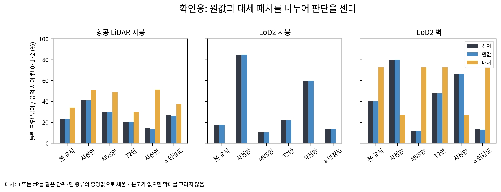
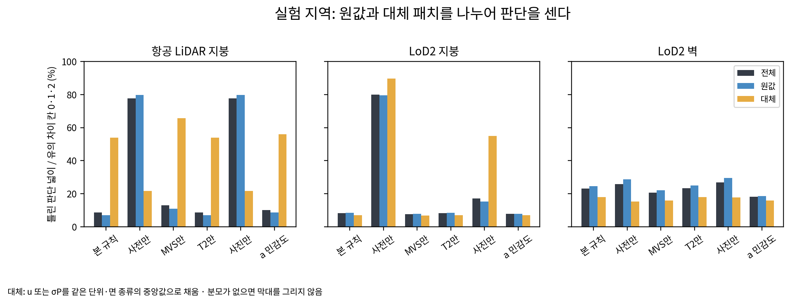
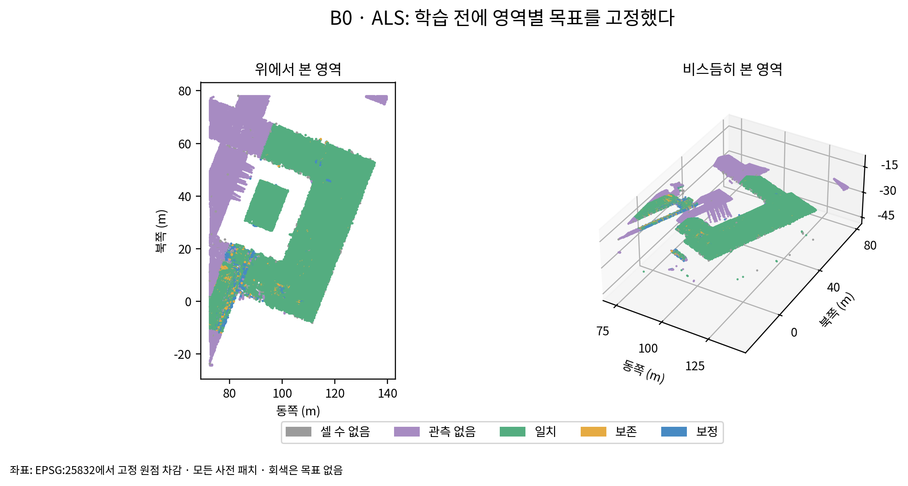
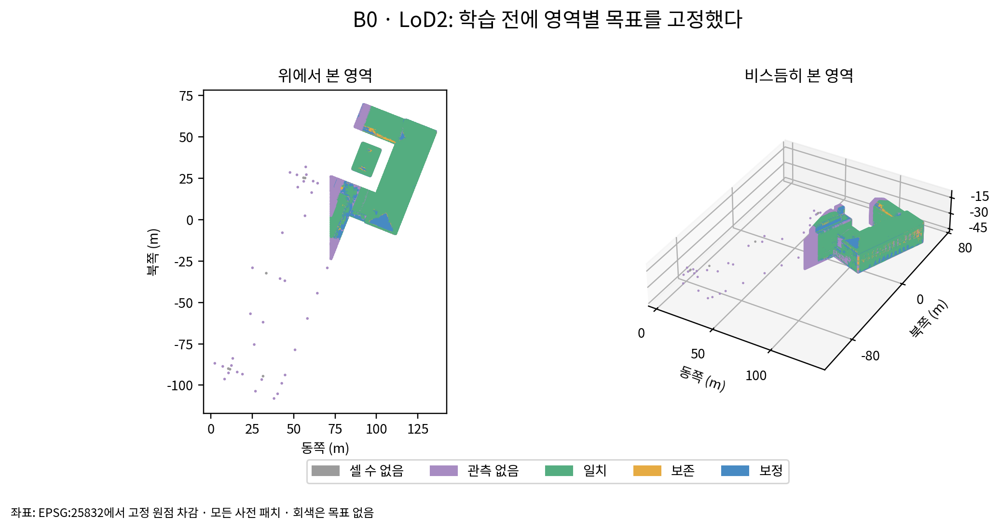
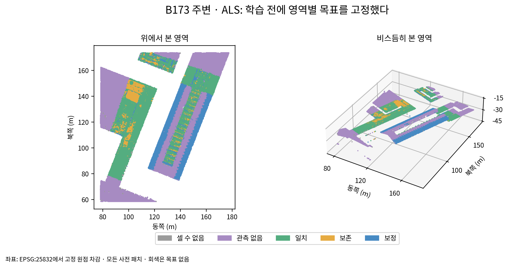
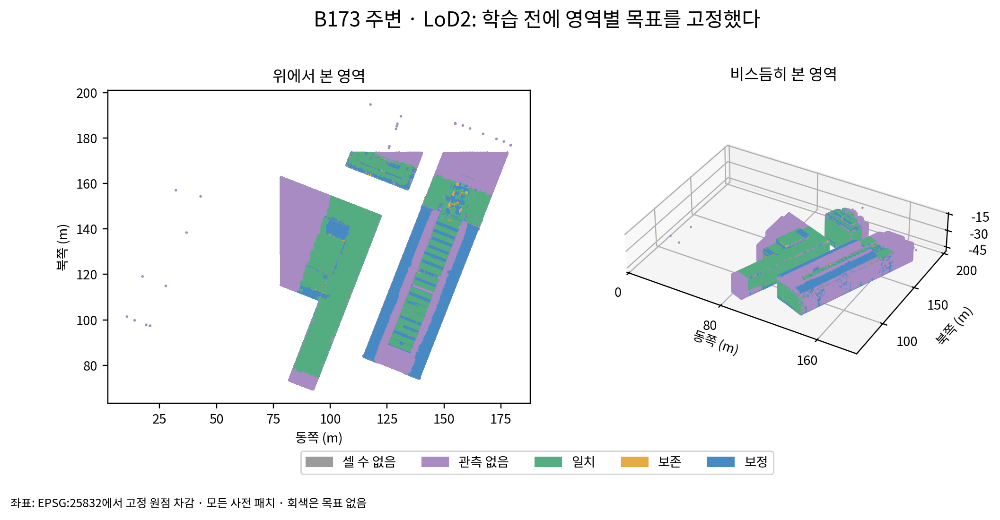
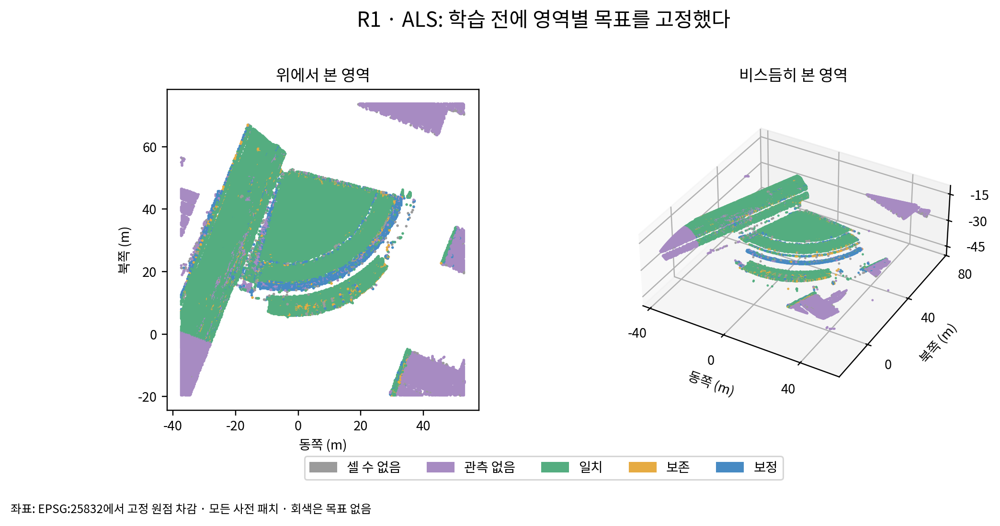
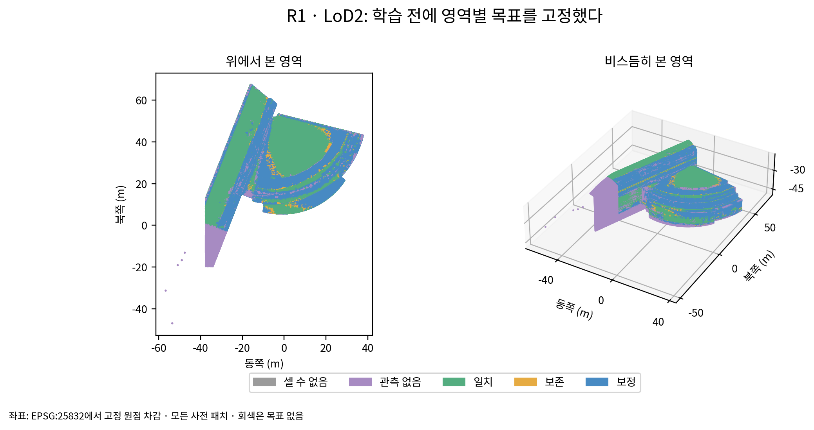
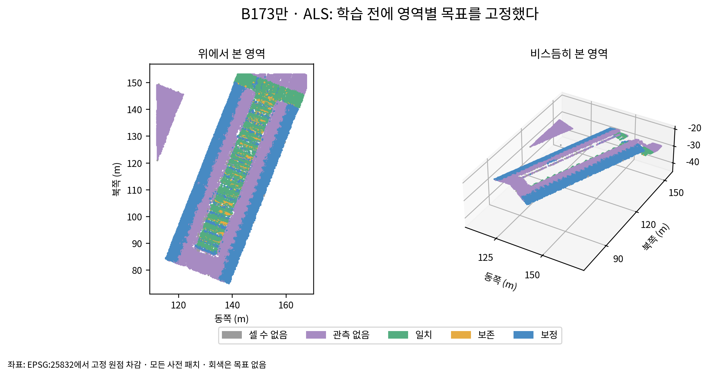
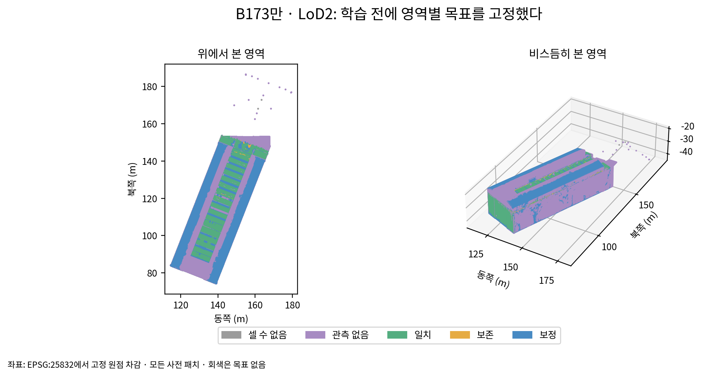

### 사진 곡선 연결

동일하게 정합된 패치 중심(1e-8 m), 면 종류, 바깥 법선(1e-6)이 유일하게 일치하는 경우에만 저장 사진 곡선을 연결했다. 전체 지역 ALS와 실험 ALS의 격자·정합 차이 때문에 B0·B173 주변·B173만은 연결된 곡선이 없다. R1 ALS도 매우 적다. 이런 곳은 사진 판단 모름이며 T2 규칙은 그대로 적용된다. LoD2는 대부분 연결된다. [대응 넓이](tables/photo_join_r1.csv).

### 띠의 항공 LiDAR 상태 1 원인

영역 파일의 `in_eval=False` 패치 집합은 저장 점군을 잘라낸 사각형 밖까지 이어진다. 아래 그림과 원통 점 수를 대조하면 상태 1 대부분이 이 범위 차이에서 발생한 빈 원통이다. 소수는 범위 안 점 부족 또는 점은 있으나 0.3 m 구간에 20%가 모이지 않은 경우다. 원본 점군이나 영역을 다시 만들지 않았으며, 사용자 결정대로 중앙값 대체 후 진행한다.

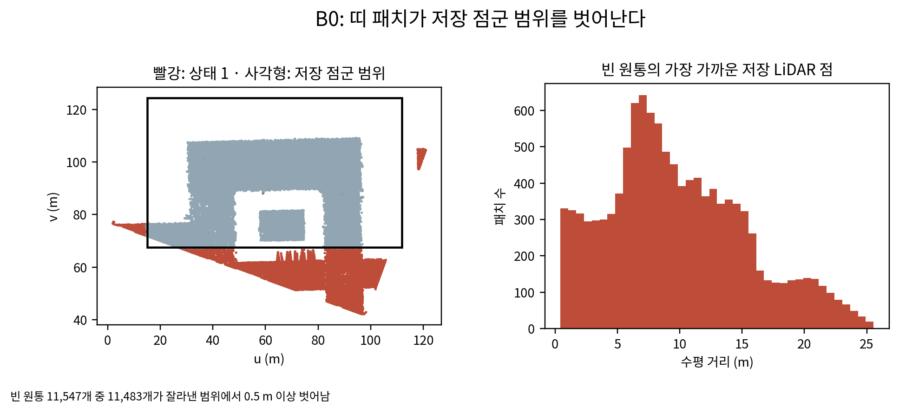
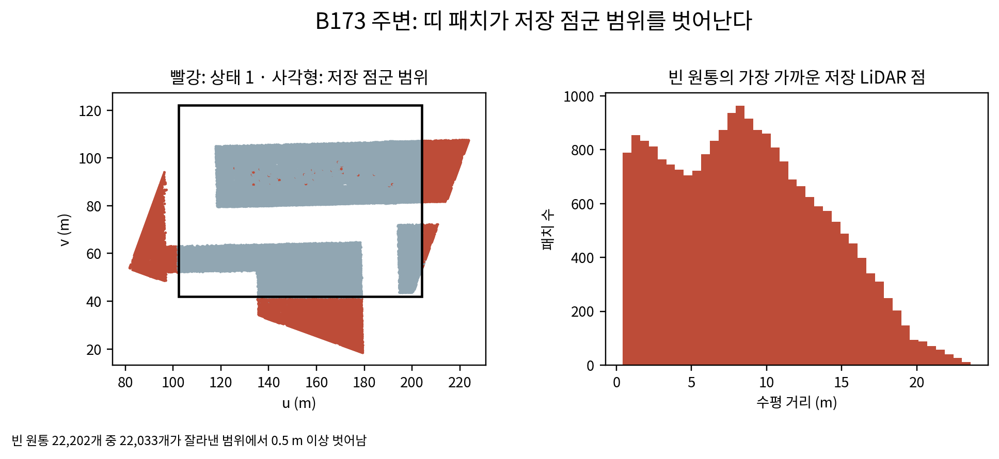
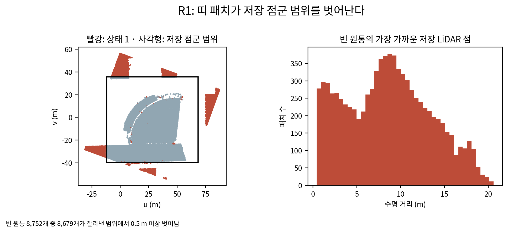
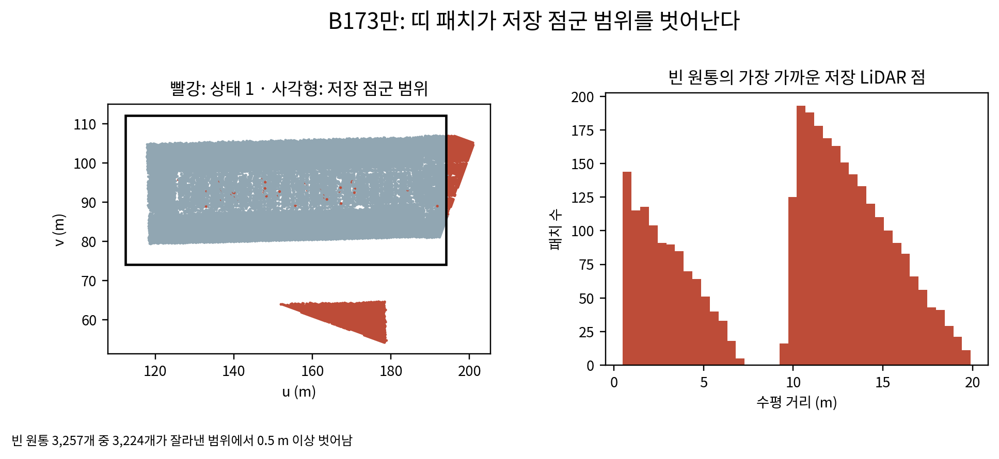

### B173만

자체 학습 영상 140장의 MVS 판 가(5,489,535점)와 자체 범위의 원본 항공 LiDAR로 UNCERT-v1과 같은 1.5 m 고리 계산을 완료했다. 주변 단위 값은 읽어 옮기지 않았다. 두 판의 단계 0도 통과했다. 초기 6판/추가 2판의 실행 순서는 유지한다.

## 3. 단계 1: 학습 전 중단

발주문 3.5의 **초기 렌더 깊이 오차 중앙값 5 cm 이하**를 충족하지 못했다. 7,000회 건강 점검 실패가 아니다. 학습과 본 채점은 시작하지 않았다. 묶기는 폭 밖 중심을 끝으로 옮기고 폭 안·접선 성분을 유지했다. 실제 GaussianModel의 복제·분할·제거 뒤 부모 목표 인덱스도 유지됐다.

| 판 | 전체 목표 화소 오차 중앙값 m | 사전 패치 화소만 m | 기준 |
|---|---:|---:|---|
| B0 LoD2 | 32.014999 | 5.367508 | 0.05 m 이하, 미충족 |
| B173 주변 ALS | 39.562180 | 4.569275 | 0.05 m 이하, 미충족 |
| B173 주변 LoD2 | 17.064514 | 2.516720 | 0.05 m 이하, 미충족 |
| R1 LoD2 | 98.817245 | 6.977371 | 0.05 m 이하, 미충족 |

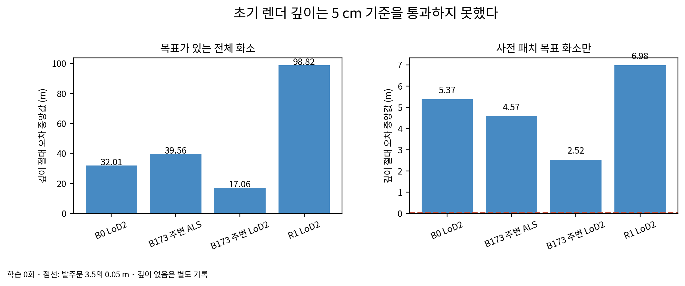

전체 목표 화소는 학습 영상 전체에서 양의 유효 깊이가 있는 화소를 합쳐 센 값이다. 렌더 깊이가 없는 비율은 영상별 원표에 따로 남겼고 성공으로 세지 않았다. 사전 패치만 따로 보아도 기준 미충족이다.

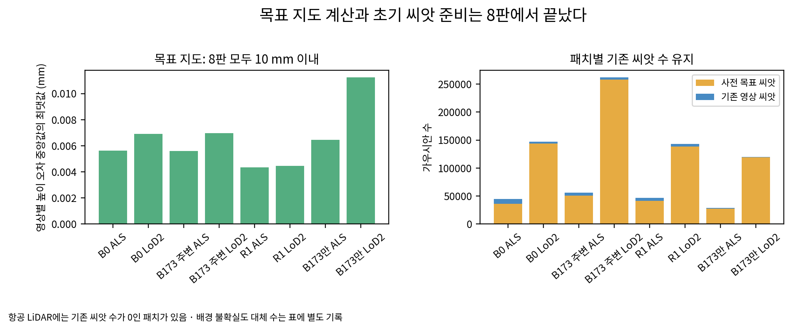

목표 지도는 8판 전부 완료했다. 모든 학습 영상에서 지도 깊이를 세계 좌표로 되돌린 h의 중앙값 오차가 1 cm 이내다. 대표 자리 넷의 정확한 단면과 학습 영상은 렌더 전에 representatives_v1.json으로 잠갔다. 판단이 틀린 보존 자리는 LoD2 지붕 칸 1의 최대 연결 넓이로 정했으며 표시 전용이다.

바탕은 r18의 현재 실제 파일 109개다. 마지막 추적 커밋은 f614090ab5444090182890c6c43505a3a4e5af8f이며, 추적하지 않은 상속 파일도 fork_r19_base.json의 개별 해시로 고정했다. 새 판 r19에서 train.py에 목표 초기화·깊이 손실·갱신 뒤 묶기·기록 연결을 넣고 jbgs_target.py를 추가했다. 원 r18은 변경하지 않았다. 변경 위치는 [파일·줄 기록](tables/r19_changes.json)과 [train.py 차이](tables/r19_train.patch)에 있다. 렌더러도 기존 기준선의 diff_surfel_rasterization을 유지했다.

깊이 손실은 기존 MVS 항과 같은 화소 전체 수 분모의 가중 절대 차이와 λ=0.05다. 지도는 CPU 고정 메모리에 두고 한 영상만 GPU로 옮긴다. --jbgs_target 기본값은 off다. 새 경로는 옛 판단·사진 보정·다중 보기 모듈을 끄고 목표를 고정한다. 실제 최적화 실행은 0회이므로 30,000회 동작 검증을 마쳤다는 뜻은 아니다.

### 초기 오차의 확인된 원인과 범위

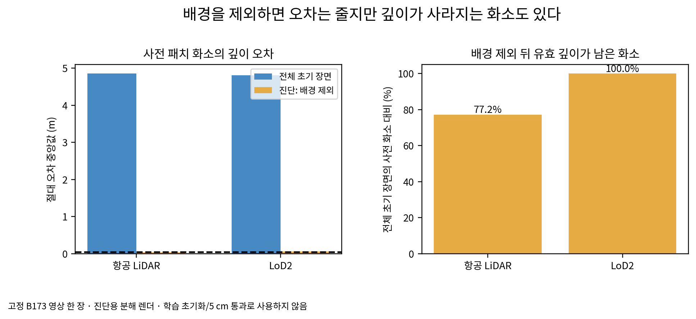

카메라 행렬 차이는 0이고, 목표에 놓인 씨앗 위치 차이는 float32 수준이다. 법선을 회전 행렬로 복원한 값도 일치한다. 카메라 깊이 50 m인 합성 평면의 렌더 중앙값 오차는 0.001 m 미만이었다.

B173 주변에서 기존 영상 씨앗 중 [135.327545, 72.262688, 21.422825]의 가우시안 크기는 42.538944 m였다. 이 한 원반만 렌더해도 고정 영상의 목표 화소 전체를 덮으며 약 11.33 m 깊이를 낸다. 항공 LiDAR 고정 영상에서 전체 초기 장면의 사전 패치 화소 오차 중앙값은 4.855858 m다. 진단용으로 배경 씨앗을 모두 제외하면 유효 깊이가 남은 사전 화소의 중앙값은 0.039948 m로 줄지만, 일부 화소에 깊이가 없어지고 평가 분모도 달라진다. 따라서 이 진단은 5 cm 기준 통과로 인정하지 않았다. 배경 씨앗을 제외한 초기화로 학습하지 않았다.

기존 기준선의 영상 씨앗 파일은 MVS 작업공간의 sparse/0/points3D.ply에 있는 SfM 희소점이다. 조밀한 MVS 깊이와 같은 점 집합이 아니다. 이번 구현은 '기존 기준선과 같이'를 따라 그 씨앗과 크기를 유지했다. 초기 배경 씨앗을 신뢰도 통과 MVS 점으로 바꾸거나, 큰 씨앗을 제거·크기 제한하거나, 깊이 정의·5 cm 기준을 바꾸는 일은 아직 적용하지 않았다. 이 중 어떤 변경을 허용할지 결정이 필요하다.

## 4. 단계 2

8판 최적화 0회, 7,000·30,000회 모델 0개. 네 값, 칸/영역별 채점, 뜬 면, 면 없음, 판단 맞음·틀림 결과, 목표 직접 메시 비교는 **확인 불가**다. 초기 6판과 추가 B173 2판의 목표만 준비됐다. B173 자체 고리 계산 완료가 학습 완료를 뜻하지 않는다.

## 5. 비교 방법

기존 결과를 다시 학습하지 않았다. 이번 학습 결과와 같은 최종 메시·채점 비교표는 확인 불가다. 메모리 보류 CDGS도 확인 불가를 유지한다.

## 6. 대표 자리의 학습 전 증거

아래는 잠근 같은 보기의 실제 사진, 목표 h·영역, 초기 렌더 깊이와 단면이다. 결과 메시와 7,000·30,000회 장면이 없으므로 해당 그림을 만들거나 추정하지 않았다. B0는 앞 작업의 평가 중심을 통과하는 사전 지붕 주축으로 단면을 고정했다. 약 15 cm라는 발주 기대값을 자리 선택이나 통과 기준에 쓰지 않았다.

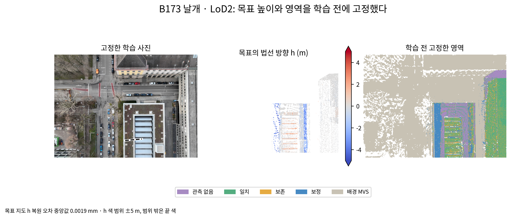

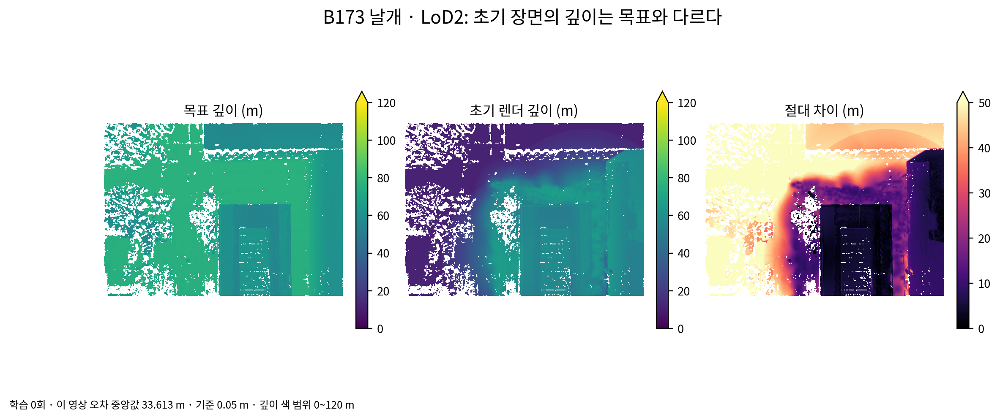

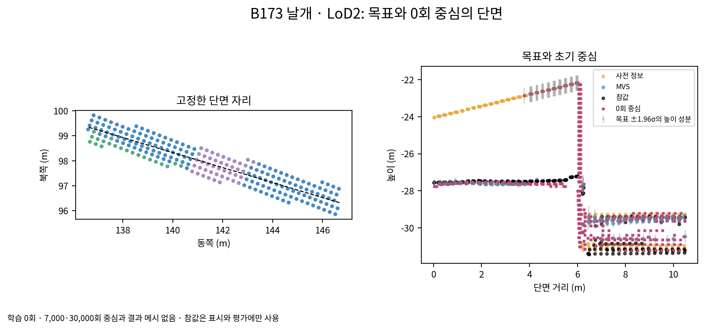

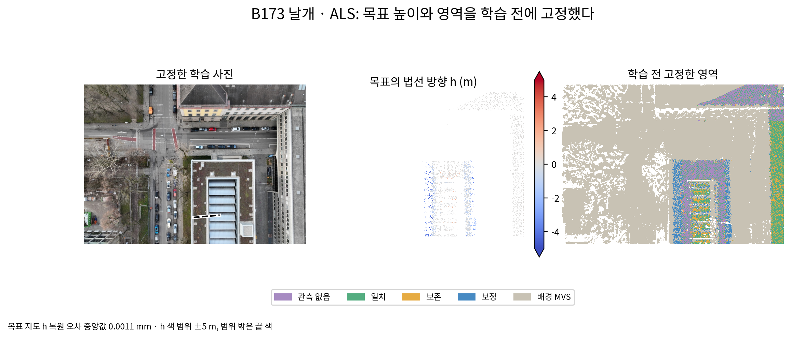

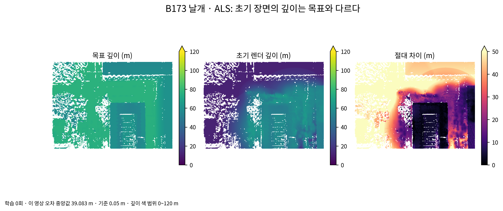

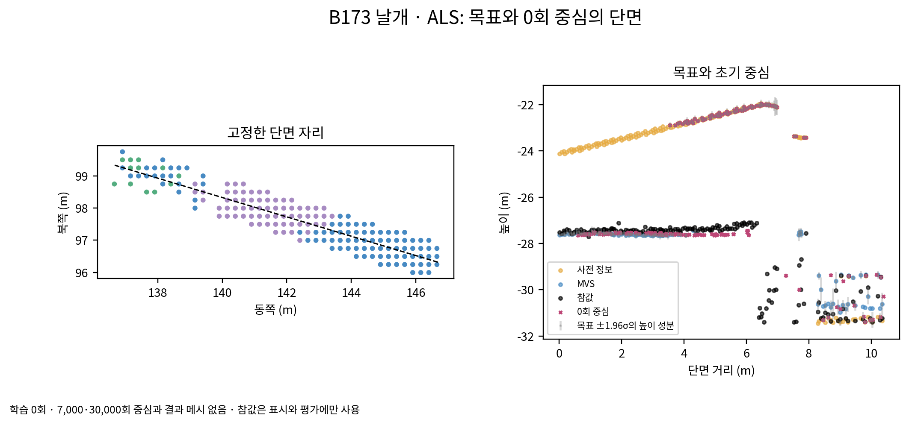

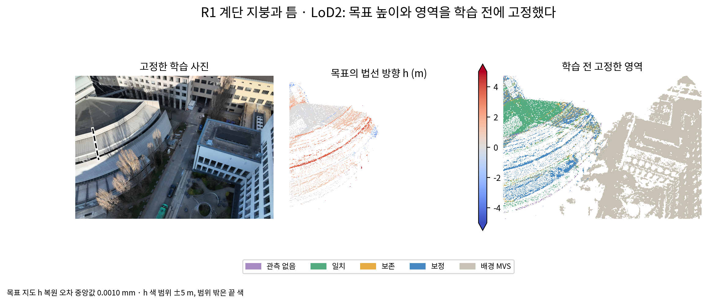

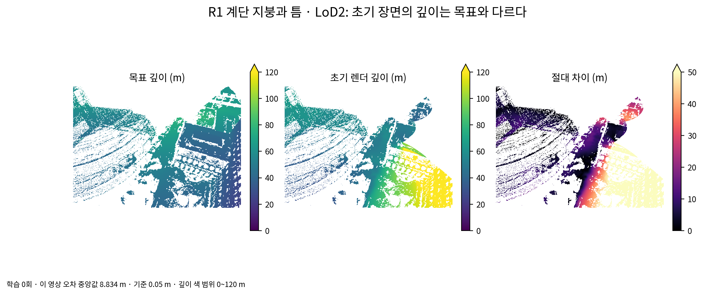

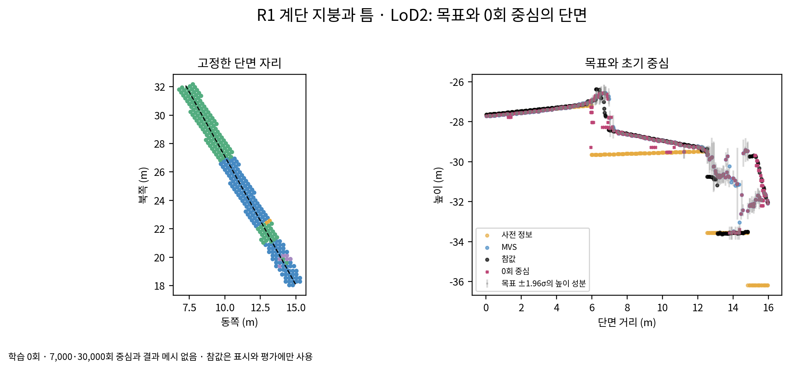

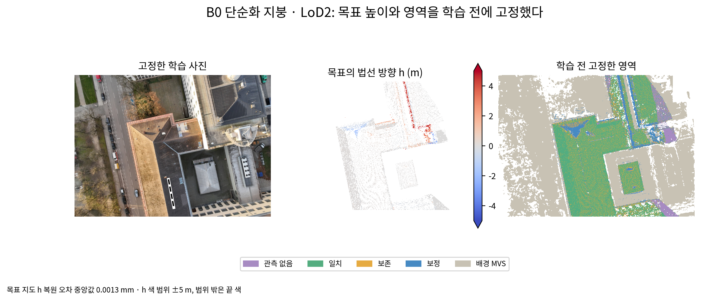

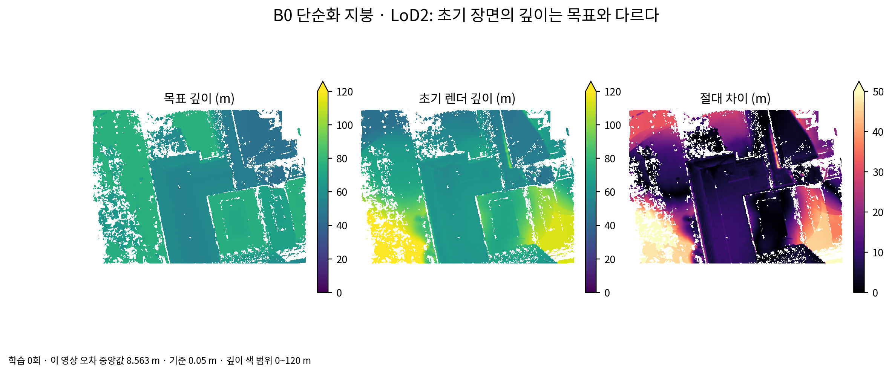

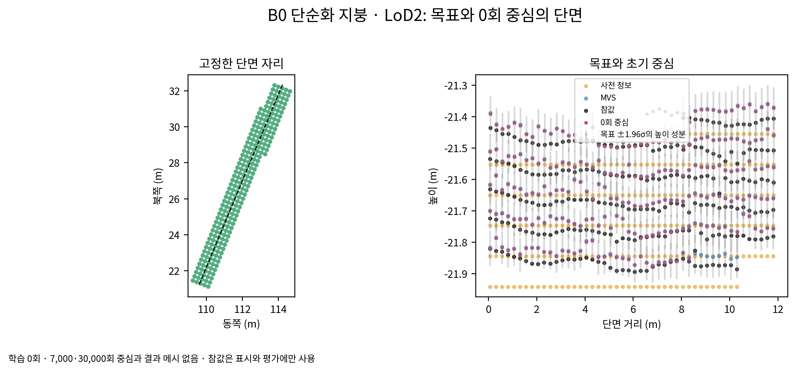

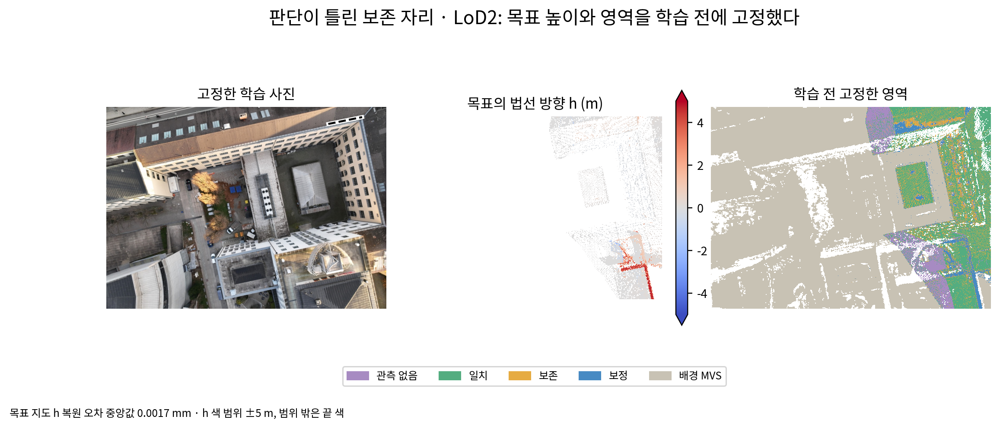

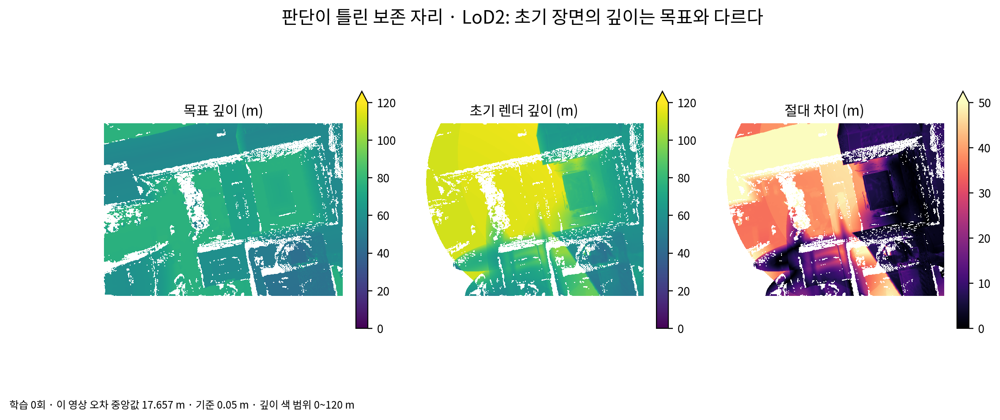

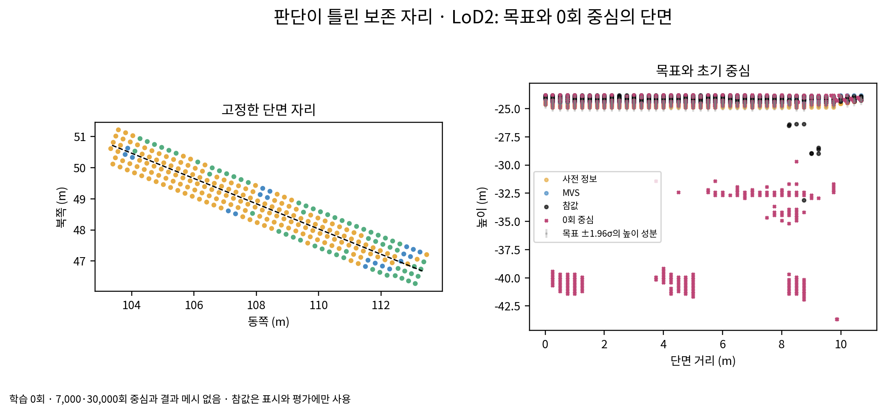

## 7. 미리 정한 물음과 관측

판단이 한 자료만 믿을 때보다 틀린 넓이를 줄이는지는 단계 0의 원값/대체별 비교 줄에 수치로 제시했다. 학습의 목표 따름, 작은 판단 오류의 변화, GS와 직접 메시의 비교, 다른 방법보다 나은지, B173의 뜬 면 변화는 학습 전 중단으로 확인 불가다. 과학적 결론은 내리지 않는다.

## 8. 바뀐 것, 검증 범위와 자원

사용자 10/31 결정 1~6을 r0에 덧붙여 r1로 잠갔다. 단계 1의 씨앗·지도·손실 구현 선택은 첫 계산 전에 별도 잠갔으며, 단계 0 설정은 revisions/r1에 보존했다. 법선 누락은 대체하지 않았고 u=0도 사용하지 않았다. 배경의 u 결측 대체는 기존 패치의 대체 넓이와 구분해 씨앗 수로 기록했다.

단계 0 원통 독립 비교 960건의 최대 차이는 4.44e-15였다. 목표 8판 각각 512개를 독립 스칼라 식으로 확인하고 넓이 보존을 점검했다. 목표 지도와 초기 렌더는 같은 소스 카메라를 사용했다. 단위 점검·좌표 검사·합성 평면 검사는 기술 검증이며, 사용자 시각 수용이나 과학적 결론이 아니다.

CPU 고리·지도 계산은 Docker 안에서 4코어와 최대 22 GiB 제한으로 실행했다. GPU 초기 렌더와 진단은 RTX 3090, 컨테이너당 24 GiB 메모리 제한으로 실행했고 역전파·최적화는 하지 않았다. 개정 설정 잠금부터 이 보고까지 약 49.6분이 지났다. GPU를 사용한 초기 렌더·진단 호출 시간의 합은 4.8분이며 병렬 실행을 포함하므로 전체 경과 시간과 다르다. [실행 시간 기록](tables/stage1_timing.json)에 호출별 영수증이 있다. 환경·스키마·호출 오류와 수정은 issues.md에 남겼다. 다음 학습의 소요 시간은 이번 실패 상태에서 확정하지 않는다.

scientific_verdict: null
