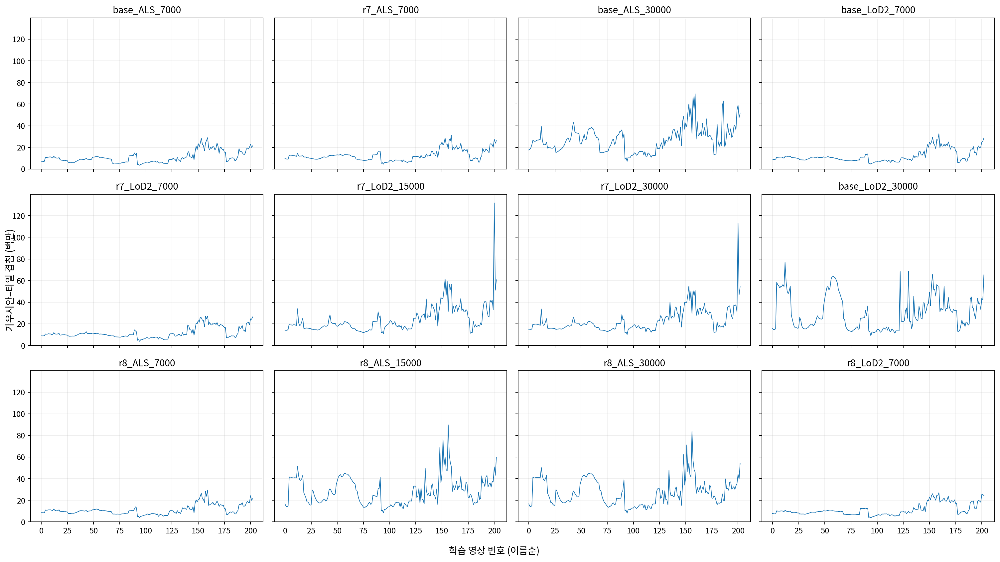
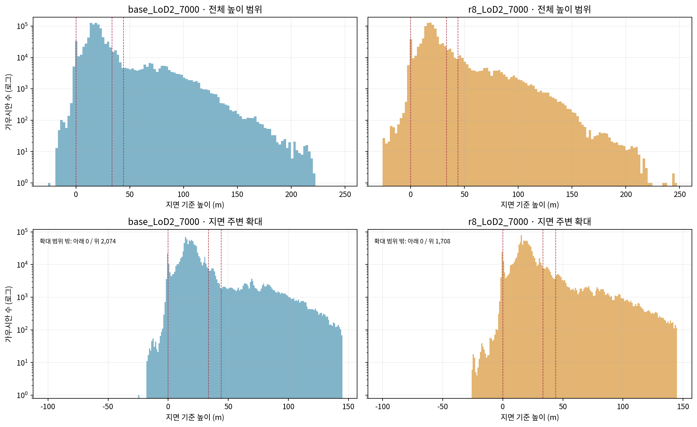

# r8 LoD2 저장 상태 원인점검

- 측정 완료: 2026-11-02T13:02:44.975720+09:00. 12개 상태 × 203장 = 2,436회 렌더. 학습·역전파·최적화 0회. scientific_verdict: null.
- r8 LoD2는 7,000회 상태를 보존한다. r8 항공 LiDAR는 완료 상태이며 나머지 여섯 판은 시작하지 않았다.
- 아래는 저장 상태와 실행 기록의 측정값이다. 원인에 대한 결론·해석은 쓰지 않는다.

## 1. 같은 자리 칸과 저장 시점

| 높이 기준 | 모델 지역 좌표 (m) | 지역 Z에 604 m를 더한 작업 좌표 (m) |
|---|---:|---:|
| 지면 | -43.640000 | 560.360000 |
| 지붕 최고 + 10 m | -10.180000 | 593.820000 |
| 카메라 중앙값 | 0.476505 | 604.476505 |

- 최종 사용자 결정: 지면 아래 / 지면~지붕 최고+10 m / 지붕+10 m~카메라 중심 중앙값 / 카메라 중앙값 위. 지면·카메라 중간값은 사용하지 않았다.
- 집계는 반올림 전 높이를 쓴다. 지면 아래는 엄격한 `<`, 나머지 칸은 위 경계를 포함한다. 표기값은 각각 −43.640, −10.180, 0.477 m다.
- 지면은 평가 사각형으로 잘라낸 LoD2 GroundSurface의 면별 중복 제거 꼭짓점 높이 중앙값(42개), 지붕은 같은 범위 RoofSurface 꼭짓점 최고값(138개)이다. 경계에서 높이는 선형 보간했다. 카메라는 동일한 학습 영상 203장의 중심 높이 중앙값이다.
- XY는 EPSG:25832에서 기존 원점을 뺀 좌표와 고정 70° UV 기준을 사용한다. 평가 범위 u=[115.4,191.0], v=[55.0,109.1] m. 가로 칸은 사각형 안(경계 포함) / 밖 거리 (0,50] / (50,200] / 200 m 초과다. 거리에는 둘레 10 m 띠를 덧붙이지 않았다.
- 높이는 기존 작업 좌표를 그대로 쓴다: LoD2 원 높이 +45.7−604 m. 위의 절대 작업 높이는 별도의 정표고 변환값이 아니다. 세 경계는 모든 상태에 같다.
- 수·크기·불투명도·렌더는 `point_cloud/iteration_<반복>/point_cloud.ply`를 사용한다. 7,000회 PLY와 꼬리표 snapshot은 밀도 제어 직전, 완전 체크포인트는 밀도 제어 직후 저장된다. 두 모집단을 섞지 않았다.
- 긴 축은 두 활성화 크기 `exp(scale)`의 최댓값이며 지름이 아니다. 불투명도는 `sigmoid(opacity)`다. 빈 칸 중앙값은 없음이다.
- 기준선 출신은 원본 `origin.npy[init_id]`와 PLY origin의 완전 일치를 확인했다. r7·r8은 현재 꼬리표다. r8 LoD2의 풀림은 자식에게 상속된 `target_released_at == 100`과 그 밖으로 나눴다.
- 경계 입력·면·카메라와 수치: [boundaries.json](cause_r8_lod2/tables/boundaries.json). 이전 설정과 변경 이유는 ZIP의 단계별 잠금 파일에 보존했다.

## 2. 기존 기준선 30,000회

| 사전 정보 | PLY 수 | 당시 GPU 번호 | 장치 사용량 최대 (MiB) | 학습 전 사용량을 뺀 최대 (MiB) | PyTorch 할당 최대 (GiB) | 예약 최대 (GiB) |
|---|---:|---:|---:|---:|---:|---:|
| ALS | 2,796,061 | 1 | 11,334 | 11,243 | 10.223253 | 10.611328 |
| LoD2 | 2,983,470 | 0 | 12,735 | 12,277 | 11.215652 | 11.894531 |

- 당시 실행 receipt와 trace에는 GPU 번호만 있어 기종은 확인 불가다. 이번 렌더에 사용한 RTX 3090을 당시 기종으로 대입하지 않았다.
- 장치 사용량은 당시 nvidia-smi 표본의 최대다. PyTorch 값은 실행 시작 이후 누적 최대이며 같은 정의의 값이 아니다. 학습 시각과 원 기록 SHA는 [memory.json](cause_r8_lod2/tables/memory.json)에 있다.

## 3. 12개 저장 상태

| 상태 | PLY 가우시안 수 | 영상별 겹침 중앙값 | 영상별 겹침 최댓값 | 정렬 버퍼 최대 (GiB) |
|---|---:|---:|---:|---:|
| base_ALS_7000 | 935,666 | 9,688,733 | 28,982,478 | 0.978928 |
| r7_ALS_7000 | 1,016,408 | 11,684,501 | 31,196,118 | 1.053695 |
| base_ALS_30000 | 2,796,061 | 26,503,567 | 69,561,193 | 2.349513 |
| base_LoD2_7000 | 1,024,224 | 10,467,935 | 32,606,971 | 1.101349 |
| r7_LoD2_7000 | 1,032,018 | 10,184,347 | 27,164,676 | 0.917531 |
| r7_LoD2_15000 | 2,772,796 | 19,904,480 | 131,798,013 | 4.451622 |
| r7_LoD2_30000 | 2,772,796 | 19,253,202 | 112,916,010 | 3.813864 |
| base_LoD2_30000 | 2,983,470 | 25,025,345 | 76,872,290 | 2.596453 |
| r8_ALS_7000 | 899,833 | 10,264,926 | 29,445,641 | 0.994572 |
| r8_ALS_15000 | 2,839,544 | 25,858,869 | 89,728,267 | 3.030676 |
| r8_ALS_30000 | 2,839,544 | 24,893,045 | 83,684,564 | 2.826543 |
| r8_LoD2_7000 | 1,018,234 | 9,692,124 | 27,052,941 | 0.913756 |

- 출신 × 가로 4칸 × 높이 4칸의 수·긴 축 중앙값·불투명도 중앙값: [counts.csv](cause_r8_lod2/tables/counts.csv), [JSON](cause_r8_lod2/tables/counts.json).
- 영상별 겹침과 버퍼·GPU 최대값: [render_views.csv](cause_r8_lod2/tables/render_views.csv). 출신 × 자리 칸으로 나눈 2,436장 전체 표: [render_cross.csv](cause_r8_lod2/tables/render_cross.csv), [JSON](cause_r8_lod2/tables/render_cross.json).
- 겹침은 각 가우시안의 투영 사각형이 만나는 타일 수의 합이다. 불투명도 누적·가림 처리 전의 작업 목록이며 최종 화소 기여량과 같은 값이 아니다. GPU는 원본 forward 렌더에만 썼다.
- 모든 상태 그림은 같은 수 축·같은 부하 축을 쓴다. 출신 색은 기준선 SfM/사전 정보와 r7·r8 배경/패치/풀림에 대응한다. r8 LoD2 풀림 세부 두 색을 합하면 전체 풀림이다.

### 상태별 같은 축 그림

| 상태 | 자리별 수 | 영상별 부하 |
|---|---|---|
| base_ALS_7000 | [그림](cause_r8_lod2/figures/counts_base_ALS_7000.png) | [그림](cause_r8_lod2/figures/load_base_ALS_7000.png) |
| r7_ALS_7000 | [그림](cause_r8_lod2/figures/counts_r7_ALS_7000.png) | [그림](cause_r8_lod2/figures/load_r7_ALS_7000.png) |
| base_ALS_30000 | [그림](cause_r8_lod2/figures/counts_base_ALS_30000.png) | [그림](cause_r8_lod2/figures/load_base_ALS_30000.png) |
| base_LoD2_7000 | [그림](cause_r8_lod2/figures/counts_base_LoD2_7000.png) | [그림](cause_r8_lod2/figures/load_base_LoD2_7000.png) |
| r7_LoD2_7000 | [그림](cause_r8_lod2/figures/counts_r7_LoD2_7000.png) | [그림](cause_r8_lod2/figures/load_r7_LoD2_7000.png) |
| r7_LoD2_15000 | [그림](cause_r8_lod2/figures/counts_r7_LoD2_15000.png) | [그림](cause_r8_lod2/figures/load_r7_LoD2_15000.png) |
| r7_LoD2_30000 | [그림](cause_r8_lod2/figures/counts_r7_LoD2_30000.png) | [그림](cause_r8_lod2/figures/load_r7_LoD2_30000.png) |
| base_LoD2_30000 | [그림](cause_r8_lod2/figures/counts_base_LoD2_30000.png) | [그림](cause_r8_lod2/figures/load_base_LoD2_30000.png) |
| r8_ALS_7000 | [그림](cause_r8_lod2/figures/counts_r8_ALS_7000.png) | [그림](cause_r8_lod2/figures/load_r8_ALS_7000.png) |
| r8_ALS_15000 | [그림](cause_r8_lod2/figures/counts_r8_ALS_15000.png) | [그림](cause_r8_lod2/figures/load_r8_ALS_15000.png) |
| r8_ALS_30000 | [그림](cause_r8_lod2/figures/counts_r8_ALS_30000.png) | [그림](cause_r8_lod2/figures/load_r8_ALS_30000.png) |
| r8_LoD2_7000 | [그림](cause_r8_lod2/figures/counts_r8_LoD2_7000.png) | [그림](cause_r8_lod2/figures/load_r8_LoD2_7000.png) |

모든 그림 옆에 같은 이름의 JSON과 PDF가 있다. 높이 분포는 전체 범위와 지면 주변 확대를 함께 보여 주며 확대 범위 밖의 수도 표시한다.

## 4. 겹침이 큰 영상 다섯 장씩

| 상태 | 순위 | 영상 | 겹침 수 | 정렬 버퍼 (GiB) |
|---|---:|---|---:|---:|
| base_ALS_7000 | 1 | DJI_20241217100347_0028_D | 28,982,478 | 0.978928 |
| base_ALS_7000 | 2 | DJI_20241217100331_0020_D | 28,377,016 | 0.958477 |
| base_ALS_7000 | 3 | DJI_20241217100345_0027_D | 26,394,474 | 0.891516 |
| base_ALS_7000 | 4 | DJI_20241217100343_0026_D | 24,254,601 | 0.819240 |
| base_ALS_7000 | 5 | DJI_20241217101134_0016_D | 24,060,641 | 0.812688 |
| r7_ALS_7000 | 1 | DJI_20241217100347_0028_D | 31,196,118 | 1.053695 |
| r7_ALS_7000 | 2 | DJI_20241217100331_0020_D | 28,617,539 | 0.966602 |
| r7_ALS_7000 | 3 | DJI_20241217100343_0026_D | 27,678,398 | 0.934881 |
| r7_ALS_7000 | 4 | DJI_20241217103621_0080_D | 27,600,007 | 0.932234 |
| r7_ALS_7000 | 5 | DJI_20241217103631_0085_D | 26,165,744 | 0.883789 |
| base_ALS_30000 | 1 | DJI_20241217100347_0028_D | 69,561,193 | 2.349513 |
| base_ALS_30000 | 2 | DJI_20241217100343_0026_D | 66,794,361 | 2.256061 |
| base_ALS_30000 | 3 | DJI_20241217101321_0013_D | 62,933,087 | 2.125642 |
| base_ALS_30000 | 4 | DJI_20241217100331_0020_D | 60,063,617 | 2.028724 |
| base_ALS_30000 | 5 | DJI_20241217103621_0080_D | 59,077,821 | 1.995427 |
| base_LoD2_7000 | 1 | DJI_20241217100347_0028_D | 32,606,971 | 1.101349 |
| base_LoD2_7000 | 2 | DJI_20241217100331_0020_D | 29,486,417 | 0.995949 |
| base_LoD2_7000 | 3 | DJI_20241217103631_0085_D | 28,623,921 | 0.966818 |
| base_LoD2_7000 | 4 | DJI_20241217100343_0026_D | 27,297,763 | 0.922025 |
| base_LoD2_7000 | 5 | DJI_20241217100345_0027_D | 26,528,939 | 0.896057 |
| r7_LoD2_7000 | 1 | DJI_20241217100347_0028_D | 27,164,676 | 0.917531 |
| r7_LoD2_7000 | 2 | DJI_20241217100343_0026_D | 26,960,272 | 0.910626 |
| r7_LoD2_7000 | 3 | DJI_20241217103631_0085_D | 26,380,087 | 0.891029 |
| r7_LoD2_7000 | 4 | DJI_20241217100329_0019_D | 26,229,773 | 0.885953 |
| r7_LoD2_7000 | 5 | DJI_20241217100331_0020_D | 25,609,846 | 0.865014 |
| r7_LoD2_15000 | 1 | DJI_20241217103621_0080_D | 131,798,013 | 4.451622 |
| r7_LoD2_15000 | 2 | DJI_20241217100331_0020_D | 61,368,846 | 2.072809 |
| r7_LoD2_15000 | 3 | DJI_20241217103631_0085_D | 60,704,631 | 2.050374 |
| r7_LoD2_15000 | 4 | DJI_20241217100339_0024_D | 59,403,641 | 2.006432 |
| r7_LoD2_15000 | 5 | DJI_20241217100347_0028_D | 56,611,701 | 1.912131 |
| r7_LoD2_30000 | 1 | DJI_20241217103621_0080_D | 112,916,010 | 3.813864 |
| r7_LoD2_30000 | 2 | DJI_20241217100331_0020_D | 54,761,058 | 1.849625 |
| r7_LoD2_30000 | 3 | DJI_20241217103631_0085_D | 54,307,980 | 1.834321 |
| r7_LoD2_30000 | 4 | DJI_20241217100347_0028_D | 51,158,963 | 1.727960 |
| r7_LoD2_30000 | 5 | DJI_20241217100343_0026_D | 50,978,113 | 1.721852 |
| base_LoD2_30000 | 1 | DJI_20241217084505_0076_D | 76,872,290 | 2.596453 |
| base_LoD2_30000 | 2 | DJI_20241217095629_0077_D | 68,874,884 | 2.326333 |
| base_LoD2_30000 | 3 | DJI_20241217095523_0044_D | 68,385,618 | 2.309807 |
| base_LoD2_30000 | 4 | DJI_20241217100331_0020_D | 65,910,583 | 2.226210 |
| base_LoD2_30000 | 5 | DJI_20241217103631_0085_D | 65,247,438 | 2.203812 |
| r8_ALS_7000 | 1 | DJI_20241217100347_0028_D | 29,445,641 | 0.994572 |
| r8_ALS_7000 | 2 | DJI_20241217100343_0026_D | 28,475,561 | 0.961806 |
| r8_ALS_7000 | 3 | DJI_20241217100331_0020_D | 26,684,472 | 0.901311 |
| r8_ALS_7000 | 4 | DJI_20241217103621_0080_D | 24,294,173 | 0.820576 |
| r8_ALS_7000 | 5 | DJI_20241217100329_0019_D | 24,010,099 | 0.810981 |
| r8_ALS_15000 | 1 | DJI_20241217100341_0025_D | 89,728,267 | 3.030676 |
| r8_ALS_15000 | 2 | DJI_20241217100122_0047_D | 76,053,224 | 2.568788 |
| r8_ALS_15000 | 3 | DJI_20241217100116_0044_D | 68,922,111 | 2.327927 |
| r8_ALS_15000 | 4 | DJI_20241217100343_0026_D | 61,911,917 | 2.091151 |
| r8_ALS_15000 | 5 | DJI_20241217100331_0020_D | 60,244,717 | 2.034840 |
| r8_ALS_30000 | 1 | DJI_20241217100341_0025_D | 83,684,564 | 2.826543 |
| r8_ALS_30000 | 2 | DJI_20241217100122_0047_D | 71,223,547 | 2.405660 |
| r8_ALS_30000 | 3 | DJI_20241217100116_0044_D | 62,233,801 | 2.102023 |
| r8_ALS_30000 | 4 | DJI_20241217100343_0026_D | 57,029,855 | 1.926255 |
| r8_ALS_30000 | 5 | DJI_20241217103631_0085_D | 54,259,232 | 1.832675 |
| r8_LoD2_7000 | 1 | DJI_20241217100347_0028_D | 27,052,941 | 0.913756 |
| r8_LoD2_7000 | 2 | DJI_20241217100331_0020_D | 26,115,901 | 0.882107 |
| r8_LoD2_7000 | 3 | DJI_20241217103621_0080_D | 25,359,271 | 0.856550 |
| r8_LoD2_7000 | 4 | DJI_20241217103629_0084_D | 25,254,808 | 0.853022 |
| r8_LoD2_7000 | 5 | DJI_20241217100343_0026_D | 24,567,757 | 0.829816 |

전체 표: [top5.csv](cause_r8_lod2/tables/top5.csv). 동률은 영상 이름순이다.

## 5. 15.69 GiB 요청과 코드상의 관계

- `forward.cu:223–250`은 투영 사각형의 가로 타일 수 × 세로 타일 수를 `tiles_touched`에 둔다. `rasterizer_impl.cu:276–286`은 이를 누적해 N을 구한 뒤 N개용 BinningState를 요청한다.
- `rasterizer_impl.cu:181–193`의 ID 두 배열은 각각 uint32, 키 두 배열은 각각 uint64다. 기본 배열 합은 **24N byte**이며 여기에 CUB 정렬 작업 공간과 128-byte 정렬 여백이 붙는다. `rasterizer_impl.h:67–73`은 끝에 128 byte를 더한다.
- 식: **B(N) = 24N + CUB 정렬 작업 공간(N) + 메모리 정렬 여백 + 128**. `rasterize_points.cu:31–36`은 B(N)을 그대로 GPU byte tensor의 resize에 넘긴다. 타일 목록은 가우시안 수와 별도로 크기가 정해진다.
- 이번 2,436회 렌더에서 B(N)/N의 중앙값은 36.267807 byte/겹침이다. 이 비용으로 15.69 GiB를 단순 환산하면 약 464.5백만 겹침에 해당한다. 이는 실패 반복의 실측 겹침 수가 아니다.
- 실패 기록은 CUDA rasterize_gaussians 호출과 15.69 GiB 요청을 남겼다. C++ 내부의 어느 버퍼였는지, 실패 당시 정확한 영상·겹침 수는 저장되지 않았다. 14,830은 마지막 진행 표시이며 그 시점 전체 모델도 없어 같은 상태의 재렌더는 확인 불가다. 위 환산으로 누락 값을 채우지 않았다.
- 코드 원문·줄·SHA, 에러 전문과 환산값: [memory.json](cause_r8_lod2/tables/memory.json). ZIP에 해당 원본 래스터라이저 소스와 라이선스를 넣었다. CUDA 코드는 수정하거나 다시 빌드하지 않았다.

## 6. 밀도 제어 자격

| 7,000회 상태 | 렌더 PLY의 누적 기울기 | 별도 완전 상태 |
|---|---|---|
| base_LoD2_7000 | 없음 | 없음 |
| r7_LoD2_7000 | 없음 | 1,070,675개, 밀도 제어 직후 누적값·분모 모두 0 |
| r8_ALS_7000 | 없음 | 936,078개, 밀도 제어 직후 누적값·분모 모두 0 |
| r8_LoD2_7000 | 없음 | 1,059,539개, 밀도 제어 직후 누적값·분모 모두 0 |

- 요청한 렌더 PLY의 누적 기울기는 네 상태 모두 없음이다. PLY와 snapshot은 누적 위치 기울기를 저장하지 않는다. 기준선 LoD2 7,000회에는 완전 체크포인트도 없다.
- r7 LoD2·r8 ALS·r8 LoD2의 완전 체크포인트에는 누적 기울기 필드가 있지만, 밀도 제어 직후 초기화된 서로 다른 모집단이다. 그 상태의 출신 × 자리 칸별 수·문턱 이상 비율·분모 양수 수는 [gradient.csv](cause_r8_lod2/tables/gradient.csv), [JSON](cause_r8_lod2/tables/gradient.json)에 별도로 적었다. 이 0을 직전 PLY의 자격 비율로 옮기지 않았다.
- 문턱 비교는 저장된 densify_grad_threshold에 대해 기존 코드대로 accum/denom, NaN→0, `>=`이다. 실제 복제·분할의 크기 조건 등을 추가로 통과했다는 뜻으로 쓰지 않았다. 저장 순서: r22 train.py:1163–1180, 1317; 초기화: scene/gaussian_model.py:444 및 jbgs_state.py:189–193.

## 7. 검증과 재계산 범위

- 검증 PASS: 12개 수의 합, 모든 칸 중앙값, 모든 영상의 겹침 보존, 상태당 1,000개의 독립 Shapely 거리·높이 분류, 상태당 고정 3장의 직접 마스크 합을 확인했다.
- 깊이 2,436장 전부 기존 저장값과 완전 일치. alpha가 저장된 2,030장은 완전 일치. 기준선 30,000회 두 판 406장은 이전 저장 파일에 alpha가 없다. 관측 래퍼는 반환 텐서를 바꾸지 않으며 12개 상태의 첫 영상에서 RGB·깊이·alpha·왜곡·법선의 원본 호출 일치를 확인했다.
- 입력·코드 1,889개 SHA 불변을 확인했다. 원본 PLY·체크포인트·r21·r22는 변경하지 않았다. 학습·역전파·최적화 0회.
- ZIP은 보고서, 전체 표, 26개 그림의 PNG/PDF/JSON, 코드·설정·잠금, 무결성 목록을 포함한다. 큰 원본 모델·영상과 가우시안마다 저장한 타일 배열은 외부 payload에 보존하고 경로·SHA를 manifest에 적는다. ZIP만으로 원본 모델을 복원하는 묶음은 아니다.
- 실행 중 CPU Tensor 변환 오류, 저장 시점 불일치 점검 실패, 한 렌더의 입력 준비 순서 오류, 승인 전 높이 순서 불일치를 기록·보존했다. 각각 읽기 변환, 모집단 분리, 입력 완료 후 재렌더, 사용자 경계 결정으로 처리했다. 학습은 실행하지 않았다.
- 실행 순서: inventory_r2 → spatial_r1 → render(각 상태203장) → tables → memory → figures → verify → report → package. 고정 이미지와 파일 SHA는 configs의 잠금 파일에 있다. scientific_verdict: null.

- 검증 환경 기록: 원래 geogs 이미지에 Shapely가 없어 독립 거리 검증만 기존 `jointbuildgs:dev`에서 수행했다. 검증 코드와 분류 규칙은 같고 설치는 하지 않았다. 이미지 ID와 사유는 ZIP의 `receipts/verification_environment.json`, 실패·재실행 로그는 `cpu_execution/`에 있다.
