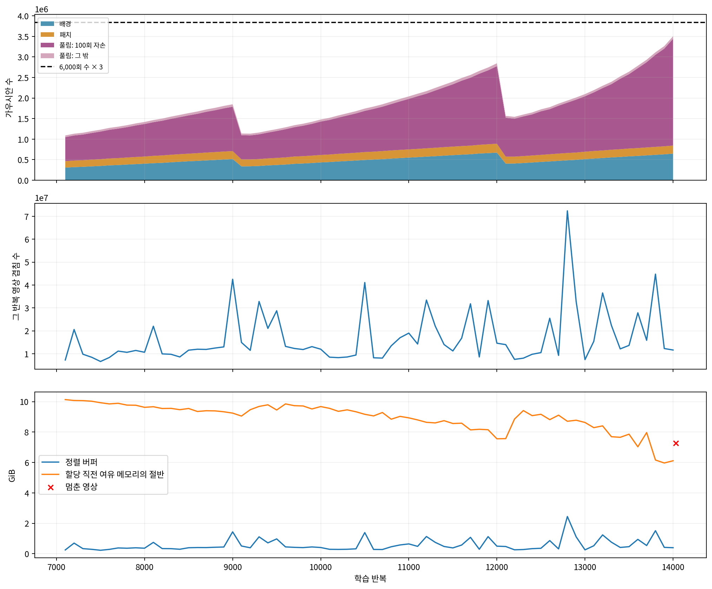
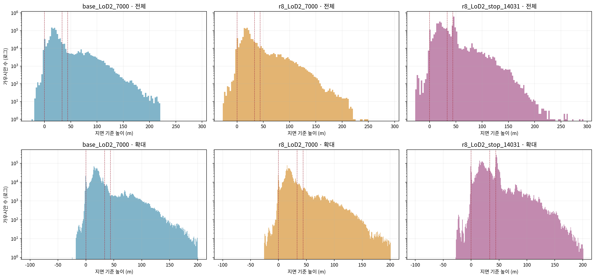
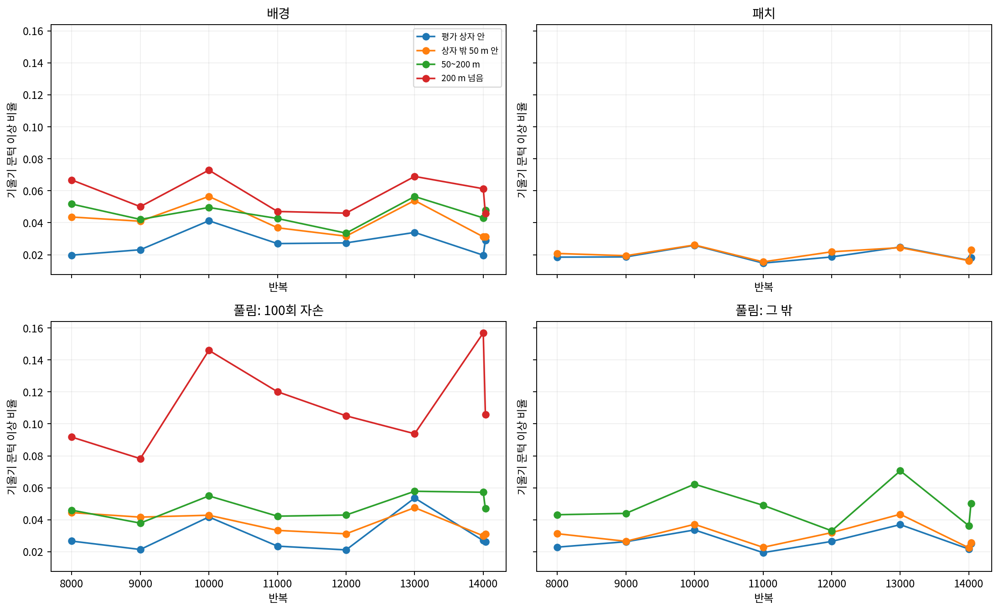

# r8 LoD2 기록하며 이어 학습 — 중단 기록

기록 시각: 2026-11-02T14:57:29.743271+09:00. 새 계산에는 [이 발주에서 냄]을 적용한다. `scientific_verdict: null`.

- 상태: **STOPPED_BUFFER_GUARD**. 14,030회까지 완료했고 14,031회에서 멈췄다. 자동 재시도하지 않았다.
- 15,000·30,000회에 도달하지 않아 해당 채점·그림과 7장 틀은 없음. r8 항공 LiDAR는 완료 상태로 보존했고 나머지 여섯 판은 시작하지 않았다.
- 중단 영상: `DJI_20241217102535_0020_D`. 저장 가우시안 3,504,875개. 저장 단계 `training_forward_before_optimizer`.
- 원래 7,000회 완전 상태 SHA-256 `ce0767b0f2b6fe1b6f08abe06b2a8b9b1a93b724d3b0895da47f23f3e4631770`를 재확인했다. 모델·Adam·난수·영상 순서·목표 계보를 복원했다.

## 멈춤과 보존

- 정렬 버퍼 요구량 7,796,493,183 bytes = 7.261050 GiB; 할당 직전 GPU 여유 15,122,956,288 bytes = 14.084351 GiB; 절반 7.042175 GiB.
- 해당 영상의 실제 가우시안–타일 겹침 214,976,330개. 검사식 `required<BinningState>(N) > 0.5 × cudaMemGetInfo.free`는 엄격한 초과다. PyTorch 예약 캐시는 여유량에 더하지 않았다.
- 실행 CUDA 사본 `/out/r8_recorded_continue/runtime/rasterizer/cuda_rasterizer/rasterizer_impl.cu`의 299: 버퍼 필요량, 302: 여유량, 303: 비교, 260: 할당 전 멈춤. 원본 정렬은 uint32 ID 두 벌·uint64 key 두 벌(24N bytes), CUB 작업 공간과 정렬 여백을 더한다.
- r8 수 검사 기준은 6,000회의 1,280,149개 × 3 = 3,840,447개다. 검사 주기와 불투명도 초기화 유예는 그대로다.
- 중단 PLY·완전 체크포인트·누적 기울기·출신 snapshot·중단 영상의 개별 겹침 수를 `/out/r8_recorded_continue/runs/tg_B173nb_b10_LoD2_s0_r8/model/recording/stop/iteration_14031`에 저장했다. 체크포인트 반복은 14,030이며, 일반 복원 가능 표시는 `True`이다.
- 학습 forward에서 버퍼 할당 전에 멈춘 상태는 시도한 반복 직전의 영상 선택·난수·학습률·SH 차수로 복원 경계를 맞췄다. 모델 및 Adam 업데이트는 그 반복에서 실행되지 않았다.

## 후속 결정

- 11월 2일 후속 회신으로 추가 학습을 하지 않기로 확정했다. 저장 상태의 상위 무리·계보·반복별 변화는 [중단 상태 원인 점검](중단상태_원인점검_r8_LoD2.md)에 모았다.

## 고정한 자리 칸

지역 높이(m): 지면 -43.640000000, 지붕 최고+10 m -10.180000000, 학습 카메라 높이 중앙값 0.476505482. 지면과 카메라의 중간값은 쓰지 않았다.
가로는 평가 상자 안 / 밖 50 m 안 / 50~200 m / 200 m 넘음. 높이는 지면 아래 / 지면~지붕+10 m / 지붕+10 m~카메라 / 카메라 위다. 기존 원인 점검 boundaries의 바이트를 그대로 썼다.

| 출신 | 중단 상태 수 |
|---|---:|
| 배경 | 647,563 |
| 패치 | 195,868 |
| 풀림: 100회 자손 | 2,598,752 |
| 풀림: 그 밖 | 62,692 |

## 상태와 기울기 저장

| 반복 | 밀도 제어 직전 수 | 완전 상태 수 | 누적 기울기 0 아님 |
|---|---:|---:|---:|
| 8,000 | 1,382,484 | 1,417,877 | 1,363,173 |
| 9,000 | 1,808,046 | 1,848,442 | 1,745,605 |
| 10,000 | 1,421,994 | 1,478,027 | 1,396,827 |
| 11,000 | 1,978,270 | 2,040,109 | 1,882,584 |
| 12,000 | 2,743,573 | 2,845,747 | 2,472,542 |
| 13,000 | 2,013,866 | 2,096,233 | 1,807,020 |
| 14,000 | 3,263,767 | 3,504,875 | 2,744,927 |

100회마다 forward 70줄, 반복 후 70줄. 출신 4 × 가로 4 × 높이 4 칸의 수 합과 겹침 합을 검증했다. 기울기 자격은 저장된 누적값/denom을 r8 문턱 0.0002과 비교했다. 누적 기울기는 밀도 제어 직전, 완전 상태는 직후이므로 두 수를 구분한다.

## 중단 상태 원인 점검 자료

- 학습 영상 203장 모두의 겹침 수를 실제 CUDA 전처리로 계산했다. 전체 forward 완료 203/203장. 할당 전 검사로 끝난 영상은 렌더 완료로 세지 않았다.
- 중단 뒤 저장 모델의 읽기 전용 렌더는 최적화 0회이며, Adam·학습 기울기 메모리를 사용하지 않는다. 이 읽기 전용 실행은 여유량 95%를 할당 용량 확인선으로 사용했다. 학습의 절반 초과 멈춤값은 0.5로 유지했고 학습을 재시도하지 않았다. 중단 영상의 개별 가우시안 겹침 배열도 저장된 배열과 재현 비교했다.
- 출신×자리별 수·긴 축 중앙값·불투명도 중앙값: `recorded_r8_lod2/tables/counts.csv`. 영상×출신×자리별 겹침: `render_cross.csv`. 기울기 자격: `gradient.csv`.
- 이전 원인 점검의 12상태를 다시 학습하거나 다시 계산하지 않고 보관된 표를 비교 칸으로 사용했다. 중단 상태와 합친 수 막대·영상 부하 곡선은 같은 축이다.

| 부하 순위 | 영상 | 겹침 | 버퍼 GiB | 전체 렌더 |
|---|---|---:|---:|---|
| 1 | DJI_20241217102535_0020_D | 214,976,330 | 7.261050 | True |
| 2 | DJI_20241217102533_0019_D | 181,115,891 | 6.117381 | True |
| 3 | DJI_20241217100114_0043_D | 148,511,529 | 5.016137 | True |
| 4 | DJI_20241217095051_0052_D | 83,748,515 | 2.828704 | True |
| 5 | DJI_20241217095055_0054_D | 82,985,292 | 2.802925 | True |

## 구현·검증·재계산 경계

- r22 원본은 변경하지 않았다. 별도 실행 사본에서 반복 시작 관측, training forward 관측, 밀도 제어 직전 저장, 추가 정렬 버퍼 멈춤만 연결했다. 손실·목표·가중치·학습률·밀도 제어·기존 건강 검사는 r8 그대로다.
- 고정 3장 × 검사 활성/비활성에서 원본의 모든 출력 텐서·겹침·버퍼 크기가 바이트 단위로 같았다. CUDA 역전파 소스는 원본과 같다. 버퍼 경계 동일값 통과/초과 멈춤과 강제 멈춤의 개별 겹침 일치도 통과했다.
- 저장 모델 역전파 3장 × 6개 매개변수 비교도 통과했다(최적화 0회). 최대 절대 차이 1.39698386192e-08; 최대 상대 L2 1.91743010662e-06. 원본 반복의 최대 상대 L2 2.05863137317e-06도 함께 기록한다. 허용오차는 절대 1e-7·상대 1e-4였다. 바이트 일치는 forward 출력에 대한 검사다.
- 최초 잠금: `r8_record_prepare.lock.json`; 빌드·검증 후 실행 잠금: `r8_record_runtime.lock.json`. 실행 환경은 고정 geogs Docker 이미지와 GPU 1 RTX 3090이다.
- 학습 GPU peak 값은 이번 이어 학습 프로세스 시작 이후의 누적 최대다. 100회 forward 기록과 반복 후 기록은 각각 그 시점의 allocated/reserved/free도 포함한다. 중단 뒤 읽기 전용 렌더의 peak는 영상마다 초기화했다.
- 같은 씨앗의 새 학습을 반복한 실험은 수행하지 않았다. 비결정적 CUDA 연산의 완전 재현성을 주장하지 않는다.
- ZIP에는 표·그림·JSON·설정·실행 코드·검증 및 큰 자료의 경로와 SHA-256을 넣는다. 원본/추가 완전 체크포인트와 대형 개별 겹침 배열은 외부 payload로 남는다. 재계산에는 그 payload와 고정 Docker 이미지가 필요하다. ZIP 무결성은 과학적 판정이 아니다.

