# LoD2 r7 이어 학습 기록 [이 발주에서 냄]

scientific_verdict: null. 아래는 기록이며 기하 통과 판정이나 원인 해석이 아니다.

## 15,000회

| 출신 | 그리는 몫 | 폭 밖 최대 기여 몫 | 틀린 몫 / 그리는 몫 |
|---|---:|---:|---:|
| background | 47.814% | 49.751% | 1.0405 |
| released | 11.632% | 22.475% | 1.9321 |
| patch | 40.554% | 27.774% | 0.6849 |

| 현재 출신 | 수 | 접선 1 m 초과 | 긴 축 중앙(m) | 불투명도 중앙 | 법선 이동 중앙(m) | 접선 이동 중앙(m) |
|---|---:|---:|---:|---:|---:|---:|
| patch | 151,547 | 116,195 | 0.442372 | 0.432708 | 0.086231 | 1.762903 |
| background | 1,915,214 | 1,874,705 | 1.105957 | 0.354812 | 29.264935 | 222.840817 |
| released | 706,035 | 701,646 | 0.947034 | 0.344169 | 10.400699 | 61.270639 |

처음 1 m 초과 배경의 생존 자손 1,704,746개, 생존 원래 부모 287개. 부모별 개수와 크기·불투명도·이동 분포는 동반 JSON에 모두 있다.

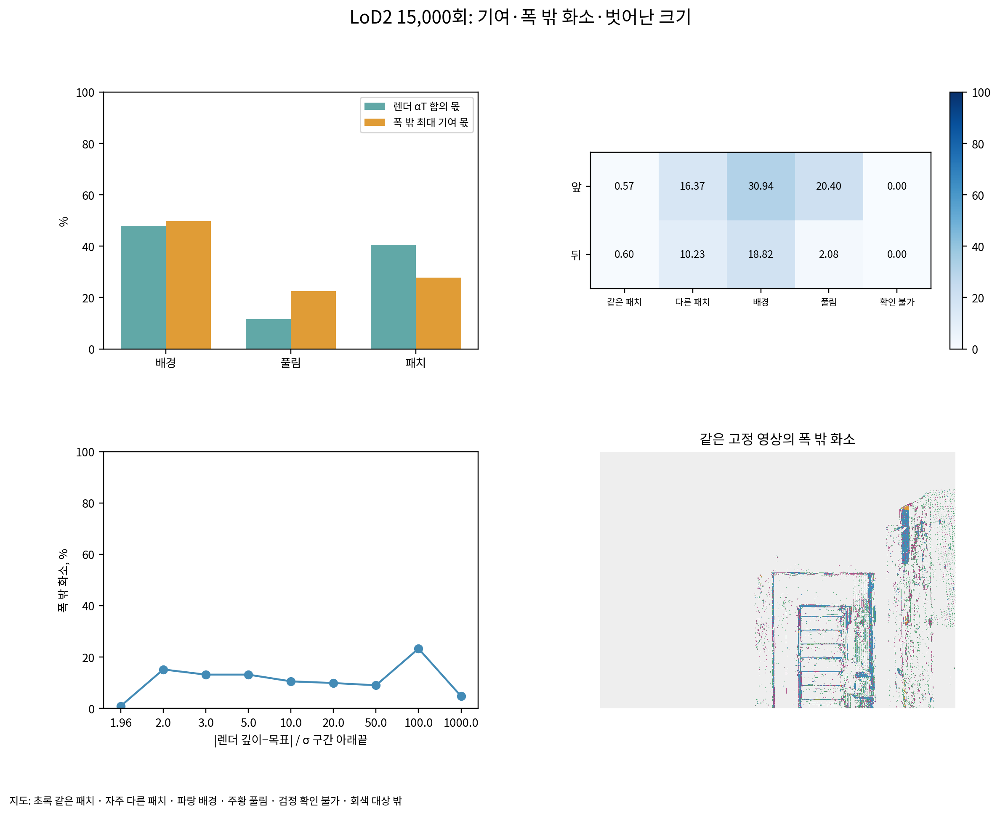

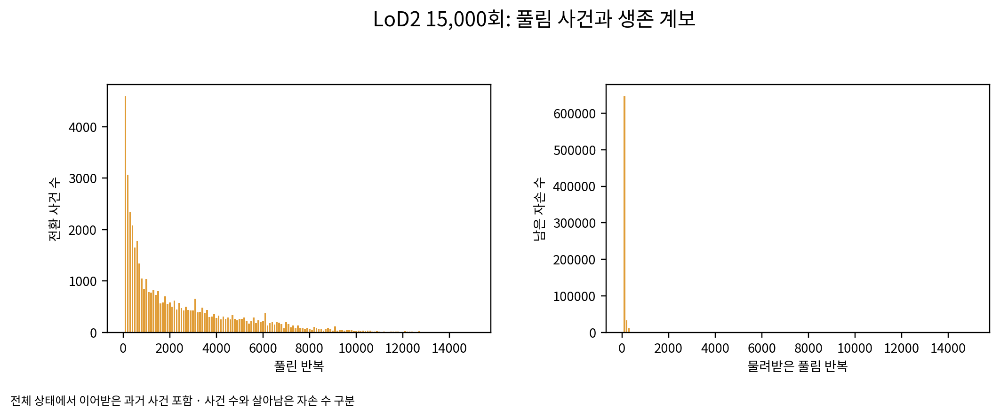

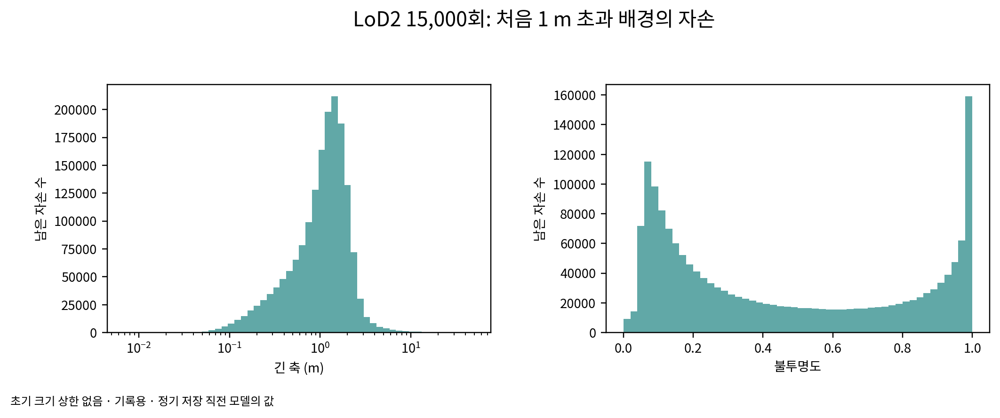

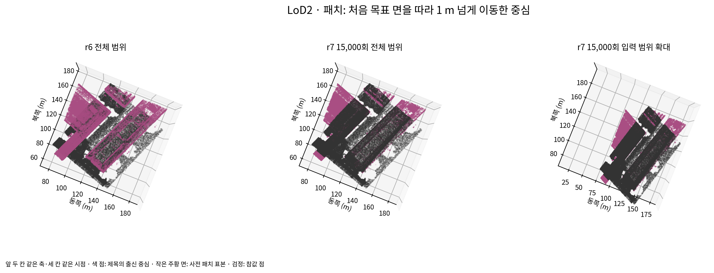

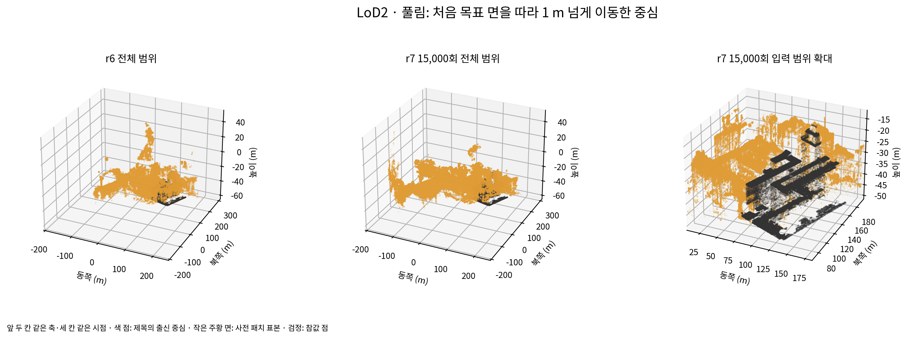

## 30,000회

| 출신 | 그리는 몫 | 폭 밖 최대 기여 몫 | 틀린 몫 / 그리는 몫 |
|---|---:|---:|---:|
| background | 46.202% | 49.147% | 1.0637 |
| released | 11.179% | 24.022% | 2.1488 |
| patch | 42.618% | 26.831% | 0.6296 |

| 현재 출신 | 수 | 접선 1 m 초과 | 긴 축 중앙(m) | 불투명도 중앙 | 법선 이동 중앙(m) | 접선 이동 중앙(m) |
|---|---:|---:|---:|---:|---:|---:|
| patch | 151,453 | 116,863 | 0.416391 | 0.664908 | 0.083363 | 1.781155 |
| background | 1,915,214 | 1,875,977 | 0.944097 | 0.209743 | 29.260603 | 222.843191 |
| released | 706,129 | 701,761 | 0.778147 | 0.472672 | 10.414443 | 61.256732 |

처음 1 m 초과 배경의 생존 자손 1,704,746개, 생존 원래 부모 287개. 부모별 개수와 크기·불투명도·이동 분포는 동반 JSON에 모두 있다.

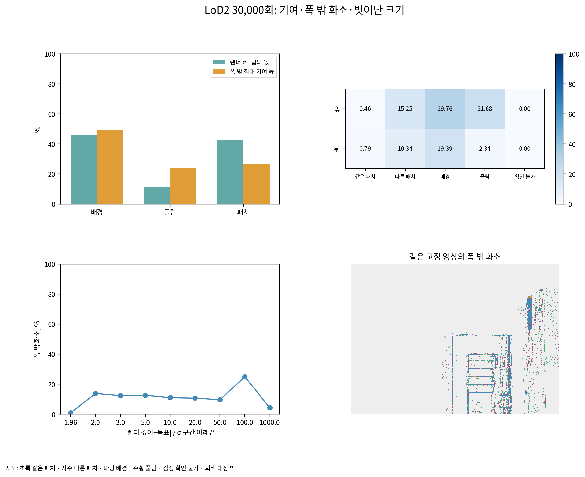

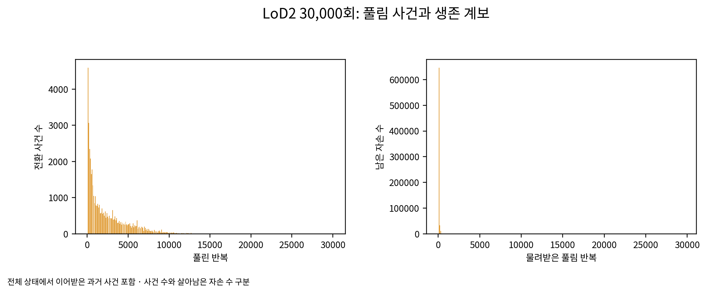

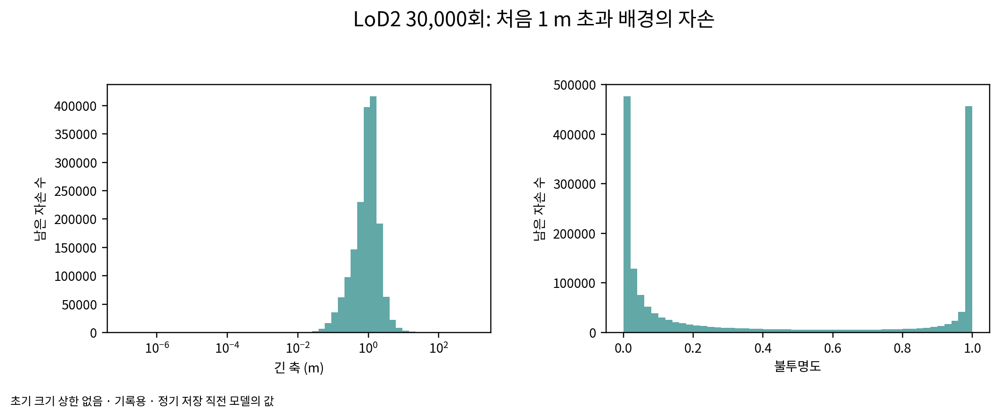

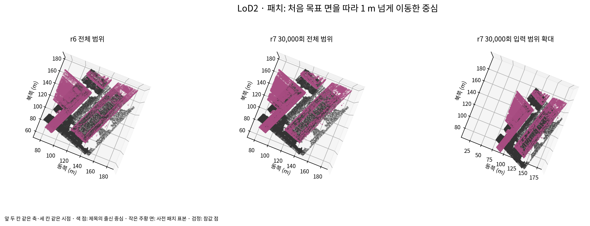

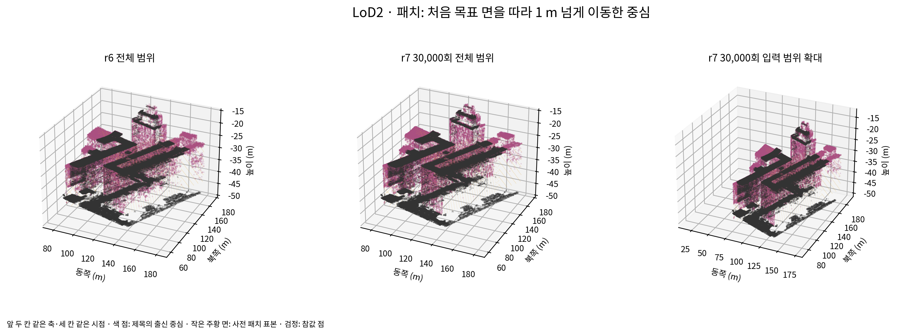

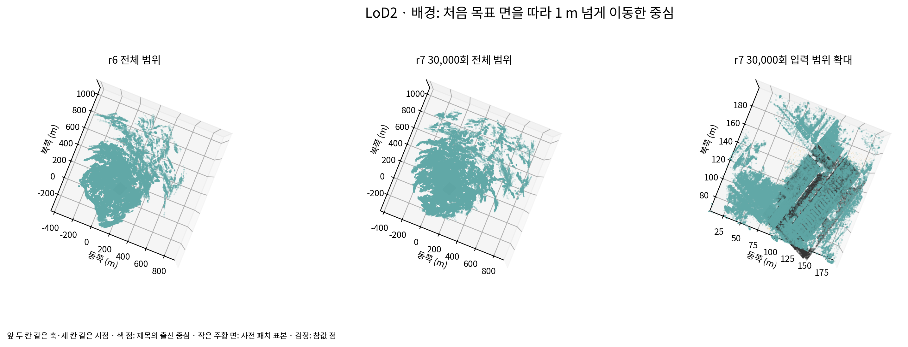

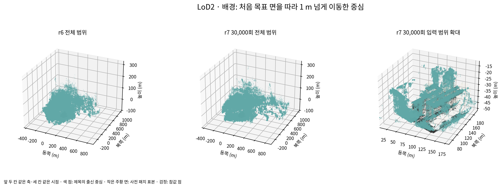

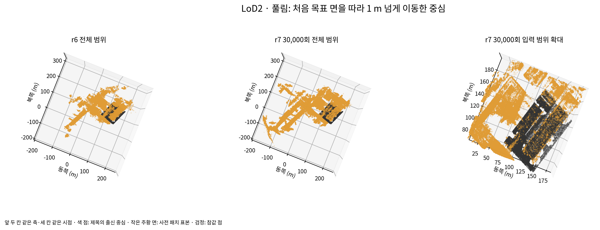

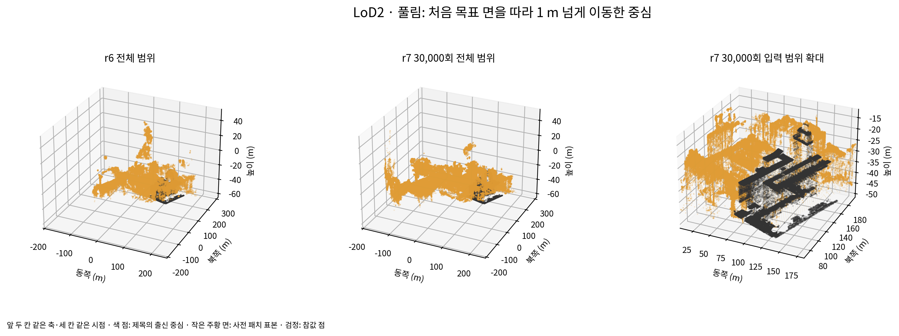

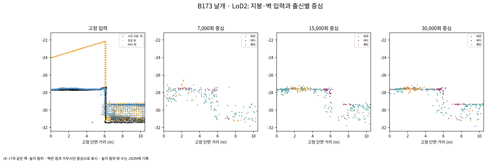
