# 자리별 판단 점검 · r5

단계 0의 잠근 판단 결과를 그대로 나누어 셌다. 작은 구조물 → 가장자리 → 유리·무늬 없음 → 그 밖 순서로 먼저 해당하는 자리를 썼다. 남은 그 밖에서 사진 곡선이 없는 곳은 사진 없음 행으로 분리하고, 다른 자리에도 사진 없음 넓이를 별도 열로 남겼다. 참값 칸은 분류에 쓰지 않았다. [이 발주에서 냄]

MVS 면 종류는 MESHPATCH의 `roofer_def` 면에 Track-A `elem_types.py` 규칙을 적용한 값이다. 개발용은 기존 패치 표와 정확한 패치 ID·기하로 연결했다. 확인용은 그 입력들만으로 같은 규칙을 계산했다. 실험 지역은 같은 규칙을 자체 입력에 적용하고, 기존 표와 정확히 연결되는 패치에는 기존 분류를 사용했다. 항공 LiDAR 실험 입력에는 건물 ID가 비어 있어 그 입력의 빈 그룹을 그대로 사용했으며, 임의 건물 ID를 만들지 않았다. 이 때문에 면을 나누는 입력 문맥이 전역 패치 표와 다른 부분은 별도 수로 기록했다.

B173만의 CPU 불확실도 파일에는 파생 z와 LoD2 사전 σ가 없어, 이미 잠근 동일 패치의 σ로 입력 z의 유한성만 복원했다. 분류 수치·문턱은 그대로다. B173 유리 채광창은 저장된 입력 면 자리 `place_skylight`를 썼고, 참값 칸으로 거른 `case_skylight`는 쓰지 않았다. 유리 띠·둥근 지붕은 UNCERT에 저장된 지역 패치 목록을 사용했다. 다른 단위로 연결할 때는 중심·법선·넓이·면 종류가 모두 같은 패치만 연결했다.

전체 표는 [CSV](tables/places_r5_all.csv)에 있다. 개발용·확인용·네 실험 지역, 사전 정보, 지붕·벽, 평가 범위·띠, 원값·대체를 나누고, 각 줄에 사전 정보만 믿음·영상만 믿음 비교를 함께 냈다. 넓이 비율의 분모는 해당 묶음의 같은 면 종류 전체 넓이다. 칸 2 보정은 T2 초과를 우선하고, T2 이하이면서 사진 반박인 보정을 별도 열로 세어 두 열이 겹치지 않게 했다. 두 증거가 모두 있는 넓이도 별도 열로 제공한다.

## 개발용

| 지역 · 사전 · 면 | 자리 | 넓이 m² | 전체 대비 | 칸 2 m² | 칸 2 보정 m² | T2 / 사진 보정 m² | 칸 1 m² | 칸 1 보존 m² |
|---|---|---:|---:|---:|---:|---:|---:|---:|
| 전체 · ALS · 지붕 | 작은 구조물 | 135.22 | 0.40% | 76.34 | 31.44 | 30.07 / 1.37 | 44.03 | 0.79 |
| 전체 · ALS · 지붕 | 가장자리 | 7962.56 | 23.50% | 2422.44 | 398.47 | 378.93 / 19.54 | 236.13 | 6.74 |
| 전체 · ALS · 지붕 | 유리·무늬 없음 | 2109.42 | 6.23% | 78.58 | 7.03 | 7.03 / 0.00 | 2.70 | 0.65 |
| 전체 · ALS · 지붕 | 그 밖 | 23670.98 | 69.87% | 2265.91 | 125.56 | 111.19 / 14.38 | 275.84 | 22.79 |
| 전체 · LoD2 · 지붕 | 작은 구조물 | 400.25 | 0.99% | 77.31 | 33.69 | 33.56 / 0.12 | 205.12 | 4.31 |
| 전체 · LoD2 · 지붕 | 가장자리 | 13694.12 | 34.00% | 1818.88 | 364.25 | 358.00 / 6.25 | 4082.19 | 166.81 |
| 전체 · LoD2 · 지붕 | 유리·무늬 없음 | 2044.94 | 5.08% | 27.62 | 2.06 | 2.06 / 0.00 | 710.62 | 63.31 |
| 전체 · LoD2 · 지붕 | 그 밖 | 24137.38 | 59.93% | 749.56 | 54.12 | 51.94 / 2.19 | 5250.19 | 299.75 |
| 전체 · LoD2 · 벽 | 작은 구조물 | 6.44 | 0.01% | 0.00 | 0.00 | 0.00 / 0.00 | 1.31 | 0.00 |
| 전체 · LoD2 · 벽 | 가장자리 | 32138.44 | 34.62% | 3533.00 | 1183.44 | 1180.44 / 3.00 | 4673.13 | 228.56 |
| 전체 · LoD2 · 벽 | 유리·무늬 없음 | 7089.38 | 7.64% | 304.31 | 41.25 | 41.25 / 0.00 | 893.69 | 187.06 |
| 전체 · LoD2 · 벽 | 그 밖 | 53596.37 | 57.74% | 1542.75 | 178.00 | 170.12 / 7.88 | 3810.00 | 428.94 |

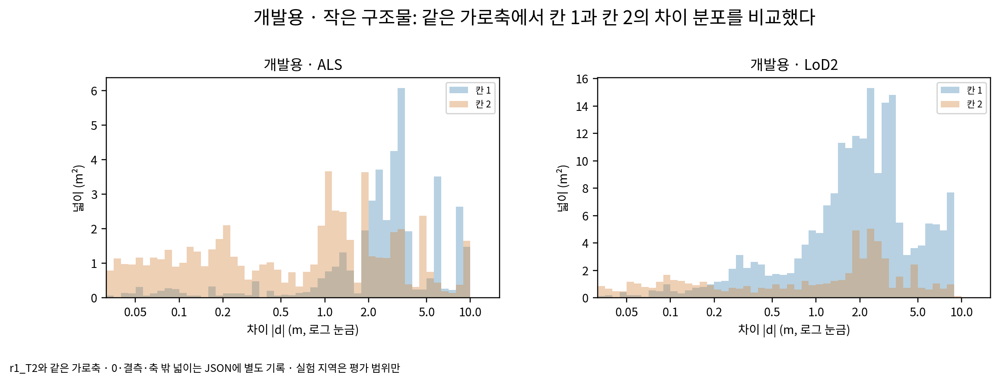

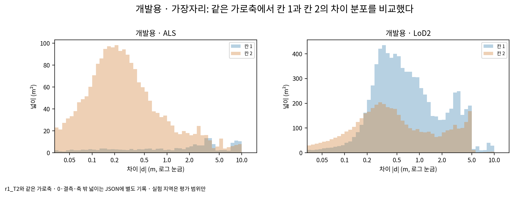

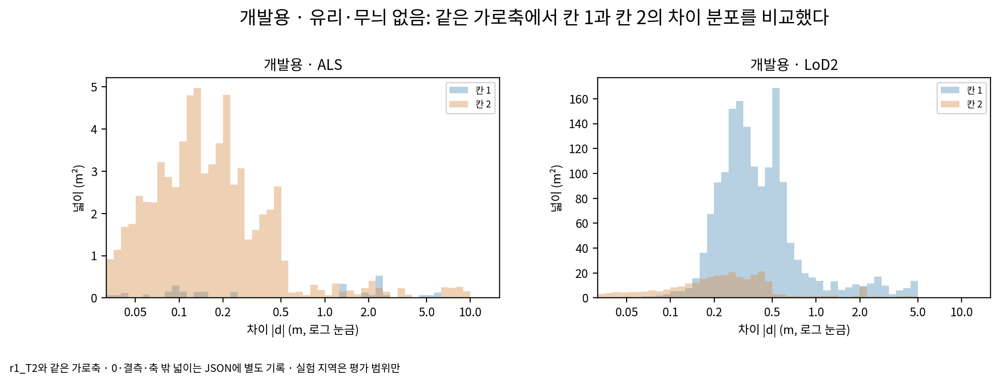

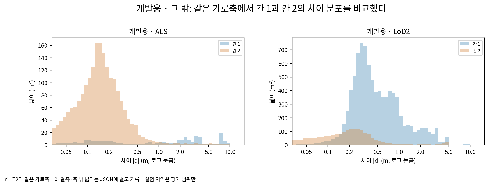

## 확인용

| 지역 · 사전 · 면 | 자리 | 넓이 m² | 전체 대비 | 칸 2 m² | 칸 2 보정 m² | T2 / 사진 보정 m² | 칸 1 m² | 칸 1 보존 m² |
|---|---|---:|---:|---:|---:|---:|---:|---:|
| 전체 · ALS · 지붕 | 작은 구조물 | 0.25 | 0.01% | 0.13 | 0.00 | 0.00 / 0.00 | 0.06 | 0.00 |
| 전체 · ALS · 지붕 | 가장자리 | 619.53 | 25.79% | 131.76 | 30.07 | 27.18 / 2.89 | 22.98 | 0.42 |
| 전체 · ALS · 지붕 | 유리·무늬 없음 | 116.60 | 4.85% | 2.73 | 0.00 | 0.00 / 0.00 | 0.09 | 0.00 |
| 전체 · ALS · 지붕 | 그 밖 | 1666.11 | 69.35% | 89.61 | 3.73 | 2.83 / 0.90 | 42.73 | 2.33 |
| 전체 · LoD2 · 지붕 | 작은 구조물 | 6.06 | 0.21% | 0.44 | 0.12 | 0.12 / 0.00 | 2.19 | 0.00 |
| 전체 · LoD2 · 지붕 | 가장자리 | 1095.69 | 37.07% | 122.81 | 32.12 | 32.00 / 0.12 | 255.31 | 0.81 |
| 전체 · LoD2 · 지붕 | 유리·무늬 없음 | 122.06 | 4.13% | 0.75 | 0.00 | 0.00 / 0.00 | 9.38 | 0.00 |
| 전체 · LoD2 · 지붕 | 그 밖 | 1731.69 | 58.59% | 14.38 | 0.44 | 0.38 / 0.06 | 208.50 | 0.94 |
| 전체 · LoD2 · 벽 | 가장자리 | 3842.26 | 48.86% | 150.62 | 48.56 | 48.38 / 0.19 | 315.75 | 19.44 |
| 전체 · LoD2 · 벽 | 유리·무늬 없음 | 446.31 | 5.68% | 3.38 | 0.12 | 0.12 / 0.00 | 42.06 | 10.19 |
| 전체 · LoD2 · 벽 | 그 밖 | 3575.80 | 45.47% | 116.62 | 4.69 | 4.62 / 0.06 | 466.94 | 63.94 |

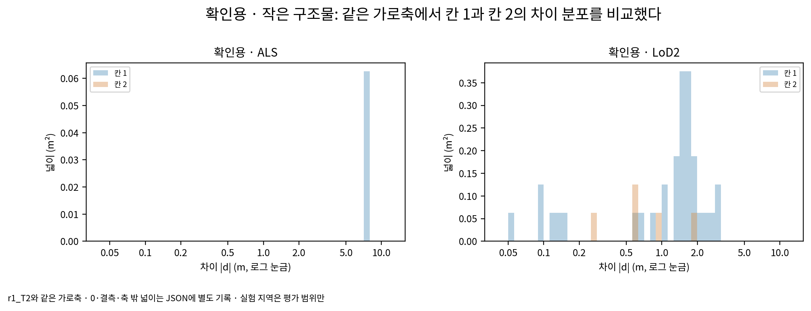

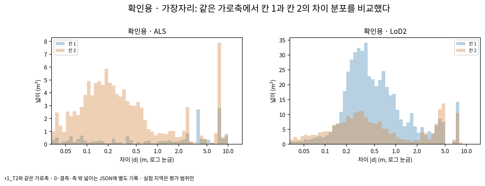

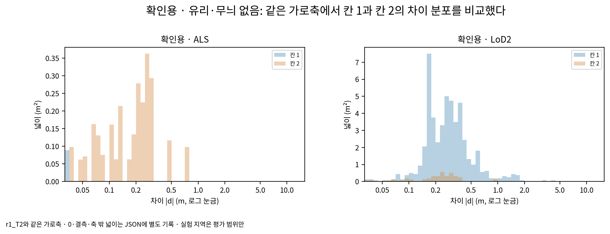

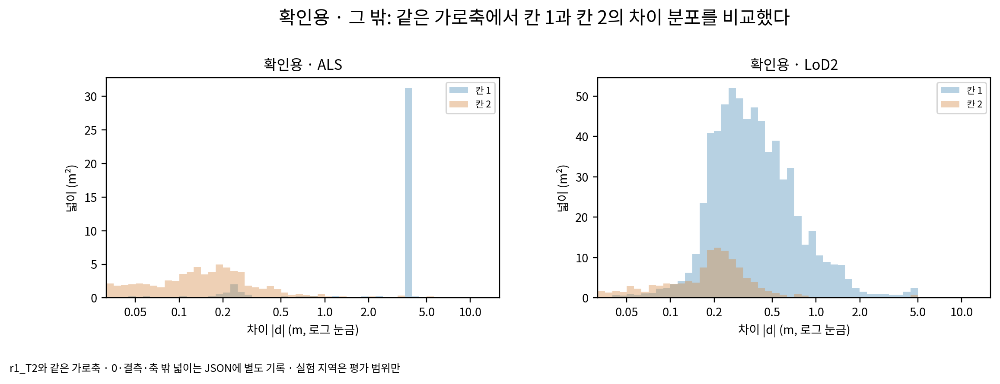

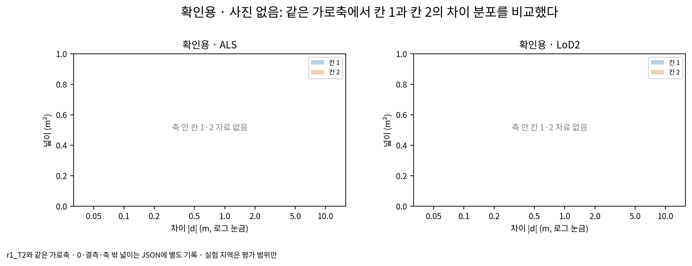

## 실험 지역

| 지역 · 사전 · 면 | 자리 | 넓이 m² | 전체 대비 | 칸 2 m² | 칸 2 보정 m² | T2 / 사진 보정 m² | 칸 1 m² | 칸 1 보존 m² |
|---|---|---:|---:|---:|---:|---:|---:|---:|
| B0 · ALS · 지붕 | 작은 구조물 | 0.34 | 0.02% | 0.00 | 0.00 | 0.00 / 0.00 | 0.00 | 0.00 |
| B0 · ALS · 지붕 | 가장자리 | 263.58 | 16.55% | 13.94 | 1.20 | 1.20 / 0.00 | 3.40 | 0.11 |
| B0 · ALS · 지붕 | 사진 없음 | 1328.97 | 83.43% | 48.57 | 0.21 | 0.21 / 0.00 | 2.42 | 0.15 |
| B0 · LoD2 · 지붕 | 작은 구조물 | 2.81 | 0.16% | 0.25 | 0.19 | 0.19 / 0.00 | 2.12 | 0.00 |
| B0 · LoD2 · 지붕 | 가장자리 | 328.06 | 19.18% | 54.06 | 2.75 | 2.75 / 0.00 | 82.19 | 0.00 |
| B0 · LoD2 · 지붕 | 유리·무늬 없음 | 7.19 | 0.42% | 0.00 | 0.00 | 0.00 / 0.00 | 1.44 | 0.00 |
| B0 · LoD2 · 지붕 | 그 밖 | 1356.44 | 79.29% | 52.12 | 0.06 | 0.06 / 0.00 | 148.81 | 0.00 |
| B0 · LoD2 · 지붕 | 사진 없음 | 16.12 | 0.94% | 2.06 | 0.00 | 0.00 / 0.00 | 0.00 | 0.00 |
| B0 · LoD2 · 벽 | 가장자리 | 1139.25 | 33.30% | 56.69 | 7.31 | 7.31 / 0.00 | 125.12 | 2.19 |
| B0 · LoD2 · 벽 | 유리·무늬 없음 | 499.12 | 14.59% | 0.81 | 0.19 | 0.19 / 0.00 | 0.12 | 0.00 |
| B0 · LoD2 · 벽 | 그 밖 | 1704.69 | 49.82% | 49.75 | 4.25 | 4.25 / 0.00 | 41.31 | 1.31 |
| B0 · LoD2 · 벽 | 사진 없음 | 78.56 | 2.30% | 0.44 | 0.00 | 0.00 / 0.00 | 0.19 | 0.00 |
| B173만 · ALS · 지붕 | 작은 구조물 | 50.40 | 2.91% | 5.11 | 3.02 | 3.02 / 0.00 | 11.87 | 0.00 |
| B173만 · ALS · 지붕 | 가장자리 | 729.83 | 42.20% | 84.84 | 20.64 | 20.64 / 0.00 | 322.83 | 0.25 |
| B173만 · ALS · 지붕 | 유리·무늬 없음 | 0.26 | 0.02% | 0.03 | 0.00 | 0.00 / 0.00 | 0.08 | 0.00 |
| B173만 · ALS · 지붕 | 사진 없음 | 949.08 | 54.87% | 38.76 | 5.41 | 5.41 / 0.00 | 677.94 | 0.00 |
| B173만 · LoD2 · 지붕 | 작은 구조물 | 15.06 | 0.73% | 1.88 | 0.69 | 0.69 / 0.00 | 8.12 | 0.00 |
| B173만 · LoD2 · 지붕 | 가장자리 | 972.94 | 47.11% | 88.12 | 66.62 | 66.62 / 0.00 | 403.31 | 0.00 |
| B173만 · LoD2 · 지붕 | 유리·무늬 없음 | 291.38 | 14.11% | 18.00 | 4.44 | 4.44 / 0.00 | 73.75 | 0.00 |
| B173만 · LoD2 · 지붕 | 그 밖 | 785.69 | 38.05% | 0.06 | 0.06 | 0.06 / 0.00 | 731.38 | 0.00 |
| B173만 · LoD2 · 벽 | 가장자리 | 1078.31 | 21.29% | 36.62 | 10.19 | 10.19 / 0.00 | 60.06 | 3.00 |
| B173만 · LoD2 · 벽 | 유리·무늬 없음 | 56.12 | 1.11% | 0.38 | 0.12 | 0.12 / 0.00 | 0.00 | 0.00 |
| B173만 · LoD2 · 벽 | 그 밖 | 3929.19 | 77.59% | 64.56 | 14.50 | 14.38 / 0.12 | 32.31 | 1.44 |
| B173만 · LoD2 · 벽 | 사진 없음 | 0.38 | 0.01% | 0.00 | 0.00 | 0.00 / 0.00 | 0.00 | 0.00 |
| B173 주변 · ALS · 지붕 | 작은 구조물 | 31.32 | 1.37% | 2.46 | 2.00 | 2.00 / 0.00 | 6.57 | 0.00 |
| B173 주변 · ALS · 지붕 | 가장자리 | 757.24 | 33.13% | 73.33 | 23.84 | 23.84 / 0.00 | 351.36 | 0.23 |
| B173 주변 · ALS · 지붕 | 유리·무늬 없음 | 207.31 | 9.07% | 45.14 | 2.91 | 2.91 / 0.00 | 5.46 | 0.07 |
| B173 주변 · ALS · 지붕 | 사진 없음 | 1290.00 | 56.43% | 31.39 | 0.06 | 0.06 / 0.00 | 652.78 | 0.13 |
| B173 주변 · LoD2 · 지붕 | 작은 구조물 | 16.25 | 0.61% | 2.06 | 1.25 | 1.25 / 0.00 | 8.44 | 0.00 |
| B173 주변 · LoD2 · 지붕 | 가장자리 | 1164.06 | 43.98% | 103.12 | 61.38 | 61.38 / 0.00 | 412.31 | 0.06 |
| B173 주변 · LoD2 · 지붕 | 유리·무늬 없음 | 292.50 | 11.05% | 16.25 | 4.12 | 4.12 / 0.00 | 81.25 | 0.00 |
| B173 주변 · LoD2 · 지붕 | 그 밖 | 1173.69 | 44.35% | 4.19 | 0.44 | 0.44 / 0.00 | 760.12 | 0.00 |
| B173 주변 · LoD2 · 벽 | 가장자리 | 1320.62 | 21.30% | 18.56 | 3.12 | 3.12 / 0.00 | 60.56 | 1.88 |
| B173 주변 · LoD2 · 벽 | 유리·무늬 없음 | 83.56 | 1.35% | 0.56 | 0.19 | 0.19 / 0.00 | 0.62 | 0.00 |
| B173 주변 · LoD2 · 벽 | 그 밖 | 4794.81 | 77.34% | 24.75 | 12.00 | 12.00 / 0.00 | 35.50 | 1.12 |
| B173 주변 · LoD2 · 벽 | 사진 없음 | 0.38 | 0.01% | 0.00 | 0.00 | 0.00 / 0.00 | 0.00 | 0.00 |
| R1 · ALS · 지붕 | 작은 구조물 | 0.71 | 0.04% | 0.20 | 0.13 | 0.13 / 0.00 | 0.00 | 0.00 |
| R1 · ALS · 지붕 | 가장자리 | 391.20 | 24.29% | 160.79 | 83.29 | 83.29 / 0.00 | 8.27 | 0.88 |
| R1 · ALS · 지붕 | 그 밖 | 0.33 | 0.02% | 0.09 | 0.00 | 0.00 / 0.00 | 0.00 | 0.00 |
| R1 · ALS · 지붕 | 사진 없음 | 1218.29 | 75.65% | 144.04 | 5.00 | 5.00 / 0.00 | 5.63 | 0.64 |
| R1 · LoD2 · 지붕 | 작은 구조물 | 22.31 | 1.13% | 7.44 | 5.75 | 5.75 / 0.00 | 6.31 | 0.00 |
| R1 · LoD2 · 지붕 | 가장자리 | 808.50 | 40.86% | 65.25 | 50.69 | 50.69 / 0.00 | 359.50 | 0.12 |
| R1 · LoD2 · 지붕 | 유리·무늬 없음 | 188.62 | 9.53% | 2.44 | 2.38 | 2.38 / 0.00 | 6.81 | 0.00 |
| R1 · LoD2 · 지붕 | 그 밖 | 959.19 | 48.47% | 6.62 | 4.75 | 4.75 / 0.00 | 275.62 | 0.44 |
| R1 · LoD2 · 지붕 | 사진 없음 | 0.25 | 0.01% | 0.00 | 0.00 | 0.00 / 0.00 | 0.00 | 0.00 |
| R1 · LoD2 · 벽 | 가장자리 | 1416.44 | 47.82% | 175.81 | 106.50 | 106.12 / 0.38 | 46.44 | 0.00 |
| R1 · LoD2 · 벽 | 유리·무늬 없음 | 94.06 | 3.18% | 2.94 | 1.38 | 1.38 / 0.00 | 0.75 | 0.00 |
| R1 · LoD2 · 벽 | 그 밖 | 1451.12 | 48.99% | 150.50 | 41.81 | 41.50 / 0.31 | 24.12 | 0.00 |
| R1 · LoD2 · 벽 | 사진 없음 | 0.38 | 0.01% | 0.00 | 0.00 | 0.00 / 0.00 | 0.31 | 0.00 |

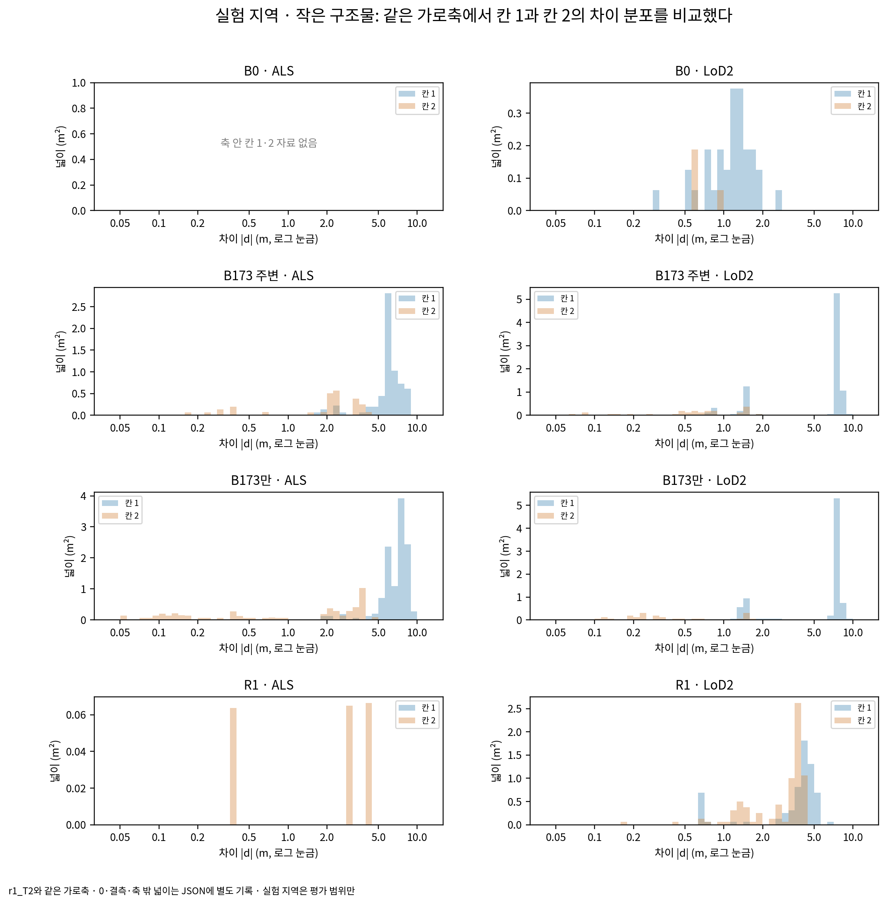

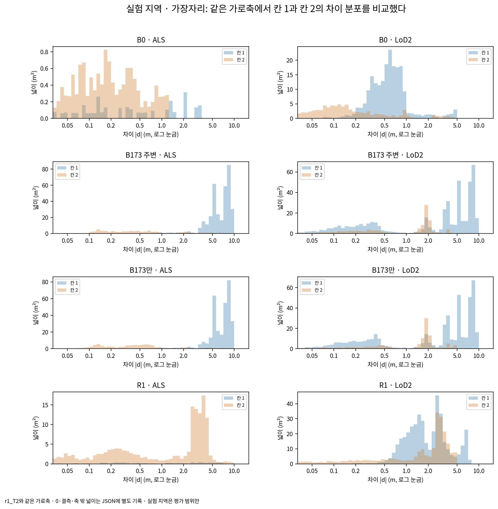

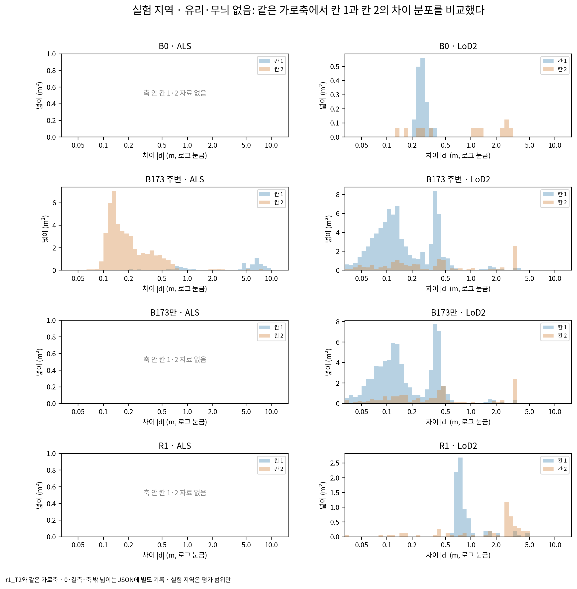

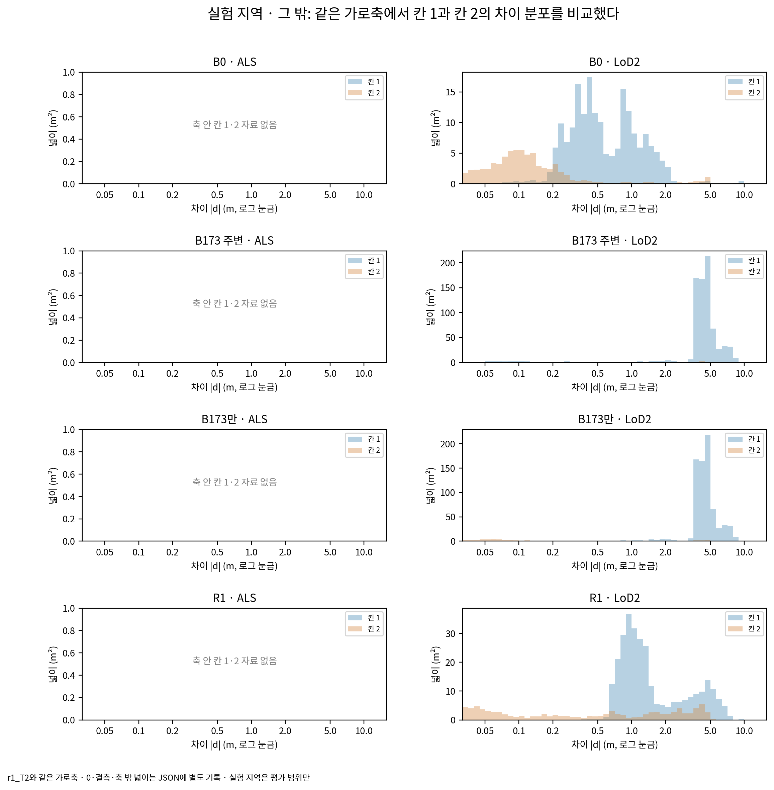

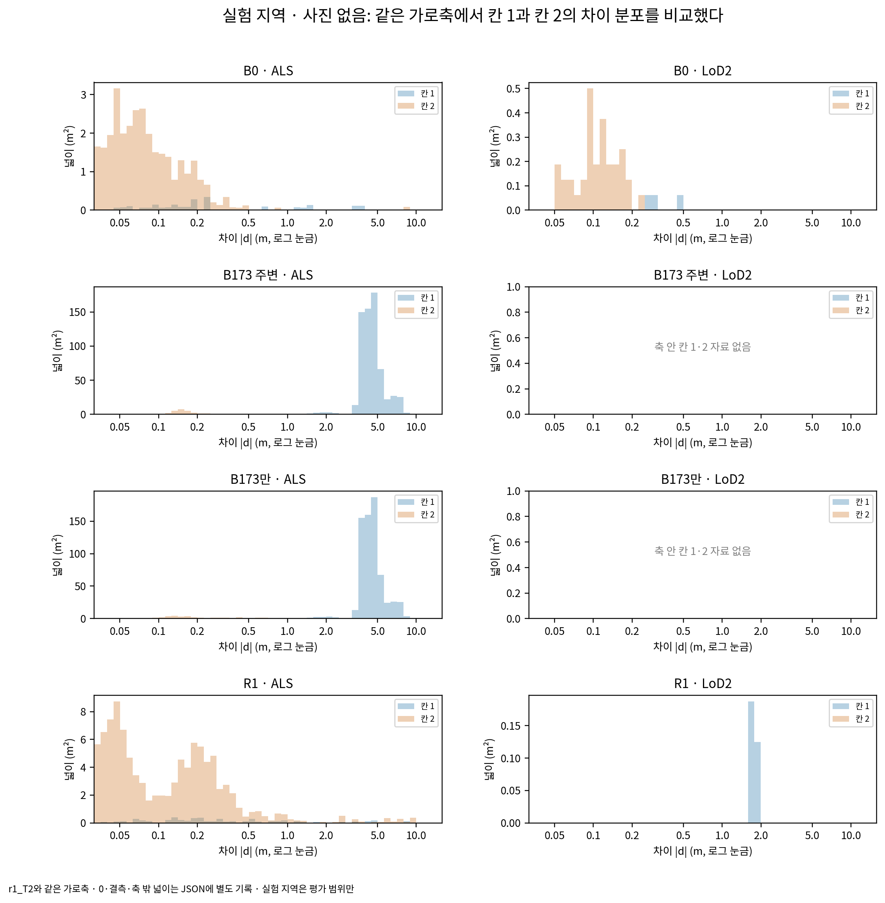

## 칸 2를 보정한 대표 단면

실험 지역을 먼저, 없으면 개발용에서 찾았다. 해당 자리의 칸 2·보정 패치 중 넓이가 가장 큰 패치를 고르고, 동률이면 고정된 파일·행 순서를 따랐다. 이 선택은 점검 그림에만 쓰며 판단 규칙을 바꾸지 않는다. 확인용 패치 상세는 열거나 그림에 넣지 않았다.

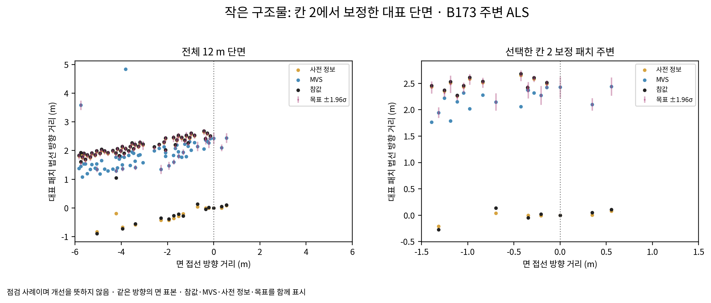

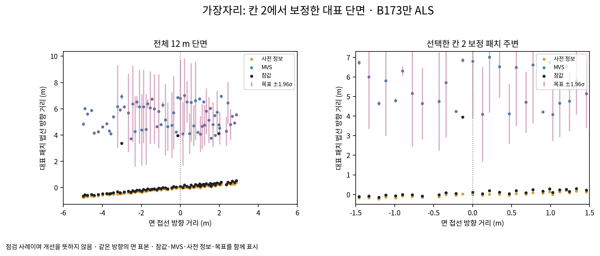

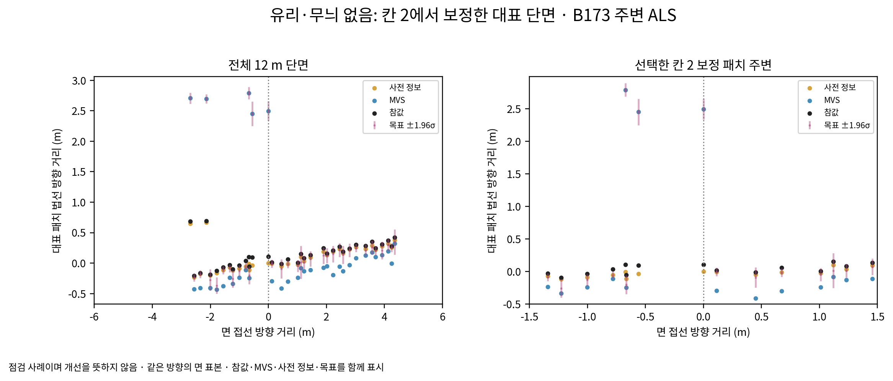

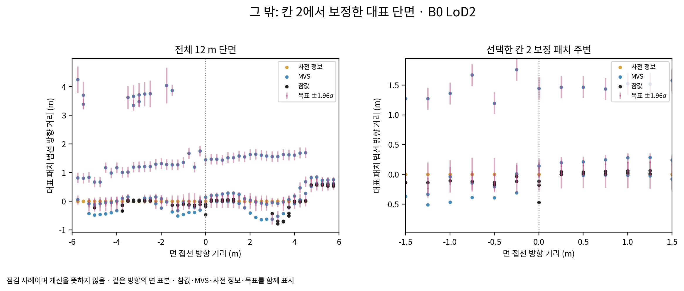

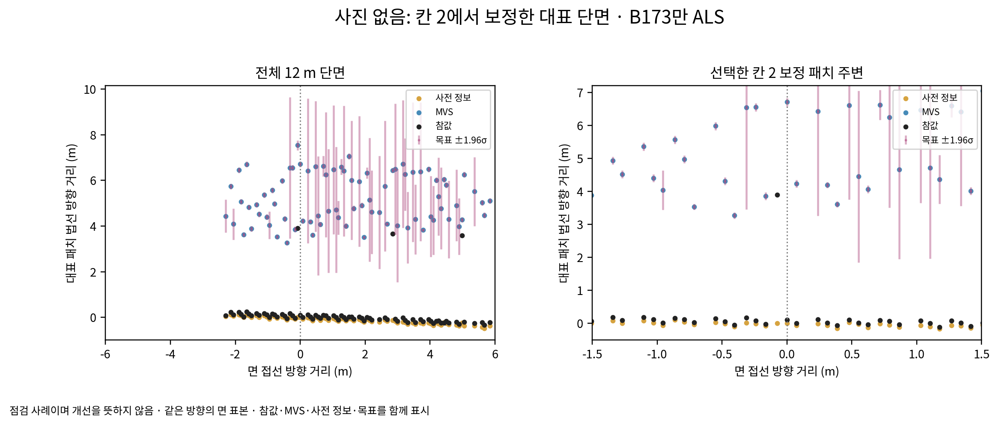

## 손으로 표시한 유리 자리의 연결

원래 지역 파일의 저장 목록을 우선했다. B173만 등 다른 단위에 정확히 같은 패치가 없으면 유리 소속을 옮겨 쓰지 않았다. 다음 표의 확인 불가는 그 단위의 수동 유리 소속만을 뜻하며, 사진의 무늬 없음 분류는 별도로 남는다.

| 지역 | 사전 | 수동 자리 | 상태 | 연결 패치 |
|---|---|---|---|---:|
| B0 | ALS | 유리 띠 | unavailable | 0 |
| B0 | ALS | 유리 둥근 지붕 | unavailable | 0 |
| B0 | ALS | B173 유리 채광창 | unavailable | 0 |
| B0 | LoD2 | 유리 띠 | unavailable | 0 |
| B0 | LoD2 | 유리 둥근 지붕 | unavailable | 0 |
| B0 | LoD2 | B173 유리 채광창 | unavailable | 0 |
| B173만 | ALS | 유리 띠 | unavailable | 0 |
| B173만 | ALS | 유리 둥근 지붕 | unavailable | 0 |
| B173만 | ALS | B173 유리 채광창 | available | 30 |
| B173만 | LoD2 | 유리 띠 | available | 161 |
| B173만 | LoD2 | 유리 둥근 지붕 | available | 80 |
| B173만 | LoD2 | B173 유리 채광창 | available | 13631 |
| B173 주변 | ALS | 유리 띠 | available | 181 |
| B173 주변 | ALS | 유리 둥근 지붕 | available | 66 |
| B173 주변 | ALS | B173 유리 채광창 | available | 8716 |
| B173 주변 | LoD2 | 유리 띠 | available | 161 |
| B173 주변 | LoD2 | 유리 둥근 지붕 | available | 80 |
| B173 주변 | LoD2 | B173 유리 채광창 | available | 13631 |
| R1 | ALS | 유리 띠 | unavailable | 0 |
| R1 | ALS | 유리 둥근 지붕 | unavailable | 0 |
| R1 | ALS | B173 유리 채광창 | unavailable | 0 |
| R1 | LoD2 | 유리 띠 | unavailable | 0 |
| R1 | LoD2 | 유리 둥근 지붕 | unavailable | 0 |
| R1 | LoD2 | B173 유리 채광창 | unavailable | 0 |

확인용의 공개 출력은 집계 수·넓이·비율과 분포의 구간 넓이뿐이다. 패치 ID·좌표·개별 판단은 전용 holdout 경로에 남겼다. scientific_verdict: null.
