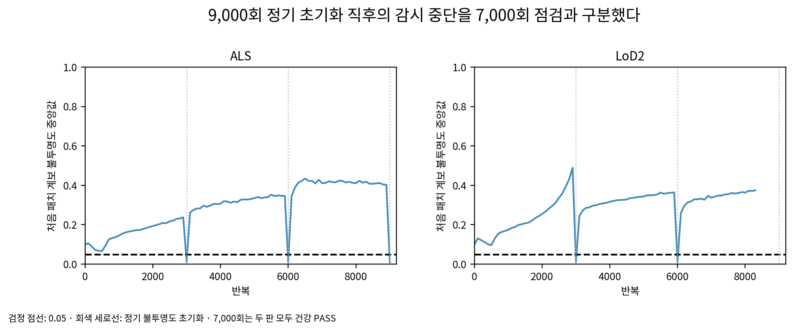

# r6 · 9,000회 정기 초기화와 감시 중단

두 판의 7,000회 건강 점검과 전체 상태 저장은 통과했다. CPU 채점 중 학습을 이어가던 항공 LiDAR 판이 9,000회 정기 불투명도 초기화 뒤 감시 조건에 걸렸고 두 판을 멈췄다. 7,000회 기하 판정과 별개의 실행 중단이다.

| 항목 | 관측 |
|---|---|
| ALS 8,900회 중앙값 | 0.4028858840 |
| ALS 9,000회 초기화 직후 중앙값 | 0.0099999988 |
| LoD2 마지막 건강 로그 | 8,300회, 0.3743583262 |
| LoD2 진행 표시 마지막 반복 | 8,370회 |
| 실행 종료 | ALS 1(감시 예외), LoD2 137(공동 종료), OOM 아님 |

원인: 그대로 물려받은 train.py는 밀도 제어 안에서 3,000회마다 reset_opacity를 호출한다. reset_opacity는 활성 불투명도를 0.01 이하로 만든다. 그 뒤 observe가 `iteration >= 7000`인 때 중앙값 0.05를 검사한다. 따라서 9,000회에는 정기 초기화 자체가 감시 조건을 충족한다. 직전 값과 일정에 따른 동작을 근거로 기록하며, 이를 학습 중 자연 발생한 불투명도 붕괴라고 해석하지 않는다.

초기화 일정과 감시 시점을 결과를 보고 바꾸지 않았고 자동 재학습은 하지 않았다. 새로운 이어 학습 결정에는 정기 초기화와 건강 검사 시점의 관계를 명시할 필요가 있다. 저장된 두 7,000회 전체 상태에는 Adam과 동적 목표 정보가 있어 r5의 최적화 상태 부재와는 다르다.

15,000·30,000회에는 도달하지 않았다. 해당 상태·기록은 미생성으로 표시한다. 7,000회 메시 채점, 최대 기여 계보·세 출신 이동, 그림과 점검 ZIP은 이 중단과 별도로 완성한다.

scientific_verdict: null.

2026-11-01T18:10:35.783700+09:00
