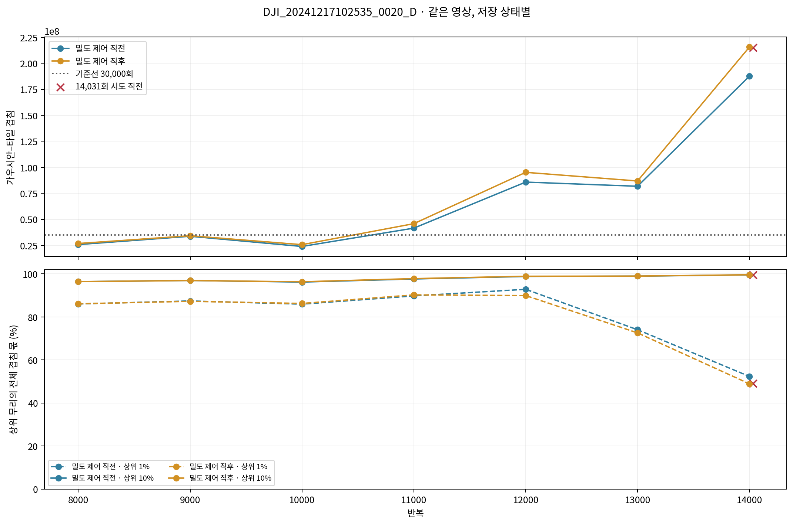
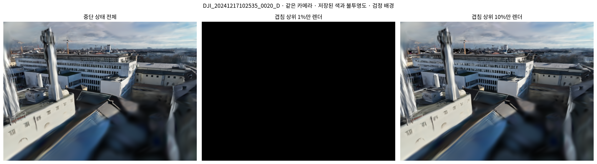
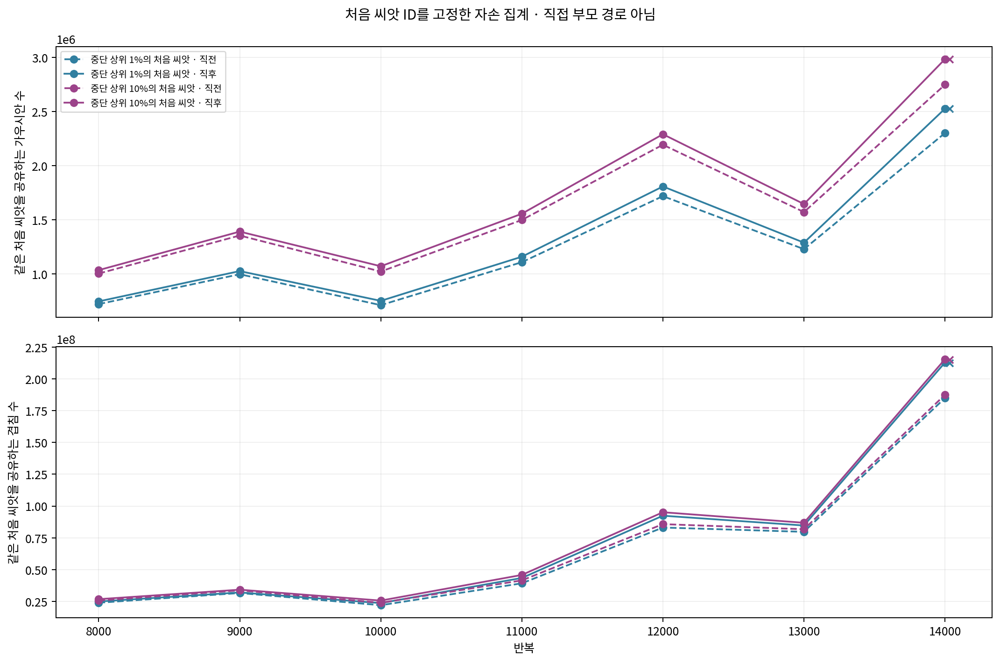
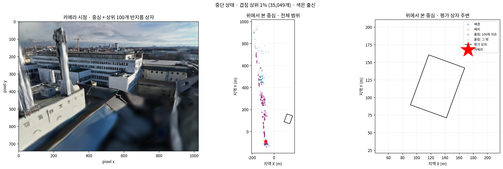
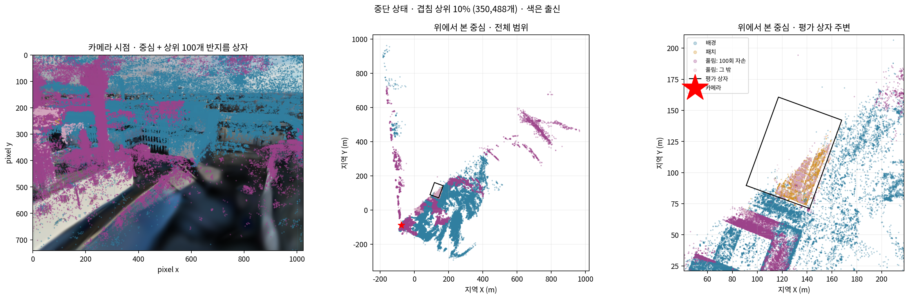
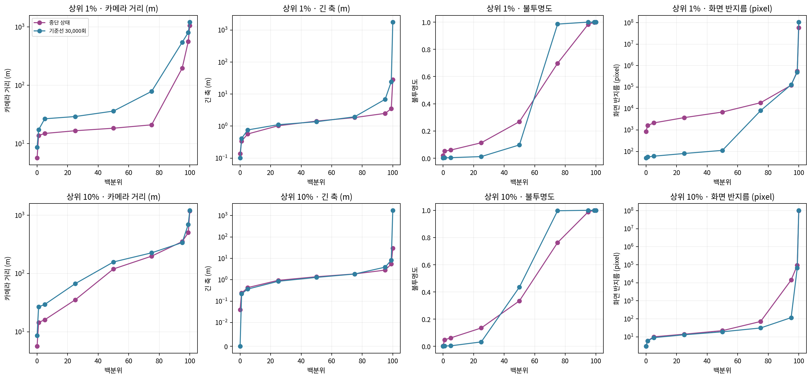

# r8 LoD2 중단 상태 — 무거운 영상과 저장 상태 원인 점검

기록 시각: 2026-11-02T14:57:29.697945+09:00. `scientific_verdict: null`. 새 수치에는 [이 발주에서 냄]을 적용한다. 결론과 원인 해석은 쓰지 않고 저장 상태의 수치·그림만 제시한다.

11월 2일 후속 결정에 따라 추가 학습을 하지 않았다. 완료 반복은 14,030회이고 14,031회 forward 직전 상태를 읽었다. r8 항공 LiDAR는 완료 상태로 보존했고 나머지 여섯 판은 시작하지 않았다. 15,000·30,000회 r8 LoD2 결과는 없음.

## 셈과 저장 시점

- 상위 1%·10%의 분모는 각 상태의 **전체 가우시안 수**다. 겹침 0인 행을 포함하고 `ceil(비율 × 전체 수)`개를 고른다. 정렬은 겹침 내림차순, 동률은 저장 행 번호 오름차순이다. 표의 실제 선택 수·양의 겹침 수·마지막 순위 겹침도 JSON/CSV에 있다.
- 겹침은 CUDA가 배정한 가우시안–타일 쌍 수다. 가려짐·알파 합성으로 실제 색에 기여했는지와는 별개의 정렬 작업량이다. 반지름은 같은 forward가 반환한 정수 pixel 반지름이다.
- 카메라 거리는 중심 간 3차원 유클리드 거리, 긴 축은 `max(exp(scale_0),exp(scale_1))`(직경 아님), 불투명도는 `sigmoid(opacity)`다. 분포는 전체 선택 무리에 대해 계산했다.
- 8,000~14,000회는 밀도 제어 **직전 PLY**와 **직후 완전 상태 PLY**를 따로 그렸다. 기울기 표는 직전 PLY와 같은 모집단이다.
- 자리 칸은 기존 공통 기준 그대로다. 가로: 평가 상자 안 / 밖 50 m 안 / 50~200 m / 200 m 넘음. 높이(m): −43.640 아래 / −43.640~−10.180 / −10.180~0.476505482 / 0.476505482 위. 중간 높이는 쓰지 않았다.
- `init_id`와 최초 `origin`을 씨앗 파일에 대조했다. 기준선은 SfM·사전 정보 출신, r8은 현재 배경·패치·풀림(100회 자손)·풀림(그 밖)을 사용했다. 처음 출신은 CSV에 별도 보존한다. 직접 부모 ID는 저장되지 않아 확인 불가다.
- 모든 추가 GPU 실행은 저장 모델 렌더이며 최적화 0회다. 렌더용 여유량 95% 확인선은 Adam이 없는 읽기 전용 과정에만 적용했다. 학습의 절반 초과 멈춤값은 바꾸지 않았고 학습을 다시 시도하지 않았다.

## 무거운 영상과 기준선

영상: `DJI_20241217102535_0020_D`. 중단 상태 3,504,875개, 기준선 LoD2 30,000회 2,983,470개.

| 상태 | 상위 무리 | 선택 수 | 겹침 수 | 전체 겹침 몫 | 처음 씨앗 수 |
|---|---:|---:|---:|---:|---:|
| r8_14031_stop | 1% | 35,049 | 105,427,392 | 49.0414% | 5 |
| r8_14031_stop | 10% | 350,488 | 214,165,760 | 99.6229% | 3,022 |
| base_LoD2_30000 | 1% | 29,835 | 30,228,983 | 86.1175% | 79 |
| base_LoD2_30000 | 10% | 298,347 | 33,819,455 | 96.3462% | 3,606 |

분포의 0·1·5·25·50·75·95·99·100 백분위와 고정 구간 히스토그램은 `heavy_r8_lod2/tables/distributions.json`에 있다. 아래는 중앙값 / 95백분위다.

| 상태 | 상위 | 카메라 거리 m | 긴 축 m | 불투명도 | 반지름 pixel |
|---|---:|---:|---:|---:|---:|
| r8_14031_stop | 1% | 18.34 / 195.8 | 1.434 / 2.497 | 0.2687 / 0.9835 | 6836 / 1.206e+05 |
| r8_14031_stop | 10% | 119.4 / 352 | 1.377 / 2.813 | 0.3345 / 0.9881 | 22 / 1.416e+04 |
| base_LoD2_30000 | 1% | 36.1 / 545.2 | 1.369 / 6.871 | 0.0976 / 1 | 112 / 1.277e+05 |
| base_LoD2_30000 | 10% | 157.4 / 338.2 | 1.286 / 3.87 | 0.4358 / 1 | 19 / 116 |

| 상태 | 상위 | 출신 | 선택 수 | 전체 겹침 몫 |
|---|---:|---|---:|---:|
| r8_14031_stop | 1% | 배경 | 2,104 | 2.9440% |
| r8_14031_stop | 1% | 패치 | 0 | 0.0000% |
| r8_14031_stop | 1% | 풀림: 100회 자손 | 32,945 | 46.0974% |
| r8_14031_stop | 1% | 풀림: 그 밖 | 0 | 0.0000% |
| r8_14031_stop | 10% | 배경 | 183,850 | 4.6254% |
| r8_14031_stop | 10% | 패치 | 7,028 | 0.0206% |
| r8_14031_stop | 10% | 풀림: 100회 자손 | 156,562 | 94.9646% |
| r8_14031_stop | 10% | 풀림: 그 밖 | 3,048 | 0.0123% |
| base_LoD2_30000 | 1% | SfM 출신 | 1,377 | 4.9634% |
| base_LoD2_30000 | 1% | 사전 정보 출신 | 28,458 | 81.1541% |
| base_LoD2_30000 | 10% | SfM 출신 | 69,889 | 6.9641% |
| base_LoD2_30000 | 10% | 사전 정보 출신 | 228,458 | 89.3820% |

출신×가로×높이의 모든 칸은 `top_cells.csv/json`에 있다. 빈 칸도 0으로 기록했다. 각 칸의 긴 축·거리·불투명도·반지름 중앙값은 빈 칸일 때 null이다.

## 같은 영상의 반복별 기록

| 반복 | 저장 시점 | 전체 겹침 | 상위 1% 몫 | 상위 10% 몫 |
|---:|---|---:|---:|---:|
| 8,000 | pre | 25,758,400 | 86.0464% | 96.4323% |
| 8,000 | post | 26,779,621 | 86.1187% | 96.4516% |
| 9,000 | pre | 33,722,100 | 87.4447% | 96.9590% |
| 9,000 | post | 34,244,969 | 87.2634% | 96.9233% |
| 10,000 | pre | 23,945,383 | 85.9586% | 96.2131% |
| 10,000 | post | 25,669,827 | 86.2782% | 96.3646% |
| 11,000 | pre | 41,551,185 | 89.7908% | 97.6528% |
| 11,000 | post | 45,844,658 | 90.2569% | 97.8293% |
| 12,000 | pre | 85,796,686 | 92.8551% | 98.8180% |
| 12,000 | post | 95,167,326 | 89.9486% | 98.9268% |
| 13,000 | pre | 81,792,360 | 74.0633% | 98.9753% |
| 13,000 | post | 86,874,931 | 72.5833% | 98.9942% |
| 14,000 | pre | 187,583,118 | 52.3369% | 99.5650% |
| 14,000 | post | 215,570,698 | 48.9062% | 99.6228% |
| 14,031 | before_attempt | 214,976,330 | 49.0414% | 99.6229% |
| 30,000 | saved_PLY | 35,102,026 | 86.1175% | 96.3462% |

`fixed_initial_seed_cohorts.csv/json`은 중단 영상의 상위 무리와 **같은 처음 씨앗 ID를 공유하는 모든 자손**을 각 저장 상태에서 집계한다. 이는 중간 반복의 정확한 부모 경로를 복원한 값이 아니다. 매 상태에서 새로 뽑은 상위 무리와 구별한다.

## 다른 영상

중단 상태 203장 모두의 전체 forward와 개별 겹침을 확인했다. 아래 다섯 장은 재렌더한 개별 겹침 배열도 기존 203장 측정과 바이트 단위로 같았다.

| 순위 | 영상 | 전체 겹침 | 상위 1% 몫 | 상위 10% 몫 |
|---:|---|---:|---:|---:|
| 1 | DJI_20241217102535_0020_D | 214,976,330 | 49.0414% | 99.6229% |
| 2 | DJI_20241217102533_0019_D | 181,115,891 | 58.2099% | 99.6509% |
| 3 | DJI_20241217100114_0043_D | 148,511,529 | 70.9894% | 99.9277% |
| 4 | DJI_20241217095051_0052_D | 83,748,515 | 11.2938% | 54.7249% |
| 5 | DJI_20241217095055_0054_D | 82,985,292 | 10.9940% | 54.4241% |

다섯 장 각각의 같은 분포·출신×자리 표, 개별 상위 가우시안과 처음 씨앗 목록을 함께 냈다. 203장 전체 표는 이어 학습 기록의 `recorded_r8_lod2/tables/render_views.csv`와 `render_cross.csv`에 있다.

## 밀도 제어 직전 기울기와 수 변화

| 반복 | 직전 가우시안 수 | 기울기 문턱 이상 수 | 비율 |
|---:|---:|---:|---:|
| 8,000 | 1,382,484 | 79,985 | 5.7856% |
| 9,000 | 1,808,046 | 91,780 | 5.0762% |
| 10,000 | 1,421,994 | 108,281 | 7.6147% |
| 11,000 | 1,978,270 | 130,340 | 6.5886% |
| 12,000 | 2,743,573 | 181,221 | 6.6053% |
| 13,000 | 2,013,866 | 139,657 | 6.9348% |
| 14,000 | 3,263,767 | 343,457 | 10.5233% |

문턱은 0.0002이며 저장된 `accum/denom >= 문턱`을 사용했다. NaN은 원래 구현과 같이 0이다. 이는 기울기 조건을 넘은 수이며 복제·분할·삭제 결과 수와 동일한 항목이 아니다. 전체 7×64칸은 `pre_density_gradients.csv/json`에 있다.

| 1,000회 구간 | 시작 수 | 끝 수 | 순변화 |
|---|---:|---:|---:|
| 7,000 → 8,000 | 1,059,539 | 1,417,877 | +358,338 |
| 8,000 → 9,000 | 1,417,877 | 1,848,442 | +430,565 |
| 9,000 → 10,000 | 1,848,442 | 1,478,027 | -370,415 |
| 10,000 → 11,000 | 1,478,027 | 2,040,109 | +562,082 |
| 11,000 → 12,000 | 2,040,109 | 2,845,747 | +805,638 |
| 12,000 → 13,000 | 2,845,747 | 2,096,233 | -749,514 |
| 13,000 → 14,000 | 2,096,233 | 3,504,875 | +1,408,642 |

1,000회 변화는 매 100회 **반복 후** 기록의 차이를 더해 양 끝 수와 일치함을 확인했다. 7,000회 시작은 원래 완전 상태다. 칸별 변화에는 칸 사이 이동·복제·분할·삭제가 함께 들어 있으므로 이를 각각의 원인 수로 읽지 않는다. 모든 칸은 `growth_1000.csv/json`에 있다.

## 독립 검증

20개 상태·영상 조합의 상위 합을 정렬과 다른 partition 계산으로 재확인했다. 압축 CSV의 모든 행을 원본 행 번호·겹침·처음 씨앗 ID·출신과 대조했고 순위·동률 순서·합계가 일치했다. 상위 1%·10%만 별도로 렌더한 개별 겹침 배열도 전체 렌더에서 선택한 배열과 같았다. 중단 완전 상태의 난수·영상 스택으로 다음 영상이 중단 영상임을 확인했고 모델·Adam의 유한값과 저장 반복 경계를 검증했다.

## 그림과 개별 계보 자료

- 위치 그림은 선택된 모든 중심을 그린다. 카메라 시점에는 원래 전체 RGB와 화면 안 중심을 겹쳤고, 가장 무거운 100개는 CUDA 반지름의 사각 범위를 추가했다. 중심이 화면 밖이어도 큰 가우시안은 화면 타일에 겹칠 수 있으므로 화면 밖/뒤 중심 수를 그림 JSON에 명시했다. 위에서 본 전체 범위와 평가 상자 주변 확대를 함께 낸다.
- ZIP의 `heavy_selected_rows/*top10.csv.gz`: 상위 10% 모든 행, 상위 1% 표시, 겹침, 처음 씨앗 ID·출신, 현재 출신·자리·XYZ·거리·크기·불투명도·반지름. `*ancestors.csv.gz`: 두 상위 무리의 처음 씨앗별 자손 수·겹침 수. 별도 색상이나 행 표본으로 생략하지 않았다.
- 각 그림에는 JSON이 있다. 체크포인트·PLY·전체 개별 겹침 NPZ는 외부 경로와 SHA-256으로 제공하며 ZIP에 중복하지 않는다. 패키지 무결성은 과학적 판정이 아니다.
