# 7,000회 중단 후 비교·원인 점검 · r5

두 판의 7,000회 중단과 목표 따름 80% 기준을 유지했다. 나머지 여섯 판은 시작하지 않았다. 기존 모델 비교와 저장 모델 진단, 단계 0의 자리별 판단 집계를 마쳤다. 최적화 상태가 없어 기록용 이어 학습은 실행하지 않았다. 모든 새 수치와 그림은 [이 발주에서 냄]이며 scientific_verdict는 null이다.

## 1. 같은 목표 지도로 센 기존 모델 비교

모든 판에 r4n과 같은 203개 학습 영상, 같은 목표 깊이·σ 지도, 같은 화소 구분을 적용했다. 깊이 없는 화소도 분모에 포함했다. 기존 깊이 손실 기준선에는 7,000회 모델이 없어 30,000회를, 영상만 쓴 2DGS에는 저장된 7,000회를 썼다. 학습 횟수가 다르므로 같은 학습량의 성능 비교로 해석하지 않는다. 기준선의 재학습은 0회다.

### ALS

| 화소 구분 | r4n 7,000회 | 깊이 기준선 30,000회 | 영상 2DGS 7,000회 |
|---|---:|---:|---:|
| 전체 | 32.72% | 67.09% | 5.70% |
| 사전 패치 | 67.62% | 47.91% | 8.35% |
| 배경 MVS | 28.69% | 69.31% | 5.39% |
| 사전 지붕 | 67.62% | 47.91% | 8.35% |
| 사전 벽 | 확인 불가 | 확인 불가 | 확인 불가 |
| 관측 없음 | 66.14% | 46.00% | 7.76% |
| 일치 | 70.57% | 46.59% | 8.15% |
| 보존 | 65.08% | 4.62% | 4.59% |
| 보정 | 65.02% | 83.36% | 12.87% |
| 사전 원값 | 68.96% | 49.01% | 8.64% |
| 사전 대체 | 65.61% | 46.26% | 7.92% |

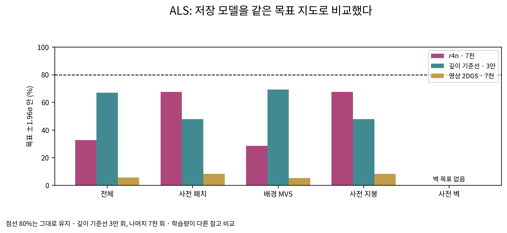

### LoD2

| 화소 구분 | r4n 7,000회 | 깊이 기준선 30,000회 | 영상 2DGS 7,000회 |
|---|---:|---:|---:|
| 전체 | 34.28% | 71.28% | 6.79% |
| 사전 패치 | 55.75% | 68.44% | 11.49% |
| 배경 MVS | 30.49% | 71.78% | 5.96% |
| 사전 지붕 | 72.43% | 89.74% | 14.22% |
| 사전 벽 | 30.25% | 35.86% | 7.32% |
| 관측 없음 | 42.26% | 50.69% | 11.25% |
| 일치 | 64.08% | 79.06% | 11.16% |
| 보존 | 39.30% | 56.21% | 14.12% |
| 보정 | 57.72% | 71.88% | 12.95% |
| 사전 원값 | 62.40% | 76.95% | 11.87% |
| 사전 대체 | 42.69% | 51.72% | 10.75% |

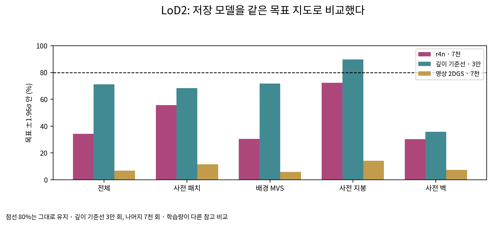

## 2. 목표 폭 밖 사전 화소의 앞·뒤와 최대 기여 출신

최대 기여는 실제 CUDA 렌더 순서에서 개별 가우시안의 α×누적 투과율이 가장 큰 항목이다. 같은 값이면 먼저 나타난 항목을 썼다. 진단용 사본의 왜곡 출력 채널에 번호만 기록했고, 두 판 각 203개 깊이 배열이 기존 r4n 배열과 바이트 단위로 같았다. 출신 묶음의 합계 기여를 대신 쓰지 않았다. 앞은 렌더 깊이가 목표 폭보다 카메라 쪽, 뒤는 반대쪽이다. 이 구분과 출신 연관만으로 인과를 확정하지 않는다.

### ALS

사전 패치 화소 11,876,159개 중 폭 밖 3,845,965개. 깊이 없음 0개.

| 방향 | 그 자리 패치 | 다른 패치 | 배경 | 확인 불가 |
|---|---:|---:|---:|---:|
| 앞 · 가림 쪽 | 0.07% | 6.57% | 49.53% | 0.00% |
| 뒤 · 비침 쪽 | 0.08% | 6.54% | 37.19% | 0.00% |

표의 분모는 해당 판의 폭 밖 사전 화소 전체다. 전체 사전 화소를 분모로 한 값과 원 화소 수는 CSV에 함께 있다.

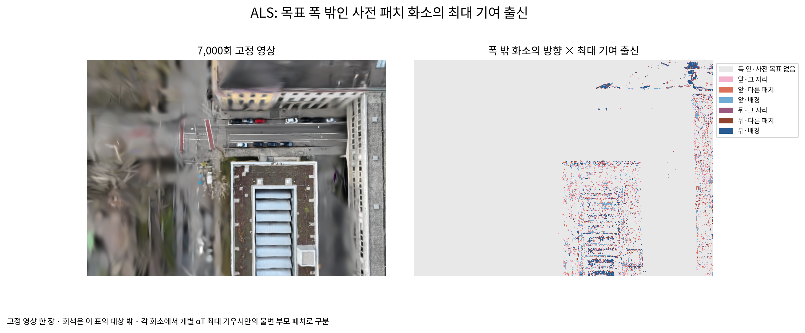

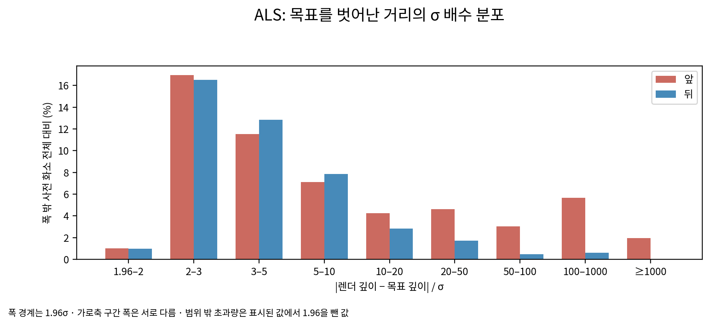

### LoD2

사전 패치 화소 17,415,076개 중 폭 밖 7,705,604개. 깊이 없음 0개.

| 방향 | 그 자리 패치 | 다른 패치 | 배경 | 확인 불가 |
|---|---:|---:|---:|---:|
| 앞 · 가림 쪽 | 0.08% | 20.81% | 37.09% | 0.00% |
| 뒤 · 비침 쪽 | 0.07% | 11.62% | 30.34% | 0.00% |

표의 분모는 해당 판의 폭 밖 사전 화소 전체다. 전체 사전 화소를 분모로 한 값과 원 화소 수는 CSV에 함께 있다.

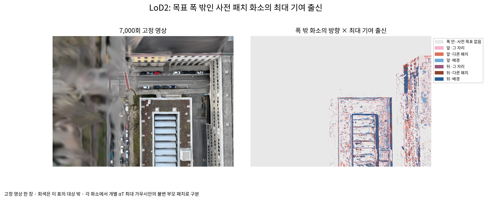

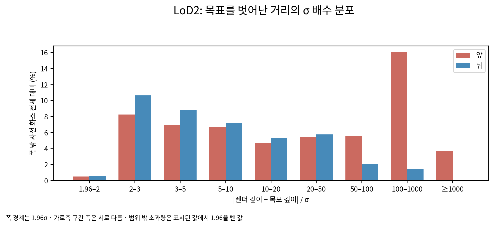

## 3. 두 출신의 이동과 씨앗·영상 범위

긴 축 크기는 활성화된 접선 두 축 중 큰 값이며 지름이 아니다. 부모의 목표 점과 단위 법선을 기준으로 법선 이동과 접선 이동을 분해했다. 처음 1 m 초과 배경 계보의 별도 표는 r4n 점검 보고서에 유지하고, 여기서는 전체 배경과 전체 사전 출신을 같은 방식으로 센다.

### ALS

| 출신 | 남은 수 | 접선 >1 m | 긴 축 중앙값 / 최대 (m) | 불투명도 중앙값 | 법선 이동 중앙값 / 최대 (m) | 접선 이동 중앙값 / 최대 (m) |
|---|---:|---:|---:|---:|---:|---:|
| 배경 | 548,447 | 498,249 | 1.515 / 48.787 | 0.4215 | 0.098 / 3.101 | 44.688 / 679.186 |
| 사전 패치 | 22,456 | 14,428 | 0.321 / 4.430 | 0.3519 | 0.045 / 1.497 | 1.298 / 13.409 |

최솟값·95% 분위와 1 m 초과 집단의 크기·불투명도도 JSON에 있다. 각 그림은 전체 이동 범위, 입력 지역의 참값·사전 면, 같은 자리에 이동 중심을 겹친 보기 순서다. 검정은 실제 참값 점, 주황은 사전 패치 면 표본이다.

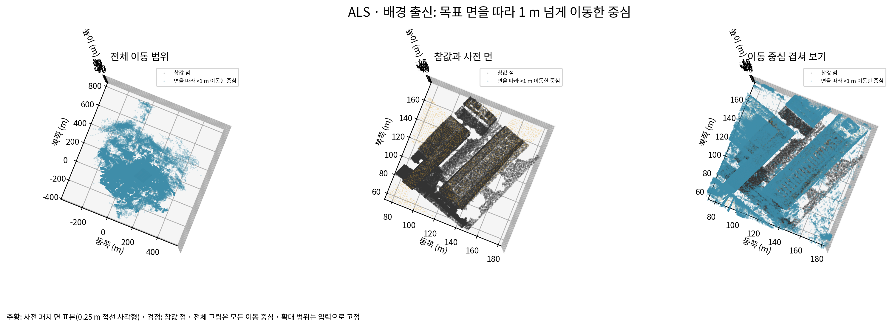

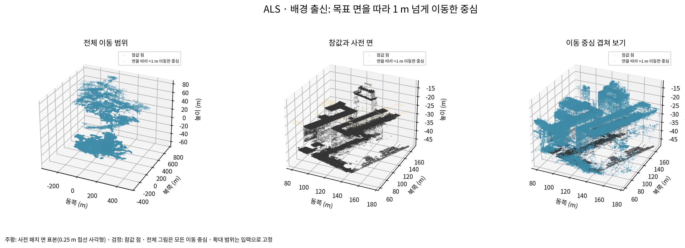

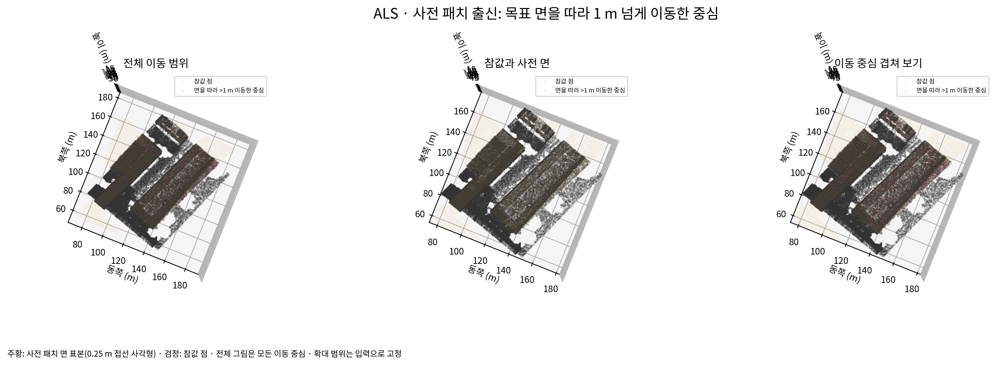

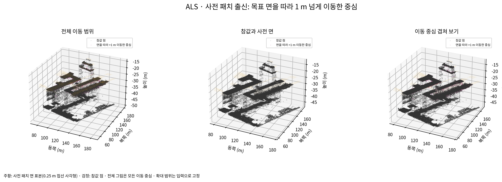

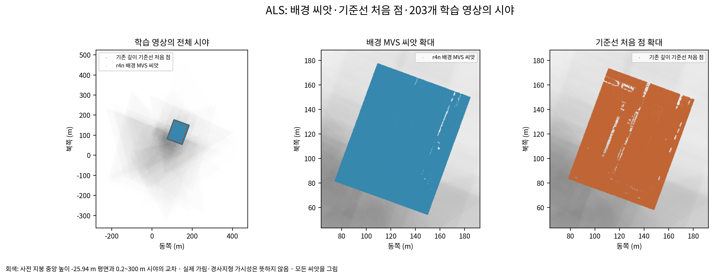

배경 씨앗 555,259개와 기준선 처음 점 112,557개를 모두 표시했다. 영상 시야는 입력 지붕 중앙 높이 평면과 카메라 깊이 0.2~300 m의 교차다. 203개 중 203개가 그 평면과 교차했다. 실제 가림을 반영한 관측 넓이와 구분한다.

### LoD2

| 출신 | 남은 수 | 접선 >1 m | 긴 축 중앙값 / 최대 (m) | 불투명도 중앙값 | 법선 이동 중앙값 / 최대 (m) | 접선 이동 중앙값 / 최대 (m) |
|---|---:|---:|---:|---:|---:|---:|
| 배경 | 438,227 | 382,412 | 1.330 / 47.148 | 0.4290 | 0.091 / 2.791 | 31.300 / 687.400 |
| 사전 패치 | 334,758 | 308,883 | 1.240 / 45.424 | 0.3335 | 0.172 / 2.082 | 29.318 / 462.953 |

최솟값·95% 분위와 1 m 초과 집단의 크기·불투명도도 JSON에 있다. 각 그림은 전체 이동 범위, 입력 지역의 참값·사전 면, 같은 자리에 이동 중심을 겹친 보기 순서다. 검정은 실제 참값 점, 주황은 사전 패치 면 표본이다.

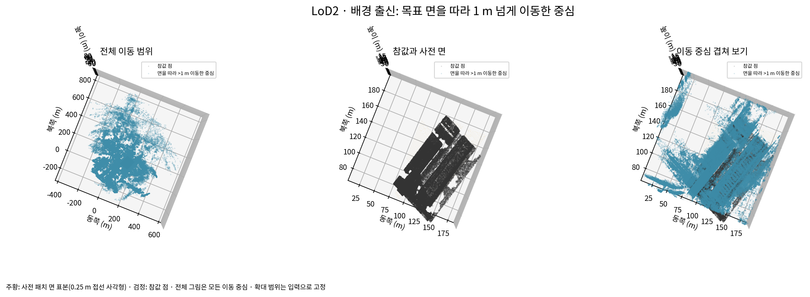

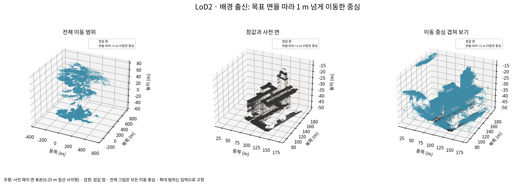

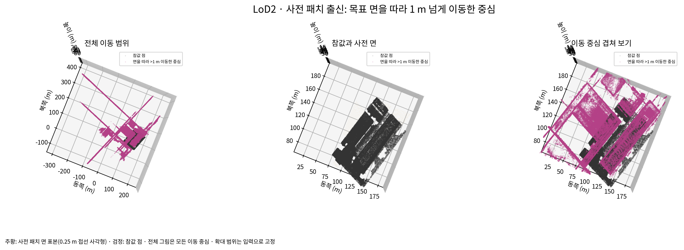

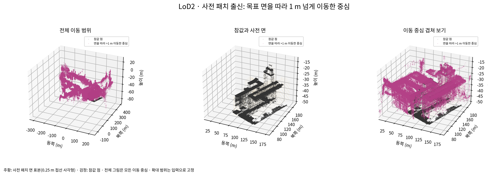

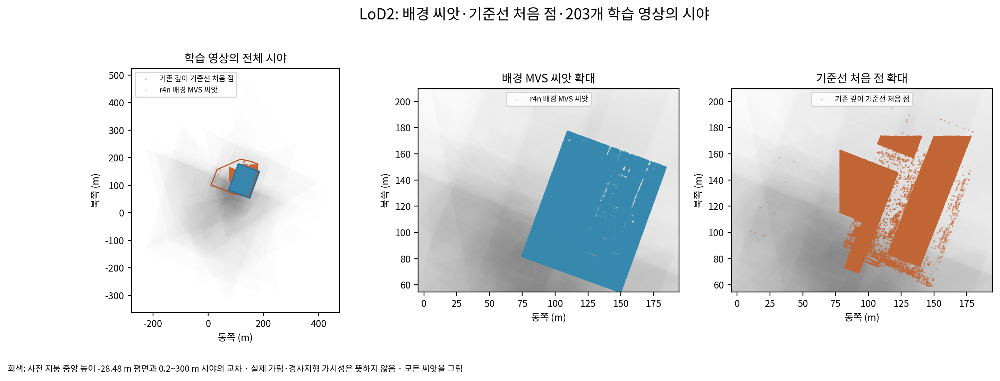

배경 씨앗 408,243개와 기준선 처음 점 270,067개를 모두 표시했다. 영상 시야는 입력 지붕 중앙 높이 평면과 카메라 깊이 0.2~300 m의 교차다. 203개 중 203개가 그 평면과 교차했다. 실제 가림을 반영한 관측 넓이와 구분한다.

## 4. 뜬 면·결과와 목표의 τ 비교

현재 TSDF와 고정된 채점 규칙을 그대로 적용했다. 두 판 모두 2,048개 독립 첫 면 광선과 넓이 재계산을 통과했다. 항공 LiDAR의 보고서 메타데이터 누락은 보완했고, 보완 전후 메시 SHA-256이 같았다.

| 사전 정보 | 칸 0~3 뜬 면 | 뜬 면 넓이 / 평가 넓이 (m²) |
|---|---:|---:|
| ALS | 21.23% | 425.355 / 2003.866 |
| LoD2 | 21.71% | 827.188 / 3809.812 |

결과와 목표의 τ 비교, 고정 단면, 배경 출신 뜬 면 지도는 [7,000회 점검](단계1_7000회_점검_r4n.md)에 있다. 해당 지도는 출신별 기여의 합계이고, 2절의 개별 최대 기여 지도와 계산이 다르다.

## 5. 기록용 이어 학습

두 판 모두 **NOT_RUN_NO_OPTIMIZER_STATE**. 실행 명령에는 `--checkpoint_iterations`가 없고 기본값은 빈 목록이다. 전체 상태 자동 저장은 기본 8,000·30,000회라 7,000회 중단 전에 발생하지 않았다. 전체 모델 폴더에 `.pt`, `.pth`, `.ckpt` 상태 파일이 없었고, PLY와 스냅샷에는 Adam의 모멘트·매개변수 묶음 상태가 없다. 이를 새로 초기화하면 같은 최적화 상태에서 잇는 것이 아니므로 사용자 결정 6에 따라 실행하지 않았다. 15,000·30,000회 `_rec` 목표 따름과 계보 표는 확인 불가이며 0이나 통과로 적지 않는다.

## 6. 자리별 판단 정확도

[자리별 보고서](자리별_판단점검_r5.md)와 `tables/places_r5_*.json`, 전체 CSV를 함께 제공한다. 분류는 MVS·사전 정보·사진 입력으로만 만들고, 참값 칸은 집계와 대표 단면을 고른 뒤에만 사용했다. 작은 구조물 → 가장자리 → 유리·무늬 없음 → 그 밖 순서이며, 남은 그 밖 중 사진 곡선이 없는 곳은 사진 없음으로 별도 행을 냈다. 앞선 세 자리에도 사진 없음 넓이를 별도 열로 기록했다.

## 7. 기록과 남은 범위

설정과 사용자 결정은 `diagnostics_r5.json` 및 잠금 파일에 있다. 80%, 배경 크기·묶기, 분할 자식 목표, 깊이 손실 무게를 바꾸지 않았다. 이 점검 묶음 이후에는 진행하지 않는다. 확인용 패치 상세, 큰 모델·메시·지도는 ZIP 밖의 지정 경로에 보존하며, ZIP의 외부 자료 manifest에 재계산 경계를 적는다.
