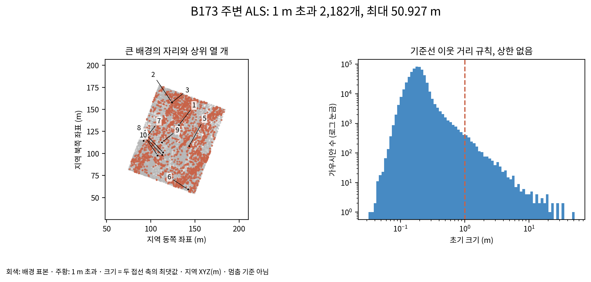
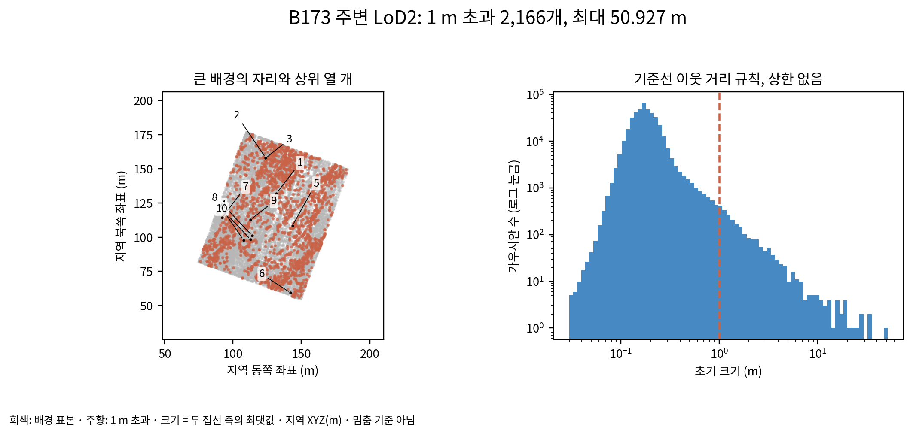
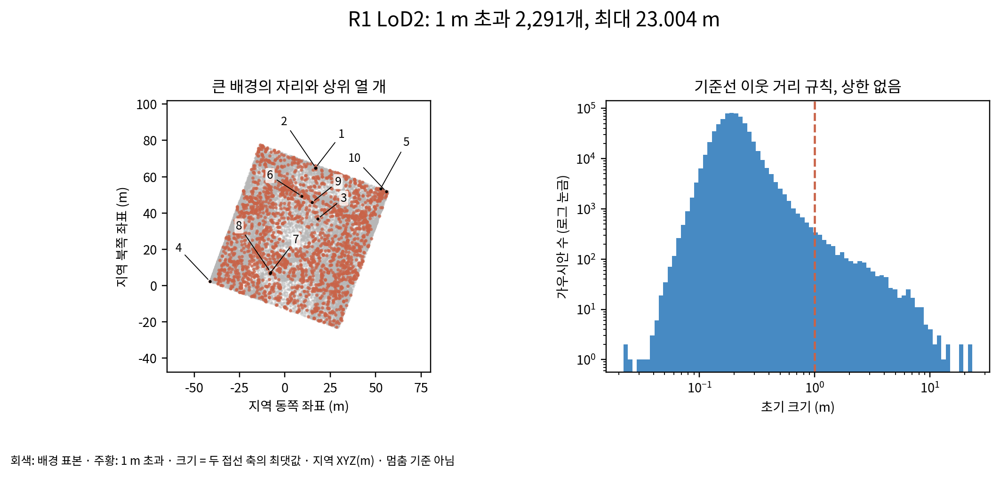
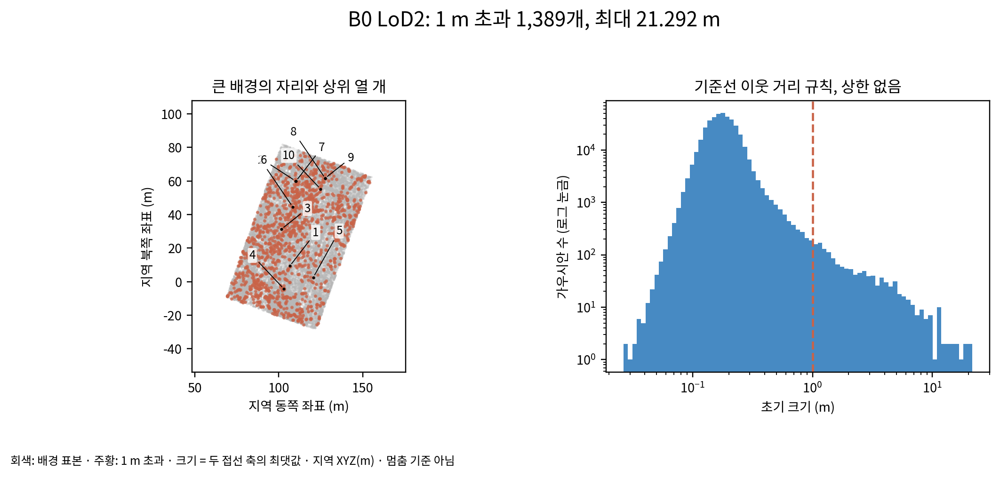

# r3 초기 배경 크기 기록

배경의 크기는 기준선의 이웃 거리 규칙 그대로이며 상한이나 외톨이 제거를 적용하지 않았다. 아래는 대표 자리 검사에 준비한 네 조합의 전수 집계다. 아직 배경을 준비하지 않은 네 조합의 값을 0으로 표시하지 않았다.

크기는 `exp(log(sqrt(clamp_min(distCUDA2(사전 목표 + 배경 XYZ), 1e-7))))`의 실제 float32 값이다. 두 접선 축이 같으므로 그 최댓값을 사용한다. 원반 지름이나 3σ 폭이 아니다. 배경 자체의 위치 자료만으로 계산하므로, 진행 중인 고리 불확실도를 임의로 채우지 않았다.

| 조합 | 배경 수 | 1 m 초과 수 | 가장 큰 크기 (m) |
|---|---:|---:|---:|
| B173 주변 ALS | 555,259 | 2,182 | 50.927437 |
| B173 주변 LoD2 | 408,243 | 2,166 | 50.927437 |
| R1 LoD2 | 657,342 | 2,291 | 23.003561 |
| B0 LoD2 | 407,441 | 1,389 | 21.291609 |

좌표는 원본 학습 장면의 지역 XYZ(m)다. 측량 평면 좌표와 연결하는 XY 오프셋 출처는 `scripts/phd/main_axes71_v2/mvs_surface.py: OFFSET=[690953,5336071]`이다. EPSG:25832 평면 연결과 원본 카메라 좌표를 보존하며, Z를 검증하지 않은 절대 표고로 이름 붙이지 않는다.

### B173 주변 ALS

| 순위 | 처음 씨앗 번호 | X (m) | Y (m) | Z (m) | 크기 (m) |
|---|---:|---:|---:|---:|---:|
| 1 | 567741 | 131.726562 | 132.023529 | -151.225327 | 50.927437 |
| 2 | 157494 | 123.891296 | 158.091248 | -95.344261 | 33.084427 |
| 3 | 576647 | 123.875069 | 157.848083 | -95.384804 | 32.987637 |
| 4 | 488826 | 113.971046 | 101.148071 | 77.288132 | 28.580826 |
| 5 | 501717 | 143.451340 | 108.429947 | -110.548065 | 28.279034 |
| 6 | 579563 | 142.075836 | 59.331642 | -84.370117 | 24.219021 |
| 7 | 548334 | 91.951843 | 114.379982 | 54.768940 | 22.960823 |
| 8 | 562431 | 107.714462 | 97.848839 | 62.064877 | 20.842552 |
| 9 | 569062 | 112.706673 | 112.639961 | 47.824463 | 19.713078 |
| 10 | 349163 | 112.867348 | 98.317223 | -117.440247 | 19.141432 |

### B173 주변 LoD2

| 순위 | 처음 씨앗 번호 | X (m) | Y (m) | Z (m) | 크기 (m) |
|---|---:|---:|---:|---:|---:|
| 1 | 626253 | 131.726562 | 132.023529 | -151.225327 | 50.927437 |
| 2 | 317617 | 123.891296 | 158.091248 | -95.344261 | 33.084427 |
| 3 | 635690 | 123.875069 | 157.848083 | -95.384804 | 32.987637 |
| 4 | 544392 | 113.971046 | 101.148071 | 77.288132 | 28.580826 |
| 5 | 557388 | 143.451340 | 108.429947 | -110.548065 | 28.279034 |
| 6 | 638802 | 142.075836 | 59.331642 | -84.370117 | 24.219021 |
| 7 | 605809 | 91.951843 | 114.379982 | 54.768940 | 22.960823 |
| 8 | 620566 | 107.714462 | 97.848839 | 62.064877 | 20.842552 |
| 9 | 627647 | 112.706673 | 112.639961 | 47.824463 | 19.713078 |
| 10 | 430070 | 112.867348 | 98.317223 | -117.440247 | 19.141432 |

### R1 LoD2

| 순위 | 처음 씨앗 번호 | X (m) | Y (m) | Z (m) | 크기 (m) |
|---|---:|---:|---:|---:|---:|
| 1 | 690411 | 16.829561 | 64.918205 | -144.993958 | 23.003561 |
| 2 | 164887 | 17.051273 | 64.771904 | -144.995453 | 22.982164 |
| 3 | 662579 | 18.146029 | 36.875103 | -104.548485 | 19.010708 |
| 4 | 728768 | -41.268318 | 2.261936 | -130.236008 | 18.283237 |
| 5 | 243489 | 52.637512 | 53.339710 | -92.482895 | 14.177750 |
| 6 | 438537 | 9.182824 | 49.369396 | 54.934151 | 14.062511 |
| 7 | 489973 | -8.242625 | 6.794457 | -122.027252 | 12.636099 |
| 8 | 586986 | -7.857584 | 7.311732 | -122.177307 | 12.251126 |
| 9 | 770669 | 15.028672 | 45.935322 | -6.676828 | 12.050983 |
| 10 | 579871 | 55.778667 | 51.787785 | 53.810196 | 11.637304 |

### B0 LoD2

| 순위 | 처음 씨앗 번호 | X (m) | Y (m) | Z (m) | 크기 (m) |
|---|---:|---:|---:|---:|---:|
| 1 | 161022 | 106.575333 | 9.342046 | -89.756653 | 21.291609 |
| 2 | 514163 | 108.268806 | 44.569077 | -99.067398 | 19.829376 |
| 3 | 470641 | 101.633476 | 31.355509 | 71.704193 | 19.162216 |
| 4 | 524923 | 103.082634 | -4.312587 | -83.626549 | 18.809036 |
| 5 | 468420 | 120.563942 | 2.577295 | -73.667389 | 17.165592 |
| 6 | 519098 | 109.938889 | 60.004723 | -97.752373 | 15.802435 |
| 7 | 500966 | 110.244133 | 59.901787 | -97.288162 | 15.532347 |
| 8 | 420132 | 127.729141 | 61.477291 | -80.375397 | 14.637732 |
| 9 | 546575 | 127.588364 | 61.619514 | -80.442795 | 14.570679 |
| 10 | 500041 | 124.825562 | 55.260963 | -81.567886 | 13.893738 |

## 7,000회 기록 상태

3.5에서 중단하여 실제 자손의 잔존 수·크기·불투명도와 뜬 면 지도는 확인 불가다. 코드에는 처음 씨앗 번호를 통한 자손 추적, 목표 면에서의 법선·접선 이동, 배경 및 처음 1 m 초과 배경 출신의 렌더 기여를 추가했다. 이 진단은 새 멈춤 기준이 아니다.

실제 B173 항공 LiDAR 초기화에서 이전 위치·법선·정밀도·불투명도 배열이 모두 같고 난수 상태도 변하지 않음을 확인했다. 큰 배경 2,182개와 최대 크기가 별도 계산과 일치했다. 작은 예제의 복제·분할·제거 뒤 자손 수와 렌더 기여 합도 점검했다. 작은 예제는 실제 7,000회 결과가 아니다.

[검증 기록](tables/monitor_verification_r3.json) · `scientific_verdict: null`
