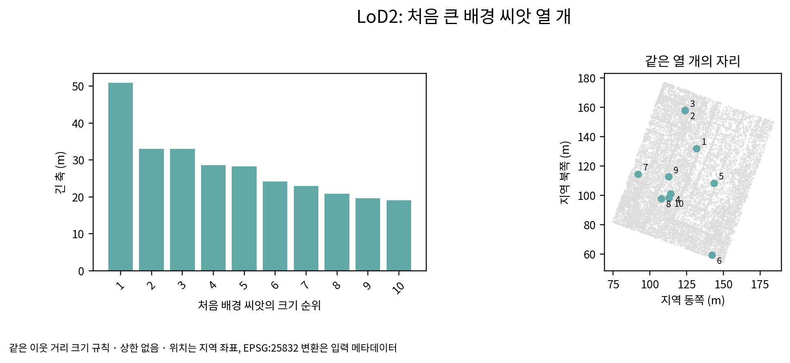

# r7 초기 씨앗 확인

목표에서 사라짐으로 옮긴 패치의 씨앗만 제외했다. 배경 위치와 마스크·솎기 범위는 r6와 같다. 처음 크기는 기준선의 이웃 거리 규칙이며 상한·외톨이 제거를 추가하지 않았다. 사전 씨앗을 뺀 데 따른 이웃 거리의 변화는 허용한 같은 규칙의 결과다.

## ALS

목표 씨앗 50,391개, 배경 씨앗 555,259개. 처음 불투명도는 각각 0.10000000, 0.10000000이며 기준선 기본값과 같다. 처음 1 m 초과 배경은 2,182개다.

| init_id | 동쪽(m) | 북쪽(m) | 높이(m) | 긴 축(m) |
|---:|---:|---:|---:|---:|
| 567614 | 131.726562 | 132.023529 | -151.225327 | 50.927437 |
| 157367 | 123.891296 | 158.091248 | -95.344261 | 33.084427 |
| 576520 | 123.875069 | 157.848083 | -95.384804 | 32.987637 |
| 488699 | 113.971046 | 101.148071 | 77.288132 | 28.580826 |
| 501590 | 143.451340 | 108.429947 | -110.548065 | 28.279034 |
| 579436 | 142.075836 | 59.331642 | -84.370117 | 24.219021 |
| 548207 | 91.951843 | 114.379982 | 54.768940 | 22.960823 |
| 562304 | 107.714462 | 97.848839 | 62.064877 | 20.842552 |
| 568935 | 112.706673 | 112.639961 | 47.824463 | 19.713078 |
| 349036 | 112.867348 | 98.317223 | -117.440247 | 19.141432 |

## LoD2

목표 씨앗 242,139개, 배경 씨앗 408,243개. 처음 불투명도는 각각 0.10000000, 0.10000000이며 기준선 기본값과 같다. 처음 1 m 초과 배경은 2,176개다.

| init_id | 동쪽(m) | 북쪽(m) | 높이(m) | 긴 축(m) |
|---:|---:|---:|---:|---:|
| 610297 | 131.726562 | 132.023529 | -151.225327 | 50.927437 |
| 301661 | 123.891296 | 158.091248 | -95.344261 | 33.084427 |
| 619734 | 123.875069 | 157.848083 | -95.384804 | 32.987637 |
| 528436 | 113.971046 | 101.148071 | 77.288132 | 28.580826 |
| 541432 | 143.451340 | 108.429947 | -110.548065 | 28.279034 |
| 622846 | 142.075836 | 59.331642 | -84.370117 | 24.219021 |
| 589853 | 91.951843 | 114.379982 | 54.768940 | 22.960823 |
| 604610 | 107.714462 | 97.848839 | 62.064877 | 20.842552 |
| 611691 | 112.706673 | 112.639961 | 47.824463 | 19.713078 |
| 414114 | 112.867348 | 98.317223 | -117.440247 | 19.141432 |

`scientific_verdict: null`
