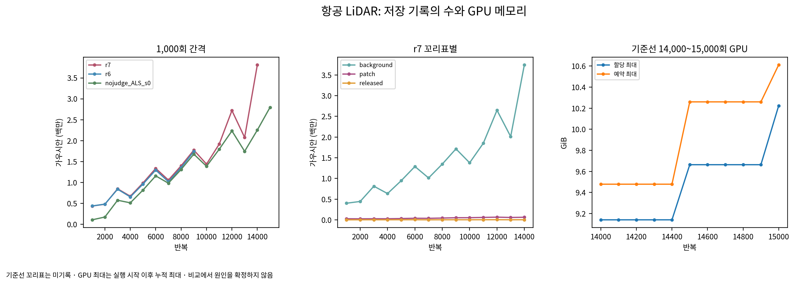

# 항공 LiDAR r7 기록·저장 상태 점검

- 기록: 2026-11-01T21:52:06.837110+09:00. 학습 없음. scientific_verdict: null.
- 21:15 결정 4와 21:50 결정 2를 한 보고로 묶는다. 아래는 측정값이며 원인을 확정하지 않는다.

## 가우시안 수 비교

| 반복 | r7 | 기존 깊이 기준선 | r7 / 기준선 |
|---|---:|---:|---:|
| 14,000 | 3,813,383 | 2,252,255 | 1.693 |
| 14,100 | 4,123,081 | 2,316,383 | 1.780 |

- 기준선 15,000회: 2,796,061개. 14,000~15,000회 기록의 할당 최대 10.223 GiB, 예약 최대 10.611 GiB. 누적 최대 기록이다.
- r7 마지막 건강 기록 14,100회: 4,123,081개, 6,000회 1,335,353개의 3.088배.

| 꼬리표 | 6,000회 | 14,100회 | 배수 |
|---|---:|---:|---:|
| background | 1,289,800 | 4,053,318 | 3.143 |
| patch | 40,612 | 64,904 | 1.598 |
| released | 4,941 | 4,859 | 0.983 |

- 1,000회 전체 표: `tables/continue_r7_ALS_counts_1000.csv`. r6은 9,000회까지. 기준선의 배경·패치·풀림 꼬리표는 저장되지 않아 확인 불가로 둔다. 보호 수를 출신으로 대신 쓰지 않았다.

## 설정·씨앗·다시 붙이기·뜬 면

- r20→r21에서 달라진 파일은 5개다. 전체 파일별 SHA와 줄 차이는 전달 묶음의 `source_differences.json`, `source_changes.diff`에 있다. 설정 차이 29개는 `tables/continue_r7_ALS_config_changes.csv`, 바뀐 파일과 줄은 `tables/continue_r7_ALS_code_changes.json`에 모두 적었다.
- 배경 씨앗 555,259개는 두 판에서 위치가 바이트 단위로 같다. 패치 씨앗은 r6 50,518개, r7 50,391개다. 학습·평가 영상 순서, 7,000회 남은 영상 스택과 저장된 난수 상태는 두 판에서 같았다. 매 반복의 영상 이름은 저장되지 않아 전 구간 순서를 완전 대조할 수는 없다.
- 원본 씨앗 번호로 맞춘 50,391개 사전 씨앗은 초기 위치·크기·불투명도·법선·σ가 같다. 배경 555,259개의 위치·불투명도·법선·σ도 같고 처음 크기는 5개가 다르다. 세부 표는 `tables/continue_r7_ALS_initial_comparison.csv`와 `figures/continue_r7_ALS_initial_comparison.png`다.
- r7 패치 꼬리표 38,133개 중 r6의 0.5 m 규칙이면 47개가 풀린다. r7 목표와 원래 r6 목표를 각각 사용한 두 참고 셈의 수가 같았다.
- 그 47개가 최대 기여인 모든 1,562개 화소를 검사했다. 원본 ALS 격자 접선으로 복원한 뜬 면 패치와 깊이 0.25 m 안에서 연결된 것은 124개 화소, 가우시안 3개다. 면 위 정사각형으로 둔 이전 119화소 계산은 잘못된 면적 가정으로 대체되었으며 보존했다. 패치 면적 밖 화소에는 참값 뜬 면 표지를 추정하지 않았다. 중심 표본만 사용한 이전 참고 셈은 26개 화소·2개 가우시안이다.
- 출신 × 판단 영역 × 목표 반폭의 넓이 표와 그림: `tables/continue_r7_ALS_floating_cross.csv`·JSON, `figures/continue_r7_ALS_floating_cross.png`. 혼합과 확인 불가를 별도로 유지했다.
- 같은 씨앗의 새 학습 반복은 하지 않았다. 저장 상태에서 재개한 겹치는 구간도 모든 기록값이 같지는 않았다. 영상 순서·수·손실 비교는 `resume_and_rng.json`에 있다.

## 추가 학습 상태

- 14,100회의 r7 수는 같은 반복 기준선보다 약 78% 많다. 21:50 결정 3의 후속 결정을 받기 전까지 항공 LiDAR는 재개하지 않는다.
- 이 비교만으로 다시 붙이기 규칙, 실행 흔들림, 메모리 한계의 인과를 확정하지 않는다.

22:20 후속 결정: r7 항공 LiDAR는 다시 잇지 않는다. r21을 보존하고 r22에서 r8을 별도 시작한다. r7의 15,000·30,000회 모델은 없음으로 남긴다. scientific_verdict: null.
